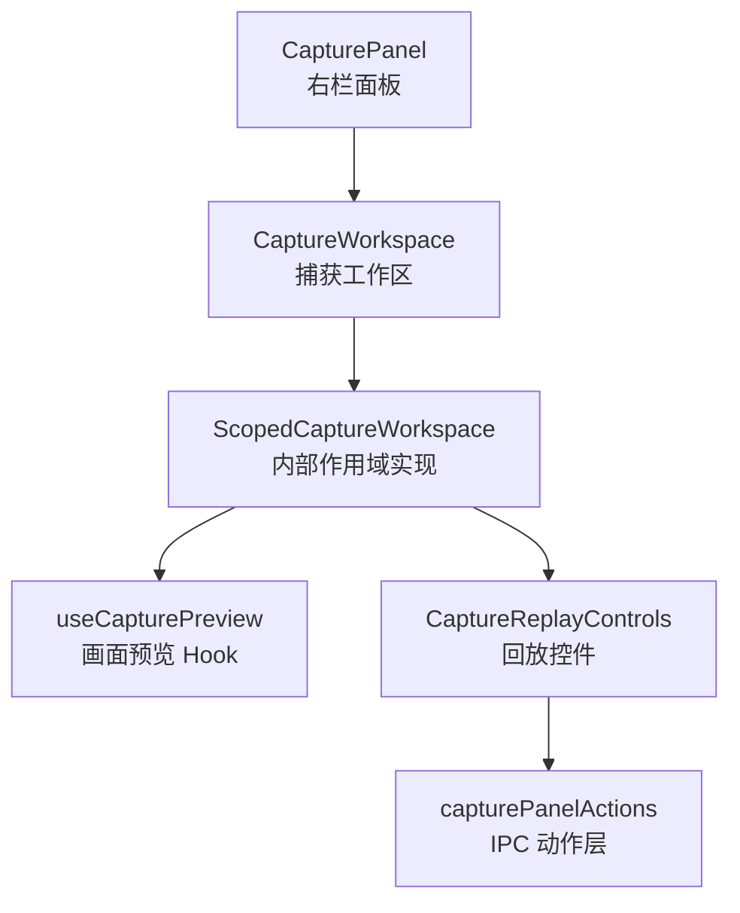
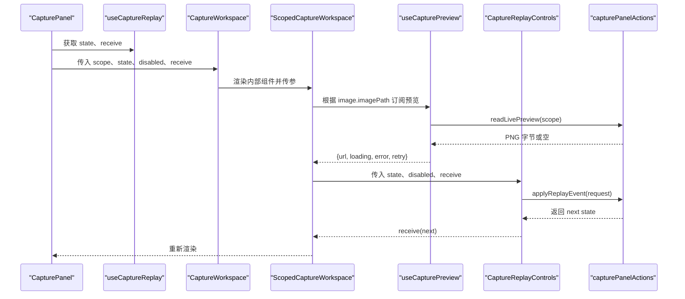
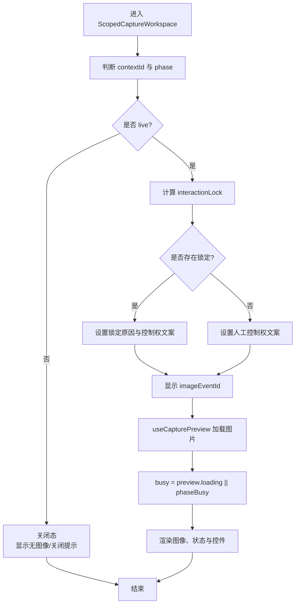
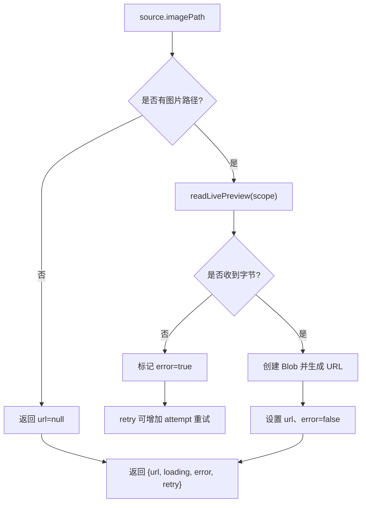
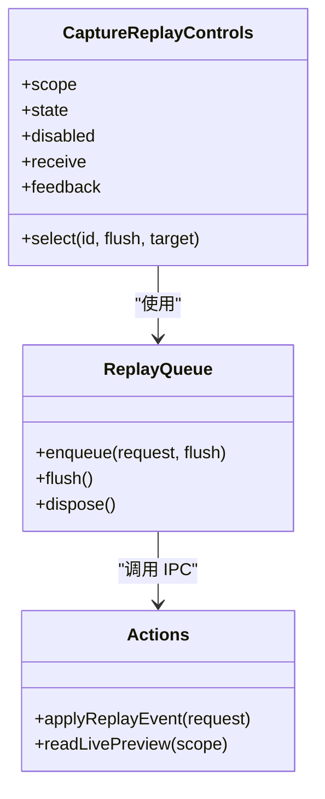
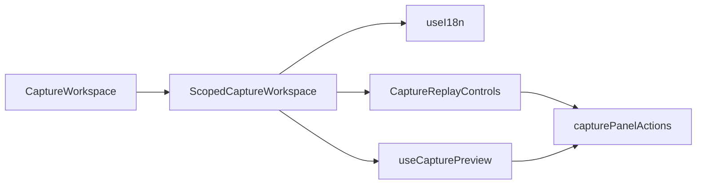

# CaptureWorkspace 组件

<cite>
**本文引用的文件**
- [CaptureWorkspace.tsx](file://src/renderer/features/right-rail/CaptureWorkspace.tsx)
- [useCapturePreview.ts](file://src/renderer/features/right-rail/useCapturePreview.ts)
- [CaptureReplayControls.tsx](file://src/renderer/features/right-rail/CaptureReplayControls.tsx)
- [capturePanelActions.ts](file://src/renderer/features/right-rail/capturePanelActions.ts)
- [CapturePanel.tsx](file://src/renderer/features/right-rail/CapturePanel.tsx)
- [CaptureWorkspace.test.ts](file://src/renderer/features/right-rail/CaptureWorkspace.test.ts)
</cite>

## 目录
1. [简介](#简介)
2. [项目结构与定位](#项目结构与定位)
3. [核心组件与职责](#核心组件与职责)
4. [架构总览](#架构总览)
5. [详细组件分析](#详细组件分析)
6. [依赖关系分析](#依赖关系分析)
7. [性能与渲染特性](#性能与渲染特性)
8. [国际化与无障碍访问](#国际化与无障碍访问)
9. [使用示例](#使用示例)
10. [自定义扩展方法](#自定义扩展方法)
11. [故障排查](#故障排查)
12. [结论](#结论)

## 简介
CaptureWorkspace 是捕获工作区的展示与交互入口。它负责把捕获回放的状态转化为可理解的用户界面，包括：
- 判断当前是否处于“直播式”回放状态；
- 显示当前画面、事件编号和加载状态；
- 根据 interactionLock 决定控件禁用策略与所有权提示；
- 组合预览加载、错误重试与回放控制；
- 提供完整的无障碍标签和国际化文案。

该组件不直接持有业务状态，而是通过父级面板传入的 state 与 receive 回调，配合 useCapturePreview 与 CaptureReplayControls 完成渲染与控制。

## 项目结构与定位
CaptureWorkspace 位于右栏功能模块中，与 CapturePanel、useCaptureReplay、useCapturePreview、CaptureReplayControls 共同构成捕获回放子系统。

**图表来源**
- [CapturePanel.tsx:1-129](file://src/renderer/features/right-rail/CapturePanel.tsx#L1-L129)
- [CaptureWorkspace.tsx:1-47](file://src/renderer/features/right-rail/CaptureWorkspace.tsx#L1-L47)
- [useCapturePreview.ts:1-42](file://src/renderer/features/right-rail/useCapturePreview.ts#L1-L42)
- [CaptureReplayControls.tsx:1-65](file://src/renderer/features/right-rail/CaptureReplayControls.tsx#L1-L65)
- [capturePanelActions.ts:1-21](file://src/renderer/features/right-rail/capturePanelActions.ts#L1-L21)

**章节来源**
- [CapturePanel.tsx:1-129](file://src/renderer/features/right-rail/CapturePanel.tsx#L1-L129)
- [CaptureWorkspace.tsx:1-47](file://src/renderer/features/right-rail/CaptureWorkspace.tsx#L1-L47)

## 核心组件与职责
- CaptureWorkspace：对外暴露的 React 组件，负责 key 稳定化与参数转发。
- ScopedCaptureWorkspace：内部实现，负责 live 判断、busy 计算、ownership 与 lock 策略、当前画面显示、错误反馈与回放控件组合。
- useCapturePreview：读取实时画面字节并生成预览 URL，封装 loading/error/retry。
- CaptureReplayControls：事件编号输入、前后跳转、滑块、目标通道选择、队列化回放请求。
- capturePanelActions：统一 Electron IPC 调用入口，如 applyReplayEvent、readLivePreview、refreshFrame 等。

**章节来源**
- [CaptureWorkspace.tsx:1-47](file://src/renderer/features/right-rail/CaptureWorkspace.tsx#L1-L47)
- [useCapturePreview.ts:1-42](file://src/renderer/features/right-rail/useCapturePreview.ts#L1-L42)
- [CaptureReplayControls.tsx:1-65](file://src/renderer/features/right-rail/CaptureReplayControls.tsx#L1-L65)
- [capturePanelActions.ts:1-21](file://src/renderer/features/right-rail/capturePanelActions.ts#L1-L21)

## 架构总览
CaptureWorkspace 的生命周期由父级 CapturePanel 管理的 useCaptureReplay 驱动。父面板获取 state，并通过 props 传给 CaptureWorkspace；CaptureWorkspace 再向下传递 scope、state、disabled 与 receive。

**图表来源**
- [CapturePanel.tsx:1-129](file://src/renderer/features/right-rail/CapturePanel.tsx#L1-L129)
- [CaptureWorkspace.tsx:1-47](file://src/renderer/features/right-rail/CaptureWorkspace.tsx#L1-L47)
- [useCapturePreview.ts:1-42](file://src/renderer/features/right-rail/useCapturePreview.ts#L1-L42)
- [CaptureReplayControls.tsx:1-65](file://src/renderer/features/right-rail/CaptureReplayControls.tsx#L1-L65)
- [capturePanelActions.ts:1-21](file://src/renderer/features/right-rail/capturePanelActions.ts#L1-L21)

## 详细组件分析

### CaptureWorkspace 组件接口
CaptureWorkspace 接收以下 props：
- scope：捕获作用域，包含 projectId 与 sessionId。
- state：CaptureReplayState 或 null，描述回放上下文、阶段、事件序列、图像与锁定信息。
- disabled：外部禁用标志，通常来自父面板的 busy/lock 计算结果。
- receive：状态更新回调，用于向父级回写新的回放状态。

组件对外仅暴露一个函数组件，内部使用 key 强制在 scope 或图像版本变化时重建实例，避免旧状态污染。

**章节来源**
- [CaptureWorkspace.tsx:1-14](file://src/renderer/features/right-rail/CaptureWorkspace.tsx#L1-L14)

### ScopedCaptureWorkspace 生命周期与状态组合
ScopedCaptureWorkspace 的核心逻辑如下：

1. **live 状态判断**  
   当 state.contextId 存在且 phase 不是 closed 时，视为 live。这是是否显示当前画面、EID、以及启用回放控件的前提。

2. **interactionLock 机制**  
   - 如果存在 interactionLock，则控件整体禁用，并且 ownership 文案与标题提示反映锁定原因。
   - 不同锁类型对应不同国际化键：agent_running、delegated_execution、native_exit_unconfirmed 以及其他未知锁定。
   - 即使被锁定，只要仍为 live，imageEventId 仍会显示，体现“Agent 控制但画面可见”。

3. **当前画面 imageEventId 显示逻辑**  
   - 仅在 live 且 state.imageEventId 不为空时显示 EID。
   - 图片 alt 文本使用 imageEventId，若为空则用占位符，保证屏幕阅读器可读。

4. **busy 状态计算**  
   - preview.loading 表示预览资源加载中。
   - phaseBusy 检查 state.phase 是否为 validating、connecting、transferring、opening、loading_image、closing。
   - busy = preview.loading || phaseBusy，用于 aria-busy 和图片区域加载提示。

5. **错误处理与重试**  
   - useCapturePreview 返回 error 时，渲染错误反馈区域，并提供重试按钮。
   - 重试本质是增加内部 attempt 计数，触发重新读取预览。

6. **控制权归属文案 ownership**  
   - agent_running 或 delegated_execution：显示 Agent 控制。
   - 其他 lock：显示锁定。
   - live 但未锁定：显示人工控制。
   - 非 live：显示关闭状态。

**图表来源**
- [CaptureWorkspace.tsx:15-47](file://src/renderer/features/right-rail/CaptureWorkspace.tsx#L15-L47)

**章节来源**
- [CaptureWorkspace.tsx:15-47](file://src/renderer/features/right-rail/CaptureWorkspace.tsx#L15-L47)

### 预览加载 Hook：useCapturePreview
useCapturePreview 的职责是把 imagePath 转换为浏览器可用的 URL，并管理加载与错误状态：

- 输入：scope 与 source（包含 imagePath、imageRevision）。
- 输出：url、loading、error、retry。
- 关键行为：
  - 使用 JSON.stringify 生成的 key 作为缓存标识，包含 project、session、imagePath、imageRevision 与 retry 次数。
  - 通过 readLivePreview 获取 PNG 字节，构造 Blob 并生成 Object URL。
  - 清理时使用 useEffect 的销毁回调释放 URL。
  - 异常时设置 error，并可通过 retry 再次尝试。

**图表来源**
- [useCapturePreview.ts:1-42](file://src/renderer/features/right-rail/useCapturePreview.ts#L1-L42)

**章节来源**
- [useCapturePreview.ts:1-42](file://src/renderer/features/right-rail/useCapturePreview.ts#L1-L42)

### 回放控件：CaptureReplayControls
CaptureReplayControls 负责用户回放操作，并与 CaptureWorkspace 共享 state：

- 事件编号输入框：支持手动输入、焦点失焦校验。
- 前/后按钮：基于 events 数组索引跳转。
- 滑块：onChange 入队，onPointerUp 刷新队列；键盘方向键也触发刷新。
- 目标通道 Select：可在同一事件中切换 color 输出或 final output。
- 队列机制：createReplayApplyQueue 将多次快速操作合并为一次应用，避免重复请求。
- 反馈文案：区分 requested/shown/applied/synced 状态，并处理设备 presentation 不可用时的提示。

**图表来源**
- [CaptureReplayControls.tsx:1-65](file://src/renderer/features/right-rail/CaptureReplayControls.tsx#L1-L65)
- [capturePanelActions.ts:1-21](file://src/renderer/features/right-rail/capturePanelActions.ts#L1-L21)

**章节来源**
- [CaptureReplayControls.tsx:1-65](file://src/renderer/features/right-rail/CaptureReplayControls.tsx#L1-L65)

### 父级集成：CapturePanel
CapturePanel 负责更高层的状态与 UI：
- 使用 useCaptureReplay 获取 state、selection、connectionError、reload、receive。
- 决定 open/close/refresh/image 等操作，并统一错误状态。
- 组装 CaptureWorkspace，并根据 locked、phaseBusy、action、partial 等决定 disabled。
- 提供更多菜单、设备选择、输入源选择、状态 Chip 与 callouts。

**章节来源**
- [CapturePanel.tsx:1-129](file://src/renderer/features/right-rail/CapturePanel.tsx#L1-L129)

## 依赖关系分析
CaptureWorkspace 及其子组件依赖关系如下：

**图表来源**
- [CaptureWorkspace.tsx:1-47](file://src/renderer/features/right-rail/CaptureWorkspace.tsx#L1-L47)
- [useCapturePreview.ts:1-42](file://src/renderer/features/right-rail/useCapturePreview.ts#L1-L42)
- [CaptureReplayControls.tsx:1-65](file://src/renderer/features/right-rail/CaptureReplayControls.tsx#L1-L65)
- [capturePanelActions.ts:1-21](file://src/renderer/features/right-rail/capturePanelActions.ts#L1-L21)

**章节来源**
- [CaptureWorkspace.tsx:1-47](file://src/renderer/features/right-rail/CaptureWorkspace.tsx#L1-L47)
- [capturePanelActions.ts:1-21](file://src/renderer/features/right-rail/capturePanelActions.ts#L1-L21)

## 性能与渲染特性
- 组件重建策略：CaptureWorkspace 使用 JSON.stringify([projectId, sessionId, captureHash, generation]) 作为 key，确保 scope 或绑定版本变化时重建，避免状态错乱。
- 预览缓存：useCapturePreview 通过 key 包含 imagePath 与 imageRevision，避免不必要的重绘。
- URL 清理：Object URL 在 effect 清理时释放，防止内存泄漏。
- 控件节流：CaptureReplayControls 使用队列合并快速滑动和拖动，减少 IPC 压力。
- 条件渲染：只有 live 才显示 EID 与预览图，减少无效渲染。

[本节为通用性能说明，不直接分析具体代码片段]

## 国际化与无障碍访问
- 国际化：组件大量使用 useI18n 的 t 函数，包括 workspace、control.replay.*、device.local、control.rightRail.capture.* 等键。
- 无障碍：
  - 工具栏使用 role="status"，aria-label 标注工作区语义。
  - 图像区域使用 aria-busy 表达加载状态。
  - 控件组使用 role="group"，aria-label 与 aria-disabled 表达交互状态。
  - 滑块使用 aria-valuetext 提供 EID 可读值。
  - 错误反馈使用 role="alert" 提示用户。

**章节来源**
- [CaptureWorkspace.tsx:15-47](file://src/renderer/features/right-rail/CaptureWorkspace.tsx#L15-L47)
- [CaptureReplayControls.tsx:1-65](file://src/renderer/features/right-rail/CaptureReplayControls.tsx#L1-L65)
- [CapturePanel.tsx:1-129](file://src/renderer/features/right-rail/CapturePanel.tsx#L1-L129)

## 使用示例
在右栏面板中使用 CaptureWorkspace 的标准方式如下：

1. 在 CapturePanel 中通过 useCaptureReplay 获取 state 与 receive。
2. 计算 disabled，考虑 locked、phaseBusy、pending、error 等。
3. 渲染 CaptureWorkspace，传入 scope、state、disabled、receive。
4. 如需打开/关闭捕获输入、刷新设备与输入列表、刷新帧，使用 capturePanelActions 中的 openProjectCaptureInput、clearOpenedCapture、refreshReplayFrame、refreshProjectCaptureInputs、refreshReplayDevices。

参考路径：
- [CapturePanel.tsx:1-129](file://src/renderer/features/right-rail/CapturePanel.tsx#L1-L129)
- [capturePanelActions.ts:1-21](file://src/renderer/features/right-rail/capturePanelActions.ts#L1-L21)

**章节来源**
- [CapturePanel.tsx:1-129](file://src/renderer/features/right-rail/CapturePanel.tsx#L1-L129)
- [capturePanelActions.ts:1-21](file://src/renderer/features/right-rail/capturePanelActions.ts#L1-L21)

## 自定义扩展方法
如果需要扩展 CaptureWorkspace 的行为，建议从以下位置入手：

- 扩展预览加载：
  - 在 useCapturePreview 中增加额外缓存维度，例如添加 deviceId 或 devicePresentation.reason。
  - 在 readLivePreview 失败时记录更详细的错误码，便于上层重试策略差异化。
  - 参考路径：[useCapturePreview.ts:1-42](file://src/renderer/features/right-rail/useCapturePreview.ts#L1-L42)、[capturePanelActions.ts:1-21](file://src/renderer/features/right-rail/capturePanelActions.ts#L1-L21)

- 扩展控制权与锁定展示：
  - 在 ScopedCaptureWorkspace 中新增 interactionLock 分支，添加新的 lockReason 与 ownership 文案。
  - 保持 live 状态下 EID 可见，同时更新 title 与 aria 属性。
  - 参考路径：[CaptureWorkspace.tsx:15-47](file://src/renderer/features/right-rail/CaptureWorkspace.tsx#L15-L47)

- 扩展回放控制：
  - 在 CaptureReplayControls 中增加新的 target 类型或显示策略。
  - 扩展队列行为，例如按 target 分组刷新或限制并发。
  - 参考路径：[CaptureReplayControls.tsx:1-65](file://src/renderer/features/right-rail/CaptureReplayControls.tsx#L1-L65)

- 扩展父级面板：
  - 在 CapturePanel 中增加新的 action，如批量刷新、导出截图、打印 trace projection。
  - 参考路径：[CapturePanel.tsx:1-129](file://src/renderer/features/right-rail/CapturePanel.tsx#L1-L129)

**章节来源**
- [useCapturePreview.ts:1-42](file://src/renderer/features/right-rail/useCapturePreview.ts#L1-L42)
- [capturePanelActions.ts:1-21](file://src/renderer/features/right-rail/capturePanelActions.ts#L1-L21)
- [CaptureWorkspace.tsx:15-47](file://src/renderer/features/right-rail/CaptureWorkspace.tsx#L15-L47)
- [CaptureReplayControls.tsx:1-65](file://src/renderer/features/right-rail/CaptureReplayControls.tsx#L1-L65)
- [CapturePanel.tsx:1-129](file://src/renderer/features/right-rail/CapturePanel.tsx#L1-L129)

## 故障排查
常见问题与定位思路：

- 图片无法加载
  - 检查 useCapturePreview 是否返回 error，确认 imagePath 是否存在。
  - 查看 readLivePreview 是否成功返回字节。
  - 点击重试按钮验证是否恢复。
  - 参考路径：[useCapturePreview.ts:1-42](file://src/renderer/features/right-rail/useCapturePreview.ts#L1-L42)

- 控件始终禁用
  - 检查 interactionLock 是否为 agent_running、delegated_execution 或 native_exit_unconfirmed。
  - 检查父级 disabled 是否因 phaseBusy、action、pending 或 state.error.retry === 'close' 而启用。
  - 参考路径：[CaptureWorkspace.tsx:15-47](file://src/renderer/features/right-rail/CaptureWorkspace.tsx#L15-L47)、[CapturePanel.tsx:1-129](file://src/renderer/features/right-rail/CapturePanel.tsx#L1-L129)

- EID 显示不正确
  - 确认 live 条件：contextId 存在且 phase 不是 closed。
  - 确认 imageEventId 是否为 null。
  - 注意 requestedEventId 与 imageEventId 可能不同，控件显示 requested，图片显示 shown。
  - 参考路径：[CaptureWorkspace.tsx:15-47](file://src/renderer/features/right-rail/CaptureWorkspace.tsx#L15-L47)、[CaptureReplayControls.tsx:1-65](file://src/renderer/features/right-rail/CaptureReplayControls.tsx#L1-L65)

- 测试用例验证
  - 单测覆盖 EID 回放、drag 去抖、Agent 锁定、requested/shown 分离、关闭后控件禁用等行为。
  - 参考路径：[CaptureWorkspace.test.ts:1-98](file://src/renderer/features/right-rail/CaptureWorkspace.test.ts#L1-L98)

**章节来源**
- [useCapturePreview.ts:1-42](file://src/renderer/features/right-rail/useCapturePreview.ts#L1-L42)
- [CaptureWorkspace.tsx:15-47](file://src/renderer/features/right-rail/CaptureWorkspace.tsx#L15-L47)
- [CapturePanel.tsx:1-129](file://src/renderer/features/right-rail/CapturePanel.tsx#L1-L129)
- [CaptureReplayControls.tsx:1-65](file://src/renderer/features/right-rail/CaptureReplayControls.tsx#L1-L65)
- [CaptureWorkspace.test.ts:1-98](file://src/renderer/features/right-rail/CaptureWorkspace.test.ts#L1-L98)

## 结论
CaptureWorkspace 是一个简洁而强大的捕获工作区入口。它将复杂的回放状态拆解为 live、lock、busy、ownership、imageEventId 等直观概念，并通过 useCapturePreview 与 CaptureReplayControls 组合出完整的预览与控制体验。其设计强调：
- 清晰的职责划分：展示、预览、控制、IPC 分层明确；
- 健壮的状态组合：live 与 lock 互不影响，busy 综合多来源；
- 良好的用户体验：国际化、无障碍、错误重试与队列节流；
- 可扩展性：通过父级面板与 Hook 扩展能力。

在实际使用中，应优先通过 CapturePanel 提供的 state 与 receive 集成，谨慎修改 ScopedCaptureWorkspace 的状态组合逻辑，确保 live、lock、busy 与 ownership 保持一致。

[本节为总结性内容，不直接分析具体代码片段]