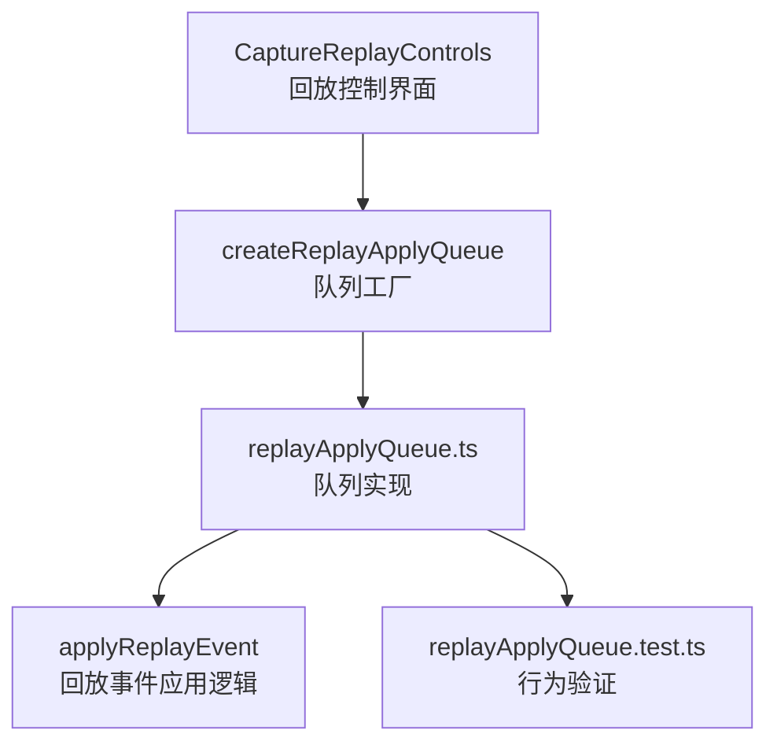
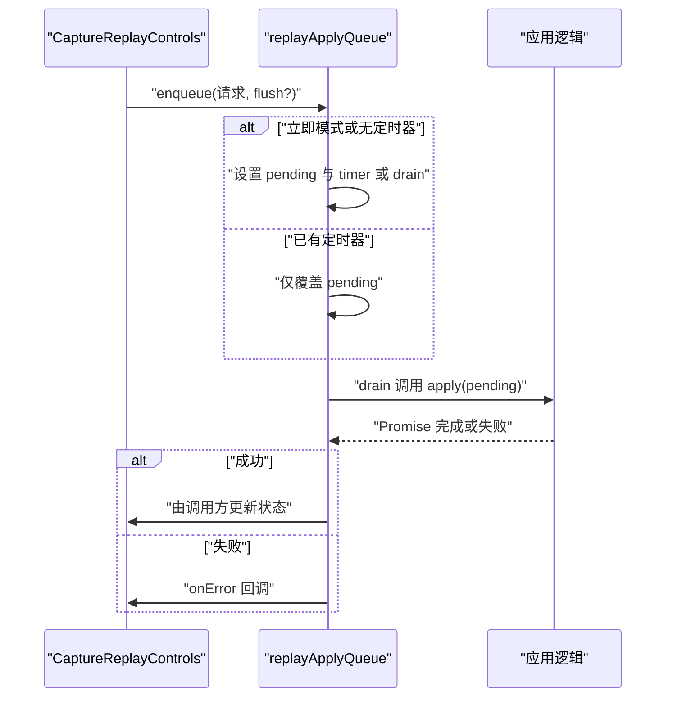
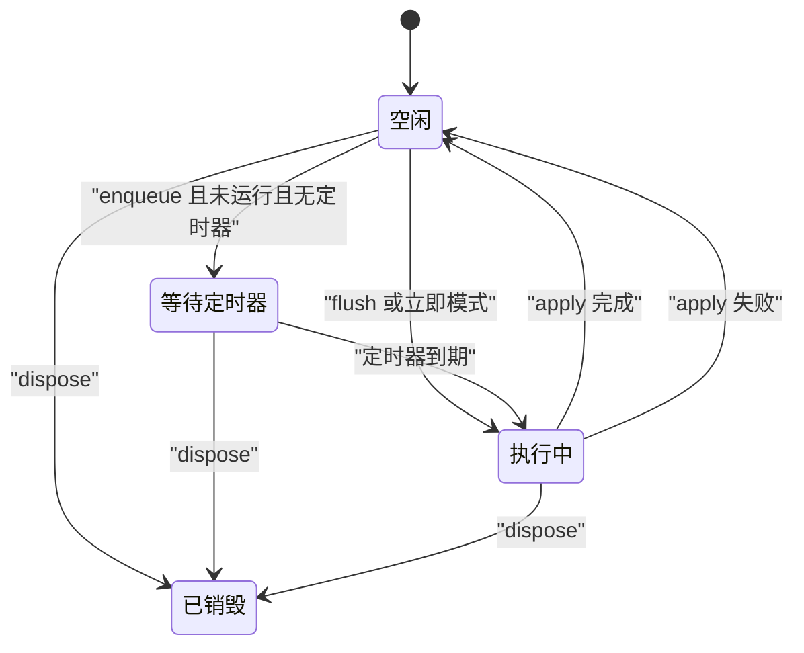
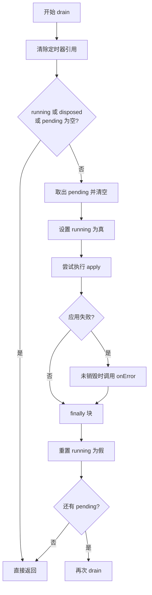
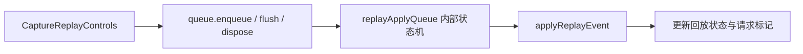

# replayApplyQueue 队列

<cite>
**本文引用的文件**
- [replayApplyQueue.ts](file://src/renderer/features/right-rail/replayApplyQueue.ts)
- [replayApplyQueue.test.ts](file://src/renderer/features/right-rail/replayApplyQueue.test.ts)
- [CaptureReplayControls.tsx](file://src/renderer/features/right-rail/CaptureReplayControls.tsx)
</cite>

## 目录
1. [引言](#引言)
2. [项目结构定位](#项目结构定位)
3. [核心组件总览](#核心组件总览)
4. [架构与调用关系](#架构与调用关系)
5. [工厂函数设计模式](#工厂函数设计模式)
6. [状态模型与单实例执行语义](#状态模型与单实例执行语义)
7. [详细方法分析](#详细方法分析)
8. [异步执行流程与错误处理](#异步执行流程与错误处理)
9. [依赖关系分析](#依赖关系分析)
10. [性能与节流调优](#性能与节流调优)
11. [使用示例](#使用示例)
12. [常见问题与排错](#常见问题与排错)
13. [结论](#结论)

## 引言
replayApplyQueue 是一个面向回放事件应用的轻量级任务队列。它用于在用户频繁触发回放操作时，将多次意图合并为“最新值”，并在保证最多只有一个应用任务运行的前提下，按时间间隔或立即执行。该队列特别适合拖拽、滑动条快速移动、连续切换回放事件等高频输入场景。

其核心目标是：
- 限制同一时刻只运行一个 apply 任务，避免并发冲突。
- 保留最新 pending 值，丢弃中间旧值。
- 支持节流调度与立即 flush 两种模式。
- 提供 dispose 销毁机制，防止组件卸载后继续执行或泄漏定时器。
- 在应用失败时报告错误，并允许后续重试。

## 项目结构定位
replayApplyQueue 位于右侧面板功能模块中，主要服务于捕获回放控制界面：
- 实现文件：`src/renderer/features/right-rail/replayApplyQueue.ts`
- 单元测试：`src/renderer/features/right-rail/replayApplyQueue.test.ts`
- 使用者：`src/renderer/features/right-rail/CaptureReplayControls.tsx`

**图表来源**
- [CaptureReplayControls.tsx:1-65](file://src/renderer/features/right-rail/CaptureReplayControls.tsx#L1-L65)
- [replayApplyQueue.ts:1-35](file://src/renderer/features/right-rail/replayApplyQueue.ts#L1-L35)
- [replayApplyQueue.test.ts:1-58](file://src/renderer/features/right-rail/replayApplyQueue.test.ts#L1-L58)

**章节来源**
- [replayApplyQueue.ts:1-35](file://src/renderer/features/right-rail/replayApplyQueue.ts#L1-L35)
- [replayApplyQueue.test.ts:1-58](file://src/renderer/features/right-rail/replayApplyQueue.test.ts#L1-L58)
- [CaptureReplayControls.tsx:1-65](file://src/renderer/features/right-rail/CaptureReplayControls.tsx#L1-L65)

## 核心组件总览
replayApplyQueue 暴露一个工厂函数 `createReplayApplyQueue`，返回包含三个方法的对象：
- `enqueue(value, flush?)`：入队一个待应用值，支持可选的立即 flush。
- `flush()`：立即执行当前 pending 值（如果尚未运行且没有定时器）。
- `dispose()`：销毁队列，清空 pending、清除定时器，并拒绝后续入队。

工厂参数：
- `apply(value)`：实际执行应用逻辑的异步函数，返回 Promise。
- `onError(error)`：应用失败时的回调。
- `interval`：节流时间间隔，默认 100 毫秒。

**章节来源**
- [replayApplyQueue.ts:1-35](file://src/renderer/features/right-rail/replayApplyQueue.ts#L1-L35)

## 架构与调用关系
回放控制界面通过 useMemo 创建队列实例，并将 UI 交互转换为队列入队请求；队列内部根据 running、disposed、timer 状态决定是立即执行还是延迟执行。

**图表来源**
- [CaptureReplayControls.tsx:1-65](file://src/renderer/features/right-rail/CaptureReplayControls.tsx#L1-L65)
- [replayApplyQueue.ts:1-35](file://src/renderer/features/right-rail/replayApplyQueue.ts#L1-L35)

## 工厂函数设计模式
`createReplayApplyQueue` 采用闭包工厂模式：
- 每次调用都会创建独立的作用域，维护各自的 `pending`、`running`、`disposed`、`timer`。
- 不同 UI 区域可以各自拥有独立的队列实例，互不干扰。
- 工厂对外只暴露稳定的方法接口，隐藏内部状态机细节。
- 通过传入 `apply` 和 `onError`，把具体业务逻辑与调度策略解耦。

这种设计的优点：
- 高内聚：队列的状态与调度逻辑集中在闭包内。
- 低耦合：调用方不需要了解内部定时器和状态转移。
- 易测试：单元测试可以直接注入 mock 的 `apply` 与 `onError`。
- 可复用：不同业务场景可使用不同的 apply 与 onError。

**章节来源**
- [replayApplyQueue.ts:1-35](file://src/renderer/features/right-rail/replayApplyQueue.ts#L1-L35)

## 状态模型与单实例执行语义
队列内部维护以下关键状态：
- `pending`：待执行的最新值，类型为 T 或 undefined。
- `running`：是否正在执行 apply。
- `disposed`：是否已销毁。
- `timer`：setTimeout 返回值，用于节流调度。

单实例执行语义：
- `running` 为 true 时，不会启动新的 drain。
- `pending` 始终保存最新入队值，新值会覆盖旧值。
- 当 apply 完成后，如果仍有 pending 值，会再次 drain。
- disposed 后，所有入队操作直接返回，pending 会被清空，定时器被清理。

**图表来源**
- [replayApplyQueue.ts:1-35](file://src/renderer/features/right-rail/replayApplyQueue.ts#L1-L35)

**章节来源**
- [replayApplyQueue.ts:1-35](file://src/renderer/features/right-rail/replayApplyQueue.ts#L1-L35)

## 详细方法分析

### enqueue：入队与节流
- 若队列已 disposed，直接返回，不记录任何值。
- 每次调用都会把 `pending` 覆盖为新值。
- 如果 flush 为 true 且存在定时器，会清除定时器并进入立即执行路径。
- 如果当前没有在运行且没有定时器，则：
  - flush 为 true 时立即调用 drain。
  - 否则设置 interval 定时器，到点再 drain。

节流作用：
- 短时间内多次入队只会保留最后一个 pending。
- 避免频繁触发 apply，降低后端或渲染压力。

**章节来源**
- [replayApplyQueue.ts:1-35](file://src/renderer/features/right-rail/replayApplyQueue.ts#L1-L35)

### flush：立即执行模式
- 清除现有定时器。
- 如果当前没有在运行，立即调用 drain。
- 如果已经在运行，flush 不会中断当前任务，但 pending 仍保持最新值，当前任务完成后会继续执行。

适用场景：
- 滑块释放、键盘方向键结束、手动确认按钮点击等需要立即落地的操作。

**章节来源**
- [replayApplyQueue.ts:1-35](file://src/renderer/features/right-rail/replayApplyQueue.ts#L1-L35)

### dispose：销毁与资源清理
- 设置 disposed 为 true。
- 清空 pending。
- 清除定时器。
- 之后所有 enqueue 和 flush 都不会触发新的执行。

适用场景：
- React 组件卸载时清理。
- 会话失去所有权或禁用时停止回放。

**章节来源**
- [replayApplyQueue.ts:1-35](file://src/renderer/features/right-rail/replayApplyQueue.ts#L1-L35)

## 异步执行流程与错误处理
drain 的执行流程如下：
1. 清除 timer 引用，避免残留定时器影响后续状态判断。
2. 如果 running、disposed 或 pending 不存在，直接返回。
3. 取出 pending 并重置为 undefined。
4. 设置 running 为 true。
5. try 中调用 apply(value)。
6. catch 中仅在未 disposed 时调用 onError。
7. finally 中重置 running，并检查是否还有 pending，如果有则递归 drain。

错误处理要点：
- 应用失败不会阻塞后续入队。
- onError 负责上报错误，例如 UI 层显示错误消息。
- dispose 后不再调用 onError，避免卸载后的副作用。

**图表来源**
- [replayApplyQueue.ts:1-35](file://src/renderer/features/right-rail/replayApplyQueue.ts#L1-L35)

**章节来源**
- [replayApplyQueue.ts:1-35](file://src/renderer/features/right-rail/replayApplyQueue.ts#L1-L35)

## 依赖关系分析
replayApplyQueue 的实现本身非常轻量，几乎没有外部依赖：
- 仅使用 JavaScript 内置的 setTimeout、clearTimeout 和 async/await。
- 对上层来说，它依赖的是两个回调：
  - `apply`：具体回放事件应用逻辑。
  - `onError`：错误上报与 UI 状态恢复。

调用链关系：
- CaptureReplayControls 创建队列实例。
- 用户交互触发 select 或 slider 事件。
- select 封装成回放请求并调用 queue.enqueue。
- 队列在合适时机调用 applyReplayEvent。
- 应用成功后更新状态，失败时设置错误信息。

**图表来源**
- [CaptureReplayControls.tsx:1-65](file://src/renderer/features/right-rail/CaptureReplayControls.tsx#L1-L65)
- [replayApplyQueue.ts:1-35](file://src/renderer/features/right-rail/replayApplyQueue.ts#L1-L35)

**章节来源**
- [CaptureReplayControls.tsx:1-65](file://src/renderer/features/right-rail/CaptureReplayControls.tsx#L1-L65)
- [replayApplyQueue.ts:1-35](file://src/renderer/features/right-rail/replayApplyQueue.ts#L1-L35)

## 性能与节流调优
建议与注意事项：
- 合理设置 interval：
  - 过小会导致频繁触发 apply，增加网络或渲染开销。
  - 过大会导致用户感知延迟，尤其在拖拽过程中。
  - 默认 100 毫秒适合大多数回放拖动场景。
- 高频交互使用节流：
  - 滑块移动时尽量使用 enqueue 默认节流模式。
  - 只在明确需要立即执行时使用 flush 或 flush=true。
- 避免重复应用：
  - pending 覆盖策略保证只执行最新值。
  - running 保证同一时刻只有一个任务。
- 及时 dispose：
  - 组件卸载、禁用、会话丢失时都应调用 dispose。
  - 防止定时器泄漏和无效回调。
- 错误恢复：
  - onError 中应清除请求标记，让用户能重新选择事件。
  - 不要因单次失败而阻止后续入队。

**章节来源**
- [replayApplyQueue.ts:1-35](file://src/renderer/features/right-rail/replayApplyQueue.ts#L1-L35)
- [replayApplyQueue.test.ts:1-58](file://src/renderer/features/right-rail/replayApplyQueue.test.ts#L1-L58)
- [CaptureReplayControls.tsx:1-65](file://src/renderer/features/right-rail/CaptureReplayControls.tsx#L1-L65)

## 使用示例
以下是基于仓库中使用方式的说明性示例，不直接展示代码内容：

- 创建队列：
  - 传入 apply 函数，内部调用 `applyReplayEvent`。
  - 传入 onError 函数，内部设置错误消息并清空请求标记。
  - 使用 useMemo 创建实例，绑定 scope、state generation、receive 等依赖。

- 入队回放请求：
  - select 函数构造回放请求对象。
  - 校验 disabled、state、events。
  - 调用 queue.enqueue，并传入 flush=false 作为默认节流。

- 立即执行：
  - 上一个、下一个按钮点击时传入 flush=true。
  - 滑块 onPointerUp 和特定键盘事件结束后调用 queue.flush。

- 生命周期清理：
  - useEffect 返回 dispose，确保组件卸载时清理。
  - disabled 变化时也主动 dispose 并清理请求状态。

这些用法可以在以下文件中找到对应实现：
- 队列创建与错误处理：[CaptureReplayControls.tsx:1-65](file://src/renderer/features/right-rail/CaptureReplayControls.tsx#L1-L65)
- 队列 API 定义：[replayApplyQueue.ts:1-35](file://src/renderer/features/right-rail/replayApplyQueue.ts#L1-L35)

**章节来源**
- [CaptureReplayControls.tsx:1-65](file://src/renderer/features/right-rail/CaptureReplayControls.tsx#L1-L65)
- [replayApplyQueue.ts:1-35](file://src/renderer/features/right-rail/replayApplyQueue.ts#L1-L35)

## 常见问题与排错
常见问题及解决方案：

1. 为什么多次快速入队只执行了一次？
   - 这是预期的节流与合并行为。pending 只保留最新值，只有定时器到期或 flush 才会执行。
   - 参考测试用例中的合并与最终值行为。

2. 为什么 flush 没有立即执行？
   - 如果当前已经有 apply 在执行，flush 不会中断它。
   - 当前任务完成后，pending 仍会再次执行。

3. 为什么 dispose 后入队无效？
   - dispose 会设置 disposed 标志，清空 pending 并清除定时器。
   - 之后所有 enqueue 直接返回，避免副作用。

4. 应用失败后还能继续入队吗？
   - 可以。错误只触发 onError，不会阻止后续入队。
   - 建议在 onError 中清理 UI 的请求状态。

5. 如何调试定时器行为？
   - 单元测试中使用 fake timers 模拟时间推进。
   - 关注 advanceTimersByTimeAsync 与 runAllTimersAsync 的行为。

相关验证依据：
- 刷新一次 intent 且不重复执行：[replayApplyQueue.test.ts:1-58](file://src/renderer/features/right-rail/replayApplyQueue.test.ts#L1-L58)
- 拖拽合并与 in-flight 后执行最新值：[replayApplyQueue.test.ts:1-58](file://src/renderer/features/right-rail/replayApplyQueue.test.ts#L1-L58)
- 销毁后丢弃 pending：[replayApplyQueue.test.ts:1-58](file://src/renderer/features/right-rail/replayApplyQueue.test.ts#L1-L58)
- 应用失败仍接受新意图：[replayApplyQueue.test.ts:1-58](file://src/renderer/features/right-rail/replayApplyQueue.test.ts#L1-L58)

**章节来源**
- [replayApplyQueue.test.ts:1-58](file://src/renderer/features/right-rail/replayApplyQueue.test.ts#L1-L58)
- [replayApplyQueue.ts:1-35](file://src/renderer/features/right-rail/replayApplyQueue.ts#L1-L35)

## 结论
replayApplyQueue 是一个简洁而稳健的回放任务调度器。它通过闭包工厂封装状态，利用 pending 覆盖策略实现值合并，通过 running 保护实现单实例执行，并通过 dispose 保障资源安全。配合 interval 节流与 flush 立即模式，既能应对高频交互，又能保证最终一致性。在 CaptureReplayControls 中，它与回放事件应用逻辑紧密结合，提供了良好的用户体验与可维护性。