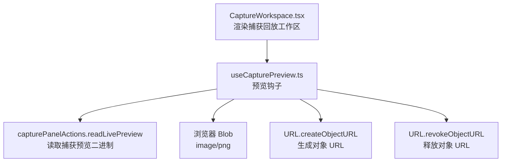
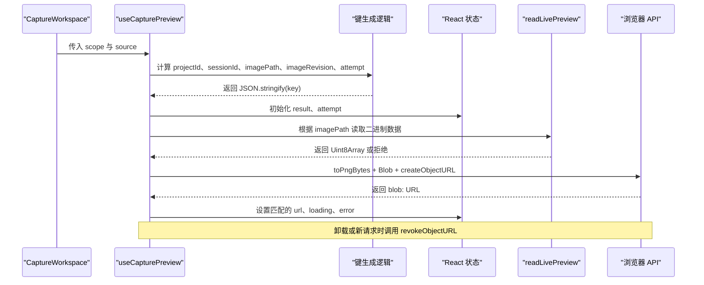
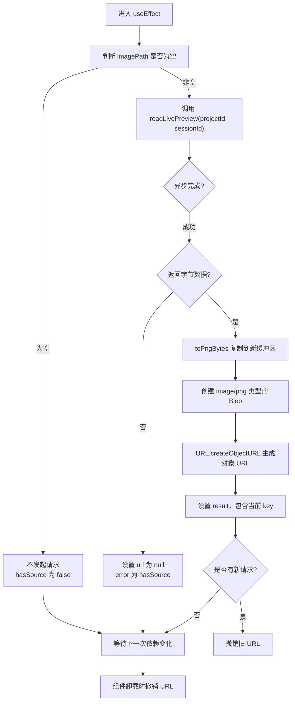
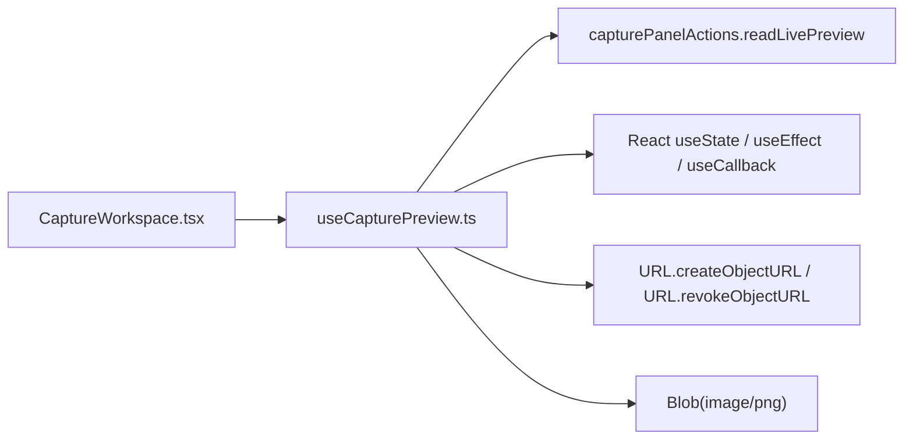

# useCapturePreview 钩子

<cite>
**本文引用的文件**   
- [useCapturePreview.ts](file://src/renderer/features/right-rail/useCapturePreview.ts)
- [useCapturePreview.test.ts](file://src/renderer/features/right-rail/useCapturePreview.test.ts)
- [CaptureWorkspace.tsx](file://src/renderer/features/right-rail/CaptureWorkspace.tsx)
- [README.md](file://src/renderer/features/right-rail/README.md)
</cite>

## 目录
1. [引言](#引言)
2. [项目结构定位](#项目结构定位)
3. [核心职责与对外接口](#核心职责与对外接口)
4. [架构总览](#架构总览)
5. [详细实现分析](#详细实现分析)
6. [依赖关系分析](#依赖关系分析)
7. [性能与内存管理](#性能与内存管理)
8. [故障排除指南](#故障排除指南)
9. [结论](#结论)

## 引言
`useCapturePreview` 是右侧面板 Capture 工作区中用于加载、缓存和刷新捕获预览图的 React 钩子。它封装了从主进程或回放数据源读取 PNG 二进制数据、将其转换为浏览器对象 URL、处理异步请求失败、重试以及组件卸载时释放资源的完整生命周期。该钩子的设计目标是：在捕获会话变化、图片路径变化、版本变更或用户主动重试时，安全地切换预览图，避免过时结果污染当前 UI，并防止 `URL.createObjectURL` 造成内存泄漏。

## 项目结构定位
该钩子位于渲染端右栏功能模块中，由 `CaptureWorkspace` 组件消费，并通过 `capturePanelActions` 中的 `readLivePreview` 获取底层二进制数据。测试文件覆盖了同 EID 替换、重试、迟到结果隔离以及会话切换时的资源清理行为。

**图表来源**
- [useCapturePreview.ts:1-42](file://src/renderer/features/right-rail/useCapturePreview.ts#L1-L42)
- [CaptureWorkspace.tsx:1-47](file://src/renderer/features/right-rail/CaptureWorkspace.tsx#L1-L47)

**章节来源**
- [useCapturePreview.ts:1-42](file://src/renderer/features/right-rail/useCapturePreview.ts#L1-L42)
- [CaptureWorkspace.tsx:1-47](file://src/renderer/features/right-rail/CaptureWorkspace.tsx#L1-L47)
- [README.md:1-13](file://src/renderer/features/right-rail/README.md#L1-L13)

## 核心职责与对外接口
`useCapturePreview(scope, source)` 接收两个参数：

| 参数 | 类型 | 含义 |
|---|---|---|
| `scope` | `CaptureScope` | 提供 `projectId` 和 `sessionId`，用于标识一次捕获请求的作用域 |
| `source` | `{ imagePath?: string \| null; imageRevision?: number }` | 描述当前预览来源；`imagePath` 为空表示没有预览图，`imageRevision` 用于区分同一图片路径的更新版本 |

返回值为一个状态对象：

| 字段 | 类型 | 含义 |
|---|---|---|
| `url` | `string \| null` | 当前渲染的预览对象 URL；当本次异步请求尚未完成或被新版本覆盖时返回 `null` |
| `loading` | `boolean` | 是否存在有效图片来源且当前请求尚未得到匹配的结果 |
| `error` | `boolean` | 上一次已完成的请求是否处于错误状态 |
| `retry` | `() => void` | 触发重新加载的回调，内部通过递增 `attempt` 状态驱动重新请求 |

对外暴露的关键行为如下：

1. **加载控制**：只有当 `imagePath` 存在时才发起请求；没有图片来源时不加载，也不报错。
2. **缓存语义**：以 `key` 作为“本次请求身份”；只有与该 key 匹配的异步结果才会被渲染。
3. **刷新机制**：`projectId`、`sessionId`、`imagePath`、`imageRevision` 或 `attempt` 任一变化都会触发重新加载。
4. **重试能力**：通过 `retry` 将 `attempt` 加一，使 key 改变并重新发起请求。
5. **资源清理**：组件卸载或新的请求开始时，会撤销上一个有效的 `objectUrl`。

**章节来源**
- [useCapturePreview.ts:1-42](file://src/renderer/features/right-rail/useCapturePreview.ts#L1-L42)
- [CaptureWorkspace.tsx:10-47](file://src/renderer/features/right-rail/CaptureWorkspace.tsx#L10-L47)

## 架构总览
下图展示了从组件到钩子、再到二进制数据和浏览器对象 URL 的调用链：

**图表来源**
- [useCapturePreview.ts:1-42](file://src/renderer/features/right-rail/useCapturePreview.ts#L1-L42)
- [CaptureWorkspace.tsx:10-47](file://src/renderer/features/right-rail/CaptureWorkspace.tsx#L10-L47)

## 详细实现分析

### 二进制数据处理函数 `toPngBytes`
`toPngBytes` 接收一个 `Uint8Array`，创建一个相同长度的新 `Uint8Array`，并将原始数据拷贝到新数组后返回。其设计意图是：

- 为后续 `new Blob([bytes], { type: 'image/png' })` 提供一个可独立管理的字节视图。
- 在测试中用于确认读取流程不会直接修改原始输入数组，而是通过复制方式参与后续构造。
- 时间复杂度为 O(n)，空间复杂度为 O(n)，其中 n 为 PNG 字节长度。

该函数本身不执行图像解码或转码，仅负责字节缓冲的安全复制，真正的图像编码由二进制数据来源保证为 PNG。

**章节来源**
- [useCapturePreview.ts:4-7](file://src/renderer/features/right-rail/useCapturePreview.ts#L4-L7)
- [useCapturePreview.test.ts:1-75](file://src/renderer/features/right-rail/useCapturePreview.test.ts#L1-L75)

### key 生成策略
key 由以下五个值按固定顺序组成：

1. `projectId`：来自 `scope.projectId`。
2. `sessionId`：来自 `scope.sessionId`。
3. `imagePath`：来自 `source.imagePath`，空值会被归一化为 `null`。
4. `imageRevision`：来自 `source.imageRevision`，用于区分同一图片路径的新旧版本。
5. `attempt`：重试计数器，初始为 0，每次点击重试递增。

最终使用 `JSON.stringify([...])` 生成字符串 key。这个 key 有两个作用：

- 作为 `useEffect` 依赖的一部分，确保关键上下文变化时重新执行加载逻辑。
- 作为“请求身份”标记：只有 `result.key === key` 的结果才会被渲染，从而丢弃异步延迟或重试过程中产生的过时结果。

这种策略的优点是简单可靠；缺点是 key 随 `attempt` 增长而不断变化，因此 `result` 状态始终只保留最近一次请求的身份，而不是传统意义上的“持久缓存”。

**章节来源**
- [useCapturePreview.ts:12-20](file://src/renderer/features/right-rail/useCapturePreview.ts#L12-L20)

### 加载、缓存与刷新机制
钩子内部维护两个主要状态：

| 状态 | 用途 |
|---|---|
| `result` | 保存最近一次已完成请求的 `{ key, url, error }` |
| `attempt` | 记录重试次数，初始为 0 |

加载流程如下：

**图表来源**
- [useCapturePreview.ts:12-42](file://src/renderer/features/right-rail/useCapturePreview.ts#L12-L42)

关键点说明：

- `active` 标志用于防止组件卸载后继续写入状态。
- `objectUrl` 局部变量保存当前请求生成的对象 URL，便于清理。
- `requestScope` 只包含 `projectId` 和 `sessionId`，说明二进制读取逻辑基于会话级上下文，而非图片路径。
- 如果返回的 `bytes` 为空，则把 `error` 设置为 `hasSource`：即“有图片来源但读不到数据”视为错误，“根本没有图片来源”不视为错误。
- 如果异步抛出异常，则设置 `error: true`，并且 `url` 为 `null`。
- 依赖数组中包含 `projectId`、`sessionId`、`imagePath`、`key`、`hasSource`。由于 `key` 已经包含前四项，显式重复声明部分依赖项属于防御性写法，不会破坏行为，但会增加理解成本。

**章节来源**
- [useCapturePreview.ts:12-42](file://src/renderer/features/right-rail/useCapturePreview.ts#L12-L42)

### URL.createObjectURL 与内存泄漏防护
每次成功读取二进制数据后，钩子会：

1. 用 `toPngBytes(bytes)` 获得可安全使用的字节数组。
2. 包装成 `Blob`，类型为 `image/png`。
3. 调用 `URL.createObjectURL` 生成浏览器内部的 `blob:` URL。
4. 将该 URL 放入 `result.url`。

内存泄漏防护体现在三个位置：

| 场景 | 防护措施 |
|---|---|
| 组件卸载 | `useEffect` 清理函数中将 `active` 设为 `false`，并撤销当前 `objectUrl` |
| 新请求开始 | 如果已有 `objectUrl`，在设置新结果前撤销旧 URL |
| 无效结果 | 如果 `bytes` 为空或请求失败，不创建对象 URL，避免无意义占用 |

测试文件明确断言：同 EID 替换时会撤销旧 URL；会话切换时不会撤销仍在渲染的图片；组件卸载后会撤销当前渲染的图片。

**章节来源**
- [useCapturePreview.ts:21-42](file://src/renderer/features/right-rail/useCapturePreview.ts#L21-L42)
- [useCapturePreview.test.ts:1-75](file://src/renderer/features/right-rail/useCapturePreview.test.ts#L1-L75)

### 重试机制与 attempt 状态
`retry` 是一个稳定回调，内部仅调用 `setAttempt(prev => prev + 1)`。它不直接调用 `readLivePreview`，而是通过改变 `attempt` 来改变 `key`，从而触发 `useEffect` 重新执行。

优势：

- 重试逻辑与副作用解耦。
- 重试会生成新的 key，确保旧请求结果不会被覆盖到新的渲染帧。
- 父组件可以决定是否显示重试按钮，例如 `CaptureWorkspace` 仅在 `preview.error` 时显示。

限制：

- 当前实现没有最大重试次数、退避间隔或并发控制。
- 频繁快速点击重试可能产生多个并发请求，但只有最新 key 对应的结果会生效。

**章节来源**
- [useCapturePreview.ts:9-11](file://src/renderer/features/right-rail/useCapturePreview.ts#L9-L11)
- [CaptureWorkspace.tsx:36-47](file://src/renderer/features/right-rail/CaptureWorkspace.tsx#L36-L47)

### loading、error、retry 状态管理
返回值中的三个布尔字段都基于 `result` 与 `key` 的比较：

| 状态 | 计算逻辑 | 业务含义 |
|---|---|---|
| `url` | `result?.key === key ? result.url : null` | 只有当前请求的结果才可见 |
| `loading` | `hasSource && result?.key !== key` | 有图片来源但还没有匹配结果 |
| `error` | `result?.key === key && result.error` | 最近一次匹配请求失败 |
| `retry` | `() => setAttempt(prev => prev + 1)` | 触发重新加载 |

注意：当 `imagePath` 不存在时，`loading` 永远为 `false`，因为 `hasSource` 为 `false`。这是合理的设计：没有图片来源不应显示加载态。

**章节来源**
- [useCapturePreview.ts:28-42](file://src/renderer/features/right-rail/useCapturePreview.ts#L28-L42)

### 异步请求的错误处理
错误分为两类：

1. **返回值为空**：`bytes` 为 falsy 时，直接设置 `error: hasSource`。这意味着“有图片却读不到”是错误，“没有图片”不是错误。
2. **异步异常**：`load().catch(...)` 捕获抛出的错误，并设置 `error: true`。

这两类错误都会清空 `url`，并让 `loading` 变为 `false`，因为此时 `result.key === key` 成立，但 `url` 为 `null`。

**章节来源**
- [useCapturePreview.ts:21-33](file://src/renderer/features/right-rail/useCapturePreview.ts#L21-L33)

### 组件卸载时的资源清理
清理逻辑包括：

- 将 `active` 设为 `false`，阻止后续 `setResult` 更新状态。
- 撤销当前有效的 `objectUrl`，避免浏览器保留对 Blob 的引用。
- 对于新请求，在设置结果前检查 `active`，若已失效则立即撤销刚创建的 URL。

这保证了即使异步请求在组件卸载后完成，也不会泄露 URL，也不会更新已卸载组件的状态。

**章节来源**
- [useCapturePreview.ts:21-42](file://src/renderer/features/right-rail/useCapturePreview.ts#L21-L42)
- [useCapturePreview.test.ts:1-75](file://src/renderer/features/right-rail/useCapturePreview.test.ts#L1-L75)

## 依赖关系分析

**图表来源**
- [useCapturePreview.ts:1-42](file://src/renderer/features/right-rail/useCapturePreview.ts#L1-L42)
- [CaptureWorkspace.tsx:1-47](file://src/renderer/features/right-rail/CaptureWorkspace.tsx#L1-L47)

耦合关系说明：

- `useCapturePreview` 与 `capturePanelActions` 存在强依赖：二进制读取逻辑不在钩子内实现。
- 钩子与 React Hooks 紧密耦合，符合现代 React 模式。
- 钩子与浏览器 API 耦合，因此不能在服务端渲染环境中直接使用。
- `CaptureWorkspace` 只消费钩子返回的公开状态，不直接访问二进制数据或 URL 生命周期。

**章节来源**
- [useCapturePreview.ts:1-42](file://src/renderer/features/right-rail/useCapturePreview.ts#L1-L42)
- [CaptureWorkspace.tsx:1-47](file://src/renderer/features/right-rail/CaptureWorkspace.tsx#L1-L47)

## 性能与内存管理

### 性能特征
| 方面 | 分析 |
|---|---|
| 时间复杂度 | `toPngBytes` 为 O(n)；Blob 与 URL 构造接近 O(1)；整体受网络或主进程 I/O 影响更大 |
| 空间复杂度 | 额外复制一份 PNG 字节数组，峰值内存约为原始数据的两倍 |
| 渲染频率 | 每次 `projectId`、`sessionId`、`imagePath`、`imageRevision`、`attempt` 变化时重新执行 effect |
| 并发控制 | 未实现限流或去抖，快速重试可能产生多个并发请求 |
| 缓存策略 | 基于请求 identity 的临时缓存，不是跨请求的全局缓存 |

### 优化建议
1. **避免不必要的重试**：在父组件层面对 `retry` 做节流，例如短时间内禁止重复点击。
2. **取消陈旧请求**：可使用 `AbortController` 或类似机制，在 key 变化时主动取消未完成请求，减少无用 I/O。
3. **合并依赖项**：当前依赖数组同时包含 `imagePath`、`key`、`hasSource`，可考虑精简以减少不必要的 effect 重建。
4. **限制重试次数**：增加最大重试次数和指数退避，避免后端或主进程压力过大。
5. **大图分块加载**：如果未来需要支持超大捕获图，可考虑缩略图优先、原图懒加载。
6. **URL 生命周期集中化**：可将 `createObjectURL` 与 `revokeObjectURL` 封装为自定义 Hook，统一资源管理。

### 内存泄漏防护清单
- 组件卸载时撤销当前 URL。
- 新请求开始前撤销旧 URL。
- 异步失败或不返回字节时不创建 URL。
- 通过 `active` 标志防止卸载后写入状态。
- 测试中验证了同 EID 替换、会话切换和卸载时的撤销行为。

**章节来源**
- [useCapturePreview.ts:1-42](file://src/renderer/features/right-rail/useCapturePreview.ts#L1-L42)
- [useCapturePreview.test.ts:1-75](file://src/renderer/features/right-rail/useCapturePreview.test.ts#L1-L75)

## 故障排除指南

### 预览图一直显示加载中
可能原因：

- `imagePath` 为空，但上层仍期望显示加载态。
- `readLivePreview` 长时间未完成。
- 请求被新 key 覆盖，导致 `result.key !== key`。

排查步骤：

1. 检查 `source.imagePath` 是否真实存在。
2. 检查 `readLivePreview` 是否返回 Promise 但未 resolve。
3. 观察 `imageRevision` 或 `attempt` 是否频繁变化，导致 key 不断重置。

**章节来源**
- [useCapturePreview.ts:12-20](file://src/renderer/features/right-rail/useCapturePreview.ts#L12-L20)
- [useCapturePreview.ts:28-42](file://src/renderer/features/right-rail/useCapturePreview.ts#L28-L42)

### 预览图显示错误
可能原因：

- `readLivePreview` 返回空数据。
- `readLivePreview` 抛出异常。
- `imagePath` 存在但实际无输出。

排查步骤：

1. 确认 `hasSource` 是否为 `true`。
2. 检查 `readLivePreview` 的 mock 或真实实现是否正确返回字节数据。
3. 点击 `retry` 重试，观察是否能恢复。

**章节来源**
- [useCapturePreview.ts:21-33](file://src/renderer/features/right-rail/useCapturePreview.ts#L21-L33)
- [CaptureWorkspace.tsx:36-47](file://src/renderer/features/right-rail/CaptureWorkspace.tsx#L36-L47)

### 图片闪烁或短暂显示旧图
可能原因：

- 异步结果到达顺序与预期不一致。
- `imageRevision` 或 `attempt` 变化过快。
- 同 EID 替换时未及时撤销旧 URL。

排查步骤：

1. 检查测试用例中关于“同 EID 替换”和“迟到结果隔离”的行为。
2. 确认 `key` 是否包含 `imageRevision`。
3. 检查是否出现多次并发重试。

**章节来源**
- [useCapturePreview.test.ts:1-75](file://src/renderer/features/right-rail/useCapturePreview.test.ts#L1-L75)
- [useCapturePreview.ts:12-42](file://src/renderer/features/right-rail/useCapturePreview.ts#L12-L42)

### 内存泄漏或浏览器警告
可能原因：

- 手动创建 `blob:` URL 后忘记撤销。
- 组件卸载时仍有活跃请求。
- 新旧 URL 共存。

排查步骤：

1. 不要绕过钩子直接操作 `URL.createObjectURL`。
2. 确认组件卸载路径能执行清理函数。
3. 参考测试中对 `URL.revokeObjectURL` 的断言。

**章节来源**
- [useCapturePreview.ts:21-42](file://src/renderer/features/right-rail/useCapturePreview.ts#L21-L42)
- [useCapturePreview.test.ts:1-75](file://src/renderer/features/right-rail/useCapturePreview.test.ts#L1-L75)

## 结论
`useCapturePreview` 是一个面向捕获预览的小而完整的 React 钩子。它以 `projectId`、`sessionId`、`imagePath`、`imageRevision`、`attempt` 组合的 key 作为请求身份，结合 `useState`、`useEffect` 和 `useCallback` 实现了安全的加载、刷新、重试和资源清理。`toPngBytes` 通过复制字节数组保障二进制数据处理的可控性；`URL.createObjectURL` 与 `URL.revokeObjectURL` 配合确保对象 URL 的生命周期正确。虽然当前实现没有内置并发控制和重试上限，但它的对外接口清晰，适合在 Capture 工作区中复用，并通过父组件进一步扩展健壮性。