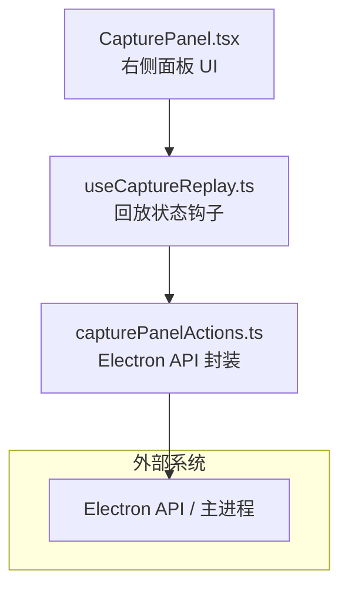
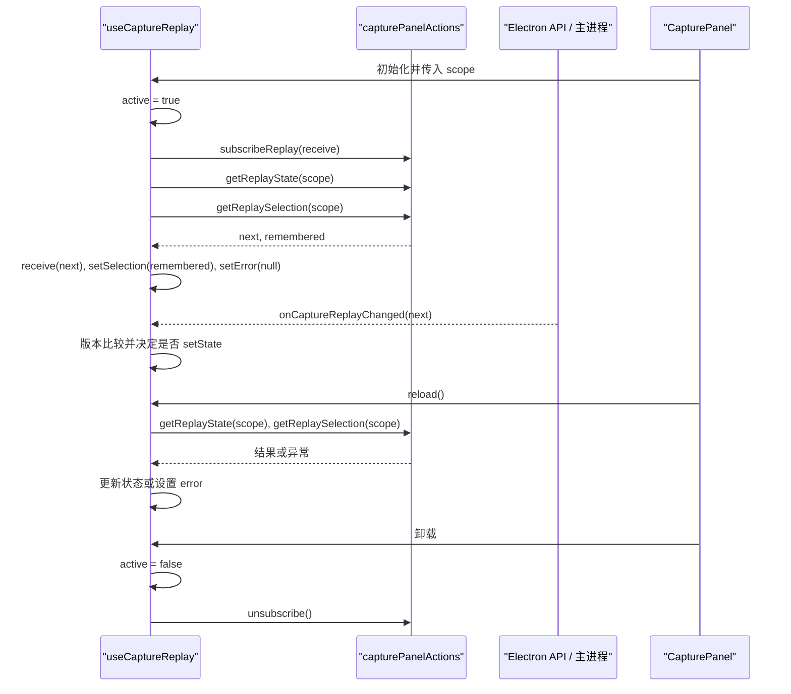
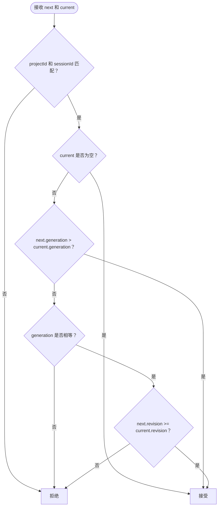
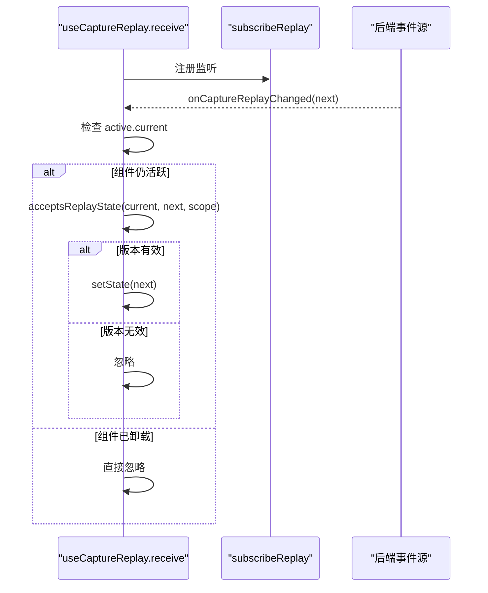
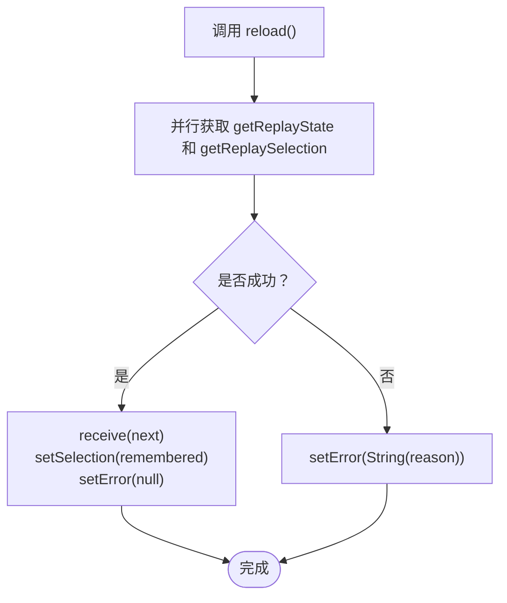
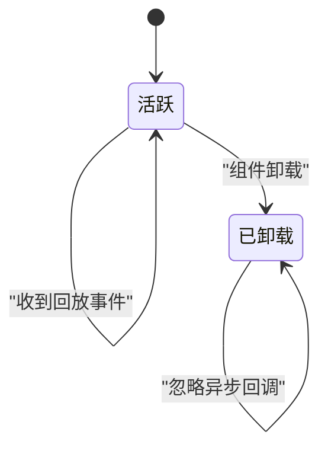
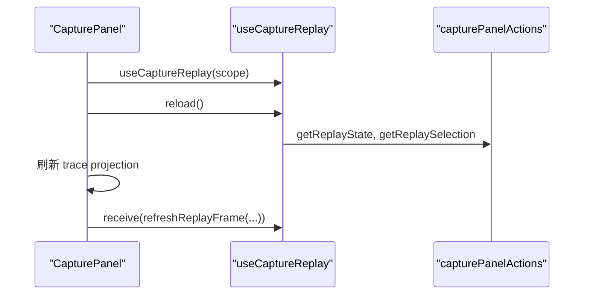
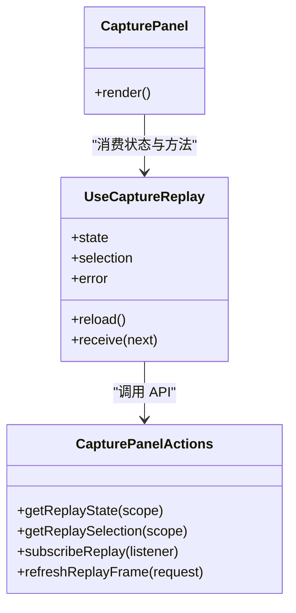

# useCaptureReplay 钩子

<cite>
**本文引用的文件**
- [useCaptureReplay.ts](file://src/renderer/features/right-rail/useCaptureReplay.ts)
- [capturePanelActions.ts](file://src/renderer/features/right-rail/capturePanelActions.ts)
- [CapturePanel.tsx](file://src/renderer/features/right-rail/CapturePanel.tsx)
- [captureReplay.test.ts](file://src/renderer/features/right-rail/captureReplay.test.ts)
</cite>

## 目录
1. [简介](#简介)
2. [项目结构定位](#项目结构定位)
3. [核心状态与职责](#核心状态与职责)
4. [架构总览](#架构总览)
5. [详细组件分析](#详细组件分析)
6. [依赖关系分析](#依赖关系分析)
7. [性能与内存特性](#性能与内存特性)
8. [使用示例与最佳实践](#使用示例与最佳实践)
9. [故障排查指南](#故障排查指南)
10. [结论](#结论)

## 简介
`useCaptureReplay` 是渲染层右侧捕获回放面板的核心 React 钩子，负责：
- 订阅后端或主进程通过事件通道推送的捕获回放状态变更。
- 管理当前回放状态、用户选择、连接错误三个核心状态。
- 在组件挂载时发起初始加载并建立订阅，在卸载时清理订阅并防止异步回调更新已卸载组件。
- 暴露 `reload`、`receive` 等方法，供父组件触发重新加载或直接刷新单帧画面。

该钩子强调“按作用域订阅”和“版本比较过滤”，确保同一项目中不同会话的回放数据不会互相覆盖，同时避免陈旧消息造成状态回退。

## 项目结构定位
`useCaptureReplay` 位于渲染端功能模块 `src/renderer/features/right-rail` 中，主要与以下文件协作：
- `capturePanelActions.ts`：封装 Electron API 调用，包括获取回放状态、选择、重放事件、以及事件订阅入口。
- `CapturePanel.tsx`：右侧面板 UI，消费 `useCaptureReplay` 提供的状态和方法，处理打开/关闭、刷新设备、刷新输入、刷新投影等交互。
- `captureReplay.test.ts`：针对版本比较逻辑和部分回放展示行为的测试。

**图示来源**
- [CapturePanel.tsx:1-129](file://src/renderer/features/right-rail/CapturePanel.tsx#L1-L129)
- [useCaptureReplay.ts:1-32](file://src/renderer/features/right-rail/useCaptureReplay.ts#L1-L32)
- [capturePanelActions.ts:1-21](file://src/renderer/features/right-rail/capturePanelActions.ts#L1-L21)

**章节来源**
- [useCaptureReplay.ts:1-32](file://src/renderer/features/right-rail/useCaptureReplay.ts#L1-L32)
- [capturePanelActions.ts:1-21](file://src/renderer/features/right-rail/capturePanelActions.ts#L1-L21)
- [CapturePanel.tsx:1-129](file://src/renderer/features/right-rail/CapturePanel.tsx#L1-L129)

## 核心状态与职责
`useCaptureReplay` 维护以下三个核心状态：

| 状态 | 类型 | 含义 | 更新时机 |
|---|---|---|---|
| `state` | `CaptureReplayState \| null` | 当前捕获回放完整状态，包含项目、会话、生成号、修订号、阶段、事件、图像、锁定等字段 | 通过 `receive` 接收事件后，经版本比较决定是否更新 |
| `selection` | `CaptureReplaySelection \| null` | 用户上一次选择的回放输入和设备组合 | 首次加载时从持久化或上次选择恢复；后续由 UI 操作间接影响 |
| `error` | `string \| null` | 钩子自身层面的连接或读取错误信息 | `reload` 失败时设置，成功时清空 |

此外，钩子还对外暴露：
- `reload()`：并行拉取回放状态和选择，成功后应用状态并清除错误。
- `receive(next)`：事件监听回调，用于接收后端推送的新状态。
- 内部 `active` ref：标记组件是否仍处于活跃状态，防止卸载后更新状态。

**章节来源**
- [useCaptureReplay.ts:6-32](file://src/renderer/features/right-rail/useCaptureReplay.ts#L6-L32)

## 架构总览
`useCaptureReplay` 的生命周期可以概括为：

**图示来源**
- [useCaptureReplay.ts:6-32](file://src/renderer/features/right-rail/useCaptureReplay.ts#L6-L32)
- [capturePanelActions.ts:1-21](file://src/renderer/features/right-rail/capturePanelActions.ts#L1-L21)
- [CapturePanel.tsx:1-129](file://src/renderer/features/right-rail/CapturePanel.tsx#L1-L129)

## 详细组件分析

### 版本比较函数 `acceptsReplayState`
`acceptsReplayState` 决定新收到的回放状态是否应该替换当前状态。其规则如下：

1. **作用域必须匹配**：新状态的 `projectId` 和 `sessionId` 必须与当前 `scope` 一致。
2. **没有旧状态时允许接受**：如果当前状态为 `null`，则直接接受新状态。
3. **生成号更大则接受**：新状态的 `generation` 大于旧状态时接受。
4. **生成号相同但修订号不小于旧状态才接受**：当 `generation` 相等时，只有 `revision >= current.revision` 才接受。
5. **其他情况拒绝**：例如 generation 更小、revision 更小，或者作用域不匹配。

该设计把 `generation` 视为更高维度的版本标识，适用于一次完整的回放生命周期或上下文切换；`revision` 则在同一 generation 内表示增量更新。

**图示来源**
- [useCaptureReplay.ts:6-11](file://src/renderer/features/right-rail/useCaptureReplay.ts#L6-L11)
- [captureReplay.test.ts:9-16](file://src/renderer/features/right-rail/captureReplay.test.ts#L9-L16)

**章节来源**
- [useCaptureReplay.ts:6-11](file://src/renderer/features/right-rail/useCaptureReplay.ts#L6-L11)
- [captureReplay.test.ts:9-16](file://src/renderer/features/right-rail/captureReplay.test.ts#L9-L16)

### 状态订阅机制 `subscribeReplay`
`subscribeReplay` 是钩子与后端事件通道的桥梁：
- 它调用 `capturePanelActions.subscribeReplay`，将 `receive` 注册为事件监听器。
- 返回的取消函数会在组件卸载时调用，以移除监听器。
- 每次收到事件时，`receive` 会先检查 `active.current`，再调用 `setState` 并使用 `acceptsReplayState` 进行版本比较。

这意味着即使后端持续推送消息，已经卸载或不再活跃的组件也不会继续更新状态。

**图示来源**
- [useCaptureReplay.ts:12-21](file://src/renderer/features/right-rail/useCaptureReplay.ts#L12-L21)
- [capturePanelActions.ts:19-19](file://src/renderer/features/right-rail/capturePanelActions.ts#L19-L19)

**章节来源**
- [useCaptureReplay.ts:12-21](file://src/renderer/features/right-rail/useCaptureReplay.ts#L12-L21)
- [capturePanelActions.ts:19-19](file://src/renderer/features/right-rail/capturePanelActions.ts#L19-L19)

### 自动重连与错误处理策略
钩子本身并不实现网络级重试，而是采用“主动刷新 + 状态隔离”的策略：

- 初始加载：在 `useEffect` 中调用 `reload()`，并行获取回放状态和选择。
- 错误处理：`reload` 的 `try/catch` 会把异常转换为字符串并写入 `error`，同时保留已有状态，避免 UI 完全空白。
- 成功处理：成功时调用 `receive(next)` 更新状态、恢复选择，并清空 `error`。
- 手动重连：父组件可通过暴露的 `reload()` 触发再次加载，适合用户点击刷新按钮或依赖项变化后重新初始化。

需要区分两类错误：
1. **钩子层错误**：`error` 字符串，表示初始化或刷新失败。
2. **回放状态中的错误**：`state.error`，由后端填充，可能包含业务代码、消息和重试建议。

**图示来源**
- [useCaptureReplay.ts:16-24](file://src/renderer/features/right-rail/useCaptureReplay.ts#L16-L24)

**章节来源**
- [useCaptureReplay.ts:16-24](file://src/renderer/features/right-rail/useCaptureReplay.ts#L16-L24)

### 组件卸载与内存泄漏防护
钩子使用 `useRef(true)` 创建 `active` 引用，并在以下位置控制副作用：

1. **effect 启动时**：设置 `active.current = true`。
2. **cleanup 中**：设置 `active.current = false` 并调用 `unsubscribe()`。
3. **异步回调中**：`reload` 和 `receive` 都检查 `active.current`，避免在卸载后更新状态。

这解决了两个常见问题：
- 避免卸载后仍调用 `setState` 导致的 React 警告或潜在内存泄漏。
- 避免卸载后仍保持事件监听器引用，导致无法被垃圾回收。

**图示来源**
- [useCaptureReplay.ts:12-28](file://src/renderer/features/right-rail/useCaptureReplay.ts#L12-L28)

**章节来源**
- [useCaptureReplay.ts:12-28](file://src/renderer/features/right-rail/useCaptureReplay.ts#L12-L28)

### `reload` 方法实现细节
`reload` 的实现要点包括：

- 使用 `Promise.all` 并发请求回放状态和选择，减少等待时间。
- 成功后依次执行：
  - 调用 `receive(next)`，让版本比较逻辑统一决定状态是否更新。
  - 设置 `selection` 为之前记住的选择。
  - 清空 `error`。
- 失败时仅设置 `error`，不修改 `state` 和 `selection`，从而保留上一次可用状态。
- 由于 `reload` 依赖 `receive` 和 `scope`，它们作为依赖项参与 `useCallback` 稳定化。

**章节来源**
- [useCaptureReplay.ts:16-21](file://src/renderer/features/right-rail/useCaptureReplay.ts#L16-L21)

### 父组件如何使用
`CapturePanel.tsx` 展示了典型用法：

- 使用 `useMemo` 构造 `scope`，基于当前任务的项目和会话 ID。
- 解构 `state`、`selection`、`error`、`reload`、`receive`。
- 用 `reload` 刷新投影数据。
- 在打开/关闭、刷新设备、刷新输入等操作中调用 `reload` 或 `receive`。
- 将 `connectionError` 和其他状态错误一起汇总到 callouts 中展示。

**图示来源**
- [CapturePanel.tsx:24-76](file://src/renderer/features/right-rail/CapturePanel.tsx#L24-L76)
- [useCaptureReplay.ts:29-32](file://src/renderer/features/right-rail/useCaptureReplay.ts#L29-L32)
- [capturePanelActions.ts:11-19](file://src/renderer/features/right-rail/capturePanelActions.ts#L11-L19)

**章节来源**
- [CapturePanel.tsx:24-76](file://src/renderer/features/right-rail/CapturePanel.tsx#L24-L76)
- [useCaptureReplay.ts:29-32](file://src/renderer/features/right-rail/useCaptureReplay.ts#L29-L32)
- [capturePanelActions.ts:11-19](file://src/renderer/features/right-rail/capturePanelActions.ts#L11-L19)

## 依赖关系分析

**图示来源**
- [useCaptureReplay.ts:1-32](file://src/renderer/features/right-rail/useCaptureReplay.ts#L1-L32)
- [capturePanelActions.ts:1-21](file://src/renderer/features/right-rail/capturePanelActions.ts#L1-L21)
- [CapturePanel.tsx:1-129](file://src/renderer/features/right-rail/CapturePanel.tsx#L1-L129)

**章节来源**
- [useCaptureReplay.ts:1-32](file://src/renderer/features/right-rail/useCaptureReplay.ts#L1-L32)
- [capturePanelActions.ts:1-21](file://src/renderer/features/right-rail/capturePanelActions.ts#L1-L21)
- [CapturePanel.tsx:1-129](file://src/renderer/features/right-rail/CapturePanel.tsx#L1-L129)

## 性能与内存特性

### 性能特征
- **并发请求**：`reload` 使用 `Promise.all` 同时获取回放状态和选择，降低首屏延迟。
- **事件驱动更新**：正常增量更新通过 `subscribeReplay` 推送，避免轮询。
- **版本过滤**：`acceptsReplayState` 避免无意义的状态回退，减少不必要渲染。
- **回调稳定**：`receive` 和 `reload` 使用 `useCallback`，依赖项明确，有助于父组件优化。

### 内存特性
- **active ref 防护**：卸载后不再更新状态，避免 React 状态更新警告和闭包持有引用。
- **订阅清理**：effect cleanup 中调用 `unsubscribe()`，释放事件监听器。
- **局部状态**：`state`、`selection`、`error` 仅在钩子实例内维护，不污染全局 store。

**章节来源**
- [useCaptureReplay.ts:6-32](file://src/renderer/features/right-rail/useCaptureReplay.ts#L6-L32)

## 使用示例与最佳实践

### 基本使用方式
在右侧面板组件中：
1. 根据当前任务构造 `scope`，包含 `projectId` 和 `sessionId`。
2. 调用 `useCaptureReplay(scope)`。
3. 使用 `state` 渲染回放状态、阶段、锁定、警告等信息。
4. 使用 `selection` 显示或恢复用户上次的输入和设备选择。
5. 使用 `error` 展示连接或加载错误。
6. 在需要刷新时调用 `reload()`。
7. 在需要刷新单帧图像时调用 `receive(await refreshReplayFrame(...))`。

### 推荐模式
- **始终传递稳定的 scope**：scope 变化意味着不同项目或会话，应重新挂载组件或使用新的 key，避免复用错误作用域的状态。
- **不要绕过版本比较**：优先通过 `receive` 接收状态，而不是直接 `setState`，以确保 `generation` 和 `revision` 比较逻辑生效。
- **区分连接错误与回放错误**：`error` 表示钩子层问题；`state.error` 表示回放业务错误，两者可分别展示。
- **刷新后联动其他数据**：如 `CapturePanel` 所示，刷新后可同步刷新 trace projection、设备列表和项目输入。
- **避免重复订阅**：不要在多个父组件中同时订阅同一个 scope，否则会产生多个监听器。

### 反模式
- 在卸载后调用 `reload` 或 `receive`：应由 React 生命周期保证调用时机，或由父组件判断组件可见性。
- 手动维护 `state` 而忽略 `receive`：容易破坏版本一致性。
- 对 `scope` 使用不稳定对象：应使用 `useMemo` 包裹，避免 effect 频繁重建。

**章节来源**
- [CapturePanel.tsx:24-129](file://src/renderer/features/right-rail/CapturePanel.tsx#L24-L129)
- [useCaptureReplay.ts:6-32](file://src/renderer/features/right-rail/useCaptureReplay.ts#L6-L32)

## 故障排查指南

| 现象 | 可能原因 | 排查建议 |
|---|---|---|
| 回放状态不更新 | 新版本被 `acceptsReplayState` 拒绝 | 检查 `generation` 是否下降，或 `revision` 是否小于旧值 |
| 切换到另一个会话后状态未变 | 作用域不匹配 | 确认 `projectId` 和 `sessionId` 是否正确变化 |
| 刷新后出现连接错误 | Electron API 不可用或主进程无响应 | 检查 `capturePanelActions` 中 bridge 可用性 |
| 组件卸载后仍有状态更新日志 | `active` 检查失效或外部仍在调用回调 | 确认卸载路径正确，避免外部强引用 `receive` |
| UI 一直显示加载中 | 后端尚未推送最终状态或存在业务错误 | 查看 `state.phase` 和 `state.error` |
| 打开/关闭失败 | 后端返回失败结果 | 查看父组件的错误处理和 retry 提示 |

**章节来源**
- [useCaptureReplay.ts:6-32](file://src/renderer/features/right-rail/useCaptureReplay.ts#L6-L32)
- [capturePanelActions.ts:1-21](file://src/renderer/features/right-rail/capturePanelActions.ts#L1-L21)
- [CapturePanel.tsx:24-129](file://src/renderer/features/right-rail/CapturePanel.tsx#L24-L129)

## 结论
`useCaptureReplay` 是一个职责清晰、边界明确的回放状态钩子：它以 `scope` 为单位订阅回放事件，通过 `generation` 和 `revision` 的双重版本比较保证状态一致性，并通过 `active` ref 和 `unsubscribe` 清理机制防止内存泄漏。配合 `CapturePanel` 和 `capturePanelActions`，它能够可靠地支撑捕获回放面板的加载、实时更新、错误展示和手动刷新等场景。

在实际使用中，开发者应重点关注：
- 正确构造和使用 `scope`。
- 通过 `receive` 和 `reload` 管理状态，而不是直接操作内部状态。
- 区分钩子层错误与回放业务错误。
- 在组件卸载前确保清理完成，避免后台事件继续影响已销毁组件。