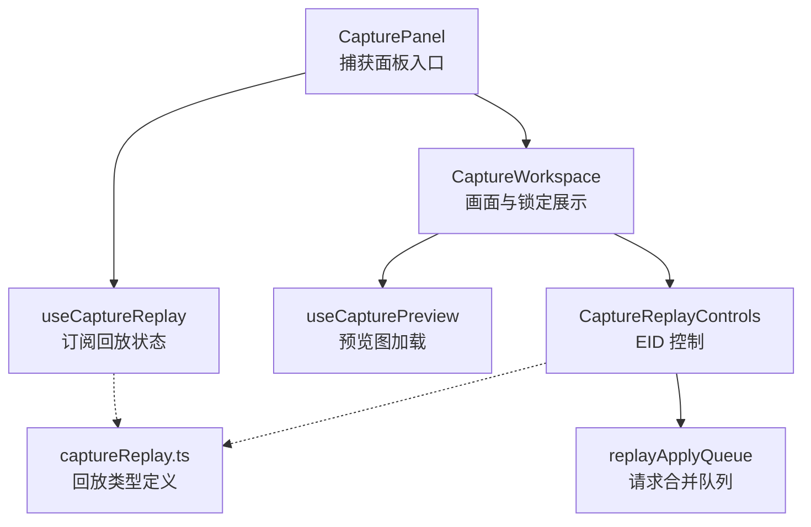
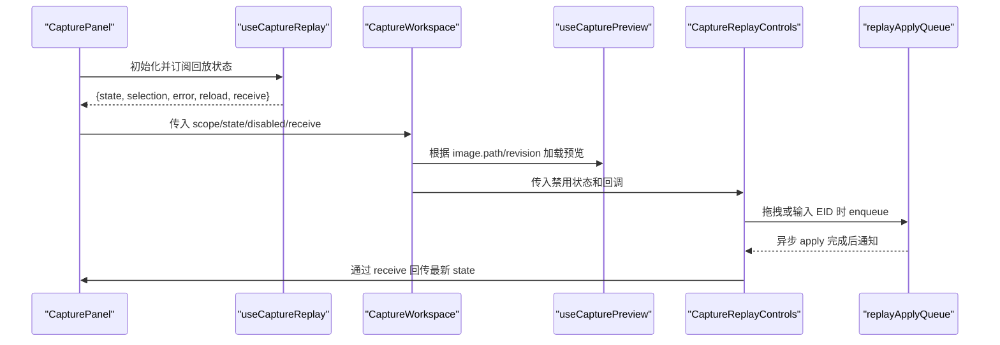
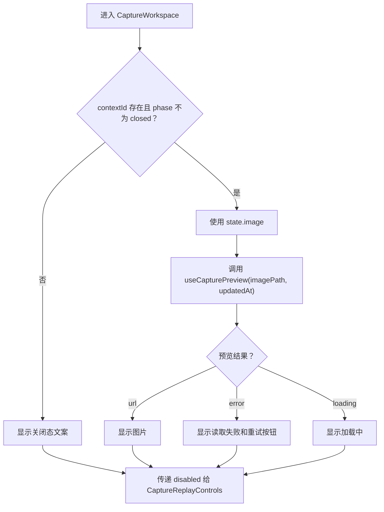
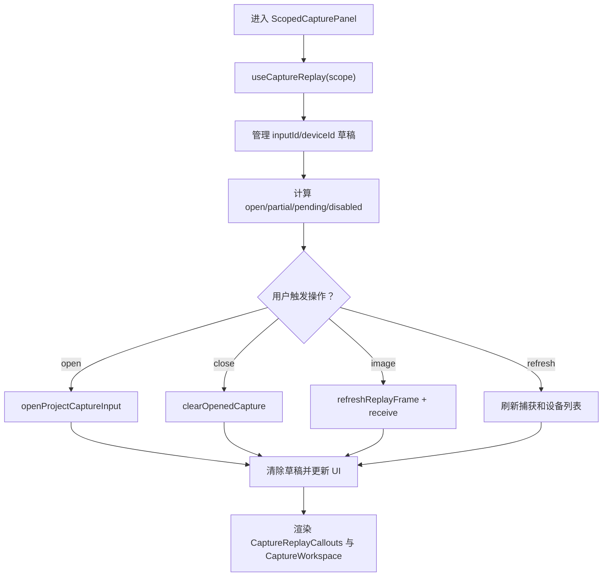
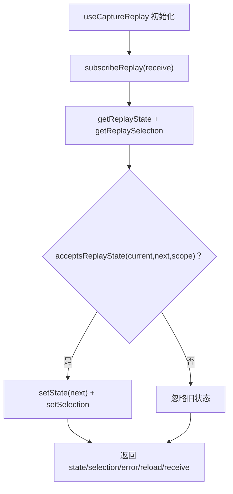
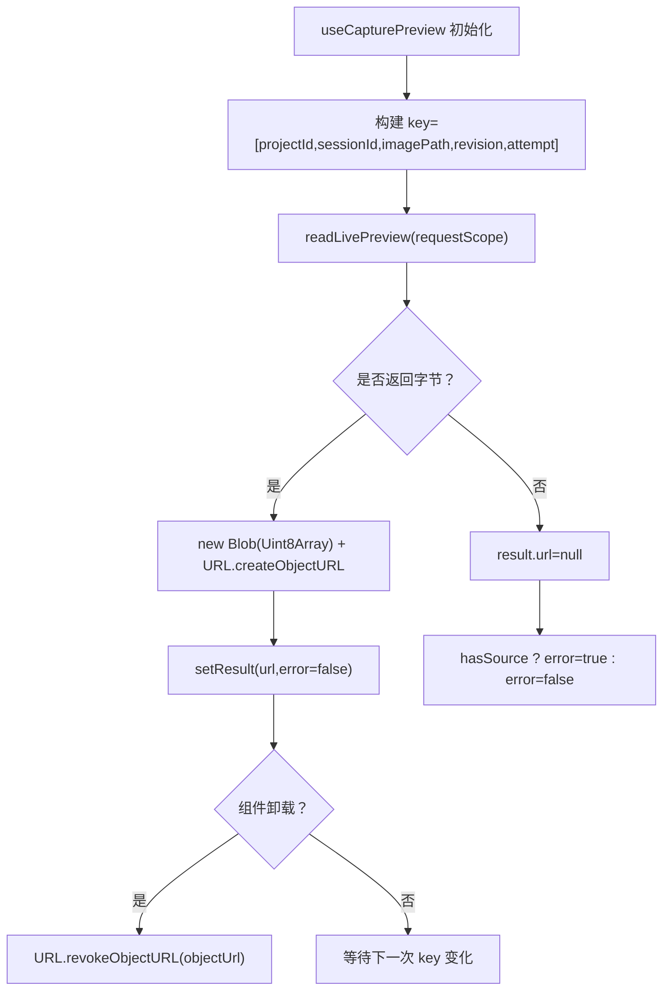
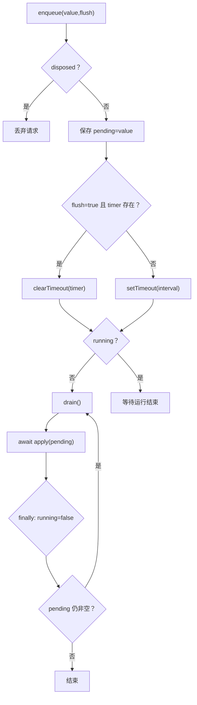
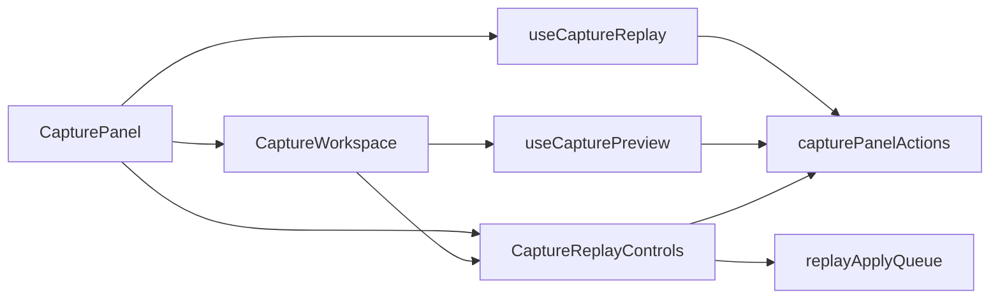

# 捕获工作区

<cite>
**本文引用的文件**   
- [CaptureWorkspace.tsx](file://src/renderer/features/right-rail/CaptureWorkspace.tsx)
- [CapturePanel.tsx](file://src/renderer/features/right-rail/CapturePanel.tsx)
- [useCaptureReplay.ts](file://src/renderer/features/right-rail/useCaptureReplay.ts)
- [useCapturePreview.ts](file://src/renderer/features/right-rail/useCapturePreview.ts)
- [replayApplyQueue.ts](file://src/renderer/features/right-rail/replayApplyQueue.ts)
- [CaptureReplayControls.tsx](file://src/renderer/features/right-rail/CaptureReplayControls.tsx)
- [captureReplay.ts](file://src/shared/types/captureReplay.ts)
</cite>

## 目录
1. [简介](#简介)
2. [项目结构](#项目结构)
3. [核心组件与状态模型](#核心组件与状态模型)
4. [架构总览](#架构总览)
5. [详细组件分析](#详细组件分析)
6. [依赖关系分析](#依赖关系分析)
7. [性能考虑](#性能考虑)
8. [故障排查指南](#故障排查指南)
9. [结论](#结论)
10. [附录：扩展点与最佳实践](#附录扩展点与最佳实践)

## 简介
本文件围绕“捕获回放”能力，系统说明以下实现：
- CaptureWorkspace 如何根据当前画面、EID 轨道和 interactionLock 管理用户可见的捕获回放视图。
- CapturePanel 如何组合 useCaptureReplay、设备选择、捕获输入切换以及 CaptureWorkspace 和回放控制。
- useCaptureReplay 钩子如何订阅会话级回放状态、处理版本过滤并暴露 reload 与 receive。
- useCapturePreview 钩子如何实现预览图加载、重试机制与 URL 回收策略。
- replayApplyQueue 如何合并拖动事件、串行执行应用请求并提供错误恢复。
- 如何基于现有类型和队列机制扩展自定义回放交互，以及在 UI 层优化渲染性能。

## 项目结构
右侧面板中的捕获回放由多个 React 组件和钩子协作完成：
- CapturePanel 是右侧面板中捕获区域的入口，负责捕获输入和设备选择、状态展示与操作编排。
- CaptureWorkspace 负责渲染当前画面、EID 信息和锁定状态，并驱动预览刷新。
- CaptureReplayControls 提供 EID 导航、目标纹理选择和播放反馈。
- useCaptureReplay 订阅全局回放状态，按 scope 和 generation/revision 过滤更新。
- useCapturePreview 从主进程读取 PNG 预览字节流，生成对象 URL 并处理失败重试。
- replayApplyQueue 将多次 EID 变更合并为一次网络调用，避免拖拽时频繁请求。

**图表来源**
- [CapturePanel.tsx:1-129](file://src/renderer/features/right-rail/CapturePanel.tsx#L1-L129)
- [CaptureWorkspace.tsx:1-47](file://src/renderer/features/right-rail/CaptureWorkspace.tsx#L1-L47)
- [useCaptureReplay.ts:1-32](file://src/renderer/features/right-rail/useCaptureReplay.ts#L1-L32)
- [useCapturePreview.ts:1-42](file://src/renderer/features/right-rail/useCapturePreview.ts#L1-L42)
- [CaptureReplayControls.tsx:1-65](file://src/renderer/features/right-rail/CaptureReplayControls.tsx#L1-L65)
- [replayApplyQueue.ts:1-35](file://src/renderer/features/right-rail/replayApplyQueue.ts#L1-L35)
- [captureReplay.ts:1-25](file://src/shared/types/captureReplay.ts#L1-L25)

**章节来源**
- [CapturePanel.tsx:1-129](file://src/renderer/features/right-rail/CapturePanel.tsx#L1-L129)
- [CaptureWorkspace.tsx:1-47](file://src/renderer/features/right-rail/CaptureWorkspace.tsx#L1-L47)
- [useCaptureReplay.ts:1-32](file://src/renderer/features/right-rail/useCaptureReplay.ts#L1-L32)
- [useCapturePreview.ts:1-42](file://src/renderer/features/right-rail/useCapturePreview.ts#L1-L42)
- [CaptureReplayControls.tsx:1-65](file://src/renderer/features/right-rail/CaptureReplayControls.tsx#1-L65)
- [replayApplyQueue.ts:1-35](file://src/renderer/features/right-rail/replayApplyQueue.ts#L1-L35)
- [captureReplay.ts:1-25](file://src/shared/types/captureReplay.ts#L1-L25)

## 核心组件与状态模型
### 回放状态模型
CaptureReplayState 是回放系统的核心数据结构，包含：
- 会话范围信息：projectId、sessionId、generation、revision。
- 生命周期阶段：phase，包括 closed、validating、connecting、transferring、opening、loading_image、ready、applying、closing、error。
- 当前画面：image，包含 imagePath、updatedAt 等元信息；imageEventId 表示该画面对应的 EID。
- EID 轨道：events、requestedEventId、appliedEventId。
- 目标纹理：targets、target、isFinalOutput。
- 设备呈现：devicePresentation.status 表示远程设备是否可用及原因。
- 交互锁：interactionLock，表示控制权归属或锁定原因。
- 错误与警告：error.code、error.retry、warning。

这些字段共同决定 UI 显示：是否处于活跃会话、是否可交互、当前画面是否可读、EID 是否与画面同步、远程设备是否正常。

**章节来源**
- [captureReplay.ts:1-25](file://src/shared/types/captureReplay.ts#L1-L25)

## 架构总览
CapturePanel 作为上层容器，负责：
- 通过 useCaptureReplay 获取回放状态和 selection。
- 管理捕获输入、回放设备和 pending 切换。
- 组装错误提示、状态标签和更多菜单。
- 将状态传给 CaptureWorkspace 和回放控制。

CaptureWorkspace 负责：
- 判断 live 会话、计算 busy 和 lock。
- 根据 state.image 驱动 useCapturePreview 刷新预览。
- 向 CaptureReplayControls 传递 disabled 状态，防止锁定或关闭时误操作。

CaptureReplayControls 负责：
- 维护 draft EID、requested EID 和 feedback。
- 使用 replayApplyQueue 串行应用 EID 变更，支持立即 flush 和延迟合并。
- 根据 requested/applied/imageEventId 差异展示反馈。

**图表来源**
- [CapturePanel.tsx:1-129](file://src/renderer/features/right-rail/CapturePanel.tsx#L1-L129)
- [useCaptureReplay.ts:1-32](file://src/renderer/features/right-rail/useCaptureReplay.ts#L1-L32)
- [CaptureWorkspace.tsx:1-47](file://src/renderer/features/right-rail/CaptureWorkspace.tsx#L1-L47)
- [useCapturePreview.ts:1-42](file://src/renderer/features/right-rail/useCapturePreview.ts#L1-L42)
- [CaptureReplayControls.tsx:1-65](file://src/renderer/features/right-rail/CaptureReplayControls.tsx#L1-L65)
- [replayApplyQueue.ts:1-35](file://src/renderer/features/right-rail/replayApplyQueue.ts#L1-L35)

## 详细组件分析

### CaptureWorkspace：画面、EID 与锁定状态
CaptureWorkspace 的职责是把 CaptureReplayState 映射到用户界面：
- 判定 live：当 contextId 存在且 phase 不是 closed 时，视为活跃会话。
- 计算 busy：preview.loading 与 phaseBusy 合并，其中 phaseBusy 包含 validating、connecting、transferring、opening、loading_image、closing。
- 解析 interactionLock：agent_running、delegated_execution、native_exit_unconfirmed 或其他值，分别对应不同的锁定原因和所有权文案。
- 渲染当前画面：live 时使用 state.image；否则显示无输出或无图像。
- 显示 EID：在 live 且 imageEventId 存在时显示。
- 传递 disabled：如果 lock 存在、disabled 传入或不在 live 状态，则禁用下游控件。

**图表来源**
- [CaptureWorkspace.tsx:1-47](file://src/renderer/features/right-rail/CaptureWorkspace.tsx#L1-L47)
- [useCapturePreview.ts:1-42](file://src/renderer/features/right-rail/useCapturePreview.ts#L1-L42)

**章节来源**
- [CaptureWorkspace.tsx:1-47](file://src/renderer/features/right-rail/CaptureWorkspace.tsx#L1-L47)

### CapturePanel：捕获数据编排与 UI 组合
CapturePanel 是右侧面板的入口，主要职责包括：
- 使用 useCaptureReplay 获取 state、selection、error、reload、receive。
- 管理本地草稿 draft，用于捕获输入 inputId 和回放设备 deviceId 的临时选择。
- 计算 actualInputId、actualDeviceId、chosen、open、pending、partial、disabled 等状态。
- 封装 run 操作：open、close、image、refresh，统一错误处理和 action 状态。
- 组装状态标签、callouts、菜单、文件和设备选择器。
- 将 state、scope、disabled、receive 传递给 CaptureWorkspace。

关键逻辑：
- openProjectCaptureInput：打开指定捕获输入，并可指定 replayDeviceId。
- clearOpenedCapture：关闭已打开的捕获。
- refreshReplayFrame：主动刷新当前帧并调用 receive 更新父级 state。
- refreshProjectCaptureInputs 与 refreshReplayDevices：刷新项目捕获列表和回放设备。

**图表来源**
- [CapturePanel.tsx:1-129](file://src/renderer/features/right-rail/CapturePanel.tsx#L1-L129)

**章节来源**
- [CapturePanel.tsx:1-129](file://src/renderer/features/right-rail/CapturePanel.tsx#L1-L129)

### useCaptureReplay：回放状态订阅与版本过滤
useCaptureReplay 的核心目标是：
- 订阅回放状态变化，只接受属于当前 scope 且版本更高的状态。
- 初始加载 getReplayState 与 getReplaySelection。
- 提供 receive 回调供子组件回写最新状态。
- 提供 reload 以重新拉取状态并清空错误。

acceptsReplayState 的版本规则：
- projectId 与 sessionId 必须匹配。
- next.generation > current.generation，或 generation 相等但 revision >= current.revision。

生命周期：
- 组件挂载后设置 active.current=true，订阅 subscribeReplay，并调用 reload。
- 卸载时设置 active=false 并取消订阅。

**图表来源**
- [useCaptureReplay.ts:1-32](file://src/renderer/features/right-rail/useCaptureReplay.ts#L1-L32)

**章节来源**
- [useCaptureReplay.ts:1-32](file://src/renderer/features/right-rail/useCaptureReplay.ts#L1-L32)

### useCapturePreview：预览刷新、重试与 URL 回收
useCapturePreview 的目标是根据 imagePath 和 imageRevision 动态加载 PNG 预览：
- 每次 source 变化或 attempt 增加时重建 key，从而触发重新加载。
- readLivePreview 返回 Uint8Array；若为空则显示无图或错误。
- 成功时创建 Blob 和 URL.createObjectURL，并通过 setResult 更新 url。
- 清理时检查 active 标志并在卸载前调用 URL.revokeObjectURL 释放内存。
- retry 回调仅增加 attempt 计数，促使 useEffect 再次执行加载。

**图表来源**
- [useCapturePreview.ts:1-42](file://src/renderer/features/right-rail/useCapturePreview.ts#L1-L42)

**章节来源**
- [useCapturePreview.ts:1-42](file://src/renderer/features/right-rail/useCapturePreview.ts#L1-L42)

### CaptureReplayControls 与 replayApplyQueue：EID 轨道与队列管理
CaptureReplayControls 负责：
- 维护 requestedEventId、draft 和 feedback。
- 根据 events 数组定位 position，并支持上一个、下一个、滑块、键盘和手动输入。
- 对 EID 变更使用 queue.enqueue(..., flush)。
- 在 applyReplayEvent 成功后通过 receive 更新父级 state，并清除 requested。

replayApplyQueue 的行为：
- 最多保留一个 pending 值和最多一个 running 请求。
- 默认使用 setTimeout 合并短时间内的多次入队。
- flush=true 会立即执行并取消已有定时器。
- 应用失败时调用 onError 回调，不中断后续入队。
- dispose 会停止 timer、清空 pending 并拒绝新入队。

**图表来源**
- [replayApplyQueue.ts:1-35](file://src/renderer/features/right-rail/replayApplyQueue.ts#L1-L35)
- [CaptureReplayControls.tsx:1-65](file://src/renderer/features/right-rail/CaptureReplayControls.tsx#L1-L65)

**章节来源**
- [CaptureReplayControls.tsx:1-65](file://src/renderer/features/right-rail/CaptureReplayControls.tsx#L1-L65)
- [replayApplyQueue.ts:1-35](file://src/renderer/features/right-rail/replayApplyQueue.ts#L1-L35)

## 依赖关系分析
组件与模块之间的依赖如下：
- CapturePanel 依赖 useCaptureReplay、capturePanelActions、useDeviceStore、useProjectStore、useWorkflowStore、useSessionProjectionStore。
- CaptureWorkspace 依赖 useCapturePreview、CaptureReplayControls、i18n 和 Button。
- CaptureReplayControls 依赖 capturePanelActions、replayApplyQueue、i18n、Button、Input、Select。
- useCaptureReplay 依赖 capturePanelActions。
- useCapturePreview 依赖 capturePanelActions。
- replayApplyQueue 是纯函数式工具，被 CaptureReplayControls 使用。

**图表来源**
- [CapturePanel.tsx:1-129](file://src/renderer/features/right-rail/CapturePanel.tsx#L1-L129)
- [CaptureWorkspace.tsx:1-47](file://src/renderer/features/right-rail/CaptureWorkspace.tsx#L1-L47)
- [useCaptureReplay.ts:1-32](file://src/renderer/features/right-rail/useCaptureReplay.ts#L1-L32)
- [useCapturePreview.ts:1-42](file://src/renderer/features/right-rail/useCapturePreview.ts#L1-L42)
- [CaptureReplayControls.tsx:1-65](file://src/renderer/features/right-rail/CaptureReplayControls.tsx#L1-L65)
- [replayApplyQueue.ts:1-35](file://src/renderer/features/right-rail/replayApplyQueue.ts#L1-L35)

**章节来源**
- [CapturePanel.tsx:1-129](file://src/renderer/features/right-rail/CapturePanel.tsx#L1-L129)
- [CaptureWorkspace.tsx:1-47](file://src/renderer/features/right-rail/CaptureWorkspace.tsx#L1-L47)
- [useCaptureReplay.ts:1-32](file://src/renderer/features/right-rail/useCaptureReplay.ts#L1-L32)
- [useCapturePreview.ts:1-42](file://src/renderer/features/right-rail/useCapturePreview.ts#L1-L42)
- [CaptureReplayControls.tsx:1-65](file://src/renderer/features/right-rail/CaptureReplayControls.tsx#L1-L65)
- [replayApplyQueue.ts:1-35](file://src/renderer/features/right-rail/replayApplyQueue.ts#L1-L35)

## 性能考虑
- 状态版本过滤：useCaptureReplay 通过 acceptsReplayState 确保只接受更高 generation 或同 generation 下更高 revision 的状态，避免重复渲染。
- 预览对象 URL 回收：useCapturePreview 在组件卸载或 key 变化时调用 URL.revokeObjectURL，避免内存泄漏。
- EID 请求合并：replayApplyQueue 使用定时器合并短时间内的多次入队，减少后端压力；拖拽场景建议配合 flush 在 onPointerUp 或键盘结束时触发。
- 禁用状态提前短路：CaptureWorkspace 和 CaptureReplayControls 在 disabled、lock、phaseBusy 时避免无效操作。
- 局部状态最小化：CapturePanel 使用 draft 存储未提交的选择，减少不必要的 re-render 和远端调用。

[本节为通用性能建议，不直接分析具体代码行]

## 故障排查指南
常见问题与定位思路：
- 画面无法加载：
  - 检查 preview.error 是否为 true，并使用 preview.retry 触发重试。
  - 确认 state.phase 是否处于 loading_image 或 transferring 等 busy 阶段。
  - 查看 imageEventId 是否存在，确保 live 会话有效。
- 回放被锁定：
  - 检查 interactionLock 的值：agent_running、delegated_execution、native_exit_unconfirmed。
  - 根据锁定原因确定是否需要等待代理执行结束或确认退出。
- EID 应用失败：
  - 观察 CaptureReplayControls 中的 error 状态，错误会来自 replayApplyQueue 的 onError。
  - 检查 requestedEventId 与 appliedEventId 是否一致，不一致说明仍在 applying。
  - 确认 state.generation 是否在 apply 回调中被比较，避免陈旧状态覆盖。
- 设备不可用：
  - 检查 devicePresentation.status 是否为 unsupported 或 unavailable，并根据 reason 提示用户。
- 捕获输入切换失败：
  - 关注 CapturePanel.run 的错误分支，区分 open/close/image/refresh 不同操作。
  - 刷新后需要调用 refreshProjection 更新 trace 投影。

**章节来源**
- [CaptureWorkspace.tsx:1-47](file://src/renderer/features/right-rail/CaptureWorkspace.tsx#L1-L47)
- [CapturePanel.tsx:1-129](file://src/renderer/features/right-rail/CapturePanel.tsx#L1-L129)
- [CaptureReplayControls.tsx:1-65](file://src/renderer/features/right-rail/CaptureReplayControls.tsx#L1-L65)
- [useCapturePreview.ts:1-42](file://src/renderer/features/right-rail/useCapturePreview.ts#L1-L42)
- [captureReplay.ts:1-25](file://src/shared/types/captureReplay.ts#L1-L25)

## 结论
捕获工作区通过清晰的组件分层和状态模型实现了稳定的回放体验：
- CapturePanel 负责高层编排与用户操作。
- CaptureWorkspace 聚焦画面展示与锁定语义。
- CaptureReplayControls 与 replayApplyQueue 保证 EID 轨道的流畅交互。
- useCaptureReplay 与 useCapturePreview 分别承担状态订阅与预览加载。
结合类型约束、版本过滤、URL 回收和队列合并，系统在易用性和性能之间取得平衡。

[本节为总结性内容，不直接分析具体代码行]

## 附录：扩展点与最佳实践
### 自定义扩展方法
- 扩展 EID 轨道行为：
  - 在 CaptureReplayControls 中复用 createReplayApplyQueue，传入自定义 apply 函数，实现对不同 target 或额外参数的支持。
  - 通过 state.targets 和 state.target 扩展颜色通道选择逻辑。
- 扩展预览策略：
  - 在 useCapturePreview 中替换 readLivePreview 的实现，支持更复杂的缓存键或预取策略。
  - 在 result.key 变化时决定是否保留上一次 URL，以实现平滑过渡。
- 扩展锁定语义：
  - 根据 interactionLock 的值添加新的 UI 提示或自动解锁流程。
  - 在 CapturePanel.run 中添加新的操作类型，例如批量刷新或导出回放元数据。

### 性能优化技巧
- 避免在高频事件中直接发送网络请求：始终通过 replayApplyQueue.enqueue 进行合并。
- 在 drag 场景中仅在 onPointerUp 或键盘结束事件上调用 flush，减少中间状态抖动。
- 合理使用 useMemo 和 useCallback：
  - CapturePanel 已经对 refreshProjection 和 run 使用记忆化。
  - CaptureReplayControls 中对 queue 使用 useMemo，避免重复创建队列实例。
- 及时清理资源：
  - useCapturePreview 在卸载时撤销对象 URL。
  - replayApplyQueue 在组件卸载或 disabled 变化时调用 dispose。

**章节来源**
- [CaptureReplayControls.tsx:1-65](file://src/renderer/features/right-rail/CaptureReplayControls.tsx#L1-L65)
- [replayApplyQueue.ts:1-35](file://src/renderer/features/right-rail/replayApplyQueue.ts#L1-L35)
- [useCapturePreview.ts:1-42](file://src/renderer/features/right-rail/useCapturePreview.ts#L1-L42)
- [CapturePanel.tsx:1-129](file://src/renderer/features/right-rail/CapturePanel.tsx#L1-L129)