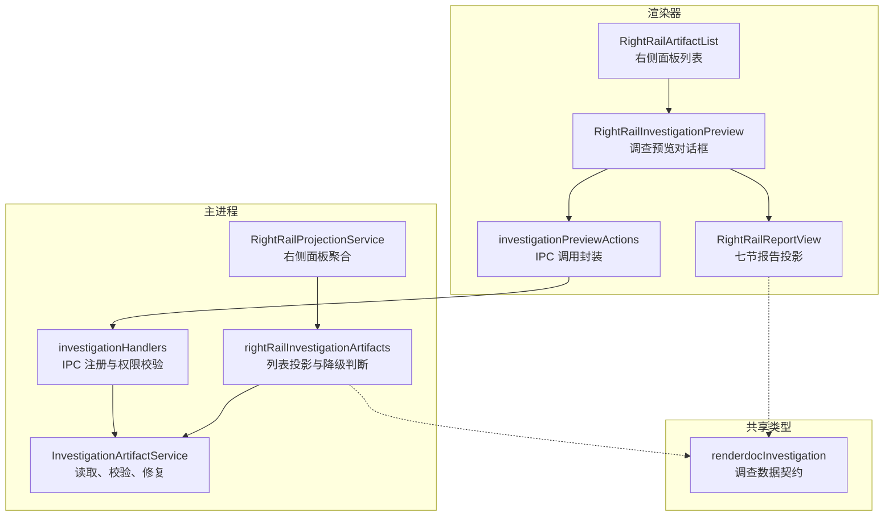
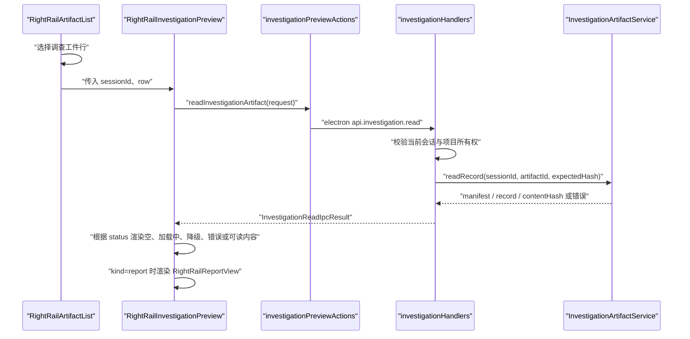
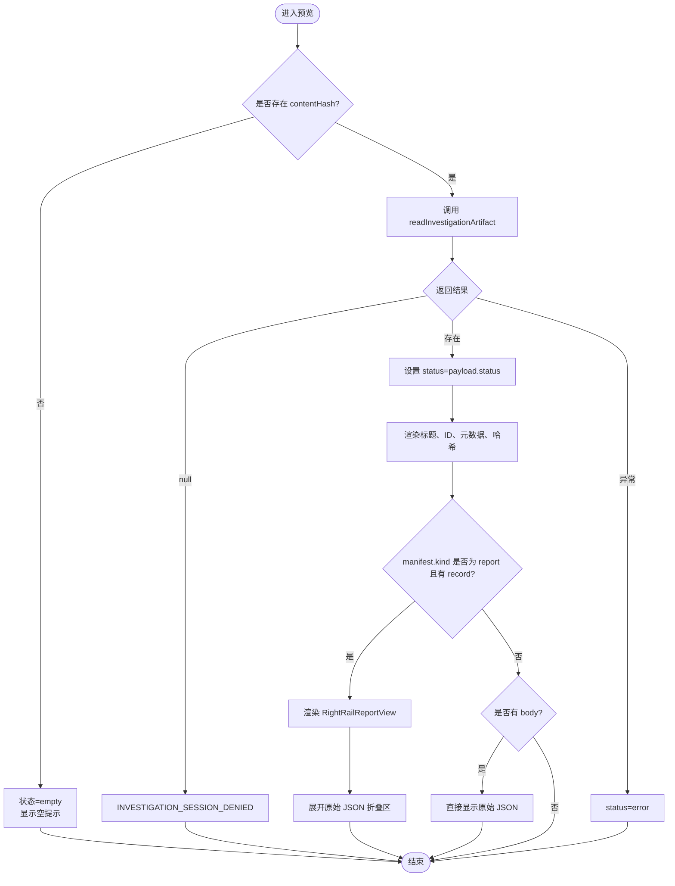
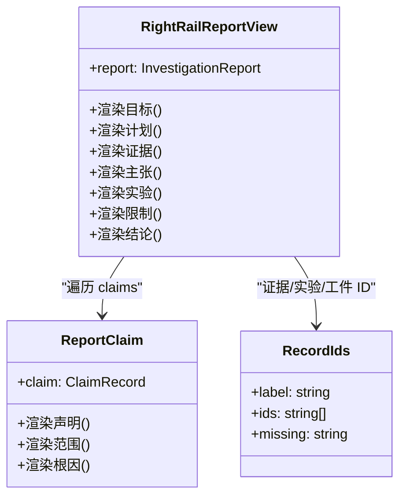
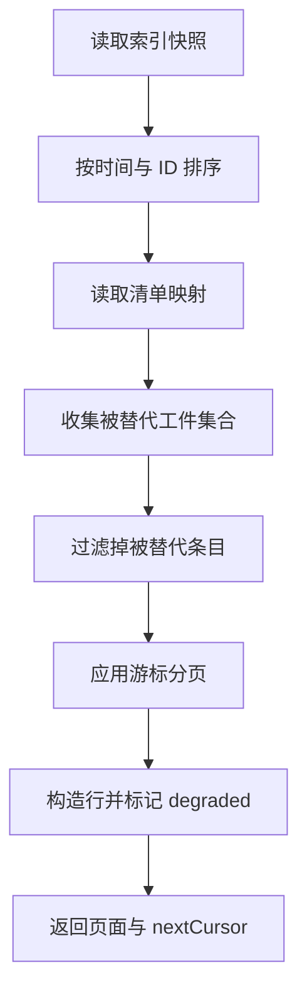
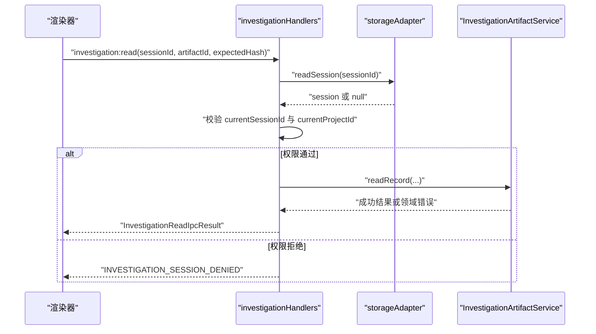
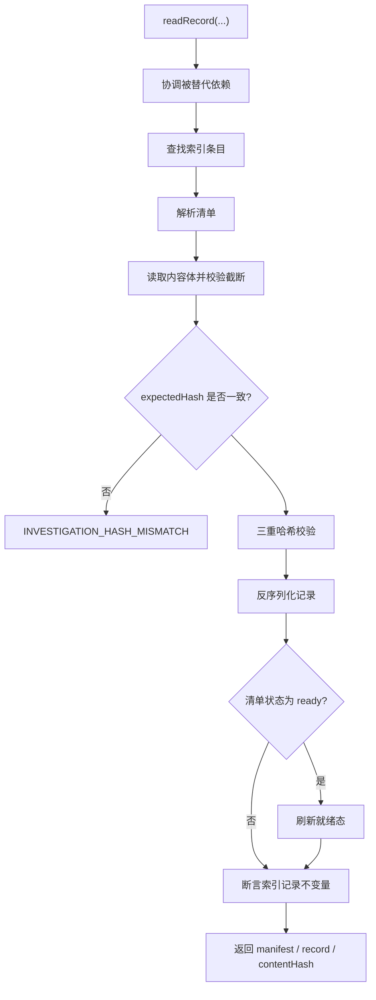
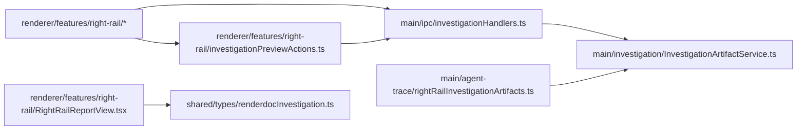
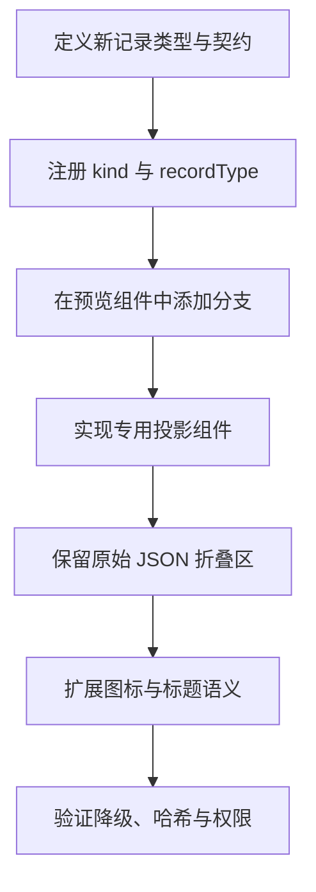
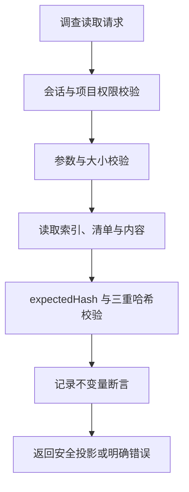

# 调查预览

<cite>
**本文引用的文件**   
- [RightRailInvestigationPreview.tsx](file://src/renderer/features/right-rail/RightRailInvestigationPreview.tsx)
- [investigationPreviewActions.ts](file://src/renderer/features/right-rail/investigationPreviewActions.ts)
- [RightRailReportView.tsx](file://src/renderer/features/right-rail/RightRailReportView.tsx)
- [RightRailArtifactList.tsx](file://src/renderer/features/right-rail/RightRailArtifactList.tsx)
- [rightRailInvestigationArtifacts.ts](file://src/main/agent-trace/rightRailInvestigationArtifacts.ts)
- [RightRailProjectionService.ts](file://src/main/agent-trace/RightRailProjectionService.ts)
- [investigationHandlers.ts](file://src/main/ipc/investigationHandlers.ts)
- [InvestigationArtifactService.ts](file://src/main/investigation/InvestigationArtifactService.ts)
- [investigationRecordKeys.ts](file://src/main/investigation/investigationRecordKeys.ts)
- [renderdocInvestigation.ts](file://src/shared/types/renderdocInvestigation.ts)
</cite>

## 目录
1. [引言](#引言)
2. [项目结构定位](#项目结构定位)
3. [核心组件](#核心组件)
4. [架构总览](#架构总览)
5. [详细组件分析](#详细组件分析)
6. [依赖关系分析](#依赖关系分析)
7. [性能与可伸缩性](#性能与可伸缩性)
8. [故障排查指南](#故障排查指南)
9. [自定义展示格式开发指南](#自定义展示格式开发指南)
10. [安全性考虑](#安全性考虑)
11. [结论](#结论)

## 引言
本文面向 RDC-Agent 右侧面板中的“调查预览”能力，系统解释 `RightRailInvestigationPreview` 如何渲染调查工件、如何区分七节报告的投影视图与原始 JSON 次级折叠区、如何通过主进程 IPC 安全读取调查内容，以及列表投影层如何过滤被替代工件并标记降级状态。文档还说明权限校验、哈希一致性检查、缺失字段诚实标记机制，以及在扩展自定义展示格式时的数据契约与安全边界。

## 项目结构定位
调查预览涉及渲染器、主进程 IPC、调查服务与共享类型四个层次：
- 渲染器负责用户交互、状态管理、报告投影展示和原始 JSON 折叠显示。
- 主进程 IPC 层负责会话权限校验、参数校验与错误映射。
- 调查服务负责索引、清单、内容体、哈希与完整性校验。
- 共享类型定义调查工件种类、记录类型、任务使命等数据契约。

**图表来源**
- [RightRailArtifactList.tsx:1-67](file://src/renderer/features/right-rail/RightRailArtifactList.tsx#L1-L67)
- [RightRailInvestigationPreview.tsx:1-141](file://src/renderer/features/right-rail/RightRailInvestigationPreview.tsx#L1-L141)
- [RightRailReportView.tsx:1-90](file://src/renderer/features/right-rail/RightRailReportView.tsx#L1-L90)
- [investigationPreviewActions.ts:1-15](file://src/renderer/features/right-rail/investigationPreviewActions.ts#L1-L15)
- [investigationHandlers.ts:1-103](file://src/main/ipc/investigationHandlers.ts#L1-L103)
- [rightRailInvestigationArtifacts.ts:1-112](file://src/main/agent-trace/rightRailInvestigationArtifacts.ts#L1-L112)
- [RightRailProjectionService.ts:1-96](file://src/main/agent-trace/RightRailProjectionService.ts#L1-L96)
- [InvestigationArtifactService.ts:255-314](file://src/main/investigation/InvestigationArtifactService.ts#L255-L314)
- [renderdocInvestigation.ts:1-200](file://src/shared/types/renderdocInvestigation.ts#L1-L200)

**章节来源**
- [RightRailArtifactList.tsx:1-67](file://src/renderer/features/right-rail/RightRailArtifactList.tsx#L1-L67)
- [RightRailProjectionService.ts:1-96](file://src/main/agent-trace/RightRailProjectionService.ts#L1-L96)

## 核心组件
- `RightRailInvestigationPreview`：打开调查工件预览对话框，加载 manifest、record 与 contentHash，按 kind 是否为 report 决定使用报告投影或原始 JSON；提供 ID 与哈希复制、状态标签、降级提示与被替代工件信息。
- `investigationPreviewActions`：将渲染器请求桥接到 Electron API 的 `investigation.read` 与 `investigation.list`。
- `RightRailReportView`：按七节契约渲染目标、计划、证据、主张、实验、限制与结论，并对缺失字段显示统一占位文本。
- `rightRailInvestigationArtifacts`：从索引与清单构建列表行，过滤被替代项，计算降级标志，并返回右侧面板所需的轻量模型。
- `investigationHandlers`：注册 IPC 端点，校验当前活动会话与项目所有权，调用服务读取并映射错误。
- `InvestigationArtifactService`：实现读取流程、三重哈希校验、清单解析、记录反序列化、就绪态刷新与不变量断言。

**章节来源**
- [RightRailInvestigationPreview.tsx:1-141](file://src/renderer/features/right-rail/RightRailInvestigationPreview.tsx#L1-L141)
- [investigationPreviewActions.ts:1-15](file://src/renderer/features/right-rail/investigationPreviewActions.ts#L1-L15)
- [RightRailReportView.tsx:1-90](file://src/renderer/features/right-rail/RightRailReportView.tsx#L1-L90)
- [rightRailInvestigationArtifacts.ts:1-112](file://src/main/agent-trace/rightRailInvestigationArtifacts.ts#L1-L112)
- [investigationHandlers.ts:1-103](file://src/main/ipc/investigationHandlers.ts#L1-L103)
- [InvestigationArtifactService.ts:255-314](file://src/main/investigation/InvestigationArtifactService.ts#L255-L314)

## 架构总览
右侧面板由 `RightRailProjectionService` 聚合任务进度、输出、上下文与调查工件列表。调查工件列表通过 `mapRightRailInvestigationArtifacts` 调用 `rightRailInvestigationArtifacts`，后者委托 `InvestigationArtifactService` 获取索引与清单，再投影为轻量行。点击某一行后，预览组件通过 `investigationPreviewActions.readInvestigationArtifact` 调用主进程 `investigation:read`，最终由 `InvestigationArtifactService.readRecord` 完成安全读取。

**图表来源**
- [RightRailArtifactList.tsx:1-67](file://src/renderer/features/right-rail/RightRailArtifactList.tsx#L1-L67)
- [RightRailInvestigationPreview.tsx:1-141](file://src/renderer/features/right-rail/RightRailInvestigationPreview.tsx#L1-L141)
- [investigationPreviewActions.ts:1-15](file://src/renderer/features/right-rail/investigationPreviewActions.ts#L1-L15)
- [investigationHandlers.ts:1-103](file://src/main/ipc/investigationHandlers.ts#L1-L103)
- [InvestigationArtifactService.ts:255-314](file://src/main/investigation/InvestigationArtifactService.ts#L255-L314)

## 详细组件分析

### 调查预览对话框：`RightRailInvestigationPreview`
该组件是用户直接看到的调查工件预览入口。其关键行为如下：
- 初始状态根据 `row.contentHash` 是否为空决定为空或加载中。
- 调用 `readInvestigationArtifact`，传入 `sessionId`、`artifactId` 与 `expectedHash`。
- 对返回值设置 `status`：empty、loading、ready、degraded、error、hash-mismatch。
- 标题优先取 manifest.title，否则回退到 row.title 或 artifactId。
- 元数据区域显示版本、状态、是否降级与预览状态标签。
- 哈希区域显示短哈希，并提供复制按钮；当无哈希时显示缺失提示。
- 若存在 error，则显示错误提示。
- 当 manifest.kind 为 report 且 record 存在时，先渲染 `RightRailReportView`，再展开一个 `
` 显示完整 JSON。
- 若非 report 但存在 body，则直接显示原始 JSON。
- 若 manifest.supersedes 存在，则显示被替代工件标识。

**图表来源**
- [RightRailInvestigationPreview.tsx:1-141](file://src/renderer/features/right-rail/RightRailInvestigationPreview.tsx#L1-L141)

**章节来源**
- [RightRailInvestigationPreview.tsx:1-141](file://src/renderer/features/right-rail/RightRailInvestigationPreview.tsx#L1-L141)

### 七节报告投影：`RightRailReportView`
该组件以人类可读的方式呈现 `InvestigationReport` 的七节内容：
- 目标：summary 与 mission。
- 计划：contract.links，并注明时间线未嵌入。
- 证据：contract.evidence 与 evidenceIds 列表。
- 主张：claims 列表，每个 claim 显示 statement、scope、epistemic、verification、decision 与 rootCause。
- 实验：contract.verification 与 experimentIds 列表。
- 限制：contract.limitations 与挑战来源提示。
- 结论：contract.conclusion、status、candidateStatus 与 artifactIds 列表。

所有可能缺失的字符串字段都会替换为统一的“未记录”占位文本，从而避免把 undefined 直接展示给用户。

**图表来源**
- [RightRailReportView.tsx:1-90](file://src/renderer/features/right-rail/RightRailReportView.tsx#L1-L90)

**章节来源**
- [RightRailReportView.tsx:1-90](file://src/renderer/features/right-rail/RightRailReportView.tsx#L1-L90)
- [renderdocInvestigation.ts:1-200](file://src/shared/types/renderdocInvestigation.ts#L1-L200)

### 列表投影与降级判断：`rightRailInvestigationArtifacts`
该模块负责把底层索引与清单投影为右侧面板所需的轻量行，主要逻辑包括：
- 已知任务使命白名单校验，未知使命标记为 unknown。
- 规范化 contentHash，并拼接短哈希用于界面展示。
- 降级判断：如果 manifest 缺失、mission 为 unknown，或者 manifest.contentHash 与 entry.contentHash 不一致，则标记 degraded。
- 被替代工件收集：根据 supersedes 链收集被替代条目，并从可见列表中移除。
- 分页与排序：按创建时间与 artifactId 排序，支持 cursor 分页。
- 右侧面板只取前五行，同时保留 totalCount 与 storeDegraded 标志。

**图表来源**
- [rightRailInvestigationArtifacts.ts:1-112](file://src/main/agent-trace/rightRailInvestigationArtifacts.ts#L1-L112)
- [investigationRecordKeys.ts:1-117](file://src/main/investigation/investigationRecordKeys.ts#L1-L117)

**章节来源**
- [rightRailInvestigationArtifacts.ts:1-112](file://src/main/agent-trace/rightRailInvestigationArtifacts.ts#L1-L112)
- [investigationRecordKeys.ts:1-117](file://src/main/investigation/investigationRecordKeys.ts#L1-L117)

### IPC 权限与读取路径：`investigationHandlers`
IPC 层保护调查读取接口：
- `assertActiveInvestigationOwner` 要求请求必须来自当前活动会话，并且当前项目必须拥有该会话。
- `investigation:list` 在授权失败或项目不匹配时抛出拒绝错误。
- `investigation:read` 解析参数、验证会话所有权后调用 `investigationArtifactService.readRecord`。
- 错误映射区分：
  - `ARTIFACT_TOO_LARGE`：证据过大。
  - `INVESTIGATION_HASH_MISMATCH`：哈希不一致。
  - 存储退化：`degraded`。
  - 其他错误归为通用存储失败。

**图表来源**
- [investigationHandlers.ts:1-103](file://src/main/ipc/investigationHandlers.ts#L1-L103)

**章节来源**
- [investigationHandlers.ts:1-103](file://src/main/ipc/investigationHandlers.ts#L1-L103)

### 安全读取与完整性校验：`InvestigationArtifactService.readRecord`
服务层的读取流程保证数据不可篡改且结构合法：
- 先进行依赖清理与修复协调。
- 查找索引条目，不存在则返回未找到错误。
- 解析清单，读取内容体，并允许客户端传入 expectedHash。
- 若截断或 expectedHash 不匹配，抛出哈希不一致错误。
- 执行三重哈希校验：索引 contentHash、清单 contentHash 与实际内容 hash。
- 反序列化记录，并根据清单状态刷新就绪态。
- 对 ready 或 draft 状态的条目执行索引记录不变量断言。
- 返回 manifest、record、contentUri 与格式化后的 contentHash。

**图表来源**
- [InvestigationArtifactService.ts:255-314](file://src/main/investigation/InvestigationArtifactService.ts#L255-L314)

**章节来源**
- [InvestigationArtifactService.ts:255-314](file://src/main/investigation/InvestigationArtifactService.ts#L255-L314)

## 依赖关系分析
- 渲染器依赖 Electron API 提供的 investigation IPC 通道，并通过 `getElectronApi()` 访问。
- 列表投影依赖 `InvestigationArtifactService` 作为默认源，测试时可注入 mock source。
- IPC 层依赖 `storageAdapter` 与 `parseIpcArgs` 做会话校验与参数校验。
- 报告投影依赖共享类型中定义的 `InvestigationReport`、`ClaimRecord` 等契约。

**图表来源**
- [investigationPreviewActions.ts:1-15](file://src/renderer/features/right-rail/investigationPreviewActions.ts#L1-L15)
- [investigationHandlers.ts:1-103](file://src/main/ipc/investigationHandlers.ts#L1-L103)
- [rightRailInvestigationArtifacts.ts:1-112](file://src/main/agent-trace/rightRailInvestigationArtifacts.ts#L1-L112)
- [InvestigationArtifactService.ts:255-314](file://src/main/investigation/InvestigationArtifactService.ts#L255-L314)
- [RightRailReportView.tsx:1-90](file://src/renderer/features/right-rail/RightRailReportView.tsx#L1-L90)
- [renderdocInvestigation.ts:1-200](file://src/shared/types/renderdocInvestigation.ts#L1-L200)

**章节来源**
- [RightRailArtifactList.tsx:1-67](file://src/renderer/features/right-rail/RightRailArtifactList.tsx#L1-L67)
- [RightRailProjectionService.ts:1-96](file://src/main/agent-trace/RightRailProjectionService.ts#L1-L96)

## 性能与可伸缩性
- 列表分页：右侧面板仅展示前五行，浏览全部时通过 cursor 分页，每页固定大小，避免一次性加载大量调查工件。
- 降级短路：当存储快照降级时，列表直接返回空结果并标记 storeDegraded，防止损坏数据阻塞 UI。
- 大证据处理：IPC 层将 `ARTIFACT_TOO_LARGE` 映射为明确错误，避免前端长时间等待超大附件。
- 预览加载取消：预览组件使用 effect cleanup 标记 cancelled，避免异步回调更新已卸载组件。
- 哈希短显示：短哈希仅用于界面展示，实际校验使用完整哈希，减少界面噪音但不降低安全性。

[本节为通用性能建议，不直接分析具体代码片段]

## 故障排查指南
常见问题与定位方式：
- “调查会话被拒绝”：通常因为请求的 sessionId 不是当前活动会话，或当前项目不拥有该会话。应检查 IPC 权限校验与当前 session/project 状态。
- “哈希不一致”：表示预期哈希与读取内容哈希不一致，可能由并发写入、缓存不一致或外部篡改引起。应检查 expectedHash 来源与存储服务哈希生成逻辑。
- “存储退化”：索引或清单读取失败时，服务会标记退化，IPC 层将其映射为 degraded 状态，UI 应停止进一步交互并提示重试。
- “证据过大”：当证据体积超过阈值时，服务抛出 `ARTIFACT_TOO_LARGE`，IPC 层映射为对应错误码，UI 应显示友好提示而不是无限加载。
- “报告缺失字段”：报告投影会把缺失字符串显示为“未记录”，这是诚实标记而非 bug。若业务需要严格必填，应在写入阶段或清单校验阶段增强约束。

**章节来源**
- [investigationHandlers.ts:1-103](file://src/main/ipc/investigationHandlers.ts#L1-L103)
- [InvestigationArtifactService.ts:255-314](file://src/main/investigation/InvestigationArtifactService.ts#L255-L314)
- [RightRailReportView.tsx:1-90](file://src/renderer/features/right-rail/RightRailReportView.tsx#L1-L90)

## 自定义展示格式开发指南
若要在调查预览中新增一种非 report 类型的自定义展示格式，建议遵循以下流程：
1. 确定数据契约：在共享类型中明确新记录类型的字段、可选字段与枚举值，确保向后兼容。
2. 注册记录类型：在调查记录类型注册表中登记新的 kind 与 recordType，避免运行时无法识别。
3. 在预览组件中分支处理：在 `RightRailInvestigationPreview` 中增加对 newKind 的判断，优先渲染投影视图，其次回退到原始 JSON。
4. 如需结构化展示：参考 `RightRailReportView`，新建一个专用投影组件，对缺失字段使用占位文本，对关联 ID 使用统一列表组件。
5. 保持原始 JSON 可审计：无论是否提供投影视图，都应保留原始 JSON 折叠区，便于调试与审计。
6. 更新右侧面板列表展示：如果需要新的图标或标题语义，扩展 `RightRailArtifactGlyph` 与本地化文案。
7. 验证降级与哈希：确保自定义记录的 manifest 与 index 哈希一致，避免因缺失字段导致 degraded 标记误报。

**图表来源**
- [RightRailInvestigationPreview.tsx:1-141](file://src/renderer/features/right-rail/RightRailInvestigationPreview.tsx#L1-L141)
- [RightRailReportView.tsx:1-90](file://src/renderer/features/right-rail/RightRailReportView.tsx#L1-L90)
- [renderdocInvestigation.ts:1-200](file://src/shared/types/renderdocInvestigation.ts#L1-L200)

**章节来源**
- [RightRailInvestigationPreview.tsx:1-141](file://src/renderer/features/right-rail/RightRailInvestigationPreview.tsx#L1-L141)
- [RightRailReportView.tsx:1-90](file://src/renderer/features/right-rail/RightRailReportView.tsx#L1-L90)
- [renderdocInvestigation.ts:1-200](file://src/shared/types/renderdocInvestigation.ts#L1-L200)

## 安全性考虑
调查预览的安全边界贯穿渲染器、IPC 与服务层：
- 会话所有权校验：只有当前活动会话且属于当前项目的读取请求才被允许。
- 参数校验：IPC 层使用参数 schema 限制请求大小与字段类型。
- 哈希一致性：服务端强制比较 expectedHash 与内容 hash，并在不一致时拒绝。
- 三重哈希校验：索引、清单与实际内容三者哈希必须一致。
- 不变量断言：对 ready 或 draft 记录执行领域不变量检查，防止非法状态扩散。
- 降级与截断防护：内容截断、存储退化与大附件都有明确的错误映射，避免前端猜测或崩溃。
- 审计可追溯：即使报告被替代，旧版本仍可通过预览查看，但当前语义由最新版本承担。

**图表来源**
- [investigationHandlers.ts:1-103](file://src/main/ipc/investigationHandlers.ts#L1-L103)
- [InvestigationArtifactService.ts:255-314](file://src/main/investigation/InvestigationArtifactService.ts#L255-L314)

**章节来源**
- [investigationHandlers.ts:1-103](file://src/main/ipc/investigationHandlers.ts#L1-L103)
- [InvestigationArtifactService.ts:255-314](file://src/main/investigation/InvestigationArtifactService.ts#L255-L314)

## 结论
调查预览以分层架构保障可用性与安全性：渲染器专注交互与投影展示，IPC 层专注权限与错误映射，服务层专注数据完整性与领域不变量。`RightRailInvestigationPreview` 通过报告投影与原始 JSON 折叠区兼顾可读性与可审计性；`rightRailInvestigationArtifacts` 通过清单与索引投影提供稳定的列表视图；`investigationHandlers` 与 `InvestigationArtifactService` 共同实现安全的读取路径。对于未来扩展，应优先完善契约定义、投影组件与安全检查，而不是直接暴露原始 JSON 作为唯一展示形式。