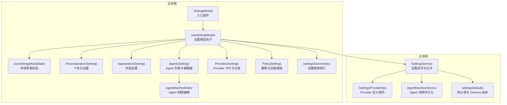
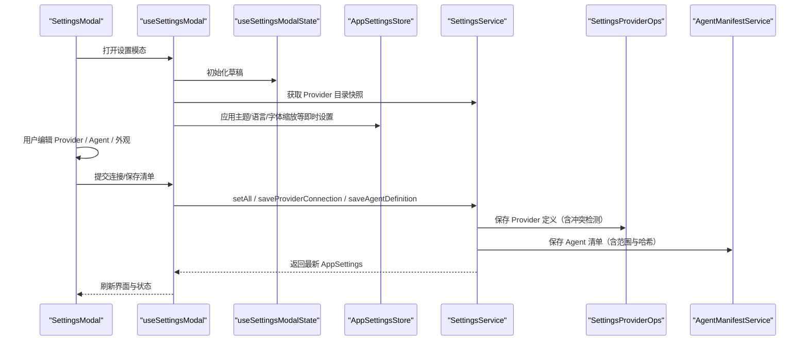
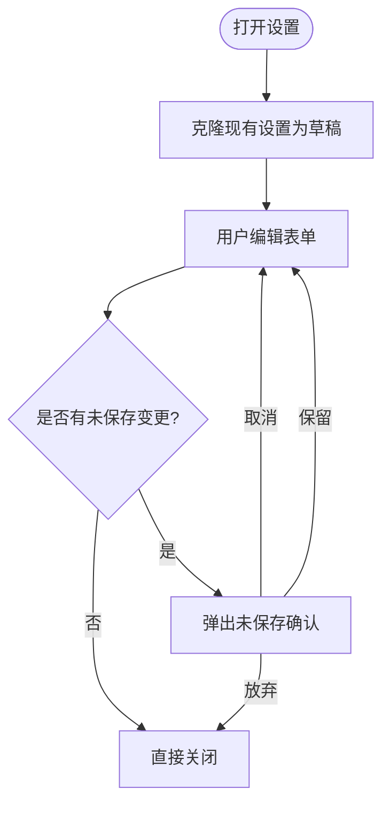
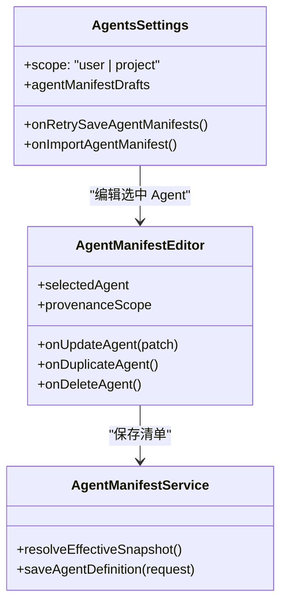
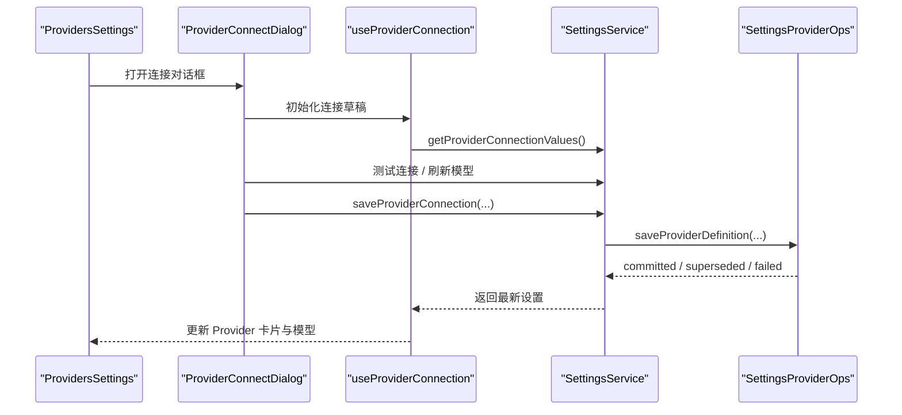
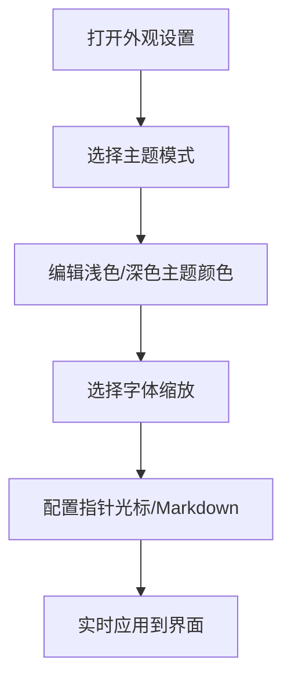
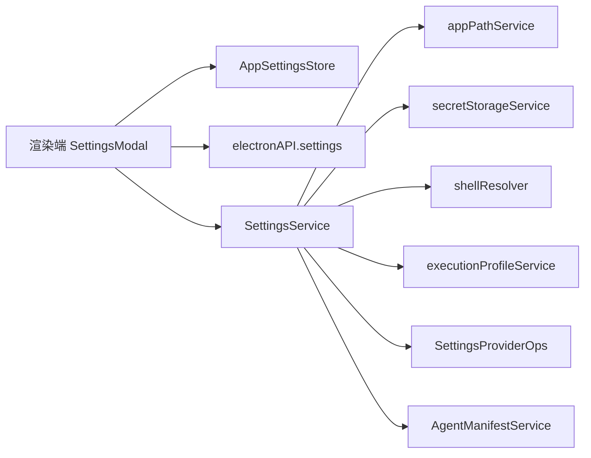

# Settings 设置面板

<cite>
**本文引用的文件**   
- [SettingsService.ts](file://src/main/settings/SettingsService.ts)
- [settingsDefaults.ts](file://src/main/settings/settingsDefaults.ts)
- [SettingsProviderOps.ts](file://src/main/settings/SettingsProviderOps.ts)
- [AgentManifestService.ts](file://src/main/settings/AgentManifestService.ts)
- [index.tsx](file://src/renderer/features/settings/SettingsModal/index.tsx)
- [useSettingsModal.ts](file://src/renderer/features/settings/SettingsModal/useSettingsModal.ts)
- [useSettingsModalState.ts](file://src/renderer/features/settings/SettingsModal/useSettingsModalState.ts)
- [types.ts](file://src/renderer/features/settings/SettingsModal/types.ts)
- [settingsSearchIndex.ts](file://src/renderer/features/settings/SettingsModal/settingsSearchIndex.ts)
- [PersonalizationSettings.tsx](file://src/renderer/features/settings/SettingsModal/sections/PersonalizationSettings.tsx)
- [AppearanceSettings.tsx](file://src/renderer/features/settings/SettingsModal/sections/AppearanceSettings.tsx)
- [AgentsSettings.tsx](file://src/renderer/features/settings/SettingsModal/sections/AgentsSettings.tsx)
- [AgentManifestEditor.tsx](file://src/renderer/features/settings/SettingsModal/sections/AgentManifestEditor.tsx)
- [ProvidersSettings.tsx](file://src/renderer/features/settings/SettingsModal/sections/ProvidersSettings.tsx)
- [PolicySettings.tsx](file://src/renderer/features/settings/SettingsModal/sections/PolicySettings.tsx)
</cite>

## 目录
1. [简介](#简介)
2. [项目结构](#项目结构)
3. [核心组件](#核心组件)
4. [架构总览](#架构总览)
5. [详细组件分析](#详细组件分析)
6. [依赖关系分析](#依赖关系分析)
7. [性能与可维护性](#性能与可维护性)
8. [故障排查指南](#故障排查指南)
9. [结论](#结论)
10. [附录：扩展开发指南](#附录扩展开发指南)

## 简介
本文件面向“设置”模态框及其后端持久化服务，系统说明以下目标：
- 设置分组管理、表单验证、变更追踪机制。
- Agent 配置管理：代理清单编辑、路由规则、能力声明。
- Provider 设置管理：模型提供商配置、认证信息、连接测试。
- 外观设置：主题选择、字体配置、颜色方案。
- 设置数据的持久化存储、默认值恢复、配置迁移机制。
- 自定义设置项的开发指南和数据验证规则。

该文档以代码仓库中的主进程 `SettingsService` 与渲染端 `SettingsModal` 为事实依据，尽量用图示和结构化描述帮助非专业读者理解。

## 项目结构
设置功能横跨主进程与渲染器两个层次：
- 渲染端负责用户交互、分组导航、草稿状态、表单校验、连接对话框展示。
- 主进程负责设置读取、写入、清理旧密钥、Agent 清单持久化、Provider 定义保存与冲突检测。

**图表来源**
- [index.tsx:1-176](file://src/renderer/features/settings/SettingsModal/index.tsx#L1-L176)
- [useSettingsModal.ts:1-195](file://src/renderer/features/settings/SettingsModal/useSettingsModal.ts#L1-L195)
- [useSettingsModalState.ts:1-118](file://src/renderer/features/settings/SettingsModal/useSettingsModalState.ts#L1-L118)
- [SettingsService.ts:1-200](file://src/main/settings/SettingsService.ts#L1-L200)
- [SettingsService.ts:201-510](file://src/main/settings/SettingsService.ts#L201-L510)
- [SettingsProviderOps.ts:1-250](file://src/main/settings/SettingsProviderOps.ts#L1-L250)
- [AgentManifestService.ts:1-200](file://src/main/settings/AgentManifestService.ts#L1-L200)
- [settingsDefaults.ts:1-167](file://src/main/settings/settingsDefaults.ts#L1-L167)

**章节来源**
- [index.tsx:1-176](file://src/renderer/features/settings/SettingsModal/index.tsx#L1-L176)
- [useSettingsModal.ts:1-195](file://src/renderer/features/settings/SettingsModal/useSettingsModal.ts#L1-L195)
- [settingsSearchIndex.ts:1-125](file://src/renderer/features/settings/SettingsModal/settingsSearchIndex.ts#L1-L125)

## 核心组件
- **SettingsModal（入口）**：使用 Portal 挂载模态框，管理侧边栏导航、页面内容区域、未保存离开提示、Provider 连接对话框。
- **useSettingsModal（组合钩子）**：聚合设置分类、Provider 目录快照、连接状态、自动保存 Agent 清单、脏标记计算、动作派发。
- **useSettingsModalState（草稿状态）**：维护账户资料、Provider 草稿、Agent 路由草稿、工具设置草稿、Agent 清单草稿、连接草稿等。
- **SettingsService（主进程）**：初始化、读取、合并、写入设置；处理窗口布局快速写入；持久化 Provider 密钥；导出运行时 LLM 配置。
- **SettingsProviderOps（主进程）**：Provider 定义的并发写锁、乐观版本控制、冲突检测、连接保存、账号连接与旋转。
- **AgentManifestService（主进程）**：解析、校验、哈希、保存 Agent 清单，区分内置、用户、项目范围。
- **settingsDefaults（主进程）**：Schema 版本号、默认外观、布局、工具、Agent 运行权限等。

**章节来源**
- [index.tsx:1-176](file://src/renderer/features/settings/SettingsModal/index.tsx#L1-L176)
- [useSettingsModal.ts:1-195](file://src/renderer/features/settings/SettingsModal/useSettingsModal.ts#L1-L195)
- [useSettingsModalState.ts:1-118](file://src/renderer/features/settings/SettingsModal/useSettingsModalState.ts#L1-L118)
- [SettingsService.ts:1-200](file://src/main/settings/SettingsService.ts#L1-L200)
- [SettingsService.ts:201-510](file://src/main/settings/SettingsService.ts#L201-L510)
- [SettingsProviderOps.ts:1-250](file://src/main/settings/SettingsProviderOps.ts#L1-L250)
- [AgentManifestService.ts:1-200](file://src/main/settings/AgentManifestService.ts#L1-L200)
- [settingsDefaults.ts:1-167](file://src/main/settings/settingsDefaults.ts#L1-L167)

## 架构总览
设置面板采用“渲染端草稿 + 主进程持久化”的分离架构。渲染端在打开时复制当前设置生成草稿，关闭或提交时才调用主进程写入。Provider 连接通过独立对话框完成，支持在线探测模型与 OAuth 登录流程。Agent 清单支持用户级与项目级范围，并具备自动保存与回滚机制。

**图表来源**
- [index.tsx:1-176](file://src/renderer/features/settings/SettingsModal/index.tsx#L1-L176)
- [useSettingsModal.ts:1-195](file://src/renderer/features/settings/SettingsModal/useSettingsModal.ts#L1-L195)
- [useSettingsModalState.ts:1-118](file://src/renderer/features/settings/SettingsModal/useSettingsModalState.ts#L1-L118)
- [SettingsService.ts:201-510](file://src/main/settings/SettingsService.ts#L201-L510)
- [SettingsProviderOps.ts:1-250](file://src/main/settings/SettingsProviderOps.ts#L1-L250)
- [AgentManifestService.ts:1-200](file://src/main/settings/AgentManifestService.ts#L1-L200)

## 详细组件分析

### 设置分组管理与导航
设置中心左侧导航由 `useSettingsModal` 动态构建，包含通用、外观、模型、Agent、技能、工具、钩子、策略等分组。每个分组带有标题、副标题与国际化键。设置搜索索引将关键字映射到目标分组与具体控件，便于全局搜索跳转。

- 分组数据由钩子统一提供，并在 `SettingsCenterNav` 中渲染。
- 切换分组前会触发“未保存确认”，避免误丢草稿。
- 搜索索引同时覆盖多语言关键词，例如“模型”“供应商”“工具”“终端”等。

**章节来源**
- [useSettingsModal.ts:1-195](file://src/renderer/features/settings/SettingsModal/useSettingsModal.ts#L1-L195)
- [settingsSearchIndex.ts:1-125](file://src/renderer/features/settings/SettingsModal/settingsSearchIndex.ts#L1-L125)

### 表单验证与变更追踪
- 草稿隔离：`useSettingsModalState` 在模态打开时克隆 Provider、Agent 路由、工具等设置，避免直接修改全局设置。
- 脏标记：`useSettingsDirty` 根据工具、资料、全局指令等草稿与原始设置比较，决定是否显示“未保存更改”。
- Agent 关联校验：保存 Agent 前校验 handoff 目标是否自引用、是否存在循环或跨 Agent 目标冲突；投影保存时会检查其他 Agent 的目标冲突。
- 连接草稿：Provider 连接对话框中的密钥字段不进入持久化的渲染端设置，仅在主进程落盘。

**图表来源**
- [useSettingsModalState.ts:1-118](file://src/renderer/features/settings/SettingsModal/useSettingsModalState.ts#L1-L118)
- [useSettingsModal.ts:1-195](file://src/renderer/features/settings/SettingsModal/useSettingsModal.ts#L1-L195)
- [index.tsx:1-176](file://src/renderer/features/settings/SettingsModal/index.tsx#L1-L176)

**章节来源**
- [useSettingsModalState.ts:1-118](file://src/renderer/features/settings/SettingsModal/useSettingsModalState.ts#L1-L118)
- [useSettingsModal.ts:1-195](file://src/renderer/features/settings/SettingsModal/useSettingsModal.ts#L1-L195)

### Agent 配置管理
Agent 设置包括清单编辑、路由规则、能力声明、手递交接、执行限制、诊断信息等。

- **清单编辑**：`AgentsSettings` 提供用户级与项目级范围切换、新增、复制、删除、导入 Agent 清单。`AgentManifestEditor` 提供身份、权限、手递、指令等子面板。
- **路由规则**：Agent 选择模型后，结合 `agents.modelOptions` 判断模型是否就绪；若无效则显示路由原因。
- **能力声明**：通过 `AgentCapabilityPicker` 选择工具、技能、Agent、MCP 服务器等能力；同时展示工具令牌诊断。
- **持久化**：`AgentManifestService` 负责清单解析、校验、哈希、保存，并区分内置、用户、项目范围；文件名必须与 id 一致，否则抛出错误。
- **自动保存**：渲染端通过 `useAgentManifestAutosave` 实现草稿自动保存与失败回滚。

**图表来源**
- [AgentsSettings.tsx:1-200](file://src/renderer/features/settings/SettingsModal/sections/AgentsSettings.tsx#L1-L200)
- [AgentManifestEditor.tsx:1-200](file://src/renderer/features/settings/SettingsModal/sections/AgentManifestEditor.tsx#L1-L200)
- [AgentManifestService.ts:1-200](file://src/main/settings/AgentManifestService.ts#L1-L200)

**章节来源**
- [AgentsSettings.tsx:1-200](file://src/renderer/features/settings/SettingsModal/sections/AgentsSettings.tsx#L1-L200)
- [AgentManifestEditor.tsx:1-200](file://src/renderer/features/settings/SettingsModal/sections/AgentManifestEditor.tsx#L1-L200)
- [AgentManifestService.ts:1-200](file://src/main/settings/AgentManifestService.ts#L1-L200)

### Provider 设置管理
Provider 设置涵盖模型提供商配置、认证信息管理、连接测试、模型偏好与发现。

- **Provider 列表**：`ProvidersSettings` 按类别分组展示已连接 Provider、目录 Provider 与即将推出 Provider；支持搜索过滤。
- **连接对话框**：支持 API Key、OAuth 账号模式、自定义协议与连接字段；支持测试连接、刷新模型、查看账号状态。
- **连接草稿**：`types.ts` 定义了连接草稿结构，包含连接字段、可见性、测试结果、模型列表、账号状态等。
- **持久化**：`SettingsProviderOps` 提供并发写锁、乐观版本控制、冲突检测；`SettingsService` 提供 `saveProviderConnection`、`saveProviderAccountConnection`、`rotateProviderAccountCredential`、`disconnectProvider` 等方法。
- **运行时配置**：`SettingsService.getLlmConfig` 输出启用且验证通过的 Provider，注入 API Key 或账号凭证，并附带编译后的 Agent 路由。

**图表来源**
- [ProvidersSettings.tsx:1-135](file://src/renderer/features/settings/SettingsModal/sections/ProvidersSettings.tsx#L1-L135)
- [types.ts:1-55](file://src/renderer/features/settings/SettingsModal/types.ts#L1-L55)
- [SettingsService.ts:201-510](file://src/main/settings/SettingsService.ts#L201-L510)
- [SettingsProviderOps.ts:1-250](file://src/main/settings/SettingsProviderOps.ts#L1-L250)

**章节来源**
- [ProvidersSettings.tsx:1-135](file://src/renderer/features/settings/SettingsModal/sections/ProvidersSettings.tsx#L1-L135)
- [types.ts:1-55](file://src/renderer/features/settings/SettingsModal/types.ts#L1-L55)
- [SettingsService.ts:201-510](file://src/main/settings/SettingsService.ts#L201-L510)
- [SettingsProviderOps.ts:1-250](file://src/main/settings/SettingsProviderOps.ts#L1-L250)

### 外观设置
外观设置包括主题模式、Chrome 主题颜色、字体缩放、指针光标、编辑器 Markdown 等。

- **主题模式**：支持系统、浅色、深色三种模式，由 `AppearanceSettings` 提供分段标签切换。
- **颜色方案**：分别编辑浅色与深色 Chrome 主题，使用 `ChromeThemeCard` 进行可视化配置。
- **字体与交互**：提供小/中/大三档字体缩放，开关指针光标，开关编辑器 Markdown。
- **实时生效**：这些设置通过 `AppSettingsStore` 立即应用到界面，不依赖保存按钮。

**图表来源**
- [AppearanceSettings.tsx:1-115](file://src/renderer/features/settings/SettingsModal/sections/AppearanceSettings.tsx#L1-L115)
- [useSettingsModal.ts:1-195](file://src/renderer/features/settings/SettingsModal/useSettingsModal.ts#L1-L195)

**章节来源**
- [AppearanceSettings.tsx:1-115](file://src/renderer/features/settings/SettingsModal/sections/AppearanceSettings.tsx#L1-L115)
- [useSettingsModal.ts:1-195](file://src/renderer/features/settings/SettingsModal/useSettingsModal.ts#L1-L195)

### 个性化设置
个性化设置主要提供全局指令文本输入与保存状态反馈。

- **全局指令**：使用文本域编辑，保存后显示“正在保存/已保存/保存失败”状态。
- **持久化**：通过 `patchSettings` 更新 `agents.globalInstructions`，主进程将其写入对应路径。

**章节来源**
- [PersonalizationSettings.tsx:1-77](file://src/renderer/features/settings/SettingsModal/sections/PersonalizationSettings.tsx#L1-L77)
- [useSettingsModal.ts:1-195](file://src/renderer/features/settings/SettingsModal/useSettingsModal.ts#L1-L195)

### 策略与运行环境
策略设置包括运行时策略基线与上下文压缩阈值。

- **策略基线**：通过 `RuntimeScopePanel` 编辑用户或项目范围的策略。
- **压缩阈值**：从常量边界生成可选百分比，写入 `agentRuntime.context.compactionThresholdPercent`。

**章节来源**
- [PolicySettings.tsx:1-82](file://src/renderer/features/settings/SettingsModal/sections/PolicySettings.tsx#L1-L82)

## 依赖关系分析
设置模块的关键依赖如下：
- 渲染端依赖 `AppSettingsStore` 进行即时主题、语言、字体缩放等设置。
- 渲染端通过 IPC 调用 `window.electronAPI.settings.getProviderCatalog()` 获取 Provider 目录快照。
- 主进程依赖 `appPathService`、`executionProfileService`、`secretStorageService`、`shellResolver` 等基础设施。
- Provider 与 Agent 的操作被封装在 `SettingsProviderOps` 与 `AgentManifestService`，由 `SettingsService` 统一调度。

**图表来源**
- [index.tsx:1-176](file://src/renderer/features/settings/SettingsModal/index.tsx#L1-L176)
- [useSettingsModal.ts:1-195](file://src/renderer/features/settings/SettingsModal/useSettingsModal.ts#L1-L195)
- [SettingsService.ts:1-200](file://src/main/settings/SettingsService.ts#L1-L200)
- [SettingsProviderOps.ts:1-250](file://src/main/settings/SettingsProviderOps.ts#L1-L250)
- [AgentManifestService.ts:1-200](file://src/main/settings/AgentManifestService.ts#L1-L200)

**章节来源**
- [useSettingsModal.ts:1-195](file://src/renderer/features/settings/SettingsModal/useSettingsModal.ts#L1-L195)
- [SettingsService.ts:1-200](file://src/main/settings/SettingsService.ts#L1-L200)

## 性能与可维护性
- **窗口布局快速写入**：`SettingsService` 提供同步与异步方法仅写入 `layout.window`，跳过 Provider 归一化与密钥水合，适合窗口移动/调整大小场景。
- **Provider 并发写保护**：`SettingsProviderOps` 使用 per-provider 写尾队列与写锁，避免同 Provider 定义并发写入产生竞争条件。
- **乐观版本控制**：Provider 定义保存使用客户端 revision 与服务端 latestRevision 对比，防止覆盖他人变更。
- **Agent 清单哈希**：通过 SHA256 对清单内容与文件内容进行哈希，便于变更检测与一致性校验。
- **可维护性建议**：
  - 新增设置字段应在 `settingsDefaults.ts` 提供默认值，并在 `SettingsService.setAll` 中补充清洗与合并逻辑。
  - 新增 Provider 连接字段应在 `connectionSchema` 中声明，并确保 `sanitizeConnectionValues` 能处理。
  - 新增 Agent 能力应同步更新 `AgentCapabilityPicker` 与诊断逻辑。

[本节为通用指导，不直接分析具体文件]

## 故障排查指南
常见设置问题及定位要点：
- **Provider 连接失败**：检查连接字段是否符合 schema、Secret 是否正确、OAuth 账号是否有效、模型是否返回空列表。
- **Provider 定义保存冲突**：若返回 `superseded`，表示客户端 revision 落后于服务端；需要重新拉取最新定义后再提交。
- **Agent 清单保存失败**：检查 id 与文件名是否匹配、是否命中保留 id、是否缺少必填能力或工具。
- **未保存提示无法关闭**：确认是否存在活跃的 Provider 连接草稿；若有，先关闭连接对话框再退出设置。
- **外观设置未生效**：确认是否使用了正确的 store setter，如 `setTheme`、`setFontScale`、`setChromeTheme`。

**章节来源**
- [SettingsProviderOps.ts:1-250](file://src/main/settings/SettingsProviderOps.ts#L1-L250)
- [AgentManifestService.ts:1-200](file://src/main/settings/AgentManifestService.ts#L1-L200)
- [index.tsx:1-176](file://src/renderer/features/settings/SettingsModal/index.tsx#L1-L176)

## 结论
设置面板以清晰的分组导航、严谨的草稿与变更机制、健壮的 Provider 与 Agent 持久化能力，构成了完整的配置体验。主进程服务负责数据安全与一致性，渲染端负责交互与预览。未来扩展可通过遵循默认值、清洗函数与校验规则，平滑加入新的设置项。

[本节为总结性内容，不直接分析具体文件]

## 附录：扩展开发指南

### 新增设置项的步骤
1. **定义类型与默认值**：在共享类型或 `settingsDefaults.ts` 中增加字段与默认值。
2. **渲染表单**：在对应设置页面组件中添加字段，绑定 store setter 或草稿 setter。
3. **持久化与清洗**：在 `SettingsService.setAll` 中合并 patch，调用相应 sanitizer，确保字段合法。
4. **默认值恢复**：若字段来自持久化负载，确保 `normalizePersistedSettings` 或重建逻辑能兼容旧版本。
5. **迁移机制**：若 Schema 版本变化，需在初始化阶段做升级迁移，并更新 `SETTINGS_SCHEMA_VERSION`。
6. **搜索索引**：如需可搜索，更新 `settingsSearchIndex.ts` 添加关键字与目标。

### 数据验证规则建议
- 字符串字段需 trim 并限制长度。
- 布尔字段需显式赋值而非隐式转换。
- 数字字段需校验范围与步长。
- 枚举字段需限定在白名单内。
- 敏感字段（如 API Key）必须走 secret storage，不在渲染端持久化。
- 列表字段需去重、排序与最大长度限制。
- 关联字段需进行交叉校验，例如 Agent handoff 目标不可自引用、不可循环。

### 自定义 Agent 能力与路由
- 新增能力时，更新 `AgentCapabilityPicker` 的能力分组与选择逻辑。
- 新增路由规则时，确保 `compiledRoutesFromDefinitions` 能正确编译。
- 新增工具令牌诊断时，更新 `diagnoseManifestToolTokens` 的识别规则。

### Provider 连接字段扩展
- 在 Provider catalog 的 connectionSchema 中新增字段，并指定 kind（普通或 secret）。
- 确保 `sanitizeConnectionValues` 能处理新字段。
- 若为主密钥字段，需配合 `resolvePrimaryConnectionSecretFieldId` 与 `getResolvedProviderSecret`。

**章节来源**
- [settingsDefaults.ts:1-167](file://src/main/settings/settingsDefaults.ts#L1-L167)
- [SettingsService.ts:201-510](file://src/main/settings/SettingsService.ts#L201-L510)
- [settingsSearchIndex.ts:1-125](file://src/renderer/features/settings/SettingsModal/settingsSearchIndex.ts#L1-L125)
- [AgentManifestEditor.tsx:1-200](file://src/renderer/features/settings/SettingsModal/sections/AgentManifestEditor.tsx#L1-L200)
- [SettingsProviderOps.ts:1-250](file://src/main/settings/SettingsProviderOps.ts#L1-L250)