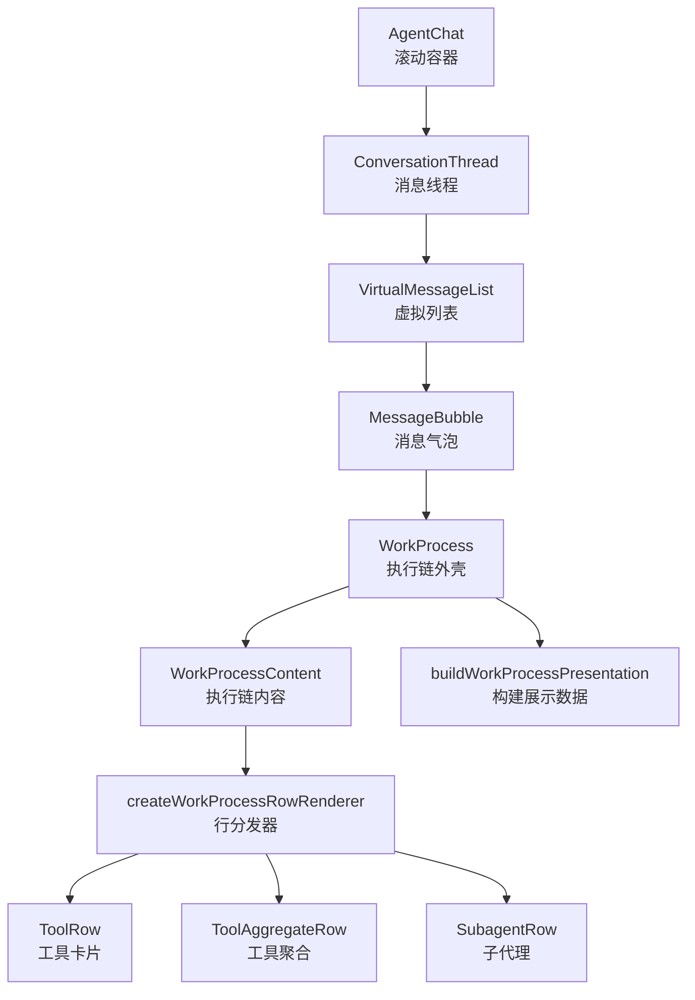
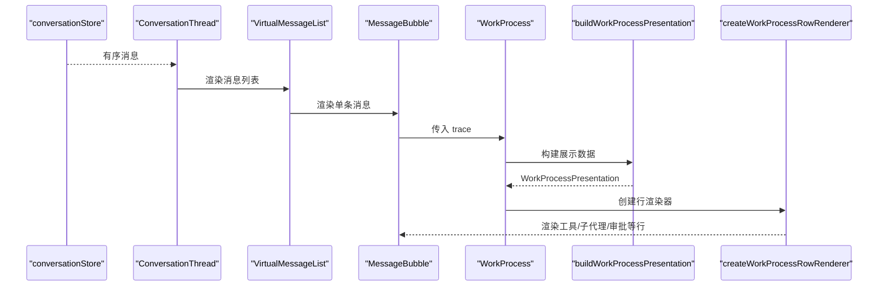
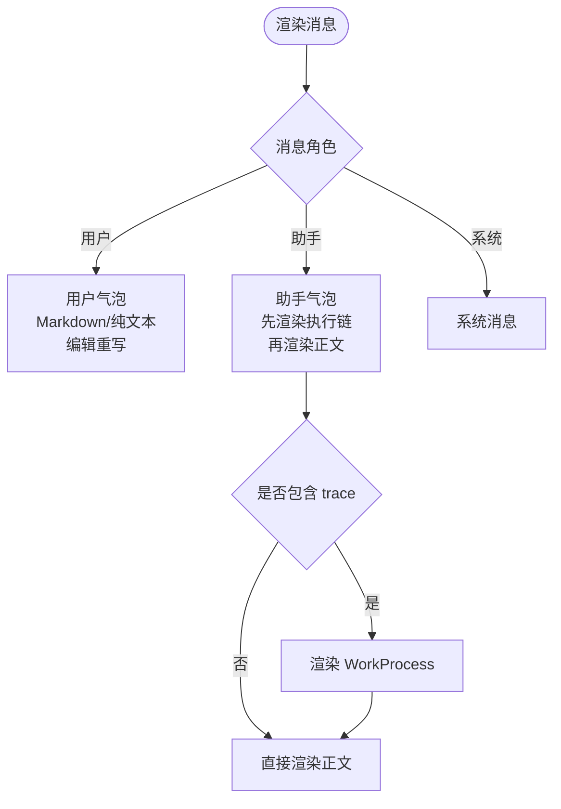
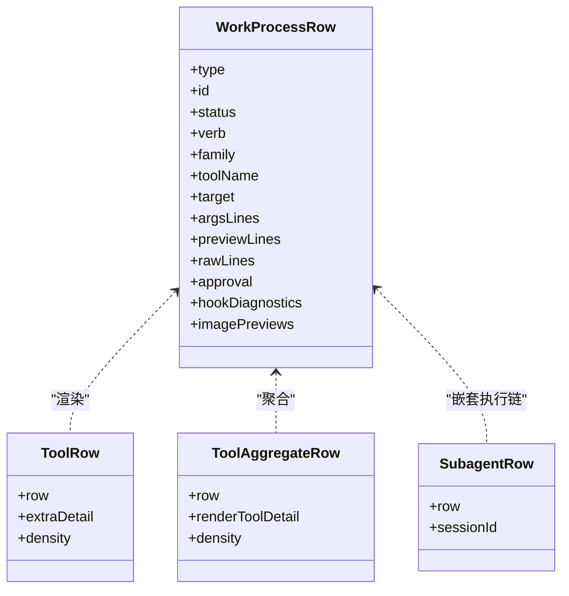
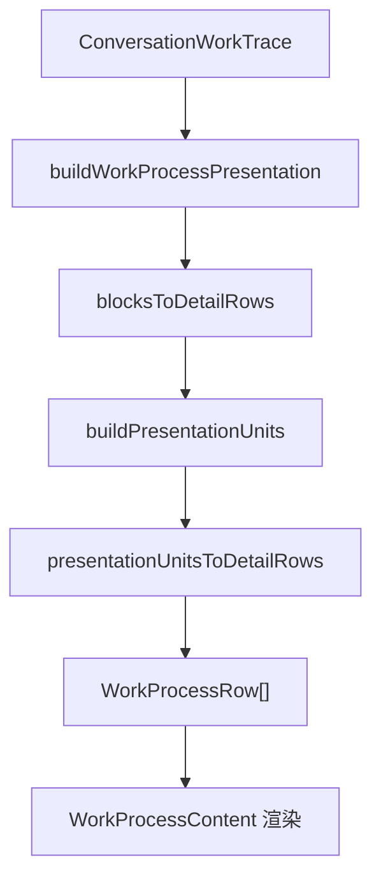
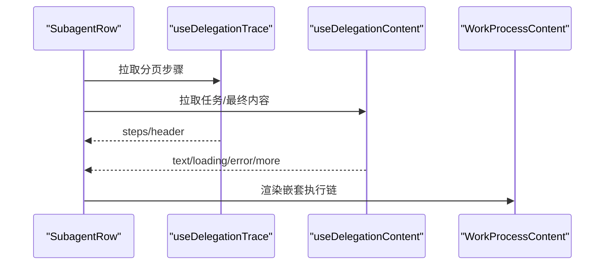
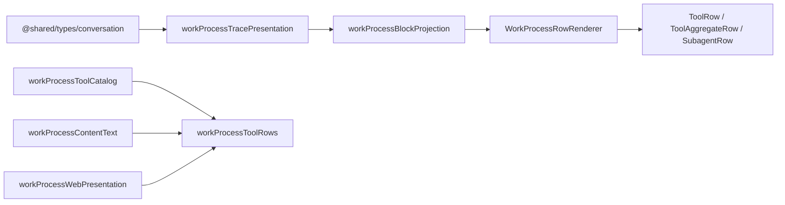
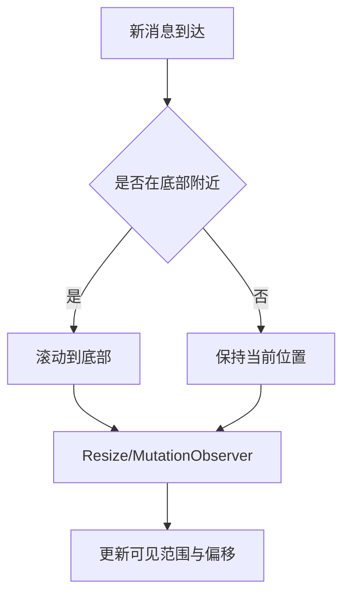
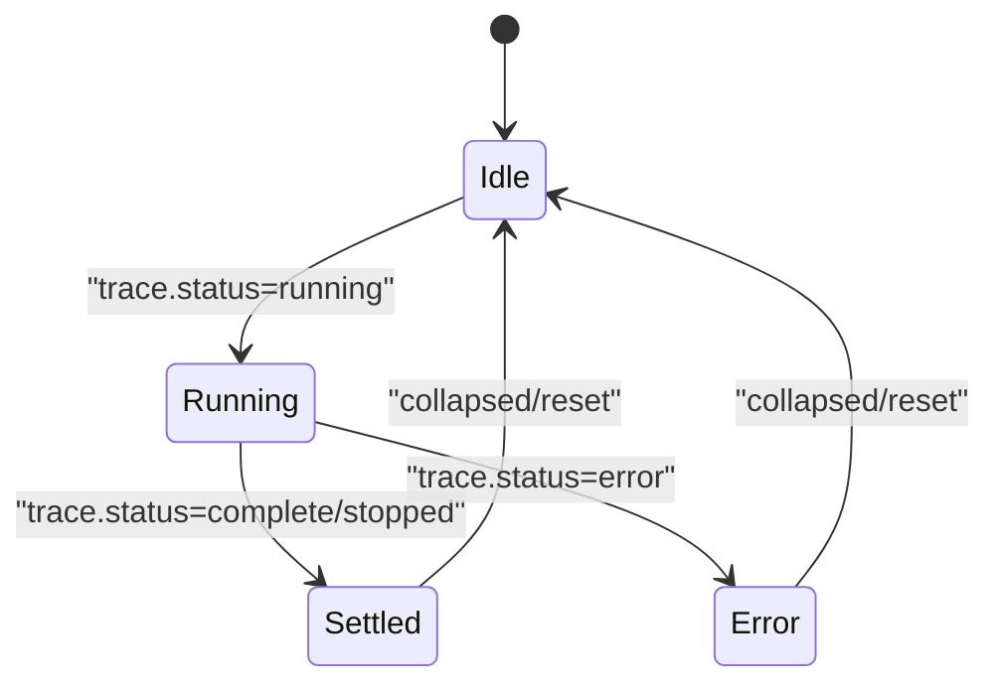
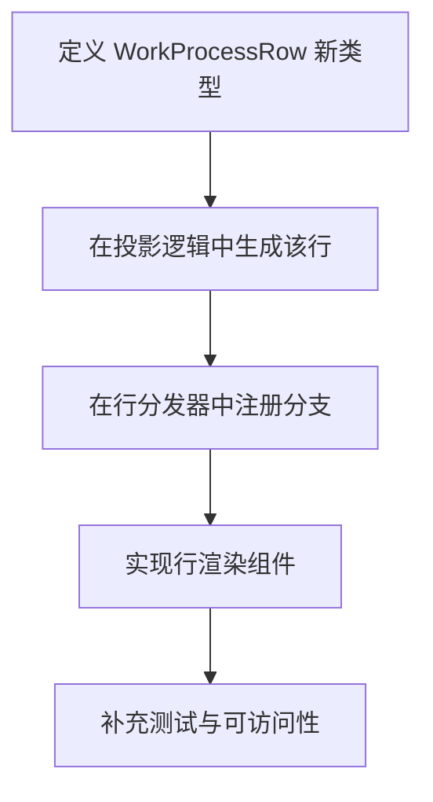

# Transcript 执行历史组件

<cite>
**本文引用的文件**   
- [src/renderer/features/transcript/index.tsx](file://src/renderer/features/transcript/index.tsx)
- [src/renderer/features/transcript/ConversationThread.tsx](file://src/renderer/features/transcript/ConversationThread.tsx)
- [src/renderer/features/transcript/VirtualMessageList.tsx](file://src/renderer/features/transcript/VirtualMessageList.tsx)
- [src/renderer/features/transcript/useTranscriptScroll.ts](file://src/renderer/features/transcript/useTranscriptScroll.ts)
- [src/renderer/features/transcript/MessageBubble.tsx](file://src/renderer/features/transcript/MessageBubble.tsx)
- [src/renderer/features/transcript/WorkProcess.tsx](file://src/renderer/features/transcript/WorkProcess.tsx)
- [src/renderer/features/transcript/WorkProcessContent.tsx](file://src/renderer/features/transcript/WorkProcessContent.tsx)
- [src/renderer/features/transcript/workProcessTypes.ts](file://src/renderer/features/transcript/workProcessTypes.ts)
- [src/renderer/features/transcript/workProcessTracePresentation.ts](file://src/renderer/features/transcript/workProcessTracePresentation.ts)
- [src/renderer/features/transcript/workProcessBlockProjection.ts](file://src/renderer/features/transcript/workProcessBlockProjection.ts)
- [src/renderer/features/transcript/workProcessToolRows.ts](file://src/renderer/features/transcript/workProcessToolRows.ts)
- [src/renderer/features/transcript/WorkProcessRowParts.tsx](file://src/renderer/features/transcript/WorkProcessRowParts.tsx)
- [src/renderer/features/transcript/WorkProcessRowRenderer.tsx](file://src/renderer/features/transcript/WorkProcessRowRenderer.tsx)
- [src/renderer/features/transcript/WorkProcessRows.tsx](file://src/renderer/features/transcript/WorkProcessRows.tsx)
- [src/renderer/features/transcript/ToolAggregateRow.tsx](file://src/renderer/features/transcript/ToolAggregateRow.tsx)
- [src/renderer/features/transcript/SubagentRow.tsx](file://src/renderer/features/transcript/SubagentRow.tsx)
</cite>

## 目录
1. [引言](#引言)
2. [项目结构](#项目结构)
3. [核心组件](#核心组件)
4. [架构总览](#架构总览)
5. [详细组件分析](#详细组件分析)
6. [依赖关系分析](#依赖关系分析)
7. [性能与流式更新](#性能与流式更新)
8. [配置与扩展指南](#配置与扩展指南)
9. [故障排查](#故障排查)
10. [结论](#结论)

## 引言
本文件聚焦 Transcript 执行历史组件，目标是解释对话消息如何被渲染为可交互的执行历史，包括用户消息、AI 回复、工具调用、子代理任务、审批与诊断信息。文档同时覆盖流式增量渲染、进度指示、状态同步机制，以及工具调用的嵌套展示、参数展开、结果折叠和错误高亮策略，并提供组件配置选项、自定义渲染接口与扩展新消息类型的开发指南。

## 项目结构
Transcript 相关代码集中在 `src/renderer/features/transcript` 目录，按职责分层：
- 入口与滚动容器：`index.tsx`、`useTranscriptScroll.ts`
- 消息列表与虚拟滚动：`ConversationThread.tsx`、`VirtualMessageList.tsx`
- 单条消息渲染：`MessageBubble.tsx`
- 工作进程（执行链）呈现：`WorkProcess.tsx`、`WorkProcessContent.tsx`、`workProcessTracePresentation.ts`、`workProcessBlockProjection.ts`
- 行模型与类型：`workProcessTypes.ts`
- 工具行与卡片：`workProcessToolRows.ts`、`WorkProcessRowParts.tsx`、`WorkProcessRowRenderer.tsx`、`WorkProcessRows.tsx`、`ToolAggregateRow.tsx`
- 子代理执行视图：`SubagentRow.tsx`

**图表来源**
- [src/renderer/features/transcript/index.tsx:1-37](file://src/renderer/features/transcript/index.tsx#L1-L37)
- [src/renderer/features/transcript/ConversationThread.tsx:1-46](file://src/renderer/features/transcript/ConversationThread.tsx#L1-L46)
- [src/renderer/features/transcript/VirtualMessageList.tsx:1-150](file://src/renderer/features/transcript/VirtualMessageList.tsx#L1-L150)
- [src/renderer/features/transcript/MessageBubble.tsx:1-251](file://src/renderer/features/transcript/MessageBubble.tsx#L1-L251)
- [src/renderer/features/transcript/WorkProcess.tsx:1-75](file://src/renderer/features/transcript/WorkProcess.tsx#L1-L75)
- [src/renderer/features/transcript/WorkProcessContent.tsx:1-39](file://src/renderer/features/transcript/WorkProcessContent.tsx#L1-L39)
- [src/renderer/features/transcript/workProcessRowRenderer.tsx:1-46](file://src/renderer/features/transcript/workProcessRowRenderer.tsx#L1-L46)
- [src/renderer/features/transcript/ToolAggregateRow.tsx:1-37](file://src/renderer/features/transcript/ToolAggregateRow.tsx#L1-L37)
- [src/renderer/features/transcript/SubagentRow.tsx:1-154](file://src/renderer/features/transcript/SubagentRow.tsx#L1-L154)

**章节来源**
- [src/renderer/features/transcript/index.tsx:1-37](file://src/renderer/features/transcript/index.tsx#L1-L37)
- [src/renderer/features/transcript/ConversationThread.tsx:1-46](file://src/renderer/features/transcript/ConversationThread.tsx#L1-L46)

## 核心组件
- AgentChat：Transcript 根容器，订阅消息数量与最新活动时间，提供滚动容器与空态类名。
- ConversationThread：从 conversationStore 获取有序消息，使用 VirtualMessageList 渲染，为空时显示空态提示。
- VirtualMessageList：窗口化虚拟列表，测量行高、计算偏移、滚动定位、支持“定位到工具调用”事件。
- MessageBubble：根据角色渲染用户消息、AI 回复或系统消息；AI 消息优先渲染执行链，再渲染正文与附件。
- WorkProcess：将后端 ConversationWorkTrace 转换为展示数据，控制展开/收起、状态点与元信息。
- WorkProcessContent：统一渲染执行链行，通过 createWorkProcessRowRenderer 分派具体行类型。
- workProcessTracePresentation / workProcessBlockProjection：把底层 blocks 投影为 WorkProcessRow 序列，处理循环、思考、输出阶段、计划审查、用户输入等。
- workProcessToolRows：工具调用到行模型的转换、状态推导、动词标签、目标摘要、诊断摘要、审批展示。
- WorkProcessRowParts / WorkProcessRows：工具卡片、摘要、诊断、用户输入、审批等行 UI。
- ToolAggregateRow：工具聚合卡片，用于批量同类工具的折叠展示。
- SubagentRow：子代理任务卡，包含任务、流程、最终结果、详情等子区域。

**章节来源**
- [src/renderer/features/transcript/WorkProcess.tsx:1-75](file://src/renderer/features/transcript/WorkProcess.tsx#L1-L75)
- [src/renderer/features/transcript/WorkProcessContent.tsx:1-39](file://src/renderer/features/transcript/WorkProcessContent.tsx#L1-L39)
- [src/renderer/features/transcript/workProcessTypes.ts:1-283](file://src/renderer/features/transcript/workProcessTypes.ts#L1-L283)

## 架构总览
Transcript 的渲染架构分为三层：
- 消息层：消息列表与单条消息气泡，负责角色区分、附件、Markdown 正文、时间戳与状态标签。
- 执行层：WorkProcess 将 ConversationWorkTrace 转为 WorkProcessPresentation，再由 WorkProcessContent 逐行渲染。
- 工具层：工具调用被规范化为 WorkProcessRow，按 family/groupKind 分组展示，支持参数预览、原始数据、审批、诊断、图片缩略图等。

**图表来源**
- [src/renderer/features/transcript/ConversationThread.tsx:1-46](file://src/renderer/features/transcript/ConversationThread.tsx#L1-L46)
- [src/renderer/features/transcript/VirtualMessageList.tsx:1-150](file://src/renderer/features/transcript/VirtualMessageList.tsx#L1-L150)
- [src/renderer/features/transcript/MessageBubble.tsx:1-251](file://src/renderer/features/transcript/MessageBubble.tsx#L1-L251)
- [src/renderer/features/transcript/WorkProcess.tsx:1-75](file://src/renderer/features/transcript/WorkProcess.tsx#L1-L75)
- [src/renderer/features/transcript/workProcessTracePresentation.ts:1-200](file://src/renderer/features/transcript/workProcessTracePresentation.ts#L1-L200)
- [src/renderer/features/transcript/workProcessRowRenderer.tsx:1-46](file://src/renderer/features/transcript/workProcessRowRenderer.tsx#L1-L46)

## 详细组件分析

### 消息类型与呈现方式
- 用户消息：显示 Markdown 或纯文本，支持编辑重写；附带附件与时间戳；编辑提交走乐观快照与异步重试。
- AI 回复：优先渲染 WorkProcess 执行链；正文在下方流式渲染，带流式光标；可选诊断块与转交建议。
- 工具调用：以卡片形式展示，默认折叠；展开后显示参数、原始数据、家族细节、审批、钩子诊断、图片预览、网页来源等。
- 审批与诊断：独立行或嵌入工具卡片；诊断在错误时高亮并支持展开详情。
- 子代理任务：独立卡片，含任务描述、执行过程、最终结果与详情面板。

**图表来源**
- [src/renderer/features/transcript/MessageBubble.tsx:1-251](file://src/renderer/features/transcript/MessageBubble.tsx#L1-L251)
- [src/renderer/features/transcript/WorkProcess.tsx:1-75](file://src/renderer/features/transcript/WorkProcess.tsx#L1-L75)

**章节来源**
- [src/renderer/features/transcript/MessageBubble.tsx:1-251](file://src/renderer/features/transcript/MessageBubble.tsx#L1-L251)

### 工具调用展示与嵌套
工具调用行由 `createToolRowForPresentation` 生成，随后由 `ToolRow` 渲染。关键特性：
- 折叠默认行为：运行中保持安静，减少 CoT 噪音；用户按需展开查看参数与原始数据。
- 参数展开与结果折叠：参数行与原始结果行分离；bodyText/bodyLines 作为折叠摘要，避免重复冗长输出。
- 家族模板：按 file/shell/git/web/search/generic 等 family 选择不同 Body/Detail 布局。
- 审批与诊断：当需要审批时显示审批出票；错误时提取人类可读的诊断摘要并高亮。
- 图片与网页：imagePreviews 缩略图；web 工具支持 pageChip 与 sourcePills。
- 嵌套聚合：相似工具可聚合成 ToolAggregateRow，提供统一展开/折叠。

**图表来源**
- [src/renderer/features/transcript/workProcessTypes.ts:1-283](file://src/renderer/features/transcript/workProcessTypes.ts#L1-L283)
- [src/renderer/features/transcript/WorkProcessRowParts.tsx:1-131](file://src/renderer/features/transcript/WorkProcessRowParts.tsx#L1-L131)
- [src/renderer/features/transcript/ToolAggregateRow.tsx:1-37](file://src/renderer/features/transcript/ToolAggregateRow.tsx#L1-L37)
- [src/renderer/features/transcript/SubagentRow.tsx:1-154](file://src/renderer/features/transcript/SubagentRow.tsx#L1-L154)

**章节来源**
- [src/renderer/features/transcript/workProcessToolRows.ts:1-273](file://src/renderer/features/transcript/workProcessToolRows.ts#L1-L273)
- [src/renderer/features/transcript/WorkProcessRowParts.tsx:1-131](file://src/renderer/features/transcript/WorkProcessRowParts.tsx#L1-L131)
- [src/renderer/features/transcript/WorkProcessRowRenderer.tsx:1-46](file://src/renderer/features/transcript/workProcessRowRenderer.tsx#L1-L46)
- [src/renderer/features/transcript/ToolAggregateRow.tsx:1-37](file://src/renderer/features/transcript/ToolAggregateRow.tsx#L1-L37)

### 执行链可视化与状态推进
执行链来自 ConversationWorkTrace.blocks，经以下阶段转换：
- buildWorkProcessPresentation：初始化 blocks 到 detail rows，标记最后一节默认展开，统计工具数、步骤数、重要性与时长。
- workProcessBlockProjection：遍历 blocks，识别 llm_turn、plan_review、user_input、output、approval、compaction、task_snapshot 等节点，组装 LoopPresentationUnit/StandalonePresentationUnit，并聚合 section 可见步骤。
- 状态推导：工具行的 status 基于 call.status、approval.status、error/resultPreview 推导；动词标签根据状态与工具展示定义生成。
- 思考与输出阶段：根据 thinking/kind/status 与 outputPhase 决定思考区与评论文本，运行时自动展开，结束后折叠。

**图表来源**
- [src/renderer/features/transcript/workProcessTracePresentation.ts:1-200](file://src/renderer/features/transcript/workProcessTracePresentation.ts#L1-L200)
- [src/renderer/features/transcript/workProcessBlockProjection.ts:1-200](file://src/renderer/features/transcript/workProcessBlockProjection.ts#L1-L200)

**章节来源**
- [src/renderer/features/transcript/workProcessTracePresentation.ts:1-200](file://src/renderer/features/transcript/workProcessTracePresentation.ts#L1-L200)
- [src/renderer/features/transcript/workProcessBlockProjection.ts:1-200](file://src/renderer/features/transcript/workProcessBlockProjection.ts#L1-L200)

### 子代理执行视图
SubagentRow 封装了子代理任务的完整体验：
- 头部展示身份、模式、时长、状态点与进度点。
- 任务区：懒加载任务文档，支持事实与约束展开。
- 流程区：内嵌 WorkProcessContent，密度为 compact，支持“更早记录”与重试。
- 最终结果区：Markdown 内容，支持加载更多。
- 详情区：调用头信息与执行元数据。
- 工具收据：对已完成/失败/取消/跳过的工具调用，渲染 DelegatedToolReceipt。

**图表来源**
- [src/renderer/features/transcript/SubagentRow.tsx:1-154](file://src/renderer/features/transcript/SubagentRow.tsx#L1-L154)
- [src/renderer/features/transcript/WorkProcessContent.tsx:1-39](file://src/renderer/features/transcript/WorkProcessContent.tsx#L1-L39)

**章节来源**
- [src/renderer/features/transcript/SubagentRow.tsx:1-154](file://src/renderer/features/transcript/SubagentRow.tsx#L1-L154)

## 依赖关系分析
- 消息层依赖 conversationStore 提供有序消息；渲染路径为 ConversationThread → VirtualMessageList → MessageBubble。
- 执行层依赖 @shared/types/conversation 中的 ConversationWorkTrace/ConversationWorkBlock/ConversationToolCall 等类型；展示构建依赖 workProcessFormat、groupImageRows、workProcessBlockText。
- 工具层依赖 workProcessToolCatalog（工具名归一化、展示名、家族）、workProcessContentText（解析/美化预览）、workProcessWebPresentation（web 工具呈现）。
- 行分发依赖 WorkProcessRowRenderer，将 type 映射到具体 React 组件。

**图表来源**
- [src/renderer/features/transcript/workProcessToolRows.ts:1-273](file://src/renderer/features/transcript/workProcessToolRows.ts#L1-L273)
- [src/renderer/features/transcript/workProcessTracePresentation.ts:1-200](file://src/renderer/features/transcript/workProcessTracePresentation.ts#L1-L200)
- [src/renderer/features/transcript/workProcessBlockProjection.ts:1-200](file://src/renderer/features/transcript/workProcessBlockProjection.ts#L1-L200)
- [src/renderer/features/transcript/workProcessRowRenderer.tsx:1-46](file://src/renderer/features/transcript/workProcessRowRenderer.tsx#L1-L46)

**章节来源**
- [src/renderer/features/transcript/workProcessToolRows.ts:1-273](file://src/renderer/features/transcript/workProcessToolRows.ts#L1-L273)
- [src/renderer/features/transcript/workProcessRowRenderer.tsx:1-46](file://src/renderer/features/transcript/workProcessRowRenderer.tsx#L1-L46)

## 性能与流式更新

### 虚拟列表与滚动吸附
- VirtualMessageList：当消息数超过阈值时使用虚拟滚动，维护 heights 表与 offsets 数组；通过 ResizeObserver 监听元素尺寸变化，动态修正 scrollTop 以保持视觉稳定。
- 滚动吸附：useTranscriptScroll 在用户位于底部附近时自动吸附到新内容；通过 MutationObserver 与 ResizeObserver 观察 DOM 变更与尺寸变化。

**图表来源**
- [src/renderer/features/transcript/VirtualMessageList.tsx:1-150](file://src/renderer/features/transcript/VirtualMessageList.tsx#L1-L150)
- [src/renderer/features/transcript/useTranscriptScroll.ts:1-49](file://src/renderer/features/transcript/useTranscriptScroll.ts#L1-L49)

**章节来源**
- [src/renderer/features/transcript/VirtualMessageList.tsx:1-150](file://src/renderer/features/transcript/VirtualMessageList.tsx#L1-L150)
- [src/renderer/features/transcript/useTranscriptScroll.ts:1-49](file://src/renderer/features/transcript/useTranscriptScroll.ts#L1-L49)

### 流式更新与实时状态同步
- 消息级流式：assistant 消息在 streaming/draft 状态下显示流式光标与“流式”标签；Markdown 渲染延迟重型插件以减少卡顿。
- 执行链流式：WorkProcess 在 running 状态下保持展开，并在头部使用 ActiveSignalText 表示活跃；section 的 thinking 与 proseStreaming 字段驱动思考区与评论文本的展开策略。
- 子代理流式：SubagentRow 对 active 状态启用时钟刷新，持续更新时间；loadEarlier/loadMore 与 error/retry 保证网络与分页交互流畅。

**图表来源**
- [src/renderer/features/transcript/WorkProcess.tsx:1-75](file://src/renderer/features/transcript/WorkProcess.tsx#L1-L75)
- [src/renderer/features/transcript/workProcessTracePresentation.ts:1-200](file://src/renderer/features/transcript/workProcessTracePresentation.ts#L1-L200)
- [src/renderer/features/transcript/SubagentRow.tsx:1-154](file://src/renderer/features/transcript/SubagentRow.tsx#L1-L154)

**章节来源**
- [src/renderer/features/transcript/MessageBubble.tsx:1-251](file://src/renderer/features/transcript/MessageBubble.tsx#L1-L251)
- [src/renderer/features/transcript/WorkProcess.tsx:1-75](file://src/renderer/features/transcript/WorkProcess.tsx#L1-L75)
- [src/renderer/features/transcript/SubagentRow.tsx:1-154](file://src/renderer/features/transcript/SubagentRow.tsx#L1-L154)

## 配置与扩展指南

### 组件配置选项
- AgentChat：mode 控制工作区模式；内部使用 useTranscriptScroll 管理滚动。
- WorkProcessContent：
  - presentation：WorkProcessPresentation，由 buildWorkProcessPresentation 生成。
  - sessionId：可选，传递给子代理与工具收据。
  - renderToolDetail：可选回调，为 tool 行提供额外详情节点。
  - disclosureScope：可选作用域，用于 ScopedWorkDisclosure。
  - density：normal 或 compact。
  - embedded：是否嵌入模式，影响外层缩进样式。
- VirtualMessageList：
  - estimateHeight：估算行高。
  - overscan：上下缓存行数。
  - className/data-testid：样式与测试标识。

**章节来源**
- [src/renderer/features/transcript/WorkProcessContent.tsx:1-39](file://src/renderer/features/transcript/WorkProcessContent.tsx#L1-L39)
- [src/renderer/features/transcript/VirtualMessageList.tsx:1-150](file://src/renderer/features/transcript/VirtualMessageList.tsx#L1-L150)

### 自定义渲染器接口
- 工具行详情扩展：在 WorkProcessContent 中传入 renderToolDetail(row)，可对特定工具返回额外 React 节点。
- 子代理工具收据：SubagentRow 中对已完成/失败/取消/跳过的工具调用渲染 DelegatedToolReceipt。
- 行渲染分发：createWorkProcessRowRenderer 支持按 row.type 路由到对应组件，新增类型需在此注册。

**章节来源**
- [src/renderer/features/transcript/WorkProcessContent.tsx:1-39](file://src/renderer/features/transcript/WorkProcessContent.tsx#L1-L39)
- [src/renderer/features/transcript/workProcessRowRenderer.tsx:1-46](file://src/renderer/features/transcript/workProcessRowRenderer.tsx#L1-L46)
- [src/renderer/features/transcript/SubagentRow.tsx:1-154](file://src/renderer/features/transcript/SubagentRow.tsx#L1-L154)

### 扩展现有消息类型的开发指南
若需新增一种执行历史行类型，建议遵循以下步骤：
1. 定义类型：在 workProcessTypes.ts 中添加新的联合分支，如 `{ type: 'custom', ...fields }`。
2. 数据构建：在 workProcessTracePresentation.ts 或 workProcessBlockProjection.ts 中将底层数据投影为新行。
3. 行分发：在 workProcessRowRenderer.tsx 的 createWorkProcessRowRenderer 中新增分支，返回对应组件。
4. 渲染组件：新建或复用 WorkProcessRows.tsx 中的行组件，遵循 status、icon、label 语义，并与 WorkCardHeader/CardBody/FamilyDetail/RawPanel 配合。
5. 聚合与展示：如需聚合，参考 ToolAggregateRow 的实现；如需特殊交互，参考 SubagentRow 的嵌套结构与披露控制。
6. 测试与可访问性：添加 data-testid、aria-* 属性，确保屏幕阅读器与自动化测试可用。

**图表来源**
- [src/renderer/features/transcript/workProcessTypes.ts:1-283](file://src/renderer/features/transcript/workProcessTypes.ts#L1-L283)
- [src/renderer/features/transcript/workProcessTracePresentation.ts:1-200](file://src/renderer/features/transcript/workProcessTracePresentation.ts#L1-L200)
- [src/renderer/features/transcript/workProcessBlockProjection.ts:1-200](file://src/renderer/features/transcript/workProcessBlockProjection.ts#L1-L200)
- [src/renderer/features/transcript/workProcessRowRenderer.tsx:1-46](file://src/renderer/features/transcript/workProcessRowRenderer.tsx#L1-L46)

**章节来源**
- [src/renderer/features/transcript/workProcessTypes.ts:1-283](file://src/renderer/features/transcript/workProcessTypes.ts#L1-L283)
- [src/renderer/features/transcript/workProcessRowRenderer.tsx:1-46](file://src/renderer/features/transcript/workProcessRowRenderer.tsx#L1-L46)

## 故障排查
- 工具调用未显示：检查 ConversationToolCall 是否进入 createToolRowForPresentation；确认 toolName 归一化与 display 定义是否存在。
- 诊断信息重复：MessageBubble 已判断诊断文案是否与正文相同，避免三重显示；如仍出现，检查 diagnostic.userMessage 与 message.content 一致性。
- 流式不更新：确认 assistant 消息的 status 是否为 streaming/draft，以及 WorkProcess.trace.status 是否为 running。
- 虚拟列表错位：检查 ResizeObserver 与 MutationObserver 是否正常触发；确认 onHeight 回调与 parent.scrollTop 修正逻辑。
- 子代理内容不可用：确认 useDelegationTrace 与 useDelegationContent 的 loading/error 分支是否正确渲染重试按钮。

**章节来源**
- [src/renderer/features/transcript/MessageBubble.tsx:150-251](file://src/renderer/features/transcript/MessageBubble.tsx#L150-L251)
- [src/renderer/features/transcript/VirtualMessageList.tsx:1-150](file://src/renderer/features/transcript/VirtualMessageList.tsx#L1-L150)
- [src/renderer/features/transcript/SubagentRow.tsx:1-154](file://src/renderer/features/transcript/SubagentRow.tsx#L1-L154)

## 结论
Transcript 执行历史组件通过清晰的层次划分与可扩展的行模型，将对话消息与工作进程执行链统一呈现。其设计重点在于：
- 消息层与执行层解耦，便于单独优化与扩展。
- 工具调用采用折叠默认、按需展开的策略，平衡信息密度与可读性。
- 流式更新贯穿消息与执行链，配合虚拟滚动与吸附策略，保障大会话下的性能与体验。
- 提供 renderToolDetail 与行分发机制，支持定制化工具详情与新消息类型。