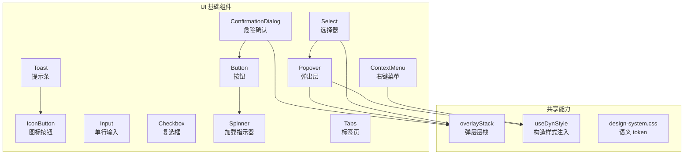
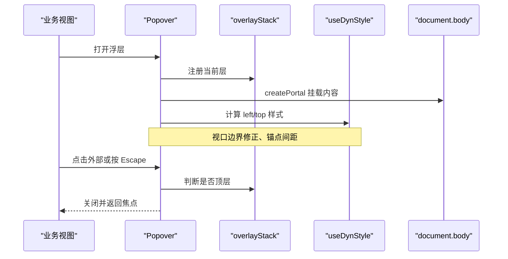
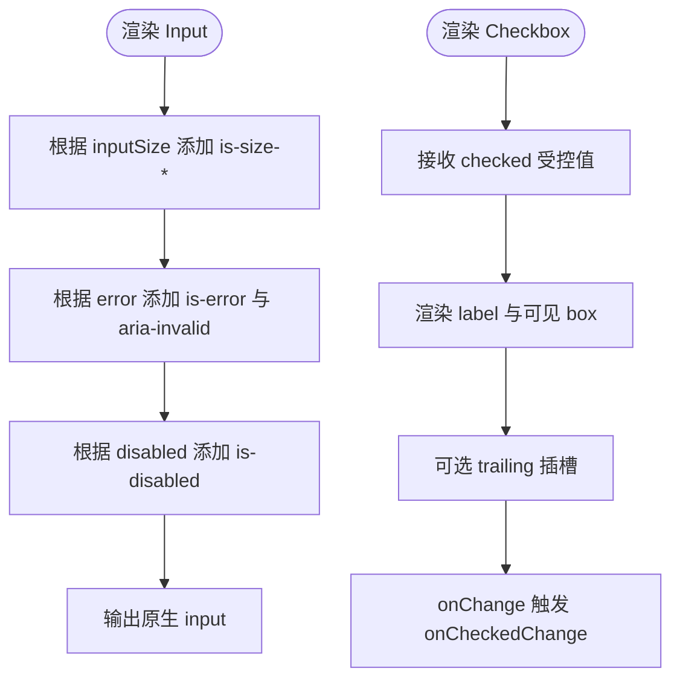
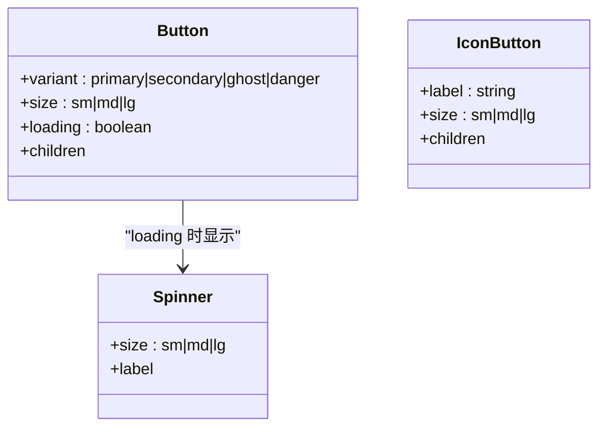
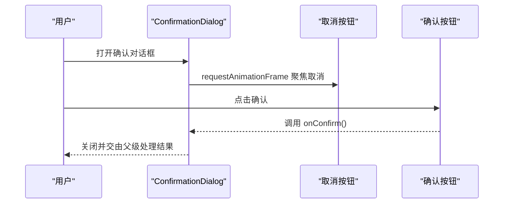
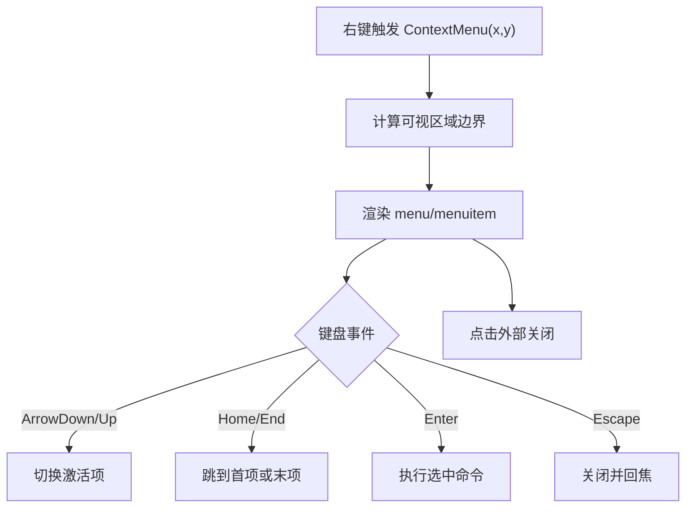
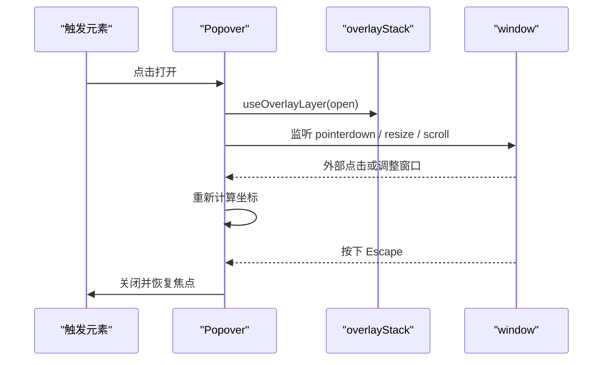
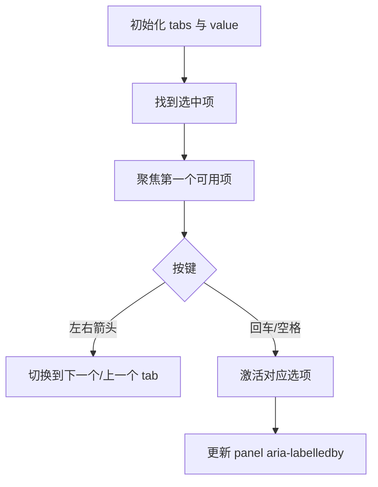
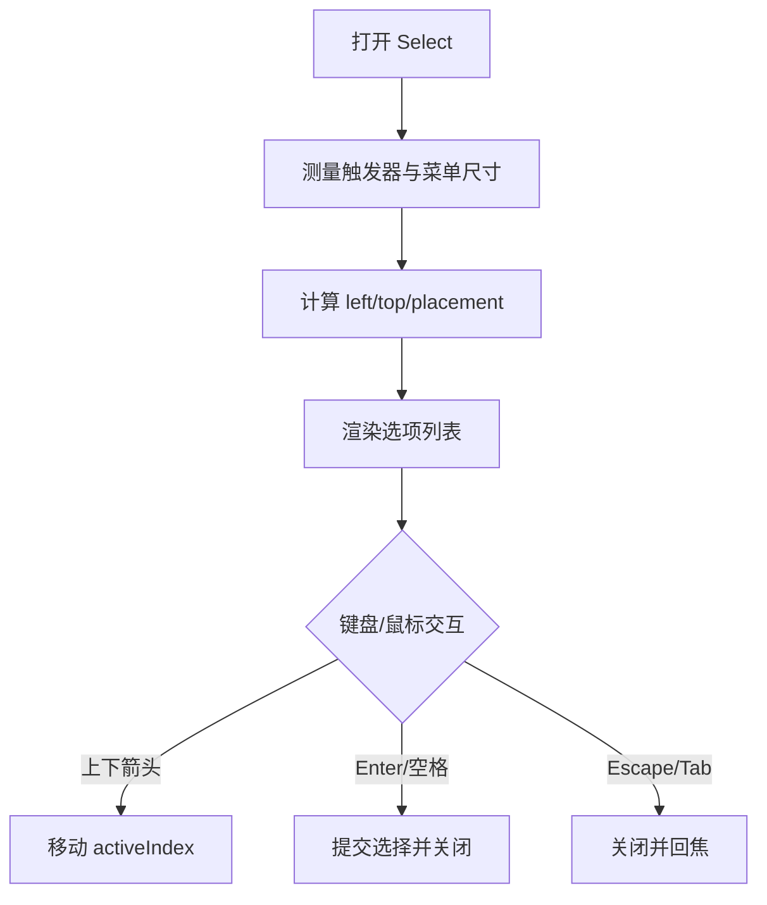
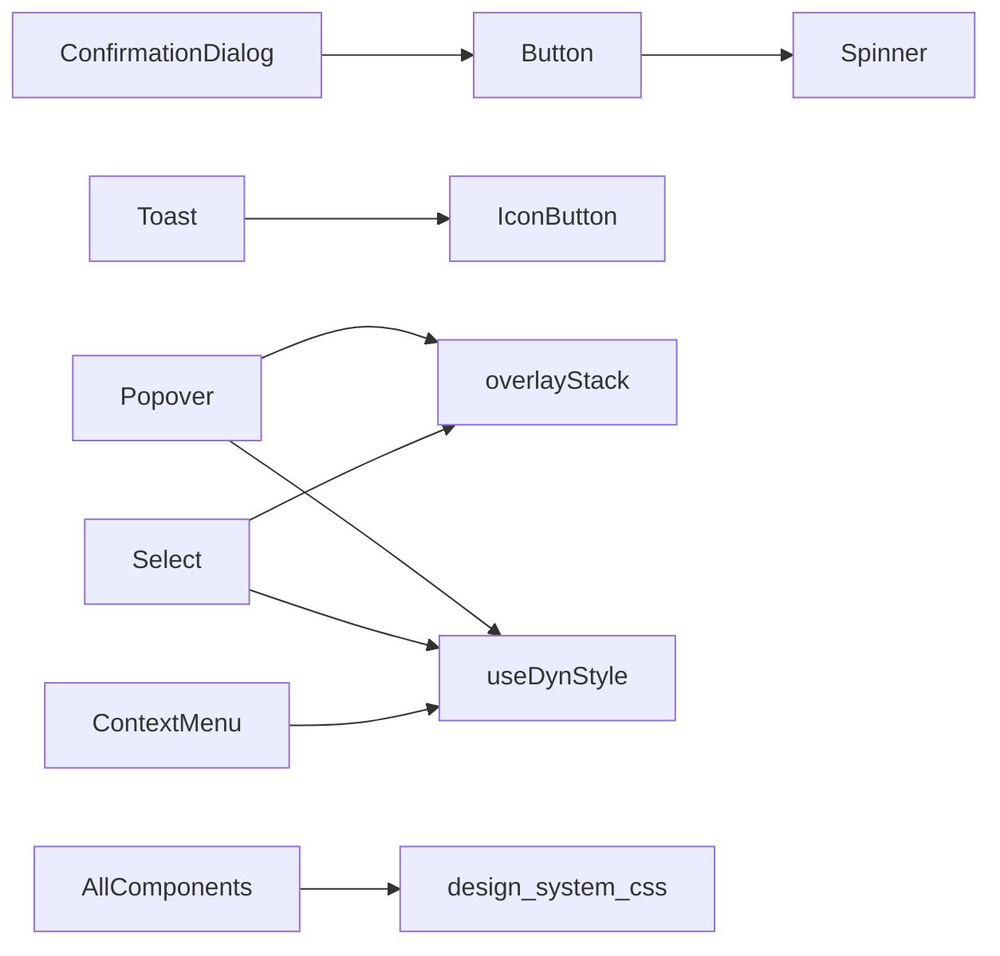

# UI 基础组件库

<cite>
**本文引用的文件**   
- [src/renderer/ui/Button.tsx](file://src/renderer/ui/Button.tsx)
- [src/renderer/ui/IconButton.tsx](file://src/renderer/ui/IconButton.tsx)
- [src/renderer/ui/Input.tsx](file://src/renderer/ui/Input.tsx)
- [src/renderer/ui/Checkbox.tsx](file://src/renderer/ui/Checkbox.tsx)
- [src/renderer/ui/Spinner.tsx](file://src/renderer/ui/Spinner.tsx)
- [src/renderer/ui/Toast.tsx](file://src/renderer/ui/Toast.tsx)
- [src/renderer/ui/ConfirmationDialog.tsx](file://src/renderer/ui/ConfirmationDialog.tsx)
- [src/renderer/ui/ContextMenu/index.tsx](file://src/renderer/ui/ContextMenu/index.tsx)
- [src/renderer/ui/Popover.tsx](file://src/renderer/ui/Popover.tsx)
- [src/renderer/ui/Tabs.tsx](file://src/renderer/ui/Tabs.tsx)
- [src/renderer/ui/Select/index.tsx](file://src/renderer/ui/Select/index.tsx)
- [docs/ui/design-system.md](file://docs/ui/design-system.md)
</cite>

## 目录
1. [简介](#简介)
2. [项目结构](#项目结构)
3. [核心组件](#核心组件)
4. [架构总览](#架构总览)
5. [详细组件分析](#详细组件分析)
6. [依赖关系分析](#依赖关系分析)
7. [性能与可访问性](#性能与可访问性)
8. [样式与主题系统](#样式与主题系统)
9. [使用示例与接口说明](#使用示例与接口说明)
10. [扩展与自定义指南](#扩展与自定义指南)
11. [故障排查](#故障排查)
12. [结论](#结论)

## 简介
本文件面向 RDC-Agent 前端渲染层中的 `src/renderer/ui` 基础组件库，目标是帮助开发者快速理解其整体架构、设计原则、组件分类、主题与样式体系、可访问性支持、扩展方式以及常见问题的定位方法。该组件库强调受控控件、语义化状态类、CSS 变量驱动的变体、统一的弹层与焦点管理，并通过门禁脚本约束视觉与结构契约。

## 项目结构
UI 组件位于 `src/renderer/ui`，采用“原子—分子”分层组织：
- 原子组件：按钮、图标按钮、输入框、复选框、加载指示器、提示条等。
- 分子组件：弹出层、上下文菜单、标签页、选择器、面板、空态、确认对话框等。
- 样式策略：每个组件尽量就近维护 `.css`，通过全局入口 `styles/global.css` → `ui/kit.css` 引入；主题语义 token 集中在运行时 CSS 中，组件只引用语义 token。

图表来源
- [src/renderer/ui/Button.tsx:1-53](file://src/renderer/ui/Button.tsx#L1-L53)
- [src/renderer/ui/IconButton.tsx:1-42](file://src/renderer/ui/IconButton.tsx#L1-L42)
- [src/renderer/ui/Input.tsx:1-38](file://src/renderer/ui/Input.tsx#L1-L38)
- [src/renderer/ui/Checkbox.tsx:1-41](file://src/renderer/ui/Checkbox.tsx#L1-L41)
- [src/renderer/ui/Spinner.tsx:1-18](file://src/renderer/ui/Spinner.tsx#L1-L18)
- [src/renderer/ui/Toast.tsx:1-47](file://src/renderer/ui/Toast.tsx#L1-L47)
- [src/renderer/ui/Tabs.tsx:1-95](file://src/renderer/ui/Tabs.tsx#L1-L95)
- [src/renderer/ui/Select/index.tsx:1-200](file://src/renderer/ui/Select/index.tsx#L1-L200)
- [src/renderer/ui/Popover.tsx:1-161](file://src/renderer/ui/Popover.tsx#L1-L161)
- [src/renderer/ui/ContextMenu/index.tsx:1-146](file://src/renderer/ui/ContextMenu/index.tsx#L1-L146)
- [src/renderer/ui/ConfirmationDialog.tsx:1-80](file://src/renderer/ui/ConfirmationDialog.tsx#L1-L80)
- [docs/ui/design-system.md:1-332](file://docs/ui/design-system.md#L1-L332)

章节来源
- [docs/ui/design-system.md:1-332](file://docs/ui/design-system.md#L1-L332)

## 核心组件
本节按职责对基础组件进行分类，并给出关键 Props、交互状态与可访问性要点。

### 输入组件
| 组件 | 作用 | 关键 Props | 交互状态 | 可访问性 |
|---|---|---|---|---|
| Input | 单行受控输入 | `inputSize`、`error`、原生 `input` 属性 | rest / hover / focus / disabled / error | 通过 `aria-invalid` 表达校验错误 |
| Textarea | 多行文本编辑（文档另有规范） | sizing、受控值、占位符等 | 自动高度、内部滚动、禁用 | 遵循表单语义与错误文案组合 |
| Checkbox | 受控复选 | `checked`、`onCheckedChange`、`label`、`trailing` | checked / unchecked / disabled | 原生 checkbox + 可见勾选图标 |

章节来源
- [src/renderer/ui/Input.tsx:1-38](file://src/renderer/ui/Input.tsx#L1-L38)
- [src/renderer/ui/Checkbox.tsx:1-41](file://src/renderer/ui/Checkbox.tsx#L1-L41)
- [docs/ui/design-system.md:1-332](file://docs/ui/design-system.md#L1-L332)

### 按钮组件
| 组件 | 作用 | 关键 Props | 交互状态 | 可访问性 |
|---|---|---|---|---|
| Button | 通用动作按钮 | `variant`、`size`、`loading`、`children` | primary / secondary / ghost / danger；loading / disabled | 原生 `<button>`，loading 时设置 `aria-busy` |
| IconButton | 仅图标的按钮 | `label`、`size`、`children` | size variants；disabled | 使用 `aria-label` 提供无障碍名称 |

章节来源
- [src/renderer/ui/Button.tsx:1-53](file://src/renderer/ui/Button.tsx#L1-L53)
- [src/renderer/ui/IconButton.tsx:1-42](file://src/renderer/ui/IconButton.tsx#L1-L42)

### 反馈组件
| 组件 | 作用 | 关键 Props | 行为 | 可访问性 |
|---|---|---|---|---|
| Spinner | 加载指示器 | `size`、`label`、`className` | 动画旋转；尺寸档位 | `role="status"`，可选 `aria-label` |
| Toast | 轻量通知 | `title`、`message`、`tone`、`onDismiss`、`dismissLabel` | 可关闭，多 tone 语义 | `role="status"`，配合关闭按钮 |
| ConfirmationDialog | 危险操作确认 | `title`、`message`、`details`、`busy`、回调 | 默认聚焦取消按钮；danger 主按钮 | 基于 TaskDialog 的 `alertdialog` 语义 |

章节来源
- [src/renderer/ui/Spinner.tsx:1-18](file://src/renderer/ui/Spinner.tsx#L1-L18)
- [src/renderer/ui/Toast.tsx:1-47](file://src/renderer/ui/Toast.tsx#L1-L47)
- [src/renderer/ui/ConfirmationDialog.tsx:1-80](file://src/renderer/ui/ConfirmationDialog.tsx#L1-L80)

## 架构总览
组件库采用“受控 React 组件 + 就近 CSS + 语义 token”的架构。高级浮层能力由共享机制支撑：
- `overlayStack`：统一管理弹窗、弹出层、菜单等的层级与 Escape 关闭顺序。
- `useDynStyle`：在 CSP 限制下以 constructable stylesheet 注入动态样式，避免内联 style。
- `design-system.css`：定义 primitive 与语义 token，组件 CSS 只能引用语义 token。

图表来源
- [src/renderer/ui/Popover.tsx:1-161](file://src/renderer/ui/Popover.tsx#L1-L161)
- [src/renderer/ui/Select/index.tsx:1-200](file://src/renderer/ui/Select/index.tsx#L1-L200)
- [src/renderer/ui/ContextMenu/index.tsx:1-146](file://src/renderer/ui/ContextMenu/index.tsx#L1-L146)

## 详细组件分析

### 输入组件：Input 与 Checkbox
Input 是轻量原生 input 封装，将尺寸与错误状态映射到 `is-size-*`、`is-error`、`is-disabled` 等状态类，并把 `error` 转为 `aria-invalid`。Checkbox 是受控复选框，用 label 包裹隐藏的原生 checkbox，并在视觉盒子上显示勾选图标。

图表来源
- [src/renderer/ui/Input.tsx:1-38](file://src/renderer/ui/Input.tsx#L1-L38)
- [src/renderer/ui/Checkbox.tsx:1-41](file://src/renderer/ui/Checkbox.tsx#L1-L41)

章节来源
- [src/renderer/ui/Input.tsx:1-38](file://src/renderer/ui/Input.tsx#L1-L38)
- [src/renderer/ui/Checkbox.tsx:1-41](file://src/renderer/ui/Checkbox.tsx#L1-L41)

### 按钮组件：Button 与 IconButton
Button 统一了四种 variant 与三种 size，并将 loading 与 disabled 合并为禁用态，同时设置 `aria-busy`。IconButton 用于无文字按钮场景，要求通过 `label` 提供无障碍名称。

图表来源
- [src/renderer/ui/Button.tsx:1-53](file://src/renderer/ui/Button.tsx#L1-L53)
- [src/renderer/ui/IconButton.tsx:1-42](file://src/renderer/ui/IconButton.tsx#L1-L42)
- [src/renderer/ui/Spinner.tsx:1-18](file://src/renderer/ui/Spinner.tsx#L1-L18)

章节来源
- [src/renderer/ui/Button.tsx:1-53](file://src/renderer/ui/Button.tsx#L1-L53)
- [src/renderer/ui/IconButton.tsx:1-42](file://src/renderer/ui/IconButton.tsx#L1-L42)

### 反馈组件：Spinner、Toast、ConfirmationDialog
Spinner 作为加载状态的基础单元被 Button 复用。Toast 提供 info/success/warning/error tone，并使用 IconButton 实现关闭。ConfirmationDialog 基于任务对话框模板，默认把焦点放在取消按钮上，主按钮为 danger。

图表来源
- [src/renderer/ui/Spinner.tsx:1-18](file://src/renderer/ui/Spinner.tsx#L1-L18)
- [src/renderer/ui/Toast.tsx:1-47](file://src/renderer/ui/Toast.tsx#L1-L47)
- [src/renderer/ui/ConfirmationDialog.tsx:1-80](file://src/renderer/ui/ConfirmationDialog.tsx#L1-L80)

章节来源
- [src/renderer/ui/Spinner.tsx:1-18](file://src/renderer/ui/Spinner.tsx#L1-L18)
- [src/renderer/ui/Toast.tsx:1-47](file://src/renderer/ui/Toast.tsx#L1-L47)
- [src/renderer/ui/ConfirmationDialog.tsx:1-80](file://src/renderer/ui/ConfirmationDialog.tsx#L1-L80)

### 高级组件：上下文菜单、弹出层、标签页、选择器

#### 上下文菜单 ContextMenu
右键上下文菜单自绘，不走原生菜单，保证浏览器与桌面端一致。它负责：
- 视口边界修正，避免溢出。
- 键盘导航：方向键、Home/End、Enter、Escape。
- 使用 `role="menu"` 与 `role="menuitem"`。
- 通过 `createPortal` 挂载到 `document.body`。

图表来源
- [src/renderer/ui/ContextMenu/index.tsx:1-146](file://src/renderer/ui/ContextMenu/index.tsx#L1-L146)

章节来源
- [src/renderer/ui/ContextMenu/index.tsx:1-146](file://src/renderer/ui/ContextMenu/index.tsx#L1-L146)

#### 弹出层 Popover
Popover 提供锚定元素、位置计算、视口 clamp、Escape 关闭、焦点返回和 overlay 层级管理。它与 `overlayStack` 协作，确保只在顶层响应 Escape。

图表来源
- [src/renderer/ui/Popover.tsx:1-161](file://src/renderer/ui/Popover.tsx#L1-L161)

章节来源
- [src/renderer/ui/Popover.tsx:1-161](file://src/renderer/ui/Popover.tsx#L1-L161)

#### 标签页 Tabs
Tabs 支持普通页面标签与分段单选两种模式。它维护 `tablist`、`tab`、`tabpanel` 的 ARIA 关系，并提供键盘导航逻辑，包括左右切换和初始聚焦。

图表来源
- [src/renderer/ui/Tabs.tsx:1-95](file://src/renderer/ui/Tabs.tsx#L1-L95)

章节来源
- [src/renderer/ui/Tabs.tsx:1-95](file://src/renderer/ui/Tabs.tsx#L1-L95)

#### 选择器 Select
Select 是一个完整的选择控件，包含触发器、下拉菜单、视口定位、禁用项过滤、键盘导航和焦点管理。它复用 Popover 的定位思路，但内置更丰富的菜单布局与选项状态。

图表来源
- [src/renderer/ui/Select/index.tsx:1-200](file://src/renderer/ui/Select/index.tsx#L1-L200)

章节来源
- [src/renderer/ui/Select/index.tsx:1-200](file://src/renderer/ui/Select/index.tsx#L1-L200)

## 依赖关系分析
组件之间的耦合关系清晰：
- Button 依赖 Spinner。
- Toast 依赖 IconButton。
- ConfirmationDialog 依赖 Button 与 TaskDialog。
- Popover、Select、ContextMenu 依赖 overlayStack 与 useDynStyle。
- 所有组件 CSS 依赖 design-system.css 提供的语义 token。

图表来源
- [src/renderer/ui/Button.tsx:1-53](file://src/renderer/ui/Button.tsx#L1-L53)
- [src/renderer/ui/Toast.tsx:1-47](file://src/renderer/ui/Toast.tsx#L1-L47)
- [src/renderer/ui/ConfirmationDialog.tsx:1-80](file://src/renderer/ui/ConfirmationDialog.tsx#L1-L80)
- [src/renderer/ui/Popover.tsx:1-161](file://src/renderer/ui/Popover.tsx#L1-L161)
- [src/renderer/ui/Select/index.tsx:1-200](file://src/renderer/ui/Select/index.tsx#L1-L200)
- [src/renderer/ui/ContextMenu/index.tsx:1-146](file://src/renderer/ui/ContextMenu/index.tsx#L1-L146)
- [docs/ui/design-system.md:1-332](file://docs/ui/design-system.md#L1-L332)

章节来源
- [docs/ui/design-system.md:1-332](file://docs/ui/design-system.md#L1-L332)

## 性能与可访问性

### 性能特性
- 浮层定位使用 `useLayoutEffect` 同步测量 DOM，减少闪烁。
- 动态样式通过 `useDynStyle` 注入，避免频繁修改 DOM style 属性。
- 菜单与弹出层使用 `createPortal` 直接挂载到 body，避免复杂嵌套导致的布局重排。
- Select 与 Popover 在关闭时清理事件监听，防止内存泄漏。

### 可访问性支持
- 键盘导航：ContextMenu、Tabs、Select 均实现方向键、Home/End、Enter、Escape。
- 屏幕阅读器：Spinner 使用 `role="status"`，Toast 使用 `role="status"`，ConfirmationDialog 使用 alertdialog 语义。
- 焦点管理：Popover 与 Select 在关闭后将焦点返回触发元素；ConfirmationDialog 默认聚焦取消按钮。
- 状态语义：Input 通过 `aria-invalid` 表达错误；Button 在 loading 时设置 `aria-busy`；Checkbox 使用原生 checkbox 语义。

章节来源
- [src/renderer/ui/ContextMenu/index.tsx:1-146](file://src/renderer/ui/ContextMenu/index.tsx#L1-L146)
- [src/renderer/ui/Tabs.tsx:1-95](file://src/renderer/ui/Tabs.tsx#L1-L95)
- [src/renderer/ui/Select/index.tsx:1-200](file://src/renderer/ui/Select/index.tsx#L1-L200)
- [src/renderer/ui/Popover.tsx:1-161](file://src/renderer/ui/Popover.tsx#L1-L161)
- [src/renderer/ui/Spinner.tsx:1-18](file://src/renderer/ui/Spinner.tsx#L1-L18)
- [src/renderer/ui/Toast.tsx:1-47](file://src/renderer/ui/Toast.tsx#L1-L47)
- [src/renderer/ui/ConfirmationDialog.tsx:1-80](file://src/renderer/ui/ConfirmationDialog.tsx#L1-L80)
- [src/renderer/ui/Input.tsx:1-38](file://src/renderer/ui/Input.tsx#L1-L38)
- [src/renderer/ui/Button.tsx:1-53](file://src/renderer/ui/Button.tsx#L1-L53)

## 样式与主题系统
组件库的样式体系由以下规则构成：
- 唯一全局入口：全局样式引导至 design-system.css。
- 语义 token：组件 CSS 只能引用 `--token-*`，禁止直接使用 primitive token、十六进制颜色、px 字号或奇数间距。
- 状态类：统一使用 `is-*` 命名，如 `is-active`、`is-selected`、`is-disabled`、`is-error`。
- 按钮系统：通过 `.button` 基类与 `button-primary/secondary/ghost/danger` 变体统一外观。
- 控件刻度：控件高度、圆角、间距、字号、时长由 token 统一控制。
- 动态样式：必须使用 constructable stylesheet，禁止内联 style 或动态注入 `<style>`。

章节来源
- [docs/ui/design-system.md:1-332](file://docs/ui/design-system.md#L1-L332)

## 使用示例与接口说明

### Button
- 用途：通用按钮，支持多种变体与尺寸。
- 主要 Props：
  - `variant`：primary、secondary、ghost、danger。
  - `size`：sm、md、lg。
  - `loading`：显示加载状态并禁用按钮。
  - `children`：按钮内容。
- 可访问性：原生 button，loading 时设置 `aria-busy`。

章节来源
- [src/renderer/ui/Button.tsx:1-53](file://src/renderer/ui/Button.tsx#L1-L53)

### IconButton
- 用途：图标按钮，适合工具栏、操作列等空间紧凑场景。
- 主要 Props：
  - `label`：无障碍名称。
  - `size`：sm、md、lg。
  - `children`：图标节点。
- 可访问性：必须提供 `aria-label`。

章节来源
- [src/renderer/ui/IconButton.tsx:1-42](file://src/renderer/ui/IconButton.tsx#L1-L42)

### Input
- 用途：单行输入框。
- 主要 Props：
  - `inputSize`：sm、md、lg。
  - `error`：是否处于错误状态。
  - 其他原生 input 属性。
- 可访问性：错误时设置 `aria-invalid`。

章节来源
- [src/renderer/ui/Input.tsx:1-38](file://src/renderer/ui/Input.tsx#L1-L38)

### Checkbox
- 用途：受控复选框。
- 主要 Props：
  - `checked`：受控选中状态。
  - `onCheckedChange`：选中变化回调。
  - `label`：辅助文本。
  - `trailing`：右侧附加内容。
- 可访问性：原生 checkbox 语义，视觉勾选图标。

章节来源
- [src/renderer/ui/Checkbox.tsx:1-41](file://src/renderer/ui/Checkbox.tsx#L1-L41)

### Spinner
- 用途：加载指示器。
- 主要 Props：
  - `size`：sm、md、lg。
  - `label`：可选无障碍描述。
- 可访问性：`role="status"`。

章节来源
- [src/renderer/ui/Spinner.tsx:1-18](file://src/renderer/ui/Spinner.tsx#L1-L18)

### Toast
- 用途：轻量通知。
- 主要 Props：
  - `title`：标题。
  - `message`：可选消息。
  - `tone`：info、success、warning、error。
  - `onDismiss`：关闭回调。
  - `dismissLabel`：关闭按钮无障碍名称。
- 可访问性：`role="status"`。

章节来源
- [src/renderer/ui/Toast.tsx:1-47](file://src/renderer/ui/Toast.tsx#L1-L47)

### ConfirmationDialog
- 用途：危险操作确认。
- 主要 Props：
  - `title`、`message`、`confirmLabel`、`cancelLabel`。
  - `details`：只读事实列表。
  - `busy`：是否处于忙碌。
  - `onConfirm`、`onCancel`：回调。
- 可访问性：基于 alertdialog 语义，默认聚焦取消按钮。

章节来源
- [src/renderer/ui/ConfirmationDialog.tsx:1-80](file://src/renderer/ui/ConfirmationDialog.tsx#L1-L80)

### ContextMenu
- 用途：应用级右键菜单。
- 主要 Props：
  - `x`、`y`：弹出坐标。
  - `items`：菜单项数组。
  - `onSelect`：选中回调。
  - `onClose`：关闭回调。
- 可访问性：`role="menu"`，支持键盘导航。

章节来源
- [src/renderer/ui/ContextMenu/index.tsx:1-146](file://src/renderer/ui/ContextMenu/index.tsx#L1-L146)

### Popover
- 用途：通用弹出层。
- 主要 Props：
  - `open`、`onOpenChange`。
  - `trigger`：触发元素。
  - `children`：弹出内容。
  - `align`、`side`：对齐与方位。
  - `role`：dialog 或 presentation。
- 可访问性：与 overlayStack 协作，支持 Escape 关闭并返回焦点。

章节来源
- [src/renderer/ui/Popover.tsx:1-161](file://src/renderer/ui/Popover.tsx#L1-L161)

### Tabs
- 用途：页面标签或分段选择器。
- 主要 Props：
  - `tabs`：标签项数组。
  - `value`、`onChange`：受控选中值。
  - `variant`：underline、segmented。
  - `fullWidth`：等宽分布。
- 可访问性：`tablist` / `tab` / `tabpanel`。

章节来源
- [src/renderer/ui/Tabs.tsx:1-95](file://src/renderer/ui/Tabs.tsx#L1-L95)

### Select
- 用途：下拉选择器。
- 主要 Props：
  - `value`、`options`、`onChange`。
  - `placeholder`、`emptyLabel`。
  - `variant`、`menuAlign`、`minMenuWidth`。
  - `ariaLabel`、`dataTestId`。
- 可访问性：键盘导航、Escape 关闭、焦点返回。

章节来源
- [src/renderer/ui/Select/index.tsx:1-200](file://src/renderer/ui/Select/index.tsx#L1-L200)

## 扩展与自定义指南
新增或扩展组件时应遵循以下原则：
1. 覆盖全部交互状态：rest、hover、active、focus、disabled，必要时增加 loading、error。
2. 使用 CSS 变量控制变体：不要在组件 CSS 中硬编码颜色，应通过 `--token-*` 或组件级 CSS 变量。
3. 避免内联样式：动态值例外，但优先使用 `useDynStyle` 或 constructable stylesheet。
4. 保持文件规模：组件不超过 300 行，hook/service 不超过 200 行。
5. 复用现有能力：弹层使用 Popover/TaskDialog，菜单使用 Menu/ContextMenu，空态使用 EmptyState，不要重复造轮子。
6. 可访问性先行：为交互元素提供正确的 role、aria-*、键盘导航和焦点管理。

章节来源
- [docs/ui/design-system.md:1-332](file://docs/ui/design-system.md#L1-L332)

## 故障排查
- 浮层被遮挡或位置异常：检查是否正确使用 `overlayStack` 与 `useDynStyle`，确认视口边界计算逻辑未被外部样式覆盖。
- 键盘导航无效：确认组件实现了 Arrow/Home/End/Enter/Escape，且未阻止默认行为后未更新焦点或选中项。
- 屏幕阅读器无法识别：检查 `role`、`aria-label`、`aria-invalid`、`aria-busy` 是否正确设置。
- 样式不生效或被覆盖：确认组件 CSS 引用的是语义 token，而非 primitive token；避免在 feature 层重复定义按钮或弹层样式。
- 按钮 loading 状态不可见：确认 `loading` 会同时设置 `aria-busy` 并禁用按钮，且 CSS 中存在对应的 `is-loading` 样式。
- 确认对话框焦点错乱：确认默认聚焦取消按钮，且在忙状态时禁用确认按钮。

章节来源
- [src/renderer/ui/Popover.tsx:1-161](file://src/renderer/ui/Popover.tsx#L1-L161)
- [src/renderer/ui/ContextMenu/index.tsx:1-146](file://src/renderer/ui/ContextMenu/index.tsx#L1-L146)
- [src/renderer/ui/Tabs.tsx:1-95](file://src/renderer/ui/Tabs.tsx#L1-L95)
- [src/renderer/ui/Select/index.tsx:1-200](file://src/renderer/ui/Select/index.tsx#L1-L200)
- [src/renderer/ui/Button.tsx:1-53](file://src/renderer/ui/Button.tsx#L1-L53)
- [src/renderer/ui/ConfirmationDialog.tsx:1-80](file://src/renderer/ui/ConfirmationDialog.tsx#L1-L80)
- [docs/ui/design-system.md:1-332](file://docs/ui/design-system.md#L1-L332)

## 结论
RDC-Agent 的 UI 基础组件库以受控 React 组件为核心，结合语义 token、状态类和共享浮层能力，形成统一、可访问、可扩展的基础设施。输入、按钮、反馈三类基础组件满足高频场景；上下文菜单、弹出层、标签页、选择器等高级组件则提供一致的交互与可访问性体验。遵循设计系统文档与门禁规则，可以持续保持视觉一致性、代码可维护性与无障碍质量。