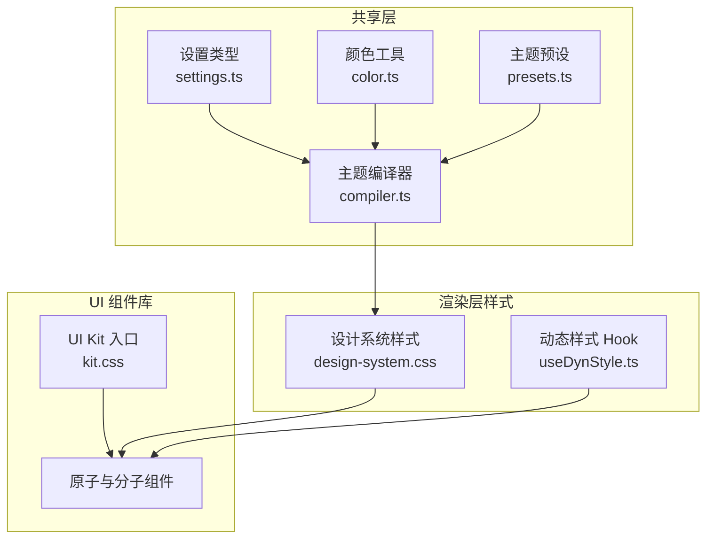
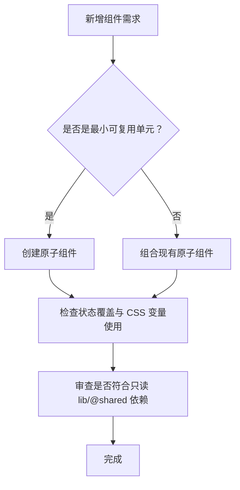
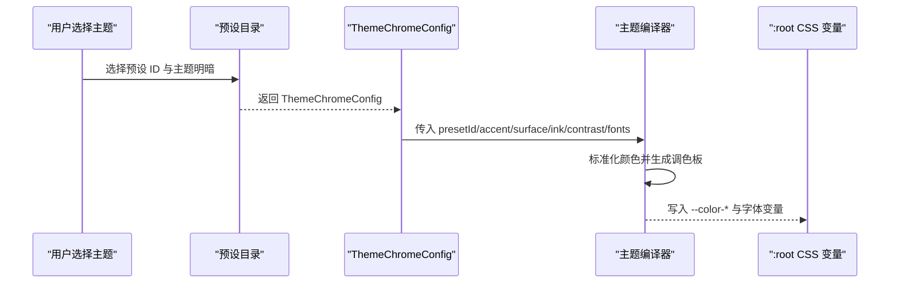
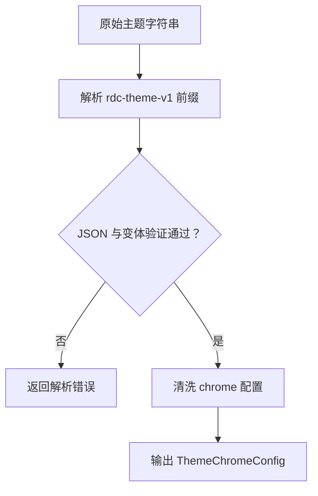
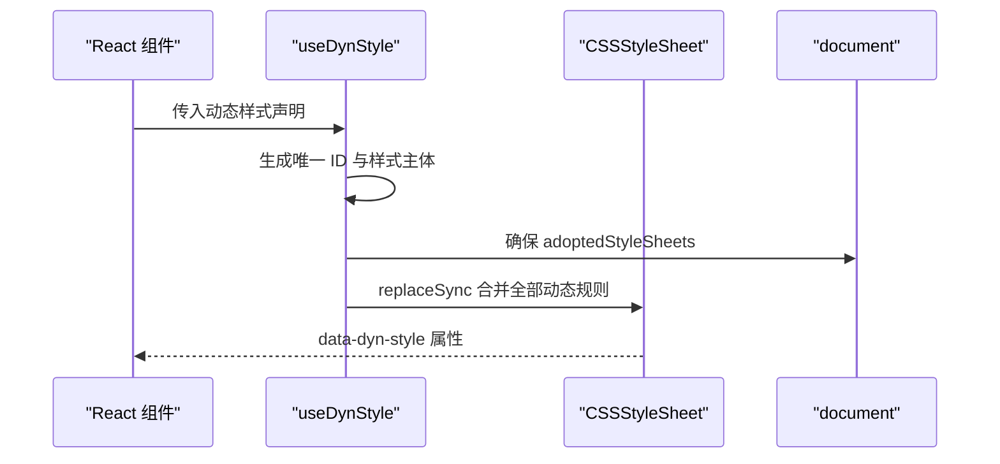
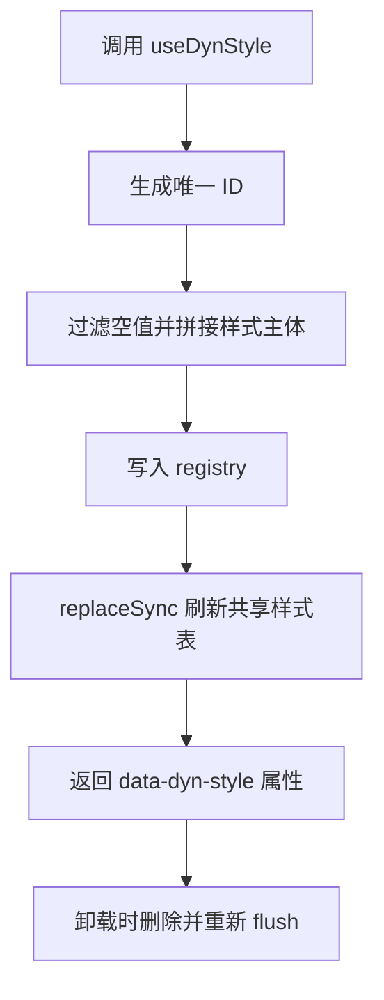
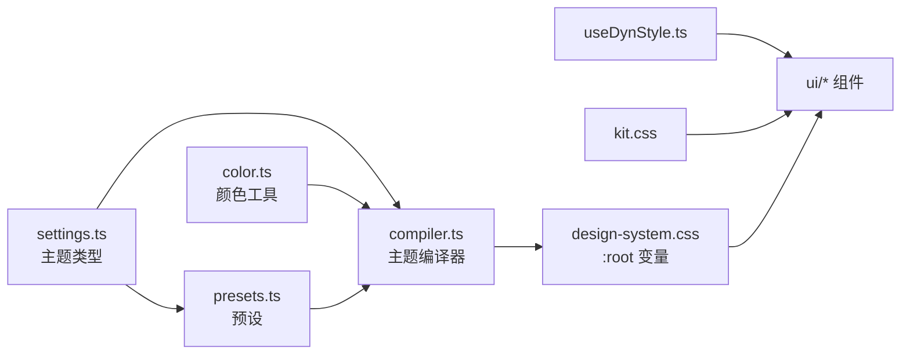

# 基础与主题系统

<cite>
**本文引用的文件**   
- [UI 组件说明](file://src/renderer/ui/README.md)
- [设计系统样式入口](file://src/renderer/styles/design-system.css)
- [动态样式注入 Hook](file://src/renderer/lib/useDynStyle.ts)
- [主题编译器](file://src/shared/theme/compiler.ts)
- [主题预设目录](file://src/shared/theme/presets.ts)
- [设置类型定义](file://src/shared/types/settings.ts)
- [颜色工具实现](file://src/shared/theme/color.ts)
- [主题导入导出协议](file://src/shared/theme/rdcThemeV1.ts)
- [UI Kit 样式汇总入口](file://src/renderer/ui/kit.css)
</cite>

## 目录
1. [引言](#引言)
2. [项目结构](#项目结构)
3. [核心组件分层](#核心组件分层)
4. [样式命名规范](#样式命名规范)
5. [主题系统实现](#主题系统实现)
6. [样式组织策略](#样式组织策略)
7. [可访问性基线](#可访问性基线)
8. [动态样式机制](#动态样式机制)
9. [依赖关系分析](#依赖关系分析)
10. [性能与限制](#性能与限制)
11. [样式定制指南](#样式定制指南)
12. [故障排查](#故障排查)
13. [结论](#结论)

## 引言
本文件系统化梳理 UI 基础与主题体系，覆盖组件库分层、CSS 变量命名、主题编译流程、样式模块化、动态样式注入以及可访问性基线。目标是帮助开发者在不直接阅读源码的情况下，理解“原子 → 分子 → 业务”的边界，以及如何通过 `--control-height-*`、`--radius-*`、`--space-*`、`--token-*` 等变量安全地定制界面。

## 项目结构
UI 基础能力主要分布在三个层次：

- **共享主题类型与编译器**：位于 `src/shared/theme`，负责主题配置、预设、颜色转换和 CSS 变量编译。
- **渲染层样式系统**：位于 `src/renderer/styles/design-system.css`，定义全局 CSS 变量、语义令牌、布局尺寸和公共组件样式。
- **UI 组件库**：位于 `src/renderer/ui`，按 README 声明为原子与分子组件，并通过 `kit.css` 统一聚合。

**图表来源**
- [设置类型定义:1-20](file://src/shared/types/settings.ts#L1-L20)
- [主题编译器:1-85](file://src/shared/theme/compiler.ts#L1-L85)
- [主题预设目录:1-109](file://src/shared/theme/presets.ts#L1-L109)
- [设计系统样式入口:8-104](file://src/renderer/styles/design-system.css#L8-L104)
- [UI Kit 样式汇总入口:1-22](file://src/renderer/ui/kit.css#L1-L22)

**章节来源**
- [UI 组件说明:1-35](file://src/renderer/ui/README.md#L1-L35)
- [UI Kit 样式汇总入口:1-22](file://src/renderer/ui/kit.css#L1-L22)

## 核心组件分层
根据 UI 组件说明，组件库采用原子与分子两层组织方式，并明确禁止组件反向依赖业务模块。

### 原子组件
原子组件是最小可复用视觉单元，包括：

| 组件 | 职责 |
| --- | --- |
| Button | 主按钮、加载态、禁用态与语义变体 |
| IconButton | 无文本图标按钮，高度跟随控制尺寸 |
| Icon | 图标展示 |
| Switch | 开关控件 |
| Checkbox | 复选框 |
| Kbd | 键盘提示 |
| Divider | 分隔线 |
| Spinner | 加载指示 |
| Toast | 轻量通知 |

### 分子组件
分子组件由原子组合而成，表达更完整的交互语义：

| 组件 | 职责 |
| --- | --- |
| Pill | 标签或状态标记 |
| SectionHeader | 分组标题 |
| Popover | 浮层弹出容器 |
| Menu | 菜单列表 |
| Input | 文本输入 |
| Textarea | 多行文本输入，支持内容自适应 |
| SearchField | 搜索输入 |
| Select | 单选下拉唯一入口 |
| ListRow | 统一 hover/focus/selected/disabled 的行容器 |
| OverflowFade | 溢出渐隐 |
| Panel | 面板容器 |
| EmptyState | 空状态 |
| InlineError | 行内错误 |
| Tabs | 选项卡 |
| ColorField | 颜色字段 |

### 组件约束
组件层有明确的工程约束：

- 只能从 `lib` 与 `@shared` 导入；不得直接依赖 `features`、`patterns`、`stores`、`services`、`hooks`、`platform`、`app`、`shell`。
- 不得直接调用 `window.electronAPI` 或 `getElectronApi`。
- 每个组件必须覆盖 rest / hover / active / focus-visible / disabled 状态。
- 变体应通过 CSS 变量控制，不使用内联 `style`。
- 单文件不超过 300 行。

**章节来源**
- [UI 组件说明:1-35](file://src/renderer/ui/README.md#L1-L35)

## 样式命名规范
设计系统通过四层 CSS 自定义属性构建稳定主题体系。

### 原始调色板
- `--color-primary-*`：中性主色阶。
- `--color-accent-*`：保留用于状态与动作强调。
- `--color-bg-*`：石墨色系背景层级。
- `--color-text-*`：正文、次要、三级、禁用、强调上文字。
- `--color-success/warning/error/info/purple/pink/orange`：语义色。
- `--color-border-*`：边框透明度与聚焦边框。

### 间距令牌
以 4px 为基准：

| 变量 | 含义 |
| --- | --- |
| `--space-0` | 0 |
| `--space-0-5` | 2px |
| `--space-1` | 4px |
| `--space-2` | 8px |
| `--space-3` | 12px |
| `--space-4` | 16px |
| `--space-5` | 20px |
| `--space-6` | 24px |
| `--space-8` | 32px |
| `--space-10` | 40px |
| `--space-12` | 48px |
| `--space-16` | 64px |
| `--space-20` | 80px |
| `--space-24` | 96px |

### 圆角令牌
| 变量 | 含义 |
| --- | --- |
| `--radius-none` | 0 |
| `--radius-sm` | 4px |
| `--radius-md` | 6px |
| `--radius-lg` | 8px |
| `--radius-xl` | 12px |
| `--radius-full` | 9999px |

语义化圆角进一步映射到具体用途：

| 变量 | 用途 |
| --- | --- |
| `--radius-card` | 卡片 |
| `--radius-button` | 按钮 |
| `--radius-input` | 输入框 |
| `--radius-bubble` | 气泡 |
| `--radius-bubble-tail` | 气泡尾部 |

### 控制高度
控件高度使用 `--control-height-sm/md/lg`，按钮、图标按钮、头像、骨架图等组件均通过该变量保持一致的尺寸节奏。

### 语义令牌
语义令牌位于设计系统的 `--token-*` 区域，分为以下子类：

| 类别 | 示例变量 | 用途 |
| --- | --- | --- |
| 背景 | `--token-bg-app/shell/panel/raised/overlay/muted` | 应用、外壳、面板、浮层 |
| 交互 | `--token-interactive-rest/hover/active/focus` | 可交互元素状态 |
| 边框 | `--token-border-muted/default/strong/focus/card/input` | 边框强度与聚焦态 |
| 文字 | `--token-text-heading/body/caption/placeholder/disabled/link/inverse` | 文字角色 |
| 强调色 | `--token-accent-primary` | 产品强调色 |
| 状态 | `--token-status-success/warning/error/info` | 成功、警告、错误、信息 |
| 上下文 | `--token-context-system-prompt/memory-files/skills/system-tools/mcp-tools/subagents/summarized/conversation/deferred/free` | 不同上下文来源的颜色 |
| 努力值 | `--token-effort-fill-* / --token-effort-thumb / --token-effort-track / --token-effort-max-*` | Agent 努力度可视化 |

### 字体与字号
- 字体族：`--font-sans`、`--font-mono`。
- 字号：`--text-xs` 到 `--text-4xl`。
- 字重：`--font-normal/medium/semibold/bold`。
- 行高：`--leading-none/tight/snug/normal/relaxed`。
- 字体缩放：通过 `data-font-scale="small/medium/large"` 调整字号比例。

**章节来源**
- [设计系统样式入口:8-104](file://src/renderer/styles/design-system.css#L8-L104)
- [设计系统样式入口:303-320](file://src/renderer/styles/design-system.css#L303-L320)
- [设计系统样式入口:424-437](file://src/renderer/styles/design-system.css#L424-L437)
- [设计系统样式入口:739-836](file://src/renderer/styles/design-system.css#L739-L836)

## 主题系统实现
主题系统由“用户配置 → 类型校验 → 预设 → 编译器 → CSS 变量”构成。

### 主题配置模型
主题配置的核心类型在设置类型中定义：

| 类型 | 含义 |
| --- | --- |
| `AppTheme` | 应用主题模式：深色、浅色或跟随系统 |
| `ResolvedTheme` | 已解析主题：`dark` 或 `light` |
| `ThemeVariant` | 与已解析主题同义 |
| `FontScale` | 字体缩放：`small`、`medium`、`large` |
| `ThemePresetId` | 内置主题预设标识 |
| `ThemeChromeConfig` | 单个主题的 accent、surface、ink、contrast、fonts |
| `ChromeThemesConfig` | 同时保存 light 与 dark 两套 chrome |

### 主题预设
预设目录维护一组产品默认主题，包括 RDC、Absolutely、Ayu、Catppuccin、Dracula、Everforest、GitHub、Gruvbox、Linear。每个预设提供 light 与 dark 两套配置，并由工厂函数生成独立副本。

### 主题编译器
主题编译器将 `ThemeChromeConfig` 转换为 CSS 自定义属性，写入 `:root`：

1. 标准化并解析 `accent`、`surface`、`ink`。
2. 根据对比度和主题明暗计算 ink/surface 分离。
3. 生成 `--color-accent-*`、`--color-bg-*`、`--color-text-*` 原始调色板。
4. 设置语义表面、边框、叠加层、字体族。
5. 输出可序列化为内联样式的 CSS 变量对象。

**图表来源**
- [主题预设目录:1-109](file://src/shared/theme/presets.ts#L1-L109)
- [主题编译器:1-85](file://src/shared/theme/compiler.ts#L1-L85)
- [设置类型定义:1-20](file://src/shared/types/settings.ts#L1-L20)

### 主题导入导出
项目提供 `rdc-theme-v1:` 前缀的序列化格式，包含主题变体、预设 ID 和 chrome 配置。解析时会对 presetId、accent、surface、ink、contrast、fonts 做清洗与校验，防止非法主题污染运行时。

**图表来源**
- [主题导入导出协议:1-95](file://src/shared/theme/rdcThemeV1.ts#L1-L95)

**章节来源**
- [设置类型定义:1-20](file://src/shared/types/settings.ts#L1-L20)
- [主题预设目录:1-109](file://src/shared/theme/presets.ts#L1-L109)
- [主题编译器:1-85](file://src/shared/theme/compiler.ts#L1-L85)
- [主题导入导出协议:1-95](file://src/shared/theme/rdcThemeV1.ts#L1-L95)

## 样式组织策略
### CSS 模块化
样式采用“设计系统全局 + 组件局部”的组织方式：

- `design-system.css` 作为设计系统全局样式，集中定义所有 CSS 变量、语义令牌、通用组件样式和主题相关规则。
- `ui/kit.css` 统一聚合原子与分子组件样式，便于按需引入。
- 各功能模块的样式按 feature 拆分，例如 transcript、composer、right-rail、sidebar、terminal 等。

### 组件样式隔离
组件样式遵循以下原则：

- 组件样式优先使用语义令牌 `--token-*`，而不是直接写死颜色。
- 尺寸使用 `--space-*`、`--control-height-*`、`--radius-*`。
- 变体通过 CSS 变量覆盖，不通过内联 `style`。
- 组件自身状态（hover、focus、disabled）由组件样式类控制。
- 组件文档要求单文件不超过 300 行，避免样式膨胀。

### 动态样式注入机制
对于需要基于测量结果动态计算的样式，项目使用 `useDynStyle` 而非内联 `style`：

- 通过 `constructable stylesheet` 向 `document.adoptedStyleSheets` 注册一个共享样式表。
- React 组件使用 `useId` 生成稳定选择器，并在 `useLayoutEffect` 中同步更新样式主体。
- DOM 测量场景提供命令式 API：`assignDynStyle`、`clearDynStyle`。
- 最终生成的 CSS 通过 `[data-dyn-style]` 或 `[data-imp-dyn-style]` 属性匹配。

**图表来源**
- [动态样式注入 Hook:1-81](file://src/renderer/lib/useDynStyle.ts#L1-L81)

**章节来源**
- [UI Kit 样式汇总入口:1-22](file://src/renderer/ui/kit.css#L1-L22)
- [动态样式注入 Hook:1-81](file://src/renderer/lib/useDynStyle.ts#L1-L81)
- [UI 组件说明:1-35](file://src/renderer/ui/README.md#L1-L35)

## 可访问性基线
组件库的可访问性基线由组件说明与设计系统共同约束。

### 状态覆盖要求
每个组件必须显式处理以下状态：

| 状态 | 目的 |
| --- | --- |
| rest | 默认外观 |
| hover | 鼠标悬停反馈 |
| active | 按下或激活反馈 |
| focus-visible | 键盘导航焦点可见 |
| disabled | 禁用态不可操作且语义正确 |

### 键盘导航
- `Textarea`、`SearchMultiSelect`、`Tabs`、`ListRow` 等交互组件需支持键盘操作。
- 组件不应阻止原生表单行为，也不应擅自接管未声明的键盘事件。
- `Switch`、`Checkbox`、`Button`、`IconButton` 等可聚焦控件必须保证焦点可见。

### 屏幕阅读器兼容
- 加载态按钮应设置 `aria-busy` 与 `disabled`。
- 错误、成功、警告、信息等状态应使用语义化颜色与辅助文本，而不只依赖颜色。
- 占位符、描述、错误消息应使用合适 ARIA 语义，避免纯视觉提示。

### 对比度与主题
- 主题编译器会根据 contrast 参数调节 ink 与 surface 分离，保障明暗主题下的可读性。
- 语义色如 success、warning、error、info 在 light/dark 主题下分别给出不同数值。
- 文字令牌区分 heading/body/caption/placeholder/disabled，便于在不同层级保持对比度。

**章节来源**
- [UI 组件说明:1-35](file://src/renderer/ui/README.md#L1-L35)
- [主题编译器:52-85](file://src/shared/theme/compiler.ts#L52-L85)

## 动态样式机制
`useDynStyle` 解决的是“需要动态计算但又不允许内联 style”的问题，典型场景包括：

- 文本域自动高度测量。
- Canvas 宿主尺寸。
- 需要响应字体加载、宽度变化或隐藏面板展开的动态布局。

### 核心数据结构
- `DynStyleDecls`：键值对形式的 CSS 声明对象。
- `registry`：内存中保存 ID 到样式主体的映射。
- `sheet`：共享的 `CSSStyleSheet`。
- `imperativeSeq`：命令式动态样式自增序号。

### 关键流程
1. React 组件调用 `useDynStyle(decls)`。
2. Hook 生成不含冒号的 ID，并把非空声明拼接成 CSS 主体。
3. `useLayoutEffect` 把 ID 与主体写入 registry，并刷新 sheet。
4. 组件返回 `{ 'data-dyn-style': id }`，供父级选择器匹配。
5. 卸载时删除对应条目并再次 flush，避免泄漏。

### 命令式 API
- `assignDynStyle(el, decls)`：给已有 DOM 元素附加或更新动态样式。
- `clearDynStyle(el)`：清除命令式动态样式，但不影响 React 管理的动态样式。

**图表来源**
- [动态样式注入 Hook:1-81](file://src/renderer/lib/useDynStyle.ts#L1-L81)

**章节来源**
- [动态样式注入 Hook:1-81](file://src/renderer/lib/useDynStyle.ts#L1-L81)
- [UI 组件说明:1-35](file://src/renderer/ui/README.md#L1-L35)

## 依赖关系分析
UI 基础与主题系统的关键依赖如下：

**图表来源**
- [设置类型定义:1-20](file://src/shared/types/settings.ts#L1-L20)
- [主题编译器:1-85](file://src/shared/theme/compiler.ts#L1-L85)
- [主题预设目录:1-109](file://src/shared/theme/presets.ts#L1-L109)
- [设计系统样式入口:8-104](file://src/renderer/styles/design-system.css#L8-L104)
- [UI Kit 样式汇总入口:1-22](file://src/renderer/ui/kit.css#L1-L22)

**章节来源**
- [主题编译器:1-85](file://src/shared/theme/compiler.ts#L1-L85)
- [UI 组件说明:1-35](file://src/renderer/ui/README.md#L1-L35)

## 性能与限制
### 动态样式性能
- `useDynStyle` 使用 `replaceSync` 一次性重写共享样式表，避免频繁创建多个 `<style>` 节点。
- 通过 ID 选择器匹配，避免全量遍历。
- 卸载时清理 registry，避免内存泄漏。

### CSP 兼容性
- 动态样式通过构造样式表注入，不依赖内联 `style` 属性，有助于满足严格的内容安全策略。
- 组件说明明确要求不写内联 `style`，优先使用 CSS 变量与样式类。

### 样式体积
- 设计系统集中在单一入口，便于缓存与压缩。
- UI 组件通过 `kit.css` 聚合，可按需引入。
- 组件文件上限 300 行，限制单文件复杂度。

**章节来源**
- [动态样式注入 Hook:1-81](file://src/renderer/lib/useDynStyle.ts#L1-L81)
- [UI 组件说明:1-35](file://src/renderer/ui/README.md#L1-L35)

## 样式定制指南
### 推荐实践
1. **优先使用语义令牌**  
   使用 `--token-bg-*`、`--token-text-*`、`--token-border-*`、`--token-status-*`，而不是直接引用 `--color-bg-*` 或硬编码颜色。
2. **尺寸走统一刻度**  
   使用 `--space-*`、`--control-height-*`、`--radius-*`，不要手写像素值。
3. **用 CSS 变量做变体**  
   例如按钮可通过 `--btn-primary-bg`、`--btn-primary-bg-hover`、`--btn-primary-text`、`--btn-primary-border` 覆盖。
4. **不在组件中使用内联 style**  
   动态布局交给 `useDynStyle`，静态样式交给 CSS 类与 CSS 变量。
5. **不跨层依赖**  
   UI 组件不得 import `features`、`patterns`、`stores`、`services`、`hooks`、`platform`、`app`、`shell`。

### 主题定制步骤
1. 在预设或用户配置中设置 `presetId`、`accent`、`surface`、`ink`、`contrast`、`fonts`。
2. 通过主题编译器生成 `--color-*` 与字体变量。
3. 如需覆盖语义行为，可在设计系统或组件作用域内覆盖 `--token-*`。
4. 如需切换明暗主题，使用 `data-resolved-theme="light|dark"`。
5. 如需调整字体大小，使用 `data-font-scale="small|medium|large"`。

### 常见误区
- 在组件里直接写 `rgb(...)` 或 `hsl(...)`，绕过主题系统。
- 使用 `style={{}}` 替代 CSS 变量。
- 自定义 token 与原有 `--token-*` 语义冲突。
- 忽略 focus-visible 与 disabled 状态。
- 在 UI 组件中直接读取 Electron API 或业务 store。

**章节来源**
- [UI 组件说明:1-35](file://src/renderer/ui/README.md#L1-L35)
- [主题编译器:1-85](file://src/shared/theme/compiler.ts#L1-L85)
- [主题预设目录:1-109](file://src/shared/theme/presets.ts#L1-L109)

## 故障排查
| 现象 | 可能原因 | 处理方式 |
| --- | --- | --- |
| 主题颜色异常 | presetId、accent、surface、ink 或 contrast 无效 | 检查预设 ID 是否在枚举中，确认 chrome 配置经过清洗 |
| 明暗主题不一致 | 未正确设置 `data-resolved-theme` | 确认主题解析逻辑与应用主题模式一致 |
| 字体未生效 | fonts.ui 或 fonts.code 为空或未传入 | 检查 `ThemeChromeConfig.fonts` 是否包含有效字体族 |
| 动态样式不生效 | 元素缺少 `data-dyn-style` 或 `data-imp-dyn-style` | 检查 `useDynStyle` 返回值是否正确传给父级选择器 |
| 样式被内联覆盖 | 组件仍使用内联 style | 改为 CSS 变量或样式类 |
| 组件状态缺失 | 未覆盖 hover/active/focus-visible/disabled | 补充组件状态样式 |
| 主题导入失败 | 主题字符串不符合 `rdc-theme-v1:` 格式 | 检查前缀、JSON 结构与 theme variant |

**章节来源**
- [主题导入导出协议:1-95](file://src/shared/theme/rdcThemeV1.ts#L1-L95)
- [动态样式注入 Hook:1-81](file://src/renderer/lib/useDynStyle.ts#L1-L81)
- [UI 组件说明:1-35](file://src/renderer/ui/README.md#L1-L35)

## 结论
该项目的 UI 基础与主题系统围绕“原始调色板 → 语义令牌 → 组件样式 → 动态注入”建立清晰分层。主题编译器负责将用户配置转换为稳定的 CSS 变量，设计系统提供统一的间距、圆角、控制高度和语义 token，UI 组件则通过原子与分子分层复用这些基础能力。配合 `useDynStyle` 的动态样式机制，系统在保持 CSP 友好与可访问性的同时，提供了足够的主题定制空间。