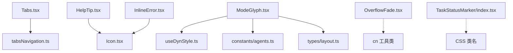
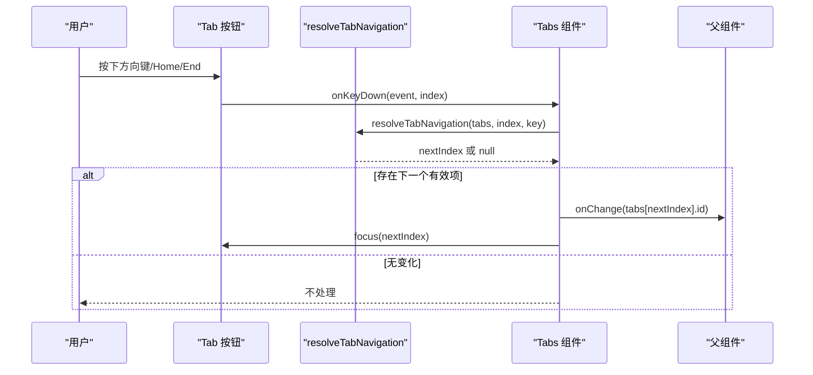
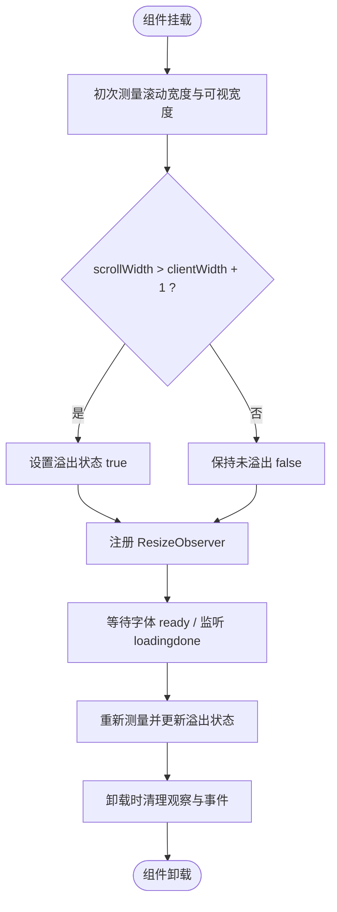
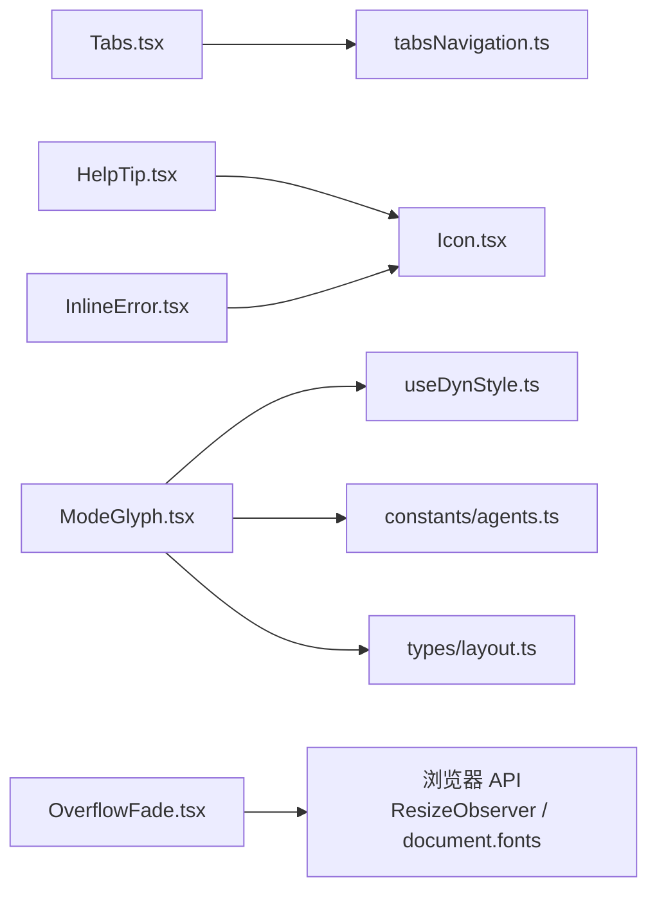

# 导航与展示组件

<cite>
**本文引用的文件**   
- [src/renderer/ui/Tabs.tsx](file://src/renderer/ui/Tabs.tsx)
- [src/renderer/ui/tabsNavigation.ts](file://src/renderer/ui/tabsNavigation.ts)
- [src/renderer/ui/Kbd.tsx](file://src/renderer/ui/Kbd.tsx)
- [src/renderer/ui/Icon.tsx](file://src/renderer/ui/Icon.tsx)
- [src/renderer/ui/ModeGlyph.tsx](file://src/renderer/ui/ModeGlyph.tsx)
- [src/renderer/ui/HelpTip.tsx](file://src/renderer/ui/HelpTip.tsx)
- [src/renderer/ui/InlineError.tsx](file://src/renderer/ui/InlineError.tsx)
- [src/renderer/ui/OverflowFade.tsx](file://src/renderer/ui/OverflowFade.tsx)
- [src/renderer/ui/TaskStatusMarker/index.tsx](file://src/renderer/ui/TaskStatusMarker/index.tsx)
- [src/renderer/lib/useDynStyle.ts](file://src/renderer/lib/useDynStyle.ts)
- [src/shared/types/layout.ts](file://src/shared/types/layout.ts)
- [src/shared/constants/agents.ts](file://src/shared/constants/agents.ts)
</cite>

## 目录
1. [简介](#简介)
2. [项目结构定位](#项目结构定位)
3. [核心组件总览](#核心组件总览)
4. [架构与关系图](#架构与关系图)
5. [详细组件分析](#详细组件分析)
6. [依赖分析](#依赖分析)
7. [性能与可访问性建议](#性能与可访问性建议)
8. [故障排查指南](#故障排查指南)
9. [结论](#结论)

## 简介
本文件面向 RDC Agent 前端渲染层中的“导航与展示”基础组件，聚焦以下能力：
- 标签页导航：Tabs 的默认内容宽度布局、fullWidth 均分模式、键盘与无障碍切换逻辑。
- 展示元素：Kbd 键盘快捷键显示、Icon 矢量图标系统、ModeGlyph 模式标识符。
- 辅助提示与错误：HelpTip 帮助提示、InlineError 内联错误。
- 文本溢出处理：OverflowFade 智能溢出检测机制。
- 任务状态标记：TaskStatusMarker 的任务生命周期可视化。

这些组件共同构成工作台、转录流、设置面板等界面中稳定、可复用、可访问的 UI 基元。

## 项目结构定位
这些组件位于渲染层用户界面模块中，并通过共享类型与常量与业务层解耦：
- 组件实现：src/renderer/ui/*
- 动态样式工具：src/renderer/lib/useDynStyle.ts
- 模式与图标类型：src/shared/types/layout.ts
- 代理模式配置与色板来源：src/shared/constants/agents.ts



图示来源
- [src/renderer/ui/Tabs.tsx:1-95](file://src/renderer/ui/Tabs.tsx#L1-L95)
- [src/renderer/ui/tabsNavigation.ts:1-13](file://src/renderer/ui/tabsNavigation.ts#L1-L13)
- [src/renderer/ui/HelpTip.tsx:1-25](file://src/renderer/ui/HelpTip.tsx#L1-L25)
- [src/renderer/ui/InlineError.tsx:1-17](file://src/renderer/ui/InlineError.tsx#L1-L17)
- [src/renderer/ui/Icon.tsx:1-169](file://src/renderer/ui/Icon.tsx#L1-L169)
- [src/renderer/ui/ModeGlyph.tsx:1-189](file://src/renderer/ui/ModeGlyph.tsx#L1-L189)
- [src/renderer/ui/OverflowFade.tsx:1-50](file://src/renderer/ui/OverflowFade.tsx#L1-L50)
- [src/renderer/ui/TaskStatusMarker/index.tsx:1-26](file://src/renderer/ui/TaskStatusMarker/index.tsx#L1-L26)
- [src/renderer/lib/useDynStyle.ts:1-81](file://src/renderer/lib/useDynStyle.ts#L1-L81)
- [src/shared/types/layout.ts:1-41](file://src/shared/types/layout.ts#L1-L41)
- [src/shared/constants/agents.ts:1-133](file://src/shared/constants/agents.ts#L1-L133)

章节来源
- [src/renderer/ui/Tabs.tsx:1-95](file://src/renderer/ui/Tabs.tsx#L1-L95)
- [src/renderer/ui/Icon.tsx:1-169](file://src/renderer/ui/Icon.tsx#L1-L169)
- [src/renderer/ui/ModeGlyph.tsx:1-189](file://src/renderer/ui/ModeGlyph.tsx#L1-L189)
- [src/renderer/ui/OverflowFade.tsx:1-50](file://src/renderer/ui/OverflowFade.tsx#L1-L50)
- [src/renderer/ui/TaskStatusMarker/index.tsx:1-26](file://src/renderer/ui/TaskStatusMarker/index.tsx#L1-L26)

## 核心组件总览
- Tabs：支持下划线与分段两种变体；支持 fullWidth 均分布局；提供键盘导航和无障碍属性。
- Kbd：轻量级键盘快捷键容器，语义化为 kbd 元素。
- Icon：基于路径、圆形、矩形的统一 SVG 图标系统，支持尺寸和标题。
- ModeGlyph：根据 Agent 模式与图标键渲染模式徽标，支持自定义强调色与尺寸。
- HelpTip：结合 Popover 的帮助提示触发器，带延迟关闭与焦点管理。
- InlineError：语义化错误段落，内置 error 图标与 alert 角色。
- OverflowFade：通过 ResizeObserver 与字体事件进行智能溢出检测。
- TaskStatusMarker：将任务生命周期状态映射为不同状态的图标与类名。

章节来源
- [src/renderer/ui/Tabs.tsx:1-95](file://src/renderer/ui/Tabs.tsx#L1-L95)
- [src/renderer/ui/Kbd.tsx:1-15](file://src/renderer/ui/Kbd.tsx#L1-L15)
- [src/renderer/ui/Icon.tsx:1-169](file://src/renderer/ui/Icon.tsx#L1-L169)
- [src/renderer/ui/ModeGlyph.tsx:1-189](file://src/renderer/ui/ModeGlyph.tsx#L1-L189)
- [src/renderer/ui/HelpTip.tsx:1-25](file://src/renderer/ui/HelpTip.tsx#L1-L25)
- [src/renderer/ui/InlineError.tsx:1-17](file://src/renderer/ui/InlineError.tsx#L1-L17)
- [src/renderer/ui/OverflowFade.tsx:1-50](file://src/renderer/ui/OverflowFade.tsx#L1-L50)
- [src/renderer/ui/TaskStatusMarker/index.tsx:1-26](file://src/renderer/ui/TaskStatusMarker/index.tsx#L1-L26)

## 架构与关系图
以下类图展示关键组件与其依赖的类型、常量与工具：

```mermaid
classDiagram
  class Tabs {
    +tabs
    +value
    +onChange
    +variant
    +fullWidth
    +onKeyDown()
  }

  class Kbd {
    +children
  }

  class Icon {
    +name
    +size
    +className
    +title
  }

  class ModeGlyph {
    +mode
    +icon
    +accentColor
    +size
    +strokeWidth
  }

  class HelpTip {
    +label
    +children
  }

  class InlineError {
    +children
  }

  class OverflowFade {
    +text
  }

  class TaskStatusMarker {
    +status
    +label
  }

  class useDynStyle {
    +useDynStyle(decls)
  }

  class agents_constants {
    +getAgentModeConfig(mode)
  }

  class layout_types {
    +AgentMode
    +ModeIconKey
    +ModeConfig
  }

  Tabs --> "uses" : "tabsNavigation"
  HelpTip --> Icon : "使用"
  InlineError --> Icon : "使用"
  ModeGlyph --> useDynStyle : "应用动态样式"
  ModeGlyph --> agents_constants : "读取模式配置"
  ModeGlyph --> layout_types : "使用类型"
```

图示来源
- [src/renderer/ui/Tabs.tsx:1-95](file://src/renderer/ui/Tabs.tsx#L1-L95)
- [src/renderer/ui/Kbd.tsx:1-15](file://src/renderer/ui/Kbd.tsx#L1-L15)
- [src/renderer/ui/Icon.tsx:1-169](file://src/renderer/ui/Icon.tsx#L1-L169)
- [src/renderer/ui/ModeGlyph.tsx:1-189](file://src/renderer/ui/ModeGlyph.tsx#L1-L189)
- [src/renderer/ui/HelpTip.tsx:1-25](file://src/renderer/ui/HelpTip.tsx#L1-L25)
- [src/renderer/ui/InlineError.tsx:1-17](file://src/renderer/ui/InlineError.tsx#L1-L17)
- [src/renderer/ui/OverflowFade.tsx:1-50](file://src/renderer/ui/OverflowFade.tsx#L1-L50)
- [src/renderer/ui/TaskStatusMarker/index.tsx:1-26](file://src/renderer/ui/TaskStatusMarker/index.tsx#L1-L26)
- [src/renderer/lib/useDynStyle.ts:1-81](file://src/renderer/lib/useDynStyle.ts#L1-L81)
- [src/shared/types/layout.ts:1-41](file://src/shared/types/layout.ts#L1-L41)
- [src/shared/constants/agents.ts:1-133](file://src/shared/constants/agents.ts#L1-L133)

## 详细组件分析

### Tabs 标签页组件
- 功能要点
  - 默认行为：以内容宽度呈现，每个 tab 自适应其 label 宽度。
  - fullWidth 模式：当传入 fullWidth=true 时，tab 列表与每个选项共享可用宽度，形成均分布局。
  - variant 变体：underline 为普通下划线标签；segmented 为紧凑单选控件风格。
  - 值驱动选择：value 对应某个 tab.id；onChange(id) 由父组件控制状态。
  - 键盘导航：左右方向键、Home、End 在启用项间循环移动，并自动 focus 目标按钮。
  - 无障碍：role=tablist/tab/tabpanel，aria-selected、aria-controls、aria-labelledby 完整配合。
- 交互流程
  - 点击任意 tab 调用 onChange。
  - 键盘事件交由 resolveTabNavigation 计算下一个启用项索引，再调用 onChange 并 focus。



图示来源
- [src/renderer/ui/Tabs.tsx:30-85](file://src/renderer/ui/Tabs.tsx#L30-L85)
- [src/renderer/ui/tabsNavigation.ts:1-13](file://src/renderer/ui/tabsNavigation.ts#L1-L13)

- 布局说明
  - 未启用 fullWidth：tab 宽度由 label 决定，适合少量且长短差异较大的标签。
  - 启用 fullWidth：tab 列表与每项共享宽度，适合数量固定、期望均等的导航场景。
- 可访问性与键盘
  - 初始 focusIndex 优先选中已选且未禁用的项；否则选择第一个启用项。
  - disabled 的 tab 不可选不可聚焦。
- 使用示例（描述）
  - 基本用法：传入 tabs 数组与 value、onChange，children 作为当前面板内容。
  - 分段模式：variant="segmented"，用于紧凑多选一控件。
  - 均分模式：fullWidth=true，让所有 tab 等宽。

章节来源
- [src/renderer/ui/Tabs.tsx:1-95](file://src/renderer/ui/Tabs.tsx#L1-L95)
- [src/renderer/ui/tabsNavigation.ts:1-13](file://src/renderer/ui/tabsNavigation.ts#L1-L13)

### Kbd 键盘快捷键显示
- 语义化：渲染为 kbd 元素，适配操作系统键盘快捷键视觉风格。
- 组合性：接受 className 与其余 HTMLAttributes，便于扩展。
- 使用场景：菜单项、工具栏、对话框中展示快捷键，如 Ctrl+S、Esc。

章节来源
- [src/renderer/ui/Kbd.tsx:1-15](file://src/renderer/ui/Kbd.tsx#L1-L15)

### Icon 图标系统
- 设计要点
  - 统一 viewBox 为 0 0 24 24，通过 path、circle、rect 三种几何元素组合成图标。
  - 支持 size 预设（12/14/16/18/20/24），并通过 CSS 类 is-size-* 控制尺寸。
  - 可选 title 作为无障碍描述，同时设置 role=img 与 aria-hidden 策略。
- 扩展方式
  - 新增图标只需在 ICONS 映射中添加 name 与对应的几何部件数组。
  - 保持部件结构一致（d/c/r），便于统一渲染。
- 使用建议
  - 明确传入 size，避免样式冲突。
  - 需要无障碍描述时传入 title，避免仅依赖 aria-label。

章节来源
- [src/renderer/ui/Icon.tsx:1-169](file://src/renderer/ui/Icon.tsx#L1-L169)

### ModeGlyph 模式标识符
- 职责
  - 根据 mode 与 icon 键渲染模式徽标，默认从 getAgentModeConfig 获取默认图标与强调色。
  - 支持外部覆盖 accentColor、size、strokeWidth、className。
  - 通过 useDynStyle 注入 CSS 变量 --mode-glyph-color，避免 inline style。
- 数据契约
  - mode 类型为 AgentMode；icon 类型为 ModeIconKey。
  - 若找不到模式配置，回退到 FALLBACK_MODE_CONFIG。
- 可定制点
  - 完全接管 icon 与 accentColor，适用于自定义 Agent 或品牌化主题。
- 使用示例（描述）
  - 基础用法：传入 mode，使用默认图标与强调色。
  - 自定义图标与颜色：传入 icon 与 accentColor，覆盖默认值。

章节来源
- [src/renderer/ui/ModeGlyph.tsx:1-189](file://src/renderer/ui/ModeGlyph.tsx#L1-L189)
- [src/shared/types/layout.ts:1-41](file://src/shared/types/layout.ts#L1-L41)
- [src/shared/constants/agents.ts:1-133](file://src/shared/constants/agents.ts#L1-L133)
- [src/renderer/lib/useDynStyle.ts:1-81](file://src/renderer/lib/useDynStyle.ts#L1-L81)

### HelpTip 帮助提示
- 交互模型
  - 使用 Popover 包裹提示内容，触发器为 Button。
  - 鼠标悬停与焦点进入打开；离开时延迟 150ms 关闭，避免误触。
  - 关闭清理定时器，防止内存泄漏。
- 可访问性
  - 触发按钮 aria-label=label，打开时关联 aria-describedby。
  - 内容区域拥有唯一 id，供屏幕阅读器朗读。
- 使用建议
  - 将 label 设置为可读的描述，替代默认的 ⓘ 图标。
  - children 不宜过长，必要时分页或链接到更详细说明。

章节来源
- [src/renderer/ui/HelpTip.tsx:1-25](file://src/renderer/ui/HelpTip.tsx#L1-L25)

### InlineError 内联错误
- 语义与用途
  - 渲染为 p 元素，role=alert，用于即时错误反馈。
  - 左侧显示 Icon(name="error", size=12)，右侧显示错误信息。
- 使用建议
  - 仅在表单字段附近或操作结果处使用，避免干扰主内容。
  - 可通过 className 调整布局与间距。

章节来源
- [src/renderer/ui/InlineError.tsx:1-17](file://src/renderer/ui/InlineError.tsx#L1-L17)
- [src/renderer/ui/Icon.tsx:1-169](file://src/renderer/ui/Icon.tsx#L1-L169)

### OverflowFade 智能溢出检测
- 核心机制
  - 使用 useRef 引用 span 元素。
  - useLayoutEffect 中立即测量 scrollWidth 与 clientWidth，差值大于 1 像素即判定为溢出。
  - 使用 ResizeObserver 监听容器尺寸变化，重新测量。
  - 监听 document.fonts 的 loadingdone 与 ready 事件，确保字体加载后重新测量。
  - 清理阶段断开观察、移除事件监听，避免泄漏。
- 输出与样式
  - 溢出时添加 is-overflowing 类，配合 CSS 实现渐隐效果（例如截断尾部并以渐变遮罩）。
  - 始终提供 title 以允许用户查看全部文本。
- 流程图



图示来源
- [src/renderer/ui/OverflowFade.tsx:1-50](file://src/renderer/ui/OverflowFade.tsx#L1-L50)

- 与 CSP 样式的关系
  - 该组件本身通过 className 与 title 工作，不直接注入 CSS。
  - 同体系中的 useDynStyle 采用 Constructable Stylesheet 与 adoptedStyleSheets，避免 inline style，从而兼容严格 CSP。

章节来源
- [src/renderer/ui/OverflowFade.tsx:1-50](file://src/renderer/ui/OverflowFade.tsx#L1-L50)
- [src/renderer/lib/useDynStyle.ts:1-81](file://src/renderer/lib/useDynStyle.ts#L1-L81)

### TaskStatusMarker 任务状态标记
- 状态映射
  - pending：空圈。
  - in_progress：圆环加进度弧线。
  - completed：圆环加对勾。
  - blocked：圆环加短竖线（暂停/阻塞）。
  - cancelled：圆环加叉号。
- 输出
  - 外层 span 包含 is-snapshot 与状态类名（如 is-completed）。
  - 内部 svg 宽高与 viewBox 固定，图标随状态变化。
- 可访问性
  - 通过 aria-label 暴露状态文本；若无 label，则回退为 status 字符串。

章节来源
- [src/renderer/ui/TaskStatusMarker/index.tsx:1-26](file://src/renderer/ui/TaskStatusMarker/index.tsx#L1-L26)

## 依赖分析
- Tabs 依赖
  - 键盘导航：tabsNavigation.resolveTabNavigation。
  - 样式：Tabs.css、cn 工具类。
- Icon 与相关组件
  - 被 HelpTip、InlineError 复用；提供统一的尺寸与无障碍语义。
- ModeGlyph
  - 依赖 types/layout 的 AgentMode、ModeIconKey、ModeConfig。
  - 依赖 constants/agents 的 getAgentModeConfig 与默认色板。
  - 依赖 useDynStyle 注入 CSS 变量。
- OverflowFade
  - 依赖浏览器 API：ResizeObserver、document.fonts。
  - 依赖 cn 工具类合并类名。



图示来源
- [src/renderer/ui/Tabs.tsx:1-95](file://src/renderer/ui/Tabs.tsx#L1-L95)
- [src/renderer/ui/tabsNavigation.ts:1-13](file://src/renderer/ui/tabsNavigation.ts#L1-L13)
- [src/renderer/ui/HelpTip.tsx:1-25](file://src/renderer/ui/HelpTip.tsx#L1-L25)
- [src/renderer/ui/InlineError.tsx:1-17](file://src/renderer/ui/InlineError.tsx#L1-L17)
- [src/renderer/ui/Icon.tsx:1-169](file://src/renderer/ui/Icon.tsx#L1-L169)
- [src/renderer/ui/ModeGlyph.tsx:1-189](file://src/renderer/ui/ModeGlyph.tsx#L1-L189)
- [src/renderer/ui/OverflowFade.tsx:1-50](file://src/renderer/ui/OverflowFade.tsx#L1-L50)
- [src/renderer/lib/useDynStyle.ts:1-81](file://src/renderer/lib/useDynStyle.ts#L1-L81)
- [src/shared/types/layout.ts:1-41](file://src/shared/types/layout.ts#L1-L41)
- [src/shared/constants/agents.ts:1-133](file://src/shared/constants/agents.ts#L1-L133)

## 性能与可访问性建议
- Tabs
  - 大量 tab 时考虑虚拟列表或分页；避免一次性渲染过多 DOM。
  - 保证每个 tab.label 稳定且不频繁变更，减少重排。
  - 始终维护 aria-selected 与 aria-controls 的一致性。
- Kbd
  - 多按键组合建议用空格分隔，保持可读性。
- Icon
  - 静态图标优先使用 SVG Sprite 或预构建资源，减少运行时解析开销。
  - 需要无障碍描述时务必传 title。
- ModeGlyph
  - 频繁变化的 accentColor 应通过 useDynStyle 注入 CSS 变量，避免 inline style 造成的样式抖动。
  - 若模式配置来自远端，应做缓存与降级处理。
- HelpTip
  - 长内容应分页或链接到详情，避免阻塞渲染。
  - 注意 Popover 的定位与遮挡问题。
- InlineError
  - 错误消息应保持简洁，必要时提供“查看详情”链接。
- OverflowFade
  - 避免在高频更新文本上使用该组件；如需实时更新，考虑节流测量。
  - 在字体复杂或自托管字体的页面，确保字体加载完成后才展示内容。
- TaskStatusMarker
  - 状态变化频率高时，尽量减少不必要的子树重绘。

[本节为通用建议，不直接分析具体文件]

## 故障排查指南
- Tabs 无法通过键盘切换
  - 检查是否有全部 tab 被 disabled；此时 resolveTabNavigation 会返回空集。
  - 确认 onChange 是否被正确调用且 value 与某 tab.id 匹配。
- Tabs 均分布局无效
  - 确认是否传入 fullWidth=true，且外层容器具备确定宽度。
- ModeGlyph 颜色不生效
  - 检查 accentColor 是否通过 useDynStyle 注入；确认 CSS 变量 --mode-glyph-color 是否被消费。
  - 检查 CSP 是否允许 adoptedStyleSheets；useDynStyle 使用构造样式表而非 inline style。
- OverflowFade 未检测溢出
  - 检查是否在字体加载完成后再渲染；必要时等待 document.fonts.ready。
  - 检查父容器是否设置了高度或宽度限制，否则 scrollWidth 可能等于 clientWidth。
- HelpTip 关闭过快
  - 检查是否频繁触发 enter/leave；可适当增加延迟或合并事件。
- InlineError 未触发屏幕阅读器
  - 确认 role=alert 所在元素未被 display:none 隐藏。

章节来源
- [src/renderer/ui/Tabs.tsx:30-85](file://src/renderer/ui/Tabs.tsx#L30-L85)
- [src/renderer/ui/tabsNavigation.ts:1-13](file://src/renderer/ui/tabsNavigation.ts#L1-L13)
- [src/renderer/ui/ModeGlyph.tsx:1-189](file://src/renderer/ui/ModeGlyph.tsx#L1-L189)
- [src/renderer/lib/useDynStyle.ts:1-81](file://src/renderer/lib/useDynStyle.ts#L1-L81)
- [src/renderer/ui/OverflowFade.tsx:1-50](file://src/renderer/ui/OverflowFade.tsx#L1-L50)
- [src/renderer/ui/HelpTip.tsx:1-25](file://src/renderer/ui/HelpTip.tsx#L1-L25)
- [src/renderer/ui/InlineError.tsx:1-17](file://src/renderer/ui/InlineError.tsx#L1-L17)

## 结论
上述组件构成了 RDC Agent 前端导航与展示的基石：
- Tabs 提供可访问、可键盘操作的标签页导航，并支持均分布局以适应不同信息密度。
- Kbd、Icon、ModeGlyph 提供一致的展示语义与视觉风格。
- HelpTip 与 InlineError 增强交互提示与错误反馈的可访问性。
- OverflowFade 通过 ResizeObserver 与字体事件实现稳健的文本溢出检测。
- TaskStatusMarker 直观表达任务生命周期状态。

在生产环境中，建议结合业务场景选择合适的变体与模式，并遵循无障碍与性能最佳实践，以获得稳定、易用、可扩展的用户体验。