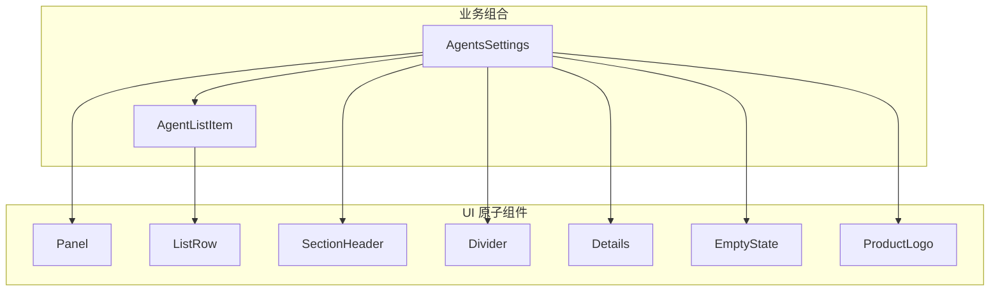
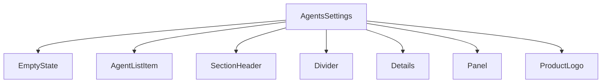
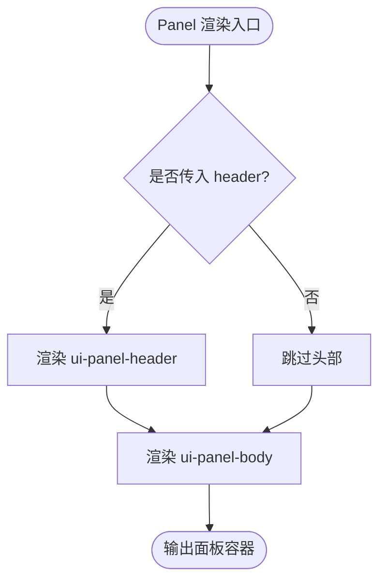
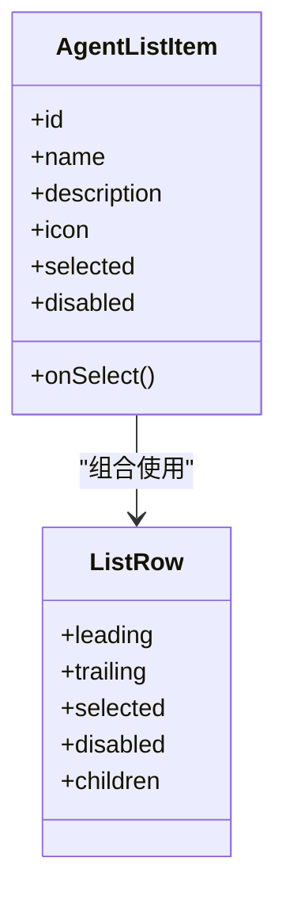
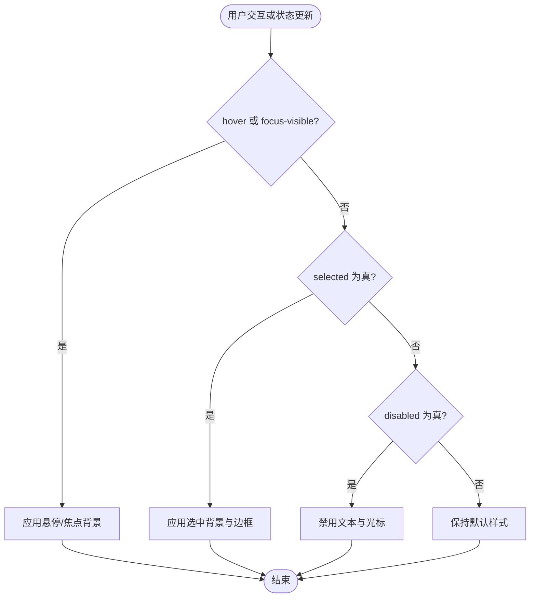
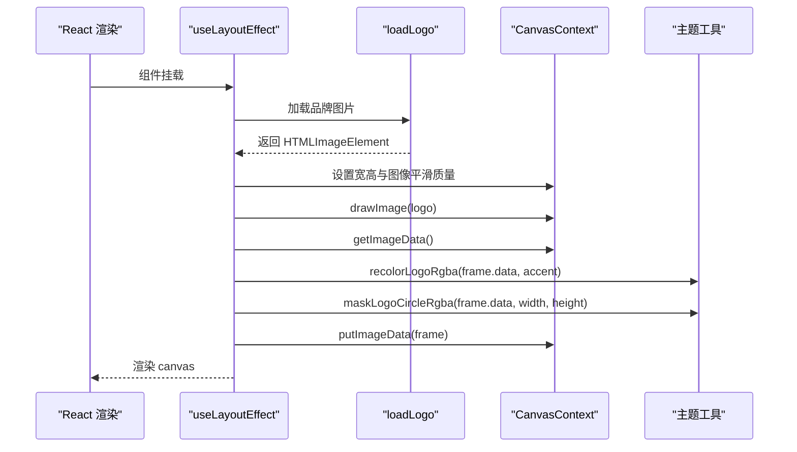
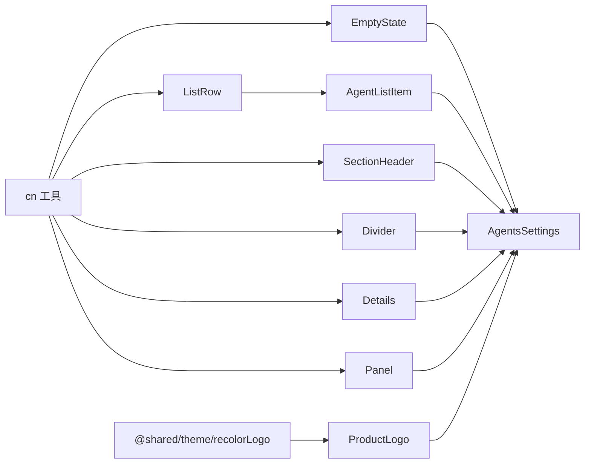
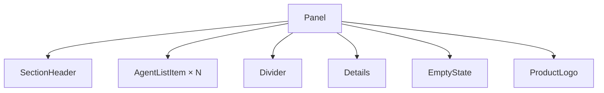

# 布局与容器组件

<cite>
**本文引用的文件**   
- [Panel.tsx](file://src/renderer/ui/Panel.tsx)
- [Panel.css](file://src/renderer/ui/Panel.css)
- [ListRow.tsx](file://src/renderer/ui/ListRow.tsx)
- [ListRow.css](file://src/renderer/ui/ListRow.css)
- [SectionHeader.tsx](file://src/renderer/ui/SectionHeader.tsx)
- [SectionHeader.css](file://src/renderer/ui/SectionHeader.css)
- [Divider.tsx](file://src/renderer/ui/Divider.tsx)
- [Divider.css](file://src/renderer/ui/Divider.css)
- [Details.tsx](file://src/renderer/ui/Details.tsx)
- [Details.css](file://src/renderer/ui/Details.css)
- [EmptyState.tsx](file://src/renderer/ui/EmptyState.tsx)
- [EmptyState.css](file://src/renderer/ui/EmptyState.css)
- [ProductLogo.tsx](file://src/renderer/ui/ProductLogo.tsx)
- [ProductLogo.css](file://src/renderer/ui/ProductLogo.css)
- [AgentListItem.tsx](file://src/renderer/features/settings/SettingsModal/sections/AgentListItem.tsx)
- [AgentsSettings.tsx](file://src/renderer/features/settings/SettingsModal/sections/AgentsSettings.tsx)
</cite>

## 目录
1. [引言](#引言)
2. [项目结构](#项目结构)
3. [核心组件](#核心组件)
4. [架构总览](#架构总览)
5. [详细组件分析](#详细组件分析)
6. [依赖关系分析](#依赖关系分析)
7. [性能考虑](#性能考虑)
8. [故障排查指南](#故障排查指南)
9. [结论](#结论)
10. [附录：组合示例与自定义样式指南](#附录组合示例与自定义样式指南)

## 引言
本文件聚焦于渲染层的基础布局与容器组件，覆盖面板、列表行、章节标题、分隔线、可折叠详情、空状态和品牌标识等。文档重点解释以下方面：
- Panel 面板容器的布局结构与边框样式。
- ListRow 统一列表行实现，包括 hover/focus/selected/disabled 状态与 CSS 变量配置（--ui-list-row-padding、--ui-list-row-gap、--ui-list-row-selected-border），以及其与 AgentListItem 的关系。
- SectionHeader 的章节标题样式、Divider 的分隔线、Details 的可折叠详情区域。
- EmptyState 的空状态展示，包括 compact 与 fill 两种布局模式。
- ProductLogo 的品牌标识组件及其 Canvas 绘制流程。

这些组件共同构成应用内设置页、右侧面板、工作区面板等界面的基础骨架。

## 项目结构
所有布局与容器组件集中在渲染层的 ui 模块中，业务侧通过具体页面或功能模块组合使用。典型文件组织如下：
- UI 原子组件：Panel、ListRow、SectionHeader、Divider、Details、EmptyState、ProductLogo。
- 业务组合示例：AgentListItem 基于 ListRow 构建；AgentsSettings 组合多个 UI 组件完成复杂设置页。

图表来源
- [Panel.tsx:1-17](file://src/renderer/ui/Panel.tsx#L1-L17)
- [ListRow.tsx:1-44](file://src/renderer/ui/ListRow.tsx#L1-L44)
- [SectionHeader.tsx:1-27](file://src/renderer/ui/SectionHeader.tsx#L1-L27)
- [Divider.tsx:1-17](file://src/renderer/ui/Divider.tsx#L1-L17)
- [Details.tsx:1-16](file://src/renderer/ui/Details.tsx#L1-L16)
- [EmptyState.tsx:1-30](file://src/renderer/ui/EmptyState.tsx#L1-L30)
- [ProductLogo.tsx:1-40](file://src/renderer/ui/ProductLogo.tsx#L1-L40)
- [AgentListItem.tsx:1-38](file://src/renderer/features/settings/SettingsModal/sections/AgentListItem.tsx#L1-L38)
- [AgentsSettings.tsx:1-200](file://src/renderer/features/settings/SettingsModal/sections/AgentsSettings.tsx#L1-L200)

章节来源
- [Panel.tsx:1-17](file://src/renderer/ui/Panel.tsx#L1-L17)
- [ListRow.tsx:1-44](file://src/renderer/ui/ListRow.tsx#L1-L44)
- [SectionHeader.tsx:1-27](file://src/renderer/ui/SectionHeader.tsx#L1-L27)
- [Divider.tsx:1-17](file://src/renderer/ui/Divider.tsx#L1-L17)
- [Details.tsx:1-16](file://src/renderer/ui/Details.tsx#L1-L16)
- [EmptyState.tsx:1-30](file://src/renderer/ui/EmptyState.tsx#L1-L30)
- [ProductLogo.tsx:1-40](file://src/renderer/ui/ProductLogo.tsx#L1-L40)
- [AgentListItem.tsx:1-38](file://src/renderer/features/settings/SettingsModal/sections/AgentListItem.tsx#L1-L38)
- [AgentsSettings.tsx:1-200](file://src/renderer/features/settings/SettingsModal/sections/AgentsSettings.tsx#L1-L200)

## 核心组件
本节概述每个组件的职责与关键属性：
- Panel：带可选 header 的面板容器，提供面板头部与主体区域，并统一边框与背景。
- ListRow：统一的按钮式列表行，支持 leading/trailing 插槽、selected/disabled 状态，并通过 CSS 变量控制间距与选中边框。
- SectionHeader：章节标题区，支持标题、描述与右侧 actions 动作区。
- Divider：水平/垂直分隔线，用于视觉分组。
- Details：基于原生 details 的可折叠详情区域，summary 作为展开触发器。
- EmptyState：空状态占位，支持 compact/fill 布局与可选 visual/title/description/actions。
- ProductLogo：品牌 Logo，通过 Canvas 对图片进行着色与圆形遮罩。

章节来源
- [Panel.tsx:1-17](file://src/renderer/ui/Panel.tsx#L1-L17)
- [ListRow.tsx:1-44](file://src/renderer/ui/ListRow.tsx#L1-L44)
- [SectionHeader.tsx:1-27](file://src/renderer/ui/SectionHeader.tsx#L1-L27)
- [Divider.tsx:1-17](file://src/renderer/ui/Divider.tsx#L1-L17)
- [Details.tsx:1-16](file://src/renderer/ui/Details.tsx#L1-L16)
- [EmptyState.tsx:1-30](file://src/renderer/ui/EmptyState.tsx#L1-L30)
- [ProductLogo.tsx:1-40](file://src/renderer/ui/ProductLogo.tsx#L1-L40)

## 架构总览
下图展示了 UI 原子组件在设置页中的组合关系，其中 AgentsSettings 聚合了 EmptyState、AgentListItem、SectionHeader、Divider、Details、Panel 与 ProductLogo，形成完整的设置界面。

图表来源
- [AgentsSettings.tsx:1-200](file://src/renderer/features/settings/SettingsModal/sections/AgentsSettings.tsx#L1-L200)
- [EmptyState.tsx:1-30](file://src/renderer/ui/EmptyState.tsx#L1-L30)
- [AgentListItem.tsx:1-38](file://src/renderer/features/settings/SettingsModal/sections/AgentListItem.tsx#L1-L38)
- [SectionHeader.tsx:1-27](file://src/renderer/ui/SectionHeader.tsx#L1-L27)
- [Divider.tsx:1-17](file://src/renderer/ui/Divider.tsx#L1-L17)
- [Details.tsx:1-16](file://src/renderer/ui/Details.tsx#L1-L16)
- [Panel.tsx:1-17](file://src/renderer/ui/Panel.tsx#L1-L17)
- [ProductLogo.tsx:1-40](file://src/renderer/ui/ProductLogo.tsx#L1-L40)

## 详细组件分析

### Panel 面板容器
Panel 是一个带有可选 header 的容器组件，将内容分为头部与主体两部分，并通过统一的边框、圆角和背景色构建清晰的面板外观。

- 组件职责
  - 对外暴露 header 与 children，内部渲染 ui-panel-header 与 ui-panel-body。
  - 使用 cn 工具类合并 className，便于外部定制。
- 布局与样式要点
  - 外层 section.ui-panel 采用 flex 纵向布局，背景为 --token-bg-shell，边框 1px 使用 --token-border-default，圆角 --radius-md，overflow hidden。
  - 头部 ui-panel-header 高度由 --control-height-lg 控制，左右间距 --space-3，底部有分割线。
  - 主体 ui-panel-body 弹性填充剩余空间，内边距 --space-3。
- 使用建议
  - 当需要包含标题、操作按钮时，优先使用 Panel 包裹 Header 与内容区。
  - 若不需要 header，可直接传入 children。

图表来源
- [Panel.tsx:1-17](file://src/renderer/ui/Panel.tsx#L1-L17)
- [Panel.css:1-27](file://src/renderer/ui/Panel.css#L1-L27)

章节来源
- [Panel.tsx:1-17](file://src/renderer/ui/Panel.tsx#L1-L17)
- [Panel.css:1-27](file://src/renderer/ui/Panel.css#L1-L27)

### ListRow 统一列表行
ListRow 是所有列表项的统一实现，以 button 元素为基础，具备键盘可访问性与语义化的 aria-selected。它通过 CSS 变量控制内边距、间距与选中边框颜色，并提供 leading/body/trailing 三列布局。

- 组件职责
  - 接受 leading、trailing、children，并根据 selected/disabled 切换 is-selected/is-disabled 类名。
  - 将 selected 映射到 aria-selected，保证无障碍体验。
- 状态行为
  - hover/focus-visible：背景变为 --token-interactive-hover，focus-visible 时显示焦点环。
  - selected：背景使用 --token-interactive-active，左侧边框由 --ui-list-row-selected-border 控制（默认回退到 --token-border-default）。
  - disabled：文本颜色与光标分别变为 --token-text-disabled 与 not-allowed。
- 关键 CSS 变量
  - --ui-list-row-padding：控制列表行内边距。
  - --ui-list-row-gap：控制 leading/body/trailing 之间的间距。
  - --ui-list-row-selected-border：控制选中状态的边框颜色。
  - --ui-list-row-white-space：控制正文换行策略，默认 nowrap。
- 与 AgentListItem 的关系
  - AgentListItem 基于 ListRow 封装，固定 className，注入 ModeGlyph 图标与名称、描述文本，并将 onSelect 绑定到 onClick，selected/disabled 透传给 ListRow。

图表来源
- [ListRow.tsx:1-44](file://src/renderer/ui/ListRow.tsx#L1-L44)
- [AgentListItem.tsx:1-38](file://src/renderer/features/settings/SettingsModal/sections/AgentListItem.tsx#L1-L38)

图表来源
- [ListRow.css:1-54](file://src/renderer/ui/ListRow.css#L1-L54)

章节来源
- [ListRow.tsx:1-44](file://src/renderer/ui/ListRow.tsx#L1-L44)
- [ListRow.css:1-54](file://src/renderer/ui/ListRow.css#L1-L54)
- [AgentListItem.tsx:1-38](file://src/renderer/features/settings/SettingsModal/sections/AgentListItem.tsx#L1-L38)

### SectionHeader 章节标题
SectionHeader 用于呈现区块标题、说明与右侧动作区，适合放在列表顶部、表格上方或卡片头部。

- 组件职责
  - 渲染标题 h3 与可选 description p，右侧放置 actions。
  - 使用 ui-section-header-copy 与 ui-section-header-actions 布局。
- 样式要点
  - 整体使用 flex，两端对齐，间距 --space-3。
  - 标题使用 --text-sm、--font-semibold、--leading-tight。
  - 描述使用 --text-xs、--token-text-caption。
  - actions 区域右对齐，不收缩，内部子项间距 --space-2。

章节来源
- [SectionHeader.tsx:1-27](file://src/renderer/ui/SectionHeader.tsx#L1-L27)
- [SectionHeader.css:1-36](file://src/renderer/ui/SectionHeader.css#L1-L36)

### Divider 分隔线
Divider 是语义化的 hr 元素，支持 horizontal/vertical 两种方向。

- 组件职责
  - 根据 orientation 切换 is-horizontal/is-vertical 类名，并设置 aria-orientation。
- 样式要点
  - 水平：宽度 100%，高度 1px，上下外边距 --space-3。
  - 垂直：宽度 1px，拉伸高度，左右外边距 --space-3，最小高度 --control-height-md。
  - 颜色使用 --token-border-muted。

章节来源
- [Divider.tsx:1-17](file://src/renderer/ui/Divider.tsx#L1-L17)
- [Divider.css:1-17](file://src/renderer/ui/Divider.css#L1-L17)

### Details 可折叠详情
Details 是对原生 details 的薄封装，保持浏览器内置的折叠语义与键盘交互（Enter/Space）。

- 组件职责
  - 接收 summary 与 summaryClassName，渲染 summary 与 children。
  - 注释强调“隐藏细节不参与 tab 顺序”，符合无障碍规范。
- 样式要点
  - summary 可点击，悬停/聚焦时文字变亮，focus-visible 使用主题主色描边。
  - open 状态下 summary 底部增加下边距，提升视觉层次。

章节来源
- [Details.tsx:1-16](file://src/renderer/ui/Details.tsx#L1-L16)
- [Details.css:1-15](file://src/renderer/ui/Details.css#L1-L15)

### EmptyState 空状态
EmptyState 用于无数据或未完成场景的占位展示，支持紧凑与填充两种布局模式。

- 组件职责
  - 支持 title、description、actions、visual 四个可选区域。
  - layout 属性支持 'compact' | 'fill'，默认为 compact。
- 布局模式
  - compact：当没有 visual 时，添加边框、圆角与面板背景，使其更像卡片。
  - fill：使容器占据父级剩余空间，常用于全屏或面板内的空白占位。
- 样式要点
  - 居中对齐，垂直方向居中，最小高度与内边距统一。
  - 标题加粗、描述限制最大字符宽度，提升可读性。
  - actions 区域支持换行与居中排列。

章节来源
- [EmptyState.tsx:1-30](file://src/renderer/ui/EmptyState.tsx#L1-L30)
- [EmptyState.css:1-57](file://src/renderer/ui/EmptyState.css#L1-L57)

### ProductLogo 品牌标识
ProductLogo 通过 Canvas 动态加载品牌图片，并使用共享工具函数进行着色与圆形遮罩。

- 组件职责
  - 使用 useLayoutEffect 在挂载后加载图片，绘制到指定尺寸的 Canvas。
  - 调用 recolorLogoRgba 与 maskLogoCircleRgba 对像素数据进行着色与遮罩处理。
  - 返回 canvas 元素，aria-hidden 避免重复朗读。
- 生命周期与错误处理
  - 图片加载失败时抛出错误并在控制台输出。
  - 组件卸载前设置 cancelled 标志，防止异步回调更新已卸载组件。
- 尺寸与样式
  - 内部 LOGO_SIZE = 128，CSS 宽高使用 --control-height-md，圆角 full。

图表来源
- [ProductLogo.tsx:1-40](file://src/renderer/ui/ProductLogo.tsx#L1-L40)
- [ProductLogo.css:1-7](file://src/renderer/ui/ProductLogo.css#L1-L7)

章节来源
- [ProductLogo.tsx:1-40](file://src/renderer/ui/ProductLogo.tsx#L1-L40)
- [ProductLogo.css:1-7](file://src/renderer/ui/ProductLogo.css#L1-L7)

## 依赖关系分析
- 组件耦合
  - AgentListItem 强依赖 ListRow 的结构与样式，属于“组合”而非继承。
  - AgentsSettings 组合多个 UI 组件，承担业务状态与页面编排。
- 外部依赖
  - ProductLogo 依赖 @shared/theme/recolorLogo 的像素处理工具。
  - 所有 UI 组件依赖公共工具 cn 与主题 CSS 变量。
- 潜在循环
  - 当前 UI 原子组件之间无相互 import，不存在循环依赖。

图表来源
- [Panel.tsx:1-17](file://src/renderer/ui/Panel.tsx#L1-L17)
- [ListRow.tsx:1-44](file://src/renderer/ui/ListRow.tsx#L1-L44)
- [SectionHeader.tsx:1-27](file://src/renderer/ui/SectionHeader.tsx#L1-L27)
- [Divider.tsx:1-17](file://src/renderer/ui/Divider.tsx#L1-L17)
- [Details.tsx:1-16](file://src/renderer/ui/Details.tsx#L1-L16)
- [EmptyState.tsx:1-30](file://src/renderer/ui/EmptyState.tsx#L1-L30)
- [ProductLogo.tsx:1-40](file://src/renderer/ui/ProductLogo.tsx#L1-L40)
- [AgentListItem.tsx:1-38](file://src/renderer/features/settings/SettingsModal/sections/AgentListItem.tsx#L1-L38)
- [AgentsSettings.tsx:1-200](file://src/renderer/features/settings/SettingsModal/sections/AgentsSettings.tsx#L1-L200)

章节来源
- [ProductLogo.tsx:1-40](file://src/renderer/ui/ProductLogo.tsx#L1-L40)
- [AgentListItem.tsx:1-38](file://src/renderer/features/settings/SettingsModal/sections/AgentListItem.tsx#L1-L38)
- [AgentsSettings.tsx:1-200](file://src/renderer/features/settings/SettingsModal/sections/AgentsSettings.tsx#L1-L200)

## 性能考虑
- ProductLogo 图片加载
  - 使用 Promise 缓存 source，避免重复请求同一图片。
  - 使用 willReadFrequently 优化 Canvas 像素读取性能。
  - 组件卸载时通过 cancelled 标志清理未完成的异步任务，避免无效渲染。
- ListRow 交互反馈
  - 通过 CSS transition 控制背景变化，减少重绘开销。
  - 使用 CSS 变量集中管理间距与颜色，降低样式分支复杂度。
- EmptyState 布局
  - compact 模式在无 visual 时添加边框与背景，避免大空白区域的闪烁感。
  - fill 模式通过 flex 拉伸填充，适合面板内大面积空白场景。

[本节为通用性能建议，无需代码引用]

## 故障排查指南
- ProductLogo 无法加载
  - 现象：控制台报错“Product logo could not be loaded.”。
  - 排查：检查资源路径是否正确、网络是否允许加载图片、浏览器跨域限制。
  - 处理：确认 logoUrl 有效，必要时增加降级图片或日志。
- ListRow 选中边框不生效
  - 现象：selected 状态下边框颜色未按预期显示。
  - 排查：检查是否在父级设置了覆盖样式的 --ui-list-row-selected-border，或全局 CSS 覆盖了 .ui-list-row.is-selected。
  - 处理：明确设置 CSS 变量，确保边框颜色可见。
- EmptyState 布局异常
  - 现象：compact 模式下无边框或填充模式未撑满。
  - 排查：确认 layout 属性值是否为 compact/fill，并确保父容器允许 flex 拉伸。
  - 处理：在 fill 模式下为父容器设置合适的高度或 flex 布局。
- Details 不可点击
  - 现象：summary 无法展开。
  - 排查：检查是否有其他元素覆盖 summary，或样式阻止 cursor:pointer。
  - 处理：调整 z-index 与 pointer-events，确保可交互。

章节来源
- [ProductLogo.tsx:1-40](file://src/renderer/ui/ProductLogo.tsx#L1-L40)
- [ListRow.css:1-54](file://src/renderer/ui/ListRow.css#L1-L54)
- [EmptyState.css:1-57](file://src/renderer/ui/EmptyState.css#L1-L57)
- [Details.css:1-15](file://src/renderer/ui/Details.css#L1-L15)

## 结论
Panel、ListRow、SectionHeader、Divider、Details、EmptyState 与 ProductLogo 构成了应用界面中稳定、可复用的基础布局与容器体系。它们通过清晰的职责划分与 CSS 变量机制，既保证了设计一致性，也提供了足够的扩展能力。AgentListItem 与 AgentsSettings 展示了如何将这些原子组件组合成复杂的业务界面。在实际使用中，建议优先复用这些组件，并通过 CSS 变量与 className 进行主题化与定制化。

[本节为总结性内容，无需代码引用]

## 附录：组合示例与自定义样式指南

### 复杂列表组合示例（设置页）
以下示例展示如何在设置页中使用多种 UI 组件组合出完整的界面：
- 使用 SectionHeader 展示区块标题与动作。
- 使用 ListRow 作为每项选择项，AgentListItem 进一步封装图标与文案。
- 使用 Divider 分隔不同区块。
- 使用 Details 展示可选的详细信息。
- 使用 EmptyState 在列表为空时给出友好提示。
- 使用 Panel 包裹整个设置区域，ProductLogo 作为品牌标识。

图表来源
- [AgentsSettings.tsx:1-200](file://src/renderer/features/settings/SettingsModal/sections/AgentsSettings.tsx#L1-L200)
- [AgentListItem.tsx:1-38](file://src/renderer/features/settings/SettingsModal/sections/AgentListItem.tsx#L1-L38)
- [SectionHeader.tsx:1-27](file://src/renderer/ui/SectionHeader.tsx#L1-L27)
- [Divider.tsx:1-17](file://src/renderer/ui/Divider.tsx#L1-L17)
- [Details.tsx:1-16](file://src/renderer/ui/Details.tsx#L1-L16)
- [EmptyState.tsx:1-30](file://src/renderer/ui/EmptyState.tsx#L1-L30)
- [ProductLogo.tsx:1-40](file://src/renderer/ui/ProductLogo.tsx#L1-L40)

### 自定义样式指南
- 主题变量优先
  - 使用 --ui-list-row-padding、--ui-list-row-gap、--ui-list-row-selected-border 调整列表行样式。
  - 使用 --token-* 系列变量统一管理颜色与间距。
- 类名叠加
  - 通过 className 叠加额外样式，避免直接修改组件源码。
  - 使用 cn 工具合并类名，保证条件类名正确应用。
- 可访问性
  - 保持 ListRow 的 button 语义与 aria-selected。
  - 使用 Details 的原生交互，避免自行实现折叠逻辑。
- 布局策略
  - 使用 Panel 的 header/body 结构组织内容。
  - 使用 SectionHeader 的 copy/actions 结构表达标题与操作。
  - 使用 EmptyState 的 compact/fill 适配不同上下文。

[本节为通用指南，无需代码引用]