# 弹出层与对话框组件

<cite>
**本文引用的文件**
- [Popover.tsx](file://src/renderer/src/renderer/ui/Popover.tsx)
- [Menu.tsx](file://src/renderer/src/renderer/ui/Menu.tsx)
- [ContextMenu.tsx](file://src/renderer/src/renderer/ui/ContextMenu.tsx)
- [ConfirmationDialog.tsx](file://src/renderer/src/renderer/ui/ConfirmationDialog.tsx)
- [TaskDialog.tsx](file://src/renderer/src/renderer/ui/TaskDialog.tsx)
- [UnsavedChangesDialog.tsx](file://src/renderer/src/renderer/ui/UnsavedChangesDialog.tsx)
- [tabsNavigation.ts](file://src/renderer/src/renderer/lib/tabsNavigation.ts)
- [overlay.ts](file://src/renderer/src/renderer/lib/overlay.ts)
- [useFocusTrap.ts](file://src/renderer/src/renderer/hooks/useFocusTrap.ts)
- [useGlobalKeyboardShortcuts.ts](file://src/renderer/src/renderer/hooks/useGlobalKeyboardShortcuts.ts)
</cite>

## 目录
1. [引言](#引言)
2. [项目结构定位](#项目结构定位)
3. [核心组件总览](#核心组件总览)
4. [架构概览](#架构概览)
5. [详细组件分析](#详细组件分析)
6. [依赖关系分析](#依赖关系分析)
7. [性能与可访问性考量](#性能与可访问性考量)
8. [故障排查指南](#故障排查指南)
9. [结论](#结论)

## 引言
本文面向需要深入理解“弹出层与对话框”相关 UI 组件的开发者与维护者，聚焦以下能力：
- Popover 的定位策略、触发方式与渲染时机。
- Menu 菜单的结构定义、项渲染与交互。
- ContextMenu 右键菜单的上下文感知与定位。
- ConfirmationDialog 确认对话框、TaskDialog 任务对话框、UnsavedChangesDialog 未保存更改提示的行为差异。
- tabsNavigation 的键盘导航逻辑，包括 Tab / Shift+Tab 焦点循环。
- overlay 的层级管理、z-index 控制与 ESC 关闭行为。
- 复杂弹窗组合场景下的可访问性与焦点管理。

## 项目结构定位
弹出层与对话框相关代码集中在渲染进程的前端模块中：
- `src/renderer/src/renderer/ui`：具体 UI 组件，如 Popover、Menu、ContextMenu、各类 Dialog。
- `src/renderer/src/renderer/lib`：底层通用库，如 overlay 层级管理、tabsNavigation 键盘导航。
- `src/renderer/src/renderer/hooks`：UI 钩子，如 useFocusTrap、useGlobalKeyboardShortcuts。

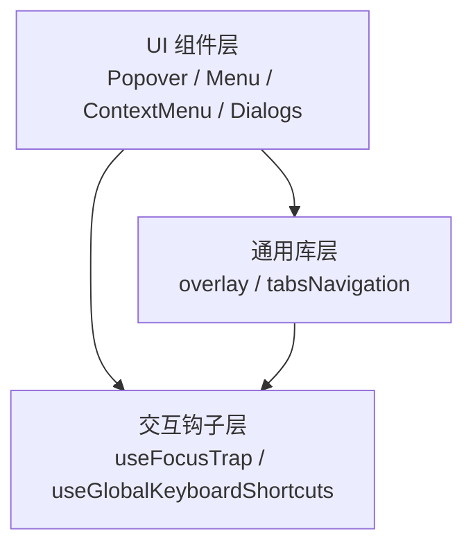

**图表来源**
- [Popover.tsx](file://src/renderer/src/renderer/ui/Popover.tsx)
- [Menu.tsx](file://src/renderer/src/renderer/ui/Menu.tsx)
- [ContextMenu.tsx](file://src/renderer/src/renderer/ui/ContextMenu.tsx)
- [overlay.ts](file://src/renderer/src/renderer/lib/overlay.ts)
- [tabsNavigation.ts](file://src/renderer/src/renderer/lib/tabsNavigation.ts)
- [useFocusTrap.ts](file://src/renderer/src/renderer/hooks/useFocusTrap.ts)
- [useGlobalKeyboardShortcuts.ts](file://src/renderer/src/renderer/hooks/useGlobalKeyboardShortcuts.ts)

**章节来源**
- [Popover.tsx](file://src/renderer/src/renderer/ui/Popover.tsx)
- [Menu.tsx](file://src/renderer/src/renderer/ui/Menu.tsx)
- [ContextMenu.tsx](file://src/renderer/src/renderer/ui/ContextMenu.tsx)
- [overlay.ts](file://src/renderer/src/renderer/lib/overlay.ts)
- [tabsNavigation.ts](file://src/renderer/src/renderer/lib/tabsNavigation.ts)
- [useFocusTrap.ts](file://src/renderer/src/renderer/hooks/useFocusTrap.ts)
- [useGlobalKeyboardShortcuts.ts](file://src/renderer/src/renderer/hooks/useGlobalKeyboardShortcuts.ts)

## 核心组件总览
| 组件 | 职责 | 关键特性 |
|---|---|---|
| Popover | 浮动提示框 | 基于容器的定位、多种触发方式（点击/悬停）、自动边界修正、受控显示状态 |
| Menu | 下拉/内联菜单 | 结构化菜单项、支持分隔符与禁用态、键盘导航、可选滚动容器 |
| ContextMenu | 右键上下文菜单 | 捕获右键事件、在鼠标位置渲染、上下文数据注入、自动遮挡修正 |
| ConfirmationDialog | 确认对话框 | 二次确认、主操作与取消、ESC 关闭、焦点归位 |
| TaskDialog | 任务对话框 | 异步任务反馈、进度或步骤展示、可取消/完成回调 |
| UnsavedChangesDialog | 未保存更改提示 | 区分保存/放弃/取消、阻止意外离开、跨窗口/标签页保护 |
| overlay | 弹窗层级管理器 | 全局 z-index 栈、ESC 关闭、点击遮罩关闭、多实例叠加 |
| tabsNavigation | 标签页键盘导航 | Tab/Shift+Tab 焦点循环、可配置激活目标 |
| useFocusTrap | 焦点陷阱钩子 | 将焦点锁定在指定容器内、避免焦点逃逸 |
| useGlobalKeyboardShortcuts | 全局快捷键钩子 | 注册 ESC 等快捷键、处理全局关闭行为 |

**章节来源**
- [Popover.tsx](file://src/renderer/src/renderer/ui/Popover.tsx)
- [Menu.tsx](file://src/renderer/src/renderer/ui/Menu.tsx)
- [ContextMenu.tsx](file://src/renderer/src/renderer/ui/ContextMenu.tsx)
- [ConfirmationDialog.tsx](file://src/renderer/src/renderer/ui/ConfirmationDialog.tsx)
- [TaskDialog.tsx](file://src/renderer/src/renderer/ui/TaskDialog.tsx)
- [UnsavedChangesDialog.tsx](file://src/renderer/src/renderer/ui/UnsavedChangesDialog.tsx)
- [overlay.ts](file://src/renderer/src/renderer/lib/overlay.ts)
- [tabsNavigation.ts](file://src/renderer/src/renderer/lib/tabsNavigation.ts)
- [useFocusTrap.ts](file://src/renderer/src/renderer/hooks/useFocusTrap.ts)
- [useGlobalKeyboardShortcuts.ts](file://src/renderer/src/renderer/hooks/useGlobalKeyboardShortcuts.ts)

## 架构概览
弹出层体系采用“组件 + 库 + 钩子”的分层设计：
- 组件层负责业务语义与 UI 呈现。
- 库层提供定位、层级、导航等横切能力。
- 钩子层封装常用交互模式（焦点、快捷键）。

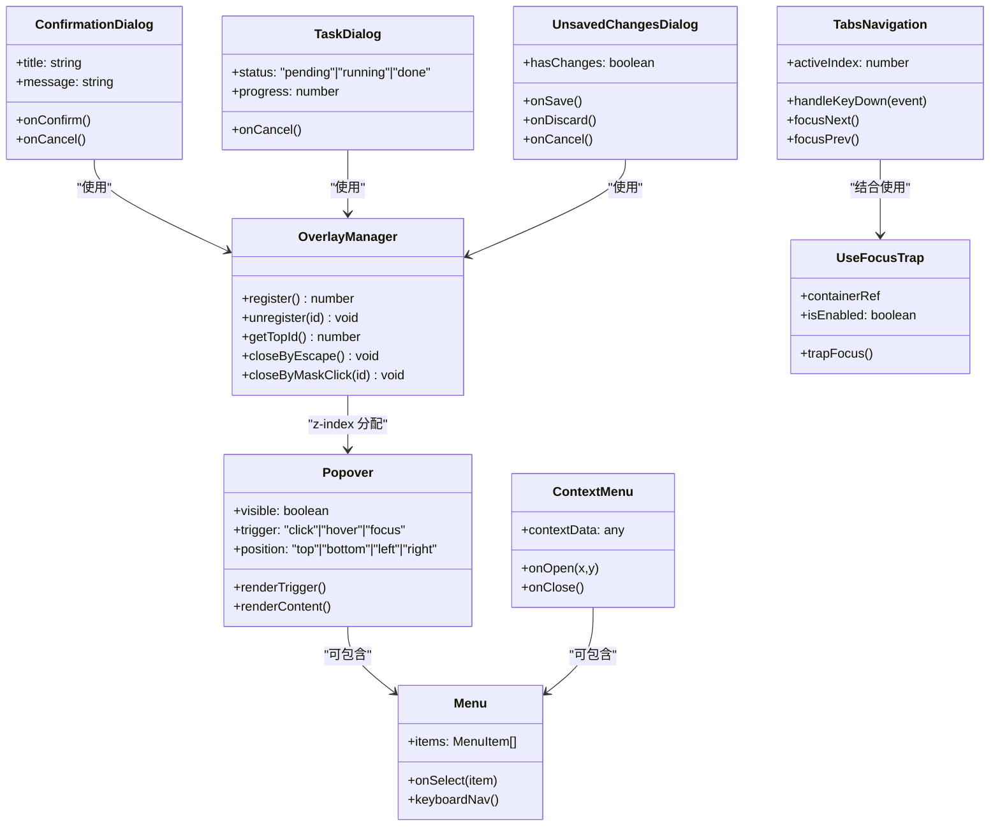

**图表来源**
- [overlay.ts](file://src/renderer/src/renderer/lib/overlay.ts)
- [Popover.tsx](file://src/renderer/src/renderer/ui/Popover.tsx)
- [Menu.tsx](file://src/renderer/src/renderer/ui/Menu.tsx)
- [ContextMenu.tsx](file://src/renderer/src/renderer/ui/ContextMenu.tsx)
- [ConfirmationDialog.tsx](file://src/renderer/src/renderer/ui/ConfirmationDialog.tsx)
- [TaskDialog.tsx](file://src/renderer/src/renderer/ui/TaskDialog.tsx)
- [UnsavedChangesDialog.tsx](file://src/renderer/src/renderer/ui/UnsavedChangesDialog.tsx)
- [tabsNavigation.ts](file://src/renderer/src/renderer/lib/tabsNavigation.ts)
- [useFocusTrap.ts](file://src/renderer/src/renderer/hooks/useFocusTrap.ts)

## 详细组件分析

### Popover：弹出定位机制与触发方式
- 触发方式
  - 点击触发：点击触发元素后打开，点击外部或按 ESC 关闭。
  - 悬停触发：鼠标进入触发元素时打开，离开时延迟关闭。
  - 聚焦触发：获得焦点时打开，失去焦点时关闭。
- 定位机制
  - 基于触发元素与参考容器计算偏移。
  - 支持上/下/左/右四种基础方位。
  - 自动边界修正：当靠近视口边缘时自动翻转方向，避免溢出。
  - 受控显示：通过 visible 属性控制显隐，便于父组件统一状态管理。
- 与 overlay 的关系
  - 打开时向 overlay 注册自身层级，获取更高 z-index。
  - 关闭时释放层级，避免残留。

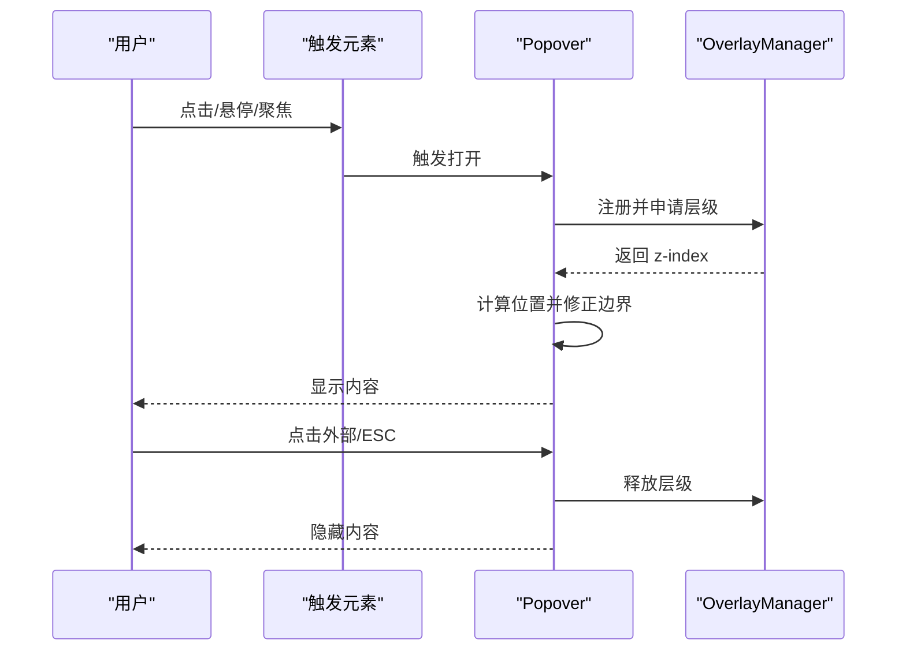

**图表来源**
- [Popover.tsx](file://src/renderer/src/renderer/ui/Popover.tsx)
- [overlay.ts](file://src/renderer/src/renderer/lib/overlay.ts)

**章节来源**
- [Popover.tsx](file://src/renderer/src/renderer/ui/Popover.tsx)
- [overlay.ts](file://src/renderer/src/renderer/lib/overlay.ts)

### Menu：菜单结构与项渲染
- 结构
  - 菜单项列表由 items 数组描述，每项包含标识、标题、是否禁用、是否分隔符、点击回调等元信息。
  - 支持分组与分隔符，便于视觉组织。
- 渲染
  - 根据项类型渲染按钮、链接或分隔线。
  - 对禁用项进行样式与交互屏蔽。
- 交互
  - 键盘导航：上下键移动焦点，回车/空格选择。
  - 点击选择：调用 onSelect 回调，携带当前项数据。
  - 可嵌入 Popover 或 ContextMenu 作为子内容。

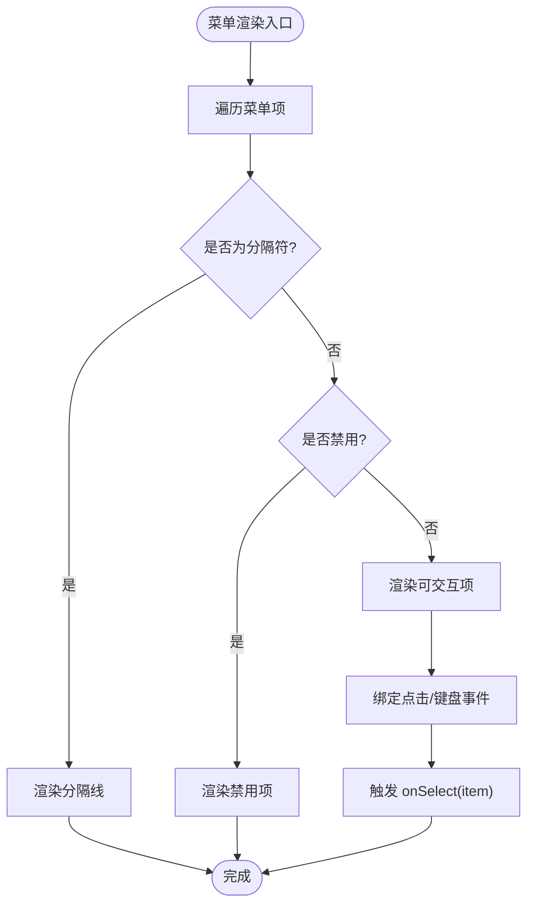

**图表来源**
- [Menu.tsx](file://src/renderer/src/renderer/ui/Menu.tsx)

**章节来源**
- [Menu.tsx](file://src/renderer/src/renderer/ui/Menu.tsx)

### ContextMenu：右键菜单与上下文感知
- 上下文感知
  - 监听目标元素的右键事件，读取 contextData 注入菜单。
  - 根据上下文数据动态生成菜单项，实现差异化操作。
- 定位
  - 以鼠标坐标为基准，计算菜单出现位置。
  - 若超出可视区域，自动调整方向与偏移，避免被遮挡。
- 生命周期
  - 打开：捕获右键、记录位置、渲染菜单。
  - 关闭：点击外部、选择某项、按 ESC 时关闭。

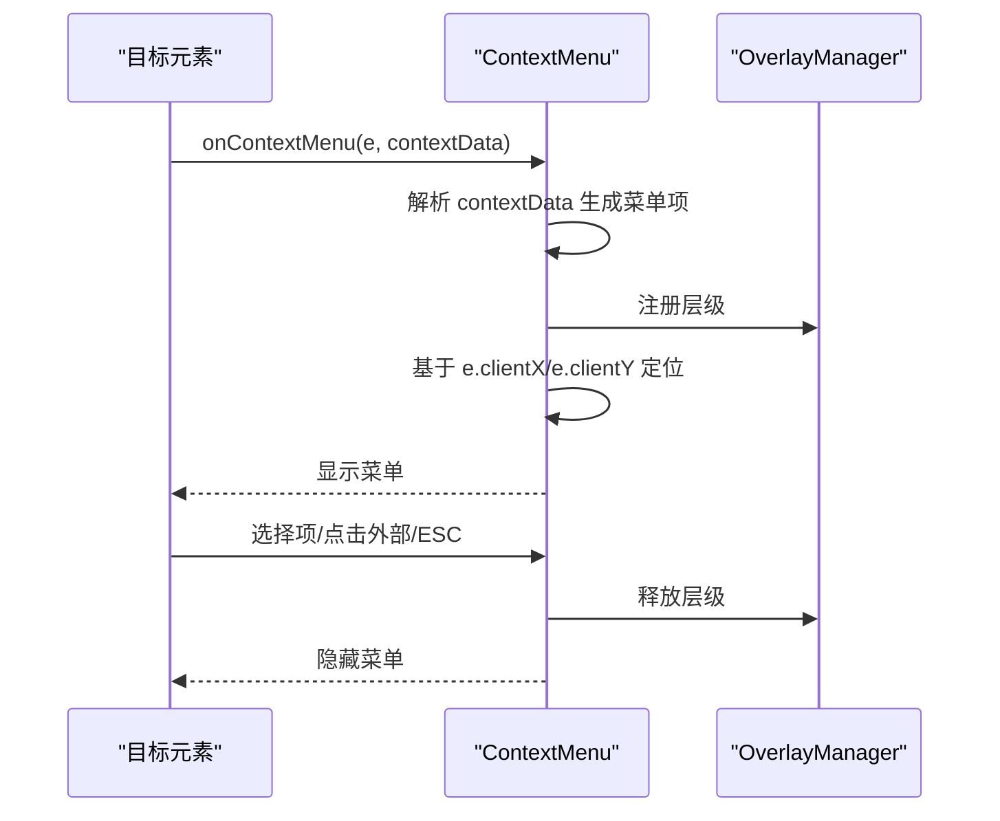

**图表来源**
- [ContextMenu.tsx](file://src/renderer/src/renderer/ui/ContextMenu.tsx)
- [overlay.ts](file://src/renderer/src/renderer/lib/overlay.ts)

**章节来源**
- [ContextMenu.tsx](file://src/renderer/src/renderer/ui/ContextMenu.tsx)
- [overlay.ts](file://src/renderer/src/renderer/lib/overlay.ts)

### ConfirmationDialog：确认对话框
- 用途
  - 用于危险操作前的二次确认，例如删除、重置。
- 行为
  - 显示标题与消息，提供“确认”和“取消”按钮。
  - ESC 关闭；点击遮罩通常关闭，但可通过配置禁止。
  - 焦点默认落在“确认”或“取消”按钮之一，保证键盘可用。
- 回调
  - onConfirm：用户确认后执行。
  - onCancel：用户取消或关闭时执行。

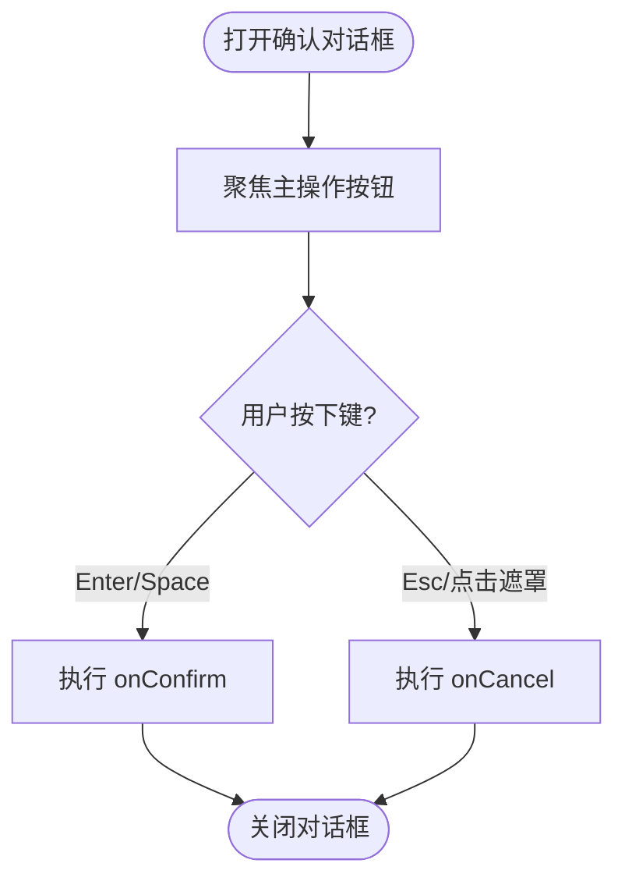

**图表来源**
- [ConfirmationDialog.tsx](file://src/renderer/src/renderer/ui/ConfirmationDialog.tsx)
- [overlay.ts](file://src/renderer/src/renderer/lib/overlay.ts)

**章节来源**
- [ConfirmationDialog.tsx](file://src/renderer/src/renderer/ui/ConfirmationDialog.tsx)
- [overlay.ts](file://src/renderer/src/renderer/lib/overlay.ts)

### TaskDialog：任务对话框
- 用途
  - 展示异步任务的运行状态，例如构建、同步、导出。
- 状态
  - pending：等待开始。
  - running：进行中，可能展示进度或步骤。
  - done：完成，可展示结果摘要。
- 交互
  - 支持取消（若任务允许取消）。
  - 完成后自动或手动关闭。
  - ESC 关闭，除非任务不允许中断。

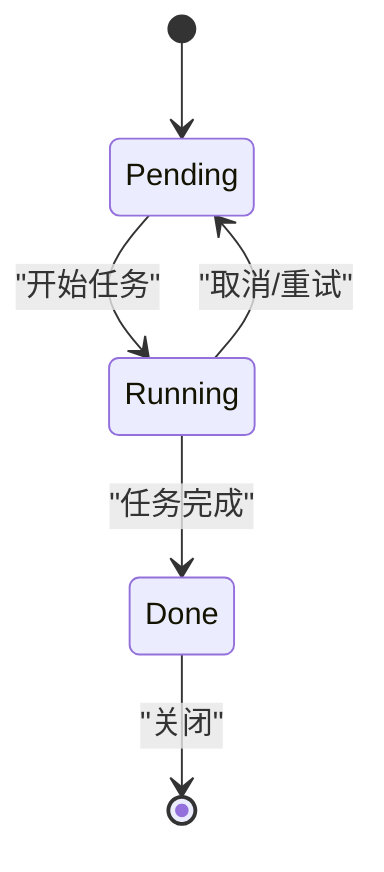

**图表来源**
- [TaskDialog.tsx](file://src/renderer/src/renderer/ui/TaskDialog.tsx)
- [overlay.ts](file://src/renderer/src/renderer/lib/overlay.ts)

**章节来源**
- [TaskDialog.tsx](file://src/renderer/src/renderer/ui/TaskDialog.tsx)
- [overlay.ts](file://src/renderer/src/renderer/lib/overlay.ts)

### UnsavedChangesDialog：未保存更改提示
- 用途
  - 在用户尝试离开页面或关闭应用前，提示存在未保存更改。
- 选项
  - 保存：提交更改并离开。
  - 放弃：丢弃更改并离开。
  - 取消：留在当前页面。
- 行为
  - 阻止默认的离开行为，直到用户明确选择。
  - 支持 ESC 取消。
  - 在路由变化、窗口关闭、标签切换时触发。

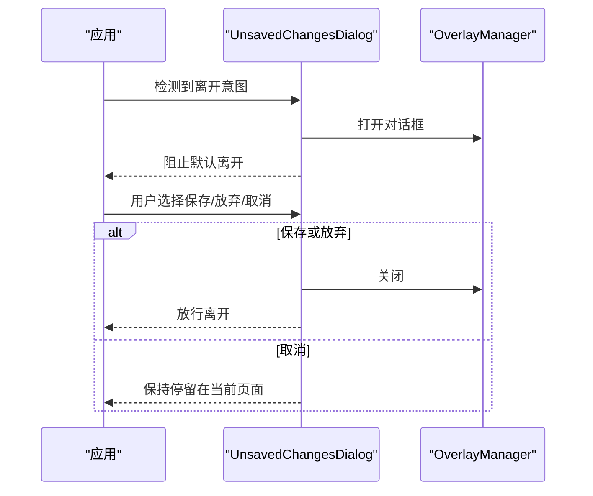

**图表来源**
- [UnsavedChangesDialog.tsx](file://src/renderer/src/renderer/ui/UnsavedChangesDialog.tsx)
- [overlay.ts](file://src/renderer/src/renderer/lib/overlay.ts)

**章节来源**
- [UnsavedChangesDialog.tsx](file://src/renderer/src/renderer/ui/UnsavedChangesDialog.tsx)
- [overlay.ts](file://src/renderer/src/renderer/lib/overlay.ts)

### tabsNavigation：键盘导航与焦点循环
- 功能
  - 为标签组提供 Tab / Shift+Tab 的焦点循环导航。
  - 支持可配置的激活目标（例如标签头、内容面板）。
- 逻辑
  - Tab：移动到下一个可聚焦元素；到达末尾时回到第一个。
  - Shift+Tab：移动到上一个可聚焦元素；到达开头时跳到最后一个。
  - 忽略不可见或禁用的节点。
- 与焦点陷阱的结合
  - 常与 useFocusTrap 配合，确保焦点不会逃逸到标签组之外。

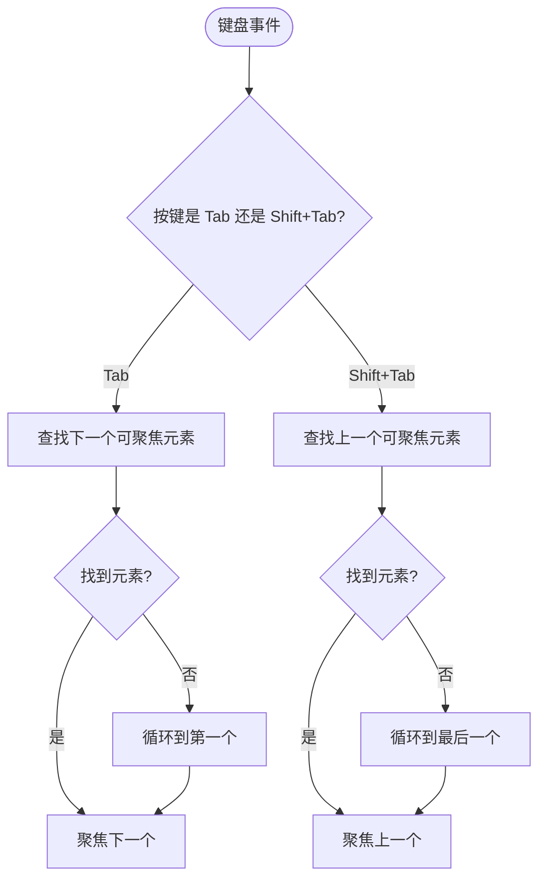

**图表来源**
- [tabsNavigation.ts](file://src/renderer/src/renderer/lib/tabsNavigation.ts)
- [useFocusTrap.ts](file://src/renderer/src/renderer/hooks/useFocusTrap.ts)

**章节来源**
- [tabsNavigation.ts](file://src/renderer/src/renderer/lib/tabsNavigation.ts)
- [useFocusTrap.ts](file://src/renderer/src/renderer/hooks/useFocusTrap.ts)

### overlay：层级管理与 ESC 关闭
- 层级管理
  - 维护一个 z-index 递增栈，每次打开新弹窗时注册并获取更高层级。
  - 关闭时移除对应层级，避免 z-index 泄漏。
- 关闭行为
  - ESC：关闭最顶层弹窗。
  - 点击遮罩：关闭对应弹窗（可配置）。
- 多实例
  - 支持多个弹窗同时存在，但只有最顶层响应全局快捷键。

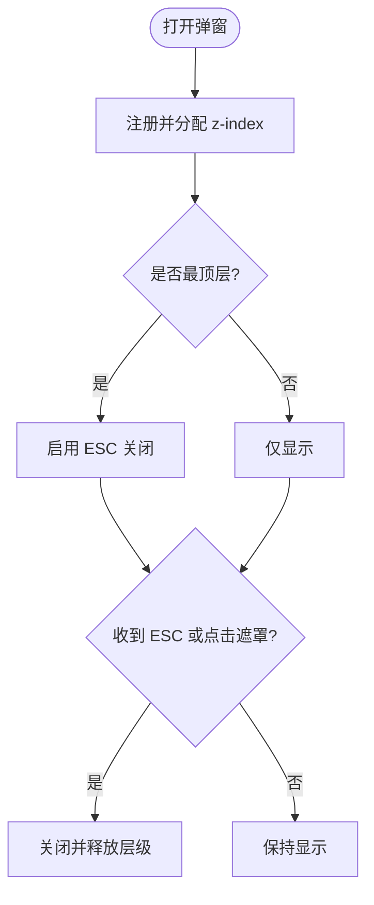

**图表来源**
- [overlay.ts](file://src/renderer/src/renderer/lib/overlay.ts)
- [useGlobalKeyboardShortcuts.ts](file://src/renderer/src/renderer/hooks/useGlobalKeyboardShortcuts.ts)

**章节来源**
- [overlay.ts](file://src/renderer/src/renderer/lib/overlay.ts)
- [useGlobalKeyboardShortcuts.ts](file://src/renderer/src/renderer/hooks/useGlobalKeyboardShortcuts.ts)

### 复杂弹窗组合场景
- 嵌套菜单
  - ContextMenu 中包含子菜单时，子菜单应在父菜单项右侧展开，并保持独立层级。
- 弹窗内的 Popover
  - 在对话框内使用 Popover 时，需确保其 z-index 高于对话框内容，但不超过对话框本身层级。
- 多弹窗叠加
  - 确认对话框弹出后再次触发右键菜单，右键菜单应位于更高层级。
- 焦点管理
  - 打开弹窗时，焦点应进入弹窗内部；关闭时恢复之前焦点。
  - 使用 useFocusTrap 防止焦点逃逸到背景内容。
- 可访问性
  - 所有可交互项需提供 aria-* 属性（如 role、aria-expanded、aria-controls）。
  - 键盘操作应与鼠标操作一致，遵循 WAI-ARIA 实践。

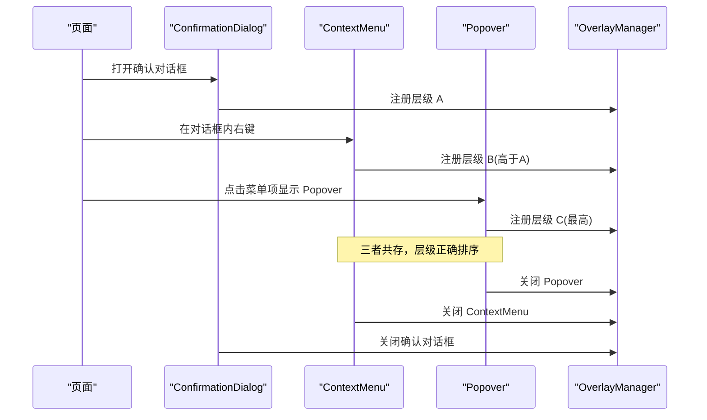

**图表来源**
- [overlay.ts](file://src/renderer/src/renderer/lib/overlay.ts)
- [ContextMenu.tsx](file://src/renderer/src/renderer/ui/ContextMenu.tsx)
- [Popover.tsx](file://src/renderer/src/renderer/ui/Popover.tsx)
- [ConfirmationDialog.tsx](file://src/renderer/src/renderer/ui/ConfirmationDialog.tsx)

**章节来源**
- [overlay.ts](file://src/renderer/src/renderer/lib/overlay.ts)
- [ContextMenu.tsx](file://src/renderer/src/renderer/ui/ContextMenu.tsx)
- [Popover.tsx](file://src/renderer/src/renderer/ui/Popover.tsx)
- [ConfirmationDialog.tsx](file://src/renderer/src/renderer/ui/ConfirmationDialog.tsx)

## 依赖关系分析
- 组件依赖
  - Popover 依赖 overlay 进行层级管理。
  - ContextMenu 依赖 Menu 进行菜单项渲染。
  - 各类 Dialog 依赖 overlay 与 useFocusTrap 进行焦点与层级控制。
- 库依赖
  - tabsNavigation 与 useFocusTrap 协同工作，保证标签组内焦点循环且不逃逸。
- 钩子依赖
  - useGlobalKeyboardShortcuts 为 overlay 提供 ESC 关闭能力。

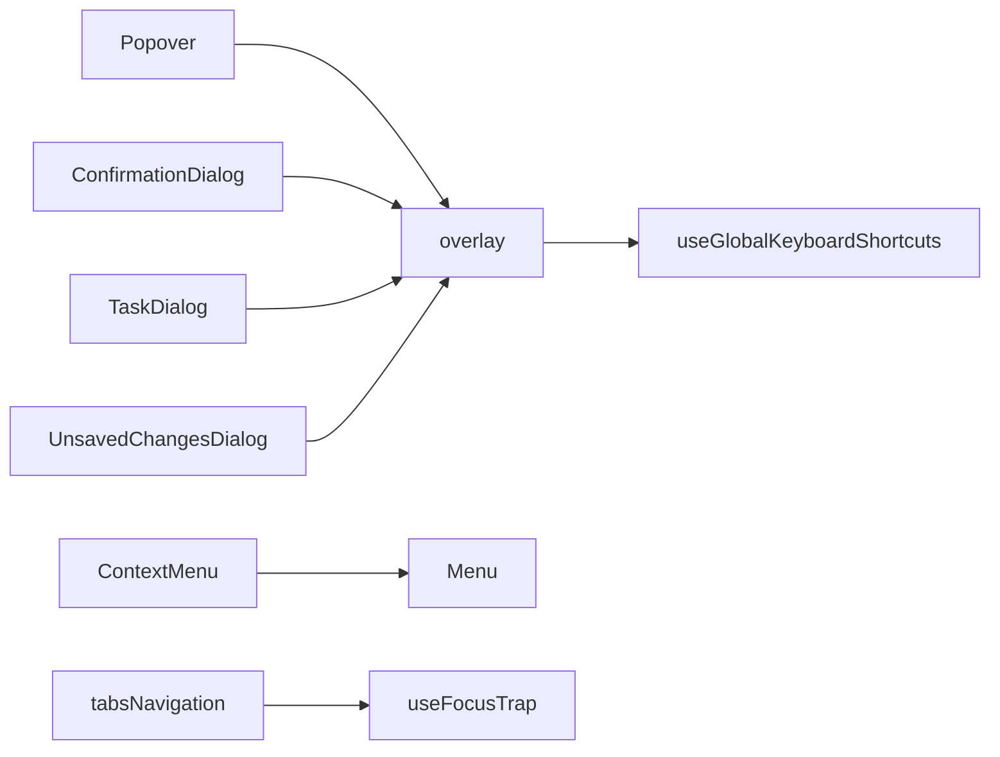

**图表来源**
- [Popover.tsx](file://src/renderer/src/renderer/ui/Popover.tsx)
- [ContextMenu.tsx](file://src/renderer/src/renderer/ui/ContextMenu.tsx)
- [Menu.tsx](file://src/renderer/src/renderer/ui/Menu.tsx)
- [overlay.ts](file://src/renderer/src/renderer/lib/overlay.ts)
- [tabsNavigation.ts](file://src/renderer/src/renderer/lib/tabsNavigation.ts)
- [useFocusTrap.ts](file://src/renderer/src/renderer/hooks/useFocusTrap.ts)
- [useGlobalKeyboardShortcuts.ts](file://src/renderer/src/renderer/hooks/useGlobalKeyboardShortcuts.ts)

**章节来源**
- [Popover.tsx](file://src/renderer/src/renderer/ui/Popover.tsx)
- [ContextMenu.tsx](file://src/renderer/src/renderer/ui/ContextMenu.tsx)
- [Menu.tsx](file://src/renderer/src/renderer/ui/Menu.tsx)
- [overlay.ts](file://src/renderer/src/renderer/lib/overlay.ts)
- [tabsNavigation.ts](file://src/renderer/src/renderer/lib/tabsNavigation.ts)
- [useFocusTrap.ts](file://src/renderer/src/renderer/hooks/useFocusTrap.ts)
- [useGlobalKeyboardShortcuts.ts](file://src/renderer/src/renderer/hooks/useGlobalKeyboardShortcuts.ts)

## 性能与可访问性考量
- 性能
  - 避免频繁重排：定位计算应尽量复用参考元素，减少 DOM 查询。
  - 层级管理去重：重复注册或释放会导致 z-index 异常，需确保成对调用。
  - 菜单虚拟化：大型菜单应考虑虚拟滚动，减少渲染压力。
- 可访问性
  - 键盘可达：所有交互必须支持键盘操作，并提供清晰的焦点顺序。
  - 屏幕阅读器：为弹窗、菜单项、标签提供合适的 aria-* 属性。
  - 颜色对比：确保文本与背景对比度符合无障碍标准。
  - 焦点回归：关闭弹窗后将焦点归还触发元素或合理默认元素。

[本节为通用指导，不直接分析具体文件]

## 故障排查指南
- 弹窗层级错乱
  - 检查是否正确注册与释放 overlay 层级。
  - 确认多弹窗场景下 z-index 是否单调递增。
- ESC 无法关闭
  - 检查 useGlobalKeyboardShortcuts 是否被覆盖或未生效。
  - 确认 overlay 是否处于“最顶层”状态。
- 焦点逃逸
  - 检查是否在弹窗中使用了 useFocusTrap。
  - 验证容器内是否存在可聚焦但被隐藏的节点。
- 菜单定位异常
  - 检查参考容器是否可见且尺寸稳定。
  - 确认边界修正逻辑是否被禁用或错误配置。
- 右键菜单不出现
  - 检查右键事件是否被其他组件拦截。
  - 确认 contextData 是否正确传入并生成菜单项。

**章节来源**
- [overlay.ts](file://src/renderer/src/renderer/lib/overlay.ts)
- [useGlobalKeyboardShortcuts.ts](file://src/renderer/src/renderer/hooks/useGlobalKeyboardShortcuts.ts)
- [useFocusTrap.ts](file://src/renderer/src/renderer/hooks/useFocusTrap.ts)
- [ContextMenu.tsx](file://src/renderer/src/renderer/ui/ContextMenu.tsx)
- [Popover.tsx](file://src/renderer/src/renderer/ui/Popover.tsx)

## 结论
该弹出层与对话框体系通过分层设计实现了高内聚、低耦合：
- Popover 提供灵活的触发与定位。
- Menu 与 ContextMenu 形成一致的菜单体验。
- 三类 Dialog 覆盖常见对话式交互。
- overlay 保障层级有序，ESC 关闭提升一致性。
- tabsNavigation 与 useFocusTrap 保证键盘可达与焦点安全。
在实际使用中，应重点关注层级注册与释放的正确性、焦点管理的一致性以及可访问性属性的完整覆盖，从而在多弹窗叠加与复杂交互场景中保持稳定体验。