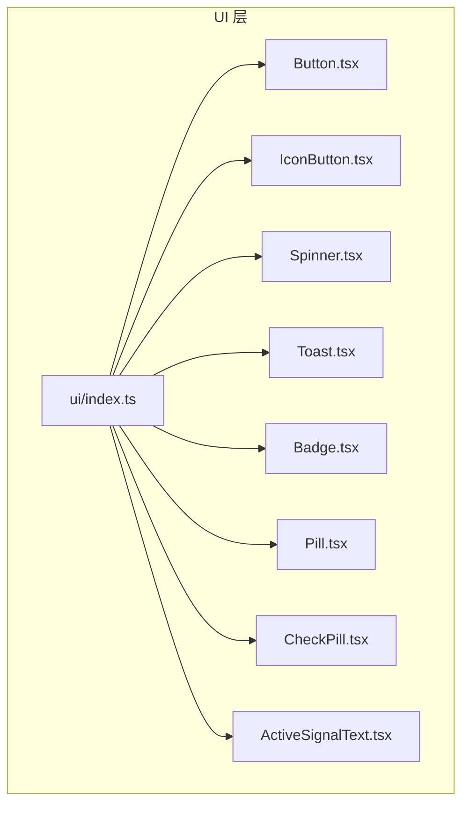
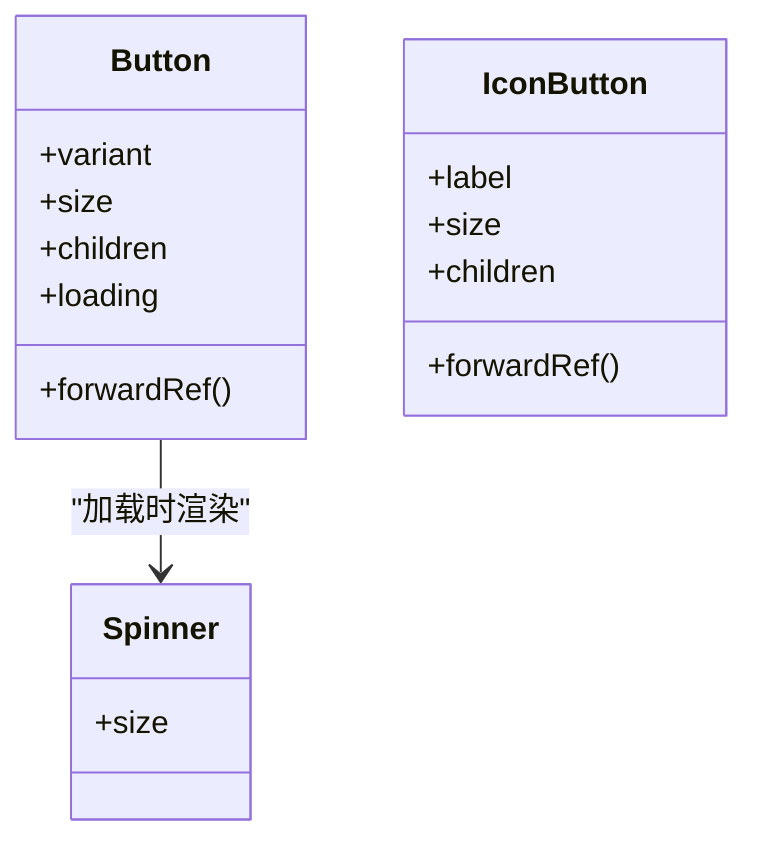
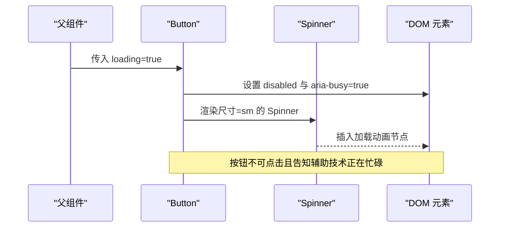
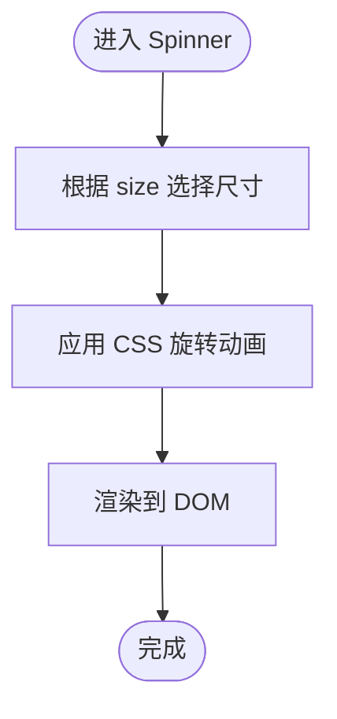
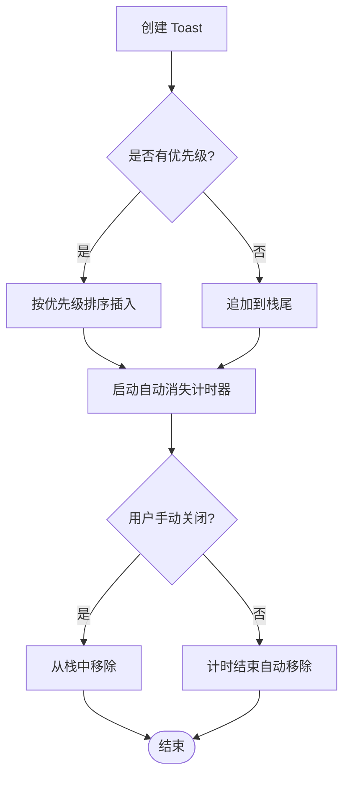
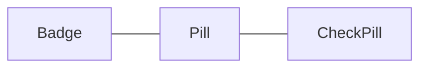
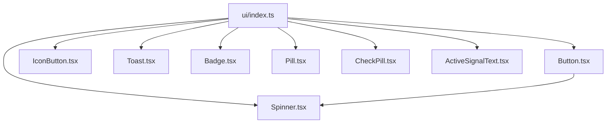

# 操作与反馈组件

<cite>
**本文引用的文件**
- [Button.tsx](file://src/renderer/ui/Button.tsx)
- [Button.css](file://src/renderer/ui/Button.css)
- [IconButton.tsx](file://src/renderer/ui/IconButton.tsx)
- [IconButton.css](file://src/renderer/ui/IconButton.css)
- [Spinner.tsx](file://src/renderer/ui/Spinner.tsx)
- [Spinner.css](file://src/renderer/ui/Spinner.css)
- [Toast.tsx](file://src/renderer/ui/Toast.tsx)
- [Toast.css](file://src/renderer/ui/Toast.css)
- [Badge.tsx](file://src/renderer/ui/Badge.tsx)
- [Pill.tsx](file://src/renderer/ui/Pill.tsx)
- [CheckPill.tsx](file://src/renderer/ui/CheckPill.tsx)
- [ActiveSignalText.tsx](file://src/renderer/ui/ActiveSignalText.tsx)
- [ui/index.ts](file://src/renderer/ui/index.ts)
</cite>

## 目录
1. [简介](#简介)
2. [项目结构](#项目结构)
3. [核心组件](#核心组件)
4. [架构总览](#架构总览)
5. [组件详细分析](#组件详细分析)
6. [依赖关系分析](#依赖关系分析)
7. [性能与可访问性](#性能与可访问性)
8. [常见问题排查](#常见问题排查)
9. [结论](#结论)

## 简介
本文面向“操作与反馈”类基础 UI 组件，覆盖按钮、图标按钮、加载指示器、通知气泡与标签系统。重点说明：
- Button 与 IconButton 的交互状态（loading、disabled、aria-busy）和 primary 变体的样式定制方式。
- Toast 与 ToastStack 的通知机制（自动消失、手动关闭、优先级排序）。
- Spinner 的加载指示功能与动画实现。
- Badge、Pill、CheckPill 的标签展示能力（变体、尺寸、状态）。
- ActiveSignalText 的信号文本组件及其语义。

这些组件共同构成设计系统中“用户操作入口”和“轻量反馈”的基础设施，通常由上层业务面板组合使用。

## 项目结构
操作与反馈组件集中在 `src/renderer/ui` 下，以“按组件分文件 + CSS 同目录”的方式组织；对外通过 `index.ts` 统一导出类型与组件，便于上层模块按需引入。



**图表来源**
- [ui/index.ts:1-39](file://src/renderer/ui/index.ts#L1-L39)

**章节来源**
- [ui/index.ts:1-39](file://src/renderer/ui/index.ts#L1-L39)

## 核心组件
- Button：通用按钮，支持多种变体、尺寸、loading 状态与禁用态，内部集成 Spinner。
- IconButton：无文字图标按钮，强调图标语义与可访问性标签。
- Spinner：旋转加载指示器，供 Button 等组件复用。
- Toast / ToastStack：消息通知容器与单条通知，支持自动消失、手动关闭与优先级排序。
- Badge / Pill / CheckPill：标签与状态标记，提供不同视觉变体与尺寸。
- ActiveSignalText：信号文本组件，用于表达当前活跃状态或进度提示。

**章节来源**
- [Button.tsx:1-53](file://src/renderer/ui/Button.tsx#L1-L53)
- [IconButton.tsx:1-42](file://src/renderer/ui/IconButton.tsx#L1-L42)
- [Spinner.tsx](file://src/renderer/ui/Spinner.tsx)
- [Toast.tsx](file://src/renderer/ui/Toast.tsx)
- [Badge.tsx](file://src/renderer/ui/Badge.tsx)
- [Pill.tsx](file://src/renderer/ui/Pill.tsx)
- [CheckPill.tsx](file://src/renderer/ui/CheckPill.tsx)
- [ActiveSignalText.tsx](file://src/renderer/ui/ActiveSignalText.tsx)

## 架构总览
以下图展示了“操作与反馈”组件之间的直接依赖关系，以及它们如何被统一导出给上层使用。

```mermaid
graph LR
  Button["Button.tsx"] --> Spinner["Spinner.tsx"]
  Button -.-> "Button.css"
  IconButton["IconButton.tsx"] -.-> "IconButton.css"
  Spinner -.-> "Spinner.css"
  Toast["Toast.tsx"] -.-> "Toast.css"
  Badge["Badge.tsx"]
  Pill["Pill.tsx"]
  CheckPill["CheckPill.tsx"]
  ActiveSignalText["ActiveSignalText.tsx"]
  Index["ui/index.ts"] --> Button
  Index --> IconButton
  Index --> Spinner
  Index --> Toast
  Index --> Badge
  Index --> Pill
  Index --> CheckPill
  Index --> ActiveSignalText
```

**图表来源**
- [Button.tsx:1-53](file://src/renderer/ui/Button.tsx#L1-L53)
- [Spinner.tsx](file://src/renderer/ui/Spinner.tsx)
- [ui/index.ts:1-39](file://src/renderer/ui/index.ts#L1-L39)

## 组件详细分析

### Button 与 IconButton
- 变体与尺寸
  - Button 支持 primary、secondary、ghost、danger 四种变体，以及 sm、md、lg 三种尺寸。
  - IconButton 支持 sm、md、lg 三种尺寸，默认 md。
- 交互状态
  - loading：Button 在 loading 时禁用自身并显示 Spinner；同时设置 aria-busy 为 true。
  - disabled：Button 与 IconButton 均支持原生 disabled 属性；Button 还会根据 loading 合并 is-disabled 类名。
  - focus-visible：Button 提供焦点轮廓与悬停/激活态过渡。
- 可访问性
  - IconButton 要求 label 并通过 aria-label 暴露屏幕阅读器可读名称。
  - Button 将 loading 映射为 aria-busy，配合 disabled 保证语义正确。
- 样式定制
  - Button.primary 通过 CSS 变量定义主色背景、边框与文本颜色，并提供 hover/focus 增强。
  - 可通过 className 注入额外样式，结合设计系统的 token 变量进行主题化。



**图表来源**
- [Button.tsx:1-53](file://src/renderer/ui/Button.tsx#L1-L53)
- [IconButton.tsx:1-42](file://src/renderer/ui/IconButton.tsx#L1-L42)
- [Spinner.tsx](file://src/renderer/ui/Spinner.tsx)

#### Button 的加载流程时序


**图表来源**
- [Button.tsx:1-53](file://src/renderer/ui/Button.tsx#L1-L53)

**章节来源**
- [Button.tsx:1-53](file://src/renderer/ui/Button.tsx#L1-L53)
- [Button.css:1-104](file://src/renderer/ui/Button.css#L1-L104)
- [IconButton.tsx:1-42](file://src/renderer/ui/IconButton.tsx#L1-L42)
- [IconButton.css](file://src/renderer/ui/IconButton.css)

### Spinner 加载指示器
- 功能职责
  - 提供统一的旋转加载动画，供 Button 等组件复用。
  - 通过 size 控制视觉大小，Button 内部固定使用小尺寸。
- 动画实现
  - 基于 CSS 动画驱动旋转效果，避免 JS 计算开销。
  - 与按钮布局采用内联 flex 对齐，确保文字与 Spinner 间距一致。



**图表来源**
- [Spinner.tsx](file://src/renderer/ui/Spinner.tsx)
- [Spinner.css](file://src/renderer/ui/Spinner.css)

**章节来源**
- [Spinner.tsx](file://src/renderer/ui/Spinner.tsx)
- [Spinner.css](file://src/renderer/ui/Spinner.css)

### Toast 与 ToastStack 通知机制
- 通知生命周期
  - 自动消失：每条通知可配置自动关闭时间。
  - 手动关闭：用户可主动关闭某条通知。
  - 优先级排序：新通知根据优先级决定插入位置与显示顺序。
- 视觉与交互
  - Toast 包裹单条通知内容，ToastStack 负责管理多条通知的堆叠与定位。
  - 通过 CSS 控制入场/出场动画与层级关系。
- 使用建议
  - 成功/失败/警告等不同语义使用不同 tone 变体。
  - 对关键操作提供可关闭但非强制停留的通知，避免阻塞用户。



**图表来源**
- [Toast.tsx](file://src/renderer/ui/Toast.tsx)
- [Toast.css](file://src/renderer/ui/Toast.css)

**章节来源**
- [Toast.tsx](file://src/renderer/ui/Toast.tsx)
- [Toast.css](file://src/renderer/ui/Toast.css)

### Badge、Pill、CheckPill 标签系统
- Badge
  - 用于简短的状态标识，如计数、版本、状态徽标。
  - 通过变体与尺寸适配不同上下文密度。
- Pill
  - 圆角胶囊形标签，适合分类、筛选、轻状态展示。
  - 支持多种尺寸与变体，强调可读性与对比度。
- CheckPill
  - 带勾选状态的 Pill，常用于多选、开关型选项。
  - 明确区分选中与非选中的视觉差异。



**图表来源**
- [Badge.tsx](file://src/renderer/ui/Badge.tsx)
- [Pill.tsx](file://src/renderer/ui/Pill.tsx)
- [CheckPill.tsx](file://src/renderer/ui/CheckPill.tsx)

**章节来源**
- [Badge.tsx](file://src/renderer/ui/Badge.tsx)
- [Pill.tsx](file://src/renderer/ui/Pill.tsx)
- [CheckPill.tsx](file://src/renderer/ui/CheckPill.tsx)

### ActiveSignalText 信号文本
- 用途
  - 显示与当前活跃状态相关的文本提示，如“处理中”“已连接”等。
- 语义
  - 作为纯展示组件，不承载复杂交互，但应遵循可访问性最佳实践，必要时结合 role/aria 描述状态。
- 视觉
  - 与 Badge/Pill 保持一致的语气与节奏，便于在同一区域混合展示。

**章节来源**
- [ActiveSignalText.tsx](file://src/renderer/ui/ActiveSignalText.tsx)

## 依赖关系分析
- Button 依赖 Spinner，并在 loading 时改变自身 disabled 与 aria-busy。
- Button 与 IconButton 通过各自的 CSS 文件实现主题化样式，遵循设计系统 token。
- ui/index.ts 作为单一导出点，屏蔽内部实现细节，降低耦合。



**图表来源**
- [ui/index.ts:1-39](file://src/renderer/ui/index.ts#L1-L39)
- [Button.tsx:1-53](file://src/renderer/ui/Button.tsx#L1-L53)

**章节来源**
- [ui/index.ts:1-39](file://src/renderer/ui/index.ts#L1-L39)
- [Button.tsx:1-53](file://src/renderer/ui/Button.tsx#L1-L53)

## 性能与可访问性
- 性能
  - Spinner 动画由 CSS 驱动，避免频繁重排；Button 仅在 loading 变化时切换子节点。
  - ToastStack 应合理管理通知数量，避免长列表导致滚动与重绘开销。
- 可访问性
  - Button.loading 时设置 aria-busy，帮助屏幕阅读器传达忙碌状态。
  - IconButton.label 必须提供有意义的文案，并通过 aria-label 传递。
  - 所有可聚焦元素需满足焦点可见与键盘操作预期。

**章节来源**
- [Button.tsx:1-53](file://src/renderer/ui/Button.tsx#L1-L53)
- [IconButton.tsx:1-42](file://src/renderer/ui/IconButton.tsx#L1-L42)

## 常见问题排查
- 按钮点击无效
  - 检查是否传入了 loading=true，此时按钮会被禁用；如需允许取消，请在上层逻辑中自行处理。
- 图标按钮无障碍缺失
  - 确认 label 属性存在且语义明确，ARIA 名称应与图标含义一致。
- Toast 未自动消失
  - 检查自动关闭时间是否配置为 0 或未设置；确认没有阻止清理的外部引用。
- Badge/Pill 颜色异常
  - 检查是否使用了错误的变体或尺寸；确认主题 token 变量未被覆盖。
- Spinner 不显示
  - 确认 Button 的 loading 为真；检查 CSS 动画是否被全局样式禁用。

**章节来源**
- [Button.tsx:1-53](file://src/renderer/ui/Button.tsx#L1-L53)
- [IconButton.tsx:1-42](file://src/renderer/ui/IconButton.tsx#L1-L42)
- [Toast.tsx](file://src/renderer/ui/Toast.tsx)

## 结论
Button、IconButton、Spinner、Toast、ToastStack、Badge、Pill、CheckPill 与 ActiveSignalText 构成了“操作与反馈”的基础设施。它们通过清晰的职责划分与主题化样式，既保证了交互一致性，又提供了足够的扩展空间。在实际使用中，应优先关注可访问性与性能表现，并通过设计系统的 token 与变体体系实现品牌化定制。