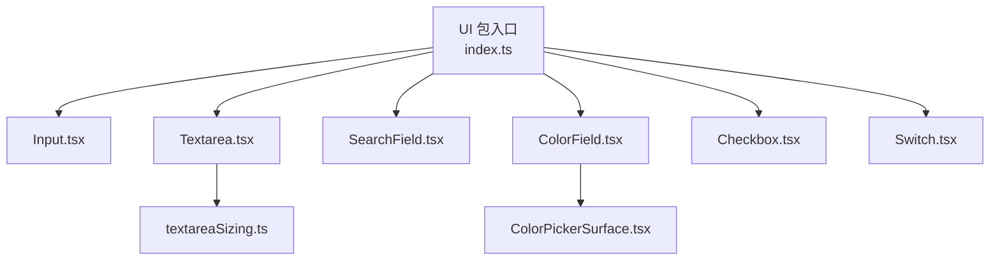
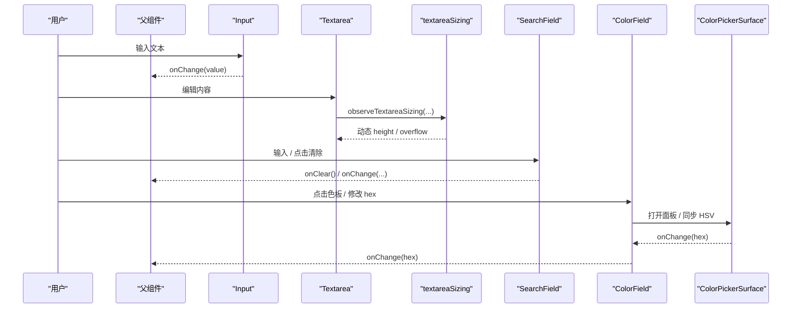
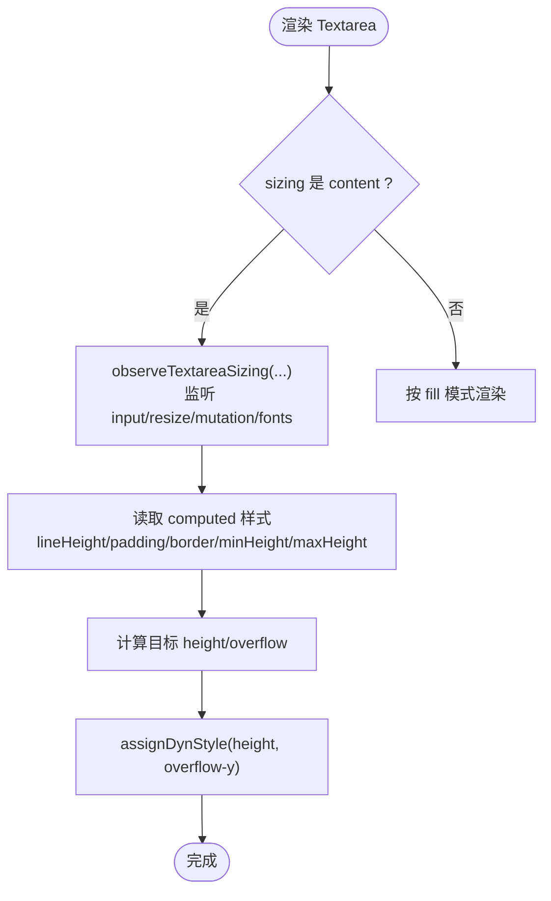
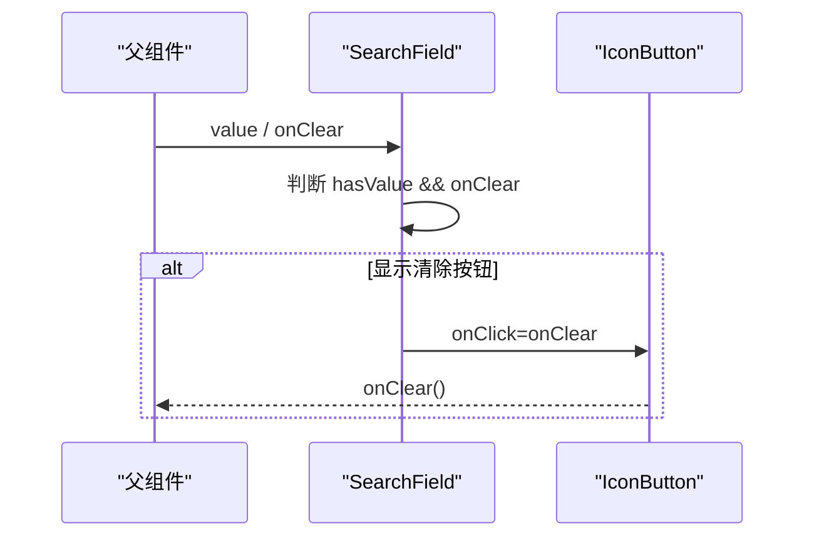
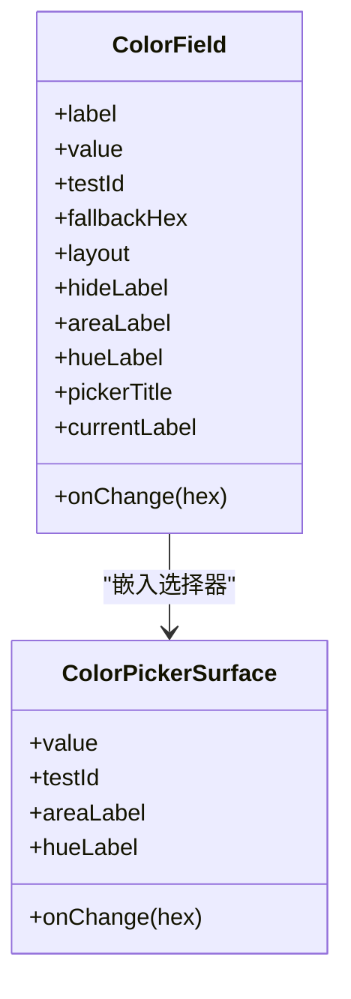
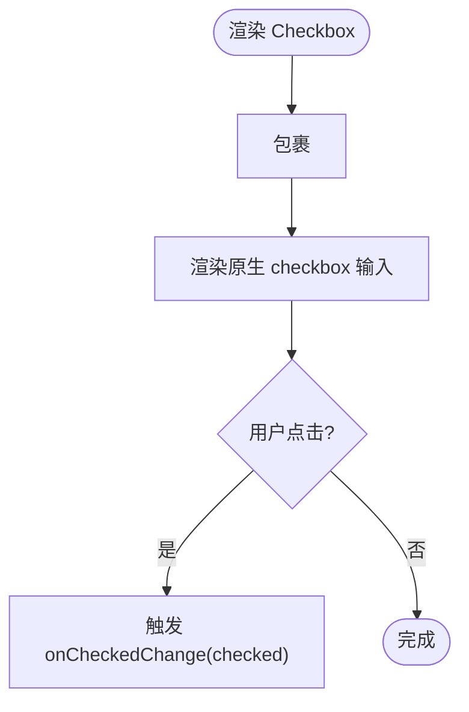
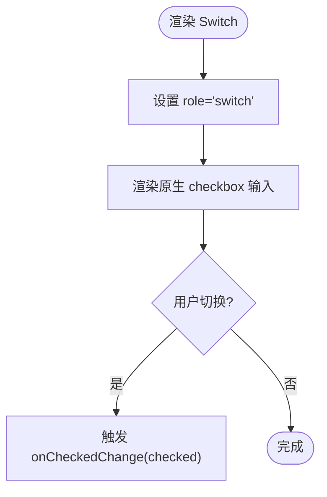
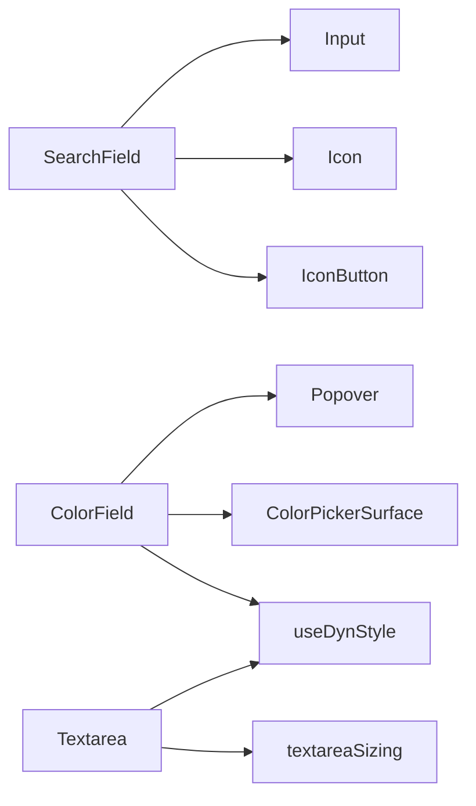

# 输入组件

<cite>
**本文引用的文件**   
- [Input.tsx](file://src/renderer/ui/Input.tsx)
- [Textarea.tsx](file://src/renderer/ui/Textarea.tsx)
- [textareaSizing.ts](file://src/renderer/lib/textareaSizing.ts)
- [SearchField.tsx](file://src/renderer/ui/SearchField.tsx)
- [ColorField.tsx](file://src/renderer/ui/ColorField.tsx)
- [ColorPickerSurface.tsx](file://src/renderer/ui/ColorPickerSurface.tsx)
- [Checkbox.tsx](file://src/renderer/ui/Checkbox.tsx)
- [Switch.tsx](file://src/renderer/ui/Switch.tsx)
- [index.ts](file://src/renderer/ui/index.ts)
</cite>

## 目录
1. [引言](#引言)
2. [项目结构与入口](#项目结构与入口)
3. [核心组件总览](#核心组件总览)
4. [架构与数据流概览](#架构与数据流概览)
5. [组件详细分析](#组件详细分析)
6. [依赖关系分析](#依赖关系分析)
7. [性能与测量机制](#性能与测量机制)
8. [可访问性与交互建议](#可访问性与交互建议)
9. [故障排查](#故障排查)
10. [结论](#结论)

## 引言
本文聚焦于基础输入组件族，包括 Input、Textarea、SearchField、ColorField、Checkbox 和 Switch。文档从 Props 接口、事件处理、状态管理、样式定制、可访问性支持和使用示例等维度展开说明，并重点解释 Textarea 的双 sizing 模式、拖拽禁用策略以及基于 CSP 的样式表测量机制。

## 项目结构与入口
这些组件位于渲染端 UI 包中，并通过统一入口导出，供上层业务页面直接引用。

**图表来源**
- [index.ts:1-39](file://src/renderer/ui/index.ts#L1-L39)
- [Input.tsx:1-38](file://src/renderer/ui/Input.tsx#L1-L38)
- [Textarea.tsx:1-62](file://src/renderer/ui/Textarea.tsx#L1-L62)
- [SearchField.tsx:1-54](file://src/renderer/ui/SearchField.tsx#L1-L54)
- [ColorField.tsx:1-117](file://src/renderer/ui/ColorField.tsx#L1-L117)
- [ColorPickerSurface.tsx:1-163](file://src/renderer/ui/ColorPickerSurface.tsx#L1-L163)
- [textareaSizing.ts:1-80](file://src/renderer/lib/textareaSizing.ts#L1-L80)

**章节来源**
- [index.ts:1-39](file://src/renderer/ui/index.ts#L1-L39)

## 核心组件总览
- Input：基础单行文本输入，支持尺寸与错误态。
- Textarea：多行文本输入，支持 content 自适应与 fill 填充两种 sizing 模式，支持 field/plain 两种 chrome。
- SearchField：带搜索图标和可选清除按钮的搜索框。
- ColorField：色板 + 十六进制输入的受控颜色选择器。
- Checkbox：自定义复选框控件。
- Switch：开关控件，适合二元偏好设置。

**章节来源**
- [Input.tsx:1-38](file://src/renderer/ui/Input.tsx#L1-L38)
- [Textarea.tsx:1-62](file://src/renderer/ui/Textarea.tsx#L1-L62)
- [SearchField.tsx:1-54](file://src/renderer/ui/SearchField.tsx#L1-L54)
- [ColorField.tsx:1-117](file://src/renderer/ui/ColorField.tsx#L1-L117)
- [Checkbox.tsx:1-41](file://src/renderer/ui/Checkbox.tsx#L1-L41)
- [Switch.tsx:1-40](file://src/renderer/ui/Switch.tsx#L1-L40)

## 架构与数据流概览
以下序列图展示常用输入场景下的调用链。

**图表来源**
- [Input.tsx:10-38](file://src/renderer/ui/Input.tsx#L10-L38)
- [Textarea.tsx:14-62](file://src/renderer/ui/Textarea.tsx#L14-L62)
- [textareaSizing.ts:14-80](file://src/renderer/lib/textareaSizing.ts#L14-L80)
- [SearchField.tsx:14-54](file://src/renderer/ui/SearchField.tsx#L14-L54)
- [ColorField.tsx:24-117](file://src/renderer/ui/ColorField.tsx#L24-L117)
- [ColorPickerSurface.tsx:23-163](file://src/renderer/ui/ColorPickerSurface.tsx#L23-L163)

## 组件详细分析

### Input 基础输入
- 职责：封装原生 input，提供统一的尺寸、错误态与禁用态类名。
- Props
  - inputSize：'sm' | 'md' | 'lg'，默认 'md'。
  - error：boolean，为 true 时添加 is-error 类并设置 aria-invalid。
  - className、disabled 及其他原生属性透传。
- 事件处理：透传所有原生事件，如 onChange、onFocus、onBlur。
- 状态管理：无内部状态，纯受控/非受控由父组件决定。
- 使用示例（示意）
  - 基本用法：传入 value 与 onChange 实现受控输入。
  - 错误态：error=true 显示错误视觉样式与无障碍提示。
  - 尺寸：inputSize="lg" 用于更大字号或更宽松的内边距。

```mermaid
flowchart TD
  Start(["渲染 Input"]) --> ApplyClasses["应用类名<br/>ui-input + size/error/disabled"]
  ApplyClasses --> ARIA["设置 aria-invalid(当 error)"]
  ARIA --> Render["渲染原生 <input>"]
  Render --> End(["完成"])
```

**图表来源**
- [Input.tsx:10-38](file://src/renderer/ui/Input.tsx#L10-L38)

**章节来源**
- [Input.tsx:1-38](file://src/renderer/ui/Input.tsx#L1-L38)

### Textarea 多行文本输入
- 职责：多行文本输入，支持双 sizing 模式与两种 chrome 外观。
- Props
  - inputSize：'md' | 'lg'，默认 'md'；仅 chrome='field' 时生效。
  - error：boolean，控制错误态。
  - sizing：'content' | 'fill'，默认 'content'。
    - content：根据内容自适应高度。
    - fill：按容器填充，不随内容增长。
  - chrome：'field' | 'plain'，默认 'field'。plain 去除边框、背景与圆角，适用于 Shell 书写区等表面。
  - minRows、maxRows：控制最小/最大行数，默认 1/8。
  - minHeight、maxHeight：覆盖 CSS 的对应约束，单位 px。
  - rows、className、disabled 及原生属性透传。
- 事件处理：透传原生事件；当 sizing='content' 时，内部通过观察器计算高度。
- 状态管理：无内部状态，ref 暴露底层 textarea。
- sizing 行为
  - content：使用 observeTextareaSizing 监听输入、布局变化、字体加载与窗口大小变化，动态计算 height 与 overflow。
  - fill：不启用观察器，高度由 CSS 与父容器决定。
- 拖拽禁用：组件自身未设置 draggable；如需禁用，可通过外层容器或样式确保。
- CSP 样式表测量机制
  - 通过 assignDynStyle/clearDynStyle 动态写入 height 与 overflow-y，避免破坏 CSP。
  - 使用 ResizeObserver、MutationObserver、window resize、document.fonts loadingdone/ready 触发重测。
  - 清理函数在卸载时移除所有监听并清空动态样式。

**图表来源**
- [Textarea.tsx:14-62](file://src/renderer/ui/Textarea.tsx#L14-L62)
- [textareaSizing.ts:14-80](file://src/renderer/lib/textareaSizing.ts#L14-L80)

**章节来源**
- [Textarea.tsx:1-62](file://src/renderer/ui/Textarea.tsx#L1-L62)
- [textareaSizing.ts:1-80](file://src/renderer/lib/textareaSizing.ts#L1-L80)

### SearchField 搜索框
- 职责：组合搜索图标、Input 与可选清除按钮。
- Props
  - inputSize：继承自 Input。
  - error：布尔值，透传给 Input。
  - onClear：清除回调，仅在 hasValue && onClear 存在时显示清除按钮。
  - clearLabel：清除按钮的可访问标签，默认“Clear search”。
  - value、disabled 及其他原生属性透传。
- Clearable 行为
  - 当 value 为非空字符串或 truthy 且提供 onClear 时，显示关闭图标按钮。
  - 点击清除按钮触发 onClear，不会自动清空 value，需由父组件更新 state。
- 图标集成：左侧固定 Icon.search，右侧 IconButton.close。
- 使用示例（示意）
  - 受控搜索：value 与 onChange 绑定到本地 state。
  - 清除功能：onClear 中清空 value 并重置搜索条件。

**图表来源**
- [SearchField.tsx:14-54](file://src/renderer/ui/SearchField.tsx#L14-L54)

**章节来源**
- [SearchField.tsx:1-54](file://src/renderer/ui/SearchField.tsx#L1-L54)

### ColorField 颜色字段
- 职责：提供色板预览、Popover 内嵌颜色选择器与十六进制输入。
- Props
  - label：标签文本。
  - value：当前颜色 HEX，如 "#ffffff"。
  - onChange：接收合法 HEX 字符串。
  - testId：测试定位标识。
  - className：额外类名。
  - fallbackHex：非法 HEX 时的回退颜色，默认 "#33d1ff"。
  - hideLabel：是否隐藏标签（仅视觉隐藏）。
  - layout：'grid' | 'inline'，默认 'grid'。
  - areaLabel、hueLabel：颜色选择区的可访问名称。
  - pickerTitle、currentLabel：弹出层标题与当前颜色文案。
- 值校验与提交
  - 内部正则 /^#[0-9a-fA-F]{6}$/ 校验 HEX。
  - draft 状态暂存输入值，失焦时若非法则回滚到 value。
  - commitHex 只调用 onChange 通过校验的值。
- 界面结构
  - 色板按钮作为 Popover 触发器，aria-labelledby 关联 labelId。
  - Popover 内包含 ColorPickerSurface 与当前颜色预览（swatch + code）。
  - 底部提供 HEX 输入框，spellCheck=false。
- 可访问性
  - 色板按钮与 HEX 输入框均关联 labelId。
  - 色板预览 swatch 使用 aria-hidden 避免重复朗读。

**图表来源**
- [ColorField.tsx:1-117](file://src/renderer/ui/ColorField.tsx#L1-L117)
- [ColorPickerSurface.tsx:1-163](file://src/renderer/ui/ColorPickerSurface.tsx#L1-L163)

**章节来源**
- [ColorField.tsx:1-117](file://src/renderer/ui/ColorField.tsx#L1-L117)
- [ColorPickerSurface.tsx:1-163](file://src/renderer/ui/ColorPickerSurface.tsx#L1-L163)

### Checkbox 复选框
- 职责：自定义复选框外观，保持原生 checkbox 语义。
- Props
  - checked：受控选中状态。
  - onCheckedChange：选中变化回调。
  - label：显示标签文本。
  - trailing：尾部附加内容。
  - id、className、disabled 及原生属性透传。
- 状态切换逻辑：内部 input[type=checkbox] 受控，onChange 调用 onCheckedChange(event.currentTarget.checked)。
- 可访问性：包裹在 label 中，便于点击整行切换；自定义勾选图标使用 aria-hidden。
- 使用示例（示意）
  - 选项列表：配合 label 与 trailing 展示复杂选项。

**图表来源**
- [Checkbox.tsx:1-41](file://src/renderer/ui/Checkbox.tsx#L1-L41)

**章节来源**
- [Checkbox.tsx:1-41](file://src/renderer/ui/Checkbox.tsx#L1-L41)

### Switch 开关
- 职责：以轨道+滑块形式呈现二元开关，适合偏好设置。
- Props
  - checked：受控选中状态。
  - onCheckedChange：选中变化回调。
  - label：可选标签文本。
  - id、className、disabled 及原生属性透传。
- 状态切换逻辑：内部 input[type=checkbox]，设置 role="switch"，onChange 调用 onCheckedChange。
- 可访问性：role="switch" 让辅助技术识别为开关；data-checked 供样式使用。
- 使用示例（示意）
  - 设置项：将 label 作为开关描述文案。

**图表来源**
- [Switch.tsx:1-40](file://src/renderer/ui/Switch.tsx#L1-L40)

**章节来源**
- [Switch.tsx:1-40](file://src/renderer/ui/Switch.tsx#L1-L40)

## 依赖关系分析
- 组件间耦合
  - SearchField 依赖 Input、Icon、IconButton。
  - ColorField 依赖 Popover、ColorPickerSurface、useDynStyle。
  - Textarea 依赖 textareaSizing 与 useDynStyle 提供的动态样式能力。
- 外部依赖
  - ColorPickerSurface 使用共享主题工具 hexToHsv/hsvToHex。
  - 所有组件普遍依赖 cn 进行类名拼接。

**图表来源**
- [SearchField.tsx:1-54](file://src/renderer/ui/SearchField.tsx#L1-L54)
- [ColorField.tsx:1-117](file://src/renderer/ui/ColorField.tsx#L1-L117)
- [Textarea.tsx:1-62](file://src/renderer/ui/Textarea.tsx#L1-L62)

**章节来源**
- [SearchField.tsx:1-54](file://src/renderer/ui/SearchField.tsx#L1-L54)
- [ColorField.tsx:1-117](file://src/renderer/ui/ColorField.tsx#L1-L117)
- [Textarea.tsx:1-62](file://src/renderer/ui/Textarea.tsx#L1-L62)

## 性能与测量机制
- Textarea sizing='content'
  - 使用 requestAnimationFrame 节流测量，避免频繁重排。
  - ResizeObserver 监听宽度变化，MutationObserver 监听父节点 class/style/hidden/open/data-font-scale 等属性变化。
  - 监听 window.resize 与 document.fonts.loadingdone/ready，保证字体加载与可见性变化后正确重算。
  - 通过 assignDynStyle/clearDynStyle 写入 height 与 overflow-y，并在卸载时清理，避免内存泄漏与 CSP 冲突。
- 复杂度
  - 每次输入或布局变化触发一次测量，O(1) DOM 操作。
  - 观察者数量线性于挂载的 Textarea 实例。
- 优化建议
  - 对长列表中的大量 Textarea，考虑虚拟化与延迟初始化。
  - 尽量复用 ref，避免不必要的重新创建观察器。

**章节来源**
- [textareaSizing.ts:1-80](file://src/renderer/lib/textareaSizing.ts#L1-L80)
- [Textarea.tsx:14-62](file://src/renderer/ui/Textarea.tsx#L14-L62)

## 可访问性与交互建议
- Input
  - 使用 aria-invalid 表达错误态；结合父级 label 或 aria-label。
- Textarea
  - plain chrome 下仍需保持语义化与键盘可达性。
- SearchField
  - 清除按钮需提供 clearLabel 以便屏幕阅读器理解。
- ColorField
  - 色板按钮与 HEX 输入均通过 aria-labelledby 关联标签。
  - 色板预览 swatch 使用 aria-hidden 避免重复朗读。
- Checkbox / Switch
  - 使用原生 checkbox 语义，Switch 设置 role="switch"。
  - 推荐将 label 文本作为可点击区域，提升触摸体验。

**章节来源**
- [Input.tsx:10-38](file://src/renderer/ui/Input.tsx#L10-L38)
- [Textarea.tsx:14-62](file://src/renderer/ui/Textarea.tsx#L14-L62)
- [SearchField.tsx:14-54](file://src/renderer/ui/SearchField.tsx#L14-L54)
- [ColorField.tsx:24-117](file://src/renderer/ui/ColorField.tsx#L24-L117)
- [Checkbox.tsx:1-41](file://src/renderer/ui/Checkbox.tsx#L1-L41)
- [Switch.tsx:1-40](file://src/renderer/ui/Switch.tsx#L1-L40)

## 故障排查
- Textarea 高度不变化
  - 确认 sizing='content'；检查父容器是否 hidden/open 被 MutationObserver 监听。
  - 检查字体是否已加载；document.fonts.ready 会触发重测。
  - 检查 minHeight/maxHeight 是否被 CSS 覆盖；必要时通过 props 传入。
- ColorField HEX 输入无效
  - 校验失败时会回滚到原 value；确认输入符合 #RRGGBB 格式。
  - 若 value 非法，会使用 fallbackHex；检查父组件是否正确更新 value。
- SearchField 清除不生效
  - onClear 必须由父组件更新 value；组件不会自动清空 value。
  - 只有 hasValue 且 onClear 存在时才显示清除按钮。
- Switch/Checkbox 状态不同步
  - 确认受控模式下，checked 与 onChange 由同一 state 驱动。

**章节来源**
- [Textarea.tsx:14-62](file://src/renderer/ui/Textarea.tsx#L14-L62)
- [textareaSizing.ts:14-80](file://src/renderer/lib/textareaSizing.ts#L14-L80)
- [ColorField.tsx:24-117](file://src/renderer/ui/ColorField.tsx#L24-L117)
- [SearchField.tsx:14-54](file://src/renderer/ui/SearchField.tsx#L14-L54)
- [Checkbox.tsx:1-41](file://src/renderer/ui/Checkbox.tsx#L1-L41)
- [Switch.tsx:1-40](file://src/renderer/ui/Switch.tsx#L1-L40)

## 结论
本组输入组件以轻量、可控为核心设计原则：Input 与 SearchField 负责常见表单场景；Textarea 通过 robust 的 sizing 机制满足从内容自适应到容器填充的多变需求；ColorField 将可视化选择与精确 HEX 输入结合；Checkbox 与 Switch 分别满足选项与偏好的二元交互。所有组件均遵循受控模式、语义化 HTML 与可访问性最佳实践，并通过统一的类名与 Props 接口降低集成成本。