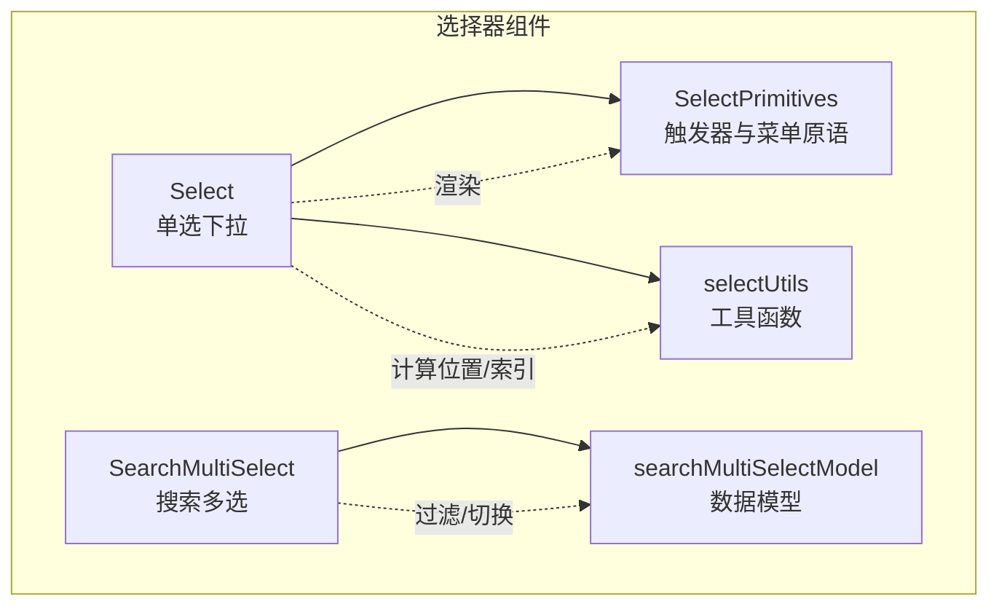
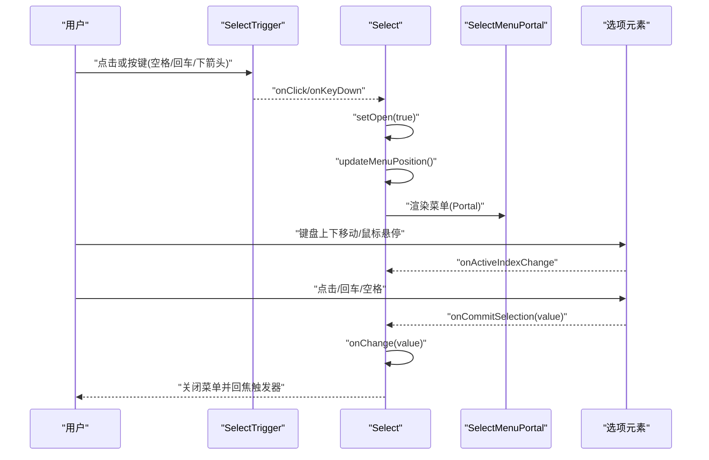
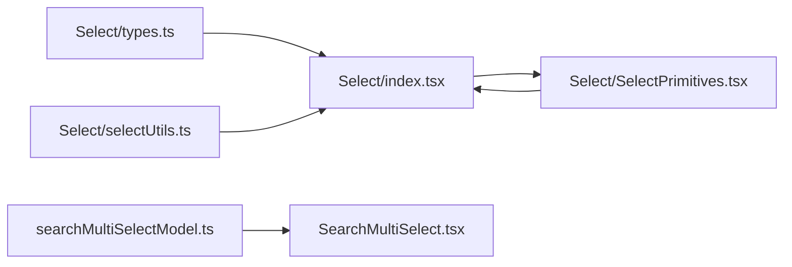

# 选择器组件

<cite>
**本文引用的文件**   
- [Select/types.ts](file://src/renderer/ui/Select/types.ts)
- [Select/index.tsx](file://src/renderer/ui/Select/index.tsx)
- [Select/selectUtils.ts](file://src/renderer/ui/Select/selectUtils.ts)
- [Select/SelectPrimitives.tsx](file://src/renderer/ui/Select/SelectPrimitives.tsx)
- [SearchMultiSelect.tsx](file://src/renderer/ui/SearchMultiSelect.tsx)
- [searchMultiSelectModel.ts](file://src/renderer/ui/searchMultiSelectModel.ts)
- [SearchMultiSelect.test.ts](file://src/renderer/ui/SearchMultiSelect.test.ts)
</cite>

## 目录
1. [简介](#简介)
2. [项目结构](#项目结构)
3. [核心组件](#核心组件)
4. [架构总览](#架构总览)
5. [详细组件分析](#详细组件分析)
6. [依赖关系分析](#依赖关系分析)
7. [性能考虑](#性能考虑)
8. [故障排查指南](#故障排查指南)
9. [结论](#结论)
10. [附录：使用示例与最佳实践](#附录使用示例与最佳实践)

## 简介
本文聚焦仓库中的选择器组件族，包括单选下拉入口 Select 与搜索多选 SearchMultiSelect。文档从接口定义、选项渲染、键盘导航、可访问性、数据模型和状态处理等维度进行系统化说明，并给出复杂场景的用法参考与性能优化建议，帮助使用者正确、高效地集成这些组件。

## 项目结构
选择器相关代码集中在 renderer 层的 ui 模块中：
- Select：单选下拉选择器，包含类型、主逻辑、工具函数、基础 UI 原语。
- SearchMultiSelect：搜索多选组件，负责搜索、去重、未命中、不可用及加载错误状态的展示。
- searchMultiSelectModel：多选数据模型与过滤、切换逻辑。

图表来源
- [Select/index.tsx:1-297](file://src/renderer/ui/Select/index.tsx#L1-L297)
- [Select/SelectPrimitives.tsx:1-218](file://src/renderer/ui/Select/SelectPrimitives.tsx#L1-L218)
- [Select/selectUtils.ts:1-49](file://src/renderer/ui/Select/selectUtils.ts#L1-L49)
- [SearchMultiSelect.tsx:1-72](file://src/renderer/ui/SearchMultiSelect.tsx#L1-L72)
- [searchMultiSelectModel.ts:1-21](file://src/renderer/ui/searchMultiSelectModel.ts#L1-L21)

章节来源
- [Select/index.tsx:1-297](file://src/renderer/ui/Select/index.tsx#L1-L297)
- [SearchMultiSelect.tsx:1-72](file://src/renderer/ui/SearchMultiSelect.tsx#L1-L72)

## 核心组件
本节概述两个核心组件的职责边界：
- Select：提供唯一单选下拉入口，管理打开/关闭、焦点、键盘导航、菜单定位、选中项展示与无障碍属性。
- SearchMultiSelect：提供搜索多选能力，维护 ID 数组、搜索词、候选集、已选项列表，以及 loading/error/retry/unavailable 等状态展示。

章节来源
- [Select/index.tsx:1-297](file://src/renderer/ui/Select/index.tsx#L1-L297)
- [SearchMultiSelect.tsx:1-72](file://src/renderer/ui/SearchMultiSelect.tsx#L1-L72)

## 架构总览
Select 通过触发按钮与弹出菜单完成交互；菜单通过 Portal 挂载到 body，并根据视口动态调整位置。SearchMultiSelect 将“搜索输入 + 已选项标签 + 候选列表”组合为分组容器，并通过模型层过滤与切换 ID。

图表来源
- [Select/index.tsx:1-297](file://src/renderer/ui/Select/index.tsx#L1-L297)
- [Select/SelectPrimitives.tsx:1-218](file://src/renderer/ui/Select/SelectPrimitives.tsx#L1-L218)

## 详细组件分析

### Select：单选下拉入口
Select 是单一的选择入口，对外暴露 value/options/onChange 三元组，并支持占位符、禁用、变体、对齐方式、最小宽度与自定义类名。内部维护 open、activeIndex、menuPosition 等状态，实现完整的键盘与焦点流程。

#### 接口定义
- SelectOption：每个选项由 value、label 组成，可选 disabled、testId、swatchColor。
- SelectProps：包含受控 value、options、onChange、placeholder、emptyLabel、disabled、dataTestId、ariaLabel、variant、menuAlign、minMenuWidth、className 等样式与行为配置。

章节来源
- [Select/types.ts:1-27](file://src/renderer/ui/Select/types.ts#L1-L27)

#### 选项渲染
- 触发器显示当前选中项 label 或 placeholder，并可显示 swatch 色块。
- 菜单以 listbox 形式渲染选项，每项为 button，具备 aria-selected、aria-disabled、role="option"。
- 空菜单时显示 emptyLabel。
- 选中项右侧显示对勾图标。

章节来源
- [Select/SelectPrimitives.tsx:1-218](file://src/renderer/ui/Select/SelectPrimitives.tsx#L1-L218)

#### 键盘导航与焦点管理
- 触发器按键：
  - 下箭头/回车/空格：打开菜单。
  - 上箭头：打开菜单并将 activeIndex 初始化为已选有效项或首个有效项。
- 菜单内按键（全局监听）：
  - Escape：关闭菜单并聚焦触发器。
  - Tab：关闭菜单。
  - 上/下箭头：在有效选项中循环移动 activeIndex。
  - 回车/空格：提交选中项，调用 onChange 并关闭菜单。
- 失焦关闭：点击菜单外区域关闭。
- 焦点回流：选择后主动 focus 触发器，保证键盘操作连续性。

章节来源
- [Select/index.tsx:1-297](file://src/renderer/ui/Select/index.tsx#L1-L297)

#### 菜单定位
- 基于触发器矩形、视口宽高、最小宽度与对齐策略计算 left/top/width/caretX/placement。
- 监听 resize/scroll/ResizeObserver 以更新位置。
- 使用 clamp 限制范围，避免溢出视口。

章节来源
- [Select/index.tsx:1-297](file://src/renderer/ui/Select/index.tsx#L1-L297)
- [Select/selectUtils.ts:1-49](file://src/renderer/ui/Select/selectUtils.ts#L1-L49)

#### 可访问性
- 触发器：aria-haspopup="listbox"、aria-expanded、aria-label。
- 菜单：role="listbox"、aria-label。
- 选项：role="option"、aria-selected、aria-disabled。
- 装饰图标使用 aria-hidden="true"。
- 可通过 ariaLabel 覆盖默认提示文案。

章节来源
- [Select/SelectPrimitives.tsx:1-218](file://src/renderer/ui/Select/SelectPrimitives.tsx#L1-L218)
- [Select/index.tsx:1-297](file://src/renderer/ui/Select/index.tsx#L1-L297)

#### 复杂度分析
- 查找已选有效项：线性扫描 options，时间复杂度 O(n)。
- 下一个有效项：最多遍历一圈选项，时间复杂度 O(n)。
- 菜单定位：几何计算常量级，但依赖 DOM 测量。

章节来源
- [Select/selectUtils.ts:1-49](file://src/renderer/ui/Select/selectUtils.ts#L1-L49)

### SearchMultiSelect：搜索多选
SearchMultiSelect 是纯展示型多选组件，不负责数据持久化与权限校验，其调用方负责数据源、变更回调与业务状态。

#### 接口定义
- SearchMultiSelectOption：id、label、source、disabled。
- SearchMultiSelectProps：value(readonly string[])、options(readonly)、onChange、unavailable、loading、error、disabled、onRetry、多语言文案与 className。

章节来源
- [SearchMultiSelect.tsx:1-72](file://src/renderer/ui/SearchMultiSelect.tsx#L1-L72)
- [searchMultiSelectModel.ts:1-21](file://src/renderer/ui/searchMultiSelectModel.ts#L1-L21)

#### 值管理与去重
- value 为 ID 数组，组件内部通过 [...new Set(value)] 做二次去重，保持首次出现顺序。
- toggleMultiSelectId 在新增时先去重再追加，删除时直接过滤，保证无重复且稳定顺序。

章节来源
- [SearchMultiSelect.tsx:1-72](file://src/renderer/ui/SearchMultiSelect.tsx#L1-L72)
- [searchMultiSelectModel.ts:1-21](file://src/renderer/ui/searchMultiSelectModel.ts#L1-L21)

#### 选项数据源与搜索
- options 作为只读数据源，构建 Map 用于按 id 快速查找。
- 搜索通过 filterMultiSelectOptions 对 label/id/source 进行不区分大小写匹配，并对 id 去重，保留首次出现的顺序。

章节来源
- [SearchMultiSelect.tsx:1-72](file://src/renderer/ui/SearchMultiSelect.tsx#L1-L72)
- [searchMultiSelectModel.ts:1-21](file://src/renderer/ui/searchMultiSelectModel.ts#L1-L21)

#### unavailable 原因映射
- unavailable 为 Record<string, string>，键为被选 ID，值为不可用原因。
- 若某已选 ID 不在 options 中，且处于非 loading/error 正常态，则标记为不可用，并在已选项旁显示原因。
- 若 option.disabled 或 unavailable 中存在该 ID，对应复选框将被禁用。

章节来源
- [SearchMultiSelect.tsx:1-72](file://src/renderer/ui/SearchMultiSelect.tsx#L1-L72)

#### 状态处理：loading / error / retry
- loading：设置 aria-busy="true"，显示 loadingLabel，不显示“无可选项”或“无结果”。
- error：显示错误信息，并提供 onRetry 重试按钮；错误时禁用交互。
- 无错误且非加载中：根据 candidates 长度与 query 显示“无可选项”或“无结果”。

章节来源
- [SearchMultiSelect.tsx:1-72](file://src/renderer/ui/SearchMultiSelect.tsx#L1-L72)

#### 可访问性
- 外层容器 role="group"，aria-labelledby 指向 label 节点。
- 搜索框带 aria-label。
- 状态区使用 aria-live="polite"，错误区域 role="alert"。
- 移除按钮带描述性 aria-label（removeLabel）。
- 复选框原生 type="checkbox"，具备默认可访问语义。

章节来源
- [SearchMultiSelect.tsx:1-72](file://src/renderer/ui/SearchMultiSelect.tsx#L1-L72)

#### 复杂度分析
- 过滤候选：遍历 options，字符串拼接与包含判断，时间复杂度 O(n)，空间复杂度 O(n) 用于 seen 集合。
- 已选项去重：O(k)，k 为已选项数量。
- 查找 option：Map.get 为 O(1)。

章节来源
- [searchMultiSelectModel.ts:1-21](file://src/renderer/ui/searchMultiSelectModel.ts#L1-L21)
- [SearchMultiSelect.tsx:1-72](file://src/renderer/ui/SearchMultiSelect.tsx#L1-L72)

## 依赖关系分析

图表来源
- [Select/types.ts:1-27](file://src/renderer/ui/Select/types.ts#L1-L27)
- [Select/index.tsx:1-297](file://src/renderer/ui/Select/index.tsx#L1-L297)
- [Select/selectUtils.ts:1-49](file://src/renderer/ui/Select/selectUtils.ts#L1-L49)
- [Select/SelectPrimitives.tsx:1-218](file://src/renderer/ui/Select/SelectPrimitives.tsx#L1-L218)
- [searchMultiSelectModel.ts:1-21](file://src/renderer/ui/searchMultiSelectModel.ts#L1-L21)
- [SearchMultiSelect.tsx:1-72](file://src/renderer/ui/SearchMultiSelect.tsx#L1-L72)

## 性能考虑
- Select
  - 大量选项时，优先确保 disabled 选项较少，以减少键盘导航时的无效跳转次数。
  - 将频繁变化的 options 通过 React.memo 或 useMemo 稳定引用，减少不必要的重渲染。
  - 避免在 onChange 中执行昂贵副作用，延迟到调用方统一处理。
  - 菜单定位依赖 DOM 测量，建议在选项静态或变化频率低时使用，或在数据更新后再打开菜单。
- SearchMultiSelect
  - 大数据量 options 时，可在调用方先做分页或前端虚拟滚动，组件本身仅做轻量过滤。
  - 使用稳定的 id 与 source，避免频繁重建导致 Map 失效。
  - 合理设置 unavailable，避免误判为“无结果”，从而减少用户困惑。
  - 过滤逻辑已在组件内去重，传入 options 也应尽量保证 id 唯一，减少重复计算。

[本节为通用指导，不直接分析具体文件]

## 故障排查指南
- Select
  - 菜单不出现：检查是否设置了 minMenuWidth 过小或被外部 CSS 隐藏；确认 open 状态与 portal 挂载。
  - 键盘无效：确认组件未被 disabled 包裹；检查是否在顶层叠加层监听 keydown。
  - 焦点丢失：选择后应自动 focus 触发器；如被其他弹窗截获事件，需确保事件冒泡与层级正确。
- SearchMultiSelect
  - 已选项消失：确认 unavailable 映射是否正确；若 catalog 中缺失该项且未声明 unavailable，会被视为不可用但会保留展示。
  - 无法取消选择：检查 disabled/loading/error 是否阻止了交互；确认 onChange 回调是否更新父级 state。
  - 搜索无结果：确认 query 是否为空；当 loading 或 error 存在时不会显示“无结果”文案。

章节来源
- [SearchMultiSelect.tsx:1-72](file://src/renderer/ui/SearchMultiSelect.tsx#L1-L72)
- [SearchMultiSelect.test.ts:1-36](file://src/renderer/ui/SearchMultiSelect.test.ts#L1-L36)

## 结论
Select 提供了完整、可访问的单选下拉体验，涵盖键盘导航、焦点管理和自适应菜单定位；SearchMultiSelect 则在受控模式下提供搜索、去重、不可用标注与加载/错误状态展示。两者职责清晰：Select 专注交互细节，SearchMultiSelect 专注多选展示与基础状态，复杂的数据获取与持久化交由调用方实现。遵循本文的接口约定与最佳实践，可获得一致且健壮的表单选择体验。

[本节为总结性内容，不直接分析具体文件]

## 附录：使用示例与最佳实践

### Select 典型用法要点
- 将 value/options/onChange 作为受控三元组传入，placeholder 与 emptyLabel 分别控制触发器与空菜单文案。
- 通过 variant 控制外观，menuAlign 控制对齐方向，minMenuWidth 控制最小宽度。
- 为 dataTestId 设置稳定标识，便于测试定位；必要时通过 ariaLabel 提供屏幕阅读器提示。
- 选项可使用 swatchColor 展示视觉色块，提升可读性与品牌一致性。

章节来源
- [Select/types.ts:1-27](file://src/renderer/ui/Select/types.ts#L1-L27)
- [Select/index.tsx:1-297](file://src/renderer/ui/Select/index.tsx#L1-L297)

### SearchMultiSelect 典型用法要点
- value 为 readonly string[]，onChange 返回新的 string[]；组件内部会去重并保持顺序。
- options 为 SearchMultiSelectOption 数组，建议 id 全局唯一；source 用于展示数据来源。
- unavailable 用于标注“已选但当前目录不存在”的项；若未设置且选项不可用，也会被识别为不可用。
- 在 loading 或 error 状态下，组件会屏蔽交互并显示相应文案；error 时可配合 onRetry 重试。
- 通过 removeLabel(id) 提供每个已选项的移除按钮提示，增强可访问性。

章节来源
- [SearchMultiSelect.tsx:1-72](file://src/renderer/ui/SearchMultiSelect.tsx#L1-L72)
- [searchMultiSelectModel.ts:1-21](file://src/renderer/ui/searchMultiSelectModel.ts#L1-L21)
- [SearchMultiSelect.test.ts:1-36](file://src/renderer/ui/SearchMultiSelect.test.ts#L1-L36)