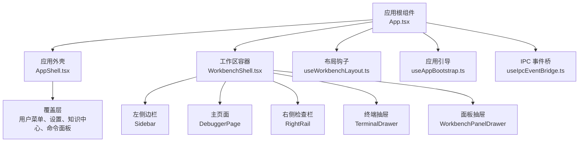
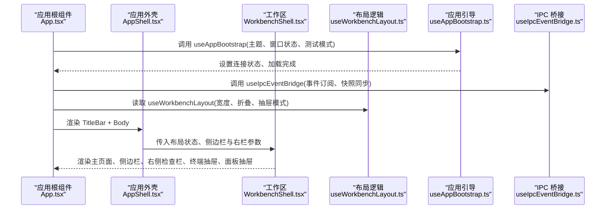
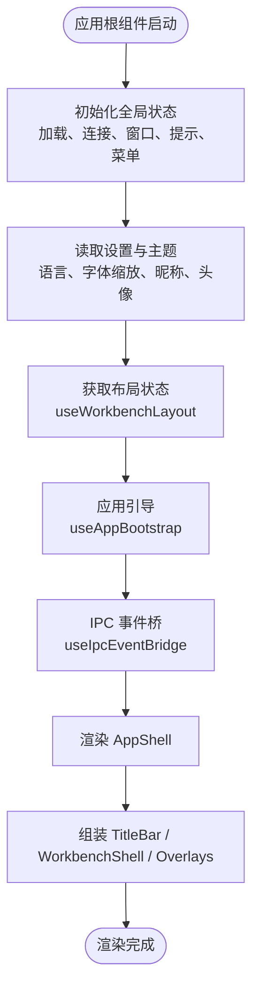
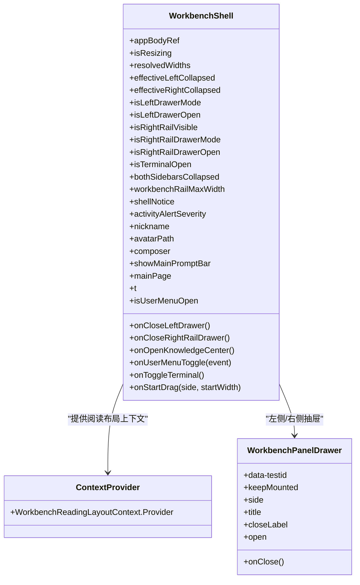
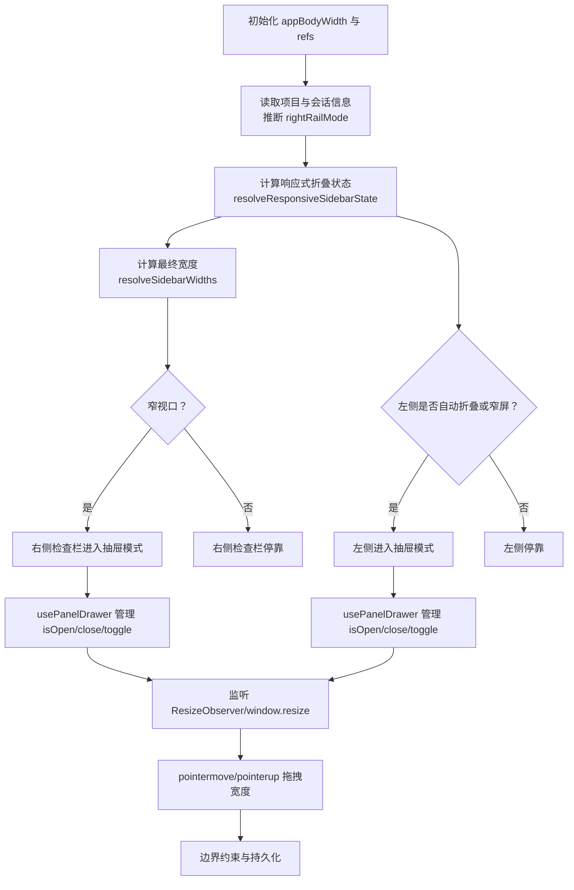
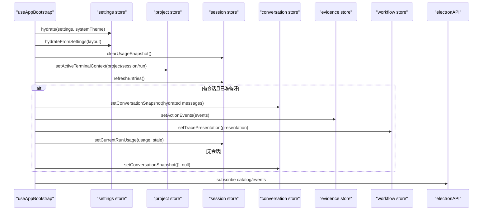
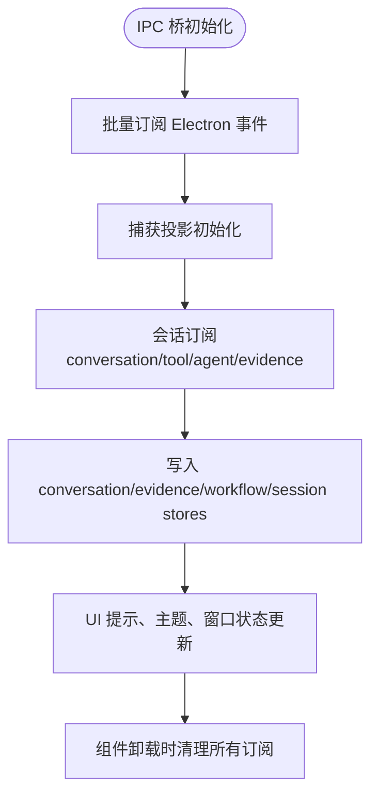
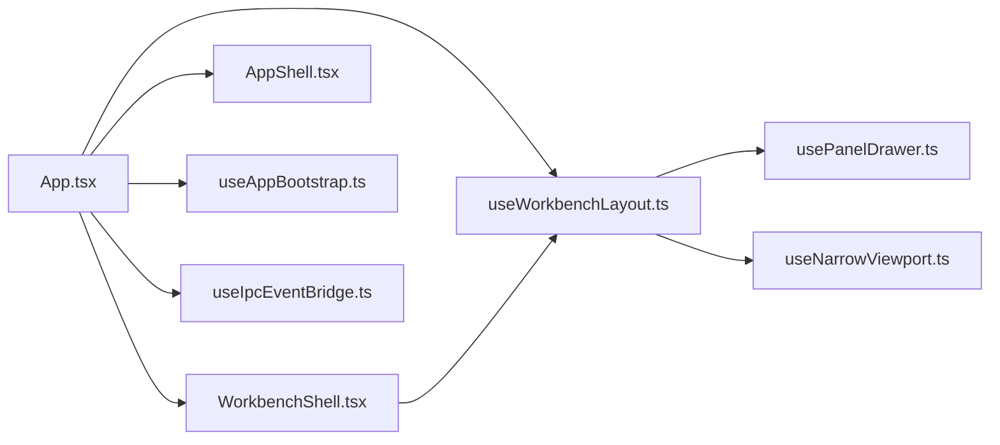

# Workbench Shell 架构

<cite>
**本文引用的文件**
- [App.tsx](file://src/renderer/app/App.tsx)
- [WorkbenchShell.tsx](file://src/renderer/app/WorkbenchShell.tsx)
- [useWorkbenchLayout.ts](file://src/renderer/app/useWorkbenchLayout.ts)
- [usePanelDrawer.ts](file://src/renderer/app/usePanelDrawer.ts)
- [useNarrowViewport.ts](file://src/renderer/app/useNarrowViewport.ts)
- [AppProviders.tsx](file://src/renderer/app/AppProviders.tsx)
- [AppShell.tsx](file://src/renderer/shell/AppShell.tsx)
- [useAppBootstrap.ts](file://src/renderer/app/bootstrap/useAppBootstrap.ts)
- [useIpcEventBridge.ts](file://src/renderer/app/bootstrap/useIpcEventBridge.ts)
</cite>

## 目录
1. [引言](#引言)
2. [项目结构](#项目结构)
3. [核心组件](#核心组件)
4. [架构总览](#架构总览)
5. [详细组件分析](#详细组件分析)
6. [依赖关系分析](#依赖关系分析)
7. [性能与扩展建议](#性能与扩展建议)
8. [故障排查指南](#故障排查指南)
9. [结论](#结论)

## 引言
本文聚焦于 Workbench Shell 的渲染端入口、工作区布局、面板抽屉机制与应用引导流程。重点解释：
- App.tsx 作为应用根组件的职责，包括 Provider 挂载、主题同步、窗口控制、通知与对话框管理。
- WorkbenchShell 的路由式页面组织方式，主面板、左侧边栏、右侧检查栏与终端抽屉的组合。
- useWorkbenchLayout hook 的响应式布局、窄视口适配、左右面板折叠与宽度拖拽逻辑。
- useAppBootstrap 的应用初始化、IPC 事件桥接、会话恢复与对话事件批处理机制。
- 同时提供架构图、交互流程图和自定义布局扩展指南，帮助读者在不深入源码的情况下理解整体设计。

## 项目结构
Workbench Shell 位于渲染进程的应用层，主要涉及以下模块：
- 应用根组件与外壳：App.tsx、AppShell.tsx、AppProviders.tsx。
- 工作区容器与工作表：WorkbenchShell.tsx。
- 布局状态与响应式逻辑：useWorkbenchLayout.ts、usePanelDrawer.ts、useNarrowViewport.ts。
- 应用引导与 IPC 桥接：useAppBootstrap.ts、useIpcEventBridge.ts。

图表来源
- [App.tsx:1-260](file://src/renderer/app/App.tsx#L1-L260)
- [AppShell.tsx:1-20](file://src/renderer/shell/AppShell.tsx#L1-L20)
- [WorkbenchShell.tsx:1-254](file://src/renderer/app/WorkbenchShell.tsx#L1-L254)
- [useWorkbenchLayout.ts:1-209](file://src/renderer/app/useWorkbenchLayout.ts#L1-L209)
- [useAppBootstrap.ts:1-317](file://src/renderer/app/bootstrap/useAppBootstrap.ts#L1-L317)
- [useIpcEventBridge.ts:1-122](file://src/renderer/app/bootstrap/useIpcEventBridge.ts#L1-L122)

章节来源
- [App.tsx:1-260](file://src/renderer/app/App.tsx#L1-L260)
- [AppShell.tsx:1-20](file://src/renderer/shell/AppShell.tsx#L1-L20)
- [WorkbenchShell.tsx:1-254](file://src/renderer/app/WorkbenchShell.tsx#L1-L254)
- [useWorkbenchLayout.ts:1-209](file://src/renderer/app/useWorkbenchLayout.ts#L1-L209)
- [useAppBootstrap.ts:1-317](file://src/renderer/app/bootstrap/useAppBootstrap.ts#L1-L317)
- [useIpcEventBridge.ts:1-122](file://src/renderer/app/bootstrap/useIpcEventBridge.ts#L1-L122)

## 核心组件
- App.tsx：应用根组件，负责加载状态、主题与语言设置、窗口最大化状态、用户菜单与全局弹窗（设置、知识中心、命令面板）、Composer 控制器、顶部标题栏、以及将布局状态与页面内容组合到 AppShell。
- WorkbenchShell.tsx：工作区容器，组织左侧边栏、主页面、右侧检查栏、终端抽屉、调整手柄、面板抽屉与阅读上下文。
- useWorkbenchLayout.ts：响应式布局计算、窄视口检测、左右面板折叠、宽度拖拽与持久化。
- usePanelDrawer.ts：轻量面板抽屉开关状态管理。
- useNarrowViewport.ts：基于 CSS 媒体查询与 window.innerWidth 的窄视口判断。
- AppProviders.tsx：应用级宿主挂载点，当前挂载右键菜单宿主。
- AppShell.tsx：最外层外壳容器，承载 titleBar、body、overlays。
- useAppBootstrap.ts：应用初始化、主题注入、Electron API 探测、会话与项目数据恢复、模型目录更新等。
- useIpcEventBridge.ts：集中订阅 Electron IPC 事件，统一桥接到各 store 与 UI 状态。

章节来源
- [App.tsx:1-260](file://src/renderer/app/App.tsx#L1-L260)
- [WorkbenchShell.tsx:1-254](file://src/renderer/app/WorkbenchShell.tsx#L1-L254)
- [useWorkbenchLayout.ts:1-209](file://src/renderer/app/useWorkbenchLayout.ts#L1-L209)
- [usePanelDrawer.ts:1-16](file://src/renderer/app/usePanelDrawer.ts#L1-L16)
- [useNarrowViewport.ts:1-24](file://src/renderer/app/useNarrowViewport.ts#L1-L24)
- [AppProviders.tsx:1-12](file://src/renderer/app/AppProviders.tsx#L1-L12)
- [AppShell.tsx:1-20](file://src/renderer/shell/AppShell.tsx#L1-L20)
- [useAppBootstrap.ts:1-317](file://src/renderer/app/bootstrap/useAppBootstrap.ts#L1-L317)
- [useIpcEventBridge.ts:1-122](file://src/renderer/app/bootstrap/useIpcEventBridge.ts#L1-L122)

## 架构总览
下图展示从应用启动到工作区渲染的关键路径：App.tsx 通过 AppShell 包裹 WorkbenchShell，并使用 useWorkbenchLayout 提供布局状态；useAppBootstrap 在初始化阶段注入主题、恢复项目与会话；useIpcEventBridge 建立与 Electron 主进程的 IPC 事件通道，驱动会话、证据、运行状态等实时变化。

图表来源
- [App.tsx:1-260](file://src/renderer/app/App.tsx#L1-L260)
- [AppShell.tsx:1-20](file://src/renderer/shell/AppShell.tsx#L1-L20)
- [WorkbenchShell.tsx:1-254](file://src/renderer/app/WorkbenchShell.tsx#L1-L254)
- [useWorkbenchLayout.ts:1-209](file://src/renderer/app/useWorkbenchLayout.ts#L1-L209)
- [useAppBootstrap.ts:1-317](file://src/renderer/app/bootstrap/useAppBootstrap.ts#L1-L317)
- [useIpcEventBridge.ts:1-122](file://src/renderer/app/bootstrap/useIpcEventBridge.ts#L1-L122)

## 详细组件分析

### App.tsx：应用根组件与全局装配
职责要点：
- 初始化加载状态、连接状态、窗口最大化状态、Shell 提示、用户菜单锚点、设置模态框、知识中心、运行时测试模式。
- 从 settings store 读取主题、语言、字体缩放、昵称与头像，并解析系统主题。
- 使用 useWorkbenchLayout 获取布局状态，结合 Composer 控制器构建输入栏。
- 调用 useAppBootstrap 进行应用引导，调用 useIpcEventBridge 建立 IPC 事件桥。
- 组装 AppShell：TitleBar 接收布局与窗口控制回调，Body 为 WorkbenchShell，Overlays 包含 UserMenu、GettingStartedDialog、SettingsModal、KnowledgeCenterModal、CommandPaletteController、NotificationToast。
- 主题变更通过 applyAppearancePreference 包装异步 mutation，失败时显示 Shell 提示。

关键交互：
- 左/右侧栏切换逻辑会根据 isLeftDrawerMode/isRightRailDrawerMode 选择抽屉模式或传统折叠模式。
- 活动日志 severity 决定终端按钮的颜色状态。
- 用户菜单触发后根据元素坐标保存锚点矩形。

图表来源
- [App.tsx:1-260](file://src/renderer/app/App.tsx#L1-L260)

章节来源
- [App.tsx:1-260](file://src/renderer/app/App.tsx#L1-L260)

### WorkbenchShell.tsx：工作区布局与页面组织
职责要点：
- 接收布局状态（appBodyRef、isResizing、resolvedWidths、折叠状态、抽屉模式与打开状态、右侧检查栏可见性、终端打开状态、最大宽度、提示、活动严重级别、昵称、头像）。
- 构造 WorkbenchReadingLayoutContext，向下游传递 workArea、composerRail 与 layoutRevision，供阅读相关组件感知布局变化。
- 根据 isRightRailVisible 与 isRightRailDrawerMode 决定右侧检查栏是停靠还是抽屉模式。
- 根据 isLeftDrawerMode 与 effectiveLeftCollapsed 决定是否渲染左侧 Sidebar，并在 Drawer 模式下把相同内容放入 WorkbenchPanelDrawer。
- 渲染主页面 mainPage、主输入栏 Composer、TerminalDrawer、ResizeHandle、右侧检查栏 RightRail。
- 当两侧边栏均折叠时，通过 CSS 变量 --workbench-inline-mode 切换到双折叠内联模式。

布局与交互要点：
- 左侧与右侧均可通过 ResizeHandle 拖动改变宽度，宽度受最小主区域宽度、左右面板最小宽度与最大宽度约束。
- 在窄视口或自动折叠时，左右面板转为抽屉模式，使用 usePanelDrawer 管理 isOpen/close/toggle。
- 主内容区域支持 shellNotice 提示与设备选择器、终端按钮等浮动工具。

图表来源
- [WorkbenchShell.tsx:1-254](file://src/renderer/app/WorkbenchShell.tsx#L1-L254)

章节来源
- [WorkbenchShell.tsx:1-254](file://src/renderer/app/WorkbenchShell.tsx#L1-L254)

### useWorkbenchLayout.ts：响应式布局与面板抽屉逻辑
职责要点：
- 维护 appBodyWidth、isResizing、appBodyRef、拖拽状态 ref。
- 从 projectStore 读取 currentProject、currentSession、rightRailTarget，推断 rightRailMode（hidden/project/session）与 isRightRailVisible。
- 使用 resolveResponsiveSidebarState 与 resolveSidebarWidths 计算有效折叠状态与最终宽度。
- 使用 useNarrowViewport(RIGHT_RAIL_DRAWPOINT) 判断右侧检查栏是否进入抽屉模式。
- 当 appBodyWidth ≤ 720 或左侧自动折叠时，左侧进入抽屉模式。
- 使用 usePanelDrawer 管理左右抽屉的 isOpen/close/toggle。
- 监听 ResizeObserver 与 window.resize，同步 appBodyWidth。
- 监听 pointermove/pointerup 实现左右面板宽度拖拽，限制最小主区域宽度、左右面板最小宽度与最大宽度，拖拽结束后 persistLayout。
- 暴露 appBodyRef、isResizing、effectiveLeftCollapsed/effectiveRightCollapsed、bothSidebarsCollapsed、drawer 状态、workbenchRailMaxWidth、startDragging。

图表来源
- [useWorkbenchLayout.ts:1-209](file://src/renderer/app/useWorkbenchLayout.ts#L1-L209)
- [usePanelDrawer.ts:1-16](file://src/renderer/app/usePanelDrawer.ts#L1-L16)
- [useNarrowViewport.ts:1-24](file://src/renderer/app/useNarrowViewport.ts#L1-L24)

章节来源
- [useWorkbenchLayout.ts:1-209](file://src/renderer/app/useWorkbenchLayout.ts#L1-L209)
- [usePanelDrawer.ts:1-16](file://src/renderer/app/usePanelDrawer.ts#L1-L16)
- [useNarrowViewport.ts:1-24](file://src/renderer/app/useNarrowViewport.ts#L1-L24)

### AppProviders.tsx 与 AppShell.tsx：应用级宿主与外壳
- AppProviders 当前仅挂载 AppContextMenuHost，作为应用级宿主。
- AppShell 是最外层容器，按顺序渲染 titleBar、body、overlays，不关心业务细节。

章节来源
- [AppProviders.tsx:1-12](file://src/renderer/app/AppProviders.tsx#L1-L12)
- [AppShell.tsx:1-20](file://src/renderer/shell/AppShell.tsx#L1-L20)

### useAppBootstrap.ts：应用引导与数据恢复
职责要点：
- 设置文档语言、应用主题。
- 探测 electronAPI，若不存在则标记 offline；否则并行获取 settings、appMeta、windowControls.isMaximized，并 hydrateSettings/hydrateLayout、设置测试模式与窗口最大化、连接状态 connected。
- 根据 currentProject/currentSession/currentRun 更新 terminal active context 并刷新条目。
- 恢复会话历史与证据链：如果已有消息绑定且非自动化测试，则跳过重复 IPC；否则并行拉取 conversation.getHistory、evidence.getChain、trace.getProjection，并使用 hydrateMessagesWithActionEvents 合并消息与动作事件，最后 setConversationSnapshot 与 setTracePresentation。
- 拉取 workflow.getRunUsage 更新 session usage。
- 订阅 catalog 变更，延迟 reloadSettings 以保持 provider modelOptions 新鲜。
- 启动 catalog projection，并根据 enabled providers 与 agentRoutes reconcileCatalogProviders。
- 额外 hooks：useProjectInputsBootstrap 与 useSessionRestoreBootstrap 分别用于项目输入与证据链/工作流状态的恢复。

图表来源
- [useAppBootstrap.ts:1-317](file://src/renderer/app/bootstrap/useAppBootstrap.ts#L1-L317)

章节来源
- [useAppBootstrap.ts:1-317](file://src/renderer/app/bootstrap/useAppBootstrap.ts#L1-L317)

### useIpcEventBridge.ts：IPC 事件桥接与会话事件批处理
职责要点：
- 提供 useSyncCapturesFromSnapshot，根据当前 run 与快照描述符同步 capture store。
- 集中订阅 Electron events：runUsageChanged、traceProjectionChanged、contextChanged、conversation、toolExecutionComplete、agentMessage、agentStatusChanged、captureStatusChanged、evidenceEventAdded、runStatusChanged、deviceStatusChanged、projectInputsChanged、projectInputsError、openedCaptureStateChanged、runtimeLogAppended、appThemeChanged、shellCommands。
- 对 handoffNotice 去重显示。
- 在卸载时统一 dispose 所有订阅，避免内存泄漏。

图表来源
- [useIpcEventBridge.ts:1-122](file://src/renderer/app/bootstrap/useIpcEventBridge.ts#L1-L122)

章节来源
- [useIpcEventBridge.ts:1-122](file://src/renderer/app/bootstrap/useIpcEventBridge.ts#L1-L122)

## 依赖关系分析
- App.tsx 依赖：
  - WorkbenchShell.tsx：工作区容器。
  - AppShell.tsx：外壳容器。
  - useWorkbenchLayout.ts：布局状态。
  - useAppBootstrap.ts：应用引导。
  - useIpcEventBridge.ts：IPC 事件桥。
  - 各 feature/store/i18n/hooks：主题、会话、项目、终端、Composer、用户菜单、设置、知识中心、命令面板、通知。
- WorkbenchShell.tsx 依赖：
  - 左侧边栏、右侧检查栏、终端抽屉、面板抽屉、Composer、PlanReaderHost、ResizeHandle。
  - useWorkbenchLayout.ts 提供的布局状态与拖拽回调。
- useWorkbenchLayout.ts 依赖：
  - layoutStore、projectStore、usePanelDrawer、useNarrowViewport、layoutGeometry 函数与常量。
- useAppBootstrap.ts 依赖：
  - conversationTimeline、theme、stores（effectiveCatalogStore、appSettingsStore、conversationStore、evidenceStore、layoutStore、projectStore、sessionStore、terminalStore、workflowStore）。
- useIpcEventBridge.ts 依赖：
  - conversationTimeline、captureSubscriptions、conversationSubscriptions、sessionSubscriptions、shellSubscriptions。

图表来源
- [App.tsx:1-260](file://src/renderer/app/App.tsx#L1-L260)
- [WorkbenchShell.tsx:1-254](file://src/renderer/app/WorkbenchShell.tsx#L1-L254)
- [useWorkbenchLayout.ts:1-209](file://src/renderer/app/useWorkbenchLayout.ts#L1-L209)
- [usePanelDrawer.ts:1-16](file://src/renderer/app/usePanelDrawer.ts#L1-L16)
- [useNarrowViewport.ts:1-24](file://src/renderer/app/useNarrowViewport.ts#L1-L24)
- [useAppBootstrap.ts:1-317](file://src/renderer/app/bootstrap/useAppBootstrap.ts#L1-L317)
- [useIpcEventBridge.ts:1-122](file://src/renderer/app/bootstrap/useIpcEventBridge.ts#L1-L122)

## 性能与扩展建议
- 响应式布局：
  - 使用 ResizeObserver 与 matchMedia 双重检测视口变化，减少抖动；拖拽时使用 pointermove/pointerup 并在结束时持久化布局。
  - 建议在新增面板时复用 usePanelDrawer 与 useNarrowViewport，保持行为一致。
- IPC 事件桥：
  - 统一在 useIpcEventBridge 中订阅与清理事件，避免多处重复订阅导致的状态不一致。
  - 对于高频事件（如 evidenceEventAdded），应确保消费方使用批处理或节流策略。
- 主题与国际化：
  - 主题变更通过 applyChromeTheme 与 settings.appearance.language 同步，避免在频繁渲染路径中进行昂贵操作。
- 可扩展点：
  - 在 WorkbenchShell 中添加新的面板区域时，可参考右侧检查栏的实现，使用 isRightRailVisible/isRightRailDrawerMode 与 WorkbenchPanelDrawer。
  - 在 App.tsx overlays 中注册新的全局模态框或命令面板，遵循现有 UserMenu/SettingsModal/KnowledgeCenterModal 的模式。

[本节为通用指导，不直接分析具体文件]

## 故障排查指南
- 应用无法加载：
  - 检查 useAppBootstrap 中 electronAPI 是否存在；若不存在，连接状态会被设为 offline。
  - 检查 Promise.all 获取 settings/appMeta/windowControls 是否抛出异常；失败会降级为 degraded。
- 会话数据未恢复：
  - 确认 currentSession.sessionId 存在且 runtimeTestMode 已就绪；否则会清空会话快照。
  - 核对 conversation.getHistory/evidence.getChain/trace.getProjection 的返回值与 hydrateMessagesWithActionEvents 的处理。
- IPC 事件未生效：
  - 确认 useIpcEventBridge 中的订阅是否正确返回 unsubscribe 函数，并在卸载时调用。
  - 检查 handoffNotice 去重逻辑是否误判，导致提示未显示。
- 布局异常：
  - 检查 useWorkbenchLayout 中 appBodyWidth 是否正确同步；确认 ResizeObserver 与 window.resize 监听未被提前移除。
  - 检查拖拽边界计算是否被 effectiveLeftCollapsed/effectiveRightCollapsed 影响。

章节来源
- [useAppBootstrap.ts:1-317](file://src/renderer/app/bootstrap/useAppBootstrap.ts#L1-L317)
- [useIpcEventBridge.ts:1-122](file://src/renderer/app/bootstrap/useIpcEventBridge.ts#L1-L122)
- [useWorkbenchLayout.ts:1-209](file://src/renderer/app/useWorkbenchLayout.ts#L1-L209)

## 结论
Workbench Shell 以 App.tsx 为根，通过 AppShell 包裹 WorkbenchShell，并使用 useWorkbenchLayout 管理响应式布局与面板抽屉。useAppBootstrap 负责应用引导与数据恢复，useIpcEventBridge 集中桥接 IPC 事件到前端状态。该架构清晰分离了外壳、工作区、布局与引导逻辑，便于扩展新面板与新交互，同时保证在窄视口下的良好体验。

[本节为总结，不直接分析具体文件]