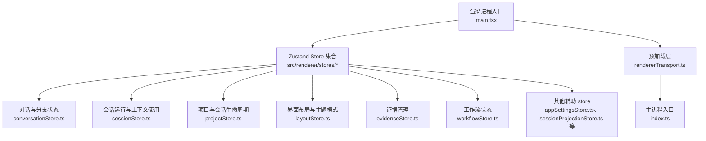
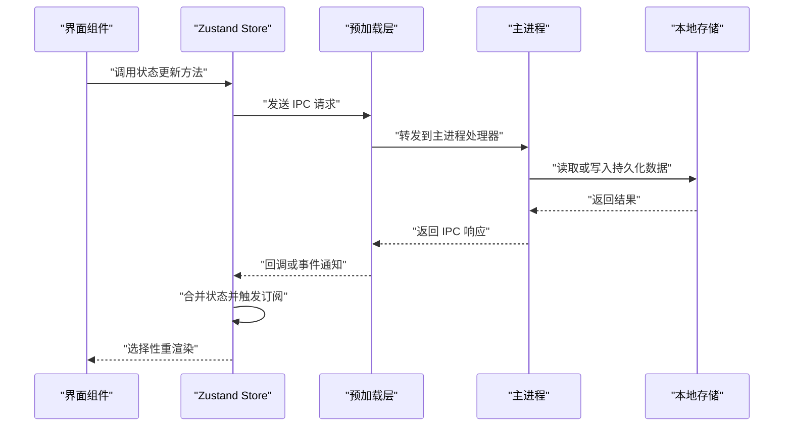
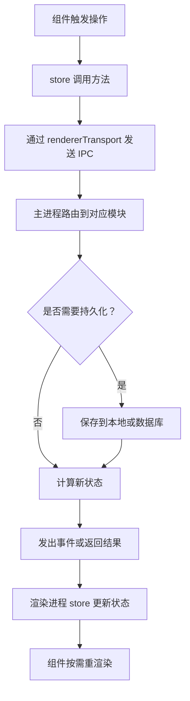
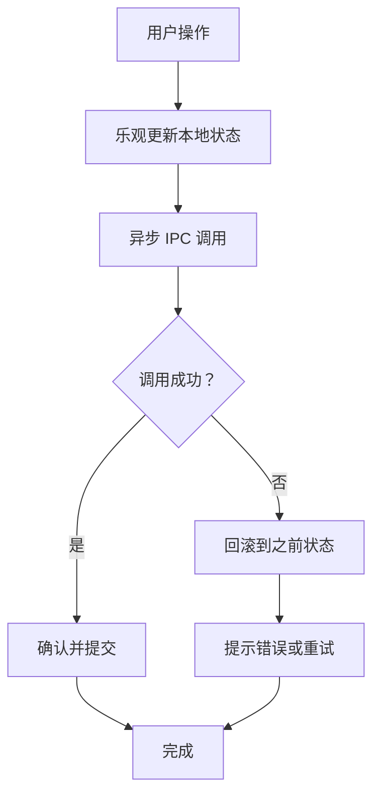
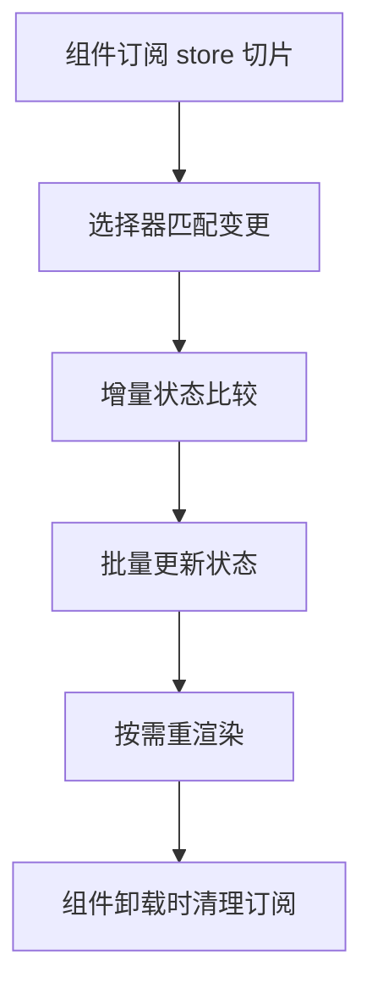
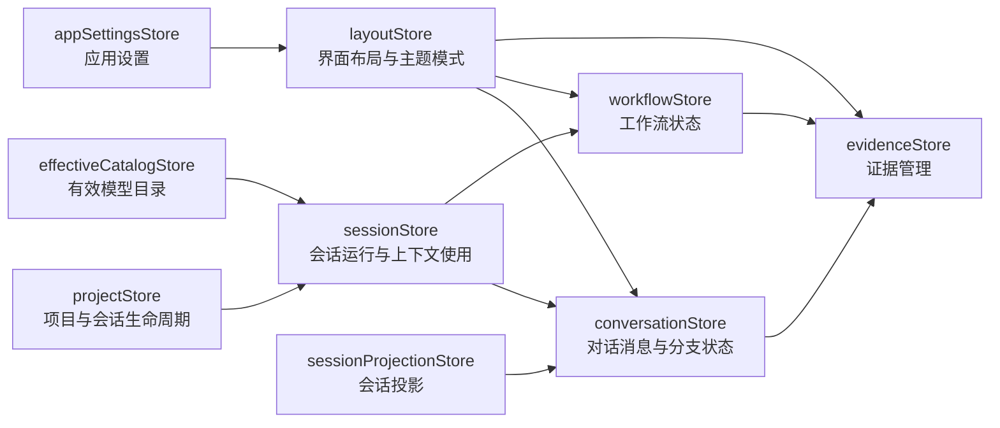
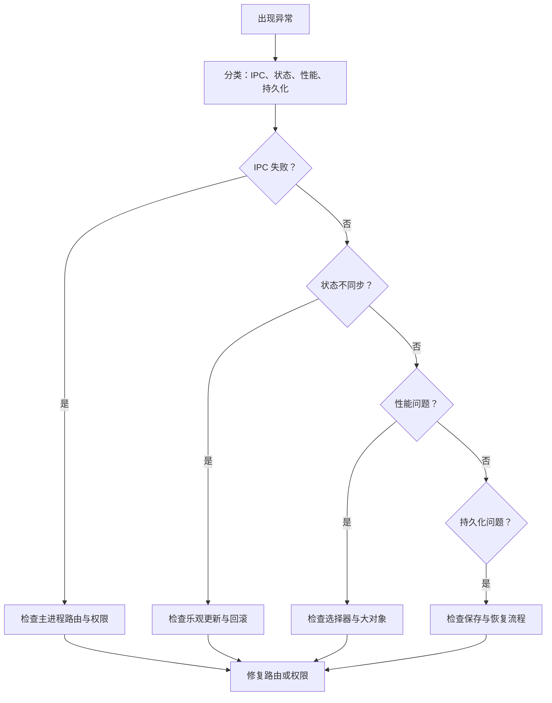

# Zustand Store 架构总览

<cite>
**本文引用的文件**   
- [conversationStore.ts](file://src/renderer/stores/conversationStore.ts)
- [sessionStore.ts](file://src/renderer/stores/sessionStore.ts)
- [projectStore.ts](file://src/renderer/stores/projectStore.ts)
- [layoutStore.ts](file://src/renderer/stores/layoutStore.ts)
- [evidenceStore.ts](file://src/renderer/stores/evidenceStore.ts)
- [workflowStore.ts](file://src/renderer/stores/workflowStore.ts)
- [effectiveCatalogStore.ts](file://src/renderer/stores/effectiveCatalogStore.ts)
- [sessionProjectionStore.ts](file://src/renderer/stores/sessionProjectionStore.ts)
- [appSettingsStore.ts](file://src/renderer/stores/appSettingsStore.ts)
- [composerSessionContextStore.ts](file://src/renderer/stores/composerSessionContextStore.ts)
- [terminalStore.ts](file://src/renderer/stores/terminalStore.ts)
- [agentStore.ts](file://src/renderer/stores/agentStore.ts)
- [captureStore.ts](file://src/renderer/stores/captureStore.ts)
- [commandPaletteStore.ts](file://src/renderer/stores/commandPaletteStore.ts)
- [deviceStore.ts](file://src/renderer/stores/deviceStore.ts)
- [notificationStore.ts](file://src/renderer/stores/notificationStore.ts)
- [turnControlsStore.ts](file://src/renderer/stores/turnControlsStore.ts)
- [index.ts](file://src/main/index.ts)
- [rendererTransport.ts](file://src/preload/src/preload/rendererTransport.ts)
- [main.tsx](file://src/renderer/src/renderer/main.tsx)
</cite>

## 目录
1. [引言](#引言)
2. [项目结构](#项目结构)
3. [核心组件](#核心组件)
4. [架构总览](#架构总览)
5. [详细组件分析](#详细组件分析)
6. [依赖关系分析](#依赖关系分析)
7. [性能考虑](#性能考虑)
8. [故障排查指南](#故障排查指南)
9. [结论](#结论)
10. [附录](#附录)

## 引言
本文件面向 Zustand store 的整体架构，目标是帮助读者理解：
- 状态管理的设计原则与按功能域划分的组织方式。
- conversationStore、sessionStore、projectStore、layoutStore、evidenceStore、workflowStore 等核心 store 的职责边界。
- 前端状态如何与主进程通过 IPC 通信，以及实时数据更新、乐观更新与回滚策略。
- 本地持久化、设置同步、断线恢复机制。
- 选择器订阅、状态合并、内存管理等性能优化手段。
- store 开发规范、测试方法与调试技巧。

## 项目结构
渲染进程中的 Zustand store 集中在 `src/renderer/stores` 目录下；每个领域一个 store 文件，形成“按功能域划分”的扁平结构。主进程入口在 `src/main/index.ts`，预加载层暴露 IPC 传输能力 `src/preload/src/preload/rendererTransport.ts`，渲染进程入口在 `src/renderer/src/renderer/main.tsx`。



**图示来源**
- [main.tsx](file://src/renderer/src/renderer/main.tsx)
- [rendererTransport.ts](file://src/preload/src/preload/rendererTransport.ts)
- [index.ts](file://src/main/index.ts)
- [conversationStore.ts](file://src/renderer/stores/conversationStore.ts)
- [sessionStore.ts](file://src/renderer/stores/sessionStore.ts)
- [projectStore.ts](file://src/renderer/stores/projectStore.ts)
- [layoutStore.ts](file://src/renderer/stores/layoutStore.ts)
- [evidenceStore.ts](file://src/renderer/stores/evidenceStore.ts)
- [workflowStore.ts](file://src/renderer/stores/workflowStore.ts)

**章节来源**
- [index.ts](file://src/main/index.ts)
- [rendererTransport.ts](file://src/preload/src/preload/rendererTransport.ts)
- [main.tsx](file://src/renderer/src/renderer/main.tsx)

## 核心组件
本节概述六个核心 store 的职责边界与协作关系。

### conversationStore：对话消息与分支状态
- 职责：维护当前对话的消息列表、消息类型、消息状态、分支切换、选中消息、展开折叠、滚动锚点、局部增量更新等。
- 典型状态字段：消息集合、当前活动分支、选中消息标识、分支元信息、消息时间线、错误消息与重试标记。
- 典型操作：追加新消息、插入流式片段、替换失败消息、创建/切换分支、清理历史、导出摘要。
- 与其他 store 的关系：受 sessionStore 驱动（会话运行时事件），向 evidenceStore 提供上下文引用，被 workflowStore 用于展示执行步骤。

**章节来源**
- [conversationStore.ts](file://src/renderer/stores/conversationStore.ts)

### sessionStore：会话运行与上下文使用
- 职责：封装当前会话的运行态，包括模型选择、上下文窗口、调用统计、令牌使用、流式响应、错误恢复、暂停与继续。
- 典型状态字段：会话标识、模型、上下文、运行状态、进度、用量、错误、重试计数。
- 典型操作：启动会话、发送提示、接收流式响应、终止会话、重置上下文、上报用量。
- 与其他 store 的关系：驱动 conversationStore 追加消息，影响 projectStore 的活跃会话，为 workflowStore 提供执行阶段。

**章节来源**
- [sessionStore.ts](file://src/renderer/stores/sessionStore.ts)

### projectStore：项目与会话生命周期
- 职责：管理项目元数据、会话列表、默认会话、打开顺序、最近访问、项目级配置、导入导出、迁移。
- 典型状态字段：项目标识、会话映射、活跃会话、最近会话、项目设置、导入导出任务。
- 典型操作：创建项目、删除项目、切换会话、保存项目、导出会话、迁移旧格式。
- 与其他 store 的关系：拥有 sessionStore 的生命周期所有权，协调 layoutStore 的面板可见性，通知 evidenceStore 清理资源。

**章节来源**
- [projectStore.ts](file://src/renderer/stores/projectStore.ts)

### layoutStore：界面布局与主题模式
- 职责：管理侧栏、右栏、面板大小、主题模式、语言、字体缩放、快捷键提示、分屏布局。
- 典型状态字段：主题、语言、面板开关、面板尺寸、快捷键状态、分屏比例。
- 典型操作：切换主题、调整面板、重置布局、记忆上次布局。
- 与其他 store 的关系：仅作为 UI 状态，不直接读写业务数据，但会影响 conversationStore、workflowStore、evidenceStore 的显示。

**章节来源**
- [layoutStore.ts](file://src/renderer/stores/layoutStore.ts)

### evidenceStore：证据管理
- 职责：集中管理证据项、证据分类、证据视图、证据筛选、证据详情、证据下载与预览。
- 典型状态字段：证据集合、当前证据、筛选条件、加载状态、错误状态。
- 典型操作：添加证据、更新证据、删除证据、批量操作、导出证据。
- 与其他 store 的关系：从 conversationStore 和 workflowStore 获取上下文，由 projectStore 控制证据的项目范围。

**章节来源**
- [evidenceStore.ts](file://src/renderer/stores/evidenceStore.ts)

### workflowStore：工作流状态
- 职责：管理工作流定义、步骤、执行状态、工具调用、审批请求、结果汇总、回放。
- 典型状态字段：工作流实例、步骤列表、当前步骤、工具调用栈、审批状态、结果摘要。
- 典型操作：启动工作流、推进步骤、提交审批、中止、查看回放。
- 与其他 store 的关系：消费 sessionStore 的运行上下文，驱动 conversationStore 输出步骤日志，影响 evidenceStore 的证据生成。

**章节来源**
- [workflowStore.ts](file://src/renderer/stores/workflowStore.ts)

## 架构总览
Zustand store 采用“领域优先、单向依赖、IPC 驱动”的设计原则：
- 领域优先：每个 store 对应一个清晰的业务领域，避免跨领域耦合。
- 单向依赖：UI store 不直接调用后端；业务 store 通过 IPC 或上层服务间接访问后端。
- IPC 驱动：主进程负责持久化、文件系统、浏览器桥接、安全权限；渲染进程专注状态与视图。



**图示来源**
- [rendererTransport.ts](file://src/preload/src/preload/rendererTransport.ts)
- [index.ts](file://src/main/index.ts)

**章节来源**
- [rendererTransport.ts](file://src/preload/src/preload/rendererTransport.ts)
- [index.ts](file://src/main/index.ts)

## 详细组件分析

### 状态同步机制：IPC 协议与实时更新
- 渲染进程通过预加载层提供的 IPC 通道调用主进程服务。
- 主进程根据命令路由到具体模块，例如会话、项目、设置、捕获、设备、终端、通知等。
- 实时更新通常通过事件或回调实现：主进程推送变更，渲染进程 store 收到后执行最小化状态合并。



**图示来源**
- [rendererTransport.ts](file://src/preload/src/preload/rendererTransport.ts)
- [index.ts](file://src/main/index.ts)

**章节来源**
- [rendererTransport.ts](file://src/preload/src/preload/rendererTransport.ts)
- [index.ts](file://src/main/index.ts)

### 乐观更新与回滚机制
- 乐观更新：对于用户即时反馈的操作，如消息追加、面板切换，先更新本地状态，再异步发起 IPC。
- 回滚机制：如果 IPC 失败，store 需要回滚到上一稳定状态，并向用户展示可恢复的错误。
- 适用场景：消息流式追加、面板展开收起、证据快速标记、工作流步骤推进。



**图示来源**
- [conversationStore.ts](file://src/renderer/stores/conversationStore.ts)
- [workflowStore.ts](file://src/renderer/stores/workflowStore.ts)
- [evidenceStore.ts](file://src/renderer/stores/evidenceStore.ts)

**章节来源**
- [conversationStore.ts](file://src/renderer/stores/conversationStore.ts)
- [workflowStore.ts](file://src/renderer/stores/workflowStore.ts)
- [evidenceStore.ts](file://src/renderer/stores/evidenceStore.ts)

### 状态持久化方案
- 本地存储：项目、会话、证据、布局、设置等数据由主进程持久化。
- 设置同步：appSettingsStore 负责应用设置，并与主进程保持同步。
- 断线恢复：应用重启时，projectStore 恢复项目与最近会话，sessionStore 恢复会话上下文，conversationStore 恢复消息快照，evidenceStore 恢复证据索引，workflowStore 恢复工作流回放。

```mermaid
erDiagram
  PROJECT {
    uuid id PK
    string name
    timestamp created_at
    timestamp updated_at
  }

  SESSION {
    uuid id PK
    uuid project_id FK
    string model
    string status
    timestamp started_at
    timestamp ended_at
  }

  CONVERSATION_MESSAGE {
    uuid id PK
    uuid session_id FK
    string role
    string content
    number index
    timestamp created_at
  }

  EVIDENCE_ITEM {
    uuid id PK
    uuid project_id FK
    string type
    string url
    timestamp created_at
  }

  WORKFLOW_STEP {
    uuid id PK
    uuid workflow_id FK
    string step_name
    string status
    json payload
  }

  APP_SETTING {
    key PK
    json value
    timestamp updated_at
  }

  PROJECT ||--o{ SESSION : "包含"
  SESSION ||--o{ CONVERSATION_MESSAGE : "包含"
  PROJECT ||--o{ EVIDENCE_ITEM : "包含"
  WORKFLOW_STEP }o--|| SESSION : "关联"
  APP_SETTING }o--|| PROJECT : "项目设置"
```

**图示来源**
- [projectStore.ts](file://src/renderer/stores/projectStore.ts)
- [sessionStore.ts](file://src/renderer/stores/sessionStore.ts)
- [conversationStore.ts](file://src/renderer/stores/conversationStore.ts)
- [evidenceStore.ts](file://src/renderer/stores/evidenceStore.ts)
- [workflowStore.ts](file://src/renderer/stores/workflowStore.ts)
- [appSettingsStore.ts](file://src/renderer/stores/appSettingsStore.ts)

**章节来源**
- [projectStore.ts](file://src/renderer/stores/projectStore.ts)
- [sessionStore.ts](file://src/renderer/stores/sessionStore.ts)
- [conversationStore.ts](file://src/renderer/stores/conversationStore.ts)
- [evidenceStore.ts](file://src/renderer/stores/evidenceStore.ts)
- [workflowStore.ts](file://src/renderer/stores/workflowStore.ts)
- [appSettingsStore.ts](file://src/renderer/stores/appSettingsStore.ts)

### 性能优化策略
- 选择器订阅：组件只订阅需要的状态切片，避免全量重渲染。
- 状态合并：IPC 返回增量数据时，仅合并差异字段，避免重建大对象。
- 内存管理：及时释放不再使用的会话、证据、工作流数据；对长消息列表进行分页与虚拟化。
- 防抖与节流：对频繁触发的 UI 操作（如搜索、过滤）进行节流。
- 懒加载：延迟加载证据详情、工作流回放、历史消息。



**图示来源**
- [conversationStore.ts](file://src/renderer/stores/conversationStore.ts)
- [evidenceStore.ts](file://src/renderer/stores/evidenceStore.ts)
- [workflowStore.ts](file://src/renderer/stores/workflowStore.ts)
- [layoutStore.ts](file://src/renderer/stores/layoutStore.ts)

**章节来源**
- [conversationStore.ts](file://src/renderer/stores/conversationStore.ts)
- [evidenceStore.ts](file://src/renderer/stores/evidenceStore.ts)
- [workflowStore.ts](file://src/renderer/stores/workflowStore.ts)
- [layoutStore.ts](file://src/renderer/stores/layoutStore.ts)

### 关键依赖 store
除六大核心 store 外，以下 store 承担重要支撑职责：
- effectiveCatalogStore：聚合有效模型目录，供 sessionStore 选择模型。
- sessionProjectionStore：将会话投影到 UI 所需结构，供 conversationStore 与 workflowStore 展示。
- appSettingsStore：应用设置与偏好，与主进程同步。
- composerSessionContextStore：编辑器与对话上下文联动。
- terminalStore、captureStore、deviceStore、commandPaletteStore、notificationStore、turnControlsStore、agentStore：分别负责终端、捕获、设备、命令面板、通知、回合控制、代理等辅助能力。

**章节来源**
- [effectiveCatalogStore.ts](file://src/renderer/stores/effectiveCatalogStore.ts)
- [sessionProjectionStore.ts](file://src/renderer/stores/sessionProjectionStore.ts)
- [appSettingsStore.ts](file://src/renderer/stores/appSettingsStore.ts)
- [composerSessionContextStore.ts](file://src/renderer/stores/composerSessionContextStore.ts)
- [terminalStore.ts](file://src/renderer/stores/terminalStore.ts)
- [captureStore.ts](file://src/renderer/stores/captureStore.ts)
- [deviceStore.ts](file://src/renderer/stores/deviceStore.ts)
- [commandPaletteStore.ts](file://src/renderer/stores/commandPaletteStore.ts)
- [notificationStore.ts](file://src/renderer/stores/notificationStore.ts)
- [turnControlsStore.ts](file://src/renderer/stores/turnControlsStore.ts)
- [agentStore.ts](file://src/renderer/stores/agentStore.ts)

## 依赖关系分析
核心 store 之间的依赖呈现“会话为中心、项目为容器、对话与工作流为两侧”的结构：



**图示来源**
- [projectStore.ts](file://src/renderer/stores/projectStore.ts)
- [sessionStore.ts](file://src/renderer/stores/sessionStore.ts)
- [conversationStore.ts](file://src/renderer/stores/conversationStore.ts)
- [workflowStore.ts](file://src/renderer/stores/workflowStore.ts)
- [evidenceStore.ts](file://src/renderer/stores/evidenceStore.ts)
- [layoutStore.ts](file://src/renderer/stores/layoutStore.ts)
- [effectiveCatalogStore.ts](file://src/renderer/stores/effectiveCatalogStore.ts)
- [sessionProjectionStore.ts](file://src/renderer/stores/sessionProjectionStore.ts)
- [appSettingsStore.ts](file://src/renderer/stores/appSettingsStore.ts)

**章节来源**
- [projectStore.ts](file://src/renderer/stores/projectStore.ts)
- [sessionStore.ts](file://src/renderer/stores/sessionStore.ts)
- [conversationStore.ts](file://src/renderer/stores/conversationStore.ts)
- [workflowStore.ts](file://src/renderer/stores/workflowStore.ts)
- [evidenceStore.ts](file://src/renderer/stores/evidenceStore.ts)
- [layoutStore.ts](file://src/renderer/stores/layoutStore.ts)
- [effectiveCatalogStore.ts](file://src/renderer/stores/effectiveCatalogStore.ts)
- [sessionProjectionStore.ts](file://src/renderer/stores/sessionProjectionStore.ts)
- [appSettingsStore.ts](file://src/renderer/stores/appSettingsStore.ts)

## 性能考虑
- 选择器订阅：使用 zustand 的选择器模式，组件仅订阅必要字段，减少不必要的重渲染。
- 状态合并：对大对象使用不可变更新，避免浅拷贝整棵状态树；对消息列表使用增量追加。
- 虚拟列表：对长对话消息、证据列表、工作流步骤使用虚拟化渲染。
- 防抖节流：对输入框、搜索、面板拖拽进行节流。
- 懒加载：证据详情、回放、历史消息按需加载。
- 内存回收：关闭会话或项目时清理缓存、取消订阅、释放资源。

[本节为通用性能建议，不直接分析具体文件]

## 故障排查指南
常见问题与定位思路：
- IPC 通信失败：检查预加载层与主进程路由是否注册；确认权限与安全策略。
- 状态不同步：检查 IPC 回调是否覆盖所有错误分支；确认乐观更新是否正确回滚。
- 页面卡顿：检查是否存在全量订阅、大对象重建、未释放的定时器或监听器。
- 数据丢失：检查持久化是否成功；确认项目与会话迁移逻辑是否完整。
- 主题与布局异常：检查 layoutStore 的设置是否与 appSettingsStore 同步。



**图示来源**
- [rendererTransport.ts](file://src/preload/src/preload/rendererTransport.ts)
- [index.ts](file://src/main/index.ts)
- [conversationStore.ts](file://src/renderer/stores/conversationStore.ts)
- [projectStore.ts](file://src/renderer/stores/projectStore.ts)
- [appSettingsStore.ts](file://src/renderer/stores/appSettingsStore.ts)

**章节来源**
- [rendererTransport.ts](file://src/preload/src/preload/rendererTransport.ts)
- [index.ts](file://src/main/index.ts)
- [conversationStore.ts](file://src/renderer/stores/conversationStore.ts)
- [projectStore.ts](file://src/renderer/stores/projectStore.ts)
- [appSettingsStore.ts](file://src/renderer/stores/appSettingsStore.ts)

## 结论
本项目采用清晰的 Zustand store 分层：以 projectStore 为容器、sessionStore 为核心、conversationStore 与 workflowStore 为两侧、evidenceStore 为产出、layoutStore 为界面、appSettingsStore 为设置。通过 IPC 将渲染进程与主进程解耦，结合乐观更新与回滚、持久化与断线恢复、选择器订阅与状态合并，实现了可扩展、可维护、高性能的状态管理架构。新增功能应遵循领域优先、单向依赖、IPC 驱动的规范，并在测试中覆盖乐观更新、回滚、持久化与性能基线。

[本节为总结，不直接分析具体文件]

## 附录

### Store 开发规范
- 单一职责：每个 store 只管理一个领域状态。
- 不可变更新：使用 immer 或不可变模式更新状态，便于调试与撤销。
- 明确边界：UI store 不直接访问后端；业务 store 通过 IPC 或服务层访问。
- 命名规范：方法以动词开头，状态字段语义清晰，避免缩写歧义。
- 错误处理：所有 IPC 调用必须有成功、失败、超时、重试、回滚路径。
- 可测试性：store 方法纯函数化，便于单元测试与模拟。

### 测试方法
- 单元测试：测试 store 方法的输入输出、副作用隔离、错误分支。
- 集成测试：模拟 IPC 返回，验证乐观更新与回滚。
- 持久化测试：验证保存与恢复的一致性。
- 性能测试：监控重渲染次数、内存占用、首帧时间。

### 调试技巧
- 启用 zustand devtools，观察状态变化与中间态。
- 打印 IPC 请求与响应，核对主进程路由。
- 记录乐观更新与回滚日志，定位不一致。
- 使用浏览器性能面板分析重渲染与内存泄漏。

[本节为通用指导，不直接分析具体文件]