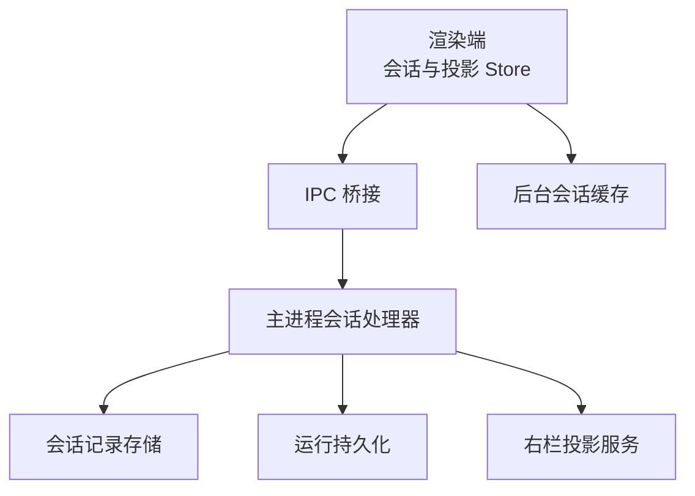
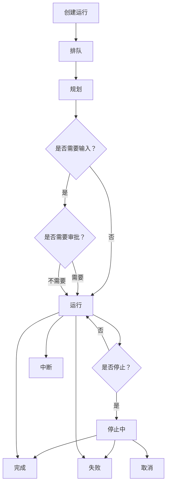
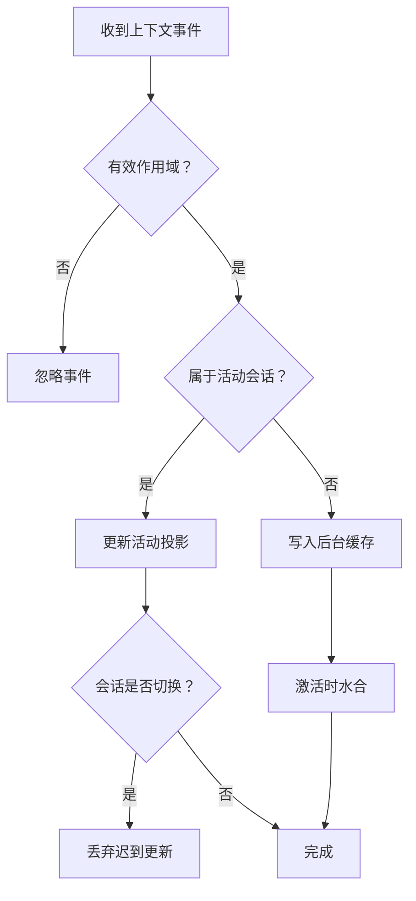
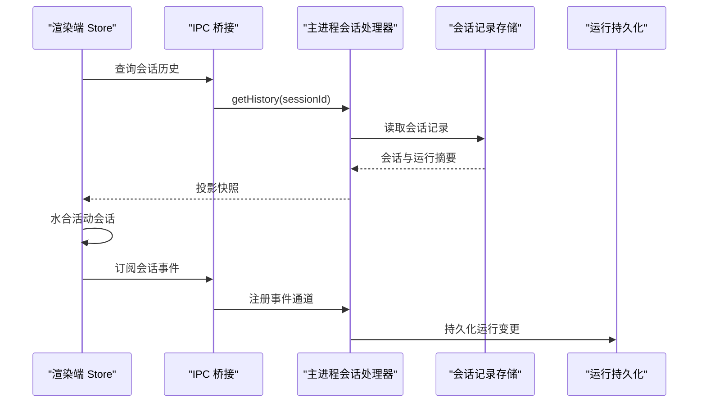
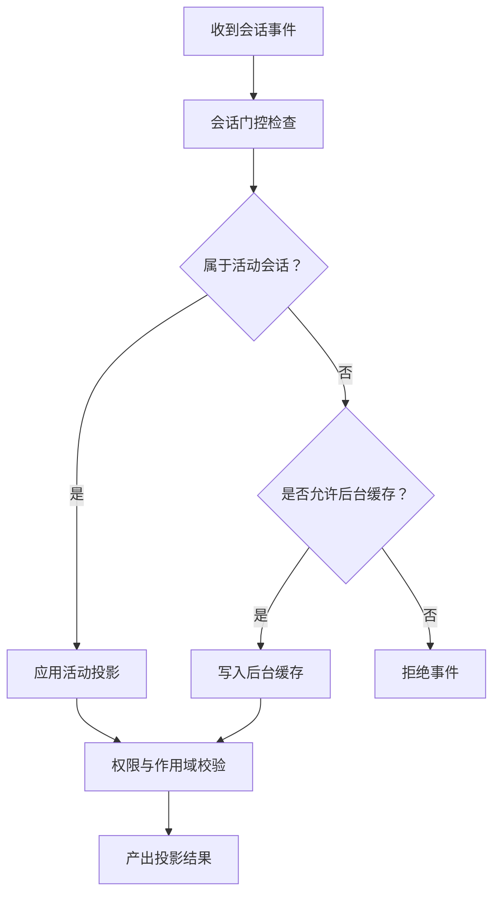
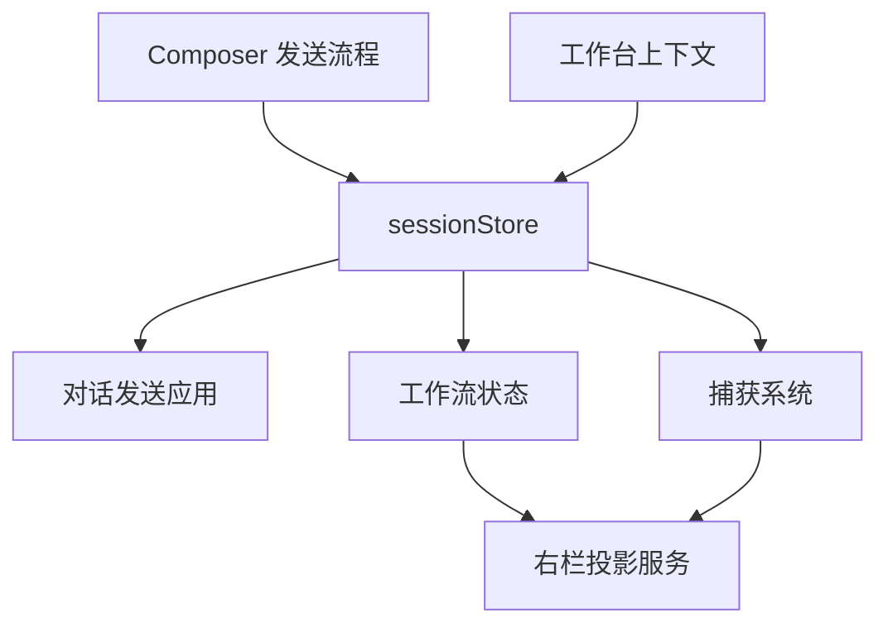

# 会话状态管理

<cite>
**本文引用的文件**   
- [session-projection.md](file://docs/contracts/session-projection.md)
- [session.ts](file://src/shared/types/session.ts)
- [conversation.ts](file://src/shared/types/conversation.ts)
- [sessionStore.ts](file://src/renderer/stores/sessionStore.ts)
- [contextUsageProjectionModel.ts](file://src/renderer/stores/contextUsageProjectionModel.ts)
- [sessionProjectionStore.ts](file://src/renderer/stores/sessionProjectionStore.ts)
- [sessionProjectionHydration.ts](file://src/renderer/stores/sessionProjectionHydration.ts)
- [sessionProjectionModel.ts](file://src/renderer/stores/sessionProjectionModel.ts)
- [sessionSubscriptions.ts](file://src/renderer/app/bootstrap/sessionSubscriptions.ts)
- [projectSessionHandlers.ts](file://src/main/ipc/projectSessionHandlers.ts)
- [SessionRecordStore.ts](file://src/main/sessions/SessionRecordStore.ts)
- [sessionRunPersistence.ts](file://src/main/sessions/sessionRunPersistence.ts)
- [StorageAdapter.ts](file://src/main/sessions/StorageAdapter.ts)
- [RightRailProjectionService.ts](file://src/main/agent-trace/RightRailProjectionService.ts)
- [rightRailProjectionMappers.ts](file://src/main/agent-trace/rightRailProjectionMappers.ts)
- [workbenchContext.ts](file://src/main/ipc/workbenchContext.ts)
</cite>

## 目录
1. [引言](#引言)
2. [项目结构与定位](#项目结构与定位)
3. [核心概念与边界](#核心概念与边界)
4. [会话运行管理与 RunSummary](#会话运行管理与-runsummary)
5. [上下文使用投影机制](#上下文使用投影机制)
6. [会话投影系统与跨进程同步](#会话投影系统与跨进程同步)
7. [事件门控与安全边界](#事件门控与安全边界)
8. [与其他 Store 的集成](#与其他-store-的集成)
9. [会话恢复、错误处理与性能监控](#会话恢复错误处理与性能监控)
10. [API 参考与调试指南](#api-参考与调试指南)
11. [结论](#结论)

## 引言
本文围绕“会话状态管理”展开，重点解释 renderer 侧 `sessionStore` 的职责、主进程与会话持久层的关系，以及基于会话所有权的事件投影模型。文档覆盖以下关键主题：
- 会话运行管理：会话与运行记录的生命周期、状态转换和停止语义。
- 上下文使用投影：`ContextUsageProjectionState` 的增量更新、过期清理和会话隔离。
- 会话投影系统：会话状态序列化、反序列化、后台缓存与激活水合。
- 事件门控机制：按会话过滤、权限校验和活跃会话安全边界。
- 多 Store 协作：与对话发送流程、捕获、工作流及右栏投影的联动。
- 恢复策略、错误处理和可观测性指标。
- API 参考与调试方法。

## 项目结构与定位
会话状态管理横跨主进程、共享类型定义和渲染端 store：
- 共享类型定义集中描述会话、运行、消息、工具调用等数据结构。
- 主进程负责会话存储、运行执行、IPC 事件发布和右栏投影服务。
- 渲染端 `sessionStore` 维护当前活动会话的可见状态，并通过 IPC 与主进程同步。
- `sessionProjectionStore` 作为后台会话缓存，支持切换回后台会话时快速水合。

**图表来源**
- [session-projection.md:1-131](file://docs/contracts/session-projection.md#L1-L131)
- [projectSessionHandlers.ts](file://src/main/ipc/projectSessionHandlers.ts)
- [SessionRecordStore.ts](file://src/main/sessions/SessionRecordStore.ts)
- [sessionRunPersistence.ts](file://src/main/sessions/sessionRunPersistence.ts)
- [RightRailProjectionService.ts](file://src/main/agent-trace/RightRailProjectionService.ts)

**章节来源**
- [session-projection.md:1-131](file://docs/contracts/session-projection.md#L1-L131)

## 核心概念与边界
### 活动会话与后台会话
- 渲染端仅有一个活动会话；其 `sessionId` 决定 UI 投影范围。
- 后台会话的事件写入 sidelined cache；切回活动时再 hydrate。
- 跨项目选择时，先清空旧会话的 transcript、运行态、右栏和 Composer 上下文，再投影目标项目。
- 多个会话可以并行运行 turn，但 UI 只投影 active session。

### 会话作用域
- 所有可变 RDC 事件必须携带 `projectId` 与 `sessionId`。
- 无归属的状态不会被投影到 UI。
- Capture、上下文资源、输出、调查制品等均以完整 `{ projectId, sessionId }` 信封进行作用域隔离。

### Composer 草稿与恢复
- Draft、待附加文件和待技能按 `{ projectId:sessionId }` 作用域隔离。
- 恢复前必须校验 owning session 与当前活动会话一致，否则丢弃迟到结果。
- Markdown Composer 输入通过 key 重新挂载，避免编辑器状态残留。

**章节来源**
- [session-projection.md:1-131](file://docs/contracts/session-projection.md#L1-L131)

## 会话运行管理与 RunSummary
### RunSummary 的数据角色
`RunSummary` 是运行状态的精简摘要，用于在消息、工作跟踪、进度和统计中引用一次运行。它通常包含：
- 运行标识：`runId`、可选 `turnId`。
- 会话与项目：`sessionId`、`projectId`。
- 运行时元信息：`profileId`、`goal`、`backend`。
- 生命周期时间戳：`startedAt`、`finishedAt`、`stoppedAt`。
- 运行状态：`status`，包括排队、规划、等待输入、等待审批、运行、停止中、完成、失败、取消、中断。
- 诊断与报告：`diagnostics`、`reportPaths`。

这些字段共同构成运行追踪、UI 进度展示、日志归档和恢复对账的基础。

### 运行状态语义
- `queued` / `planning`：准备阶段，尚未进入实际执行。
- `awaiting_input` / `awaiting_approval`：需要用户输入或计划审批。
- `running`：正在执行工具、模型调用或子任务。
- `stopping`：已发出停止请求，但终态尚未确认。
- `completed` / `failed` / `cancelled` / `interrupted`：最终终止状态。

### 停止与重写语义
- `preparing` 阶段停止应干净撤销，不留本轮 transcript。
- `committing` / `running` 阶段停止采用单调落停。
- Stop 回执成功不表示指定 assistant 一定被取消；需对同 session/request/turn/agent 的权威终态进行对账。
- Rewrite 提交立即写入 ActiveTurnContext；Stop 可在 optimistic 阶段按 `requestId` 落停，IPC reconcile 不得用 `streaming` 覆盖已停止 request。

**图表来源**
- [session.ts:1-200](file://src/shared/types/session.ts#L1-L200)
- [conversation.ts:1-200](file://src/shared/types/conversation.ts#L1-L200)

**章节来源**
- [session.ts:1-200](file://src/shared/types/session.ts#L1-L200)
- [conversation.ts:1-200](file://src/shared/types/conversation.ts#L1-L200)
- [session-projection.md:1-131](file://docs/contracts/session-projection.md#L1-L131)

## 上下文使用投影机制
### ContextUsageProjectionState 模型
上下文使用投影用于将 agent 使用的上下文资源、令牌用量、压缩统计等映射到 UI 可读状态。其典型职责包括：
- 记录当前会话的上下文使用情况。
- 区分增量更新与全量重建。
- 根据会话切换清理过期数据。
- 与消息、工具调用、计划审批和工作跟踪保持投影一致性。

### 增量更新算法
增量更新的核心思想是：
1. 接收来自主进程的上下文变更事件。
2. 校验事件所属 `sessionId` 与 `projectId`。
3. 若为活动会话，则直接 upsert 到当前投影。
4. 若为后台会话，则写入后台缓存，不污染活动视图。
5. 遇到会话切换时，丢弃非当前会话的迟到上下文更新。
6. 遇到上下文压缩或回收时，合并新的 usage 统计并保留审计来源。

### 过期数据处理
- 切换会话后，旧会话的上下文不应覆盖新会话投影。
- 后台会话的上下文缓存仅在激活时 hydrate。
- 当主进程确认输入扫描、回放清理或资源变更完成后，renderer 才以最新 scope 为准，不因历史残留恢复不存在的内容。

**图表来源**
- [contextUsageProjectionModel.ts](file://src/renderer/stores/contextUsageProjectionModel.ts)
- [session-projection.md:1-131](file://docs/contracts/session-projection.md#L1-L131)

**章节来源**
- [contextUsageProjectionModel.ts](file://src/renderer/stores/contextUsageProjectionModel.ts)
- [session-projection.md:1-131](file://docs/contracts/session-projection.md#L1-L131)

## 会话投影系统与跨进程同步
### 会话状态序列化与反序列化
- 会话记录包含 `sessionId`、`projectId`、`title`、`goal`、`createdAt`、`updatedAt`、`lastRunId`、`agentId`、模型覆盖等字段。
- 运行记录包含运行标识、会话绑定、生命周期时间戳、状态、后端类型和报告路径。
- 渲染端从主进程获取会话历史与投影快照，转换为本地 store 状态。

### 后台缓存与激活水合
- `sessionProjectionStore` 保存非活动会话的投影。
- 切换回后台会话时，优先命中缓存；miss 则通过 IPC 拉取历史与投影。
- 切换过程必须先清理活动视图，再异步加载目标会话，避免短暂显示旧项目 transcript。

### 跨进程同步契约
- 所有带 `sessionId` 的流式/投影事件在进入 active UI store 前必须经过活动会话检查。
- conversation stream、trace projection、run status、tool/evidence patches 都按会话作用域路由。
- 禁止未门控直接更新活动消息、trace presentation 或 workflow state。

**图表来源**
- [sessionProjectionStore.ts](file://src/renderer/stores/sessionProjectionStore.ts)
- [sessionProjectionHydration.ts](file://src/renderer/stores/sessionProjectionHydration.ts)
- [projectSessionHandlers.ts](file://src/main/ipc/projectSessionHandlers.ts)
- [SessionRecordStore.ts](file://src/main/sessions/SessionRecordStore.ts)
- [sessionRunPersistence.ts](file://src/main/sessions/sessionRunPersistence.ts)

**章节来源**
- [session.ts:1-200](file://src/shared/types/session.ts#L1-L200)
- [session-projection.md:1-131](file://docs/contracts/session-projection.md#L1-L131)

## 事件门控与安全边界
### 事件过滤规则
| 事件族 | 门控字段 | 活动路径 | 后台路径 |
| --- | --- | --- | --- |
| conversation stream | `event.sessionId` | 插入活动对话 | 写入后台会话投影缓存 |
| trace projection changed | `payload.sessionId` | 设置 trace 呈现 | 缓存 workflow.trace |
| workflow 状态 | 无 push | `workflow.getState` / restore → `setWorkflowState` | 无 push |
| run status/usage | `runId` 或 `sessionId` | 匹配 currentRun/session | ignore 或缓存 |
| tool/evidence patches | message 归属或 turn 所属 sessionId | 仅更新活动消息 | 缓存 |

### 权限与安全边界
- Capture 所有权仍按 `ownerSessionId` fail-closed。
- 右栏任务资源与 Capture 状态按完整 `{ projectId, sessionId, payload }` 信封作用域隔离。
- 背景会话不能写活动卡片；迟到事件不得覆盖当前视图。
- 静态检查 `pnpm run check:session-projection` 用于防止绕过门禁。

**图表来源**
- [session-projection.md:1-131](file://docs/contracts/session-projection.md#L1-L131)
- [projectSessionHandlers.ts](file://src/main/ipc/projectSessionHandlers.ts)

**章节来源**
- [session-projection.md:1-131](file://docs/contracts/session-projection.md#L1-L131)

## 与其他 Store 的集成
### 与对话发送流程的集成
- `useComposerSend`、`composerSendFlow`、`conversationSendApply`、`conversationSendOptimistic` 负责构建请求、乐观插入消息、应用流式补丁、收敛终态。
- `sessionStore` 提供当前会话上下文、运行状态和停止信号；发送流程按 `sessionId + requestId + agentId` 投影。
- Stop 与 Rewrite 共用 session-scoped ActiveTurnContext，保证单调性与会话隔离。

### 与捕获系统的集成
- Capture 控制与回放状态通过 IPC 与主进程同步。
- 回放状态变更、打开状态变化、会话 Capture 状态更新均携带完整 project/session 作用域。
- 活动会话才能写当前卡片；其他会话继续拥有其 context。

### 与工作流及右栏投影的集成
- `RightRailProjectionService` 与 `rightRailProjectionMappers` 负责将 trace 和工具证据映射为右栏投影。
- workflow 状态由主进程驱动，renderer 通过 IPC 获取或恢复后设置。
- 输出、进展、工件、上下文、Capture 共享同一 tracePresentation rightPanel 信封，互不混淆。

### 与工作台上下文集成
- `workbenchContext` 暴露工作区相关上下文，供命令、IPC 和 UI 组件访问。
- 会话选择、项目选择和上下文刷新需保持作用域一致。

**图表来源**
- [sessionStore.ts](file://src/renderer/stores/sessionStore.ts)
- [sessionSubscriptions.ts](file://src/renderer/app/bootstrap/sessionSubscriptions.ts)
- [RightRailProjectionService.ts](file://src/main/agent-trace/RightRailProjectionService.ts)
- [rightRailProjectionMappers.ts](file://src/main/agent-trace/rightRailProjectionMappers.ts)
- [workbenchContext.ts](file://src/main/ipc/workbenchContext.ts)

**章节来源**
- [session-projection.md:1-131](file://docs/contracts/session-projection.md#L1-L131)

## 会话恢复、错误处理与性能监控
### 会话恢复机制
- 新建会话时初始化 `sessionId`、`projectId`、标题、目标、Agent 配置。
- 切换会话时立即清理活动视图，再异步拉取历史与 trace。
- 后台会话激活时优先缓存命中；miss 则调用 IPC 获取历史与投影。
- Composer draft 恢复前校验 owning session 与当前会话一致。

### 错误处理策略
- 会话切换被拒绝时，恢复原选择及其缓存投影，错误只在导航入口展示。
- 迟到事件、过期上下文、旧 capture binding 不得恢复不存在内容。
- 停止回执失败或状态不一致时，通过对账权威终态修正 UI。
- 回放清理错误与待办通过独立字段保留，不阻塞正常输入展示。

### 性能监控指标
- 活动会话投影延迟：从事件到达至 UI 更新的时间。
- 后台缓存命中率：切换会话时直接 hydrate 的比例。
- 上下文增量更新大小：每次上下文变更的 payload 体积。
- 运行状态收敛次数：optimistic 到 final 的修正轮次。
- 右栏投影队列长度：pending trace/patch 数量。

**章节来源**
- [session-projection.md:1-131](file://docs/contracts/session-projection.md#L1-L131)

## API 参考与调试指南
### 会话操作 API 参考
| 类别 | 能力 | 说明 |
| --- | --- | --- |
| 会话选择 | `session:select` | 更新权威 current，不 abort 其它 session 的 active turn |
| 会话创建 | `session:create` | 新建会话并建立前台投影 |
| 历史记录 | `getHistory` | 拉取会话历史、消息、运行摘要 |
| 投影快照 | `getProjection` | 获取会话当前投影，用于后台水合 |
| 事件订阅 | conversation/stream、trace、run/status | 按会话作用域推送流式事件 |
| 停止与重写 | stop、rewrite | 基于 requestId/turnId/agentId 单调投影 |
| 上下文资源 | context:get/changed | 按 `{ projectId, sessionId }` 作用域访问 |
| Capture | capture:getOpenedState/capture:openedStateChanged | 回放与捕获状态同步 |
| 工作流 | workflow.getState/setWorkflowState | 主进程驱动，renderer 同步呈现 |

### 调试工具使用方法
- 单元测试：验证 `sessionEventGate`、composer restore session bind、monotonic requestId、projection cache activate。
- 静态检查：`pnpm run check:session-projection` 确保事件门控未被绕过。
- Browser QA：删除项目 sessions 后新建隔离会话，测试多会话串台、Stop、Rewrite 矩阵。
- 日志观察：关注 run status、trace projection、capture replay revision、上下文 usage delta。
- 恢复验证：切换会话后确认旧项目 transcript、右栏、Composer 上下文已清理。

**章节来源**
- [session-projection.md:1-131](file://docs/contracts/session-projection.md#L1-L131)

## 结论
会话状态管理的核心在于“活动会话唯一投影、后台会话缓存隔离、事件门控强约束”。`RunSummary` 提供运行追踪基础，`ContextUsageProjectionState` 提供上下文使用投影，`sessionStore` 协调发送、停止、重写、恢复与错误对账。主进程通过 IPC 与持久层、右栏投影服务协作，保证 UI 只看到正确作用域内的状态。遵循该契约，可以在多会话并行、复杂交互和长生命周期运行中维持一致、安全、可恢复的用户体验。