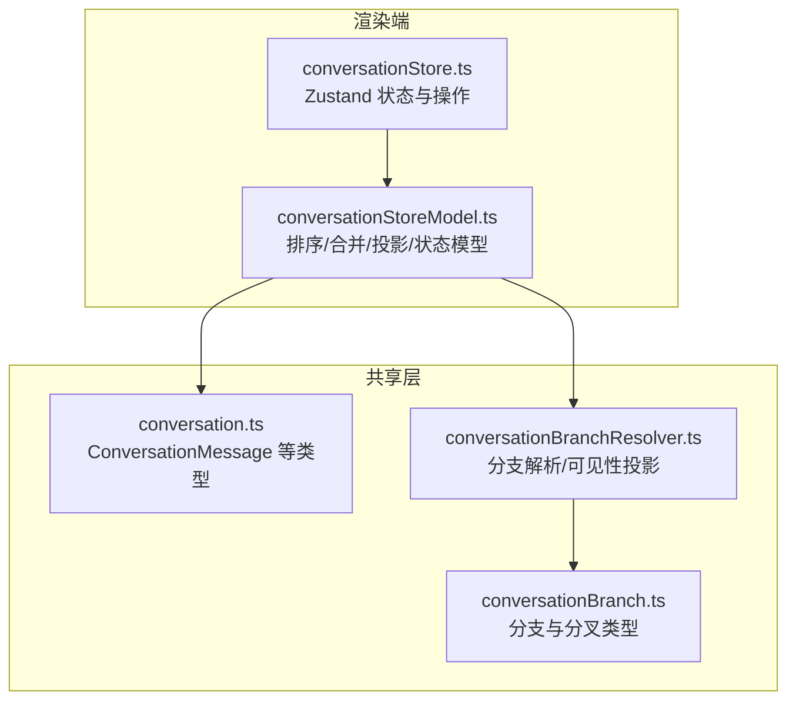
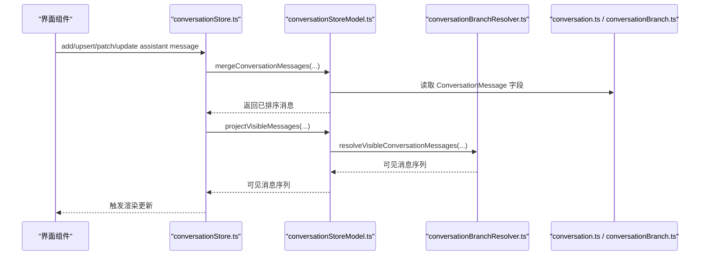
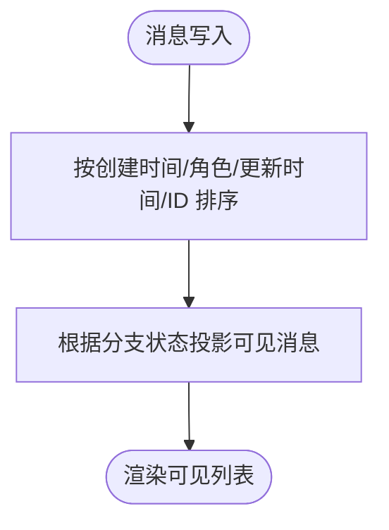
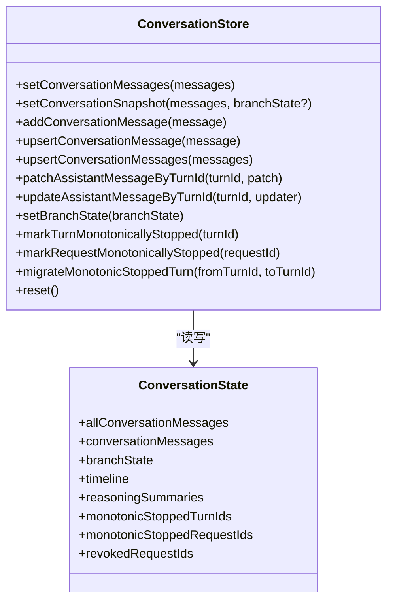
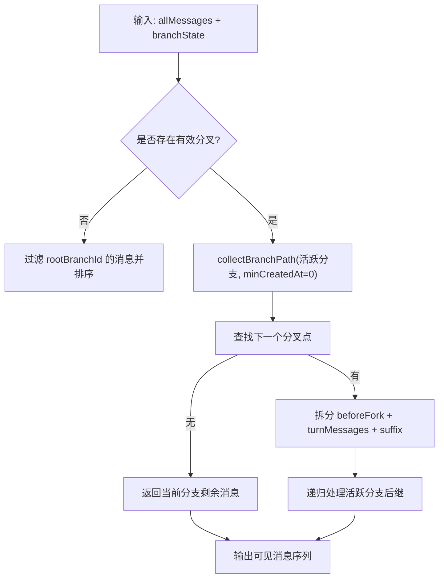
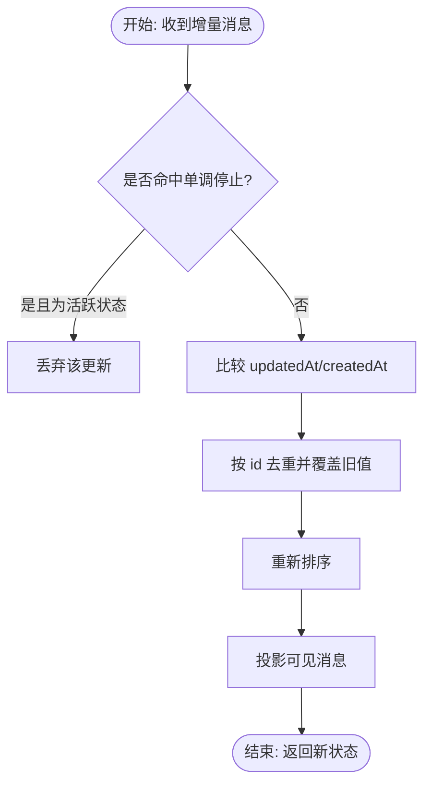
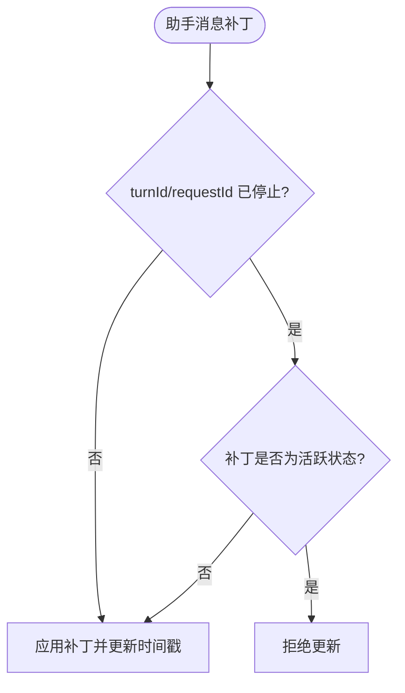
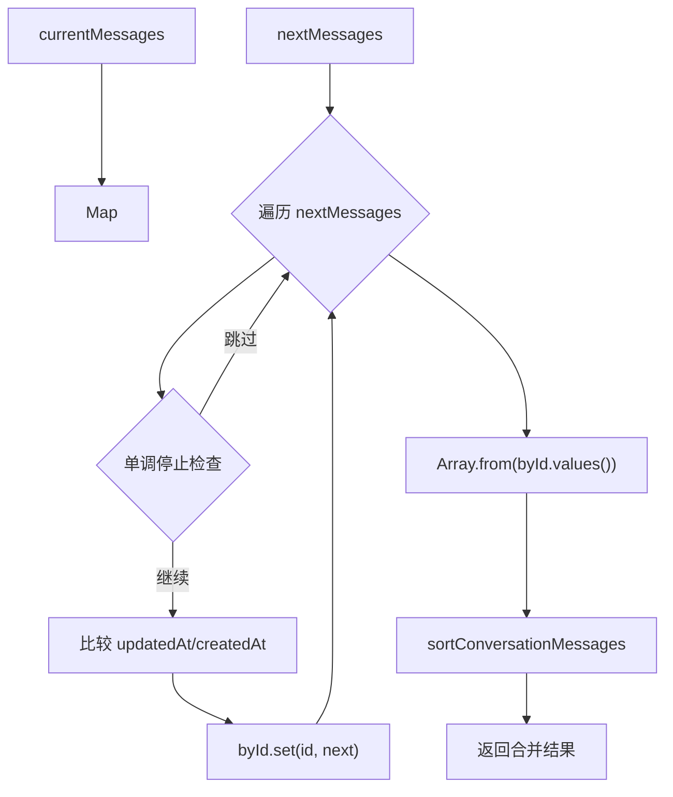
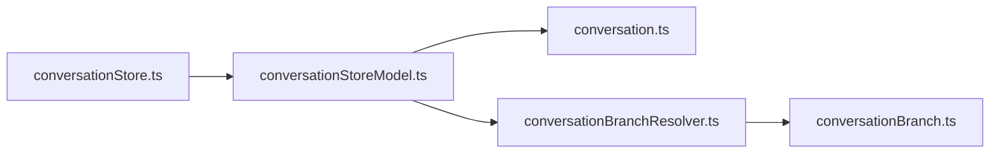

# 对话状态管理

<cite>
**本文引用的文件**   
- [conversationStore.ts](file://src/renderer/stores/conversationStore.ts)
- [conversationStoreModel.ts](file://src/renderer/stores/conversationStoreModel.ts)
- [conversation.ts](file://src/shared/types/conversation.ts)
- [conversationBranchResolver.ts](file://src/shared/conversation/conversationBranchResolver.ts)
- [conversationBranch.ts](file://src/shared/types/conversationBranch.ts)
</cite>

## 目录
1. [引言](#引言)
2. [项目结构定位](#项目结构定位)
3. [核心组件](#核心组件)
4. [架构总览](#架构总览)
5. [详细组件分析](#详细组件分析)
6. [依赖关系分析](#依赖关系分析)
7. [性能考虑](#性能考虑)
8. [故障排查指南](#故障排查指南)
9. [结论](#结论)

## 引言
本文面向对话状态管理的实现，围绕渲染端 `conversationStore` 及其数据模型展开，解释以下关键主题：
- 消息的增删改查、排序与可见性投影。
- 分支系统与活跃分支切换、消息可见性隔离。
- 消息模型结构与状态语义，包括时间戳与停止语义。
- 异步发送端到端流程中的乐观更新、增量合并与错误恢复。
- 单调停止语义下的冲突避免机制。
- 虚拟滚动、选择性渲染与内存优化思路。
- 对外 API、事件订阅与测试要点。

## 项目结构定位
对话状态管理位于渲染层 Zustand store 中，并依赖共享类型与分支解析逻辑：
- 渲染端 Store：`src/renderer/stores/conversationStore.ts`、`src/renderer/stores/conversationStoreModel.ts`。
- 共享消息类型：`src/shared/types/conversation.ts`。
- 分支解析与可见性投影：`src/shared/conversation/conversationBranchResolver.ts`、`src/shared/types/conversationBranch.ts`。

**图示来源**
- [conversationStore.ts:1-139](file://src/renderer/stores/conversationStore.ts#L1-L139)
- [conversationStoreModel.ts:1-96](file://src/renderer/stores/conversationStoreModel.ts#L1-L96)
- [conversation.ts:1-450](file://src/shared/types/conversation.ts#L1-L450)
- [conversationBranchResolver.ts:1-200](file://src/shared/conversation/conversationBranchResolver.ts#L1-L200)
- [conversationBranch.ts:1-43](file://src/shared/types/conversationBranch.ts#L1-L43)

**章节来源**
- [conversationStore.ts:1-139](file://src/renderer/stores/conversationStore.ts#L1-L139)
- [conversationStoreModel.ts:1-96](file://src/renderer/stores/conversationStoreModel.ts#L1-L96)
- [conversation.ts:1-450](file://src/shared/types/conversation.ts#L1-L450)
- [conversationBranchResolver.ts:1-200](file://src/shared/conversation/conversationBranchResolver.ts#L1-L200)
- [conversationBranch.ts:1-43](file://src/shared/types/conversationBranch.ts#L1-L43)

## 核心组件
- `useConversationStore`：基于 Zustand 创建的会话状态容器，暴露消息读写、分支状态、时间线、推理摘要与重置等能力。
- `ConversationState`：描述全部消息、可见消息、分支状态、时间线、推理摘要、单调停止集合、被撤销请求集合及所有操作方法。
- 消息排序与可见性投影：由 `sortConversationMessages` 与 `projectVisibleMessages` 提供。
- 消息合并算法：由 `mergeConversationMessages` 提供，支持增量更新、去重、时间戳优先与单调停止保护。
- 分支解析器：由 `resolveVisibleConversationMessages` 等函数提供，负责沿活跃分支拼接可见消息路径。

**章节来源**
- [conversationStore.ts:1-139](file://src/renderer/stores/conversationStore.ts#L1-L139)
- [conversationStoreModel.ts:1-96](file://src/renderer/stores/conversationStoreModel.ts#L1-L96)
- [conversationBranchResolver.ts:1-200](file://src/shared/conversation/conversationBranchResolver.ts#L1-L200)

## 架构总览
下图展示从 UI 到 Store 再到共享类型与分支解析的整体交互：

**图示来源**
- [conversationStore.ts:1-139](file://src/renderer/stores/conversationStore.ts#L1-L139)
- [conversationStoreModel.ts:1-96](file://src/renderer/stores/conversationStoreModel.ts#L1-L96)
- [conversationBranchResolver.ts:1-200](file://src/shared/conversation/conversationBranchResolver.ts#L1-L200)
- [conversation.ts:1-450](file://src/shared/types/conversation.ts#L1-L450)
- [conversationBranch.ts:1-43](file://src/shared/types/conversationBranch.ts#L1-L43)

## 详细组件分析

### 消息模型与状态语义
- `ConversationMessage` 是持久化与传输的核心记录，包含：
  - 标识：`id`、`turnId`、`sessionId`、`projectId`、可选的 `requestId`、`requestFingerprint`、`runId`、`profileId`。
  - 内容与角色：`role`（user/assistant/system）、`content`。
  - 状态与时间：`status`（draft/streaming/complete/error/stopped）、`createdAt`、`updatedAt`。
  - 工作轨迹与诊断：`workTrace`、`diagnostic`。
  - 附件：`attachments`。
  - 分支信息：`branchId`、`forkId`、`variantIndex`。
  - 预计算上下文与后续建议：`preparedContext`、`handoffSuggestions`。
- 消息状态分类：
  - 活跃状态：draft、streaming。
  - 终止状态：complete、error、stopped。
- 时间戳策略：
  - 排序使用 `createdAt` 作为主键；同轮次内按 role 顺序；其次比较 `updatedAt ?? createdAt`；最后按 `id` 稳定排序。
  - 投影时，最新活动时刻取每条消息的 `updatedAt ?? createdAt` 的最大值。

**图示来源**
- [conversationStoreModel.ts:1-96](file://src/renderer/stores/conversationStoreModel.ts#L1-L96)
- [conversationBranchResolver.ts:1-200](file://src/shared/conversation/conversationBranchResolver.ts#L1-L200)

**章节来源**
- [conversation.ts:1-450](file://src/shared/types/conversation.ts#L1-L450)
- [conversationStoreModel.ts:1-96](file://src/renderer/stores/conversationStoreModel.ts#L1-L96)

### 消息增删改查与排序投影
- 新增消息：
  - `addConversationMessage`、`upsertConversationMessage`、`upsertConversationMessages` 通过 `mergeConversationMessages` 合并入 `allConversationMessages`，再投影为 `conversationMessages`。
- 批量设置：
  - `setConversationMessages`、`setConversationSnapshot` 会先排序全部消息，再按当前分支状态投影。
- 助手消息局部更新：
  - `patchAssistantMessageByTurnId` 按 `turnId` 定位助手消息并打补丁，同时注入 `updatedAt`。
  - `updateAssistantMessageByTurnId` 允许以函数形式更新整条消息。
- 排序与投影：
  - 排序：`sortConversationMessages` 调用 `compareConversationMessages`。
  - 投影：`projectVisibleMessages` 调用 `resolveVisibleConversationMessages`，结合 `branchState` 输出可见消息。

**图示来源**
- [conversationStore.ts:1-139](file://src/renderer/stores/conversationStore.ts#L1-L139)
- [conversationStoreModel.ts:1-96](file://src/renderer/stores/conversationStoreModel.ts#L1-L96)

**章节来源**
- [conversationStore.ts:1-139](file://src/renderer/stores/conversationStore.ts#L1-L139)
- [conversationStoreModel.ts:1-96](file://src/renderer/stores/conversationStoreModel.ts#L1-L96)

### 分支系统：活跃分支切换与消息可见性
- 分支数据结构：
  - `ConversationBranch`：表示某一分支，包含父分支、变体索引、锚点用户消息与根轮次。
  - `ConversationFork`：表示一次分叉，包含锚点消息、活跃分支、所有分支。
  - `ConversationBranchState`：会话级分支状态，包含根分支、活跃叶子分支与分叉集合。
- 可见性投影：
  - 无分支或空分叉时，仅显示根分支消息。
  - 有分叉时，沿活跃分支递归拼接：在分叉点之前保留原路径，然后进入活跃分支对应轮次的消息，再递归其后继分支。
- 分支修复与导航：
  - 提供锚点缺失时的修复逻辑与可导航的分叉元信息。

**图示来源**
- [conversationBranchResolver.ts:1-200](file://src/shared/conversation/conversationBranchResolver.ts#L1-L200)
- [conversationBranch.ts:1-43](file://src/shared/types/conversationBranch.ts#L1-L43)

**章节来源**
- [conversationBranchResolver.ts:1-200](file://src/shared/conversation/conversationBranchResolver.ts#L1-L200)
- [conversationBranch.ts:1-43](file://src/shared/types/conversationBranch.ts#L1-L43)

### 异步消息处理：发送、乐观更新与错误恢复
- 乐观更新：
  - 发送方通常先插入草稿或流式助手消息，随后通过 `upsertConversationMessage(s)` 增量更新。
- 增量合并：
  - `mergeConversationMessages` 按 `id` 去重，并以 `updatedAt ?? createdAt` 决定覆盖方向。
- 单调停止保护：
  - 若目标轮次或请求已被标记为“单调停止”，则拒绝将活跃状态（draft/streaming）重新打开。
  - 助手消息补丁还会检查是否满足单调停止条件，避免回退到活跃状态。
- 撤销请求：
  - 通过 `markRequestRevoked` 与 `consumeRevokedRequest` 维护撤销队列，供上层消费后清理。

**图示来源**
- [conversationStoreModel.ts:1-96](file://src/renderer/stores/conversationStoreModel.ts#L1-L96)
- [conversationStore.ts:1-139](file://src/renderer/stores/conversationStore.ts#L1-L139)

**章节来源**
- [conversationStoreModel.ts:1-96](file://src/renderer/stores/conversationStoreModel.ts#L1-L96)
- [conversationStore.ts:1-139](file://src/renderer/stores/conversationStore.ts#L1-L139)

### 单调停止语义与冲突解决
- 定义：
  - 当某轮次或请求被标记为单调停止后，不能再将其助手消息重新置为活跃状态（draft/streaming）。
- 冲突检测：
  - `shouldRejectActivePatchForMonotonicStop` 针对待写入消息进行判断，如果命中停止且拟更新的助手状态属于活跃状态，则直接丢弃。
- 补丁保护：
  - `patchAssistantMessageByTurnId` 在存在活跃状态补丁时会额外检查单调停止集合，确保不会意外重启。
- 迁移：
  - `migrateMonotonicStoppedTurn` 支持在重排或重建时将停止轮次 ID 迁移至新的轮次 ID。

**图示来源**
- [conversationStoreModel.ts:1-96](file://src/renderer/stores/conversationStoreModel.ts#L1-L96)
- [conversationStore.ts:1-139](file://src/renderer/stores/conversationStore.ts#L1-L139)

**章节来源**
- [conversationStoreModel.ts:1-96](file://src/renderer/stores/conversationStoreModel.ts#L1-L96)
- [conversationStore.ts:1-139](file://src/renderer/stores/conversationStore.ts#L1-L139)

### 消息合并算法
- 输入：当前消息数组、待合并消息数组、单调停止轮次集合、单调停止请求集合。
- 步骤：
  1. 构建以 `id` 为键的映射表。
  2. 对每条待合并消息执行单调停止检查，命中且为活跃状态的直接跳过。
  3. 比较新旧时间戳，较晚者覆盖。
  4. 最终统一排序并返回。
- 复杂度：
  - 时间：O(n log n)，n 为合并后的消息数量，主要消耗在排序。
  - 空间：O(n)，用于临时映射与结果数组。

**图示来源**
- [conversationStoreModel.ts:1-96](file://src/renderer/stores/conversationStoreModel.ts#L1-L96)

**章节来源**
- [conversationStoreModel.ts:1-96](file://src/renderer/stores/conversationStoreModel.ts#L1-L96)

### 性能优化技术
- 虚拟滚动支持：
  - 可见消息数组适合与虚拟列表组件配合，只渲染可视区域内的消息项，降低 DOM 压力。
- 选择性渲染：
  - 仅对 visible messages 进行渲染，隐藏分支侧消息；助手消息可按状态选择轻量渲染。
- 内存池管理：
  - 大对象（如 workTrace、attachments）应尽量避免频繁复制；在不可见分支中延迟加载预览与媒体资源。
- 排序与投影缓存：
  - 仅在写边界排序与投影，读路径尽量复用上一次结果；对于长会话，可考虑分页或分段投影。

[本节为通用指导，不直接分析具体代码文件]

### API 参考
- 消息写入
  - `setConversationMessages(messages)`：替换并排序全部消息，再投影。
  - `setConversationSnapshot(messages, branchState?)`：快照式写入，可同时更新分支状态。
  - `addConversationMessage(message)`：增量添加单条消息。
  - `upsertConversationMessage(message)`：按 id 合并单条消息。
  - `upsertConversationMessages(messages)`：批量合并消息。
- 助手消息更新
  - `patchAssistantMessageByTurnId(turnId, patch)`：按轮次打补丁，含单调停止保护。
  - `updateAssistantMessageByTurnId(turnId, updater)`：按轮次完整更新。
- 分支与可见性
  - `setBranchState(branchState)`：设置分支状态并刷新可见消息。
- 停止与撤销
  - `markTurnMonotonicallyStopped(turnId)`：标记轮次单调停止。
  - `markRequestMonotonicallyStopped(requestId)`：标记请求单调停止。
  - `migrateMonotonicStoppedTurn(fromTurnId, toTurnId)`：迁移停止轮次 ID。
  - `markRequestRevoked(requestId)` / `consumeRevokedRequest(requestId)`：撤销请求标记与消费。
- 其他
  - `addTimelineEntry(entry)` / `setTimeline(timeline)`：时间线操作。
  - `setReasoningSummaries(summaries)`：推理摘要设置。
  - `selectOrderedConversationMessages(state)` / `selectConversationMessageCount(state)` / `selectLatestMessageActivityAt(state)`：选择器。
  - `reset()`：重置为初始状态。

**章节来源**
- [conversationStore.ts:1-139](file://src/renderer/stores/conversationStore.ts#L1-L139)
- [conversationStoreModel.ts:1-96](file://src/renderer/stores/conversationStoreModel.ts#L1-L96)

### 事件监听机制
- Store 基于 Zustand 创建，外部可通过订阅 `useConversationStore` 获取状态变化，常见订阅点：
  - `conversationMessages`：可见消息列表变化，驱动转录区重绘。
  - `branchState`：分支状态变化，驱动可见消息重投影。
  - `timeline` / `reasoningSummaries`：辅助面板或右侧栏更新。
- 最佳实践：
  - 使用细粒度选择器避免无关更新。
  - 对高频增量（如 streaming）合并后再订阅，减少抖动。

[本节为通用指导，不直接分析具体代码文件]

### 单元测试方法
- 分支行为测试：
  - 验证 `resolveVisibleConversationMessages` 在不同分叉与活跃分支下的可见消息序列。
  - 验证锚点修复与导航元信息的正确性。
- 单调停止测试：
  - 验证在标记停止后，活跃状态补丁被拒绝。
  - 验证迁移接口能正确转移停止轮次。
- 合并与排序测试：
  - 验证时间戳优先级、同轮次角色顺序与 ID 稳定性。
  - 验证批量 upsert 的去重与覆盖规则。
- 可见性与投影测试：
  - 验证 root 分支与有分叉场景下，可见消息集合一致性与时序。

**章节来源**
- [conversationBranchResolver.ts:1-200](file://src/shared/conversation/conversationBranchResolver.ts#L1-L200)
- [conversationStoreModel.ts:1-96](file://src/renderer/stores/conversationStoreModel.ts#L1-L96)
- [conversationStore.ts:1-139](file://src/renderer/stores/conversationStore.ts#L1-L139)

## 依赖关系分析
- 模块耦合：
  - `conversationStore.ts` 依赖 `conversationStoreModel.ts` 提供的排序、合并、投影与状态模型。
  - `conversationStoreModel.ts` 依赖共享类型与分支解析器。
  - 分支解析器依赖分支类型定义。
- 外部依赖：
  - Zustand 用于状态容器。
  - 共享类型定义保证跨进程与传输一致性。

**图示来源**
- [conversationStore.ts:1-139](file://src/renderer/stores/conversationStore.ts#L1-L139)
- [conversationStoreModel.ts:1-96](file://src/renderer/stores/conversationStoreModel.ts#L1-L96)
- [conversation.ts:1-450](file://src/shared/types/conversation.ts#L1-L450)
- [conversationBranchResolver.ts:1-200](file://src/shared/conversation/conversationBranchResolver.ts#L1-L200)
- [conversationBranch.ts:1-43](file://src/shared/types/conversationBranch.ts#L1-L43)

**章节来源**
- [conversationStore.ts:1-139](file://src/renderer/stores/conversationStore.ts#L1-L139)
- [conversationStoreModel.ts:1-96](file://src/renderer/stores/conversationStoreModel.ts#L1-L96)
- [conversation.ts:1-450](file://src/shared/types/conversation.ts#L1-L450)
- [conversationBranchResolver.ts:1-200](file://src/shared/conversation/conversationBranchResolver.ts#L1-L200)
- [conversationBranch.ts:1-43](file://src/shared/types/conversationBranch.ts#L1-L43)

## 性能考虑
- 渲染层面：
  - 使用虚拟列表仅渲染可见消息，结合 `selectOrderedConversationMessages` 提供稳定有序的数据源。
- 数据层面：
  - 合并阶段避免重复排序，仅在写边界执行。
  - 大附件与图片预览采用懒加载与引用方式，不在消息体中拷贝二进制数据。
- 状态层面：
  - 使用单调停止集合避免无效回滚导致的重新渲染。
  - 使用选择器订阅最小必要字段，降低重渲染范围。

[本节为通用指导，不直接分析具体代码文件]

## 故障排查指南
- 消息未出现：
  - 检查是否被分支投影过滤，确认 `branchState.activeLeafBranchId` 与消息 `branchId` 匹配。
  - 检查排序时间戳是否正确，必要时检查 `updatedAt` 是否缺失导致回退到 `createdAt`。
- 助手消息状态异常：
  - 若被单调停止阻止，检查 `monotonicStoppedTurnIds` 或 `monotonicStoppedRequestIds` 是否包含相关 ID。
  - 若是活跃状态补丁被拒绝，确认补丁状态是否为 draft/streaming。
- 分支切换后内容错乱：
  - 检查分叉锚点是否有效，必要时调用分支修复逻辑。
  - 确认活跃分支锚点消息存在且其轮次消息可被投影。
- 撤销请求未生效：
  - 确认已通过 `markRequestRevoked` 标记，并在适当位置调用 `consumeRevokedRequest` 消费。

**章节来源**
- [conversationStore.ts:1-139](file://src/renderer/stores/conversationStore.ts#L1-L139)
- [conversationStoreModel.ts:1-96](file://src/renderer/stores/conversationStoreModel.ts#L1-L96)
- [conversationBranchResolver.ts:1-200](file://src/shared/conversation/conversationBranchResolver.ts#L1-L200)

## 结论
`conversationStore` 通过清晰的状态分层与共享类型契约，实现了稳健的消息管理、分支可见性投影与单调停止语义。借助增量合并与排序投影，系统在高吞吐的流式场景中仍能保持可预测的一致性与良好的性能表现。在实际使用中，建议：
- 严格遵循时间戳与状态语义，避免主动将助手消息置为活跃状态后再次回退。
- 使用分支解析器提供的工具函数进行分支修复与导航。
- 在渲染层采用虚拟滚动与选择性订阅，最大化性能与用户体验。