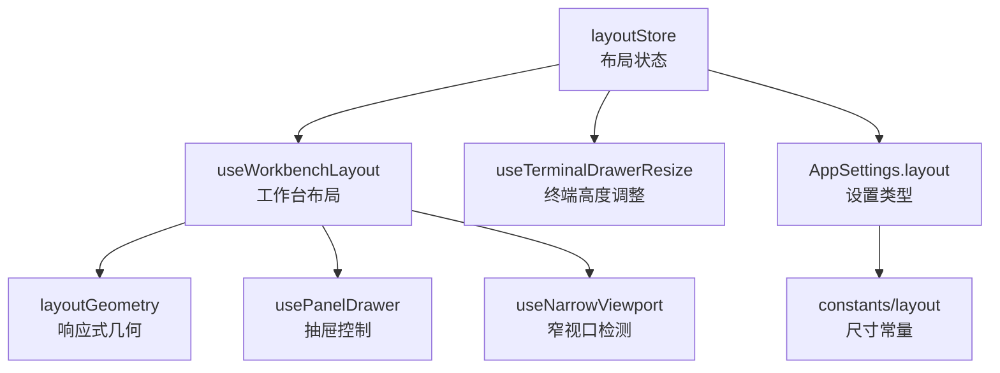
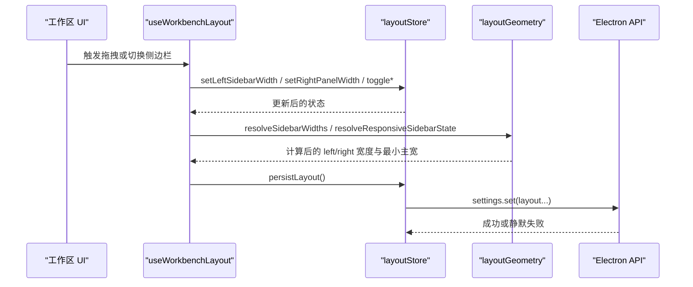
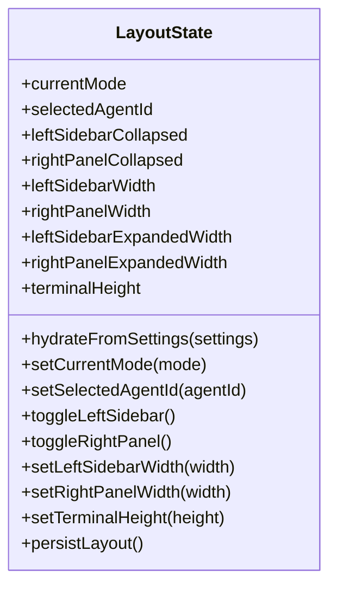
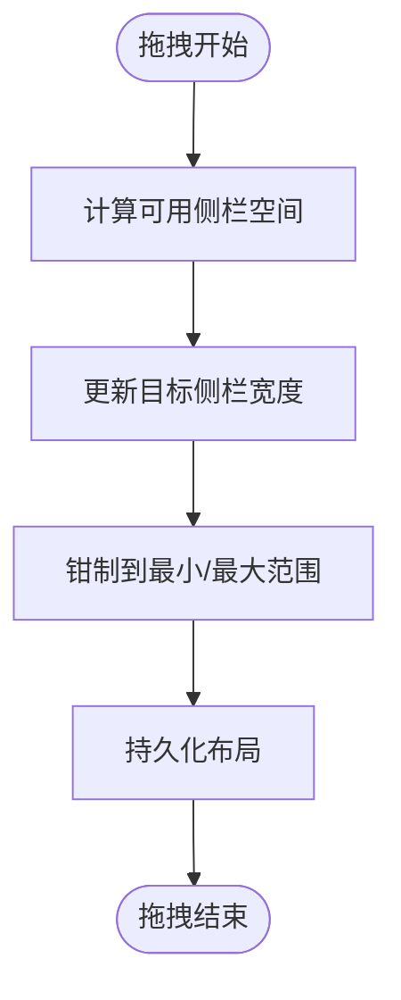
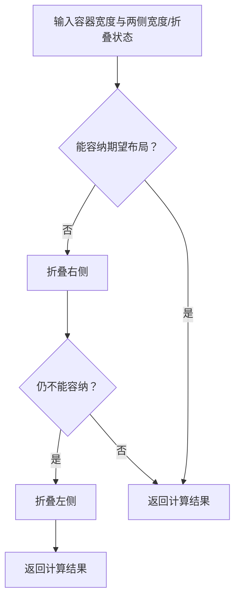
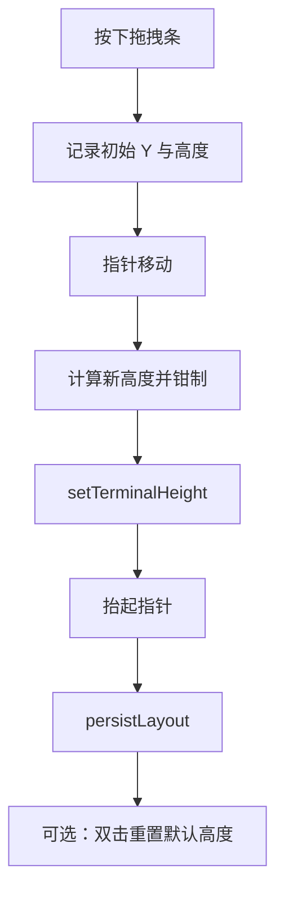
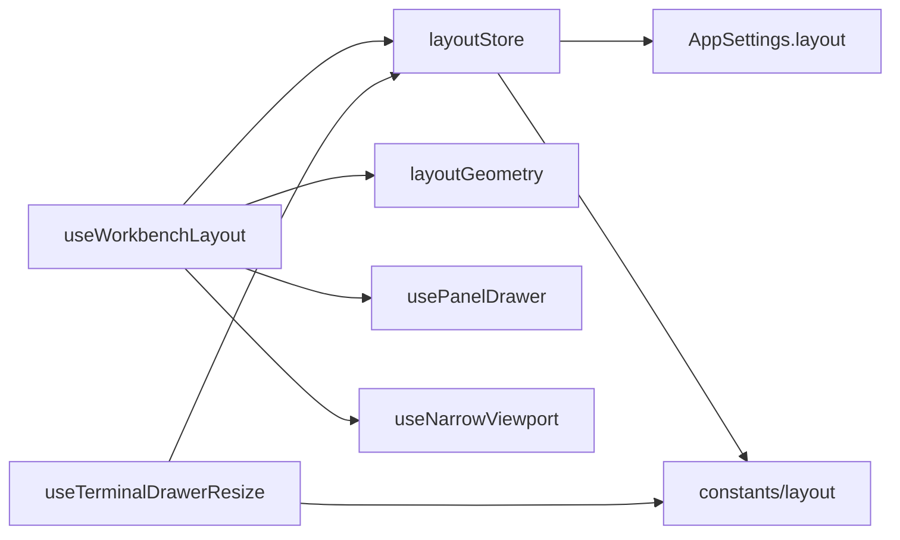
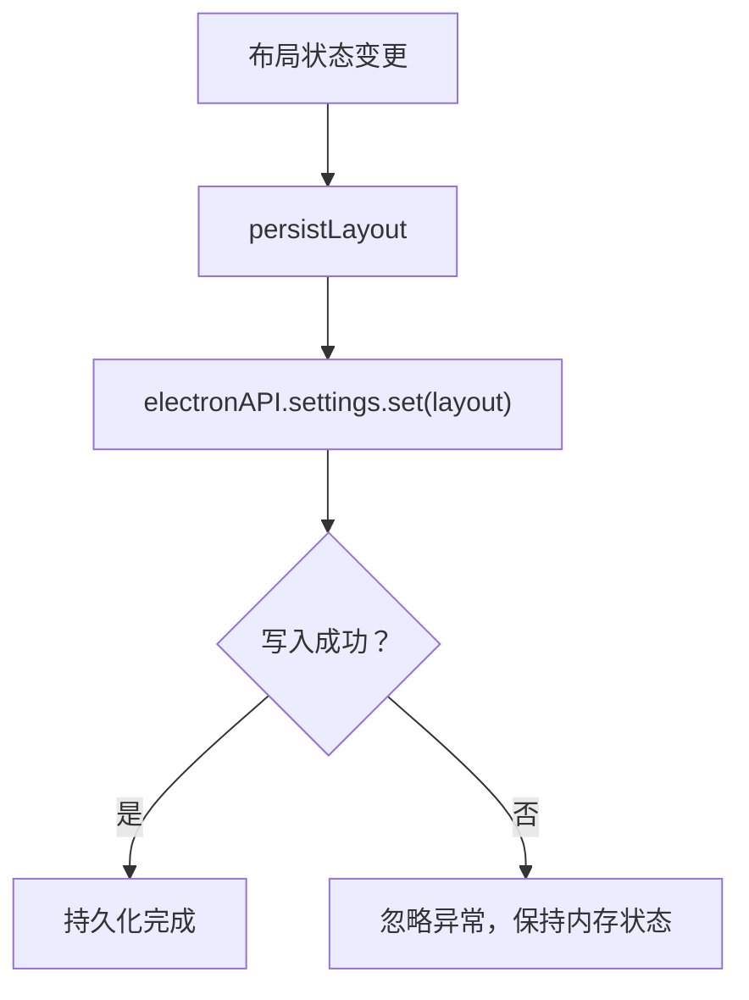

# 布局状态管理

<cite>
**本文引用的文件**   
- [layoutStore.ts](file://src/renderer/stores/layoutStore.ts)
- [layoutStore.test.ts](file://src/renderer/stores/layoutStore.test.ts)
- [useWorkbenchLayout.ts](file://src/renderer/app/useWorkbenchLayout.ts)
- [layoutGeometry.ts](file://src/renderer/shell/layoutGeometry.ts)
- [layoutGeometry.test.ts](file://src/renderer/shell/layoutGeometry.test.ts)
- [useTerminalDrawerResize.ts](file://src/renderer/features/terminal/TerminalDrawer/useTerminalDrawerResize.ts)
- [usePanelDrawer.ts](file://src/renderer/app/usePanelDrawer.ts)
- [useNarrowViewport.ts](file://src/renderer/app/useNarrowViewport.ts)
- [defaultAppSettings.ts](file://src/renderer/stores/defaultAppSettings.ts)
- [settings.ts](file://src/shared/types/settings.ts)
- [layout.ts](file://src/shared/constants/layout.ts)
- [layout.ts](file://src/shared/types/layout.ts)
</cite>

## 目录
1. [简介](#简介)
2. [项目结构](#项目结构)
3. [核心组件](#核心组件)
4. [架构总览](#架构总览)
5. [详细组件分析](#详细组件分析)
6. [依赖关系分析](#依赖关系分析)
7. [性能与响应式行为](#性能与响应式行为)
8. [设置系统集成与持久化](#设置系统集成与持久化)
9. [Agent 模式管理](#agent-模式管理)
10. [主题与外观集成](#主题与外观集成)
11. [配置 API 参考](#配置-api-参考)
12. [故障排查](#故障排查)
13. [结论](#结论)

## 简介
本文件围绕渲染器中的布局状态管理展开，聚焦 `layoutStore` 及其协作模块。它负责：
- 界面布局状态：左侧边栏、右侧面板、终端区域的高度与折叠状态。
- Agent 模式与当前选中 Agent 的状态同步。
- 拖拽调整宽度、高度时的约束校验与持久化。
- 响应式布局计算：在小屏或紧凑视口下自动折叠侧边栏并切换抽屉模式。
- 与 AppSettings 的映射、默认值初始化及跨会话恢复。

该文档从数据结构、算法、交互流程、错误处理、性能特征和扩展点六个维度进行说明，帮助开发者快速理解并安全地扩展布局系统。

## 项目结构
布局相关代码主要分布在以下位置：
- 状态层：`src/renderer/stores/layoutStore.ts`
- 工作台布局 Hook：`src/renderer/app/useWorkbenchLayout.ts`
- 几何计算工具：`src/renderer/shell/layoutGeometry.ts`
- 终端拖拽调整：`src/renderer/features/terminal/TerminalDrawer/useTerminalDrawerResize.ts`
- 抽屉面板抽象：`src/renderer/app/usePanelDrawer.ts`
- 窄视口判断：`src/renderer/app/useNarrowViewport.ts`
- 类型与常量：`src/shared/types/settings.ts`、`src/shared/types/layout.ts`、`src/shared/constants/layout.ts`
- 默认设置：`src/renderer/stores/defaultAppSettings.ts`

**图示来源**
- [layoutStore.ts:1-154](file://src/renderer/stores/layoutStore.ts#L1-L154)
- [useWorkbenchLayout.ts:1-209](file://src/renderer/app/useWorkbenchLayout.ts#L1-L209)
- [layoutGeometry.ts:1-151](file://src/renderer/shell/layoutGeometry.ts#L1-L151)
- [useTerminalDrawerResize.ts:1-77](file://src/renderer/features/terminal/TerminalDrawer/useTerminalDrawerResize.ts#L1-L77)
- [usePanelDrawer.ts:1-16](file://src/renderer/app/usePanelDrawer.ts#L1-L16)
- [useNarrowViewport.ts:1-24](file://src/renderer/app/useNarrowViewport.ts#L1-L24)
- [settings.ts:244-268](file://src/shared/types/settings.ts#L244-L268)
- [layout.ts:1-43](file://src/shared/constants/layout.ts#L1-L43)

**章节来源**
- [layoutStore.ts:1-154](file://src/renderer/stores/layoutStore.ts#L1-L154)
- [useWorkbenchLayout.ts:1-209](file://src/renderer/app/useWorkbenchLayout.ts#L1-L209)
- [layoutGeometry.ts:1-151](file://src/renderer/shell/layoutGeometry.ts#L1-L151)

## 核心组件
- `layoutStore`：基于 Zustand 的单一布局状态源，提供 Agent 模式、侧边栏折叠、面板宽度、终端高度等状态与操作方法，并提供持久化接口。
- `useWorkbenchLayout`：组合布局状态、响应式几何计算与抽屉模式，输出给工作区 UI 使用。
- `layoutGeometry`：纯函数集合，负责根据容器宽度决定侧边栏是否折叠以及实际宽度分配。
- `useTerminalDrawerResize`：监听指针事件，按最小最大高度限制更新终端区域高度。
- `usePanelDrawer`：通用抽屉开关逻辑，避免在不可用时打开。
- `useNarrowViewport`：基于 CSS media query 与窗口 resize 判断窄视口。
- 类型与常量：统一描述布局偏好、主题语言、窗口几何和全局尺寸阈值。

**章节来源**
- [layoutStore.ts:1-154](file://src/renderer/stores/layoutStore.ts#L1-L154)
- [useWorkbenchLayout.ts:1-209](file://src/renderer/app/useWorkbenchLayout.ts#L1-L209)
- [layoutGeometry.ts:1-151](file://src/renderer/shell/layoutGeometry.ts#L1-L151)
- [useTerminalDrawerResize.ts:1-77](file://src/renderer/features/terminal/TerminalDrawer/useTerminalDrawerResize.ts#L1-L77)
- [usePanelDrawer.ts:1-16](file://src/renderer/app/usePanelDrawer.ts#L1-L16)
- [useNarrowViewport.ts:1-24](file://src/renderer/app/useNarrowViewport.ts#L1-L24)
- [settings.ts:244-268](file://src/shared/types/settings.ts#L244-L268)
- [layout.ts:1-43](file://src/shared/constants/layout.ts#L1-L43)

## 架构总览
布局系统采用“状态中心 + 响应式计算 + 交互 Hook”的分层设计：
- 状态中心：`layoutStore` 维护所有布局相关状态，并通过 `hydrateFromSettings` 从设置加载。
- 响应式计算：`layoutGeometry` 根据容器宽度与当前折叠状态计算最终布局，保证主列不低于产品最小宽度。
- 交互 Hook：`useWorkbenchLayout` 负责拖拽、抽屉模式与可视性决策；`useTerminalDrawerResize` 负责终端高度拖拽。
- 设置集成：通过 Electron API 写入 `AppSettings.layout`，并在浏览器 QA 环境下容错降级为内存状态。

**图示来源**
- [useWorkbenchLayout.ts:120-209](file://src/renderer/app/useWorkbenchLayout.ts#L120-L209)
- [layoutStore.ts:60-154](file://src/renderer/stores/layoutStore.ts#L60-L154)
- [layoutGeometry.ts:50-151](file://src/renderer/shell/layoutGeometry.ts#L50-L151)

## 详细组件分析

### layoutStore：布局状态与持久化
`layoutStore` 是布局系统的核心，职责包括：
- 维护 Agent 模式（`currentMode`）与当前选中 Agent（`selectedAgentId`）。
- 维护左右侧栏折叠与宽度、展开宽度缓存、终端高度。
- 提供切换、设置宽度、设置高度的方法，并对输入进行钳制。
- 将布局变更序列化为 `AppSettings.layout` 并通过 Electron API 持久化。
- 从 `AppSettings` 反序列化到本地状态，完成跨会话恢复。

关键实现要点：
- 使用 `clamp` 对每个布局属性施加最小/最大约束，防止非法尺寸。
- `toggleLeftSidebar` 与 `toggleRightPanel` 在切换时同时更新折叠标志与对应宽度。
- `setLeftSidebarWidth` 与 `setRightPanelWidth` 会同时更新当前宽度与展开宽度，确保后续切换回展开态时保持一致。
- `persistLayout` 调用内部 `persistLayout` 辅助函数，捕获异常以兼容浏览器 QA 环境。

**图示来源**
- [layoutStore.ts:12-154](file://src/renderer/stores/layoutStore.ts#L12-L154)

**章节来源**
- [layoutStore.ts:12-154](file://src/renderer/stores/layoutStore.ts#L12-L154)
- [layoutStore.test.ts:1-21](file://src/renderer/stores/layoutStore.test.ts#L1-L21)

### useWorkbenchLayout：工作台布局与拖拽
该 Hook 负责：
- 订阅布局状态，并基于容器宽度计算响应式折叠与抽屉模式。
- 监听 ResizeObserver 与 window resize，同步应用主体宽度。
- 处理左右侧栏拖拽，根据最小主宽、手柄宽度、另一侧宽度计算新宽度上限。
- 使用 `usePanelDrawer` 控制左右抽屉的开关状态。
- 暴露拖拽起始回调、可见性与最大工作区宽度等信息供上层 UI 消费。

响应式策略：
- 当左右侧栏总宽度超过可用空间时，优先折叠右侧面板，再折叠左侧。
- 右侧面板在小于断点或自动折叠时进入抽屉模式。
- 左侧面板在极窄视口或自动折叠时进入抽屉模式。

**图示来源**
- [useWorkbenchLayout.ts:120-209](file://src/renderer/app/useWorkbenchLayout.ts#L120-L209)

**章节来源**
- [useWorkbenchLayout.ts:1-209](file://src/renderer/app/useWorkbenchLayout.ts#L1-L209)

### layoutGeometry：响应式几何计算
该模块提供三个核心能力：
- `getResponsiveMinMainWidth`：始终返回产品最小主列宽度，不随容器变化而缩小。
- `resolveResponsiveSidebarState`：根据容器宽度、两侧宽度与折叠状态，决定是否需要折叠右侧或左侧。
- `resolveSidebarWidths`：在可容纳的情况下直接返回期望宽度，否则逐步削减左右宽度，直至满足约束。

算法特点：
- 先尝试折叠右侧，再尝试折叠左侧，保证右侧面板优先级更高地被隐藏。
- 宽度削减过程分两轮：先左后右，若仍有溢出则再次从左到右削减，保证尽可能保留用户设置的宽度比例。
- 考虑左右拖拽手柄占用的额外空间，避免计算偏差。

**图示来源**
- [layoutGeometry.ts:50-120](file://src/renderer/shell/layoutGeometry.ts#L50-L120)

**章节来源**
- [layoutGeometry.ts:1-151](file://src/renderer/shell/layoutGeometry.ts#L1-L151)
- [layoutGeometry.test.ts:1-29](file://src/renderer/shell/layoutGeometry.test.ts#L1-L29)

### useTerminalDrawerResize：终端高度调整
该 Hook 负责：
- 监听指针移动与抬起事件，动态更新 `terminalHeight`。
- 根据应用主体高度限制终端最大高度（不超过视口高度的 65%），并与全局最小/最大高度钳制。
- 双击重置为默认高度。
- 在拖拽结束时持久化布局。

**图示来源**
- [useTerminalDrawerResize.ts:1-77](file://src/renderer/features/terminal/TerminalDrawer/useTerminalDrawerResize.ts#L1-L77)

**章节来源**
- [useTerminalDrawerResize.ts:1-77](file://src/renderer/features/terminal/TerminalDrawer/useTerminalDrawerResize.ts#L1-L77)

### usePanelDrawer 与 useNarrowViewport：抽屉与窄视口
- `usePanelDrawer`：提供统一的 `isOpen`、`close`、`toggle` 能力，并在面板不可用时强制关闭。
- `useNarrowViewport`：基于 CSS media query 与窗口 resize 事件判断是否处于窄视口，用于决定是否启用抽屉模式。

**章节来源**
- [usePanelDrawer.ts:1-16](file://src/renderer/app/usePanelDrawer.ts#L1-L16)
- [useNarrowViewport.ts:1-24](file://src/renderer/app/useNarrowViewport.ts#L1-L24)

## 依赖关系分析
- `layoutStore` 依赖：
  - `@shared/types/settings`：读取 `AppSettings.layout` 的类型定义。
  - `@shared/types/layout`：定义 `AgentMode` 与面板状态类型。
  - `@shared/constants/layout`：定义所有布局尺寸常量。
- `useWorkbenchLayout` 依赖：
  - `layoutStore`：读写布局状态。
  - `layoutGeometry`：计算响应式折叠与宽度。
  - `usePanelDrawer`：抽屉控制。
  - `useNarrowViewport`：窄视口判断。
  - `projectStore`：决定右侧面板目标（项目或会话）。
- `useTerminalDrawerResize` 依赖：
  - `layoutStore`：读写终端高度。
  - `@shared/constants/layout`：终端高度最小/最大/默认值。

**图示来源**
- [layoutStore.ts:1-154](file://src/renderer/stores/layoutStore.ts#L1-L154)
- [useWorkbenchLayout.ts:1-209](file://src/renderer/app/useWorkbenchLayout.ts#L1-L209)
- [useTerminalDrawerResize.ts:1-77](file://src/renderer/features/terminal/TerminalDrawer/useTerminalDrawerResize.ts#L1-L77)

**章节来源**
- [layoutStore.ts:1-154](file://src/renderer/stores/layoutStore.ts#L1-L154)
- [useWorkbenchLayout.ts:1-209](file://src/renderer/app/useWorkbenchLayout.ts#L1-L209)
- [useTerminalDrawerResize.ts:1-77](file://src/renderer/features/terminal/TerminalDrawer/useTerminalDrawerResize.ts#L1-L77)

## 性能与响应式行为
- 拖拽优化：
  - 左右侧栏拖拽仅在 `pointermove` 时更新状态，`pointerup` 时才持久化，避免频繁磁盘写入。
  - 终端高度拖拽同样在抬起时持久化，并在拖拽期间添加 body 类名以提示样式系统禁用过渡动画。
- 响应式计算：
  - `layoutGeometry` 的折叠与宽度计算是纯函数，无副作用，适合高频调用。
  - `useWorkbenchLayout` 使用 `ResizeObserver` 与 `window.resize` 双重监听，确保容器尺寸变化及时反映。
- 内存与渲染：
  - 使用 Zustand 的 selector 订阅最小状态集，减少无关重渲染。
  - 抽屉模式通过布尔开关与条件渲染控制，避免不必要的 DOM 开销。

[本节为一般性性能建议，无需特定源码引用]

## 设置系统集成与持久化

### 布局配置项与默认值
布局相关设置在 `AppSettings.layout` 中集中管理，包含：
- 左侧边栏：`collapsed`、`width`、`expandedWidth`。
- 右侧面板：`collapsed`、`width`、`expandedWidth`。
- 终端区域：`height`。
- 窗口几何：`width`、`height`、`x`、`y`、`isMaximized`。

默认值由 `DEFAULT_SETTINGS` 提供，确保首次启动时具有合理的布局基准。

**章节来源**
- [settings.ts:244-268](file://src/shared/types/settings.ts#L244-L268)
- [defaultAppSettings.ts:1-90](file://src/renderer/stores/defaultAppSettings.ts#L1-L90)

### 持久化机制
- 写入路径：`layoutStore.persistLayout` 调用 `window.electronAPI.settings.set`，写入 `layout` 子对象。
- 读入路径：`hydrateFromSettings` 从 `AppSettings.layout` 恢复状态，并对宽度执行钳制。
- 浏览器兼容：捕获写入异常，使 Browser QA 环境中仍可正常使用内存布局。

**图示来源**
- [layoutStore.ts:60-154](file://src/renderer/stores/layoutStore.ts#L60-L154)

**章节来源**
- [layoutStore.ts:60-154](file://src/renderer/stores/layoutStore.ts#L60-L154)

## Agent 模式管理
`layoutStore` 不仅管理物理布局，还承载 Agent 模式的轻量状态：
- `currentMode`：当前 Agent 模式，初始值为通用模式。
- `selectedAgentId`：当前选中的 Agent 标识，通常与 `currentMode` 一致。
- `setCurrentMode`：同时更新模式与选中 Agent。
- `setSelectedAgentId`：允许仅更新选中 ID，并同步模式字段。

这种设计让 UI 能够根据 Agent 模式适配布局文案、图标与行为，而不需要引入额外的全局状态。

**章节来源**
- [layoutStore.ts:12-40](file://src/renderer/stores/layoutStore.ts#L12-L40)
- [layout.ts:1-41](file://src/shared/types/layout.ts#L1-L41)

## 主题与外观集成
布局系统与主题外观相互独立但共享 `AppSettings`：
- `appearance.theme`、`appearance.language`、`appearance.fontScale` 等属于外观配置，不在 `layoutStore` 内维护。
- 主题模式切换由 `UiPreferences` 驱动，可通过设置模态框修改。
- 布局宽度、高度与折叠状态不影响主题选择，二者通过不同字段解耦。

如需扩展自定义主题，应遵循现有 `ThemeChromeConfig` 与 `ChromeThemesConfig` 结构，并在设置界面中提供双向绑定。

**章节来源**
- [settings.ts:270-283](file://src/shared/types/settings.ts#L270-L283)
- [defaultAppSettings.ts:1-30](file://src/renderer/stores/defaultAppSettings.ts#L1-L30)

## 配置 API 参考

### 布局状态字段
- `currentMode`：当前 Agent 模式。
- `selectedAgentId`：当前选中 Agent 标识。
- `leftSidebarCollapsed`：左侧边栏是否折叠。
- `rightPanelCollapsed`：右侧面板是否折叠。
- `leftSidebarWidth`：左侧边栏当前宽度。
- `rightPanelWidth`：右侧面板当前宽度。
- `leftSidebarExpandedWidth`：左侧边栏展开宽度缓存。
- `rightPanelExpandedWidth`：右侧面板展开宽度缓存。
- `terminalHeight`：终端区域高度。

### 布局操作方法
- `hydrateFromSettings(settings)`：从设置恢复布局状态。
- `setCurrentMode(mode)`：设置 Agent 模式。
- `setSelectedAgentId(agentId)`：设置选中 Agent。
- `toggleLeftSidebar()`：切换左侧边栏折叠。
- `toggleRightPanel()`：切换右侧面板折叠。
- `setLeftSidebarWidth(width)`：设置左侧边栏宽度。
- `setRightPanelWidth(width)`：设置右侧面板宽度。
- `setTerminalHeight(height)`：设置终端高度。
- `persistLayout()`：持久化当前布局到设置。

### 布局配置类型
- `SidebarLayoutPreference`：`collapsed`、`width`、`expandedWidth`。
- `TerminalLayoutPreference`：`height`。
- `WindowLayoutPreference`：`width`、`height`、`x`、`y`、`isMaximized`。
- `LayoutPreferences`：聚合上述布局偏好。

**章节来源**
- [layoutStore.ts:12-154](file://src/renderer/stores/layoutStore.ts#L12-L154)
- [settings.ts:244-268](file://src/shared/types/settings.ts#L244-L268)

## 故障排查
常见问题与定位建议：
- 拖拽无效：
  - 检查是否在 `useWorkbenchLayout` 中正确注册 `pointermove` 与 `pointerup` 监听。
  - 确认 `appBodyRef` 已挂载且非空。
- 侧边栏未折叠：
  - 检查 `layoutGeometry.resolveResponsiveSidebarState` 的计算输入是否正确传入。
  - 确认容器宽度与右侧面板可见性状态是否与项目/会话上下文一致。
- 终端高度无法保存：
  - 检查 `persistLayout` 是否被调用，尤其在 `pointerup` 与双击重置后。
  - 在浏览器 QA 环境中，写入可能被拒绝，属预期行为；确认内存状态正常即可。
- 布局未恢复：
  - 检查 `hydrateFromSettings` 是否在应用启动时被调用。
  - 确认 `AppSettings.layout` 中的字段完整且数值合法。

**章节来源**
- [useWorkbenchLayout.ts:120-209](file://src/renderer/app/useWorkbenchLayout.ts#L120-L209)
- [layoutGeometry.ts:50-120](file://src/renderer/shell/layoutGeometry.ts#L50-L120)
- [useTerminalDrawerResize.ts:1-77](file://src/renderer/features/terminal/TerminalDrawer/useTerminalDrawerResize.ts#L1-L77)
- [layoutStore.ts:60-154](file://src/renderer/stores/layoutStore.ts#L60-L154)

## 结论
布局状态管理以 `layoutStore` 为中心，结合响应式几何计算与交互 Hook，实现了稳定、可扩展且易维护的界面布局系统。其优势在于：
- 明确的职责分离：状态、计算、交互、类型与常量各自独立。
- 强约束与健壮性：所有尺寸均经过钳制，布局在极端视口下仍能保持稳定。
- 良好的持久化体验：跨会话恢复布局，同时在浏览器环境中优雅降级。
- 易于扩展：新增 Agent 模式、面板或主题只需在相应类型与 Hook 中扩展，不会破坏现有布局逻辑。

未来可在不改变核心契约的前提下，继续扩展多显示器适配、无障碍访问增强与更细粒度的布局预设功能。

[本节为总结性内容，无需特定源码引用]