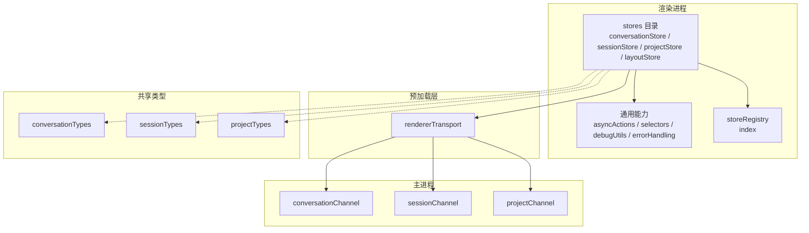
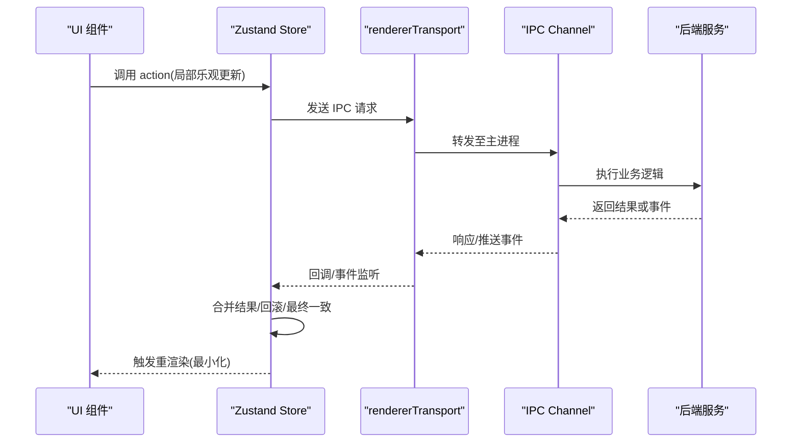
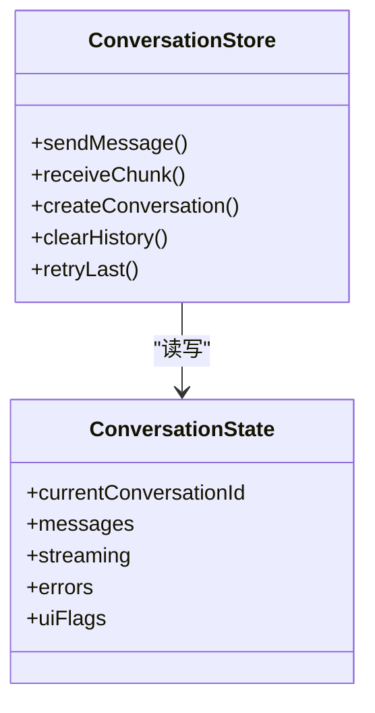
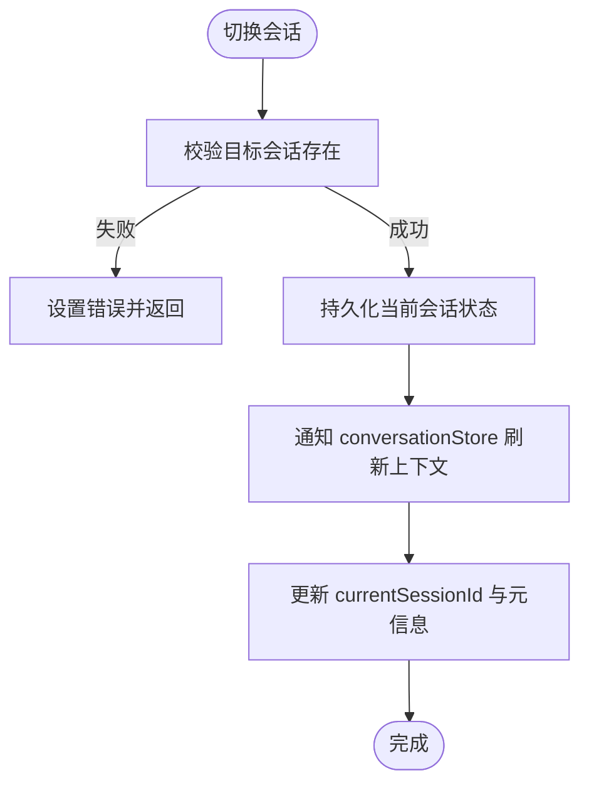
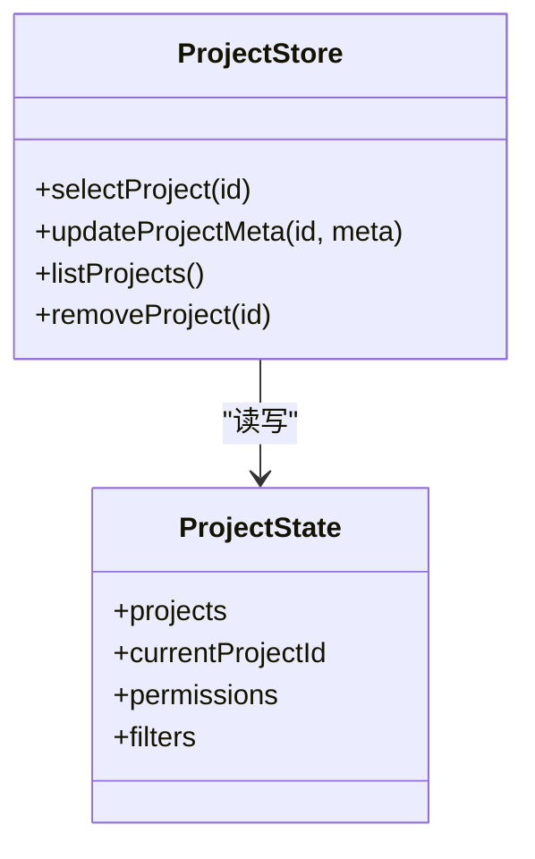
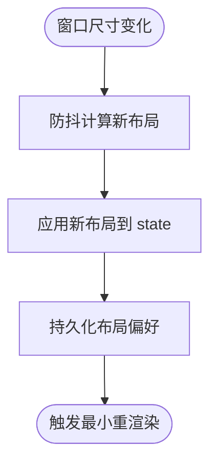
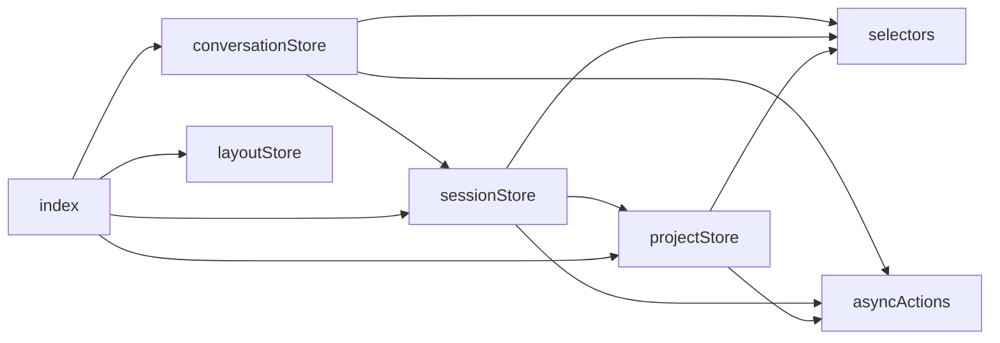
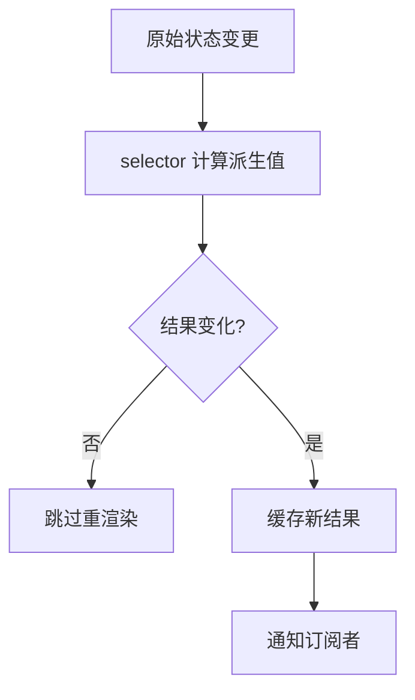
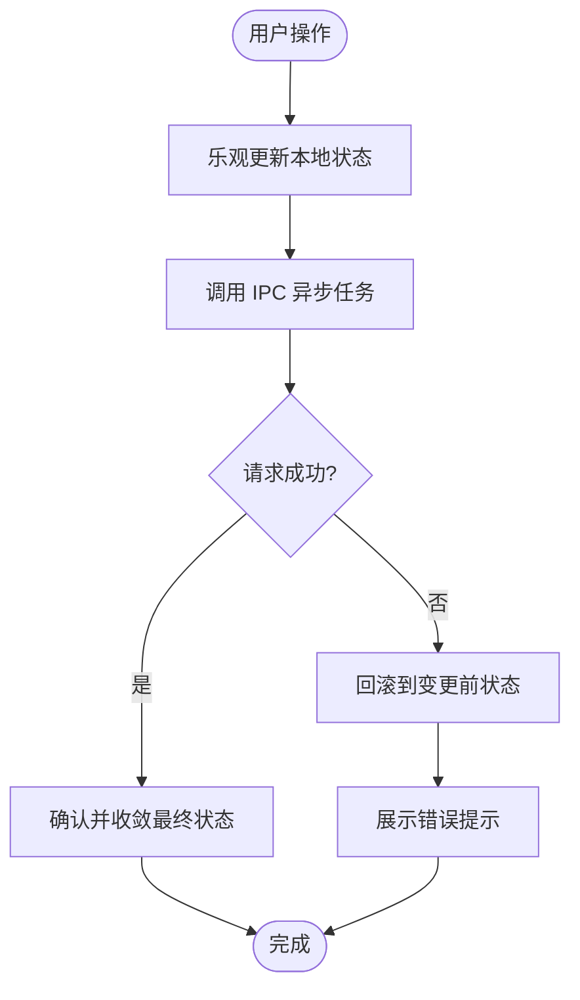
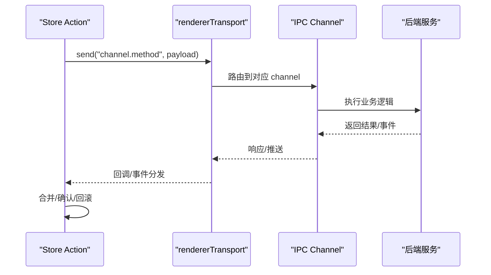

# 状态管理系统

<cite>
**本文引用的文件**   
- [src/src/renderer/src/renderer/stores/conversationStore.ts](file://src/src/renderer/src/renderer/stores/conversationStore.ts)
- [src/src/renderer/src/renderer/stores/sessionStore.ts](file://src/src/renderer/src/renderer/stores/sessionStore.ts)
- [src/src/renderer/src/renderer/stores/projectStore.ts](file://src/src/renderer/src/renderer/stores/projectStore.ts)
- [src/src/renderer/src/renderer/stores/layoutStore.ts](file://src/src/renderer/src/renderer/stores/layoutStore.ts)
- [src/src/renderer/src/renderer/stores/index.ts](file://src/src/renderer/src/renderer/stores/index.ts)
- [src/src/renderer/src/renderer/stores/storeRegistry.ts](file://src/src/renderer/src/renderer/stores/storeRegistry.ts)
- [src/src/renderer/src/renderer/stores/asyncActions.ts](file://src/src/renderer/src/renderer/stores/asyncActions.ts)
- [src/src/renderer/src/renderer/stores/selectors.ts](file://src/src/renderer/src/renderer/stores/selectors.ts)
- [src/src/renderer/src/renderer/stores/debugUtils.ts](file://src/src/renderer/src/renderer/stores/debugUtils.ts)
- [src/src/renderer/src/renderer/stores/errorHandling.ts](file://src/src/renderer/src/renderer/stores/errorHandling.ts)
- [src/src/preload/src/preload/rendererTransport.ts](file://src/src/preload/src/preload/rendererTransport.ts)
- [src/src/main/src/main/ipc/conversationChannel.ts](file://src/src/main/src/main/ipc/conversationChannel.ts)
- [src/src/main/src/main/ipc/sessionChannel.ts](file://src/src/main/src/main/ipc/sessionChannel.ts)
- [src/src/main/src/main/ipc/projectChannel.ts](file://src/src/main/src/main/ipc/projectChannel.ts)
- [src/src/shared/src/shared/types/conversationTypes.ts](file://src/src/shared/src/shared/types/conversationTypes.ts)
- [src/src/shared/src/shared/types/sessionTypes.ts](file://src/src/shared/src/shared/types/sessionTypes.ts)
- [src/src/shared/src/shared/types/projectTypes.ts](file://src/src/shared/src/shared/types/projectTypes.ts)
</cite>

## 目录
1. [引言](#引言)
2. [项目结构](#项目结构)
3. [核心组件](#核心组件)
4. [架构总览](#架构总览)
5. [详细组件分析](#详细组件分析)
6. [依赖关系分析](#依赖关系分析)
7. [性能与选择器](#性能与选择器)
8. [异步操作与乐观更新](#异步操作与乐观更新)
9. [IPC 同步机制](#ipc-同步机制)
10. [调试、测试与错误处理](#调试测试与错误处理)
11. [自定义 Store 开发指南](#自定义-store-开发指南)
12. [结论](#结论)

## 引言
本文件系统性地梳理基于 Zustand 的前端状态管理实现，重点覆盖以下方面：
- Store 组织方式与职责划分
- 状态结构设计及跨层共享类型
- 异步操作处理、乐观更新策略
- 与主进程的 IPC 通信和实时数据同步
- 选择器与派生状态的性能优化
- 调试工具、单元测试方法与错误处理机制
- 自定义 Store 的开发指南与最佳实践

目标读者包括前端开发者、集成方以及需要扩展状态模型的工程师。

## 项目结构
渲染进程的状态集中在 `src/src/renderer/src/renderer/stores` 目录下，按领域拆分为多个独立 store，并通过统一入口导出。关键路径如下：
- 领域 store：conversationStore、sessionStore、projectStore、layoutStore
- 通用能力：asyncActions、selectors、debugUtils、errorHandling
- 注册与导出：storeRegistry、index
- 跨层类型：shared/types 下的 conversationTypes、sessionTypes、projectTypes
- IPC 通道：preload/rendererTransport 与 main/ipc 下的各 channel

图表来源
- [src/src/renderer/src/renderer/stores/index.ts:1-200](file://src/src/renderer/src/renderer/stores/index.ts#L1-L200)
- [src/src/renderer/src/renderer/stores/storeRegistry.ts:1-200](file://src/src/renderer/src/renderer/stores/storeRegistry.ts#L1-L200)
- [src/src/preload/src/preload/rendererTransport.ts:1-200](file://src/src/preload/src/preload/rendererTransport.ts#L1-L200)
- [src/src/main/src/main/ipc/conversationChannel.ts:1-200](file://src/src/main/src/main/ipc/conversationChannel.ts#L1-L200)
- [src/src/main/src/main/ipc/sessionChannel.ts:1-200](file://src/src/main/src/main/ipc/sessionChannel.ts#L1-L200)
- [src/src/main/src/main/ipc/projectChannel.ts:1-200](file://src/src/main/src/main/ipc/projectChannel.ts#L1-L200)

章节来源
- [src/src/renderer/src/renderer/stores/index.ts:1-200](file://src/src/renderer/src/renderer/stores/index.ts#L1-L200)
- [src/src/renderer/src/renderer/stores/storeRegistry.ts:1-200](file://src/src/renderer/src/renderer/stores/storeRegistry.ts#L1-L200)

## 核心组件
- conversationStore（对话状态）：维护当前对话上下文、消息列表、流式输出、交互状态等，负责与后端对话会话的读写与增量同步。
- sessionStore（会话管理）：管理会话生命周期、会话元信息、运行态标记、切换与持久化。
- projectStore（项目管理）：管理项目集合、当前项目、权限与可见性、资源映射等。
- layoutStore（布局状态）：管理界面布局、面板显隐、侧栏宽度、工作区分割等 UI 状态。

上述 store 通过统一的导出入口对外暴露，并提供组合 API 供业务组件订阅。

章节来源
- [src/src/renderer/src/renderer/stores/conversationStore.ts:1-200](file://src/src/renderer/src/renderer/stores/conversationStore.ts#L1-L200)
- [src/src/renderer/src/renderer/stores/sessionStore.ts:1-200](file://src/src/renderer/src/renderer/stores/sessionStore.ts#L1-L200)
- [src/src/renderer/src/renderer/stores/projectStore.ts:1-200](file://src/src/renderer/src/renderer/stores/projectStore.ts#L1-L200)
- [src/src/renderer/src/renderer/stores/layoutStore.ts:1-200](file://src/src/renderer/src/renderer/stores/layoutStore.ts#L1-L200)
- [src/src/renderer/src/renderer/stores/index.ts:1-200](file://src/src/renderer/src/renderer/stores/index.ts#L1-L200)

## 架构总览
Zustand 在渲染进程中作为单一状态源，配合 selector 实现细粒度订阅；IPC 层通过 preload 桥接主进程服务，保证跨进程状态一致性。整体数据流遵循“UI 触发 action → store 更新本地状态 → IPC 调用主进程 → 主进程返回结果 → store 二次确认并回写”。

图表来源
- [src/src/renderer/src/renderer/stores/conversationStore.ts:1-200](file://src/src/renderer/src/renderer/stores/conversationStore.ts#L1-L200)
- [src/src/preload/src/preload/rendererTransport.ts:1-200](file://src/src/preload/src/preload/rendererTransport.ts#L1-L200)
- [src/src/main/src/main/ipc/conversationChannel.ts:1-200](file://src/src/main/src/main/ipc/conversationChannel.ts#L1-L200)

## 详细组件分析

### conversationStore（对话状态）
职责要点
- 管理当前对话 ID、消息序列、流式片段、用户输入、错误状态、加载态。
- 提供创建对话、发送消息、接收增量事件、撤销/重试、清空历史等操作。
- 与 sessionStore 协作，确保消息归属正确的会话上下文。
- 通过 selectors 暴露只读视图，如未读消息数、最近一条摘要、流式进度。

数据结构概览
- 当前对话上下文对象
- 消息数组（含时间戳、角色、内容、工具调用、状态）
- 流式状态（是否正在写入、缓冲、进度百分比）
- 错误与提示

图表来源
- [src/src/renderer/src/renderer/stores/conversationStore.ts:1-200](file://src/src/renderer/src/renderer/stores/conversationStore.ts#L1-L200)
- [src/src/shared/src/shared/types/conversationTypes.ts:1-200](file://src/src/shared/src/shared/types/conversationTypes.ts#L1-L200)

章节来源
- [src/src/renderer/src/renderer/stores/conversationStore.ts:1-200](file://src/src/renderer/src/renderer/stores/conversationStore.ts#L1-L200)
- [src/src/shared/src/shared/types/conversationTypes.ts:1-200](file://src/src/shared/src/shared/types/conversationTypes.ts#L1-L200)

### sessionStore（会话管理）
职责要点
- 维护会话列表、当前会话、会话属性、运行标记、持久化键。
- 提供切换会话、创建/删除会话、导入/导出、清理无效会话等方法。
- 与 projectStore 联动，保证会话与项目上下文的绑定关系。
- 在会话切换时触发 conversationStore 的上下文刷新。

图表来源
- [src/src/renderer/src/renderer/stores/sessionStore.ts:1-200](file://src/src/renderer/src/renderer/stores/sessionStore.ts#L1-L200)
- [src/src/shared/src/shared/types/sessionTypes.ts:1-200](file://src/src/shared/src/shared/types/sessionTypes.ts#L1-L200)

章节来源
- [src/src/renderer/src/renderer/stores/sessionStore.ts:1-200](file://src/src/renderer/src/renderer/stores/sessionStore.ts#L1-L200)
- [src/src/shared/src/shared/types/sessionTypes.ts:1-200](file://src/src/shared/src/shared/types/sessionTypes.ts#L1-L200)

### projectStore（项目管理）
职责要点
- 管理项目集合、当前项目、权限位、标签与分组、可见性与搜索索引。
- 提供添加/移除项目、更新元信息、批量操作、懒加载详情等接口。
- 在会话创建时自动绑定默认项目，或在权限不足时降级为只读视图。
- 与 conversationStore 协同，限制可访问的对话范围。

图表来源
- [src/src/renderer/src/renderer/stores/projectStore.ts:1-200](file://src/src/renderer/src/renderer/stores/projectStore.ts#L1-L200)
- [src/src/shared/src/shared/types/projectTypes.ts:1-200](file://src/src/shared/src/shared/types/projectTypes.ts#L1-L200)

章节来源
- [src/src/renderer/src/renderer/stores/projectStore.ts:1-200](file://src/src/renderer/src/renderer/stores/projectStore.ts#L1-L200)
- [src/src/shared/src/shared/types/projectTypes.ts:1-200](file://src/src/shared/src/shared/types/projectTypes.ts#L1-L200)

### layoutStore（布局状态）
职责要点
- 管理左右栏宽度、面板折叠、全屏模式、主题相关布局参数。
- 提供恢复默认布局、保存用户偏好、响应窗口尺寸变化的方法。
- 不持有业务数据，仅影响渲染呈现与交互行为。

图表来源
- [src/src/renderer/src/renderer/stores/layoutStore.ts:1-200](file://src/src/renderer/src/renderer/stores/layoutStore.ts#L1-L200)

章节来源
- [src/src/renderer/src/renderer/stores/layoutStore.ts:1-200](file://src/src/renderer/src/renderer/stores/layoutStore.ts#L1-L200)

## 依赖关系分析
- 领域 store 依赖 shared/types 中的类型定义，保证前后端契约一致。
- conversationStore 依赖 sessionStore 提供的当前会话上下文。
- sessionStore 依赖 projectStore 获取项目元信息。
- 所有 store 通过 asyncActions 封装异步流程，通过 selectors 暴露派生状态。
- 通过 storeRegistry 集中注册，并由 index 统一导出，避免循环依赖。

图表来源
- [src/src/renderer/src/renderer/stores/index.ts:1-200](file://src/src/renderer/src/renderer/stores/index.ts#L1-L200)
- [src/src/renderer/src/renderer/stores/storeRegistry.ts:1-200](file://src/src/renderer/src/renderer/stores/storeRegistry.ts#L1-L200)

章节来源
- [src/src/renderer/src/renderer/stores/index.ts:1-200](file://src/src/renderer/src/renderer/stores/index.ts#L1-L200)
- [src/src/renderer/src/renderer/stores/storeRegistry.ts:1-200](file://src/src/renderer/src/renderer/stores/storeRegistry.ts#L1-L200)

## 性能与选择器
- 选择器策略：对大对象（如消息列表、项目树）使用浅比较与切片选择，避免整树重渲染。
- 派生状态缓存：对高频计算（如最近 N 条摘要、统计计数）进行结果缓存，减少重复计算。
- 订阅粒度：组件仅订阅所需字段，结合 useMemo/useSelector 模式降低渲染成本。
- 批量更新：在事件驱动的场景中，将多次小更新合并为一次批量 set，减少中间状态抖动。

图表来源
- [src/src/renderer/src/renderer/stores/selectors.ts:1-200](file://src/src/renderer/src/renderer/stores/selectors.ts#L1-L200)

章节来源
- [src/src/renderer/src/renderer/stores/selectors.ts:1-200](file://src/src/renderer/src/renderer/stores/selectors.ts#L1-L200)

## 异步操作与乐观更新
- 乐观更新：action 先立即修改本地状态以反馈 UI，随后发起 IPC 请求。
- 失败回滚：若 IPC 返回错误，store 根据操作类型执行回滚或降级显示。
- 最终一致：收到主进程确认或事件后，修正本地状态，消除不一致。
- 去抖与节流：针对高频操作（如流式追加、布局调整）进行节流/防抖。
- 并发控制：对同一实体的并发更新进行排队或锁保护，避免乱序覆盖。

图表来源
- [src/src/renderer/src/renderer/stores/asyncActions.ts:1-200](file://src/src/renderer/src/renderer/stores/asyncActions.ts#L1-L200)
- [src/src/renderer/src/renderer/stores/errorHandling.ts:1-200](file://src/src/renderer/src/renderer/stores/errorHandling.ts#L1-L200)

章节来源
- [src/src/renderer/src/renderer/stores/asyncActions.ts:1-200](file://src/src/renderer/src/renderer/stores/asyncActions.ts#L1-L200)
- [src/src/renderer/src/renderer/stores/errorHandling.ts:1-200](file://src/src/renderer/src/renderer/stores/errorHandling.ts#L1-L200)

## IPC 同步机制
- 预加载层 rendererTransport 负责向主进程发送命令与监听事件，屏蔽底层细节。
- 主进程各 channel（conversation/session/project）处理具体业务逻辑并返回结果。
- 渲染进程 store 通过事件订阅与回调机制，将主进程推送的消息增量合并到本地状态。
- 实时数据：对长连接或事件流场景，store 维持连接与重连逻辑，并在断线时给出降级 UI。

图表来源
- [src/src/preload/src/preload/rendererTransport.ts:1-200](file://src/src/preload/src/preload/rendererTransport.ts#L1-L200)
- [src/src/main/src/main/ipc/conversationChannel.ts:1-200](file://src/src/main/src/main/ipc/conversationChannel.ts#L1-L200)
- [src/src/main/src/main/ipc/sessionChannel.ts:1-200](file://src/src/main/src/main/ipc/sessionChannel.ts#L1-L200)
- [src/src/main/src/main/ipc/projectChannel.ts:1-200](file://src/src/main/src/main/ipc/projectChannel.ts#L1-L200)

章节来源
- [src/src/preload/src/preload/rendererTransport.ts:1-200](file://src/src/preload/src/preload/rendererTransport.ts#L1-L200)
- [src/src/main/src/main/ipc/conversationChannel.ts:1-200](file://src/src/main/src/main/ipc/conversationChannel.ts#L1-L200)
- [src/src/main/src/main/ipc/sessionChannel.ts:1-200](file://src/src/main/src/main/ipc/sessionChannel.ts#L1-L200)
- [src/src/main/src/main/ipc/projectChannel.ts:1-200](file://src/src/main/src/main/ipc/projectChannel.ts#L1-L200)

## 调试、测试与错误处理
- 调试工具：debugUtils 提供快照打印、变更追踪、慢渲染检测、选择性日志开关。
- 单元测试：
  - 针对 store 的 action 与 selector 编写用例，模拟 IPC 返回成功/失败/异常。
  - 验证乐观更新与回滚路径，确保最终一致。
  - 覆盖边界条件：空数据、重复提交、网络超时、权限拒绝。
- 错误处理：
  - 分类错误：网络错误、服务端错误、业务校验错误、UI 降级错误。
  - 统一错误上报与用户提示，避免阻塞主流程。
  - 在流式场景中区分部分失败与完全失败，提供重试与继续选项。

章节来源
- [src/src/renderer/src/renderer/stores/debugUtils.ts:1-200](file://src/src/renderer/src/renderer/stores/debugUtils.ts#L1-L200)
- [src/src/renderer/src/renderer/stores/errorHandling.ts:1-200](file://src/src/renderer/src/renderer/stores/errorHandling.ts#L1-L200)

## 自定义 Store 开发指南
- 新建 store：在 stores 目录新增文件，定义状态与 actions，保持纯函数更新语义。
- 类型约束：优先复用 shared/types，必要时扩展并导出联合类型。
- 异步封装：使用 asyncActions 包装 IPC 调用，明确乐观更新与回滚逻辑。
- 选择器：对大型状态提供 selectors，仅在必要时订阅子集。
- 注册导出：在 storeRegistry 中注册，并在 index 中统一导出，避免循环依赖。
- 测试：为每个 action 与 selector 编写用例，覆盖成功、失败、边界情况。
- 调试：启用 debugUtils 的日志与快照，定位状态漂移问题。

最佳实践清单
- 单一职责：每个 store 只管理一个领域状态。
- 不可变更新：使用不可变更新模式，便于 diff 与回放。
- 最小作用域：动作尽量小而专一，组合复杂流程。
- 可观测性：对关键路径埋点与指标采集，辅助性能优化。
- 向后兼容：迁移时保留旧字段映射，逐步替换。

章节来源
- [src/src/renderer/src/renderer/stores/storeRegistry.ts:1-200](file://src/src/renderer/src/renderer/stores/storeRegistry.ts#L1-L200)
- [src/src/renderer/src/renderer/stores/index.ts:1-200](file://src/src/renderer/src/renderer/stores/index.ts#L1-L200)

## 结论
该状态管理系统以 Zustand 为核心，围绕 conversation、session、project、layout 四个领域构建清晰解耦的 store 体系。通过 selectors 提升渲染性能，借助 asyncActions 与 IPC 通道实现可靠的数据同步与乐观更新。配合调试工具与完善的错误处理，既保障了用户体验，也为扩展与测试提供了坚实基础。后续可在现有架构上持续引入更细粒度的选择器与更稳健的重连机制，进一步提升系统稳定性与可维护性。