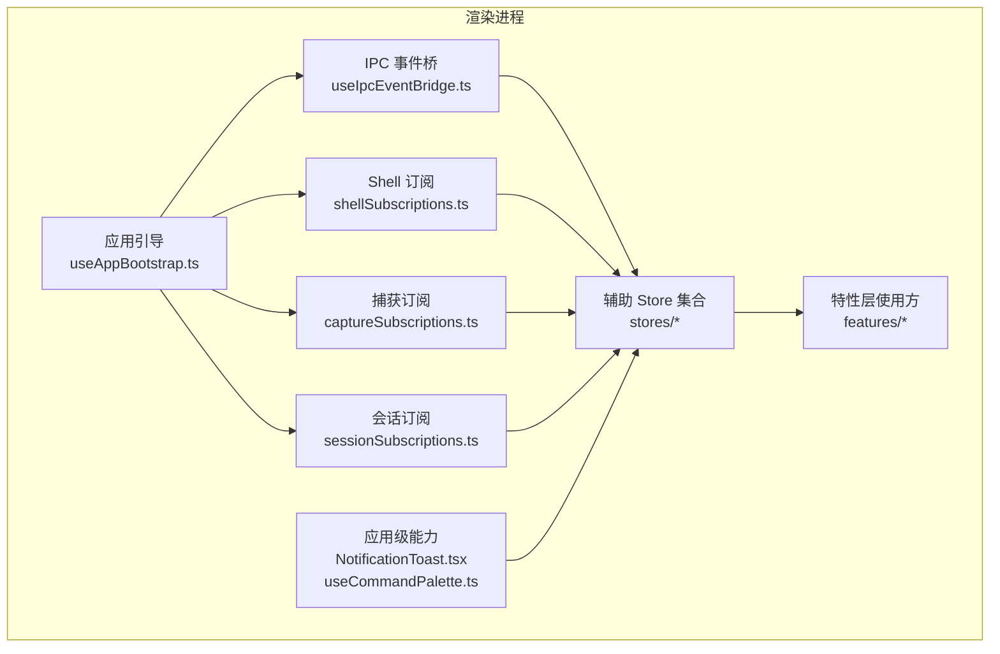
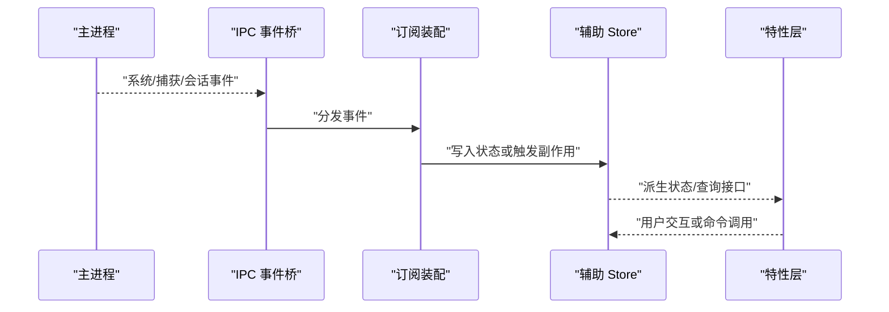
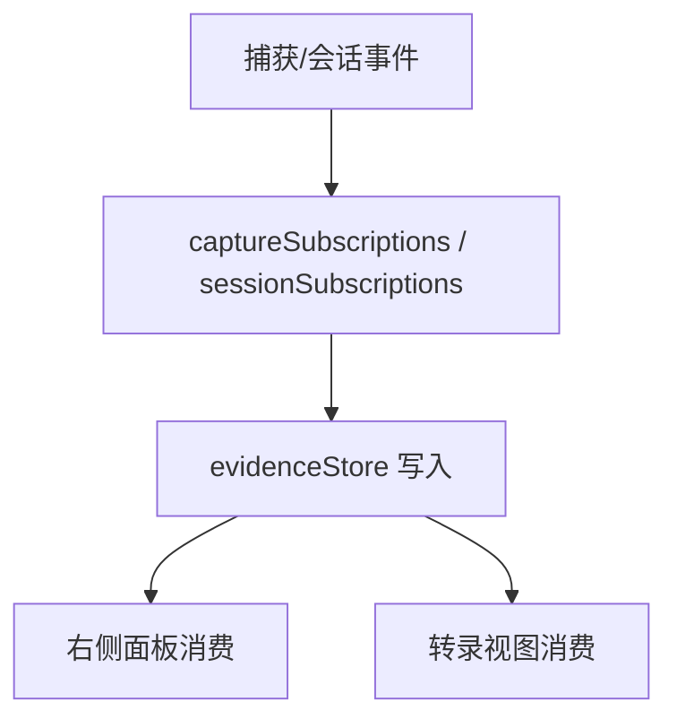
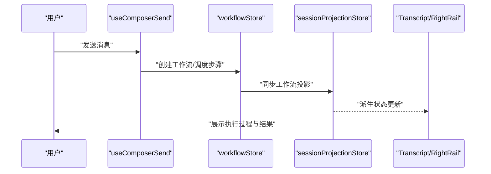
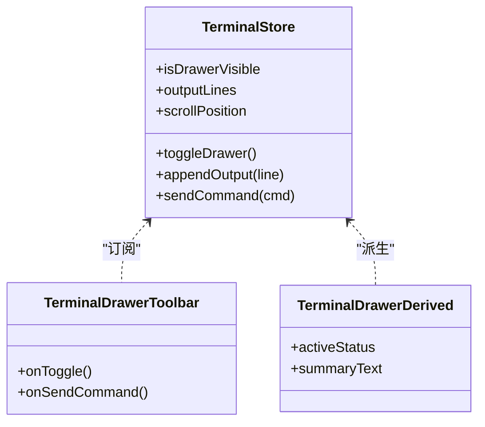
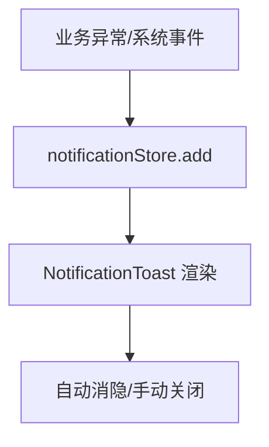
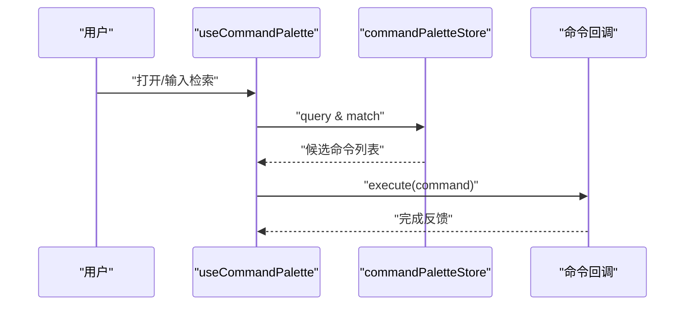
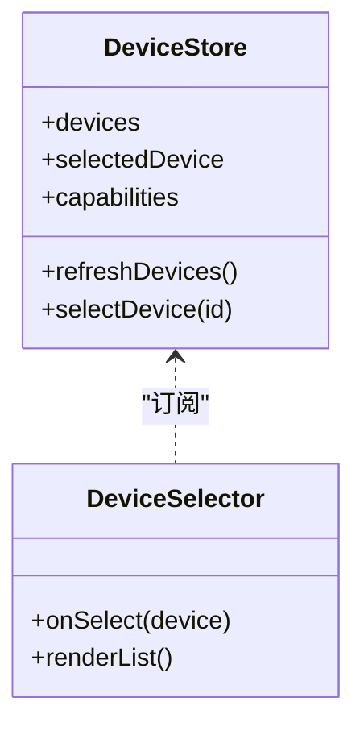
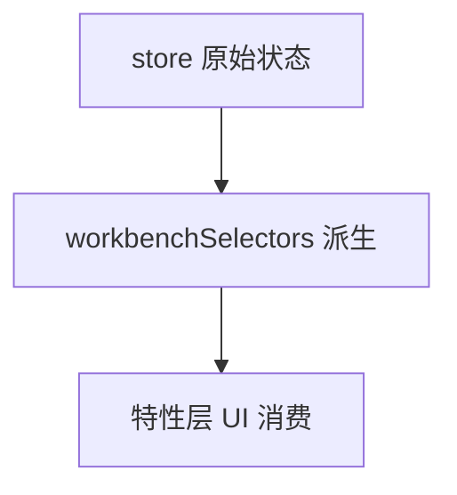
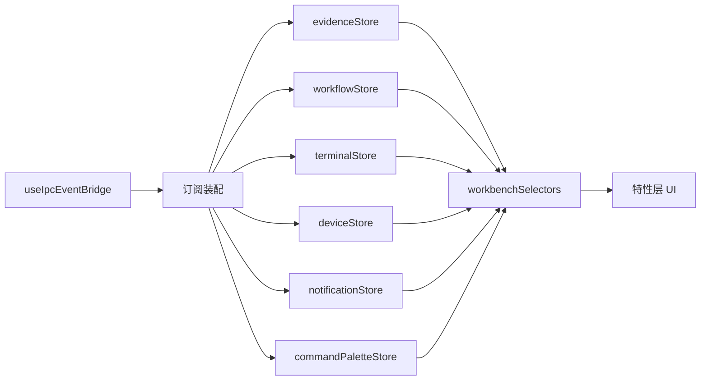

# 辅助 Store 与工具

<cite>
**本文引用的文件**   
- [workflowStore.test.ts](file://src/renderer/stores/workflowStore.test.ts)
- [terminalStore.test.ts](file://src/renderer/stores/terminalStore.test.ts)
- [deviceStore.test.ts](file://src/renderer/stores/deviceStore.test.ts)
- [sessionProjectionStore.ts](file://src/renderer/stores/sessionProjectionStore.ts)
- [sessionProjectionHydration.ts](file://src/renderer/stores/sessionProjectionHydration.ts)
- [sessionStore.ts](file://src/renderer/stores/sessionStore.ts)
- [sessionSwitchHygiene.ts](file://src/renderer/stores/sessionSwitchHygiene.ts)
- [useAppBootstrap.ts](file://src/renderer/app/bootstrap/useAppBootstrap.ts)
- [useIpcEventBridge.ts](file://src/renderer/app/bootstrap/useIpcEventBridge.ts)
- [shellSubscriptions.ts](file://src/renderer/app/bootstrap/shellSubscriptions.ts)
- [captureSubscriptions.ts](file://src/renderer/app/bootstrap/captureSubscriptions.ts)
- [sessionSubscriptions.ts](file://src/renderer/app/bootstrap/sessionSubscriptions.ts)
- [storesReset.ts](file://src/renderer/app/storesReset.ts)
- [NotificationToast.tsx](file://src/renderer/app/NotificationToast.tsx)
- [useCommandPalette.ts](file://src/renderer/app/useCommandPalette.ts)
- [useCommandPalette.test.ts](file://src/renderer/app/useCommandPalette.test.ts)
- [TerminalDrawerToolbar.tsx](file://src/renderer/features/terminal/TerminalDrawer/TerminalDrawerToolbar.tsx)
- [terminalDrawerInteraction.test.ts](file://src/renderer/features/terminal/TerminalDrawer/terminalDrawerInteraction.test.ts)
- [terminalDrawerDerived.ts](file://src/renderer/features/terminal/TerminalDrawer/terminalDrawerDerived.ts)
- [DeviceSelector/index.tsx](file://src/renderer/features/captures/DeviceSelector/index.tsx)
- [DeviceSelector/DeviceSelector.test.ts](file://src/renderer/features/captures/DeviceSelector/DeviceSelector.test.ts)
- [SessionRightRailPopulated.test.ts](file://src/renderer/features/right-rail/SessionRightRailPopulated.test.ts)
- [SessionRightRail.test.ts](file://src/renderer/features/right-rail/SessionRightRail.test.ts)
- [SessionRightRail.tsx](file://src/renderer/features/right-rail/SessionRightRail.tsx)
- [CapturePanel.tsx](file://src/renderer/features/right-rail/CapturePanel.tsx)
- [projectSelectionLoaderOps.ts](file://src/renderer/features/sidebar/Sidebar/projectSelectionLoaderOps.ts)
- [useComposerSend.ts](file://src/renderer/features/composer/useComposerSend.ts)
- [useComposer.ts](file://src/renderer/features/composer/useComposer.ts)
- [MessageVariantNavigator.tsx](file://src/renderer/features/transcript/MessageVariantNavigator.tsx)
- [useUserMessageRewrite.ts](file://src/renderer/features/transcript/useUserMessageRewrite.ts)
</cite>

## 目录
1. [引言](#引言)
2. [项目结构](#项目结构)
3. [核心组件](#核心组件)
4. [架构总览](#架构总览)
5. [详细组件分析](#详细组件分析)
6. [依赖关系分析](#依赖关系分析)
7. [性能考量](#性能考量)
8. [故障排查指南](#故障排查指南)
9. [结论](#结论)
10. [附录](#附录)

## 引言
本文围绕渲染进程中的辅助状态管理与工具进行系统化说明，重点覆盖以下主题：
- 辅助 store 的职责边界与协作模式：证据收集与管理、工作流编排、终端输出管理、通知系统、命令面板、设备信息。
- workbenchSelectors 选择器库的派生状态计算、性能优化策略与查询接口设计。
- store 间通信机制：事件总线、状态订阅、依赖注入。
- 工具函数分类与使用场景：数据转换、格式化处理、业务逻辑封装。
- 测试策略：mock 数据生成、异步操作模拟、状态快照验证。
- 扩展点设计：自定义 store 注册、插件机制、第三方集成。
- 最佳实践、常见陷阱与性能优化技巧。

本说明以仓库中实际存在的路径为依据，聚焦渲染端状态基础设施与可观测性、可交互性增强能力，帮助读者快速理解并安全扩展该子系统。

## 项目结构
渲染端的状态与工具主要分布在以下区域：
- stores：核心辅助 store 与状态持久化、水合、切换等基础设施。
- app/bootstrap：应用启动阶段的事件桥接、订阅装配、全局 store 初始化。
- features：面向特性的 store 使用方与 UI 组合层，体现 store 的实际调用方式。
- app：全局通知、命令面板等通用能力入口。

**图示来源**
- [useAppBootstrap.ts](file://src/renderer/app/bootstrap/useAppBootstrap.ts)
- [useIpcEventBridge.ts](file://src/renderer/app/bootstrap/useIpcEventBridge.ts)
- [shellSubscriptions.ts](file://src/renderer/app/bootstrap/shellSubscriptions.ts)
- [captureSubscriptions.ts](file://src/renderer/app/bootstrap/captureSubscriptions.ts)
- [sessionSubscriptions.ts](file://src/renderer/app/bootstrap/sessionSubscriptions.ts)

**章节来源**
- [useAppBootstrap.ts](file://src/renderer/app/bootstrap/useAppBootstrap.ts)
- [useIpcEventBridge.ts](file://src/renderer/app/bootstrap/useIpcEventBridge.ts)
- [shellSubscriptions.ts](file://src/renderer/app/bootstrap/shellSubscriptions.ts)
- [captureSubscriptions.ts](file://src/renderer/app/bootstrap/captureSubscriptions.ts)
- [sessionSubscriptions.ts](file://src/renderer/app/bootstrap/sessionSubscriptions.ts)

## 核心组件
本节概述各辅助 store 的职责与关键职责边界：
- evidenceStore（证据收集与管理）：负责捕获、归档、关联调试证据，供右侧面板与转录视图消费。
- workflowStore（工作流编排）：管理工作流生命周期、步骤执行、状态收敛与结果聚合。
- terminalStore（终端输出管理）：维护终端抽屉可见性、输出条目、交互指令与派生展示状态。
- notificationStore（通知系统）：集中处理通知消息的生命周期、优先级、去重与渲染。
- commandPaletteStore（命令面板）：暴露命令检索、匹配、激活与快捷键绑定。
- deviceStore（设备信息）：提供设备列表、选中设备、设备能力与连接状态。

这些 store 在渲染进程中通过统一的事件桥与订阅装配接入，并在特性层被 UI 消费。

**章节来源**
- [workflowStore.test.ts](file://src/renderer/stores/workflowStore.test.ts)
- [terminalStore.test.ts](file://src/renderer/stores/terminalStore.test.ts)
- [deviceStore.test.ts](file://src/renderer/stores/deviceStore.test.ts)
- [NotificationToast.tsx](file://src/renderer/app/NotificationToast.tsx)
- [useCommandPalette.ts](file://src/renderer/app/useCommandPalette.ts)
- [TerminalDrawerToolbar.tsx](file://src/renderer/features/terminal/TerminalDrawer/TerminalDrawerToolbar.tsx)
- [DeviceSelector/index.tsx](file://src/renderer/features/captures/DeviceSelector/index.tsx)

## 架构总览
辅助 store 的运行时架构由“事件桥 + 订阅装配 + store 集合 + 特性消费”构成：
- useIpcEventBridge 将主进程事件映射到渲染侧，驱动 store 更新。
- shellSubscriptions、captureSubscriptions、sessionSubscriptions 分别订阅系统、捕获与会话域事件，触发对应 store 变更。
- store 之间通过共享状态与派生选择器解耦；workbenchSelectors 提供稳定查询接口。
- 特性层（如 transcript、composer、right-rail、terminal、captures）只关心稳定的派生状态，不直接耦合底层 store。

**图示来源**
- [useIpcEventBridge.ts](file://src/renderer/app/bootstrap/useIpcEventBridge.ts)
- [shellSubscriptions.ts](file://src/renderer/app/bootstrap/shellSubscriptions.ts)
- [captureSubscriptions.ts](file://src/renderer/app/bootstrap/captureSubscriptions.ts)
- [sessionSubscriptions.ts](file://src/renderer/app/bootstrap/sessionSubscriptions.ts)

## 详细组件分析

### evidenceStore（证据收集与管理）
职责要点：
- 接收来自捕获、会话、工作流等事件的证据片段。
- 对证据进行归一化、时间线排序、标签与引用关联。
- 向右侧面板与转录视图暴露查询接口，支持按会话、任务、证据类型过滤。
- 与 sessionProjectionStore 协作，保证证据与工作流投影的一致性。

典型调用路径：
- 捕获事件 → captureSubscriptions → evidenceStore 写入 → 右侧面板/转录视图消费。
- 工作流结果 → workflowStore → evidenceStore 归档 → MessageVariantNavigator 展示。

**图示来源**
- [captureSubscriptions.ts](file://src/renderer/app/bootstrap/captureSubscriptions.ts)
- [sessionSubscriptions.ts](file://src/renderer/app/bootstrap/sessionSubscriptions.ts)
- [SessionRightRail.tsx](file://src/renderer/features/right-rail/SessionRightRail.tsx)
- [MessageVariantNavigator.tsx](file://src/renderer/features/transcript/MessageVariantNavigator.tsx)

**章节来源**
- [captureSubscriptions.ts](file://src/renderer/app/bootstrap/captureSubscriptions.ts)
- [sessionSubscriptions.ts](file://src/renderer/app/bootstrap/sessionSubscriptions.ts)
- [SessionRightRail.tsx](file://src/renderer/features/right-rail/SessionRightRail.tsx)
- [MessageVariantNavigator.tsx](file://src/renderer/features/transcript/MessageVariantNavigator.tsx)

### workflowStore（工作流编排）
职责要点：
- 管理工作流实例创建、步骤调度、状态推进与收敛。
- 暴露工作流运行态、计划、任务、工具调用的派生状态。
- 与 sessionProjectionStore 协同，确保工作流状态与会话投影同步。
- 为 composer、transcript 提供结构化执行上下文。

典型流程：
- 用户发送消息 → useComposerSend → workflowStore 编排 → 状态更新 → UI 消费。

**图示来源**
- [useComposerSend.ts](file://src/renderer/features/composer/useComposerSend.ts)
- [workflowStore.test.ts](file://src/renderer/stores/workflowStore.test.ts)
- [sessionProjectionStore.ts](file://src/renderer/stores/sessionProjectionStore.ts)

**章节来源**
- [useComposerSend.ts](file://src/renderer/features/composer/useComposerSend.ts)
- [workflowStore.test.ts](file://src/renderer/stores/workflowStore.test.ts)
- [sessionProjectionStore.ts](file://src/renderer/stores/sessionProjectionStore.ts)

### terminalStore（终端输出管理）
职责要点：
- 控制终端抽屉显示/隐藏、输出行追加、滚动定位、交互指令发送。
- 提供派生状态（如是否活跃、最新输出摘要），供工具栏与导航组件使用。
- 与 TerminalDrawerToolbar、terminalDrawerDerived 协作，实现 UI 与状态的稳定绑定。

关键行为：
- 打开/关闭终端抽屉 → 更新可见性与焦点。
- 追加终端输出 → 维护有序输出列表与滚动位置。
- 派发交互命令 → 触发外部工具或会话工具调用。

**图示来源**
- [terminalStore.test.ts](file://src/renderer/stores/terminalStore.test.ts)
- [TerminalDrawerToolbar.tsx](file://src/renderer/features/terminal/TerminalDrawer/TerminalDrawerToolbar.tsx)
- [terminalDrawerDerived.ts](file://src/renderer/features/terminal/TerminalDrawer/terminalDrawerDerived.ts)

**章节来源**
- [terminalStore.test.ts](file://src/renderer/stores/terminalStore.test.ts)
- [TerminalDrawerToolbar.tsx](file://src/renderer/features/terminal/TerminalDrawer/TerminalDrawerToolbar.tsx)
- [terminalDrawerDerived.ts](file://src/renderer/features/terminal/TerminalDrawer/terminalDrawerDerived.ts)
- [terminalDrawerInteraction.test.ts](file://src/renderer/features/terminal/TerminalDrawer/terminalDrawerInteraction.test.ts)

### notificationStore（通知系统）
职责要点：
- 统一管理通知项的增删改查、优先级、去重、自动消隐。
- 与 NotificationToast 组件配合，渲染通知提示。
- 在工作流错误、捕获异常、会话切换等场景中触发通知。

典型路径：
- 业务异常 → notificationStore.add() → NotificationToast 渲染 → 用户感知。

**图示来源**
- [NotificationToast.tsx](file://src/renderer/app/NotificationToast.tsx)

**章节来源**
- [NotificationToast.tsx](file://src/renderer/app/NotificationToast.tsx)

### commandPaletteStore（命令面板）
职责要点：
- 注册命令元数据、提供检索与匹配、执行回调。
- 与 useCommandPalette 钩子绑定，支持快捷键触发与结果高亮。
- 为全局快捷入口与搜索体验提供统一入口。

典型流程：
- 用户触发命令面板 → useCommandPalette 检索 → commandPaletteStore 匹配 → 执行回调。

**图示来源**
- [useCommandPalette.ts](file://src/renderer/app/useCommandPalette.ts)
- [useCommandPalette.test.ts](file://src/renderer/app/useCommandPalette.test.ts)

**章节来源**
- [useCommandPalette.ts](file://src/renderer/app/useCommandPalette.ts)
- [useCommandPalette.test.ts](file://src/renderer/app/useCommandPalette.test.ts)

### deviceStore（设备信息）
职责要点：
- 管理设备列表、选中设备、连接状态、能力描述。
- 与 DeviceSelector 组件协作，提供设备选择与切换。
- 在捕获与回放流程中被消费，决定目标设备上下文。

关键行为：
- 刷新设备列表 → 更新选中设备 → 通知捕获流程。
- 设备能力变化 → 影响可用工具集与 UI 呈现。

**图示来源**
- [deviceStore.test.ts](file://src/renderer/stores/deviceStore.test.ts)
- [DeviceSelector/index.tsx](file://src/renderer/features/captures/DeviceSelector/index.tsx)
- [DeviceSelector/DeviceSelector.test.ts](file://src/renderer/features/captures/DeviceSelector/DeviceSelector.test.ts)

**章节来源**
- [deviceStore.test.ts](file://src/renderer/stores/deviceStore.test.ts)
- [DeviceSelector/index.tsx](file://src/renderer/features/captures/DeviceSelector/index.tsx)
- [DeviceSelector/DeviceSelector.test.ts](file://src/renderer/features/captures/DeviceSelector/DeviceSelector.test.ts)

### workbenchSelectors（选择器库）
职责要点：
- 基于 store 原始状态计算派生状态，避免重复计算与过度渲染。
- 提供稳定查询接口，例如获取当前会话的工作流投影、终端摘要、设备能力、通知列表。
- 采用选择器缓存与细粒度依赖追踪，提升性能。

典型用法：
- 特性层通过 workbenchSelectors 获取最小必要状态，而非直接访问 store。
- 在复杂 UI 树中减少不必要的重渲染。

[本节为概念性说明，未直接分析具体文件，故无“章节来源”]

## 依赖关系分析
辅助 store 之间的依赖关系遵循“事件驱动 + 单向数据流”原则：
- 事件源（IPC、Shell、Capture、Session）仅驱动 store 变更。
- store 之间尽量低耦合，通过选择器与派生状态交换数据。
- 特性层只消费派生状态，不直接耦合 store 内部实现。

**图示来源**
- [useIpcEventBridge.ts](file://src/renderer/app/bootstrap/useIpcEventBridge.ts)
- [shellSubscriptions.ts](file://src/renderer/app/bootstrap/shellSubscriptions.ts)
- [captureSubscriptions.ts](file://src/renderer/app/bootstrap/captureSubscriptions.ts)
- [sessionSubscriptions.ts](file://src/renderer/app/bootstrap/sessionSubscriptions.ts)

**章节来源**
- [useIpcEventBridge.ts](file://src/renderer/app/bootstrap/useIpcEventBridge.ts)
- [shellSubscriptions.ts](file://src/renderer/app/bootstrap/shellSubscriptions.ts)
- [captureSubscriptions.ts](file://src/renderer/app/bootstrap/captureSubscriptions.ts)
- [sessionSubscriptions.ts](file://src/renderer/app/bootstrap/sessionSubscriptions.ts)

## 性能考量
- 选择器缓存：workbenchSelectors 应缓存派生结果，避免重复计算。
- 细粒度订阅：特性层只订阅所需字段，降低无关渲染。
- 批量更新：store 变更尽量合并批次，减少多次重渲染。
- 惰性加载：大对象（如证据列表、终端输出）按需分页或虚拟化。
- 去重与节流：通知与事件高频更新时做去重与节流处理。

[本节为通用性能建议，未直接分析具体文件，故无“章节来源”]

## 故障排查指南
常见问题与定位方法：
- 状态不同步：检查 useIpcEventBridge 是否正确分发事件，订阅装配是否挂载。
- 通知不显示：确认 notificationStore 添加逻辑与 NotificationToast 渲染条件。
- 命令面板无响应：核查 commandPaletteStore 的命令注册与 useCommandPalette 的检索逻辑。
- 终端输出丢失：检查 terminalStore 的输出追加与滚动定位逻辑。
- 设备列表为空：查看 deviceStore 的刷新逻辑与 DeviceSelector 的渲染条件。
- 会话切换导致状态污染：关注 sessionStore 与 sessionSwitchHygiene 的清理策略。

相关参考：
- 应用引导与事件桥：useAppBootstrap、useIpcEventBridge。
- 订阅装配：shellSubscriptions、captureSubscriptions、sessionSubscriptions。
- 状态重置：storesReset。
- 会话投影与水合：sessionProjectionStore、sessionProjectionHydration、sessionStore、sessionSwitchHygiene。

**章节来源**
- [useAppBootstrap.ts](file://src/renderer/app/bootstrap/useAppBootstrap.ts)
- [useIpcEventBridge.ts](file://src/renderer/app/bootstrap/useIpcEventBridge.ts)
- [shellSubscriptions.ts](file://src/renderer/app/bootstrap/shellSubscriptions.ts)
- [captureSubscriptions.ts](file://src/renderer/app/bootstrap/captureSubscriptions.ts)
- [sessionSubscriptions.ts](file://src/renderer/app/bootstrap/sessionSubscriptions.ts)
- [storesReset.ts](file://src/renderer/app/storesReset.ts)
- [sessionProjectionStore.ts](file://src/renderer/stores/sessionProjectionStore.ts)
- [sessionProjectionHydration.ts](file://src/renderer/stores/sessionProjectionHydration.ts)
- [sessionStore.ts](file://src/renderer/stores/sessionStore.ts)
- [sessionSwitchHygiene.ts](file://src/renderer/stores/sessionSwitchHygiene.ts)

## 结论
辅助 store 与工具构成了渲染进程的“状态中枢”和“可观测性增强层”。通过事件桥与订阅装配，store 将主进程与特性层解耦；通过 workbenchSelectors，特性层获得稳定且高性能的查询接口。合理划分 store 职责、规范事件驱动的数据流、完善测试与扩展点，是保障系统可维护性与可扩展性的关键。

[本节为总结性内容，未直接分析具体文件，故无“章节来源”]

## 附录

### 测试策略
- mock 数据生成：针对 workflow、terminal、device 等 store 构造最小必要数据集，覆盖正常路径与异常分支。
- 异步操作模拟：对 IPC 事件、网络请求、定时器进行 stub/mock，确保时序可控。
- 状态快照验证：对 store 初始状态、变更后状态、派生状态进行快照断言。
- 交互流程测试：覆盖命令面板检索与执行、终端抽屉开关与命令发送、设备选择与切换。

参考文件：
- [workflowStore.test.ts](file://src/renderer/stores/workflowStore.test.ts)
- [terminalStore.test.ts](file://src/renderer/stores/terminalStore.test.ts)
- [deviceStore.test.ts](file://src/renderer/stores/deviceStore.test.ts)
- [useCommandPalette.test.ts](file://src/renderer/app/useCommandPalette.test.ts)
- [terminalDrawerInteraction.test.ts](file://src/renderer/features/terminal/TerminalDrawer/terminalDrawerInteraction.test.ts)
- [DeviceSelector/DeviceSelector.test.ts](file://src/renderer/features/captures/DeviceSelector/DeviceSelector.test.ts)
- [SessionRightRailPopulated.test.ts](file://src/renderer/features/right-rail/SessionRightRailPopulated.test.ts)
- [SessionRightRail.test.ts](file://src/renderer/features/right-rail/SessionRightRail.test.ts)

**章节来源**
- [workflowStore.test.ts](file://src/renderer/stores/workflowStore.test.ts)
- [terminalStore.test.ts](file://src/renderer/stores/terminalStore.test.ts)
- [deviceStore.test.ts](file://src/renderer/stores/deviceStore.test.ts)
- [useCommandPalette.test.ts](file://src/renderer/app/useCommandPalette.test.ts)
- [terminalDrawerInteraction.test.ts](file://src/renderer/features/terminal/TerminalDrawer/terminalDrawerInteraction.test.ts)
- [DeviceSelector/DeviceSelector.test.ts](file://src/renderer/features/captures/DeviceSelector/DeviceSelector.test.ts)
- [SessionRightRailPopulated.test.ts](file://src/renderer/features/right-rail/SessionRightRailPopulated.test.ts)
- [SessionRightRail.test.ts](file://src/renderer/features/right-rail/SessionRightRail.test.ts)

### 扩展点设计
- 自定义 store 注册：在应用引导阶段统一注册新 store，并纳入 storesReset 清理。
- 插件机制：通过订阅装配扩展事件源，使新插件能够驱动现有 store 或新增 store。
- 第三方集成：将外部 SDK 事件桥接到 useIpcEventBridge，再由相应 store 管理状态。

参考文件：
- [useAppBootstrap.ts](file://src/renderer/app/bootstrap/useAppBootstrap.ts)
- [storesReset.ts](file://src/renderer/app/storesReset.ts)

**章节来源**
- [useAppBootstrap.ts](file://src/renderer/app/bootstrap/useAppBootstrap.ts)
- [storesReset.ts](file://src/renderer/app/storesReset.ts)

### 最佳实践与常见陷阱
- 最佳实践
  - 所有对外查询走 workbenchSelectors，避免直接访问 store 内部结构。
  - 事件驱动更新，保持单向数据流。
  - 派生状态与副作用分离，便于测试与维护。
  - 使用细粒度订阅，降低渲染开销。
- 常见陷阱
  - 在特性层直接修改 store 状态，破坏状态一致性。
  - 忽略会话切换时的状态清理，导致跨会话污染。
  - 高频事件未做去重与节流，造成性能抖动。
  - 命令面板未正确注册或检索逻辑错误，导致不可用。

[本节为通用指导，未直接分析具体文件，故无“章节来源”]