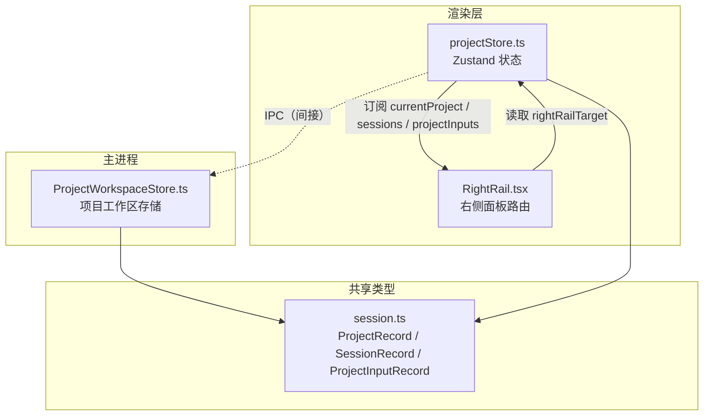
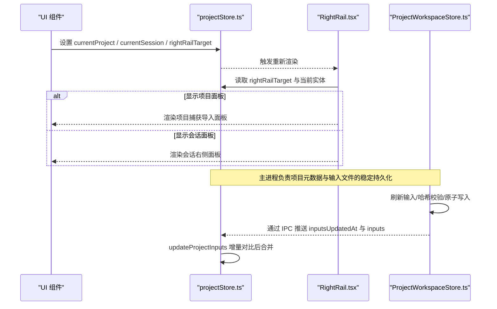
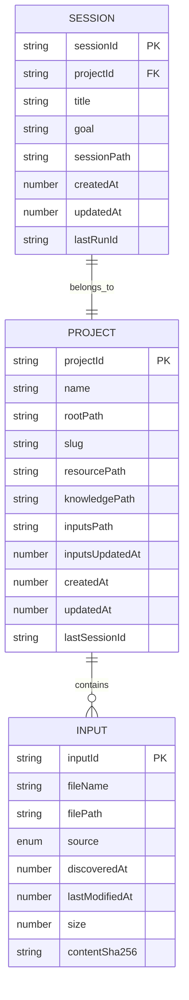
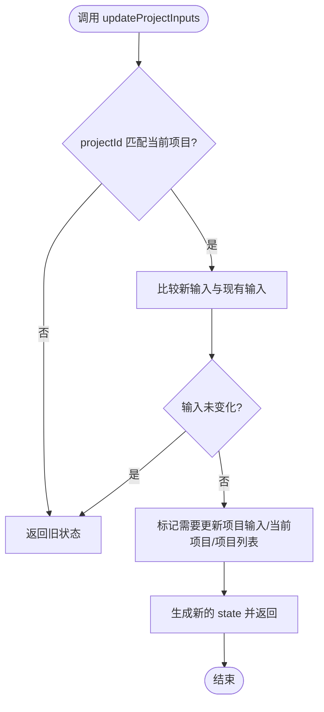
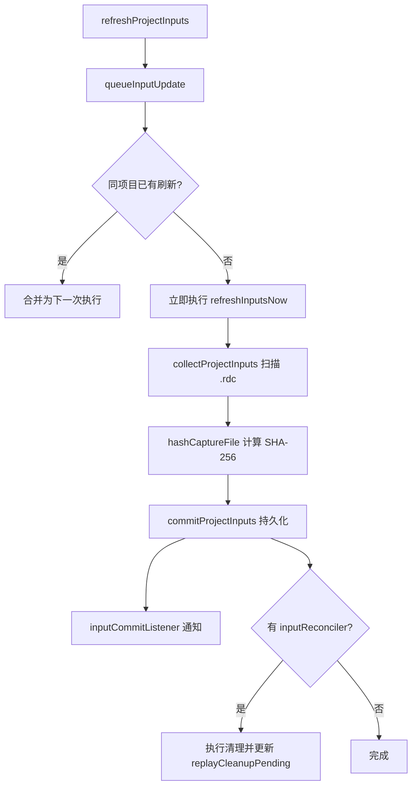
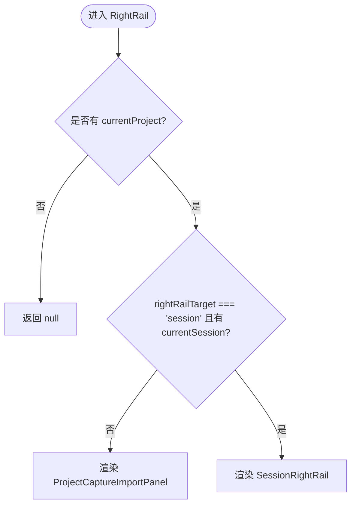
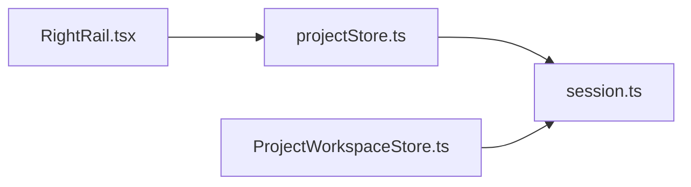

# 项目管理状态

<cite>
**本文引用的文件**   
- [projectStore.ts](file://src/renderer/stores/projectStore.ts)
- [ProjectWorkspaceStore.ts](file://src/main/sessions/ProjectWorkspaceStore.ts)
- [session.ts](file://src/shared/types/session.ts)
- [RightRail.tsx](file://src/renderer/features/right-rail/RightRail.tsx)
</cite>

## 目录
1. [引言](#引言)
2. [项目结构](#项目结构)
3. [核心组件](#核心组件)
4. [架构总览](#架构总览)
5. [详细组件分析](#详细组件分析)
6. [依赖关系分析](#依赖关系分析)
7. [性能考虑](#性能考虑)
8. [故障排查指南](#故障排查指南)
9. [结论](#结论)
10. [附录：API 与最佳实践](#附录api-与最佳实践)

## 引言
本文聚焦“项目管理状态”，系统性解释渲染端 `projectStore`、主进程 `ProjectWorkspaceStore`、共享类型 `ProjectRecord` 与 `SessionRecord`，以及右侧面板路由如何协同管理项目与会话的生命周期、输入文件管理、捕获文件集成、项目切换逻辑与数据一致性。目标是让非专业读者也能理解系统行为，同时为开发者提供可操作的实现参考。

## 项目结构
本项目采用前后端职责分离的架构：
- 渲染层使用 Zustand 维护轻量 UI 状态，包括当前项目、当前会话、右侧面板目标与项目输入列表。
- 主进程负责项目注册表、选择态、输入扫描、哈希计算、原子写入、并发控制与路径布局。
- 共享类型定义跨进程的数据契约，确保两端对项目和会话字段一致理解。

**图示来源**
- [projectStore.ts:1-97](file://src/renderer/stores/projectStore.ts#L1-L97)
- [RightRail.tsx:1-18](file://src/renderer/features/right-rail/RightRail.tsx#L1-L18)
- [ProjectWorkspaceStore.ts:1-200](file://src/main/sessions/ProjectWorkspaceStore.ts#L1-L200)
- [session.ts:1-200](file://src/shared/types/session.ts#L1-L200)

**章节来源**
- [projectStore.ts:1-97](file://src/renderer/stores/projectStore.ts#L1-L97)
- [RightRail.tsx:1-18](file://src/renderer/features/right-rail/RightRail.tsx#L1-L18)
- [ProjectWorkspaceStore.ts:1-200](file://src/main/sessions/ProjectWorkspaceStore.ts#L1-L200)
- [session.ts:1-200](file://src/shared/types/session.ts#L1-L200)

## 核心组件
- `projectStore`：渲染端项目状态中心，维护项目集合、会话集合、当前项目、当前会话、右侧面板目标与项目输入快照；提供增量更新能力。
- `ProjectWorkspaceStore`：主进程项目工作区服务，负责项目创建/删除/重命名、注册表与选择态持久化、输入扫描与哈希校验、外部引用管理、并发队列与锁。
- 共享类型：`ProjectRecord`、`SessionRecord`、`ProjectInputRecord` 等，定义项目与会话的数据模型及约束。
- 右侧面板路由：根据当前项目与会话决定展示“项目捕获导入”或“会话右侧面板”。

**章节来源**
- [projectStore.ts:1-97](file://src/renderer/stores/projectStore.ts#L1-L97)
- [ProjectWorkspaceStore.ts:1-605](file://src/main/sessions/ProjectWorkspaceStore.ts#L1-L605)
- [session.ts:1-200](file://src/shared/types/session.ts#L1-L200)
- [RightRail.tsx:1-18](file://src/renderer/features/right-rail/RightRail.tsx#L1-L18)

## 架构总览
下图展示了从用户操作到状态同步的关键流程：用户在渲染端触发项目或会话变更，`projectStore` 更新本地状态并驱动右侧面板；主进程在后台完成项目注册表、选择态与输入文件的原子更新，并通过事件机制将最新输入同步回渲染端。

**图示来源**
- [projectStore.ts:1-97](file://src/renderer/stores/projectStore.ts#L1-L97)
- [RightRail.tsx:1-18](file://src/renderer/features/right-rail/RightRail.tsx#L1-L18)
- [ProjectWorkspaceStore.ts:1-200](file://src/main/sessions/ProjectWorkspaceStore.ts#L1-L200)

## 详细组件分析

### 项目与会话数据结构
- `ProjectRecord`
  - 标识与路径：`projectId`、`rootPath`、`slug`、`resourcePath`、`knowledgePath`、`inputsPath`。
  - 输入集合：`inputs`、`inputsUpdatedAt`。
  - 回放清理标记：`replayCleanupPending`，用于记录待清理的捕获内容哈希与错误信息。
  - 时间戳：`createdAt`、`updatedAt`、可选 `lastSessionId`。
- `SessionRecord`
  - 标识与归属：`sessionId`、`projectId`。
  - 业务字段：`title`、`goal`、`sessionPath`、`createdAt`、`updatedAt`。
  - 运行上下文：`lastRunId`、`turnControls`、`modelOverride`、`agentId`。
- `ProjectInputRecord`
  - 身份与来源：`inputId`、`fileName`、`filePath`、`source`（`project_resource` 或 `external_reference`）。
  - 外部引用指纹：`referenceIdentity`，包含设备、inode、出生时间，但不授权父目录。
  - 生命周期与大小：`discoveredAt`、`lastModifiedAt`、`size`。
  - 内容校验：`contentSha256`，仅在原文件成功校验后存在。

**图示来源**
- [session.ts:1-200](file://src/shared/types/session.ts#L1-L200)

**章节来源**
- [session.ts:1-200](file://src/shared/types/session.ts#L1-L200)

### 渲染端项目状态 store
`projectStore` 暴露以下关键状态与方法：
- 状态
  - `projects`：项目清单。
  - `sessions`：会话清单。
  - `currentProject`：当前项目。
  - `currentSession`：当前会话。
  - `rightRailTarget`：右侧面板目标，取值 `'project' | 'session'`。
  - `projectInputs`：当前项目的输入快照。
- 方法
  - `setProjects` / `setSessions`：批量替换项目与会话清单。
  - `setCurrentProject` / `setCurrentSession`：切换当前项目或会话。
  - `setRightRailTarget`：切换右侧面板目标。
  - `setProjectInputs`：直接覆盖项目输入快照。
  - `updateProjectInputs(projectId, inputs)`：增量更新，比较新旧输入是否变化，决定是否更新 `projectInputs`、`currentProject.inputs` 与 `projects` 中的对应项。

输入相等性判断基于数组长度与逐项比较 `inputId`、`filePath`、`lastModifiedAt`、`size`，避免不必要的重渲染。

**图示来源**
- [projectStore.ts:1-97](file://src/renderer/stores/projectStore.ts#L1-L97)

**章节来源**
- [projectStore.ts:1-97](file://src/renderer/stores/projectStore.ts#L1-L97)

### 主进程项目工作区存储
`ProjectWorkspaceStore` 承担项目生命周期与输入管理的核心职责：
- 初始化与工作区路径
  - `initializeWorkspace`：确保数据根、项目根、全局知识库目录存在，恢复对话轮次提交。
  - `syncRuntimePaths`：同步运行时路径到 host 对象。
- 项目 CRUD
  - `createProject(rootPath)`：校验绝对路径与目录存在性，规范化路径，分配唯一 slug，收集初始输入，写入注册表与项目元数据，创建会话根目录，并设置为当前项目。
  - `renameProject(projectId, newName)`：更新名称与更新时间，重写项目元数据。
  - `removeProject(projectId)`：从注册表移除，删除项目数据目录，清理选择态。
  - `getProjectById` / `listProjects` / `touchProject`：查询与更新项目活跃度。
- 选择态管理
  - `getCurrentProjectId` / `setCurrentProjectId`：读写选择的项目 ID；当清空项目时清空会话选择；当保留会话时需校验会话仍属于该项目。
  - `getCurrentSessionId` / `setCurrentSessionId`：读写选择的会话 ID；设置会话时会同步其所属项目。
- 输入管理与增量刷新
  - `listProjectInputs` / `refreshProjectInputs`：对外暴露刷新接口，内部通过队列去抖与并发控制。
  - `queueInputUpdate`：同一项目的多次刷新请求会合并为一次最终执行，失败则跳过结果但仍清理缓存。
  - `collectProjectInputs`：安全遍历 `.rdc` 文件，限制最大深度与条目数，周期性让出线程；对符号链接拒绝；按文件名排序。
  - `commitProjectInputs`：写入归一化的项目记录，更新 `inputsUpdatedAt`，触发回调；若存在 `inputReconciler`，则在重试清理成功后清除 `replayCleanupPending`，否则记录错误。
  - 外部引用
    - `referenceProjectInput`：创建外部捕获引用，显式注册且不会因刷新静默接受字节变更。
    - `detachProjectInputReference`：仅移除引用，不触碰源文件。
- 持久化与并发
  - 注册表与选择态使用原子写入；注册表读写带目录级文件锁，防止竞态。
  - `normalizeProjectRecord`：规范化路径与默认字段，避免离线项目被误重建。

**图示来源**
- [ProjectWorkspaceStore.ts:1-200](file://src/main/sessions/ProjectWorkspaceStore.ts#L1-L200)
- [ProjectWorkspaceStore.ts:201-605](file://src/main/sessions/ProjectWorkspaceStore.ts#L201-L605)

**章节来源**
- [ProjectWorkspaceStore.ts:1-200](file://src/main/sessions/ProjectWorkspaceStore.ts#L1-L200)
- [ProjectWorkspaceStore.ts:201-605](file://src/main/sessions/ProjectWorkspaceStore.ts#L201-L605)

### 右侧面板路由与状态控制
`RightRail` 组件依据 `projectStore` 中的 `currentProject`、`currentSession` 与 `rightRailTarget` 决定渲染内容：
- 若无当前项目，则不渲染任何内容。
- 若 `rightRailTarget` 不是 `'session'` 或没有当前会话，则渲染“项目捕获导入面板”。
- 否则渲染“会话右侧面板”。

**图示来源**
- [RightRail.tsx:1-18](file://src/renderer/features/right-rail/RightRail.tsx#L1-L18)
- [projectStore.ts:1-97](file://src/renderer/stores/projectStore.ts#L1-L97)

**章节来源**
- [RightRail.tsx:1-18](file://src/renderer/features/right-rail/RightRail.tsx#L1-L18)
- [projectStore.ts:1-97](file://src/renderer/stores/projectStore.ts#L1-L97)

### 项目切换逻辑
项目切换由主进程的选择态管理保证一致性：
- 清空项目选择时，同时清空会话选择。
- 保留会话选择时，校验该会话仍存在且属于所选项目；否则清空会话选择。
- 设置会话选择时，自动回填其所属项目。

这保证了渲染端无论怎样切换，都不会出现会话与项目不一致的状态。

**章节来源**
- [ProjectWorkspaceStore.ts:1-200](file://src/main/sessions/ProjectWorkspaceStore.ts#L1-L200)

### 项目输入管理机制
- 文件监控与变更检测
  - 主进程在刷新输入时对每个 `.rdc` 文件进行安全路径校验与统计信息获取，并使用 `fingerprint`（设备号、inode、大小、修改时间、创建时间）与 SHA-256 双重校验，避免重复哈希计算。
  - 输入数组按文件名排序，保证稳定顺序。
- 增量更新
  - 渲染端通过 `areProjectInputsEqual` 比较新旧输入，仅在必要时更新 `projectInputs`、`currentProject.inputs` 与 `projects` 中对应项，减少重渲染。
- 外部引用
  - 支持外部捕获引用，引用具有精确设备与 inode 标识，但不会授权父目录；显式注册不会被刷新静默覆盖。

**章节来源**
- [ProjectWorkspaceStore.ts:201-605](file://src/main/sessions/ProjectWorkspaceStore.ts#L201-L605)
- [projectStore.ts:1-97](file://src/renderer/stores/projectStore.ts#L1-L97)
- [session.ts:1-200](file://src/shared/types/session.ts#L1-L200)

### 捕获文件管理集成
虽然 `captureStore` 的具体实现未在提供的文件中展示，但从类型与行为可以看出：
- `ProjectInputRecord` 支持 `external_reference`，表示捕获来自外部文件。
- 主进程提供 `referenceProjectInput` 与 `detachProjectInputReference`，分别用于添加与移除外部捕获引用。
- 渲染端 `RightRail` 在“项目模式”下展示捕获导入相关面板，提示用户导入或关联捕获文件。

**章节来源**
- [session.ts:1-200](file://src/shared/types/session.ts#L1-L200)
- [ProjectWorkspaceStore.ts:201-605](file://src/main/sessions/ProjectWorkspaceStore.ts#L201-L605)
- [RightRail.tsx:1-18](file://src/renderer/features/right-rail/RightRail.tsx#L1-L18)

## 依赖关系分析
- 渲染端 `projectStore` 依赖共享类型定义，确保 UI 状态与主进程数据模型一致。
- 主进程 `ProjectWorkspaceStore` 依赖文件系统、路径服务、哈希计算与原子写入工具。
- 右侧面板组件依赖 `projectStore` 暴露的 `currentProject`、`currentSession`、`rightRailTarget`。

**图示来源**
- [projectStore.ts:1-97](file://src/renderer/stores/projectStore.ts#L1-L97)
- [RightRail.tsx:1-18](file://src/renderer/features/right-rail/RightRail.tsx#L1-L18)
- [ProjectWorkspaceStore.ts:1-200](file://src/main/sessions/ProjectWorkspaceStore.ts#L1-L200)
- [session.ts:1-200](file://src/shared/types/session.ts#L1-L200)

**章节来源**
- [projectStore.ts:1-97](file://src/renderer/stores/projectStore.ts#L1-L97)
- [RightRail.tsx:1-18](file://src/renderer/features/right-rail/RightRail.tsx#L1-L18)
- [ProjectWorkspaceStore.ts:1-200](file://src/main/sessions/ProjectWorkspaceStore.ts#L1-L200)
- [session.ts:1-200](file://src/shared/types/session.ts#L1-L200)

## 性能考虑
- 输入扫描预算
  - 限制最大递归深度与最大条目数，避免超大工程导致卡顿。
  - 每处理固定数量条目后让出线程，降低阻塞风险。
- 哈希缓存
  - 使用 `verifiedInputs` 缓存已验证文件的 SHA-256，避免重复计算。
- 并发合并
  - `queueInputUpdate` 将同一项目的多次刷新合并为一次，提升吞吐。
- 原子写入与锁
  - 注册表与选择态使用原子写入与目录锁，保证多进程并发安全。

[本节为通用性能建议，无需具体文件分析]

## 故障排查指南
- 项目不存在
  - 现象：调用 `listProjectInputs`、`referenceProjectInput` 等方法时报错。
  - 检查：确认 `projectId` 是否存在于注册表。
- 输入预算超限
  - 现象：扫描输入时报 `PROJECT_INPUTS_BUDGET_EXCEEDED`。
  - 检查：工程内 `.rdc` 数量过多或递归过深，需清理无用捕获或调整工程结构。
- 不安全符号链接
  - 现象：扫描输入时报 `PROJECT_INPUTS_UNSAFE_LINK`。
  - 检查：移除或替换指向外部位置的符号链接。
- 选择态不一致
  - 现象：会话与项目不一致。
  - 检查：确认 `setCurrentProjectId` 与 `setCurrentSessionId` 的使用是否符合规则；主进程会自动校验会话归属。
- 右侧面板不显示
  - 现象：无内容或始终显示项目面板。
  - 检查：确认 `currentProject` 存在且 `rightRailTarget` 与 `currentSession` 设置正确。

**章节来源**
- [ProjectWorkspaceStore.ts:201-605](file://src/main/sessions/ProjectWorkspaceStore.ts#L201-L605)
- [projectStore.ts:1-97](file://src/renderer/stores/projectStore.ts#L1-L97)
- [RightRail.tsx:1-18](file://src/renderer/features/right-rail/RightRail.tsx#L1-L18)

## 结论
本方案通过清晰的职责划分与稳健的主进程存储策略，实现了项目与会话生命周期的可靠管理。渲染端的 `projectStore` 以最小状态驱动界面，主进程的 `ProjectWorkspaceStore` 保障数据一致性与并发安全，共享类型定义确保跨进程契约稳定。右侧面板路由根据当前上下文灵活切换，配合输入增量更新与捕获引用机制，为用户提供了直观且健壮的项目管理体验。

[本节为总结性内容，无需具体文件分析]

## 附录：API 与最佳实践

### 渲染端 API（projectStore）
- 状态字段
  - `projects`：项目清单。
  - `sessions`：会话清单。
  - `currentProject`：当前项目。
  - `currentSession`：当前会话。
  - `rightRailTarget`：右侧面板目标。
  - `projectInputs`：项目输入快照。
- 方法
  - `setProjects(projects)`
  - `setSessions(sessions)`
  - `setCurrentProject(project)`
  - `setCurrentSession(session)`
  - `setRightRailTarget(target)`
  - `setProjectInputs(inputs)`
  - `updateProjectInputs(projectId, inputs)`

最佳实践：
- 使用 `updateProjectInputs` 进行增量更新，避免整份替换导致不必要重渲染。
- 切换 `rightRailTarget` 时确保 `currentSession` 有效，以避免右侧面板异常。

**章节来源**
- [projectStore.ts:1-97](file://src/renderer/stores/projectStore.ts#L1-L97)

### 主进程 API（ProjectWorkspaceStore）
- 工作区
  - `initializeWorkspace()`
  - `getWorkspacePath()`
  - `getGlobalKnowledgePath()`
- 项目
  - `listProjects()`
  - `createProject(rootPath)`
  - `renameProject(projectId, newName)`
  - `removeProject(projectId)`
  - `getProjectById(projectId)`
  - `touchProject(projectId, lastSessionId?, updatedAt?)`
- 输入
  - `listProjectInputs(projectId)`
  - `refreshProjectInputs(projectId)`
  - `importProjectInputs(projectId, filePaths[])`
  - `referenceProjectInput(projectId, filePath)`
  - `detachProjectInputReference(projectId, inputId)`
- 选择态
  - `getCurrentProjectId()`
  - `setCurrentProjectId(projectId | null)`
  - `getCurrentSessionId()`
  - `setCurrentSessionId(sessionId | null)`

最佳实践：
- 刷新输入前确保项目根路径存在且安全。
- 外部引用应显式注册，避免刷新静默覆盖。
- 清理捕获内容时使用 `inputReconciler` 回调，确保失败时记录错误并保留清理请求。

**章节来源**
- [ProjectWorkspaceStore.ts:1-200](file://src/main/sessions/ProjectWorkspaceStore.ts#L1-L200)
- [ProjectWorkspaceStore.ts:201-605](file://src/main/sessions/ProjectWorkspaceStore.ts#L201-L605)

### 数据类型摘要
- `ProjectRecord`：项目元数据与输入集合。
- `SessionRecord`：会话业务数据与运行上下文。
- `ProjectInputRecord`：单个输入文件或外部引用描述。

最佳实践：
- 保持 `source` 字段准确，区分 `project_resource` 与 `external_reference`。
- 仅在内容校验成功后使用 `contentSha256`。

**章节来源**
- [session.ts:1-200](file://src/shared/types/session.ts#L1-L200)