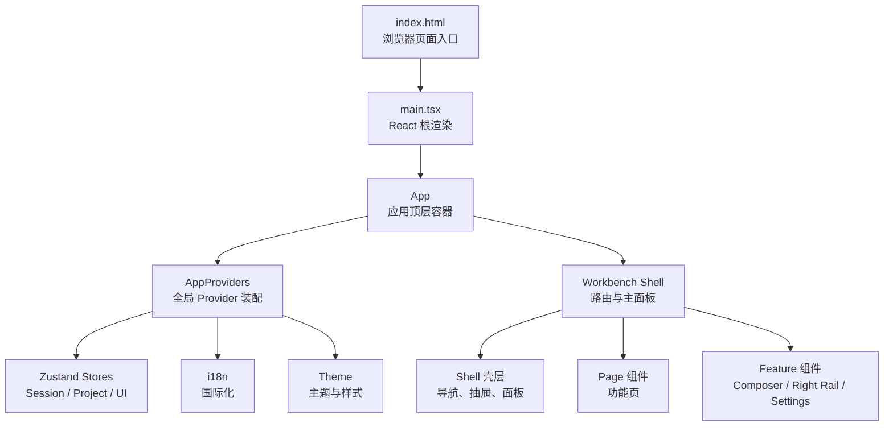
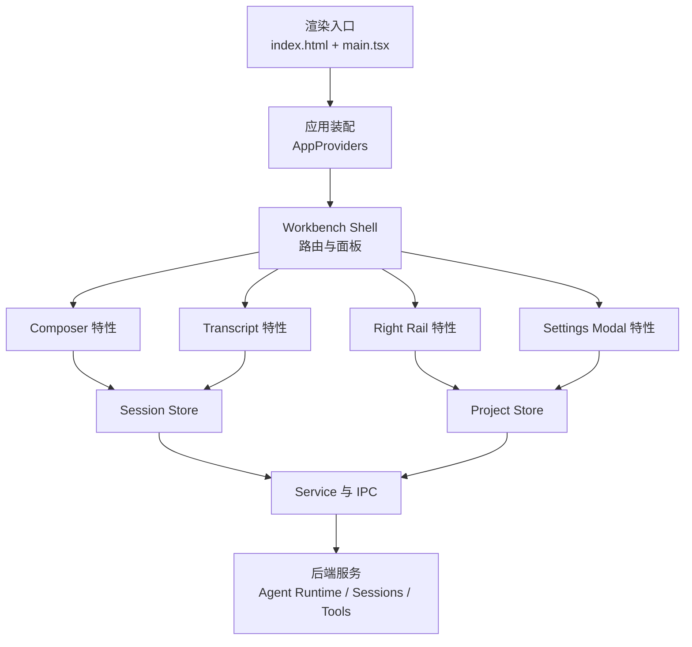
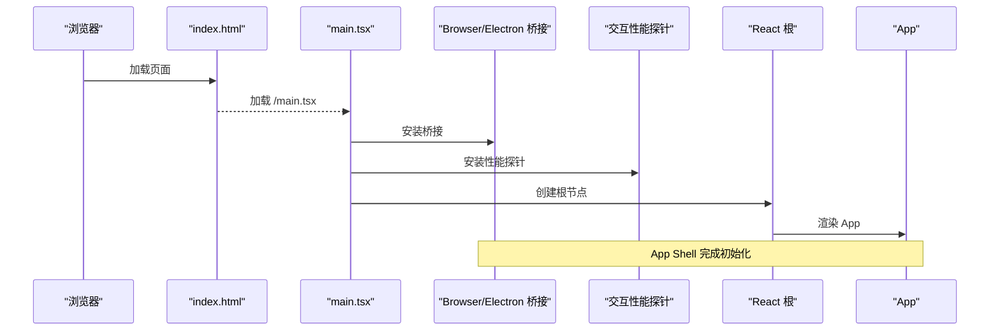
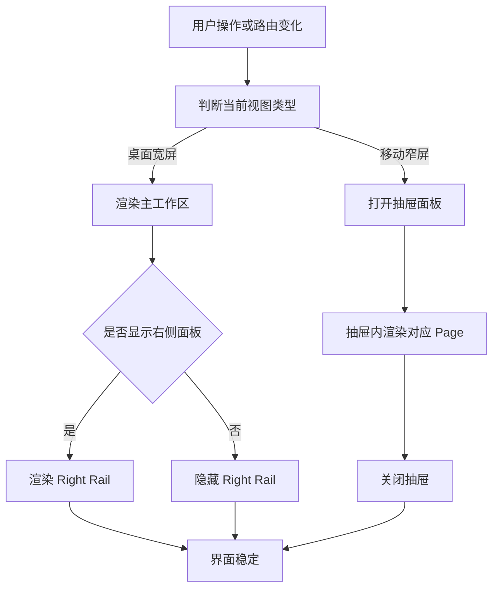
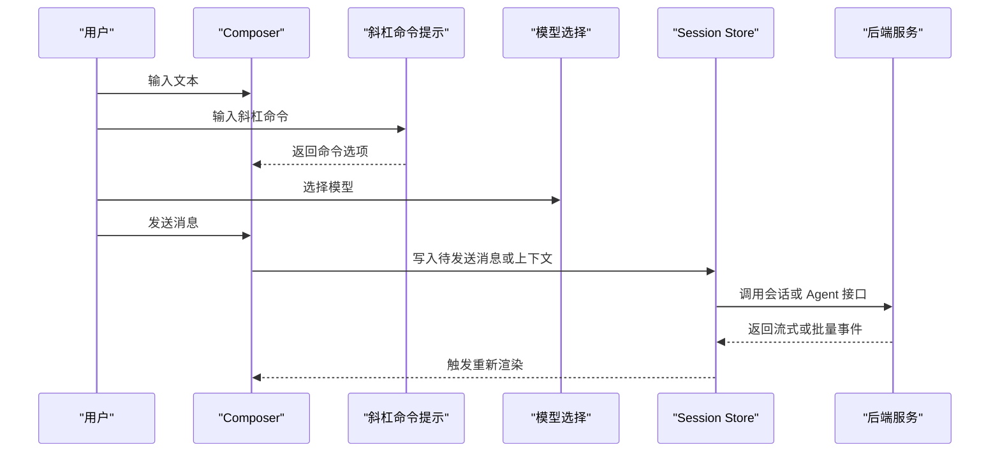
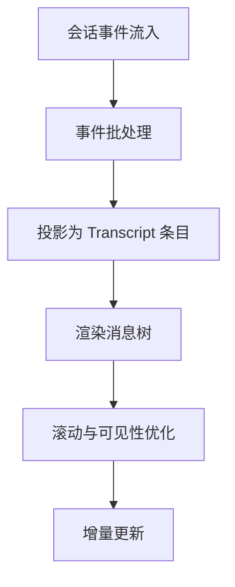
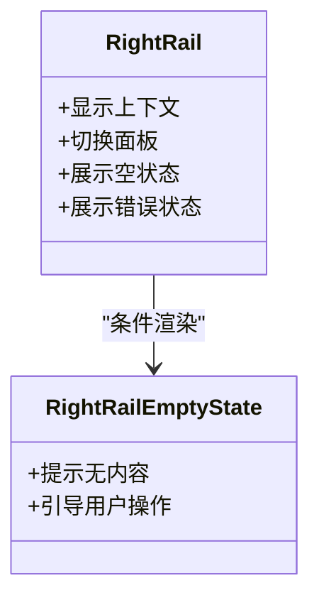
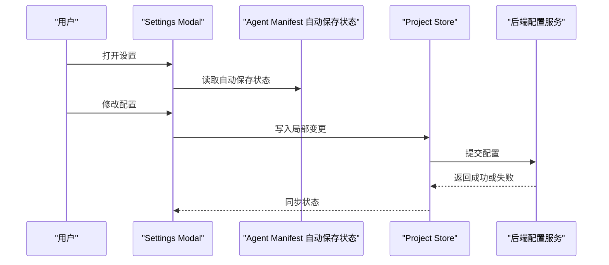
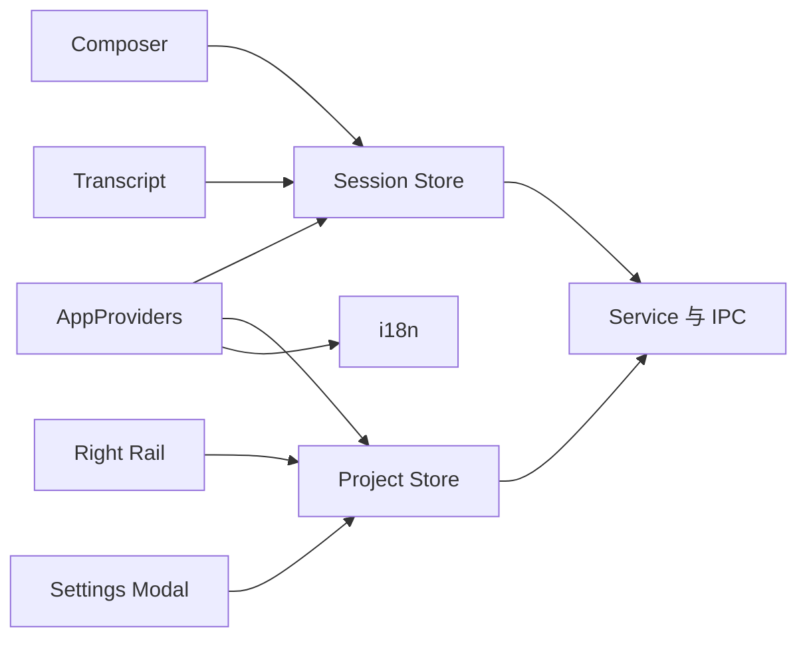
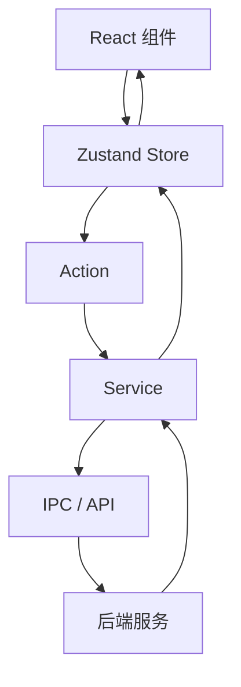

# 用户界面

<cite>
**本文引用的文件**   
- [src/renderer/main.tsx](file://src/renderer/main.tsx)
- [src/renderer/index.html](file://src/renderer/index.html)
- [src/renderer/app/AppProviders.tsx](file://src/renderer/app/AppProviders.tsx)
- [src/renderer/app/useNarrowViewport.ts](file://src/renderer/app/useNarrowViewport.ts)
- [src/renderer/app/usePanelDrawer.ts](file://src/renderer/app/usePanelDrawer.ts)
- [src/renderer/app/WorkbenchPanelDrawer.tsx](file://src/renderer/app/WorkbenchPanelDrawer.tsx)
- [src/renderer/app/bootstrap/conversationEventBatcher.ts](file://src/renderer/app/bootstrap/conversationEventBatcher.ts)
- [src/renderer/features/composer/ComposerMarkdownModeTabs.tsx](file://src/renderer/features/composer/ComposerMarkdownModeTabs.tsx)
- [src/renderer/features/composer/SlashCommandPopover.tsx](file://src/renderer/features/composer/SlashCommandPopover.tsx)
- [src/renderer/features/right-rail/RightRailEmptyState.tsx](file://src/renderer/features/right-rail/RightRailEmptyState.tsx)
- [src/renderer/features/settings/SettingsModal/agentManifestAutosaveState.ts](file://src/renderer/features/settings/SettingsModal/agentManifestAutosaveState.ts)
- [src/renderer/i18n.ts](file://src/renderer/i18n.ts)
</cite>

## 目录

1. [简介](#简介)
2. [项目结构](#项目结构)
3. [核心组件](#核心组件)
4. [架构总览](#架构总览)
5. [详细组件分析](#详细组件分析)
6. [依赖分析](#依赖分析)
7. [性能考虑](#性能考虑)
8. [故障排查指南](#故障排查指南)
9. [结论](#结论)

## 简介

本文件聚焦于 Workbench 的用户界面层，目标是帮助读者快速理解：

- App Shell 的启动与渲染流程。
- Workbench Shell 的路由与面板组织方式。
- Page 组件的组织策略。
- 核心 UI 组件的职责与交互模式，包括 Composer、Transcript、Right Rail、Settings Modal。
- Zustand store 在 Session Store 与 Project Store 中的状态管理模式。
- 响应式布局、可访问性与国际化支持。
- 样式定制方法。
- UI 与后端服务的通信方式以及实时数据更新机制。

## 项目结构

Workbench 的前端基于 Electron + Vite + React 构建，入口位于 `src/renderer`：

**图表来源**
- [src/renderer/index.html:1-18](file://src/renderer/index.html#L1-L18)
- [src/renderer/main.tsx:1-15](file://src/renderer/main.tsx#L1-L15)

### 关键入口

| 文件 | 职责 |
| --- | --- |
| `src/renderer/index.html` | 提供 `
`、基础 CSP、移动端视口设置，并加载 `/main.tsx`。 |
| `src/renderer/main.tsx` | 安装 Browser/Electron API 桥接、交互性能探针，挂载 React 根节点并渲染 `App`。 |
| `src/renderer/app/AppProviders.tsx` | 集中注册 i18n、Store、主题等全局上下文 Provider。 |

**章节来源**
- [src/renderer/index.html:1-18](file://src/renderer/index.html#L1-L18)
- [src/renderer/main.tsx:1-15](file://src/renderer/main.tsx#L1-L15)

## 核心组件

本节从“工作区视角”说明 Workbench 的核心 UI 单元。

| 组件 | 主要职责 | 典型交互 |
| --- | --- | --- |
| App Shell | 初始化运行时、装配全局能力、承载 Workbench Shell。 | 首次加载时完成桥接、性能探针、全局样式注入。 |
| Workbench Shell | 管理主区域路由、右侧面板、抽屉式窄屏布局。 | 切换会话、打开/关闭右侧面板、移动端滑出侧栏。 |
| Page 组件 | 按业务场景组织页面，如会话页、知识中心、设置页。 | 通过路由或事件进入；内部组合 Feature 组件。 |
| Composer | 用户输入、模型选择、技能标签、附件、命令提示。 | 发送消息、切换 Markdown 模式、选择模型、触发斜杠命令。 |
| Transcript | 展示对话流、工具执行结果、任务与计划状态。 | 滚动、展开折叠、查看工具输出、定位错误。 |
| Right Rail | 展示上下文、记忆、捕获回放、工件与指标。 | 切换面板、查看详细信息、回放设备捕获。 |
| Settings Modal | 配置 Agent、Provider、行为开关与自动保存。 | 打开设置弹窗、修改配置、确认变更。 |

这些组件大多位于 `src/renderer/features` 下的功能域中，并通过 `stores` 和 `services` 与状态及后端通信解耦。

**章节来源**
- [src/renderer/app/AppProviders.tsx](file://src/renderer/app/AppProviders.tsx)
- [src/renderer/features/composer/ComposerMarkdownModeTabs.tsx](file://src/renderer/features/composer/ComposerMarkdownModeTabs.tsx)
- [src/renderer/features/composer/SlashCommandPopover.tsx](file://src/renderer/features/composer/SlashCommandPopover.tsx)
- [src/renderer/features/right-rail/RightRailEmptyState.tsx](file://src/renderer/features/right-rail/RightRailEmptyState.tsx)
- [src/renderer/features/settings/SettingsModal/agentManifestAutosaveState.ts](file://src/renderer/features/settings/SettingsModal/agentManifestAutosaveState.ts)

## 架构总览

Workbench 的 UI 架构采用分层设计：

1. **渲染入口层**：HTML 与 React 根挂载。
2. **应用装配层**：Provider 统一装配 i18n、Store、主题、平台能力。
3. **Shell 与路由层**：Workbench Shell 负责页面路由、主面板与侧边面板协调。
4. **功能特性层**：Composer、Transcript、Right Rail、Settings Modal 等以 Feature 为单位组织。
5. **状态层**：Zustand Store 管理 Session、Project、UI 等跨组件状态。
6. **服务与通信层**：IPC、Browser/Electron API、Agent Trace、Session Service 等。
7. **主题与样式层**：Design Token、CSS、动态样式。

**图表来源**
- [src/renderer/main.tsx:1-15](file://src/renderer/main.tsx#L1-L15)
- [src/renderer/app/AppProviders.tsx](file://src/renderer/app/AppProviders.tsx)

## 详细组件分析

### App Shell 与渲染流程

App Shell 的职责是完成前端运行时的最小可用初始化：

- 安装 Browser/Electron API 桥接。
- 安装交互性能探针。
- 注入全局样式。
- 在严格模式下渲染 `App`。

**图表来源**
- [src/renderer/index.html:1-18](file://src/renderer/index.html#L1-L18)
- [src/renderer/main.tsx:1-15](file://src/renderer/main.tsx#L1-L15)

**章节来源**
- [src/renderer/index.html:1-18](file://src/renderer/index.html#L1-L18)
- [src/renderer/main.tsx:1-15](file://src/renderer/main.tsx#L1-L15)

### Workbench Shell 与路由管理

Workbench Shell 通常承担以下职责：

- 根据当前会话、项目或功能标识决定渲染哪个 Page。
- 控制右侧面板的显示、隐藏与内容切换。
- 在窄屏设备上使用抽屉式面板替代固定侧栏。
- 将路由变化与 Store 状态同步，避免视图与状态不一致。

虽然具体路由实现文件未在本仓库快照中直接暴露路径，但从现有文件可以看出 Shell 与面板、抽屉、窄屏适配之间存在明确协作关系。

**图表来源**
- [src/renderer/app/useNarrowViewport.ts](file://src/renderer/app/useNarrowViewport.ts)
- [src/renderer/app/usePanelDrawer.ts](file://src/renderer/app/usePanelDrawer.ts)
- [src/renderer/app/WorkbenchPanelDrawer.tsx](file://src/renderer/app/WorkbenchPanelDrawer.tsx)

**章节来源**
- [src/renderer/app/useNarrowViewport.ts](file://src/renderer/app/useNarrowViewport.ts)
- [src/renderer/app/usePanelDrawer.ts](file://src/renderer/app/usePanelDrawer.ts)
- [src/renderer/app/WorkbenchPanelDrawer.tsx](file://src/renderer/app/WorkbenchPanelDrawer.tsx)

### Page 组件的组织方式

Page 组件应按“领域优先”组织，例如：

- 会话相关 Page 放在会话或 transcript 相关目录。
- 设置相关 Page 放在 settings 或 configuration 相关目录。
- 知识中心 Page 放在 knowledge 相关目录。
- 每个 Page 只负责页面级布局与数据装配，具体交互下沉到 Feature 组件。

推荐组织原则：

| 层级 | 建议 |
| --- | --- |
| Page | 路由映射、页面容器、布局拼装。 |
| Feature | 复杂交互逻辑、表单、弹出层、本地状态。 |
| Component | 可复用 UI 元素，如按钮、卡片、列表项。 |
| Hook | 跨组件共享逻辑，如窗口尺寸、抽屉状态、模型选择。 |
| Store | 跨页面持久化或共享状态。 |

这种分层能降低耦合度，方便测试与样式定制。

### Composer 组件

Composer 是用户发起 AI 任务的入口，常见职责包括：

- 接收用户输入。
- 处理 Markdown 编辑模式。
- 选择模型、技能、上下文。
- 显示斜杠命令提示。
- 提交消息后与 Session Store 或后端服务通信。

**图表来源**
- [src/renderer/features/composer/ComposerMarkdownModeTabs.tsx](file://src/renderer/features/composer/ComposerMarkdownModeTabs.tsx)
- [src/renderer/features/composer/SlashCommandPopover.tsx](file://src/renderer/features/composer/SlashCommandPopover.tsx)

**章节来源**
- [src/renderer/features/composer/ComposerMarkdownModeTabs.tsx](file://src/renderer/features/composer/ComposerMarkdownModeTabs.tsx)
- [src/renderer/features/composer/SlashCommandPopover.tsx](file://src/renderer/features/composer/SlashCommandPopover.tsx)

### Transcript 组件

Transcript 负责展示对话历史、工具执行过程、任务与计划状态。它通常需要：

- 高效渲染大量消息条目。
- 支持滚动定位与自动滚动。
- 渲染工具结果、代码块、错误信息。
- 与 Session Store 保持最新状态。

**图表来源**
- [src/renderer/app/bootstrap/conversationEventBatcher.ts](file://src/renderer/app/bootstrap/conversationEventBatcher.ts)

**章节来源**
- [src/renderer/app/bootstrap/conversationEventBatcher.ts](file://src/renderer/app/bootstrap/conversationEventBatcher.ts)

### Right Rail 组件

Right Rail 用于展示与工作区相关的辅助信息，例如：

- 会话上下文。
- 任务上下文资源。
- 捕获回放。
- 记忆与工件。
- 空状态与错误状态。

当没有有效上下文时，应显示友好的空状态。

**图表来源**
- [src/renderer/features/right-rail/RightRailEmptyState.tsx](file://src/renderer/features/right-rail/RightRailEmptyState.tsx)

**章节来源**
- [src/renderer/features/right-rail/RightRailEmptyState.tsx](file://src/renderer/features/right-rail/RightRailEmptyState.tsx)

### Settings Modal 组件

Settings Modal 是用户配置 Agent、Provider、行为开关的地方。其关键关注点包括：

- 表单校验与变更追踪。
- 自动保存与撤销。
- 与 Project Store 或后端配置的同步。
- 可访问性：焦点管理、键盘导航、ARIA 属性。

**图表来源**
- [src/renderer/features/settings/SettingsModal/agentManifestAutosaveState.ts](file://src/renderer/features/settings/SettingsModal/agentManifestAutosaveState.ts)

**章节来源**
- [src/renderer/features/settings/SettingsModal/agentManifestAutosaveState.ts](file://src/renderer/features/settings/SettingsModal/agentManifestAutosaveState.ts)

## 依赖分析

### 组件依赖关系

**图表来源**
- [src/renderer/app/AppProviders.tsx](file://src/renderer/app/AppProviders.tsx)
- [src/renderer/features/composer/ComposerMarkdownModeTabs.tsx](file://src/renderer/features/composer/ComposerMarkdownModeTabs.tsx)
- [src/renderer/features/right-rail/RightRailEmptyState.tsx](file://src/renderer/features/right-rail/RightRailEmptyState.tsx)
- [src/renderer/features/settings/SettingsModal/agentManifestAutosaveState.ts](file://src/renderer/features/settings/SettingsModal/agentManifestAutosaveState.ts)

### Store 依赖与服务

Zustand Store 不应直接耦合 DOM 或第三方 UI 库，而应通过 Action 与 Selector 暴露状态与变更能力。Service 层负责与 IPC、后端 API、WebSocket 或 Event Stream 通信。

推荐边界：

- Store：状态定义、Action、Selector。
- Service：网络请求、IPC 调用、事件订阅。
- Component：订阅 Store、调用 Action、渲染 UI。

[此图为概念图，不直接映射具体源文件]

## 性能考虑

针对 Workbench 这类长时间运行的交互式界面，性能优化应重点关注：

| 方面 | 建议 |
| --- | --- |
| 消息渲染 | 对 Transcript 使用虚拟滚动、增量更新、批处理事件。 |
| 大对象状态 | 使用不可变更新、浅比较、按需选择器。 |
| 长连接 | 合理断开重连、节流日志、限制内存占用。 |
| 动画与过渡 | 减少强制回流，优先使用 CSS transform 与 opacity。 |
| 首屏加载 | 拆分路由与 Feature 模块，延迟加载重型弹窗。 |
| 可访问性 | 确保键盘导航、焦点顺序、屏幕阅读器语义正确。 |

**章节来源**
- [src/renderer/app/bootstrap/conversationEventBatcher.ts](file://src/renderer/app/bootstrap/conversationEventBatcher.ts)

## 故障排查指南

### 常见问题

| 现象 | 可能原因 | 排查步骤 |
| --- | --- | --- |
| Composer 发送无响应 | Store 未更新或 Service 调用失败 | 检查 Store Action、IPC 通道、后端响应。 |
| Transcript 卡顿 | 消息过多或未批处理 | 检查事件批处理、虚拟滚动、渲染数量。 |
| Right Rail 空白 | 上下文未加载或为空 | 检查上下文状态、空状态渲染、数据来源。 |
| Settings Modal 无法保存 | 自动保存状态或权限不足 | 检查自动保存状态、配置提交、权限校验。 |
| 移动端布局错乱 | 窄屏判断或抽屉状态异常 | 检查 `useNarrowViewport`、`usePanelDrawer`、抽屉内容。 |

### 调试建议

- 在 Store 层打印关键 Action 与 Selector 变化。
- 在服务层记录 IPC 请求与响应。
- 在 UI 层添加轻量日志，避免高频渲染中输出过多日志。
- 使用浏览器开发者工具检查 CSP、网络请求与内存占用。
- 对可访问性问题，优先使用键盘操作和屏幕阅读器验证。

**章节来源**
- [src/renderer/index.html:1-18](file://src/renderer/index.html#L1-L18)
- [src/renderer/app/useNarrowViewport.ts](file://src/renderer/app/useNarrowViewport.ts)
- [src/renderer/app/usePanelDrawer.ts](file://src/renderer/app/usePanelDrawer.ts)

## 结论

Workbench 的用户界面以 App Shell 为起点，通过 AppProviders 装配全局能力，再由 Workbench Shell 组织路由与面板。核心功能以 Feature 形式拆分，Composer、Transcript、Right Rail、Settings Modal 分别承担输入、对话、上下文与配置职责。Zustand Store 作为状态中枢，结合 Service 与 IPC 实现前后端通信。响应式布局、可访问性与国际化则贯穿整个界面层，保障不同设备、语言与无障碍需求下的可用性。

在实际扩展中，应优先遵循“Page 装配、Feature 封装、Store 抽象、Service 解耦”的原则，使界面具备可维护性、可测试性和可扩展性。