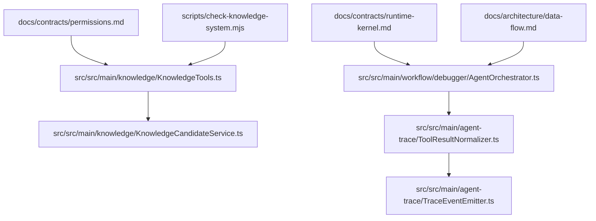
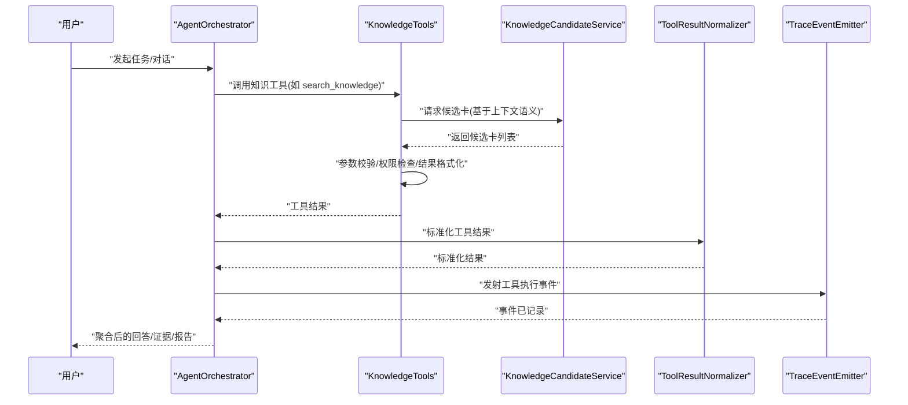
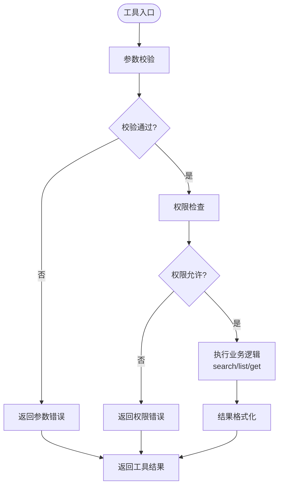
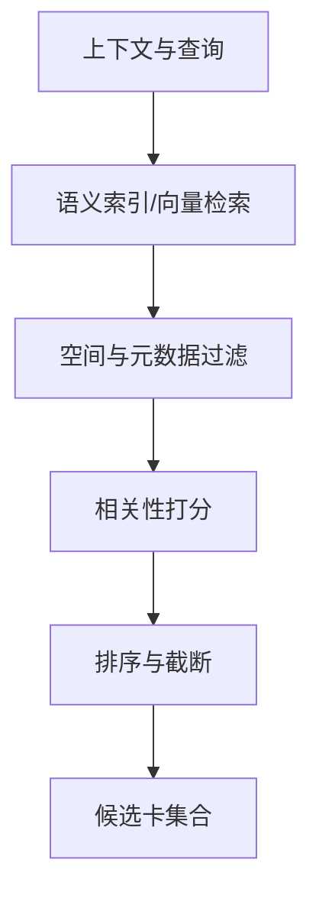
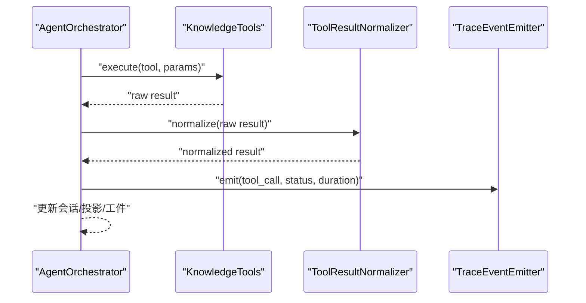
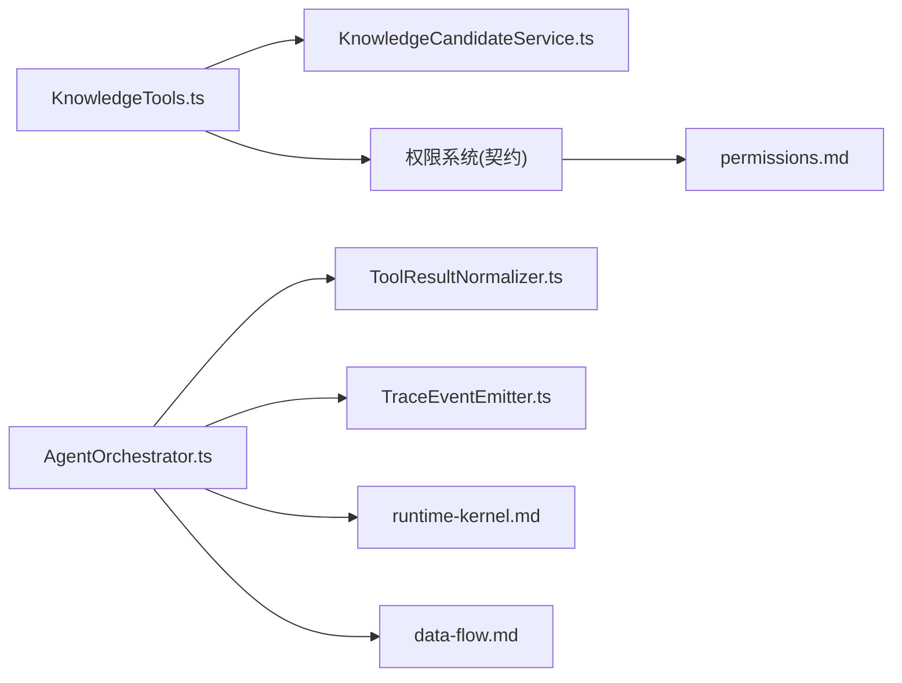

# Agent 工具集成

<cite>
**本文引用的文件**   
- [KnowledgeTools.ts](file://src/src/main/knowledge/KnowledgeTools.ts)
- [KnowledgeCandidateService.ts](file://src/src/main/knowledge/KnowledgeCandidateService.ts)
- [AgentOrchestrator.ts](file://src/src/main/workflow/debugger/AgentOrchestrator.ts)
- [knowledgeServices.test.ts](file://src/src/main/knowledge/knowledgeServices.test.ts)
- [check-knowledge-system.mjs](file://scripts/check-knowledge-system.mjs)
- [ToolResultNormalizer.ts](file://src/src/main/agent-trace/ToolResultNormalizer.ts)
- [TraceEventEmitter.ts](file://src/src/main/agent-trace/TraceEventEmitter.ts)
- [permissions.md](file://docs/contracts/permissions.md)
- [runtime-kernel.md](file://docs/contracts/runtime-kernel.md)
- [data-flow.md](file://docs/architecture/data-flow.md)
- [overview.md](file://docs/architecture/overview.md)
</cite>

## 目录
1. [引言](#引言)
2. [项目结构](#项目结构)
3. [核心组件](#核心组件)
4. [架构总览](#架构总览)
5. [详细组件分析](#详细组件分析)
6. [依赖关系分析](#依赖关系分析)
7. [性能与扩展性](#性能与扩展性)
8. [故障排查指南](#故障排查指南)
9. [结论](#结论)
10. [附录：对话示例与最佳实践](#附录对话示例与最佳实践)

## 引言
本文面向需要理解“知识能力如何暴露给 Agent 运行时”的工程师与维护者。重点说明以下目标：
- KnowledgeTools 如何将知识检索、空间浏览、卡片详情等能力封装为 Agent 工具，并完成参数校验、权限控制与结果格式化。
- KnowledgeCandidateService 的候选卡推荐机制，包括基于上下文语义的相关性判断逻辑。
- knowledge 工具的权限模型、输入验证规则与错误处理策略。
- 与 AgentOrchestrator 的集成方式、tool result 生命周期、以及 trace 事件如何承载工具执行结果。
- 实际的 Agent 对话使用范式：问题解答、证据查找、报告生成。
- 工具扩展与自定义实现指南。

本文件以代码级引用为依据，同时提供概念性图示，帮助不同技术背景的读者建立统一心智模型。

## 项目结构
围绕知识工具与 Agent 运行时的关键路径如下：
- src/src/main/knowledge：知识工具与候选服务实现。
- src/src/main/workflow/debugger：Agent 编排器与回合执行流程。
- src/src/main/agent-trace：工具结果归一化与追踪事件发射。
- docs/contracts 与 docs/architecture：权限契约、运行时内核、数据流与总体架构文档。
- scripts/check-knowledge-system.mjs：知识系统一致性检查脚本。

**图表来源**
- [KnowledgeTools.ts](file://src/src/main/knowledge/KnowledgeTools.ts)
- [KnowledgeCandidateService.ts](file://src/src/main/knowledge/KnowledgeCandidateService.ts)
- [AgentOrchestrator.ts](file://src/src/main/workflow/debugger/AgentOrchestrator.ts)
- [ToolResultNormalizer.ts](file://src/src/main/agent-trace/ToolResultNormalizer.ts)
- [TraceEventEmitter.ts](file://src/src/main/agent-trace/TraceEventEmitter.ts)
- [permissions.md](file://docs/contracts/permissions.md)
- [runtime-kernel.md](file://docs/contracts/runtime-kernel.md)
- [data-flow.md](file://docs/architecture/data-flow.md)
- [check-knowledge-system.mjs](file://scripts/check-knowledge-system.mjs)

**章节来源**
- [overview.md](file://docs/architecture/overview.md)
- [data-flow.md](file://docs/architecture/data-flow.md)

## 核心组件
- KnowledgeTools：将知识能力暴露为 Agent 可调用工具，包含 search_knowledge、list_spaces、get_card_detail 等工具定义、参数校验、权限检查与结果格式化。
- KnowledgeCandidateService：负责根据上下文语义召回候选知识卡，进行相关性排序与筛选，供工具或上层决策使用。
- AgentOrchestrator：Agent 编排器，协调工具调用、轮次推进、tool result 生命周期管理与追踪上报。
- ToolResultNormalizer：对工具返回结果做标准化，便于 UI 展示与审计。
- TraceEventEmitter：发射工具执行相关追踪事件，形成可观测链路。

**章节来源**
- [KnowledgeTools.ts](file://src/src/main/knowledge/KnowledgeTools.ts)
- [KnowledgeCandidateService.ts](file://src/src/main/knowledge/KnowledgeCandidateService.ts)
- [AgentOrchestrator.ts](file://src/src/main/workflow/debugger/AgentOrchestrator.ts)
- [ToolResultNormalizer.ts](file://src/src/main/agent-trace/ToolResultNormalizer.ts)
- [TraceEventEmitter.ts](file://src/src/main/agent-trace/TraceEventEmitter.ts)

## 架构总览
下图展示知识工具在 Agent 系统中的调用链路与结果流转：

**图表来源**
- [AgentOrchestrator.ts](file://src/src/main/workflow/debugger/AgentOrchestrator.ts)
- [KnowledgeTools.ts](file://src/src/main/knowledge/KnowledgeTools.ts)
- [KnowledgeCandidateService.ts](file://src/src/main/knowledge/KnowledgeCandidateService.ts)
- [ToolResultNormalizer.ts](file://src/src/main/agent-trace/ToolResultNormalizer.ts)
- [TraceEventEmitter.ts](file://src/src/main/agent-trace/TraceEventEmitter.ts)

## 详细组件分析

### KnowledgeTools：知识工具定义与执行
- 工具集覆盖：
  - search_knowledge：按关键词/条件检索知识内容。
  - list_spaces：列出知识空间，支持分页或过滤。
  - get_card_detail：获取指定知识卡的详细信息。
- 参数校验：
  - 对必需字段（如 query、spaceId、cardId）进行存在性与类型检查。
  - 对可选参数（如分页大小、排序方式）进行范围与枚举校验。
- 权限控制：
  - 依据权限模型检查当前 Agent 是否具备读取知识空间的权限。
  - 未授权时直接拒绝并返回结构化错误。
- 结果格式化：
  - 将原始知识数据转换为统一的结构体，包含摘要、来源、时间戳、关联标签等。
  - 对敏感字段进行脱敏处理，确保输出安全。
- 错误处理：
  - 区分参数错误、权限错误、服务不可用等场景，返回一致的失败协议。
  - 保留最小必要诊断信息，避免泄露内部细节。

**图表来源**
- [KnowledgeTools.ts](file://src/src/main/knowledge/KnowledgeTools.ts)
- [permissions.md](file://docs/contracts/permissions.md)

**章节来源**
- [KnowledgeTools.ts](file://src/src/main/knowledge/KnowledgeTools.ts)
- [permissions.md](file://docs/contracts/permissions.md)

### KnowledgeCandidateService：候选卡推荐机制
- 输入：
  - 当前对话上下文（包括最近消息、计划、工具历史）。
  - 查询意图与约束（如时间范围、来源类型）。
- 召回策略：
  - 基于文本嵌入或语义索引进行相似度匹配。
  - 结合空间元数据进行二次过滤（如只读空间、公开空间）。
- 相关性评分：
  - 综合语义相似度、时效性、来源可信度、用户偏好等因素计算得分。
  - 支持阈值截断与 Top-N 截断，保证结果可控。
- 输出：
  - 候选卡列表，附带分数、来源、摘要、链接等信息。
  - 可被 KnowledgeTools 消费或直接用于提示词增强。

**图表来源**
- [KnowledgeCandidateService.ts](file://src/src/main/knowledge/KnowledgeCandidateService.ts)

**章节来源**
- [KnowledgeCandidateService.ts](file://src/src/main/knowledge/KnowledgeCandidateService.ts)

### AgentOrchestrator：与知识工具的集成与 tool result 生命周期
- 工具调度：
  - 解析 Agent 决策的工具调用请求，路由到对应工具实现。
  - 维护调用上下文，包括会话状态、权限上下文与资源引用。
- tool result 生命周期：
  - 接收工具返回值，交由 ToolResultNormalizer 标准化。
  - 将标准化结果写入会话投影与右栏工件，供 UI 渲染与审计。
  - 通过 TraceEventEmitter 发射工具执行事件，记录开始、完成、失败与耗时。
- 错误恢复：
  - 对可重试错误进行有限重试与退避。
  - 对不可恢复错误降级为友好提示，继续推进对话流程。

**图表来源**
- [AgentOrchestrator.ts](file://src/src/main/workflow/debugger/AgentOrchestrator.ts)
- [ToolResultNormalizer.ts](file://src/src/main/agent-trace/ToolResultNormalizer.ts)
- [TraceEventEmitter.ts](file://src/src/main/agent-trace/TraceEventEmitter.ts)

**章节来源**
- [AgentOrchestrator.ts](file://src/src/main/workflow/debugger/AgentOrchestrator.ts)
- [runtime-kernel.md](file://docs/contracts/runtime-kernel.md)
- [ToolResultNormalizer.ts](file://src/src/main/agent-trace/ToolResultNormalizer.ts)
- [TraceEventEmitter.ts](file://src/src/main/agent-trace/TraceEventEmitter.ts)

### 权限控制与输入验证
- 权限模型：
  - 基于能力的细粒度权限，例如 knowledge.read、knowledge.list、knowledge.detail。
  - 权限检查发生在工具入口处，确保非法调用尽早失败。
- 输入验证：
  - 强类型校验与业务规则校验双重保障。
  - 对恶意或异常输入进行防御性处理，避免污染下游索引与服务。
- 结果格式：
  - 统一返回结构，包含 data、error、meta 字段。
  - 对大对象进行分页或摘要，避免阻塞 Agent 主流程。

**章节来源**
- [permissions.md](file://docs/contracts/permissions.md)
- [KnowledgeTools.ts](file://src/src/main/knowledge/KnowledgeTools.ts)

### 测试与一致性检查
- knowledgeServices.test.ts：覆盖知识工具与服务的常见用例与边界情况。
- check-knowledge-system.mjs：校验知识系统配置、工具清单与权限契约的一致性。

**章节来源**
- [knowledgeServices.test.ts](file://src/src/main/knowledge/knowledgeServices.test.ts)
- [check-knowledge-system.mjs](file://scripts/check-knowledge-system.mjs)

## 依赖关系分析
- KnowledgeTools 依赖：
  - KnowledgeCandidateService：用于候选卡召回。
  - 权限系统：用于访问控制。
  - 结果格式化模块：用于统一输出。
- AgentOrchestrator 依赖：
  - 工具注册表：动态发现与调用工具。
  - ToolResultNormalizer：统一结果结构。
  - TraceEventEmitter：可观测性。
- 外部契约：
  - permissions.md：权限模型与能力清单。
  - runtime-kernel.md：运行时内核与工具协议。
  - data-flow.md：端到端数据流规范。

**图表来源**
- [KnowledgeTools.ts](file://src/src/main/knowledge/KnowledgeTools.ts)
- [KnowledgeCandidateService.ts](file://src/src/main/knowledge/KnowledgeCandidateService.ts)
- [AgentOrchestrator.ts](file://src/src/main/workflow/debugger/AgentOrchestrator.ts)
- [ToolResultNormalizer.ts](file://src/src/main/agent-trace/ToolResultNormalizer.ts)
- [TraceEventEmitter.ts](file://src/src/main/agent-trace/TraceEventEmitter.ts)
- [permissions.md](file://docs/contracts/permissions.md)
- [runtime-kernel.md](file://docs/contracts/runtime-kernel.md)
- [data-flow.md](file://docs/architecture/data-flow.md)

**章节来源**
- [data-flow.md](file://docs/architecture/data-flow.md)

## 性能与扩展性
- 性能要点：
  - 候选召回采用向量化/索引加速，避免全量扫描。
  - 工具返回采用分页与摘要，降低传输与序列化成本。
  - 标准化与事件发射异步化，减少主流程阻塞。
- 扩展建议：
  - 新增知识工具时，遵循统一的工具定义、参数校验与权限检查模式。
  - 将领域逻辑下沉至 Service 层，保持工具薄壳化。
  - 通过配置驱动的空间与权限映射，支持多租户与差异化能力。

[本节为通用指导，不直接分析具体文件]

## 故障排查指南
- 工具调用失败：
  - 检查权限是否授予，确认 Agent 具备 knowledge.* 相关能力。
  - 核对入参是否符合工具契约，尤其是必填字段与枚举值。
- 候选卡为空或质量低：
  - 检查上下文注入是否完整，包括最近消息、计划与工具历史。
  - 调整相关性阈值与 Top-N 数量，观察候选集变化。
- tool result 显示异常：
  - 查看 ToolResultNormalizer 的转换逻辑，确认字段映射正确。
  - 检查 TraceEventEmitter 的事件是否成功发射，定位中断点。
- 一致性检查失败：
  - 运行 check-knowledge-system.mjs，对照输出修复工具清单或权限配置差异。

**章节来源**
- [knowledgeServices.test.ts](file://src/src/main/knowledge/knowledgeServices.test.ts)
- [check-knowledge-system.mjs](file://scripts/check-knowledge-system.mjs)
- [ToolResultNormalizer.ts](file://src/src/main/agent-trace/ToolResultNormalizer.ts)
- [TraceEventEmitter.ts](file://src/src/main/agent-trace/TraceEventEmitter.ts)

## 结论
KnowledgeTools 将知识能力以标准化工具形式暴露给 Agent 运行时；KnowledgeCandidateService 基于上下文语义提供高质量候选卡；AgentOrchestrator 统一管理工具调用、结果标准化与追踪事件。通过权限控制、输入验证与错误处理策略，系统在安全性、可观测性与可维护性之间取得平衡。扩展新工具时，应遵循现有契约与模式，确保与编排器和追踪系统的无缝集成。

[本节为总结性内容，不直接分析具体文件]

## 附录：对话示例与最佳实践

### 使用知识工具的问题解答
- 步骤：
  1. 构造 search_knowledge 调用，传入关键词与空间过滤。
  2. 从候选卡中提取关键信息与来源。
  3. 组合答案并附带证据链接。
- 最佳实践：
  - 明确限定空间与时间范围，提高召回准确率。
  - 对答案进行事实核查，标注不确定性与置信度。

### 证据查找
- 步骤：
  1. 先 list_spaces 确定目标空间。
  2. 使用 search_knowledge 缩小范围。
  3. 通过 get_card_detail 获取权威来源与上下文。
- 最佳实践：
  - 优先选择官方发布或高可信度来源。
  - 保留原始证据与摘要，便于后续审计。

### 报告生成
- 步骤：
  1. 聚合多个相关候选卡，提取共性结论。
  2. 按主题组织段落，附证据编号与链接。
  3. 输出结构化报告，包含摘要、正文、证据清单与建议。
- 最佳实践：
  - 使用标准化模板，保证一致性与可读性。
  - 对敏感信息进行脱敏，遵守权限与合规要求。

[本节为概念性示例，不直接分析具体文件]