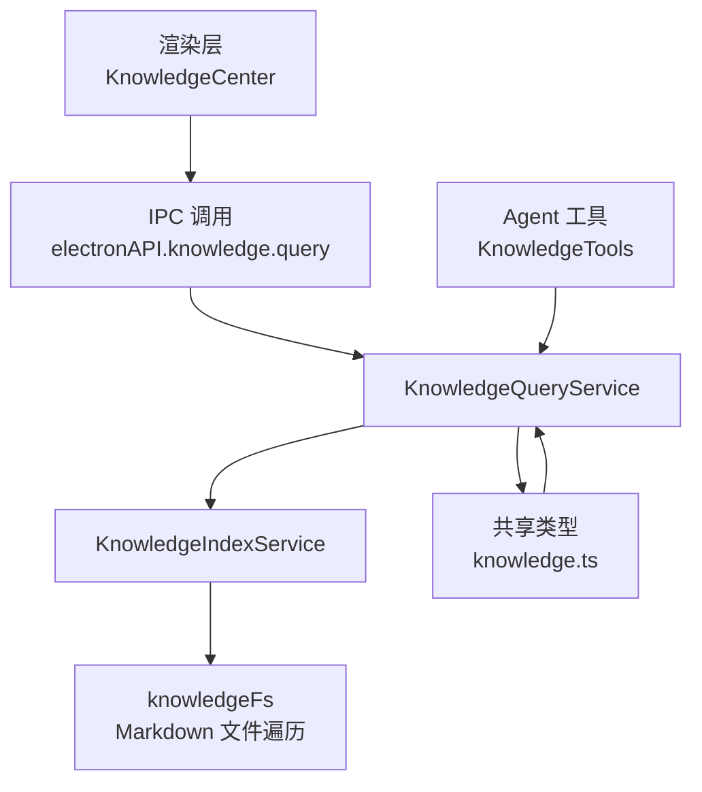
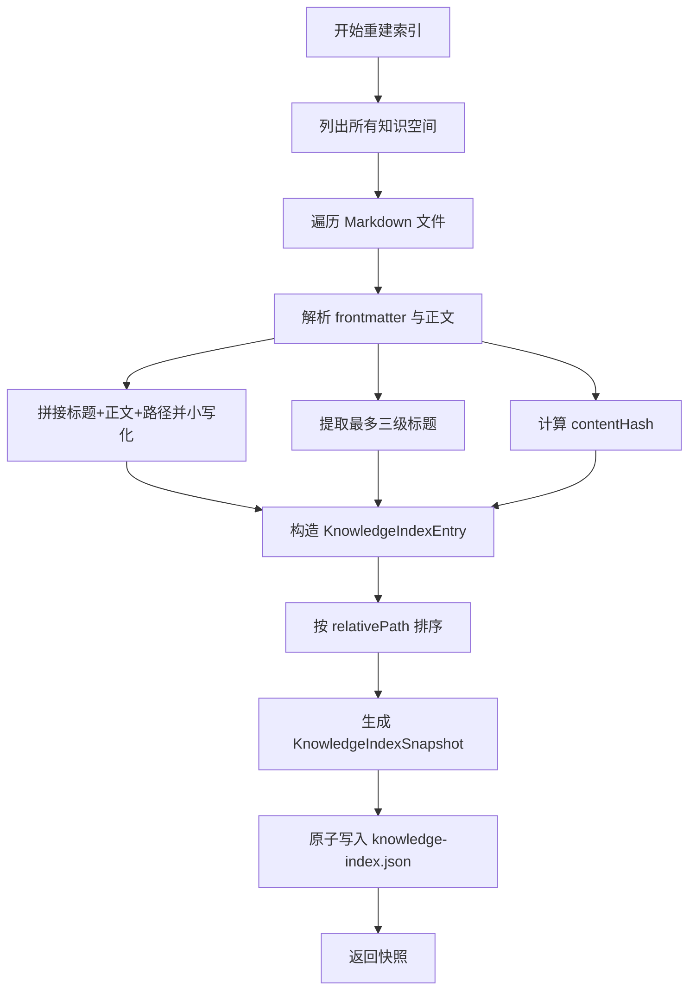
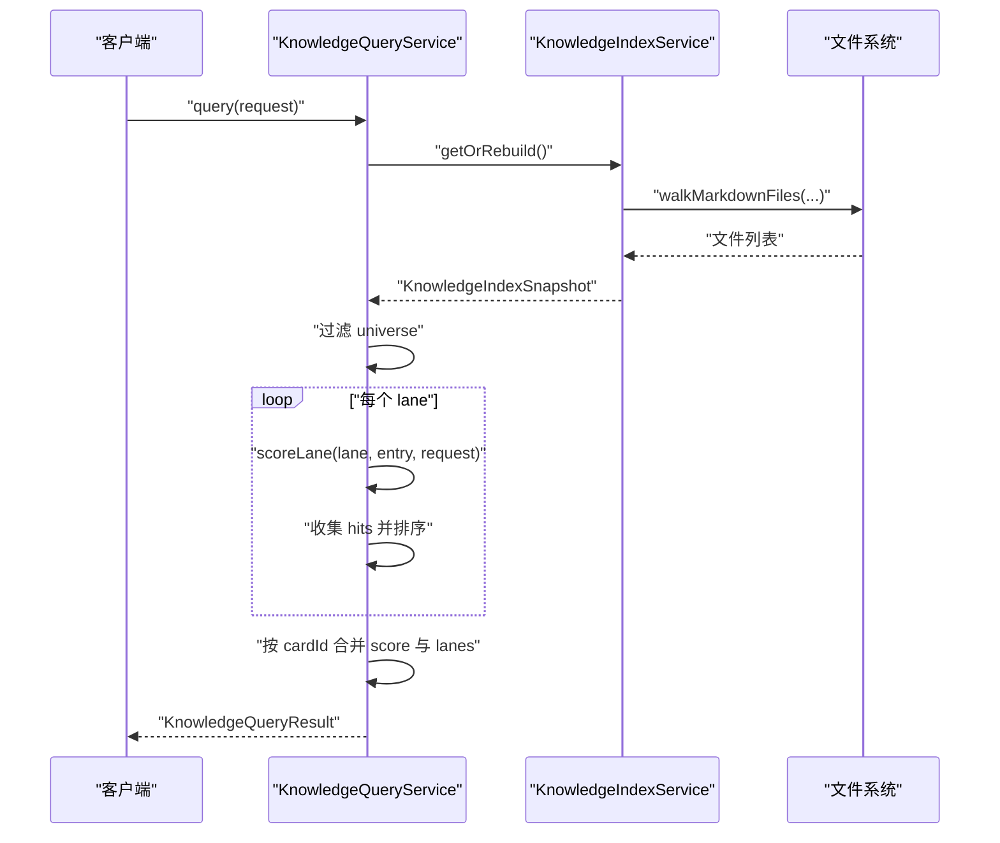
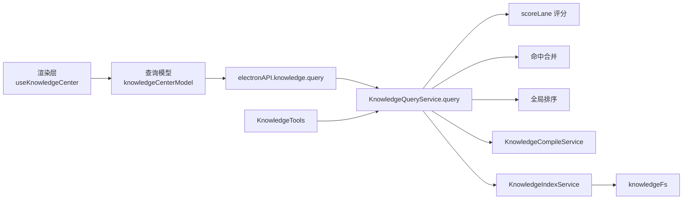
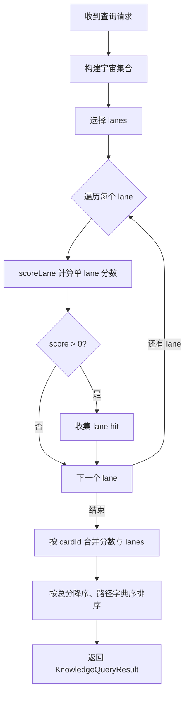
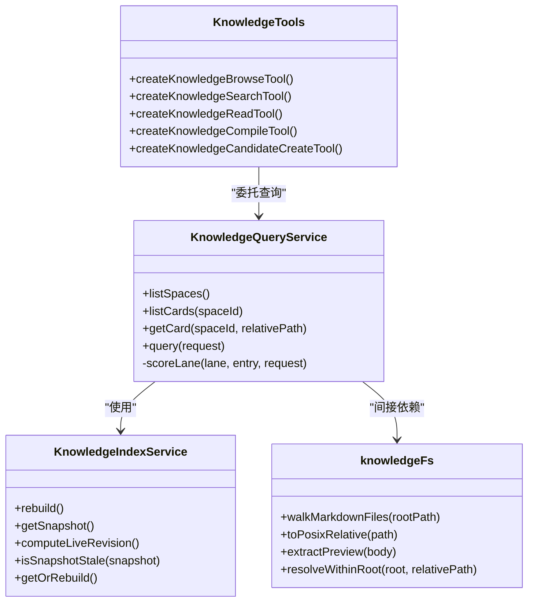

# 六 Lane 检索引擎

<cite>
**本文引用的文件**   
- [knowledgeLanes.ts](file://src/main/knowledge/knowledgeLanes.ts)
- [KnowledgeQueryService.ts](file://src/main/knowledge/KnowledgeQueryService.ts)
- [KnowledgeIndexService.ts](file://src/main/knowledge/KnowledgeIndexService.ts)
- [knowledgeFs.ts](file://src/main/knowledge/knowledgeFs.ts)
- [KnowledgeTools.ts](file://src/main/knowledge/KnowledgeTools.ts)
- [knowledgeServices.test.ts](file://src/main/knowledge/knowledgeServices.test.ts)
- [knowledgeCenterModel.ts](file://src/renderer/features/knowledge/KnowledgeCenterModal/knowledgeCenterModel.ts)
- [useKnowledgeCenter.ts](file://src/renderer/features/knowledge/KnowledgeCenterModal/useKnowledgeCenter.ts)
- [knowledge.ts](file://src/shared/types/knowledge.ts)
</cite>

## 目录
1. [引言](#引言)
2. [项目结构](#项目结构)
3. [核心组件](#核心组件)
4. [架构总览](#架构总览)
5. [详细组件分析](#详细组件分析)
6. [依赖关系分析](#依赖关系分析)
7. [性能考量](#性能考量)
8. [故障排查指南](#故障排查指南)
9. [结论](#结论)

## 引言
本文件系统性说明“六 lane 检索引擎”的实现与工作原理。该引擎面向知识卡片集合，通过六个有序检索通道完成从精确路径到全文、结构、关系与时序的召回，再对命中结果进行相关性评分与合并排序。六个通道分别是：

- Identity/Path：身份与路径精确匹配
- Scope/Metadata：作用域与元数据过滤
- Lexical：全文关键词匹配
- Structural：标题层级结构匹配
- Relation/Graph：卡片关系图遍历
- Temporal/Version：时间线与版本控制

这些通道不仅定义了搜索语义，也构成了代码中的“遍历模式契约”，即执行顺序不可随意调整，因为各通道的评分与过滤策略相互依赖。

## 项目结构
六 lane 检索能力主要由主进程的知识服务模块实现，渲染层负责构建查询请求并展示结果。关键文件职责如下：

| 文件 | 职责 |
|---|---|
| `src/shared/types/knowledge.ts` | 定义知识卡片类型、生命周期、作用域轴、关系、以及六个检索通道常量 |
| `src/main/knowledge/knowledgeLanes.ts` | 定义检索通道常量、索引条目结构、快照结构与语料哈希函数 |
| `src/main/knowledge/KnowledgeIndexService.ts` | 扫描 Markdown 知识空间，解析 frontmatter、标题、正文，构建持久化索引快照 |
| `src/main/knowledge/KnowledgeQueryService.ts` | 基于索引快照执行六 lane 检索、评分、合并与排序 |
| `src/main/knowledge/knowledgeFs.ts` | Markdown 文件遍历、相对路径规范化、预览提取等文件系统辅助逻辑 |
| `src/main/knowledge/KnowledgeTools.ts` | 为 Agent 工具暴露只读浏览与搜索接口，并对 lane、type、lifecycle 参数做白名单校验 |
| `src/renderer/.../useKnowledgeCenter.ts` | 渲染层组合用户筛选、防抖搜索、调用后端 query/compile、维护选中卡片与冲突视图 |
| `src/renderer/.../knowledgeCenterModel.ts` | 渲染层模型：视图模式、lane/type/lifecycle 全量枚举、查询键生成 |

**图表来源**
- [useKnowledgeCenter.ts:1-196](file://src/renderer/features/knowledge/KnowledgeCenterModal/useKnowledgeCenter.ts#L1-L196)
- [KnowledgeQueryService.ts:1-200](file://src/main/knowledge/KnowledgeQueryService.ts#L1-L200)
- [KnowledgeIndexService.ts:1-173](file://src/main/knowledge/KnowledgeIndexService.ts#L1-L173)
- [knowledgeFs.ts:120-160](file://src/main/knowledge/knowledgeFs.ts#L120-L160)
- [knowledge.ts:1-200](file://src/shared/types/knowledge.ts#L1-L200)

**章节来源**
- [knowledgeLanes.ts:1-56](file://src/main/knowledge/knowledgeLanes.ts#L1-L56)
- [KnowledgeQueryService.ts:1-239](file://src/main/knowledge/KnowledgeQueryService.ts#L1-L239)
- [KnowledgeIndexService.ts:1-173](file://src/main/knowledge/KnowledgeIndexService.ts#L1-L173)
- [knowledge.ts:1-200](file://src/shared/types/knowledge.ts#L1-L200)

## 核心组件
### 检索通道定义
六个检索通道以常量形式声明，并在共享类型中再次确认，保证主进程与渲染层使用同一套通道名称。通道顺序是“遍历模式契约”，意味着引擎默认按此顺序执行；如果前端显式传入 lanes，则仅执行所选通道，但通道内部评分逻辑仍保持不变。

| 通道 | 主要输入 | 主要输出 | 典型用途 |
|---|---|---|---|
| Identity/Path | `cardId`、`relativePath`、可选 `text` | 精确或身份/路径部分匹配命中 | 直接定位某张卡片或根据 ID/路径模糊查找 |
| Scope/Metadata | `scope`、`type`、`lifecycle` | 元数据过滤命中 | 限定工程、平台、驱动、状态等上下文 |
| Lexical | `text` | 全文关键词命中 | 通用自然语言或关键词搜索 |
| Structural | `text` | 标题命中 | 在文档结构中定位主题 |
| Relation/Graph | `relationTargetCardId` | 关系命中 | 根据关联目标卡片反向查找相关卡片 |
| Temporal/Version | `asOf`、`updatedAt` | 时间线命中 | 结合索引快照的版本控制 |

**章节来源**
- [knowledge.ts:140-200](file://src/shared/types/knowledge.ts#L140-L200)
- [knowledgeLanes.ts:1-20](file://src/main/knowledge/knowledgeLanes.ts#L1-L20)

### 索引服务
索引服务负责把磁盘上的 Markdown 知识卡片转成结构化索引条目。每个索引条目包含：

- 卡片标识：`cardId`、`spaceId`、`relativePath`
- 元数据：`title`、`type`、`lifecycle`、`scope`、`relations`
- 内容摘要：`headings`（最多三级标题数组）、`lexical`（标题、正文、路径拼接的小写全文）
- 版本信息：`updatedAt`、`contentHash`
- 可选字段：`preview`、`sourceStatus`、`caseId`

索引快照还包含 schema 版本、revision、构建时间与卡片列表。revision 通过对已排序卡片的 `cardId:contentHash` 序列计算 SHA-256，从而判断索引是否陈旧。

**图表来源**
- [KnowledgeIndexService.ts:40-173](file://src/main/knowledge/KnowledgeIndexService.ts#L40-L173)
- [knowledgeFs.ts:120-160](file://src/main/knowledge/knowledgeFs.ts#L120-L160)

**章节来源**
- [KnowledgeIndexService.ts:1-173](file://src/main/knowledge/KnowledgeIndexService.ts#L1-L173)
- [knowledgeFs.ts:120-160](file://src/main/knowledge/knowledgeFs.ts#L120-L160)

### 查询服务
查询服务接收 `KnowledgeQueryRequest`，先读取或重建索引快照，然后过滤出“宇宙集合”，再逐个 lane 打分、合并、排序。

查询入口的关键步骤：

1. 获取索引快照：若快照存在且 revision 未变化，则复用；否则重建。
2. 确定 lanes：若请求未指定 lanes，则使用全部六个通道；否则使用请求中的 lanes。
3. 宇宙集合过滤：排除不在 `spaceIds`、`type`、`lifecycle`、`asOf` 或 `scope` 范围内的卡片。
4. 逐 lane 评分：对每个 lane 计算 score，score ≤ 0 的命中丢弃。
5. 合并命中：同一 `cardId` 命中多次时累加 score，并记录命中的 lanes。
6. 最终排序：先按总分降序，再按相对路径字典序稳定排序。

**图表来源**
- [KnowledgeQueryService.ts:120-200](file://src/main/knowledge/KnowledgeQueryService.ts#L120-L200)
- [KnowledgeIndexService.ts:120-173](file://src/main/knowledge/KnowledgeIndexService.ts#L120-L173)

**章节来源**
- [KnowledgeQueryService.ts:1-239](file://src/main/knowledge/KnowledgeQueryService.ts#L1-L239)

## 架构总览
六 lane 检索引擎的整体调用链从渲染层开始，经过 IPC 进入主进程查询服务，再由索引服务提供预计算数据。Agent 工具也复用同一查询服务，因此系统既有面向用户的知识中心界面，也有面向智能体的可编程搜索接口。

**图表来源**
- [useKnowledgeCenter.ts:1-196](file://src/renderer/features/knowledge/KnowledgeCenterModal/useKnowledgeCenter.ts#L1-L196)
- [knowledgeCenterModel.ts:1-92](file://src/renderer/features/knowledge/KnowledgeCenterModal/knowledgeCenterModel.ts#L1-L92)
- [KnowledgeQueryService.ts:120-239](file://src/main/knowledge/KnowledgeQueryService.ts#L120-L239)
- [KnowledgeTools.ts:1-200](file://src/main/knowledge/KnowledgeTools.ts#L1-L200)

## 详细组件分析

### 通道一：Identity/Path
#### 工作原理
Identity/Path 是最接近“确定性定位”的通道：

- 如果请求携带 `cardId` 且与索引条目的 `cardId` 完全相等，得分为 10。
- 如果请求携带 `relativePath` 且与索引条目的 `relativePath` 完全相等，得分为 8。
- 如果没有精确命中，但提供了 `text`，则在 `cardId` 或 `relativePath` 中小写包含查询文本，得分为 4。
- 如果请求明确带 `cardId` 或 `relativePath` 但未命中，返回 0，表示该 lane 不贡献分数。
- 如果请求没有 `cardId` 和 `relativePath`，但启用了该 lane，则为所有卡片返回基础分 1，起到“兜底可见性”的作用。

#### 设计动机
这个通道优先满足“我知道要查哪张卡片”的场景，例如从错误日志、引用或会话上下文直接跳转到具体知识卡片。它也能接受较弱的文本提示，用于身份或路径的模糊联想。

#### 示例
- 已知卡片 ID：设置 `cardId`，其余文本留空。
- 已知相对路径：设置 `relativePath`，例如 `facts/vulkan-driver-issue.md`。
- 只输入关键词：不设置 `cardId` 与 `relativePath`，由 Lexical 通道承担更多语义，但 Identity/Path 仍会为路径中包含关键词的卡片加分。

**章节来源**
- [KnowledgeQueryService.ts:203-213](file://src/main/knowledge/KnowledgeQueryService.ts#L203-L213)

### 通道二：Scope/Metadata
#### 工作原理
Scope/Metadata 通道负责把搜索限制在合适的上下文中：

- 如果请求同时没有 `scope`、`type`、`lifecycle`，则该 lane 对所有卡片返回基础分 1。
- 如果 `request.type` 非空且卡片 `type` 匹配，加 3 分。
- 如果 `request.lifecycle` 非空且卡片 `lifecycle` 匹配，加 2 分。
- 如果 `request.scope` 非空且 `matchesScope` 返回 true，加 4 分。
- 多个条件可同时生效，因此最高可达 9 分。

`matchesScope` 会逐项比较作用域轴，如 project、engine、platform、driver、capture、pipelineStage、pass、shaderFamily、materialFamily、quality、resolution、featureConfiguration 等，并支持 exclusions 排除项。

#### 设计动机
知识卡片不是孤立文档，而是与工程、平台、驱动、捕获阶段等相关联的结构化事实。Scope/Metadata 确保搜索结果只在当前工作上下文中有效，避免无关卡片污染排名。

#### 示例
- 限定项目：设置 `scope.project`。
- 限定 GPU 与驱动：同时设置 `scope.gpuVendor`、`scope.driver`。
- 限定生命周期：设置 `lifecycle` 为 `verified` 或 `promoted`，排除草稿。
- 组合过滤：同时使用 `type`、`lifecycle`、`scope`，获得高相关度候选集。

**章节来源**
- [KnowledgeQueryService.ts:55-75](file://src/main/knowledge/KnowledgeQueryService.ts#L55-L75)
- [KnowledgeQueryService.ts:214-221](file://src/main/knowledge/KnowledgeQueryService.ts#L214-L221)
- [knowledge.ts:1-120](file://src/shared/types/knowledge.ts#L1-L120)

### 通道三：Lexical
#### 工作原理
Lexical 通道基于索引中的 `lexical` 字段进行子串匹配：

- 如果请求没有 `text`，返回基础分 1。
- 如果 `entry.lexical` 包含小写后的 `text`，返回 5。
- 否则返回 0。

`lexical` 在索引构建时由 `parsed.record.title`、`parsed.body`、`relativePath` 拼接并统一小写得到。这意味着 Lexical 不只是正文搜索，也覆盖标题、路径等轻量上下文。

#### 设计动机
Lexical 是通用全文搜索通道，适合自然语言提问、关键词组合、术语检索等场景。由于索引已经预处理了文本，查询时只需一次字符串包含判断，成本较低。

#### 示例
- 搜索 Vulkan 相关问题：设置 `text="vulkan"`。
- 多词搜索：设置 `text="driver crash"`，引擎会在索引全文中查找包含该子串的卡片。
- 配合 Scope/Metadata：先用作用域缩小范围，再用 Lexical 提升相关性。

**章节来源**
- [KnowledgeIndexService.ts:60-95](file://src/main/knowledge/KnowledgeIndexService.ts#L60-L95)
- [KnowledgeQueryService.ts:222-224](file://src/main/knowledge/KnowledgeQueryService.ts#L222-L224)

### 通道四：Structural
#### 工作原理
Structural 通道关注文档标题结构：

- 如果请求没有 `text`，只要卡片有至少一个标题，就返回 1。
- 如果标题中存在小写包含 `text` 的项，返回 4。
- 否则返回 0。

标题来源于 Markdown 源文件中最多三级标题的正则匹配，并按出现顺序存入 `headings`。

#### 设计动机
很多知识卡片是结构化文档，用户更关心“某个主题下有没有相关内容”，而不是泛泛的全文匹配。Structural 让标题成为强信号，有助于快速定位专题章节。

#### 示例
- 搜索“根因分析”：设置 `text="root cause"`，引擎优先命中标题中包含该短语的卡片。
- 无查询文本：Structural 可为有标题的卡片提供基础分，帮助区分“有结构”的文档与纯正文片段。

**章节来源**
- [KnowledgeIndexService.ts:60-95](file://src/main/knowledge/KnowledgeIndexService.ts#L60-L95)
- [KnowledgeQueryService.ts:225-227](file://src/main/knowledge/KnowledgeQueryService.ts#L225-L227)

### 通道五：Relation/Graph
#### 工作原理
Relation/Graph 通道基于卡片关系字段：

- 如果请求没有 `relationTargetCardId`，只要卡片声明了任何关系，就返回 1。
- 如果 `relationTargetCardId` 存在于卡片的 `relations[].targetCardId` 中，返回 6。
- 否则返回 0。

注意：当前实现是检查卡片自身是否“指向”目标卡片，而不是从目标卡片出发反向遍历邻居。虽然通道名为 Relation/Graph，但在当前评分函数中体现的是“与目标卡片有关联”的判定。

#### 设计动机
知识卡片之间可以表达 supports、contradicts、specializes、applies_to、supersedes 等语义关系。Relation/Graph 通道让“围绕某张卡片的相关证据”可被召回，并为后续冲突检测与知识编译提供依据。

#### 示例
- 查找支持与某问题相关的卡片：设置 `relationTargetCardId` 为目标卡片 ID。
- 发现矛盾关系：结合 KnowledgeCompileService 中对 `contradicts` 关系的处理，可在编译阶段标记冲突。

**章节来源**
- [knowledge.ts:1-120](file://src/shared/types/knowledge.ts#L1-L120)
- [KnowledgeQueryService.ts:228-231](file://src/main/knowledge/KnowledgeQueryService.ts#L228-L231)

### 通道六：Temporal/Version
#### 工作原理
Temporal/Version 通道基于更新时间：

- 如果 `entry.updatedAt > 0`，返回 1。
- 否则返回 0。

此外，查询请求支持 `asOf` 字段：在宇宙集合过滤阶段，`updatedUat > asOf` 的卡片会被排除。也就是说，Temporal/Version 通道本身只是“是否有时序信息”的信号，而真正的时间版本过滤发生在查询前的宇宙集合阶段。

#### 设计动机
知识卡片会随工程演进，旧版本可能不再适用。Temporal/Version 通道为“最近可用的知识”提供基础分，而 `asOf` 允许历史视角查询，比如审计已废弃但仍可浏览的 retired 卡片。

#### 示例
- 只看最新版本：不设置 `asOf`，Temporal/Version 会为有更新时间的卡片加分。
- 历史查询：设置 `asOf` 为某个时间戳，只保留该时间点之前更新的卡片。
- 审计废弃卡片：设置 `lifecycle=["retired"]`，即使普通检索会排除 retired，仍可显式启用。

**章节来源**
- [KnowledgeQueryService.ts:150-170](file://src/main/knowledge/KnowledgeQueryService.ts#L150-L170)
- [KnowledgeQueryService.ts:232-233](file://src/main/knowledge/KnowledgeQueryService.ts#L232-L233)

### 相关性评分算法
每个 lane 独立打分，最终分数是命中的所有 lane 得分之和。评分权重如下：

| Lane | 最高得分 | 说明 |
|---|---:|---|
| Identity/Path | 10 | 精确 `cardId` 命中 |
| Identity/Path | 8 | 精确 `relativePath` 命中 |
| Identity/Path | 4 | 身份或路径包含查询文本 |
| Scope/Metadata | 9 | type 3 + lifecycle 2 + scope 4 |
| Lexical | 5 | 全文包含查询文本 |
| Structural | 4 | 标题包含查询文本 |
| Relation/Graph | 6 | 与目标卡片存在关系 |
| Temporal/Version | 1 | 具有更新时间 |

合并规则：

- 同一 `cardId` 在多个 lane 命中时，分数累加。
- 命中的 lane 列表会合并记录，便于调试与展示。
- 最终排序先按总分降序，再按 `relativePath` 字典序稳定排序。

**图表来源**
- [KnowledgeQueryService.ts:150-200](file://src/main/knowledge/KnowledgeQueryService.ts#L150-L200)
- [KnowledgeQueryService.ts:203-239](file://src/main/knowledge/KnowledgeQueryService.ts#L203-L239)

**章节来源**
- [KnowledgeQueryService.ts:150-239](file://src/main/knowledge/KnowledgeQueryService.ts#L150-L239)

### 为什么按此顺序执行
六个通道的顺序反映了从强约束到弱约束、从低成本到高成本的召回策略：

1. Identity/Path：最精确、最便宜，优先满足直接定位需求。
2. Scope/Metadata：作用域过滤成本低，但能大幅缩小候选集。
3. Lexical：通用全文搜索，需要遍历索引全文。
4. Structural：标题匹配比全文更局部，适合结构化文档。
5. Relation/Graph：关系匹配依赖卡片关系字段，语义更强但范围有限。
6. Temporal/Version：主要是时序信号，实际版本裁剪发生在宇宙集合阶段。

如果前端显式选择 lanes，引擎不会重新排序，只会跳过未选中的 lane。因此，扩展新 lane 时必须谨慎评估它对现有排序契约的影响。

**章节来源**
- [knowledgeLanes.ts:1-20](file://src/main/knowledge/knowledgeLanes.ts#L1-L20)
- [KnowledgeQueryService.ts:150-200](file://src/main/knowledge/KnowledgeQueryService.ts#L150-L200)

## 依赖关系分析

**图表来源**
- [KnowledgeIndexService.ts:1-173](file://src/main/knowledge/KnowledgeIndexService.ts#L1-L173)
- [KnowledgeQueryService.ts:1-239](file://src/main/knowledge/KnowledgeQueryService.ts#L1-L239)
- [knowledgeFs.ts:120-160](file://src/main/knowledge/knowledgeFs.ts#L120-L160)
- [KnowledgeTools.ts:1-200](file://src/main/knowledge/KnowledgeTools.ts#L1-L200)

**章节来源**
- [KnowledgeIndexService.ts:1-173](file://src/main/knowledge/KnowledgeIndexService.ts#L1-L173)
- [KnowledgeQueryService.ts:1-239](file://src/main/knowledge/KnowledgeQueryService.ts#L1-L239)
- [KnowledgeTools.ts:1-200](file://src/main/knowledge/KnowledgeTools.ts#L1-L200)

## 性能考量
### 索引构建复杂度
索引构建会遍历所有知识空间的 Markdown 文件，对每个文件执行：

- 读取源文件
- 解析 frontmatter
- 正则匹配标题
- 拼接并小写化 lexical
- 计算 contentHash
- 排序后写入 JSON 快照

时间复杂度近似为 O(N·F)，其中 N 是卡片数量，F 是单个文件的解析与正则处理开销。空间复杂度取决于索引快照大小，包括所有卡片的结构化字段与 lexical 全文摘要。

### 查询复杂度
查询服务对每个 lane 遍历整个 universe 集合，因此单次 lane 评分复杂度约为 O(U)，U 是宇宙集合大小。若启用 k 个 lanes，则整体评分复杂度约为 O(k·U)。合并与排序复杂度约为 O(M log M)，M 是去重后的命中数量。

### 优化建议
- 优先使用 Identity/Path 和 Scope/Metadata：这两个 lane 能快速收敛候选集。
- 合理使用 lanes：不需要全文搜索时不要启用 Lexical。
- 使用 spaceIds 缩小范围：避免跨工程扫描。
- 使用 lifecycle 与 asOf：减少历史或废弃卡片的干扰。
- 监控索引体积：large knowledge corpus 应定期重建索引并观察快照大小。
- 前端防抖：渲染层已对搜索输入进行防抖，避免频繁触发 IPC 查询。

[本节为通用性能指导，不直接分析特定代码行]

## 故障排查指南
### 常见问题
| 现象 | 可能原因 | 排查方法 |
|---|---|---|
| 搜索不到任何结果 | 宇宙集合被 lifecycle、scope、asOf 或 type 过滤为空 | 检查请求中的 lifecycle、scope、asOf、type |
| 预期卡片未出现在前列 | 其他 lane 的累积分数更高 | 查看命中结果的 `lanes` 字段，确认哪些 lane 贡献了分数 |
| 废弃卡片不可见 | 默认检索会排除 `retired` | 显式设置 `lifecycle=["retired"]` |
| 时间线查询无效 | Temporal/Version 通道本身只打分，版本裁剪在宇宙集合阶段 | 检查 `asOf` 是否大于卡片 `updatedAt` |
| 关系搜索无结果 | 当前实现检查卡片是否“指向”目标卡片 | 确认 `relationTargetCardId` 是否确实在目标卡片关系中 |
| 索引未更新 | 快照 revision 与 live revision 不一致时才会重建 | 手动触发索引重建并刷新概览 |

### 调试建议
- 使用 Agent 工具的 `knowledge_search`：它会返回前 20 条命中，包含 `cardId`、`contentHash`、`spaceId`、`relativePath`、命中的 lanes。
- 在渲染层打开知识中心，观察 lanes 过滤器勾选情况，确认是否启用了预期通道。
- 通过 `knowledgeQueryKey` 生成的查询键，确认前后两次请求是否真的不同。
- 当怀疑索引陈旧时，调用索引重建接口并刷新空间概览。

**章节来源**
- [KnowledgeTools.ts:120-200](file://src/main/knowledge/KnowledgeTools.ts#L120-L200)
- [useKnowledgeCenter.ts:1-196](file://src/renderer/features/knowledge/KnowledgeCenterModal/useKnowledgeCenter.ts#L1-L196)
- [knowledgeCenterModel.ts:1-92](file://src/renderer/features/knowledge/KnowledgeCenterModal/knowledgeCenterModel.ts#L1-L92)

## 结论
六 lane 检索引擎以“确定性优先、上下文优先、全文增强、结构聚焦、关系扩展、时序控制”为设计主线。Identity/Path 和 Scope/Metadata 提供强约束，Lexical 和 Structural 提供语义与结构召回，Relation/Graph 扩展知识网络，Temporal/Version 保障版本一致性。各 lane 通过固定顺序与可叠加评分共同决定最终结果，既适合用户界面的交互式知识中心，也适合 Agent 工具的程序化检索。

在实际使用中，推荐：

- 精准定位时使用 Identity/Path。
- 工程上下文受限使用 Scope/Metadata。
- 自然语言搜索使用 Lexical。
- 文档主题定位使用 Structural。
- 围绕某张卡片扩展上下文使用 Relation/Graph。
- 控制可见时间范围使用 asOf 并结合 Temporal/Version。

[本节为总结性内容，不直接分析特定代码行]