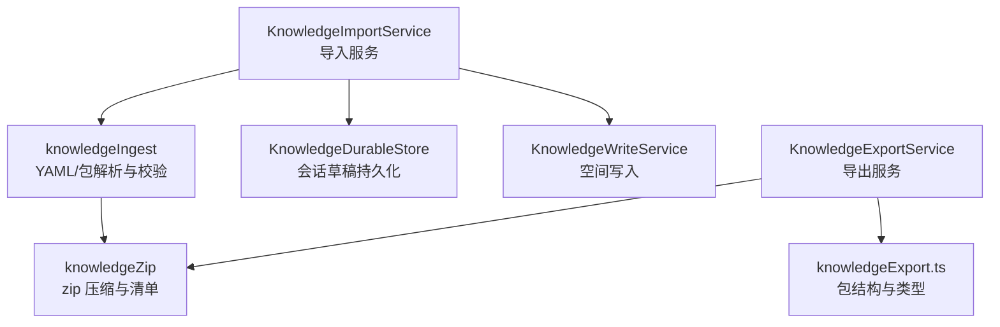
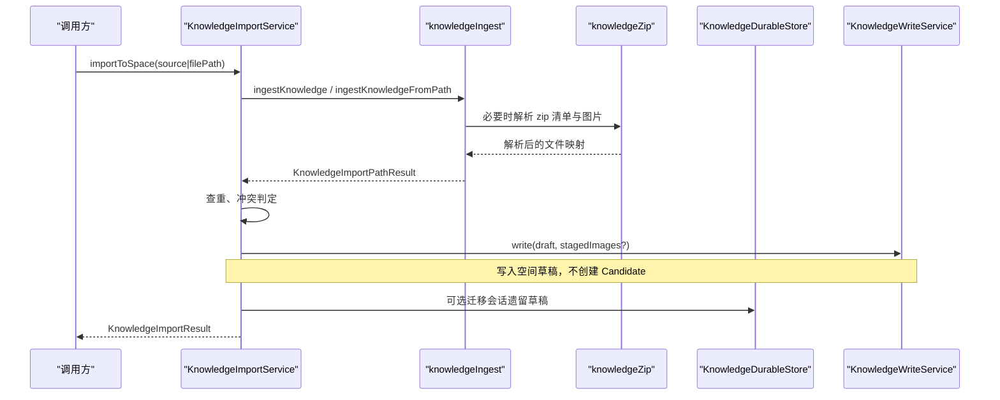
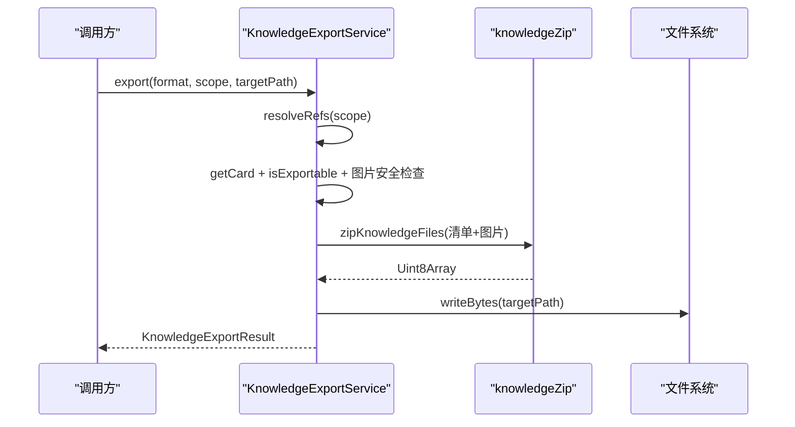
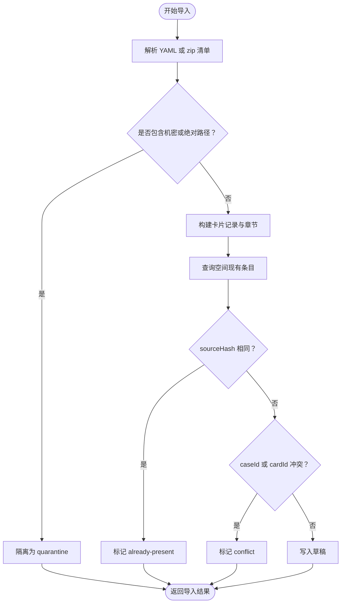
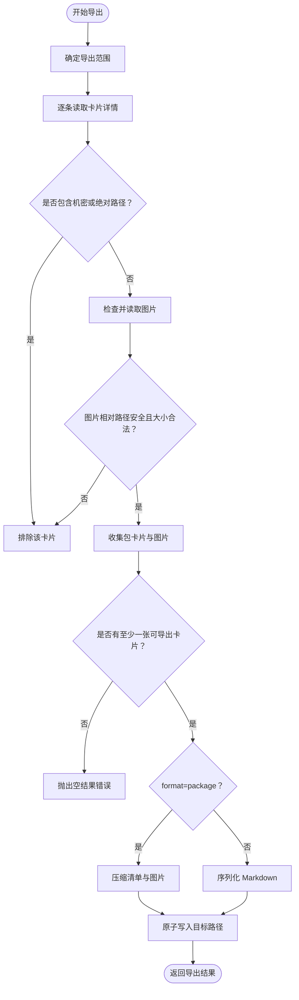
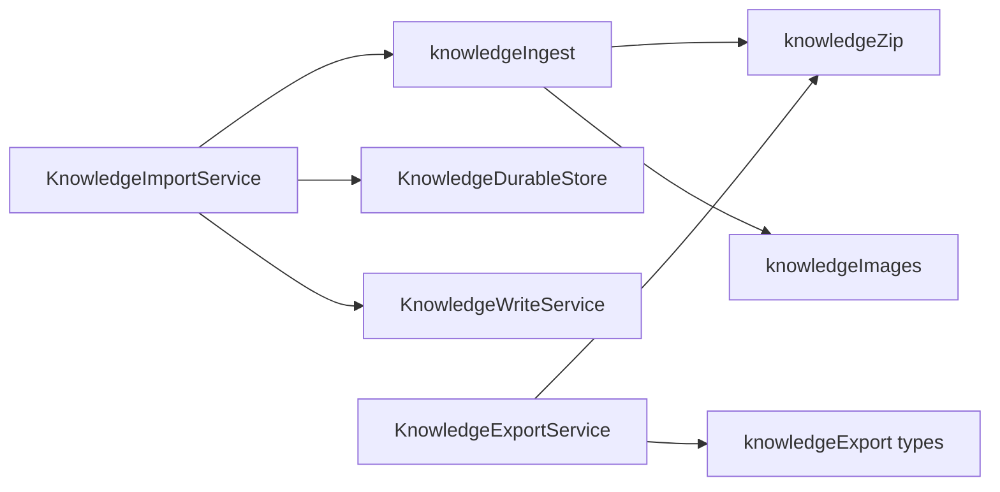

# 导入导出功能

<cite>
**本文引用的文件**   
- [KnowledgeImportService.ts](file://src/main/knowledge/KnowledgeImportService.ts)
- [KnowledgeExportService.ts](file://src/main/knowledge/KnowledgeExportService.ts)
- [knowledgeIngest.ts](file://src/main/knowledge/knowledgeIngest.ts)
- [knowledgeZip.ts](file://src/main/knowledge/knowledgeZip.ts)
- [knowledgeErrors.ts](file://src/main/knowledge/knowledgeErrors.ts)
- [KnowledgeDurableStore.ts](file://src/main/knowledge/KnowledgeDurableStore.ts)
- [knowledgeExport.ts](file://src/shared/types/knowledgeExport.ts)
- [KnowledgeImportService.test.ts](file://src/main/knowledge/KnowledgeImportService.test.ts)
- [KnowledgeExportService.test.ts](file://src/main/knowledge/KnowledgeExportService.test.ts)
</cite>

## 目录
1. [引言](#引言)
2. [项目结构](#项目结构)
3. [核心组件](#核心组件)
4. [架构总览](#架构总览)
5. [详细组件分析](#详细组件分析)
6. [依赖关系分析](#依赖关系分析)
7. [性能与体积约束](#性能与体积约束)
8. [使用场景示例](#使用场景示例)
9. [最佳实践](#最佳实践)
10. [故障排查](#故障排查)
11. [结论](#结论)

## 引言
本文件面向希望掌握知识系统“导入/导出”能力的开发者与维护者，聚焦以下目标：
- 说明 `KnowledgeImportService` 如何处理外部知识源，包括 YAML、Markdown 知识包、批量图片资源以及冲突解决策略。
- 说明 `KnowledgeExportService` 的知识打包、压缩、版本标记和不可回导入的 Markdown 输出。
- 解释 zip 文件格式规范、文件组织方式、元数据保留与脱敏规则。
- 说明导入校验、错误处理、会话草稿迁移与失败路径行为。
- 提供可操作的团队协作、RenderDoc 诊断知识导出等实际场景，并给出常见问题解决方案。

## 项目结构
知识导入导出能力集中在主进程的知识模块中，由服务层、解析层、持久化层和共享类型组成：
- 服务层
  - `KnowledgeImportService`：负责将已解析的知识条目写入目标空间，并处理“已存在”“重复 caseId”等冲突。
  - `KnowledgeExportService`：负责按范围导出知识，生成可复导入的 zip 包或仅可读的 Markdown。
- 解析与校验层
  - `knowledgeIngest`：统一处理 YAML、Markdown 知识包、敏感信息检测、绝对路径检测、资产映射、章节构建和图片暂存。
  - `knowledgeZip`：封装 zip 压缩/解压、入口清单识别、大小限制和路径规范化。
- 持久化与状态层
  - `KnowledgeDurableStore`：以会话为粒度的知识草稿、候选和评审持久化，支持原子写和锁。
  - `knowledgeErrors`：定义导入导出相关错误码和异常类。
- 共享类型
  - `knowledgeExport.ts`：定义知识包 schema、导出请求、结果和包卡片字段。

**图示来源**
- [KnowledgeImportService.ts:1-328](file://src/main/knowledge/KnowledgeImportService.ts#L1-L328)
- [KnowledgeExportService.ts:1-171](file://src/main/knowledge/KnowledgeExportService.ts#L1-L171)
- [knowledgeIngest.ts:1-808](file://src/main/knowledge/knowledgeIngest.ts#L1-L808)
- [knowledgeZip.ts:1-79](file://src/main/knowledge/knowledgeZip.ts#L1-L79)
- [knowledgeExport.ts:1-61](file://src/shared/types/knowledgeExport.ts#L1-L61)
- [KnowledgeDurableStore.ts:1-219](file://src/main/knowledge/KnowledgeDurableStore.ts#L1-L219)

**章节来源**
- [KnowledgeImportService.ts:1-328](file://src/main/knowledge/KnowledgeImportService.ts#L1-L328)
- [KnowledgeExportService.ts:1-171](file://src/main/knowledge/KnowledgeExportService.ts#L1-L171)
- [knowledgeIngest.ts:1-808](file://src/main/knowledge/knowledgeIngest.ts#L1-L808)
- [knowledgeZip.ts:1-79](file://src/main/knowledge/knowledgeZip.ts#L1-L79)
- [knowledgeExport.ts:1-61](file://src/shared/types/knowledgeExport.ts#L1-L61)
- [KnowledgeDurableStore.ts:1-219](file://src/main/knowledge/KnowledgeDurableStore.ts#L1-L219)

## 核心组件
### KnowledgeImportService
职责：
- 接收来自 UI 或 IPC 的导入请求，支持传入内联 source 文本或文件系统路径。
- 调用 `ingestKnowledge` / `ingestKnowledgeFromPath` 完成格式解析、敏感内容隔离和资源定位。
- 查询目标空间现有条目，判断是否“已存在”或“caseId 冲突”。
- 对通过校验的草稿调用 `KnowledgeWriteService.write`，将卡片以 draft 生命周期写入空间。
- 可选地迁移会话遗留草稿到目标空间，并在冲突时抛出专用异常。

关键行为：
- 导入不会直接创建 Candidate，始终落地为草稿，保证人工审查闭环。
- 同一 sourceHash 再次导入会被标记为 already-present，不覆盖原卡片。
- 相同 relativePath 但不同 sourceHash，或相同 caseId 被占用的情况，会返回 conflict。
- 若携带 stagedImages，则随卡片一并写入。

**章节来源**
- [KnowledgeImportService.ts:1-328](file://src/main/knowledge/KnowledgeImportService.ts#L1-L328)
- [KnowledgeImportService.test.ts:1-182](file://src/main/knowledge/KnowledgeImportService.test.ts#L1-L182)

### KnowledgeExportService
职责：
- 根据 scope（selected/filtered/space）解析待导出卡片集合。
- 过滤掉包含机密或绝对路径的卡片，跳过缺少图片资源的卡片。
- 将卡片转换为包卡片，剥离机器本地溯源字段。
- 导出两种格式：
  - package：生成 zip，内含 knowledge.yaml 清单和声明的图片。
  - markdown：生成纯文本 Markdown，仅供阅读，不可重新导入。
- 通过临时文件 + rename 原子写入目标路径。

关键行为：
- 所有导出结果均带有 `exportedAt` 时间戳，作为包的元数据版本标记之一。
- 包中的 lifecycle 是元数据，重新导入后一律变为 draft，不会恢复 verified。
- 图片读取受相对路径安全检查和最大字节数限制；不安全或缺失图片会导致整张卡片被排除。

**章节来源**
- [KnowledgeExportService.ts:1-171](file://src/main/knowledge/KnowledgeExportService.ts#L1-L171)
- [KnowledgeExportService.test.ts:1-244](file://src/main/knowledge/KnowledgeExportService.test.ts#L1-L244)

### knowledgeIngest
职责：
- 解析 YAML 和知识包 YAML，构建知识卡片记录、章节、scope、预览和 body。
- 对 assets 进行资产映射，把原始文件名替换为稳定且安全的 dest 路径或 opaque id。
- 检测敏感词、绝对路径、文件名泄露，并将非法输入放入 quarantine。
- 从 zip 中识别 knowledge.yaml，收集图片并建立 stagedImagesByCardId。
- 从路径导入时对文件大小、mtime、size、哈希做二次校验，防止读取期间文件变化。

关键行为：
- 支持 RenderDoc 风格诊断知识：通过 environment、symptoms/evidence/rootCause/fix 等字段映射为标准章节。
- 支持 package schema：当检测到 `schema=rdc.knowledge-package/1` 时走包解析流程。
- 对图片采用 `KNOWLEDGE_IMAGE_MAX_BYTES` 上限，并对角色和相对路径做标准化。

**章节来源**
- [knowledgeIngest.ts:1-808](file://src/main/knowledge/knowledgeIngest.ts#L1-L808)

### knowledgeZip
职责：
- 压缩知识包：校验条目名、累计未压缩大小、使用固定压缩等级。
- 解压知识包：识别 zip 魔数、拒绝非法路径、统计解压后总大小。
- 选择清单：优先取根级 knowledge.yaml，否则在根级只有一个 YAML 时将其视为清单。
- 提供 utf8 编解码工具，辅助将 YAML 文本转为二进制。

关键行为：
- 清单常量 `KNOWLEDGE_PACKAGE_MANIFEST` 为 knowledge.yaml。
- 单包最大未压缩体积限制为 32 MiB。
- 通过魔数和路径白名单保护避免 zip 炸弹和路径穿越。

**章节来源**
- [knowledgeZip.ts:1-79](file://src/main/knowledge/knowledgeZip.ts#L1-L79)

### KnowledgeDurableStore
职责：
- 管理每个会话的知识状态文档，包括 leftoverDrafts、candidates、reviews。
- 提供原子写、校验、锁机制，避免并发写入导致状态损坏。
- 在导入迁移流程中保存无法自动合并的草稿，供后续处理。

关键行为：
- 当会话状态不存在时返回空文档，而非报错。
- 写入后会再次读取并校验 schema，确保一致性。
- 使用目录级文件锁，超时和冲突有明确错误语义。

**章节来源**
- [KnowledgeDurableStore.ts:1-219](file://src/main/knowledge/KnowledgeDurableStore.ts#L1-L219)

### knowledgeErrors
职责：
- 集中定义知识子系统错误类和错误码，如权限确认缺失、候选人需要意图、资产缺失、生命周期无效、修订冲突、写入路径拒绝、写入完整性失败、审批令牌无效、草稿迁移冲突等。

**章节来源**
- [knowledgeErrors.ts:1-79](file://src/main/knowledge/knowledgeErrors.ts#L1-L79)

### knowledgeExport.ts
职责：
- 定义知识包 schema 常量 `rdc.knowledge-package/1`。
- 定义导出格式枚举 package/markdown、作用域枚举 selected/filtered/space。
- 定义 KnowledgePackageCard 允许保留的字段，明确剥离 machine-local provenance。
- 定义 KnowledgePackage、KnowledgeExportRequest、KnowledgeExportResult。

**章节来源**
- [knowledgeExport.ts:1-61](file://src/shared/types/knowledgeExport.ts#L1-L61)

## 架构总览
导入导出整体分为两条链路：

**图示来源**
- [KnowledgeImportService.ts:1-328](file://src/main/knowledge/KnowledgeImportService.ts#L1-L328)
- [knowledgeIngest.ts:1-808](file://src/main/knowledge/knowledgeIngest.ts#L1-L808)
- [knowledgeZip.ts:1-79](file://src/main/knowledge/knowledgeZip.ts#L1-L79)
- [KnowledgeDurableStore.ts:1-219](file://src/main/knowledge/KnowledgeDurableStore.ts#L1-L219)

**图示来源**
- [KnowledgeExportService.ts:1-171](file://src/main/knowledge/KnowledgeExportService.ts#L1-L171)
- [knowledgeZip.ts:1-79](file://src/main/knowledge/knowledgeZip.ts#L1-L79)

## 详细组件分析

### 导入流程与冲突解决
导入流程的核心在于“先解析、再查重、后落盘”，并且严格区分“已存在”和“冲突”。

**图示来源**
- [KnowledgeImportService.ts:1-328](file://src/main/knowledge/KnowledgeImportService.ts#L1-L328)
- [knowledgeIngest.ts:1-808](file://src/main/knowledge/knowledgeIngest.ts#L1-L808)

关键点：
- 已存在判定依据是 record.cardId 或 record.caseId 匹配，并结合 sourceHash 判断是否为同一次源。
- duplicate-case-id 冲突不会覆盖已有卡片，而是返回冲突项，让上层决定是否覆盖或忽略。
- 如果导入来源是 zip，图片资源会在解析阶段被暂存，随后随草稿一起提交给写入服务。

**章节来源**
- [KnowledgeImportService.ts:1-328](file://src/main/knowledge/KnowledgeImportService.ts#L1-L328)
- [knowledgeIngest.ts:1-808](file://src/main/knowledge/knowledgeIngest.ts#L1-L808)
- [KnowledgeImportService.test.ts:1-182](file://src/main/knowledge/KnowledgeImportService.test.ts#L1-L182)

### 导出流程与包结构
导出流程强调“安全优先、可复导入、元数据最小化”。

**图示来源**
- [KnowledgeExportService.ts:1-171](file://src/main/knowledge/KnowledgeExportService.ts#L1-L171)
- [knowledgeZip.ts:1-79](file://src/main/knowledge/knowledgeZip.ts#L1-L79)

包结构规范：
- 根目录必须包含清单文件 knowledge.yaml。
- 清单字段包括 schema、exportedAt、cards。
- cards 数组中每条记录只保留 authoring 所需字段，machine-local provenance 如 sourceHash、sourceMtimeMs、sourceSize、updatedAt、spaceId 等不被保留。
- images 字段保留相对路径和 role，图片文件按相对路径存放于 zip 中。
- 当图片全部可用时，导出结果会带上 images；否则该卡片可能被整体排除。

**章节来源**
- [KnowledgeExportService.ts:1-171](file://src/main/knowledge/KnowledgeExportService.ts#L1-L171)
- [knowledgeExport.ts:1-61](file://src/shared/types/knowledgeExport.ts#L1-L61)
- [knowledgeZip.ts:1-79](file://src/main/knowledge/knowledgeZip.ts#L1-L79)
- [KnowledgeExportService.test.ts:1-244](file://src/main/knowledge/KnowledgeExportService.test.ts#L1-L244)

### YAML 与 Markdown 导入差异
- YAML 导入：
  - 支持普通 case YAML，要求 case_id/caseId 与 title 存在。
  - 支持知识包 YAML，当 schema 为 rdc.knowledge-package/1 时走包解析。
  - 所有字符串字段会被扫描机密和绝对路径；assets 会被重映射为安全路径。
  - 最终生成的相对路径形如 cases/{sanitizedCaseId}.md。
- Markdown 导入：
  - 当前实现主要围绕 YAML 和 zip 包；Markdown 导出是只读格式，测试也表明 reimport 应针对 zip 包进行。
  - 因此 Markdown 更适合作为人类可读分享，而不是跨机器复现知识的标准载体。

**章节来源**
- [knowledgeIngest.ts:1-808](file://src/main/knowledge/knowledgeIngest.ts#L1-L808)
- [KnowledgeExportService.test.ts:1-244](file://src/main/knowledge/KnowledgeExportService.test.ts#L1-L244)

### 会话草稿迁移与回滚行为
导入服务支持迁移会话遗留草稿：
- 列出会话 leftoverDrafts。
- 对于每个草稿，查找空间中是否已有相同 identity 且相同 sourceHash 的记录；若有则跳过。
- 如果存在相同 identity 但不同 sourceHash，则视为冲突，保留草稿并抛出迁移冲突异常。
- 成功迁移的草稿会从会话状态中移除；冲突草稿保留在原状态文件中。

这种设计不是传统事务回滚，而是“幂等迁移 + 冲突暴露”：
- 成功路径：草稿写入空间，会话状态更新。
- 冲突路径：抛出异常，原会话草稿仍存在，由用户或上层逻辑决定下一步。

**章节来源**
- [KnowledgeImportService.ts:201-328](file://src/main/knowledge/KnowledgeImportService.ts#L201-L328)
- [KnowledgeDurableStore.ts:1-219](file://src/main/knowledge/KnowledgeDurableStore.ts#L1-L219)
- [knowledgeErrors.ts:1-79](file://src/main/knowledge/knowledgeErrors.ts#L1-L79)
- [KnowledgeImportService.test.ts:1-182](file://src/main/knowledge/KnowledgeImportService.test.ts#L1-L182)

## 依赖关系分析

**图示来源**
- [KnowledgeImportService.ts:1-328](file://src/main/knowledge/KnowledgeImportService.ts#L1-L328)
- [KnowledgeExportService.ts:1-171](file://src/main/knowledge/KnowledgeExportService.ts#L1-L171)
- [knowledgeIngest.ts:1-808](file://src/main/knowledge/knowledgeIngest.ts#L1-L808)
- [knowledgeZip.ts:1-79](file://src/main/knowledge/knowledgeZip.ts#L1-L79)
- [knowledgeExport.ts:1-61](file://src/shared/types/knowledgeExport.ts#L1-L61)

耦合与内聚：
- 导入服务对外只暴露 importToSpace 和 migrateSessionDrafts，内部依赖查询、写入和持久化。
- 解析器 knowledgeIngest 是导入导出的共同基础，屏蔽 YAML、zip、asset mapping 等细节。
- 导出服务与 zip 层解耦，便于扩展新的二进制容器或清单格式。
- 错误模型集中在 knowledgeErrors，便于上层统一捕获和处理。

## 性能与体积约束
- 文件导入大小限制：
  - 非 zip 导入默认最大 2 MiB。
  - zip 导入默认最大未压缩体积 32 MiB。
- 图片大小限制：
  - 单个图片超过 KNOWLEDGE_IMAGE_MAX_BYTES 会被跳过。
- zip 条目数量与路径：
  - 条目名会被规范化为 POSIX 风格，拒绝空名、空字符、冒号、父目录穿越和空段。
- 压缩级别：
  - zip 使用固定压缩等级 6，在速度与体积之间取得平衡。
- 导出写入：
  - 使用临时文件加 rename，减少部分写入导致的文件损坏风险。

建议：
- 大型知识库应按空间或主题拆分为多个 zip。
- 避免在 YAML body 中嵌入长 base64 图片；优先使用 assets 和独立图片文件。
- 团队协作时尽量复用已知稳定的 caseId，减少冲突概率。

**章节来源**
- [knowledgeIngest.ts:1-808](file://src/main/knowledge/knowledgeIngest.ts#L1-L808)
- [knowledgeZip.ts:1-79](file://src/main/knowledge/knowledgeZip.ts#L1-L79)
- [KnowledgeExportService.ts:1-171](file://src/main/knowledge/KnowledgeExportService.ts#L1-L171)

## 使用场景示例

### 从 RenderDoc 导出诊断知识并导入团队空间
典型工作流：
1. 使用 RenderDoc 或其他工具生成诊断 YAML，包含 case_id、title、symptoms、evidence、rootCause、fix 等字段。
2. 将 YAML 与关联截图放在同级目录，或在 YAML 的 assets 中声明图片文件。
3. 调用导入接口传入 spaceId 和 filePath，服务会自动解析 YAML、校验敏感信息、映射图片、写入空间草稿。
4. 若同 caseId 已在空间中且 sourceHash 不同，会返回 conflict，提示覆盖前需人工确认。
5. 在知识中心完成草稿审查后，可升级为正式知识或参与工作流。

注意事项：
- 如果 YAML 中包含 api_key、password、secret、credential、authorization 等关键词，会被隔离。
- 如果 body 中出现 Windows 盘符路径、UNC 路径或 POSIX 绝对路径，也会被隔离。
- 图片文件名若泄露到正文但未正确映射，可能触发 filename-leaked。

**章节来源**
- [knowledgeIngest.ts:1-808](file://src/main/knowledge/knowledgeIngest.ts#L1-L808)
- [KnowledgeImportService.test.ts:1-182](file://src/main/knowledge/KnowledgeImportService.test.ts#L1-L182)

### 团队协作共享知识库
推荐模式：
- 导出方使用 KnowledgeExportService 导出 package 格式 zip，包含 knowledge.yaml 和所有声明图片。
- 接收方将 zip 导入目标空间，服务会把 lifecycle 重置为 draft，避免未经审查的直接生效。
- 如果对方空间已有相同 cardId 或 caseId，导入结果会返回 conflict，便于协商版本。
- 对于只需阅读的共享场景，可使用 markdown 格式，但不支持重新导入。

优势：
- zip 包是可复导入的标准格式，适合版本化和自动化流水线。
- markdown 适合快速审阅和归档，但不具备完整导入语义。
- 包中 metadata 保留 exportedAt 和 schema 版本号，有助于审计。

**章节来源**
- [KnowledgeExportService.ts:1-171](file://src/main/knowledge/KnowledgeExportService.ts#L1-L171)
- [knowledgeExport.ts:1-61](file://src/shared/types/knowledgeExport.ts#L1-L61)
- [KnowledgeExportService.test.ts:1-244](file://src/main/knowledge/KnowledgeExportService.test.ts#L1-L244)

## 最佳实践
- 导入侧
  - 始终使用 stable、短小且不包含路径特征的 caseId。
  - 将图片通过 assets 声明，不要直接把文件路径粘贴进正文。
  - 导入前先清理 YAML，避免敏感信息和绝对路径。
  - 遇到 conflict 时，比较新旧 sourceHash，确认是否需要覆盖或新建分支案例。
- 导出侧
  - 优先导出 package 格式，以便跨机器、跨环境复现。
  - 确保图片资源完整；缺失图片会导致卡片被排除。
  - 不要期望导出的 verified 知识在导入后仍保持 verified。
  - 大知识库分卷导出，避免超过 zip 体积限制。
- 协作侧
  - 约定统一的命名规范和资产目录结构。
  - 使用 CI 或脚本校验 YAML 是否包含机密和绝对路径。
  - 用 zip 包作为发布物，markdown 作为预览附件。

[无章节来源：本节为通用实践总结]

## 故障排查
常见错误与原因：
- 未知知识空间：
  - 现象：导入时报空间不存在。
  - 原因：spaceId 不在当前空间列表中。
  - 处理：检查空间配置或调用 listSpaces 获取有效 spaceId。
- 秘密检测：
  - 现象：导入结果为 quarantine，reason 为 secret-detected。
  - 原因：YAML 或正文包含密钥、密码、授权令牌等敏感词。
  - 处理：删除或替换敏感值，使用占位符或环境变量引用。
- 绝对路径泄露：
  - 现象：导入结果为 quarantine，reason 为 absolute-path。
  - 原因：正文或字段中出现 Windows 盘符、UNC 或 POSIX 绝对路径。
  - 处理：改为相对路径或资产映射。
- 文件名泄露：
  - 现象：导入结果为 quarantine，reason 为 filename-leaked。
  - 原因：原始文件名出现在正文中，且未被安全映射。
  - 处理：确保 assets 映射生效，避免原文残留文件名。
- zip 路径无效或压缩包损坏：
  - 现象：导入结果为 zip-path-invalid 或 zip-invalid。
  - 原因：条目名非法、包含穿越路径，或 zip 结构损坏。
  - 处理：重新打包，确保只有预期文件和合理路径。
- zip 过大：
  - 现象：导入结果为 source-too-large。
  - 原因：超过 32 MiB 未压缩体积限制。
  - 处理：拆分包或缩小图片体积。
- 导出结果为空：
  - 现象：导出抛空结果错误。
  - 原因：所选卡片全部因机密、绝对路径或缺图被排除。
  - 处理：修复卡片内容或补充图片资源。
- 会话草稿迁移冲突：
  - 现象：迁移抛出草稿迁移冲突异常。
  - 原因：空间已有相同 identity 但不同 sourceHash 的记录。
  - 处理：确认是否需要覆盖，或清理/调整会话草稿。

**章节来源**
- [KnowledgeImportService.ts:1-328](file://src/main/knowledge/KnowledgeImportService.ts#L1-L328)
- [knowledgeIngest.ts:1-808](file://src/main/knowledge/knowledgeIngest.ts#L1-L808)
- [knowledgeZip.ts:1-79](file://src/main/knowledge/knowledgeZip.ts#L1-L79)
- [knowledgeErrors.ts:1-79](file://src/main/knowledge/knowledgeErrors.ts#L1-L79)
- [KnowledgeImportService.test.ts:1-182](file://src/main/knowledge/KnowledgeImportService.test.ts#L1-L182)
- [KnowledgeExportService.test.ts:1-244](file://src/main/knowledge/KnowledgeExportService.test.ts#L1-L244)

## 结论
知识导入导出能力以 knowledgeIngest 为核心，分别由 KnowledgeImportService 和 KnowledgeExportService 面向空间和文件路径提供入口。导入强调安全校验、冲突可视化和草稿优先；导出强调包结构稳定、元数据最小化和可复导入。zip 包是团队协作和版本化的首选格式，Markdown 更适合人类阅读。通过严格的敏感信息检测、路径规范化、图片资源校验和会话状态持久化，系统在易用性、安全性和可维护性之间取得了平衡。

[无章节来源：本节为总结性内容]