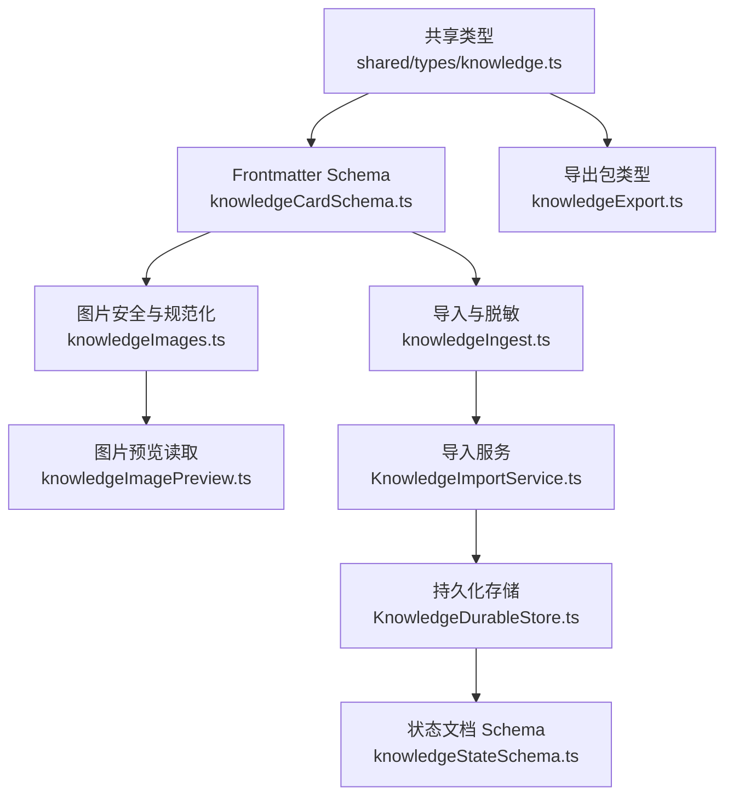
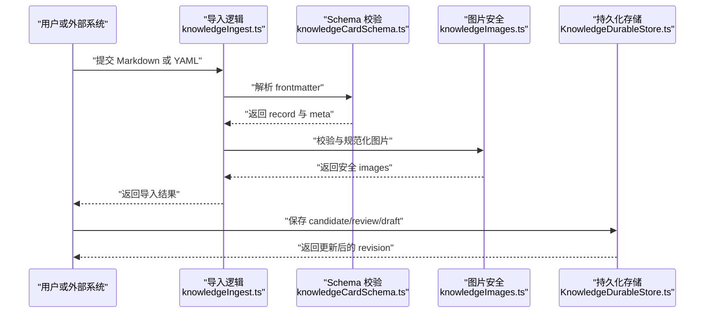
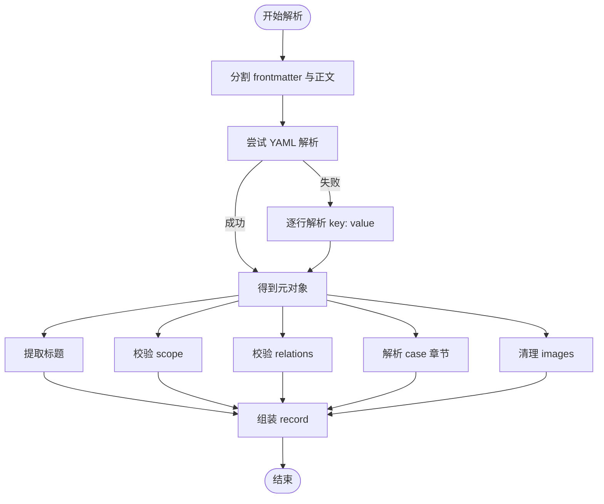
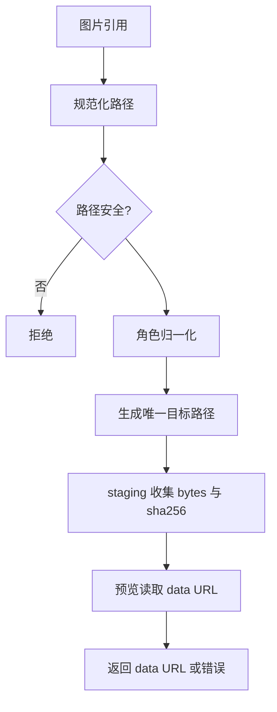
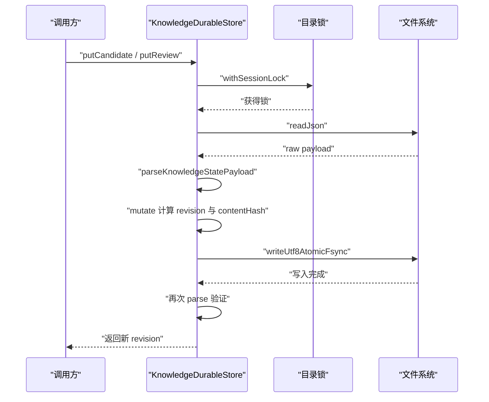
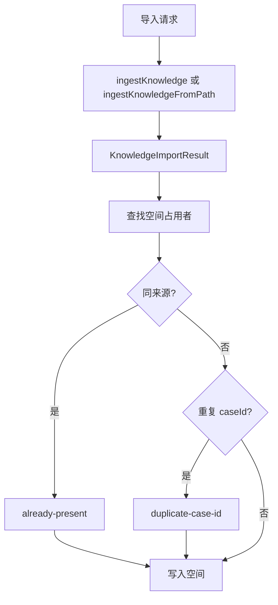
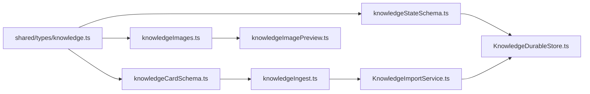

# 数据模型与 Schema

<cite>
**本文引用的文件**   
- [knowledge.ts](file://src/shared/types/knowledge.ts)
- [knowledgeCardSchema.ts](file://src/main/knowledge/knowledgeCardSchema.ts)
- [knowledgeStateSchema.ts](file://src/main/knowledge/knowledgeStateSchema.ts)
- [knowledgeImages.ts](file://src/main/knowledge/knowledgeImages.ts)
- [knowledgeImagePreview.ts](file://src/main/knowledge/knowledgeImagePreview.ts)
- [knowledgeIngest.ts](file://src/main/knowledge/knowledgeIngest.ts)
- [KnowledgeDurableStore.ts](file://src/main/knowledge/KnowledgeDurableStore.ts)
- [KnowledgeImportService.ts](file://src/main/knowledge/KnowledgeImportService.ts)
- [knowledgeExport.ts](file://src/shared/types/knowledgeExport.ts)
</cite>

## 目录
1. [引言](#引言)
2. [项目结构定位](#项目结构定位)
3. [核心数据模型](#核心数据模型)
4. [架构总览](#架构总览)
5. [详细组件分析](#详细组件分析)
6. [依赖关系分析](#依赖关系分析)
7. [性能与一致性特性](#性能与一致性特性)
8. [故障排查指南](#故障排查指南)
9. [结论](#结论)
10. [附录：Schema、示例与扩展指南](#附录schema示例与扩展指南)

## 引言
本文件面向知识系统的数据模型、frontmatter schema 验证、类型检查、生命周期状态机、图片处理流程、持久化、备份恢复与迁移，以及向后兼容性保证。目标是让不熟悉代码的读者也能理解 KnowledgeCardRecord、KnowledgeScope、KnowledgeRelation、KnowledgeImageRef 等核心类型的含义和约束，并掌握从导入、校验、持久化到预览展示的完整链路。

## 项目结构定位
知识系统的核心实现位于主进程 knowledge 目录，共享类型定义位于 shared/types/knowledge.ts，导出包契约位于 shared/types/knowledgeExport.ts。关键职责划分如下：

- 类型契约层：shared/types/knowledge.ts、knowledgeExport.ts
- Frontmatter 解析与校验：knowledgeCardSchema.ts
- 导入与脱敏：knowledgeIngest.ts
- 图片安全与路径规范：knowledgeImages.ts
- 图片预览读取：knowledgeImagePreview.ts
- 状态持久化与版本控制：knowledgeStateSchema.ts、KnowledgeDurableStore.ts
- 空间写入与冲突处理：KnowledgeImportService.ts



**图表来源**
- [knowledge.ts:1-120](file://src/shared/types/knowledge.ts#L1-L120)
- [knowledgeCardSchema.ts:1-120](file://src/main/knowledge/knowledgeCardSchema.ts#L1-L120)
- [knowledgeImages.ts:1-103](file://src/main/knowledge/knowledgeImages.ts#L1-L103)
- [knowledgeImagePreview.ts:1-34](file://src/main/knowledge/knowledgeImagePreview.ts#L1-L34)
- [knowledgeIngest.ts:201-629](file://src/main/knowledge/knowledgeIngest.ts#L201-L629)
- [KnowledgeImportService.ts:1-200](file://src/main/knowledge/KnowledgeImportService.ts#L1-L200)
- [KnowledgeDurableStore.ts:1-219](file://src/main/knowledge/KnowledgeDurableStore.ts#L1-L219)
- [knowledgeStateSchema.ts:1-124](file://src/main/knowledge/knowledgeStateSchema.ts#L1-L124)
- [knowledgeExport.ts:1-61](file://src/shared/types/knowledgeExport.ts#L1-L61)

**章节来源**
- [knowledge.ts:1-200](file://src/shared/types/knowledge.ts#L1-L200)
- [knowledgeCardSchema.ts:1-275](file://src/main/knowledge/knowledgeCardSchema.ts#L1-L275)
- [knowledgeImages.ts:1-103](file://src/main/knowledge/knowledgeImages.ts#L1-L103)
- [knowledgeImagePreview.ts:1-34](file://src/main/knowledge/knowledgeImagePreview.ts#L1-L34)
- [knowledgeIngest.ts:1-808](file://src/main/knowledge/knowledgeIngest.ts#L1-L808)
- [KnowledgeDurableStore.ts:1-219](file://src/main/knowledge/KnowledgeDurableStore.ts#L1-L219)
- [knowledgeStateSchema.ts:1-124](file://src/main/knowledge/knowledgeStateSchema.ts#L1-L124)
- [knowledgeExport.ts:1-61](file://src/shared/types/knowledgeExport.ts#L1-L61)

## 核心数据模型
本节集中说明四个核心类型及其字段语义、约束和默认值。

### KnowledgeCardRecord（知识卡片记录）
KnowledgeCardRecord 是知识卡片的运行时记录，对应 Markdown frontmatter 中的结构化元数据。关键字段如下：

| 字段 | 类型 | 是否必填 | 默认值 | 约束与说明 |
|---|---|---|---|---|
| cardId | string | 是 | 无 | 非空字符串；由 spaceId 与 relativePath 组合或显式提供 |
| spaceId | string | 是 | 无 | 非空字符串；标识所属知识空间 |
| relativePath | string | 是 | 无 | 非空字符串；相对路径，不是绝对路径 |
| type | KnowledgeCardType | 是 | 无 | 枚举：fact、constraint、pattern、procedure、case、model |
| lifecycle | KnowledgeLifecycle | 是 | 无 | 枚举：draft、candidate、verified、promoted、retired |
| title | string | 是 | 无 | 非空字符串；标题优先来自 frontmatter，其次来自正文首行标题 |
| scope | KnowledgeScope | 否 | {} | 多维环境范围映射，支持 exclusions |
| relations | KnowledgeRelation[] | 否 | [] | 指向其他卡片的受控关系列表 |
| body | string | 是 | 无 | 正文内容；序列化时放在 frontmatter 之后 |
| preview | string | 否 | 无 | 可选摘要；可由标题推导 |
| updatedAt | number | 否 | 无 | 非负整数时间戳 |
| sourceStatus | string | 否 | 无 | 历史来源状态；fixed 不等同于 verified |
| caseId | string | 否 | 无 | case 类型卡片专用标识 |
| chapters | KnowledgeCaseChapters | 否 | 无 | case 章节结构体 |
| images | KnowledgeImageRef[] | 否 | [] | 受安全校验后的图片引用数组 |
| missingAssets | string[] | 否 | 无 | 导入时缺失资源的清洗后 ID |
| sourceHash | string | 否 | 无 | 64 位十六进制哈希；用于来源去重 |
| sourceMtimeMs | number | 否 | 无 | 非负整数毫秒时间戳 |
| sourceSize | number | 否 | 无 | 非负整数字节大小 |

注意：
- KnowledgeCardRecord 的 zod schema 要求 cardId、spaceId、relativePath、type、lifecycle、title、body 必须存在且非空。
- scope、relations、images 有默认值 {} 或 []。
- sourceHash 必须是 64 位十六进制字符串。
- sourceStatus 仅为历史溯源，sourceStatusImpliesVerified 明确排除 fixed。

**章节来源**
- [knowledge.ts:1-120](file://src/shared/types/knowledge.ts#L1-L120)
- [knowledgeCardSchema.ts:60-120](file://src/main/knowledge/knowledgeCardSchema.ts#L60-L120)
- [knowledgeCardSchema.ts:239-275](file://src/main/knowledge/knowledgeCardSchema.ts#L239-L275)

### KnowledgeScope（知识范围）
KnowledgeScope 是一个以维度键为属性的映射，支持可选的 exclusions 反向规则。

| 维度键 | 含义 |
|---|---|
| project | 项目 |
| engine | 引擎 |
| engineVersion | 引擎版本 |
| api | 接口 |
| platform | 平台 |
| gpuVendor | GPU 厂商 |
| gpuArch | GPU 架构 |
| device | 设备 |
| driver | 驱动 |
| capture | 捕获阶段 |
| pipelineStage | 管线阶段 |
| pass | Pass |
| shaderFamily | 着色器族 |
| materialFamily | 材质族 |
| quality | 质量档位 |
| resolution | 分辨率 |
| featureConfiguration | 渲染路径特征配置 |

exclusions 允许按相同维度列出被排除的值数组。

Zod 校验规则：
- 所有维度值均为可选的非空字符串。
- exclusions 的键必须属于 KNOWLEDGE_SCOPE_AXES。
- exclusions 的值是字符串数组，每个元素非空。
- parseScope 在宽松输入失败时回退为空对象 {}，避免破坏性错误。

**章节来源**
- [knowledge.ts:40-80](file://src/shared/types/knowledge.ts#L40-L80)
- [knowledgeCardSchema.ts:12-39](file://src/main/knowledge/knowledgeCardSchema.ts#L12-L39)
- [knowledgeCardSchema.ts:145-155](file://src/main/knowledge/knowledgeCardSchema.ts#L145-L155)

### KnowledgeRelation（知识关系）
KnowledgeRelation 描述两个知识卡片之间的关系。

| 字段 | 类型 | 约束 |
|---|---|---|
| kind | KnowledgeRelationKind | 受控枚举，例如 supports、contradicts、specializes、generalizes、derived_from、validated_by、invalidated_by、applies_to、excludes、supersedes、related_to、recommended_for、failed_in |
| targetCardId | string | 非空字符串，表示目标卡片标识 |

校验规则：
- kind 必须来自 KNOWLEDGE_RELATION_KINDS。
- targetCardId 必须是非空 trimmed 字符串。
- parseRelations 对非法条目直接丢弃，而不是整体失败。

**章节来源**
- [knowledge.ts:24-38](file://src/shared/types/knowledge.ts#L24-L38)
- [knowledgeCardSchema.ts:41-48](file://src/main/knowledge/knowledgeCardSchema.ts#L41-L48)
- [knowledgeCardSchema.ts:157-163](file://src/main/knowledge/knowledgeCardSchema.ts#L157-L163)

### KnowledgeImageRef（知识图片引用）
KnowledgeImageRef 表示卡片关联的图片资源，使用相对路径而非绝对路径。

| 字段 | 类型 | 约束 |
|---|---|---|
| relativePath | string | 非空字符串；经 normalizeKnowledgeImagePath 规范化为 POSIX 风格相对路径 |
| role | KnowledgeImageRole | 枚举：observed、reference、illustration |
| alt | string | 可选；trim 后保留非空值 |

安全规则：
- sanitizeKnowledgeImages 会去除重复路径、无效 role、越界路径。
- isKnowledgeImagePathAllowed 限制图片只能与卡片同级，或在 cases/<caseId>/ 目录下。
- 禁止路径穿越、空字符、绝对路径和非图片扩展名。

**章节来源**
- [knowledge.ts:82-96](file://src/shared/types/knowledge.ts#L82-L96)
- [knowledgeCardSchema.ts:50-58](file://src/main/knowledge/knowledgeCardSchema.ts#L50-L58)
- [knowledgeImages.ts:24-103](file://src/main/knowledge/knowledgeImages.ts#L24-L103)

## 架构总览
知识系统的数据流分为五个阶段：

1. 源解析：Markdown frontmatter 或 YAML 导入源被解析为 ParsedKnowledgeSource。
2. Schema 校验：使用 zod 校验 type、lifecycle、scope、relations、images 等字段。
3. 安全清理：过滤绝对路径、敏感信息、文件名泄露，并对图片路径做白名单校验。
4. 结果产出：生成 KnowledgeCardRecord，可能标记 missingAssets 或 conflict。
5. 持久化：将候选、评审、草稿写入 knowledge-state.json，并维护 revision 与 contentHash。



**图表来源**
- [knowledgeIngest.ts:201-629](file://src/main/knowledge/knowledgeIngest.ts#L201-L629)
- [knowledgeCardSchema.ts:120-200](file://src/main/knowledge/knowledgeCardSchema.ts#L120-L200)
- [knowledgeImages.ts:24-103](file://src/main/knowledge/knowledgeImages.ts#L24-L103)
- [KnowledgeDurableStore.ts:60-219](file://src/main/knowledge/KnowledgeDurableStore.ts#L60-L219)

## 详细组件分析

### Frontmatter Schema 验证与类型检查
前端面 matter 解析由 splitFrontmatter、parseLooseMeta、parseKnowledgeFrontmatter 共同完成。

关键点：
- splitFrontmatter 剥离 BOM，匹配 `---` 分隔块，分离 rawMeta 与 body。
- parseLooseMeta 先尝试 YAML 解析；失败时回退到逐行 key: value 解析，并按 JSON 尝试二次解析。
- extractTitle 优先取 meta.title，再取正文首个一级标题，最后回退到相对路径去掉 .md。
- parseScope、parseRelations、parseChapters 分别对子结构做 safeParse，失败时降级为空对象或空数组。
- parseKnowledgeFrontmatter 组装 record，包括 cardId、spaceId、relativePath、type、lifecycle、title、scope、relations、chapters、images、missingAssets、sourceHash、sourceMtimeMs、sourceSize。
- serializeKnowledgeCard 将 record 写回 Markdown，包含 frontmatter 与 body。
- normalizeLifecycle 使用枚举校验，非法值回退到 draft。
- sourceStatusImpliesVerified 明确 fixed 不视为 verified。



**图表来源**
- [knowledgeCardSchema.ts:120-200](file://src/main/knowledge/knowledgeCardSchema.ts#L120-L200)
- [knowledgeCardSchema.ts:201-275](file://src/main/knowledge/knowledgeCardSchema.ts#L201-L275)

**章节来源**
- [knowledgeCardSchema.ts:60-200](file://src/main/knowledge/knowledgeCardSchema.ts#L60-L200)
- [knowledgeCardSchema.ts:201-275](file://src/main/knowledge/knowledgeCardSchema.ts#L201-L275)

### 生命周期状态机
知识卡片的生命周期由 KNOWLEDGE_LIFECYCLES 定义：

| 状态 | 含义 |
|---|---|
| draft | 草稿；未进入候选或评审流程 |
| candidate | 候选；等待人工审查或自动判定 |
| verified | 已验证；sourceStatus 可为 verified，但 fixed 不等于 verified |
| promoted | 已提升；通常表示从候选通过评审 |
| retired | 已归档；不再活跃 |

状态变更规则：
- normalizeLifecycle 只接受枚举值，非法值回退为 draft。
- sourceStatusImpliesVerified 明确 sourceStatus=fixed 不视为 verified。
- ingestKnowledgePackage 将导出的生命周期仅作为元数据，重新导入始终落盘为 draft。
- 持久化层通过 revision 与 contentHash 防止并发覆盖。

```mermaid
stateDiagram-v2
    [*] --> Draft
    Draft --> Candidate : "创建候选"
    Candidate --> Verified : "验证通过"
    Candidate --> Promoted : "评审提升"
    Verified --> Retired : "归档"
    Promoted --> Retired : "归档"
    Note over Draft,Retired : "sourceStatus=fixed 不等同于 verified"
```

**图表来源**
- [knowledge.ts:12-22](file://src/shared/types/knowledge.ts#L12-L22)
- [knowledgeCardSchema.ts:261-275](file://src/main/knowledge/knowledgeCardSchema.ts#L261-L275)
- [knowledgeIngest.ts:201-629](file://src/main/knowledge/knowledgeIngest.ts#L201-L629)
- [KnowledgeDurableStore.ts:180-219](file://src/main/knowledge/KnowledgeDurableStore.ts#L180-L219)

**章节来源**
- [knowledge.ts:12-22](file://src/shared/types/knowledge.ts#L12-L22)
- [knowledgeCardSchema.ts:261-275](file://src/main/knowledge/knowledgeCardSchema.ts#L261-L275)
- [knowledgeIngest.ts:201-629](file://src/main/knowledge/knowledgeIngest.ts#L201-L629)
- [KnowledgeDurableStore.ts:180-219](file://src/main/knowledge/KnowledgeDurableStore.ts#L180-L219)

### 图片处理流程：staging、预览生成、缩略图、缓存策略
图片处理涉及三类职责：

1. 路径与安全校验：knowledgeImages.ts
   - KNOWLEDGE_IMAGE_MAX_BYTES：单张图片最大字节数。
   - KNOWLEDGE_IMAGE_EXTENSIONS：允许的扩展名 png、jpg、jpeg、gif、webp。
   - KNOWLEDGE_IMAGE_MIME_BY_EXT：扩展名到 MIME 类型映射。
   - normalizeKnowledgeImagePath：转为 POSIX 相对路径。
   - knowledgeImageRoleFromAsset：将 observed/before/symptom 归一为 observed，reference/after/expected 归一为 reference，其余为 illustration。
   - knowledgeImageDestination：为 cases/<caseId>/<role>.ext 生成唯一目标路径。
   - isSafeKnowledgeImageRelative：拒绝路径穿越、空字符、非图片扩展名。
   - isKnowledgeImagePathAllowed：限制图片位置，要么与卡片同级，要么在 cases/<caseId>/ 下。
   - sanitizeKnowledgeImages：去重、过滤无效 role、过滤不安全路径。

2. 预览读取：knowledgeImagePreview.ts
   - readKnowledgeImagePreview 根据 spaces 找到 rootPath。
   - 校验 relativePath 安全性与 MIME 类型。
   - resolveWithinRoot 解析绝对路径并 stat。
   - 使用 readAttachmentFilePreviewDataUrl 生成 data URL。
   - 返回 KNOWLEDGE_IMAGE_MISSING 或 KNOWLEDGE_IMAGE_DENIED。

3. 导入 staging：knowledgeIngest.ts
   - stageImagesFromMap 根据 YAML assets 与 files Map 收集 staged 图片。
   - 每张 staged 图片携带 relativePath、role、bytes、sha256。
   - 超过 KNOWLEDGE_IMAGE_MAX_BYTES 的图片被跳过。

目前仓库中未发现独立的“缩略图”生成或本地缩略图缓存实现；预览以 data URL 形式直接读取原图。若需要缩略图，应基于现有 MIME 与路径安全规则扩展。



**图表来源**
- [knowledgeImages.ts:12-103](file://src/main/knowledge/knowledgeImages.ts#L12-L103)
- [knowledgeImagePreview.ts:1-34](file://src/main/knowledge/knowledgeImagePreview.ts#L1-L34)
- [knowledgeIngest.ts:630-808](file://src/main/knowledge/knowledgeIngest.ts#L630-L808)

**章节来源**
- [knowledgeImages.ts:12-103](file://src/main/knowledge/knowledgeImages.ts#L12-L103)
- [knowledgeImagePreview.ts:1-34](file://src/main/knowledge/knowledgeImagePreview.ts#L1-L34)
- [knowledgeIngest.ts:630-808](file://src/main/knowledge/knowledgeIngest.ts#L630-L808)

### 知识状态持久化、备份恢复与数据迁移
持久化层由 knowledgeStateSchema.ts 与 KnowledgeDurableStore.ts 共同组成。

#### 状态文档结构
knowledge-state.json 的结构由 KnowledgeStateDocumentSchema 定义：

| 字段 | 类型 | 说明 |
|---|---|---|
| schemaVersion | literal '1' | 当前固定版本 |
| candidates | KnowledgeDurableCandidate[] | 候选记录 |
| reviews | KnowledgeDurableReview[] | 评审记录 |
| drafts | KnowledgeDurableDraft[] | 可选；遗留草稿 |

每条候选、评审、草稿都包含：
- revision：正整数版本号。
- contentHash：64 位十六进制内容哈希。
- 业务对象：candidate、review 或 card。

#### 读写流程
- loadUnlocked 读取 JSON，调用 assertNoUnsupportedSchemaVersion 阻止不支持的版本。
- parseKnowledgeStatePayload 解析出 document 与 leftoverDrafts。
- writeUnlocked 原子写入，再次校验 schemaVersion 并 parse 验证写入完整性。
- mutate 加锁后加载、修改、写入。
- withSessionLock 使用目录级文件锁，防止多进程竞争。
- replaceLeftoverDrafts 专门处理遗留草稿迁移。

#### 冲突与幂等
- upsertRecord 比较 expectedRevision、existing.revision 与 contentHash。
- 不存在且 expectedRevision 非 0 时报错。
- revision 不一致时报错。
- 完全一致时返回已有记录，避免无意义写盘。



**图表来源**
- [knowledgeStateSchema.ts:1-124](file://src/main/knowledge/knowledgeStateSchema.ts#L1-L124)
- [KnowledgeDurableStore.ts:60-219](file://src/main/knowledge/KnowledgeDurableStore.ts#L60-L219)

**章节来源**
- [knowledgeStateSchema.ts:1-124](file://src/main/knowledge/knowledgeStateSchema.ts#L1-L124)
- [KnowledgeDurableStore.ts:1-219](file://src/main/knowledge/KnowledgeDurableStore.ts#L1-L219)

### 导入服务与空间冲突处理
KnowledgeImportService 负责将 ingested 结果持久化到指定 spaceId，并处理 already-present 与 duplicate-case-id 冲突。

关键行为：
- importToSpace 支持 filePath 或 source 两种输入。
- ingestKnowledgeFromPath 或 ingestKnowledge 产出 KnowledgeImportResult。
- persistToSpace 对比空间 occupant，判断是否 sameSource。
- alreadyPresentItem 复用已有 cardId、relativePath、caseId、sourceHash。
- spaceConflictItem 标记 duplicate-case-id 冲突。
- migrateSessionDrafts 将遗留草稿迁移到实际占用的卡片，否则保留 remaining。



**图表来源**
- [KnowledgeImportService.ts:1-200](file://src/main/knowledge/KnowledgeImportService.ts#L1-L200)
- [knowledgeIngest.ts:201-629](file://src/main/knowledge/knowledgeIngest.ts#L201-L629)

**章节来源**
- [KnowledgeImportService.ts:1-200](file://src/main/knowledge/KnowledgeImportService.ts#L1-L200)
- [knowledgeIngest.ts:201-629](file://src/main/knowledge/knowledgeIngest.ts#L201-L629)

## 依赖关系分析
知识系统的依赖关系具有清晰的层次：

- shared/types/knowledge.ts 提供核心枚举、接口与常量，是所有上层模块的类型基础。
- knowledgeCardSchema.ts 依赖 zod 与 shared types，实现 frontmatter 解析与序列化。
- knowledgeImages.ts 依赖 shared types 与 knowledgeFs，负责图片路径安全。
- knowledgeImagePreview.ts 依赖 conversation 附件预览能力与 knowledgeFs。
- knowledgeIngest.ts 依赖 knowledgeImages、knowledgeZip、shared types/knowledgeExport。
- knowledgeStateSchema.ts 依赖 zod 与 shared types。
- KnowledgeDurableStore.ts 依赖 storageAdapter、directoryFileLock 与 knowledgeErrors。
- KnowledgeImportService.ts 聚合 query、write、store，协调导入流程。



**图表来源**
- [knowledge.ts:1-200](file://src/shared/types/knowledge.ts#L1-L200)
- [knowledgeCardSchema.ts:1-275](file://src/main/knowledge/knowledgeCardSchema.ts#L1-L275)
- [knowledgeImages.ts:1-103](file://src/main/knowledge/knowledgeImages.ts#L1-L103)
- [knowledgeImagePreview.ts:1-34](file://src/main/knowledge/knowledgeImagePreview.ts#L1-L34)
- [knowledgeIngest.ts:1-808](file://src/main/knowledge/knowledgeIngest.ts#L1-L808)
- [knowledgeStateSchema.ts:1-124](file://src/main/knowledge/knowledgeStateSchema.ts#L1-L124)
- [KnowledgeDurableStore.ts:1-219](file://src/main/knowledge/KnowledgeDurableStore.ts#L1-L219)
- [KnowledgeImportService.ts:1-200](file://src/main/knowledge/KnowledgeImportService.ts#L1-L200)

**章节来源**
- [knowledge.ts:1-200](file://src/shared/types/knowledge.ts#L1-L200)
- [knowledgeCardSchema.ts:1-275](file://src/main/knowledge/knowledgeCardSchema.ts#L1-L275)
- [knowledgeImages.ts:1-103](file://src/main/knowledge/knowledgeImages.ts#L1-L103)
- [knowledgeImagePreview.ts:1-34](file://src/main/knowledge/knowledgeImagePreview.ts#L1-L34)
- [knowledgeIngest.ts:1-808](file://src/main/knowledge/knowledgeIngest.ts#L1-L808)
- [knowledgeStateSchema.ts:1-124](file://src/main/knowledge/knowledgeStateSchema.ts#L1-L124)
- [KnowledgeDurableStore.ts:1-219](file://src/main/knowledge/KnowledgeDurableStore.ts#L1-L219)
- [KnowledgeImportService.ts:1-200](file://src/main/knowledge/KnowledgeImportService.ts#L1-L200)

## 性能与一致性特性
- 图片大小限制：KNOWLEDGE_IMAGE_MAX_BYTES 限制单张图片不超过 2MB，避免大文件拖慢导入与预览。
- 白名单扩展名与 MIME 类型：减少非法文件处理和渲染开销。
- 路径规范化与安全检查：normalizeKnowledgeImagePath 与 isSafeKnowledgeImageRelative 降低路径攻击风险。
- 幂等写入：upsertRecord 在 revision 与 contentHash 完全一致时跳过写盘。
- 原子写入：writeUtf8AtomicFsync 确保 knowledge-state.json 写入一致性。
- 会话级锁：withDirectoryFileLock 防止并发竞争。
- 内容哈希：hashKnowledgeContent 与 hashKnowledgeImportBytes 用于去重与审计。

这些特性共同保证了知识系统在大规模导入、多图关联、并发写入场景下的稳定性。

[本节为通用性能讨论，不直接分析具体代码片段]

## 故障排查指南
常见错误与定位方式：

| 现象 | 可能原因 | 排查建议 |
|---|---|---|
| 导入返回 secret-detected | 源码中包含密钥模式 | 检查 frontmatter 与正文是否包含 api_key、password、secret、credential、authorization、bearer 等 |
| 导入返回 absolute-path | 源码中出现 Windows 盘符、UNC 或 POSIX 绝对路径 | 检查相对路径假设，避免硬编码本机路径 |
| 导入返回 filename-leaked | 原始文件名泄露到公开文本 | 确认 assets.file 是否被替换为 opaque id 或 destination path |
| 图片预览返回 KNOWLEDGE_IMAGE_DENIED | 路径不安全、MIME 不受支持、找不到空间 | 检查 relativePath、spaceId、扩展名与 MIME |
| 图片预览返回 KNOWLEDGE_IMAGE_MISSING | 文件不存在或 data URL 生成失败 | 确认文件存在、路径可解析、MIME 合法 |
| 持久化抛出 KnowledgeRevisionConflictError | 并发写入导致 revision 不匹配 | 检查 expectedRevision 是否正确，避免覆盖他人写入 |
| 导入报告 duplicate-case-id | 同一 caseId 已被占用 | 检查 existingCaseIds 与 occupantMatches |
| 导入报告 already-present | 同 cardId 或同 caseId 且同 sourceHash | 检查 sourceHash 与 occupant 是否匹配 |

**章节来源**
- [knowledgeIngest.ts:201-629](file://src/main/knowledge/knowledgeIngest.ts#L201-L629)
- [knowledgeImagePreview.ts:1-34](file://src/main/knowledge/knowledgeImagePreview.ts#L1-L34)
- [KnowledgeDurableStore.ts:180-219](file://src/main/knowledge/KnowledgeDurableStore.ts#L180-L219)
- [KnowledgeImportService.ts:1-200](file://src/main/knowledge/KnowledgeImportService.ts#L1-L200)

## 结论
知识系统的数据模型以 shared/types/knowledge.ts 为中心，围绕 KnowledgeCardRecord、KnowledgeScope、KnowledgeRelation、KnowledgeImageRef 构建严格的 frontmatter schema 校验与类型约束。导入流程强调安全：拒绝敏感信息、绝对路径与文件名泄露，并对图片路径做严格白名单控制。持久化层通过 schemaVersion、revision 与 contentHash 提供强一致性与幂等写入，同时用目录锁保护并发访问。生命周期状态机清晰，且 fixed 不被误认为 verified。图片处理当前以 staging、预览 data URL 为主，尚未实现独立缩略图与本地缓存；如需扩展，应在现有安全规则基础上增加缩略图生成与缓存策略。

[本节为总结性内容，不直接分析具体文件]

## 附录：Schema、示例与扩展指南

### 完整 Schema 定义要点
- KnowledgeScopeSchema：允许任意受控维度键，值为非空字符串；exclusions 为维度到字符串数组的映射。
- KnowledgeRelationSchema：kind 为枚举，targetCardId 为非空字符串。
- KnowledgeImageRefSchema：relativePath 非空，role 为枚举，alt 可选。
- KnowledgeCaseChaptersSchema：claim、scopeExclusions、symptoms、evidence、rootCause、experimentVerification、fix、negative、openChallenges、derived 均为可选字符串。
- KnowledgeCardRecordSchema：cardId、spaceId、relativePath、type、lifecycle、title、body 必填；scope、relations、images 默认空；updatedAt、sourceStatus、caseId、chapters、missingAssets、sourceHash、sourceMtimeMs、sourceSize 可选且有类型约束。
- KnowledgeStateDocumentSchema：schemaVersion 固定为 '1'；candidates、reviews 必填；drafts 可选。

**章节来源**
- [knowledgeCardSchema.ts:12-120](file://src/main/knowledge/knowledgeCardSchema.ts#L12-L120)
- [knowledgeStateSchema.ts:10-124](file://src/main/knowledge/knowledgeStateSchema.ts#L10-L124)

### 示例数据说明
由于本仓库不允许直接粘贴代码内容，以下以结构化描述给出示例：

- 事实型卡片示例：
  - cardId: "user:notes/perf-tip.md"
  - type: "fact"
  - lifecycle: "draft"
  - title: "某性能优化建议"
  - scope: { platform: "Windows", gpuVendor: "NVIDIA" }
  - relations: []
  - body: "一段关于性能优化的说明文字"

- 案例型卡片示例：
  - cardId: "staging:cases/AIRD-1.md"
  - type: "case"
  - lifecycle: "draft"
  - title: "某问题案例"
  - caseId: "AIRD-1"
  - chapters: { claim: "问题声明", symptoms: "症状描述", evidence: "证据", fix: "修复方案" }
  - images: [{ relativePath: "cases/AIRD-1/observed.png", role: "observed" }]

- 关系示例：
  - KnowledgeRelation: { kind: "supports", targetCardId: "user:notes/perf-tip.md" }

- 图片引用示例：
  - KnowledgeImageRef: { relativePath: "cases/AIRD-1/reference.png", role: "reference", alt: "预期效果截图" }

**章节来源**
- [knowledge.ts:1-120](file://src/shared/types/knowledge.ts#L1-L120)
- [knowledgeCardSchema.ts:60-120](file://src/main/knowledge/knowledgeCardSchema.ts#L60-L120)

### 验证规则清单
- type 必须属于 fact、constraint、pattern、procedure、case、model。
- lifecycle 必须属于 draft、candidate、verified、promoted、retired。
- relation.kind 必须属于支持的十三个关系类型。
- image.role 必须属于 observed、reference、illustration。
- image.relativePath 必须是非空、非绝对、无路径穿越、非图片扩展名拒绝。
- sourceHash 必须为 64 位十六进制。
- sourceStatus=fixed 不视为 verified。
- 导入内容不得包含敏感关键词或绝对路径。
- 图片字节不得超过 KNOWLEDGE_IMAGE_MAX_BYTES。
- knowledge-state.json 的 schemaVersion 必须为 '1'。

**章节来源**
- [knowledge.ts:12-22](file://src/shared/types/knowledge.ts#L12-L22)
- [knowledgeCardSchema.ts:12-120](file://src/main/knowledge/knowledgeCardSchema.ts#L12-L120)
- [knowledgeImages.ts:12-103](file://src/main/knowledge/knowledgeImages.ts#L12-L103)
- [knowledgeIngest.ts:201-629](file://src/main/knowledge/knowledgeIngest.ts#L201-L629)
- [knowledgeStateSchema.ts:1-124](file://src/main/knowledge/knowledgeStateSchema.ts#L1-L124)

### 数据模型扩展指南
扩展时应遵循以下原则：

1. 新增枚举值前：
   - 在 shared/types/knowledge.ts 中添加枚举值。
   - 在 knowledgeCardSchema.ts 中同步 zod enum。
   - 在 UI 展示层与检索 lane 中考虑是否需要适配。

2. 新增字段前：
   - 先在 KnowledgeCardRecord 或相关接口添加字段。
   - 在 zod schema 中添加校验与默认值。
   - 在 parseKnowledgeFrontmatter 中增加解析逻辑。
   - 在 serializeKnowledgeCard 中增加序列化逻辑。
   - 在导入与导出流程中考虑字段是否可传输。

3. 新增图片属性前：
   - 在 knowledgeImages.ts 中补充角色映射或路径规则。
   - 在 knowledgeImagePreview.ts 中补充 MIME 或预览逻辑。
   - 在 staging 流程中补充 bytes 与 sha256 处理。

4. 新增持久化结构前：
   - 在 knowledgeStateSchema.ts 中升级 schemaVersion。
   - 在 parseKnowledgeStatePayload 中兼容旧版本。
   - 在 KnowledgeDurableStore.ts 中实现迁移逻辑。
   - 在 assertNoUnsupportedSchemaVersion 中决定是否拒绝旧版本。

### 向后兼容性保证
- schemaVersion 固定为 '1'，任何破坏性变更都需要新版本号。
- parseKnowledgeStatePayload 对未知字段保持宽容，只解析已知字段。
- parseScope、parseRelations、parseChapters 使用 safeParse，失败回退为默认值。
- normalizeLifecycle 对非法值回退为 draft。
- ingestKnowledgePackage 将生命周期作为元数据，重新导入一律为 draft，避免历史状态污染。
- replaceLeftoverDrafts 允许遗留草稿在后续迁移中被清理或保留。
- export 类型 KnowledgePackageCard 明确说明 machine-local provenance 会被剥离，避免跨机器迁移泄露路径。

**章节来源**
- [knowledgeStateSchema.ts:1-124](file://src/main/knowledge/knowledgeStateSchema.ts#L1-L124)
- [knowledgeCardSchema.ts:145-163](file://src/main/knowledge/knowledgeCardSchema.ts#L145-L163)
- [knowledgeCardSchema.ts:261-275](file://src/main/knowledge/knowledgeCardSchema.ts#L261-L275)
- [knowledgeIngest.ts:201-629](file://src/main/knowledge/knowledgeIngest.ts#L201-L629)
- [knowledgeExport.ts:1-61](file://src/shared/types/knowledgeExport.ts#L1-L61)