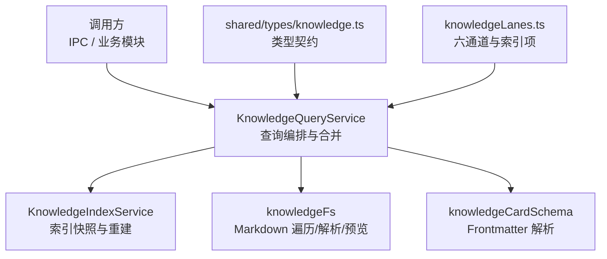
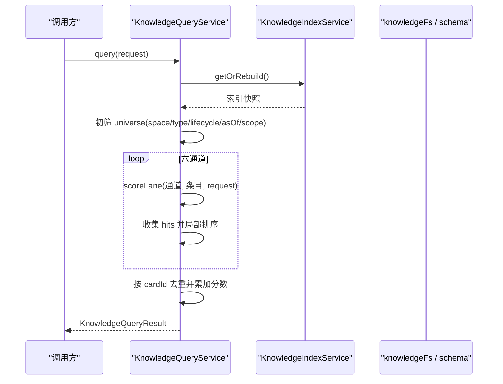
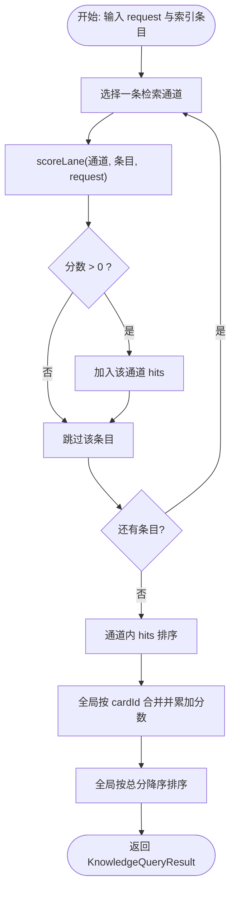
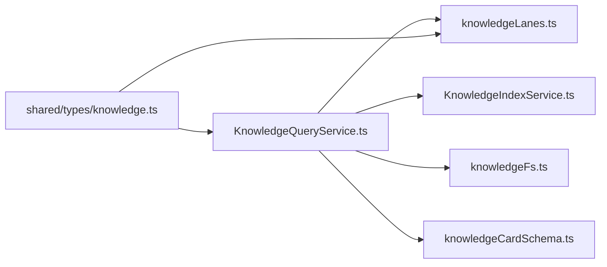

# 知识查询服务

<cite>
**本文引用的文件**   
- [KnowledgeQueryService.ts](file://src/main/knowledge/KnowledgeQueryService.ts)
- [knowledgeLanes.ts](file://src/main/knowledge/knowledgeLanes.ts)
- [knowledge.ts](file://src/shared/types/knowledge.ts)
- [KnowledgeIndexService.ts](file://src/main/knowledge/KnowledgeIndexService.ts)
- [knowledgeFs.ts](file://src/main/knowledge/knowledgeFs.ts)
- [knowledgeCardSchema.ts](file://src/main/knowledge/knowledgeCardSchema.ts)
</cite>

## 目录
1. [简介](#简介)
2. [项目结构定位](#项目结构定位)
3. [核心组件](#核心组件)
4. [架构总览](#架构总览)
5. [详细组件分析](#详细组件分析)
6. [依赖关系分析](#依赖关系分析)
7. [性能考虑与调优建议](#性能考虑与调优建议)
8. [故障排查指南](#故障排查指南)
9. [结论](#结论)

## 简介
本文件面向“知识查询服务”的实现与使用，重点说明 `KnowledgeQueryService` 如何协调六条检索通道、处理查询请求、合并并排序搜索结果。文档同时解释 `KnowledgeQueryRequest` 和 `KnowledgeQueryResult` 的数据结构，包括 lane 过滤器、scope 过滤、类型与生命周期筛选；说明查询缓存机制、结果去重策略和相关性评分算法；阐述与 `KnowledgeIndexService` 的协作方式，以及原始文件读取与预览生成流程。最后给出复杂查询场景示例、性能优化建议和常见查询模式的最佳实践。

## 项目结构定位
知识查询能力位于主进程模块中：
- 查询编排与评分：`src/main/knowledge/KnowledgeQueryService.ts`
- 六通道定义与索引条目结构：`src/main/knowledge/knowledgeLanes.ts`
- 共享类型契约（卡片、范围、关系、通道等）：`src/shared/types/knowledge.ts`
- 索引快照与服务：`src/main/knowledge/KnowledgeIndexService.ts`
- 文件系统访问、Markdown 解析、摘要/预览提取：`src/main/knowledge/knowledgeFs.ts`、`src/main/knowledge/knowledgeCardSchema.ts`

图示来源
- [KnowledgeQueryService.ts:1-239](file://src/main/knowledge/KnowledgeQueryService.ts#L1-L239)
- [knowledgeLanes.ts:1-56](file://src/main/knowledge/knowledgeLanes.ts#L1-L56)
- [knowledge.ts:1-200](file://src/shared/types/knowledge.ts#L1-L200)

章节来源
- [KnowledgeQueryService.ts:1-239](file://src/main/knowledge/KnowledgeQueryService.ts#L1-L239)
- [knowledgeLanes.ts:1-56](file://src/main/knowledge/knowledgeLanes.ts#L1-L56)
- [knowledge.ts:1-200](file://src/shared/types/knowledge.ts#L1-L200)

## 核心组件
- KnowledgeQueryService：负责空间列举、卡片列表、单卡详情、统一查询入口、六通道评分、结果合并与排序。
- KnowledgeIndexService：提供索引快照，支持按需重建；为查询提供预计算的 `KnowledgeIndexEntry` 列表。
- knowledgeLanes：声明六条检索通道、索引条目结构及快照结构。
- shared/types/knowledge：定义卡片类型、生命周期、作用域轴、关系、图像引用、查询请求与结果类型等契约。
- knowledgeFs / knowledgeCardSchema：提供 Markdown 文件遍历、frontmatter 解析、正文预览提取等基础能力。

章节来源
- [KnowledgeQueryService.ts:1-239](file://src/main/knowledge/KnowledgeQueryService.ts#L1-L239)
- [knowledgeLanes.ts:1-56](file://src/main/knowledge/knowledgeLanes.ts#L1-L56)
- [knowledge.ts:1-200](file://src/shared/types/knowledge.ts#L1-L200)
- [knowledgeFs.ts](file://src/main/knowledge/knowledgeFs.ts)
- [knowledgeCardSchema.ts](file://src/main/knowledge/knowledgeCardSchema.ts)

## 架构总览
查询过程分为四阶段：
1. 构建或获取索引快照：通过 `KnowledgeIndexService.getOrRebuild()` 返回稳定快照。
2. 全量初筛：基于 spaceId、type、lifecycle、asOf、scope 对索引进行过滤。
3. 六通道并行评分：逐通道计算分数，命中则加入该通道局部结果。
4. 全局合并与排序：按 cardId 去重累加分数，最终按总分降序输出。

图示来源
- [KnowledgeQueryService.ts:120-200](file://src/main/knowledge/KnowledgeQueryService.ts#L120-L200)
- [knowledgeLanes.ts:1-56](file://src/main/knowledge/knowledgeLanes.ts#L1-L56)

章节来源
- [KnowledgeQueryService.ts:120-200](file://src/main/knowledge/KnowledgeQueryService.ts#L120-L200)

## 详细组件分析

### KnowledgeQueryService：查询编排与合并
职责概览
- 空间列举：聚合用户空间与各项目空间。
- 卡片列表：遍历 Markdown 文件，解析 frontmatter，生成摘要并按路径排序。
- 单卡详情：安全解析相对路径，读取源文件，解析 frontmatter，必要时提取预览，附加 contentHash。
- 统一查询：加载索引快照、初筛、六通道评分、合并排序。

关键实现要点
- 依赖注入：通过 `KnowledgeQueryDependencies` 暴露 `listSpaces`、`index`、`readFile`、`statMtime`，便于测试替换。
- 路径安全：使用 `resolveWithinRoot` 防止路径穿越。
- 预览生成：若记录未包含预览，则从正文中提取；详情接口额外附加内容哈希。
- 查询初筛：按 spaceIds、type、lifecycle、asOf、scope 过滤。
- 六通道评分：每个通道独立打分，命中才计入局部结果。
- 结果合并：以 `cardId` 为键去重，分数相加，lane 数组追加；最终按总分降序排序。

```mermaid
classDiagram
  class KnowledgeQueryService {
    -resolved
    +constructor(overrides)
    +deps
    +listSpaces()
    +listCards(spaceId)
    +getCard(spaceId, relativePath)
    +query(request)
  }

  class KnowledgeIndexService {
    +getOrRebuild()
  }

  class knowledgeFs {
    +walkMarkdownFiles()
    +toCardSummary()
    +toCardDetail()
    +extractPreview()
    +resolveWithinRoot()
  }

  class knowledgeCardSchema {
    +parseKnowledgeFrontmatter()
  }

  KnowledgeQueryService --> KnowledgeIndexService : "使用索引快照"
  KnowledgeQueryService --> knowledgeFs : "文件遍历/预览"
  KnowledgeQueryService --> knowledgeCardSchema : "frontmatter 解析"
```

图示来源
- [KnowledgeQueryService.ts:1-239](file://src/main/knowledge/KnowledgeQueryService.ts#L1-L239)
- [knowledgeFs.ts](file://src/main/knowledge/knowledgeFs.ts)
- [knowledgeCardSchema.ts](file://src/main/knowledge/knowledgeCardSchema.ts)

章节来源
- [KnowledgeQueryService.ts:1-239](file://src/main/knowledge/KnowledgeQueryService.ts#L1-L239)

### 六条检索通道与评分算法
通道定义
- Identity/Path：精确匹配 cardId 或 relativePath，其次包含关键词，否则兜底低分。
- Scope/Metadata：根据 type、lifecycle、scope 是否匹配累计加分。
- Lexical：词法匹配，检查预计算的 lexical 字段是否包含查询文本。
- Structural：标题结构化匹配，优先于普通文本。
- Relation/Graph：根据 targetCardId 判断是否存在相关边。
- Temporal/Version：存在更新时间即得分。

评分逻辑要点
- 每个通道独立计算分数，零分或负分不进入该通道结果。
- 同通道内先按分数降序，再按相对路径字典序稳定排序。
- 多通道命中同一卡片时，分数叠加，lane 数组追加新通道。
- 最终全局结果按总分降序排序，保证相关性最高的卡片排在前面。

图示来源
- [KnowledgeQueryService.ts:140-239](file://src/main/knowledge/KnowledgeQueryService.ts#L140-L239)
- [knowledgeLanes.ts:1-56](file://src/main/knowledge/knowledgeLanes.ts#L1-L56)

章节来源
- [KnowledgeQueryService.ts:140-239](file://src/main/knowledge/KnowledgeQueryService.ts#L140-L239)
- [knowledgeLanes.ts:1-56](file://src/main/knowledge/knowledgeLanes.ts#L1-L56)

### 数据结构：KnowledgeQueryRequest 与 KnowledgeQueryResult
请求参数
- lanes：指定参与评分的通道子集；为空时使用全部六通道。
- text：用于 Lexical 与 Structural 通道的文本查询，内部会做规范化与小写处理。
- scope：按作用域轴进行精确匹配过滤，支持 exclusions 排除规则。
- type：限制卡片类型集合。
- lifecycle：限制生命周期集合。
- asOf：仅返回在指定时间戳之前更新的卡片。
- relationTargetCardId：Relation/Graph 通道下用于匹配关系的卡片 ID。
- cardId、relativePath：Identity/Path 通道下的精确或模糊匹配条件。
- spaceIds：限定搜索空间集合。

结果结构
- hits：去重后的命中列表，每条命中包含 cardId、contentHash、spaceId、relativePath、title、type、lifecycle、preview、updatedAt、score、lanes。
- lanes：每条通道的局部命中列表，含 lane 标识与对应 hits。

类型契约参考
- 通道枚举、Scope、Relation、Space、Card 类型等均定义于共享类型文件中。

章节来源
- [knowledge.ts:1-200](file://src/shared/types/knowledge.ts#L1-L200)
- [knowledgeLanes.ts:1-56](file://src/main/knowledge/knowledgeLanes.ts#L1-L56)
- [KnowledgeQueryService.ts:120-200](file://src/main/knowledge/KnowledgeQueryService.ts#L120-L200)

### 查询缓存机制
- 索引快照缓存：查询开始时调用 `KnowledgeIndexService.getOrRebuild()` 获取稳定的索引快照；若索引已存在且有效则直接复用，否则触发重建。
- 查询级缓存：当前实现未内置基于 request 的查询结果缓存；每次调用都会执行初筛、评分与合并。
- 文件变更感知：快照重建通常与底层 Markdown 文件变更相关；具体失效与重建策略由 `KnowledgeIndexService` 管理。

章节来源
- [KnowledgeQueryService.ts:120-160](file://src/main/knowledge/KnowledgeQueryService.ts#L120-L160)
- [KnowledgeIndexService.ts](file://src/main/knowledge/KnowledgeIndexService.ts)

### 结果去重与相关性排序
- 去重键：cardId。
- 去重策略：首次命中创建记录，后续命中将分数累加，并将新增 lane 追加到 lanes 数组。
- 排序策略：
  - 通道内：分数降序，分数相同时按 relativePath 字典序升序以保证稳定。
  - 全局：总分降序，体现跨通道相关性叠加效果。

章节来源
- [KnowledgeQueryService.ts:160-200](file://src/main/knowledge/KnowledgeQueryService.ts#L160-L200)

### 与 KnowledgeIndexService 的协作、原始文件读取与预览生成
- 索引协作：查询通过 `index.getOrRebuild()` 取得索引快照，避免重复扫描与解析开销。
- 原始文件读取：`listCards` 与 `getCard` 直接通过依赖注入的 `readFile` 读取 Markdown 源文件；`getCard` 还会调用 `statMtime` 获取更新时间。
- 预览生成：若记录的 preview 缺失，则从正文中提取；详情接口还会附加内容的 SHA-256 哈希，用于一致性校验。

章节来源
- [KnowledgeQueryService.ts:60-120](file://src/main/knowledge/KnowledgeQueryService.ts#L60-L120)
- [knowledgeFs.ts](file://src/main/knowledge/knowledgeFs.ts)
- [knowledgeCardSchema.ts](file://src/main/knowledge/knowledgeCardSchema.ts)

### 复杂查询场景示例
- 多 lane 组合查询：
  - 仅启用 Identity/Path 与 Scope/Metadata，快速定位某路径并限制 scope。
  - 启用 Lexical 与 Structural，提高自然语言关键词命中率。
- scope 过滤：
  - 设置 project、engine、platform 等轴值，缩小结果空间。
  - 使用 exclusions 排除特定 gpuVendor 或 driver 等值。
- 类型与生命周期筛选：
  - 限定 type 为 fact 或 constraint，配合 lifecycle 为 verified 或 promoted，确保高质量知识。
- 关系驱动查询：
  - 指定 relationTargetCardId，查找与被验证/推导/矛盾的其他卡片。
- 时间切片查询：
  - 设置 asOf 为某个时间点，只返回该时刻之前的版本，便于审计与回溯。

章节来源
- [KnowledgeQueryService.ts:120-200](file://src/main/knowledge/KnowledgeQueryService.ts#L120-L200)
- [knowledge.ts:1-200](file://src/shared/types/knowledge.ts#L1-L200)

## 依赖关系分析

图示来源
- [KnowledgeQueryService.ts:1-239](file://src/main/knowledge/KnowledgeQueryService.ts#L1-L239)
- [knowledgeLanes.ts:1-56](file://src/main/knowledge/knowledgeLanes.ts#L1-L56)
- [knowledge.ts:1-200](file://src/shared/types/knowledge.ts#L1-L200)

章节来源
- [KnowledgeQueryService.ts:1-239](file://src/main/knowledge/KnowledgeQueryService.ts#L1-L239)
- [knowledgeLanes.ts:1-56](file://src/main/knowledge/knowledgeLanes.ts#L1-L56)
- [knowledge.ts:1-200](file://src/shared/types/knowledge.ts#L1-L200)

## 性能考虑与调优建议
- 优先使用索引快照：避免重复文件扫描；尽量复用查询实例以减少依赖解析成本。
- 精简 lanes：当可明确目标通道时，传入 lanes 子集以降低评分计算量。
- 精准 scope 与 type/lifecycle：尽早缩小 universe 规模，减少后续通道扫描。
- 合理使用 asOf：历史切片查询能显著降低结果集大小。
- 控制 text 长度与复杂度：Lexical 与 Structural 通道会对预计算字段或标题进行匹配，过长或过于宽泛的查询会增加比较成本。
- 批量操作优化：如需多次查询，可在应用层缓存已知 stable 的 request 结果（例如分页翻页）。
- I/O 优化：listCards 与 getCard 会进行磁盘读取；在高并发场景下注意限流与错误重试。

[本节为通用性能建议，无需特定文件引用]

## 故障排查指南
常见问题与定位要点
- 未知空间报错：调用 listCards/getCard 时若 spaceId 不存在，会抛出“未知知识空间”错误。应校验 spaceId 来源于 listSpaces。
- 文件不可读：listCards 会跳过无法读取的文件；getCard 遇到 ENOENT 返回 null，其他 IO 错误向上抛出。
- 路径穿越防护：getCard 通过 `resolveWithinRoot` 校验相对路径；非法路径会抛出异常。
- 预览缺失：若预览未持久化，会在 getCard 中动态提取；若正文为空或解析失败，可能无预览。
- 查询结果为空：检查 lanes、scope、type、lifecycle、asOf、relationTargetCardId 等条件是否过于严格。

章节来源
- [KnowledgeQueryService.ts:40-120](file://src/main/knowledge/KnowledgeQueryService.ts#L40-L120)
- [KnowledgeQueryService.ts:120-200](file://src/main/knowledge/KnowledgeQueryService.ts#L120-L200)

## 结论
`KnowledgeQueryService` 以索引快照为基础，通过六通道评分与跨通道分数叠加，提供灵活且相关性友好的知识检索能力。结合 shared 类型契约与文件系统工具，它既支持面向用户的快速浏览，也支持面向 Agent 的上下文构建。在生产环境中，建议通过精确 scope、合理 lanes、asOf 切片等方式优化查询性能，并结合应用层缓存进一步提升吞吐与响应速度。