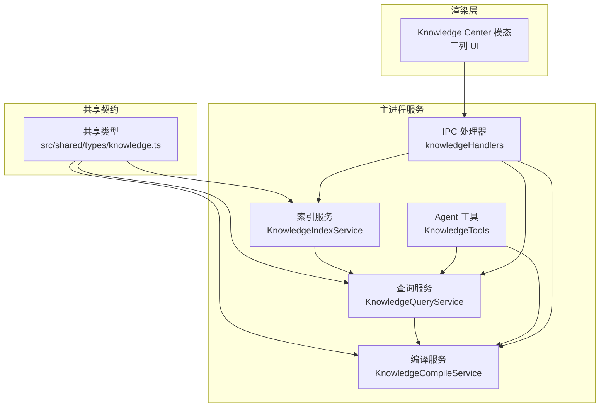
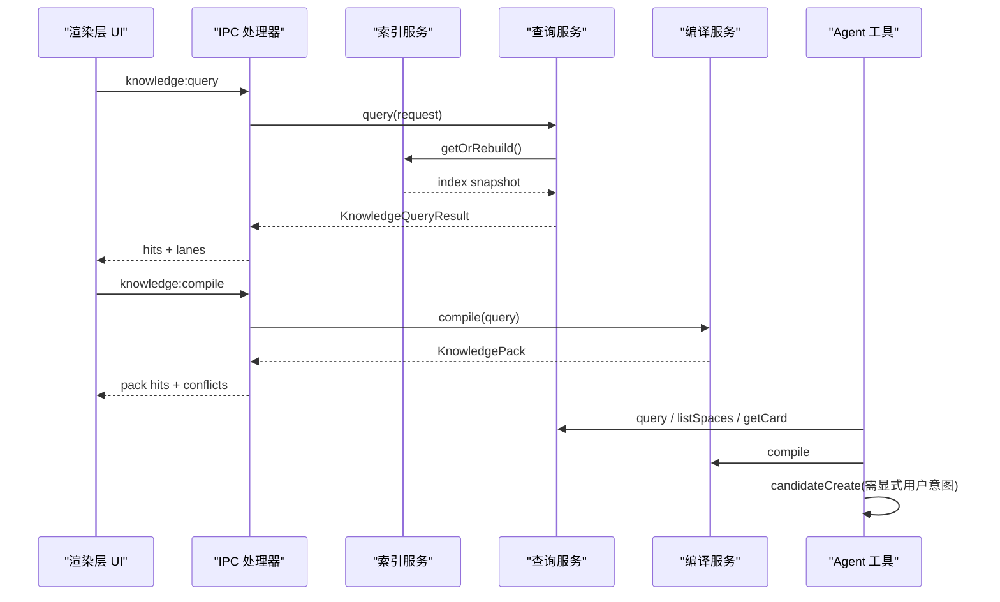
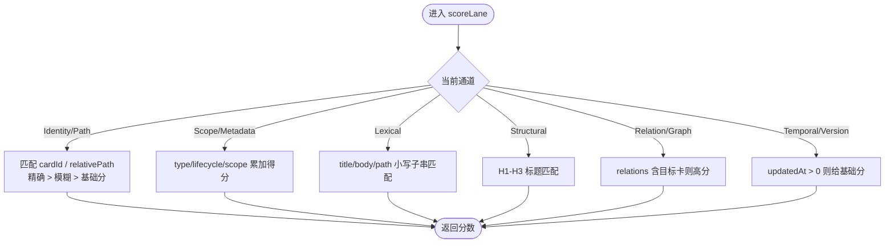
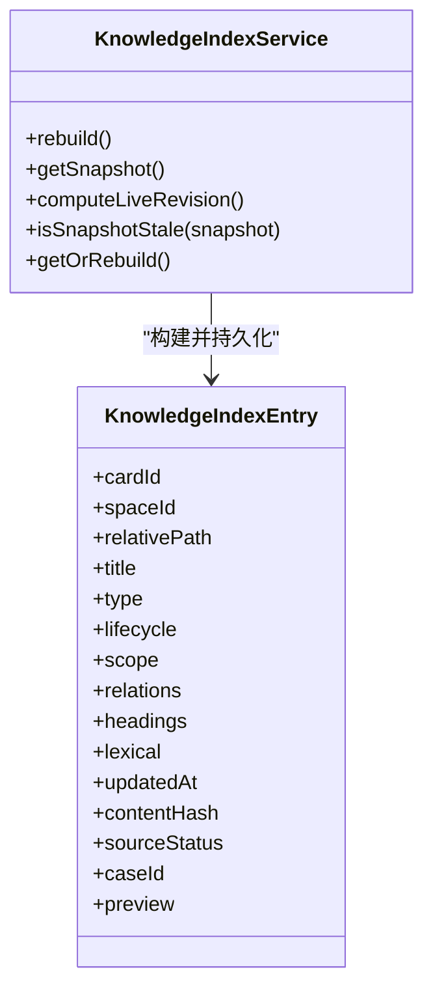
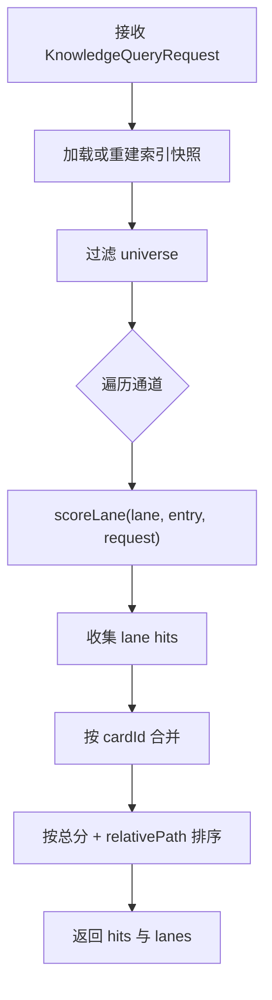
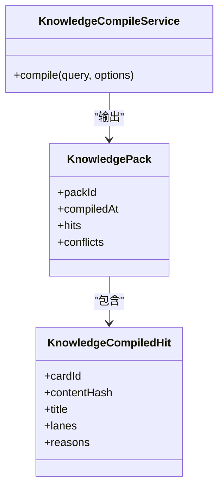
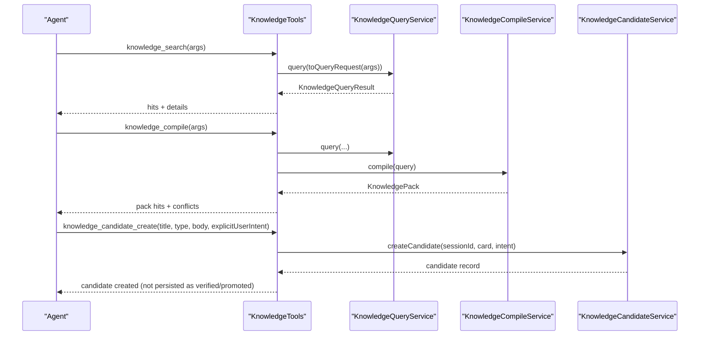
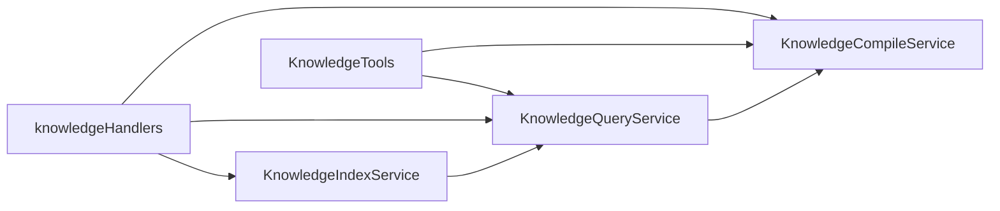

# 知识系统

<cite>
**本文引用的文件**   
- [src/shared/types/knowledge.ts](file://src/shared/types/knowledge.ts)
- [src/main/knowledge/knowledgeLanes.ts](file://src/main/knowledge/knowledgeLanes.ts)
- [src/main/knowledge/KnowledgeIndexService.ts](file://src/main/knowledge/KnowledgeIndexService.ts)
- [src/main/knowledge/KnowledgeQueryService.ts](file://src/main/knowledge/KnowledgeQueryService.ts)
- [src/main/knowledge/KnowledgeCompileService.ts](file://src/main/knowledge/KnowledgeCompileService.ts)
- [src/main/knowledge/KnowledgeTools.ts](file://src/main/knowledge/KnowledgeTools.ts)
- [src/main/ipc/knowledgeHandlers.ts](file://src/main/ipc/knowledgeHandlers.ts)
- [docs/ui/knowledge-center.md](file://docs/ui/knowledge-center.md)
</cite>

## 目录
1. [引言](#引言)
2. [项目结构](#项目结构)
3. [核心组件](#核心组件)
4. [架构总览](#架构总览)
5. [详细组件分析](#详细组件分析)
6. [依赖关系分析](#依赖关系分析)
7. [性能与扩展性](#性能与扩展性)
8. [故障排查](#故障排查)
9. [结论](#结论)
10. [附录：查询示例与最佳实践](#附录查询示例与最佳实践)

## 引言
本文件系统化说明仓库中的知识系统，重点解释以下目标：
- markdown-first 的六条检索通道：Identity/Path、Scope/Metadata、Lexical、Structural、Relation/Graph、Temporal/Version。
- Knowledge Center 的三列 UI、五服务架构、种子库管理边界。
- 知识索引构建、检索策略与相关性评分算法。
- 与 Agent 系统的集成方式：knowledge 工具、检索结果呈现、知识更新机制。
- 导入、导出、版本管理的最佳实践。
- 为何选择 markdown-first 而非 embedding-based 方案的技术决策。

该系统以 Markdown 卡片为权威源，通过结构化元数据、范围轴、关系和生命周期进行可审计、可编译、可排错的检索；Agent 只能调用只读查询、编译与候选创建接口，持久写入和提升必须经过人类确认。

## 项目结构
知识系统横跨共享类型定义、主进程服务、IPC 注册、渲染层 UI 与文档：
- 共享类型定义位于 `src/shared/types/knowledge.ts`，声明卡片类型、生命周期、范围轴、关系、图像引用、查询请求与结果、候选与审查记录等。
- 主进程实现位于 `src/main/knowledge/`，包含索引服务、查询服务、编译服务、Agent 工具、导入导出（由文档描述）以及 IPC 处理器。
- 渲染层 UI 位于 `src/renderer/features/knowledge/KnowledgeCenterModal/`，并在产品文档 `docs/ui/knowledge-center.md` 中明确约束行为。

**图表来源**
- [src/shared/types/knowledge.ts:1-200](file://src/shared/types/knowledge.ts#L1-L200)
- [src/main/knowledge/KnowledgeIndexService.ts:95-173](file://src/main/knowledge/KnowledgeIndexService.ts#L95-L173)
- [src/main/knowledge/KnowledgeQueryService.ts:97-239](file://src/main/knowledge/KnowledgeQueryService.ts#L97-L239)
- [src/main/knowledge/KnowledgeCompileService.ts:18-50](file://src/main/knowledge/KnowledgeCompileService.ts#L18-L50)
- [src/main/knowledge/KnowledgeTools.ts:1-397](file://src/main/knowledge/KnowledgeTools.ts#L1-L397)
- [src/main/ipc/knowledgeHandlers.ts:185-418](file://src/main/ipc/knowledgeHandlers.ts#L185-L418)
- [docs/ui/knowledge-center.md:1-43](file://docs/ui/knowledge-center.md#L1-L43)

**章节来源**
- [docs/ui/knowledge-center.md:1-43](file://docs/ui/knowledge-center.md#L1-L43)

## 核心组件
知识系统的核心契约与运行时职责如下：
- **共享类型契约**：定义卡片类型、生命周期、关系种类、范围轴、图像角色、查询请求与结果、候选与审查记录、空间模型等。
- **索引服务**：扫描用户和项目空间下的 Markdown 文件，解析前置元数据、生成词项、预览、标题层级、内容哈希与修订号，并持久化快照。
- **查询服务**：基于索引快照执行六条检索通道，计算每条通道的分数，合并去重后返回按总分排序的结果及每通道明细。
- **编译服务**：对查询结果取前 N 条，生成“知识包”，并为命中 Relation/Graph 的不同标题卡片标记矛盾关系。
- **Agent 工具**：暴露浏览、搜索、读取、编译、候选创建的 AgentTool，严格限制持久写入权限。
- **IPC 处理器**：将渲染层请求映射到服务，并对写操作引入审批令牌与显式人类确认。

**章节来源**
- [src/shared/types/knowledge.ts:1-200](file://src/shared/types/knowledge.ts#L1-L200)
- [src/main/knowledge/KnowledgeIndexService.ts:95-173](file://src/main/knowledge/KnowledgeIndexService.ts#L95-L173)
- [src/main/knowledge/KnowledgeQueryService.ts:97-239](file://src/main/knowledge/KnowledgeQueryService.ts#L97-L239)
- [src/main/knowledge/KnowledgeCompileService.ts:18-50](file://src/main/knowledge/KnowledgeCompileService.ts#L18-L50)
- [src/main/knowledge/KnowledgeTools.ts:1-397](file://src/main/knowledge/KnowledgeTools.ts#L1-L397)
- [src/main/ipc/knowledgeHandlers.ts:185-418](file://src/main/ipc/knowledgeHandlers.ts#L185-L418)

## 架构总览
知识系统采用分层架构：
- 契约层：共享类型统一卡片、范围、关系、查询、结果、候选与审查语义。
- 数据层：Markdown 文件是权威源，索引快照作为派生缓存，支持增量重建与校验。
- 服务层：索引、查询、编译、候选、写入各自独立，Agent 仅能访问只读能力与候选创建。
- 交互层：Knowledge Center 提供三列 UI，消费 Query/Index/Compile/Candidate/Write 五服务。
- 集成层：IPC 桥接渲染层与主进程，Agent 工具桥接 Agent 运行时与服务。

**图表来源**
- [src/main/ipc/knowledgeHandlers.ts:185-246](file://src/main/ipc/knowledgeHandlers.ts#L185-L246)
- [src/main/knowledge/KnowledgeQueryService.ts:160-239](file://src/main/knowledge/KnowledgeQueryService.ts#L160-L239)
- [src/main/knowledge/KnowledgeIndexService.ts:105-173](file://src/main/knowledge/KnowledgeIndexService.ts#L105-L173)
- [src/main/knowledge/KnowledgeCompileService.ts:18-50](file://src/main/knowledge/KnowledgeCompileService.ts#L18-L50)
- [src/main/knowledge/KnowledgeTools.ts:200-397](file://src/main/knowledge/KnowledgeTools.ts#L200-L397)

## 详细组件分析

### 六条检索通道与评分算法
六条检索通道是知识系统的核心检索语义，顺序体现 walk-pattern 约定：
1. Identity/Path：精确匹配 cardId 或 relativePath，也支持文本在标识符或路径中的模糊匹配。
2. Scope/Metadata：按 type、lifecycle 与多轴 scope 过滤，scope 支持排除项。
3. Lexical：在标题、正文与相对路径的小写词项中做子串匹配。
4. Structural：在 H1-H3 标题层级中匹配关键词。
5. Relation/Graph：按 relations 列表匹配目标卡片，或泛查有关系的卡片。
6. Temporal/Version：根据 updatedAt 是否有效区分时间相关命中。

**图表来源**
- [src/main/knowledge/KnowledgeQueryService.ts:203-239](file://src/main/knowledge/KnowledgeQueryService.ts#L203-L239)
- [src/main/knowledge/knowledgeLanes.ts:1-56](file://src/main/knowledge/knowledgeLanes.ts#L1-L56)

评分规则要点：
- Identity/Path：cardId 精确命中最高，relativePath 精确次之，文本模糊再次；若未指定标识但仍有文本，仍给基础分以便参与排序。
- Scope/Metadata：type、lifecycle、scope 分别加分；无筛选条件时给基础分。
- Lexical：存在文本才可能获得高分，否则仅基础分。
- Structural：有标题层级才可能参与结构化匹配。
- Relation/Graph：未指定 relationTargetCardId 时，仅标记有关系的卡片；指定后命中目标关系得高分。
- Temporal/Version：用于版本与时间感知，只要更新时间有效即参与。

**章节来源**
- [src/main/knowledge/KnowledgeQueryService.ts:203-239](file://src/main/knowledge/KnowledgeQueryService.ts#L203-L239)
- [src/shared/types/knowledge.ts:18-82](file://src/shared/types/knowledge.ts#L18-L82)
- [src/shared/types/knowledge.ts:111-176](file://src/shared/types/knowledge.ts#L111-L176)
- [src/shared/types/knowledge.ts:191-240](file://src/shared/types/knowledge.ts#L191-L240)

### 知识索引构建
索引服务负责从用户空间与项目空间遍历 Markdown 文件，解析前置元数据，构建索引条目，并生成带 revision 的快照：
- 空间发现：默认 user 空间，再叠加已注册项目空间。
- 文件扫描：遍历空间根目录下的 Markdown 文件，规范化相对路径。
- 解析与投影：解析 title、type、lifecycle、scope、relations、preview、headings、sourceStatus、caseId 等。
- 哈希与版本：对原始 Markdown 生成 contentHash，对所有卡片生成 corpus revision。
- 快照持久化：原子写入 `knowledge-index.json`，并提供 stale 检测与按需重建。

**图表来源**
- [src/main/knowledge/KnowledgeIndexService.ts:95-173](file://src/main/knowledge/KnowledgeIndexService.ts#L95-L173)
- [src/main/knowledge/knowledgeLanes.ts:22-56](file://src/main/knowledge/knowledgeLanes.ts#L22-L56)

**章节来源**
- [src/main/knowledge/KnowledgeIndexService.ts:47-173](file://src/main/knowledge/KnowledgeIndexService.ts#L47-L173)
- [src/main/knowledge/knowledgeLanes.ts:22-56](file://src/main/knowledge/knowledgeLanes.ts#L22-L56)

### 查询与合并策略
查询服务先过滤 universe，再逐通道打分，最后合并同一 cardId 的多通道命中：
- 过滤：按 spaceIds、type、lifecycle、asOf、scope 过滤；retired 卡片默认不进入普通检索，但可被显式查询。
- 通道扫描：对每个通道计算分数，收集 lane-specific hits。
- 合并去重：按 cardId 合并，累加分数，追加命中通道。
- 最终排序：按总分降序，相同分数按 relativePath 稳定排序。

**图表来源**
- [src/main/knowledge/KnowledgeQueryService.ts:160-239](file://src/main/knowledge/KnowledgeQueryService.ts#L160-L239)

**章节来源**
- [src/main/knowledge/KnowledgeQueryService.ts:107-239](file://src/main/knowledge/KnowledgeQueryService.ts#L107-L239)

### 知识编译与矛盾检测
编译服务对查询结果取前 N 条，生成知识包，并为 Relation/Graph 命中的不同标题卡片标记矛盾：
- 排名：按总分降序，同分按 relativePath 排序。
- 理由：每个命中记录保留其命中通道与分数。
- 矛盾：两个命中都来自 Relation/Graph 且标题不同，标记为 contradicts。
- 包标识：对命中 cardId 序列做摘要，生成稳定 packId。

**图表来源**
- [src/main/knowledge/KnowledgeCompileService.ts:18-50](file://src/main/knowledge/KnowledgeCompileService.ts#L18-L50)

**章节来源**
- [src/main/knowledge/KnowledgeCompileService.ts:18-50](file://src/main/knowledge/KnowledgeCompileService.ts#L18-L50)

### Knowledge Center 三列 UI
Knowledge Center 是 Workbench 常驻入口，打开居中模态，消费五服务：Query、Index、Compile、Candidate、Write。
- 三列布局：控制列、列表列、详情列，窄屏切换为一列或全屏。
- 控制列：Spaces、Cards/Candidates/Conflicts 三段切换、User 与 Project 多选、索引状态与重建入口。
- 列表列：Cards 视图支持搜索、类型/生命周期/六通道筛选；Candidates/Conflicts 视图展示候选与冲突。
- 详情列：标题、徽章、元信息、图片预览、Markdown 正文、写操作；候选视图保存草稿，冲突视图对比两卡。
- 导入导出：任务弹窗承载导入与导出流程，导入走 WriteService，导出走 ExportService。

**章节来源**
- [docs/ui/knowledge-center.md:1-43](file://docs/ui/knowledge-center.md#L1-L43)

### 与 Agent 系统的集成
Agent 通过 KnowledgeTools 访问只读能力与候选创建：
- knowledge_browse：列出空间或空间内卡片，只读。
- knowledge_search：使用六通道检索，返回最多 20 条命中。
- knowledge_read：按 spaceId 与 relativePath 读取卡片，附带受控图像引用。
- knowledge_compile：对查询结果编译为知识包，返回命中与矛盾。
- knowledge_candidate_create：创建会话级候选，要求显式用户意图，不直接持久化 verified/promoted。

**图表来源**
- [src/main/knowledge/KnowledgeTools.ts:1-397](file://src/main/knowledge/KnowledgeTools.ts#L1-L397)

**章节来源**
- [src/main/knowledge/KnowledgeTools.ts:1-397](file://src/main/knowledge/KnowledgeTools.ts#L1-L397)

### 知识导入、导出与版本管理
根据产品文档约束：
- 导入：只走 KnowledgeImportService.importToSpace，解析通过的条目经 WriteService 原子写入所选 user/project 空间，生命周期为 draft，verified 为 false；幂等处理同源 sourceHash，隔离异常不写盘。
- 导出：支持知识包 zip 与阅读用 Markdown；导出包剔除敏感字段与绝对路径，复用导入安全扫描；磁盘不存在图不写入 images[]。
- 版本管理：索引快照含 schemaVersion、revision、builtAt；卡片内容 contentHash 用于变更检测；审查记录记录 write/promote 操作的 reviewId、sessionId、revision、contentHash。

**章节来源**
- [docs/ui/knowledge-center.md:1-43](file://docs/ui/knowledge-center.md#L1-L43)
- [src/shared/types/knowledge.ts:176-190](file://src/shared/types/knowledge.ts#L176-L190)
- [src/main/knowledge/KnowledgeIndexService.ts:105-173](file://src/main/knowledge/KnowledgeIndexService.ts#L105-L173)

## 依赖关系分析
知识系统内部依赖清晰，服务之间松耦合：
- 索引服务依赖空间发现、文件系统、存储适配器与时间。
- 查询服务依赖索引服务与文件系统。
- 编译服务依赖时间。
- Agent 工具依赖查询、编译、候选服务。
- IPC 处理器依赖所有服务与审批令牌服务。

**图表来源**
- [src/main/knowledge/KnowledgeIndexService.ts:95-173](file://src/main/knowledge/KnowledgeIndexService.ts#L95-L173)
- [src/main/knowledge/KnowledgeQueryService.ts:97-239](file://src/main/knowledge/KnowledgeQueryService.ts#L97-L239)
- [src/main/knowledge/KnowledgeCompileService.ts:18-50](file://src/main/knowledge/KnowledgeCompileService.ts#L18-L50)
- [src/main/knowledge/KnowledgeTools.ts:1-397](file://src/main/knowledge/KnowledgeTools.ts#L1-L397)
- [src/main/ipc/knowledgeHandlers.ts:185-418](file://src/main/ipc/knowledgeHandlers.ts#L185-L418)

**章节来源**
- [src/main/knowledge/KnowledgeIndexService.ts:95-173](file://src/main/knowledge/KnowledgeIndexService.ts#L95-L173)
- [src/main/knowledge/KnowledgeQueryService.ts:97-239](file://src/main/knowledge/KnowledgeQueryService.ts#L97-L239)
- [src/main/knowledge/KnowledgeCompileService.ts:18-50](file://src/main/knowledge/KnowledgeCompileService.ts#L18-L50)
- [src/main/knowledge/KnowledgeTools.ts:1-397](file://src/main/knowledge/KnowledgeTools.ts#L1-L397)
- [src/main/ipc/knowledgeHandlers.ts:185-418](file://src/main/ipc/knowledgeHandlers.ts#L185-L418)

## 性能与扩展性
- 索引快照避免重复解析全文；stale 检测基于 corpus revision，仅在变化时重建。
- 查询按通道顺序执行，短路低价值通道（如 Lexical 无文本），并通过 cardId 合并减少重复渲染。
- 编译服务限制命中数量，降低下游上下文压力。
- 可扩展点：新增通道应在 scoreLane 中扩展，同时更新 KNOWLEDGE_RETRIEVAL_LANES；新增卡片字段需在索引 toEntry 与查询投影中同步。

[本节为通用指导，不直接分析具体代码文件]

## 故障排查
常见问题与定位建议：
- 索引为空或未更新：检查 KnowledgeIndexService.getOrRebuild 与 isSnapshotStale；确认空间 rootPath 可访问、Markdown 文件可读、snapshotPath 目录可写。
- 查询无结果：检查 KnowledgeQueryService.query 的过滤条件、scope 轴是否匹配、lifecycle 是否包含 retired；确认 text 是否在 lexical 或 headings 中出现。
- 图像无法读取：KnowledgeTools 中对 image.relativePath 做绝对路径与越界检查，失败会返回 readError；确保空间 root 在 frozen roots 内。
- 导入未落盘：检查隔离条件（secret、绝对路径、坏 YAML）、同源 sourceHash 幂等、目标空间已有同名 ID 的冲突处理。
- 导出异常：确认导出格式、目标路径由系统对话框返回，不拼接绝对路径；导出包剔除敏感字段。

**章节来源**
- [src/main/knowledge/KnowledgeIndexService.ts:105-173](file://src/main/knowledge/KnowledgeIndexService.ts#L105-L173)
- [src/main/knowledge/KnowledgeQueryService.ts:160-239](file://src/main/knowledge/KnowledgeQueryService.ts#L160-L239)
- [src/main/knowledge/KnowledgeTools.ts:200-397](file://src/main/knowledge/KnowledgeTools.ts#L200-L397)
- [docs/ui/knowledge-center.md:1-43](file://docs/ui/knowledge-center.md#L1-L43)

## 结论
该知识系统以 Markdown 为权威源，通过结构化元数据、范围轴、关系与生命周期实现可控、可审计、可编译的检索。六条检索通道覆盖标识、范围、词汇、结构、关系与时间维度；索引快照保证一致性；Agent 工具仅提供只读能力与候选创建；持久写入提升必须经人类确认。相比 embedding-based 方案，markdown-first 更强调可解释性、可维护性与确定性排序，适合需要强契约、可回溯的知识工程场景。

[本节为总结，不直接分析具体代码文件]

## 附录：查询示例与最佳实践

### 查询示例
- 按标识检索：传入 cardId 或 relativePath，优先命中 Identity/Path。
- 按范围检索：传入 type、lifecycle、scope，提高 Scope/Metadata 得分。
- 全文检索：传入 text，Lexical 与 Structural 共同作用。
- 关系检索：传入 relationTargetCardId，Relation/Graph 高优先级命中。
- 时间感知：传入 asOf 或关注 Temporal/Version，结合 updatedAt 排序。

**章节来源**
- [src/shared/types/knowledge.ts:191-240](file://src/shared/types/knowledge.ts#L191-L240)
- [src/main/knowledge/KnowledgeQueryService.ts:160-239](file://src/main/knowledge/KnowledgeQueryService.ts#L160-L239)

### 导入与导出最佳实践
- 导入：
  - 使用 zip 或 YAML 包，确保包根正确、图像相对路径有效。
  - 接受幂等与冲突提示，不要期望自动变成 Candidate 或 Conflict。
  - 导入结果为 items[]，每项自带 status、record、missingAssets、reason、existingCardId。
- 导出：
  - 知识包可用于迁移与再导入；Markdown 仅用于阅读。
  - 导出范围可为 selected、filtered 或指定 space。
  - 导出包剔除敏感字段与绝对路径，磁盘不存在图不写入。
- 版本管理：
  - 使用 contentHash 与 review.record 追踪变更与审核基线。
  - 索引 revision 用于判断快照是否过期。

**章节来源**
- [docs/ui/knowledge-center.md:1-43](file://docs/ui/knowledge-center.md#L1-L43)
- [src/shared/types/knowledge.ts:270-296](file://src/shared/types/knowledge.ts#L270-L296)
- [src/main/knowledge/KnowledgeIndexService.ts:105-173](file://src/main/knowledge/KnowledgeIndexService.ts#L105-L173)

### 为什么选择 markdown-first 而非 embedding-based
- 可解释性：标题、正文、元数据、关系与生命周期可直接阅读与审计。
- 确定性：评分基于规则与结构化字段，避免向量相似度黑盒。
- 可维护性：Markdown 便于版本控制、差异比较与人工校对。
- 可控性：范围轴、排除项、关系与生命周期提供细粒度过滤。
- 安全性：导入导出与图像读取均有严格边界，避免凭据与绝对路径泄露。
- 成本与稳定性：无需外部 embedding 服务，索引与查询可在本地完成。

[本节为概念性说明，不直接分析具体代码文件]