# 知识系统架构总览

<cite>
**本文引用的文件**   
- [src/main/knowledge/KnowledgeIndexService.ts](file://src/main/knowledge/KnowledgeIndexService.ts)
- [src/main/knowledge/KnowledgeQueryService.ts](file://src/main/knowledge/KnowledgeQueryService.ts)
- [src/main/knowledge/KnowledgeCompileService.ts](file://src/main/knowledge/KnowledgeCompileService.ts)
- [src/main/knowledge/KnowledgeCandidateService.ts](file://src/main/knowledge/KnowledgeCandidateService.ts)
- [src/main/knowledge/KnowledgeWriteService.ts](file://src/main/knowledge/KnowledgeWriteService.ts)
- [src/main/knowledge/knowledgeLanes.ts](file://src/main/knowledge/knowledgeLanes.ts)
- [src/main/knowledge/knowledgeCardSchema.ts](file://src/main/knowledge/knowledgeCardSchema.ts)
- [src/main/knowledge/knowledgeIndexSchema.ts](file://src/main/knowledge/knowledgeIndexSchema.ts)
- [docs/ui/knowledge-center.md](file://docs/ui/knowledge-center.md)
</cite>

## 目录

1. [引言](#引言)
2. [项目结构](#项目结构)
3. [核心组件](#核心组件)
4. [架构总览](#架构总览)
5. [详细组件分析](#详细组件分析)
6. [依赖关系分析](#依赖关系分析)
7. [性能与可维护性](#性能与可维护性)
8. [故障排查指南](#故障排查指南)
9. [结论](#结论)

## 引言

本仓库中的知识系统是一个以 Markdown 为唯一权威载体的本地知识库。它不依赖向量或 embedding 检索，而是通过六个明确定义的“检索通道”对卡片进行结构化、可解释的匹配：

| 通道 | 设计意图 | 典型输入 |
|---|---|---|
| Identity/Path | 精确身份定位 | `cardId`、`relativePath` |
| Scope/Metadata | 按类型、生命周期和 scope 元数据过滤 | `type`、`lifecycle`、`scope` |
| Lexical | 全文词法匹配 | `text` |
| Structural | 标题层级匹配 | `text` |
| Relation/Graph | 基于关系的图式发现 | `relationTargetCardId` |
| Temporal/Version | 时间戳存在性排序 | 无查询字段，仅影响评分 |

这种设计的核心哲学是：**知识卡片首先是一个人类可读的 Markdown 文档，其次才是机器可解析的数据对象**。索引只提取必要字段，检索只在预定义通道内打分；语义理解由上层 Agent 或用户完成，而不是把不可解释的向量距离伪装成搜索。

Knowledge Center 的用户界面只消费五个主进程服务：`KnowledgeIndexService`、`KnowledgeQueryService`、`KnowledgeCompileService`、`KnowledgeCandidateService`、`KnowledgeWriteService`。它没有独立的 browse 双轨，也没有派生存储，所有持久化最终落在每个 knowledge space 的 Markdown 文件和会话级候选状态中。

**章节来源**
- [docs/ui/knowledge-center.md:1-43](file://docs/ui/knowledge-center.md#L1-L43)

## 项目结构

知识系统的实现集中在主进程的 `src/main/knowledge` 目录中，围绕五个服务和一组共享模型组织：

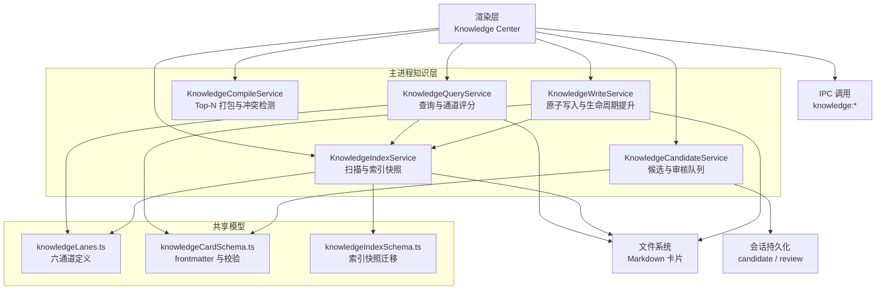

**图表来源**
- [src/main/knowledge/KnowledgeQueryService.ts:1-239](file://src/main/knowledge/KnowledgeQueryService.ts#L1-L239)
- [src/main/knowledge/KnowledgeIndexService.ts:1-173](file://src/main/knowledge/KnowledgeIndexService.ts#L1-L173)
- [src/main/knowledge/KnowledgeCompileService.ts:1-50](file://src/main/knowledge/KnowledgeCompileService.ts#L1-L50)
- [src/main/knowledge/KnowledgeCandidateService.ts:1-102](file://src/main/knowledge/KnowledgeCandidateService.ts#L1-L102)
- [src/main/knowledge/KnowledgeWriteService.ts:1-189](file://src/main/knowledge/KnowledgeWriteService.ts#L1-L189)
- [src/main/knowledge/knowledgeLanes.ts:1-56](file://src/main/knowledge/knowledgeLanes.ts#L1-L56)
- [src/main/knowledge/knowledgeCardSchema.ts:1-275](file://src/main/knowledge/knowledgeCardSchema.ts#L1-L275)
- [src/main/knowledge/knowledgeIndexSchema.ts:1-46](file://src/main/knowledge/knowledgeIndexSchema.ts#L1-L46)

**章节来源**
- [docs/ui/knowledge-center.md:1-43](file://docs/ui/knowledge-center.md#L1-L43)

## 核心组件

### KnowledgeIndexService：索引构建器

该服务负责扫描所有 knowledge space，读取 Markdown 源文件，解析 frontmatter，并生成一个包含 `cards[]` 的索引快照。快照包括：

- `schemaVersion`：索引模式版本
- `revision`：语料哈希，用于判断快照是否过期
- `builtAt`：构建时间
- `cards`：扁平化的索引条目

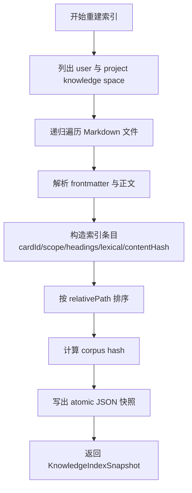

**图表来源**
- [src/main/knowledge/KnowledgeIndexService.ts:1-173](file://src/main/knowledge/KnowledgeIndexService.ts#L1-L173)
- [src/main/knowledge/knowledgeLanes.ts:1-56](file://src/main/knowledge/knowledgeLanes.ts#L1-L56)

关键行为：

1. 默认依赖从应用路径和服务适配器加载 user space 与 project spaces。
2. 每个文件的 `contentHash` 是对完整源文本计算的 SHA-256。
3. 快照通过 `StorageIo` 原子写入，避免部分写入导致的状态不一致。
4. `getOrRebuild` 会先尝试读取现有快照，再比较 `revision`；若不一致则重建。
5. `computeLiveRevision` 提供当前磁盘状态的实时语料哈希，用于快速检查。

### KnowledgeQueryService：六通道查询器

查询服务是知识检索的核心入口。它接收 `KnowledgeQueryRequest`，按通道逐一打分，然后合并同一卡片的多次命中。

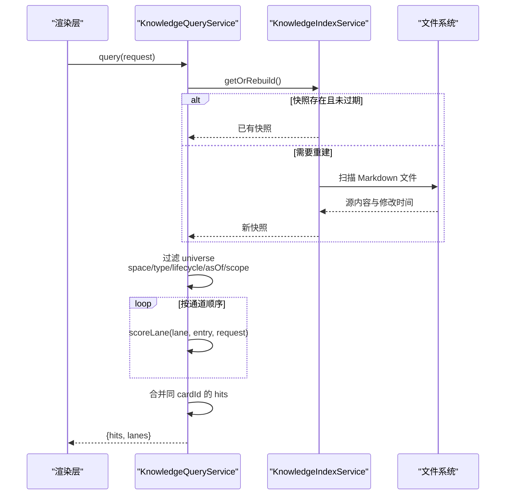

**图表来源**
- [src/main/knowledge/KnowledgeQueryService.ts:1-239](file://src/main/knowledge/KnowledgeQueryService.ts#L1-L239)
- [src/main/knowledge/KnowledgeIndexService.ts:1-173](file://src/main/knowledge/KnowledgeIndexService.ts#L1-L173)

通道评分规则如下：

| 通道 | 高优先级条件 | 低优先级条件 | 说明 |
|---|---|---|---|
| Identity/Path | 精确 `cardId`、`relativePath` | 文本出现在 id 或路径中 | 最可靠的定位方式 |
| Scope/Metadata | `scope` 完全匹配 | `type`、`lifecycle` 匹配 | 适合按项目、引擎、平台筛选 |
| Lexical | `text` 在 lexical 字段中出现 | 任意词条 | lexical 是 title + body + path 的小写拼接 |
| Structural | `text` 出现在 h1-h3 标题中 | 有标题的卡片 | 强调文档结构 |
| Relation/Graph | `relationTargetCardId` 匹配 | 存在关系 | 用于沿引用边查找相关卡片 |
| Temporal/Version | `updatedAt > 0` | 无 | 主要用于版本感知排序 |

### KnowledgeCompileService：结果编译包

查询结果是通道级别的原始命中；编译服务将其转换为 Agent 或 UI 可消费的 `KnowledgePack`：

- 取 Top-N（默认 12）
- 为每条命中记录匹配的通道原因
- 检测两个命中是否都来自 Relation/Graph 通道且标题不同，从而标记为 `contradicts`
- 用命中 cardId 列表生成短 `packId`

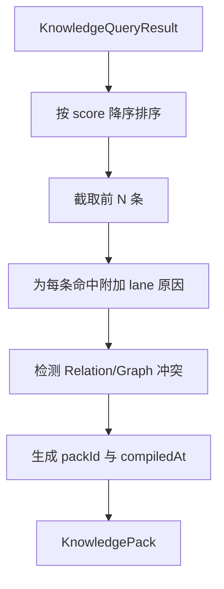

**图表来源**
- [src/main/knowledge/KnowledgeCompileService.ts:1-50](file://src/main/knowledge/KnowledgeCompileService.ts#L1-L50)

### KnowledgeCandidateService：候选与审核

候选流程将知识卡片引入“待审核”状态，但不会直接写入目标空间的知识库。其职责边界非常严格：

1. 必须显式传入 `explicitUserIntent: true`，否则抛出意图错误。
2. 如果卡片声明了缺失资源，创建候选会被拒绝。
3. 如果卡片包含图片，会验证图片是否在对应 space 中可用。
4. 候选保存在会话级持久化存储中，`lifecycle` 被设为 `candidate`。
5. 审核队列独立于候选列表，支持按 `kind` 和 `cardId` 排队与查询。

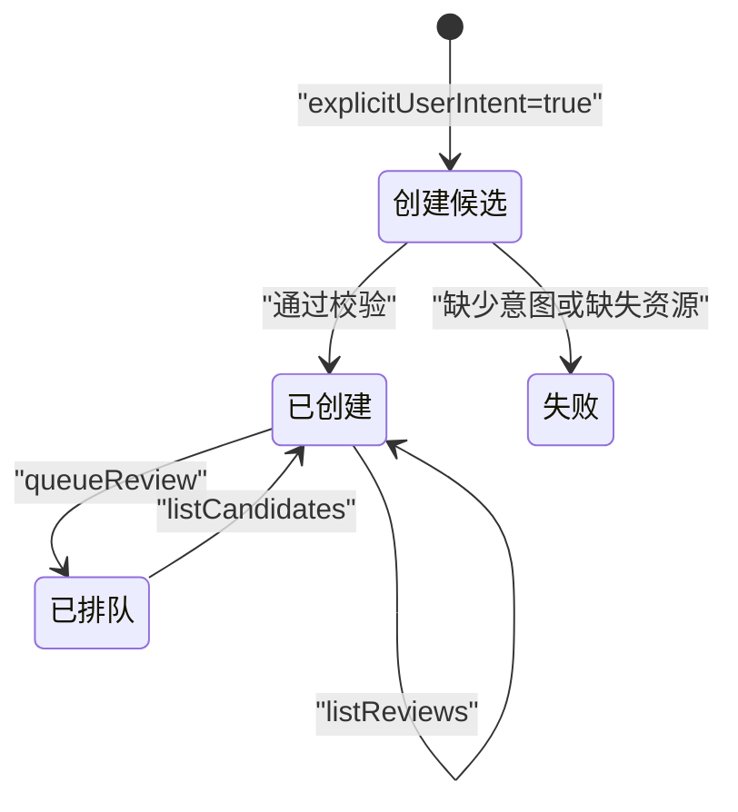

**图表来源**
- [src/main/knowledge/KnowledgeCandidateService.ts:1-102](file://src/main/knowledge/KnowledgeCandidateService.ts#L1-L102)

### KnowledgeWriteService：写入与生命周期提升

这是唯一允许持久写入 knowledge space 的服务。它承担以下职责：

- 强制人类确认与审批令牌消费
- 阻止 Candidate 直接通过 Write 写入
- 禁止 sourceStatus=fixed 的卡片变为 verified
- 对 verified/promoted case 做章节完整性检查
- 验证图片和资产可用性
- 安全解析写入目标，防止路径穿越
- 原子写入 Markdown 卡片
- 可选阶段图片落盘
- 可选触发索引重建

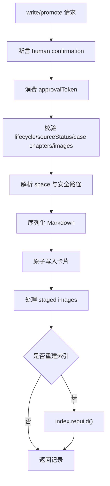

**图表来源**
- [src/main/knowledge/KnowledgeWriteService.ts:1-189](file://src/main/knowledge/KnowledgeWriteService.ts#L1-L189)

**章节来源**
- [src/main/knowledge/KnowledgeIndexService.ts:1-173](file://src/main/knowledge/KnowledgeIndexService.ts#L1-L173)
- [src/main/knowledge/KnowledgeQueryService.ts:1-239](file://src/main/knowledge/KnowledgeQueryService.ts#L1-L239)
- [src/main/knowledge/KnowledgeCompileService.ts:1-50](file://src/main/knowledge/KnowledgeCompileService.ts#L1-L50)
- [src/main/knowledge/KnowledgeCandidateService.ts:1-102](file://src/main/knowledge/KnowledgeCandidateService.ts#L1-L102)
- [src/main/knowledge/KnowledgeWriteService.ts:1-189](file://src/main/knowledge/KnowledgeWriteService.ts#L1-L189)

## 架构总览

整体数据流可以理解为“Markdown 源文件 → 索引快照 → 通道查询 → 编译包 → 候选/写入”。

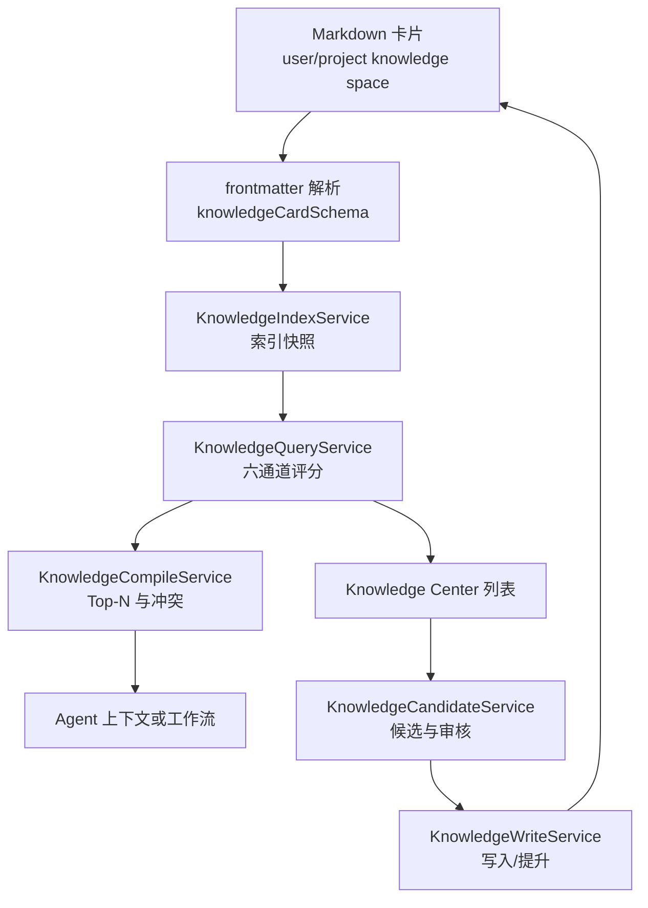

**图表来源**
- [src/main/knowledge/knowledgeCardSchema.ts:1-275](file://src/main/knowledge/knowledgeCardSchema.ts#L1-L275)
- [src/main/knowledge/KnowledgeIndexService.ts:1-173](file://src/main/knowledge/KnowledgeIndexService.ts#L1-L173)
- [src/main/knowledge/KnowledgeQueryService.ts:1-239](file://src/main/knowledge/KnowledgeQueryService.ts#L1-L239)
- [src/main/knowledge/KnowledgeCompileService.ts:1-50](file://src/main/knowledge/KnowledgeCompileService.ts#L1-L50)
- [src/main/knowledge/KnowledgeCandidateService.ts:1-102](file://src/main/knowledge/KnowledgeCandidateService.ts#L1-L102)
- [src/main/knowledge/KnowledgeWriteService.ts:1-189](file://src/main/knowledge/KnowledgeWriteService.ts#L1-L189)

## 详细组件分析

### knowledge space 概念

knowledge space 是知识的隔离单元。系统中至少包含一个 user space，并为每个 project 创建一个 project space。每个 space 由以下属性描述：

| 字段 | 含义 |
|---|---|
| `spaceId` | user 空间固定为 `user`，project 空间形如 `project:{projectId}` |
| `kind` | `user` 或 `project` |
| `label` | 展示名称 |
| `rootPath` | 该 space 对应的知识根目录 |
| `projectId` | 仅 project space 携带 |

space 不是数据库表，而是文件系统根目录。Knowledge Center 的 Spaces 列让用户在 user 和已注册 project 之间多选，查询和导入都按选中 space 聚合。

**章节来源**
- [src/main/knowledge/KnowledgeIndexService.ts:1-173](file://src/main/knowledge/KnowledgeIndexService.ts#L1-L173)
- [src/main/knowledge/KnowledgeQueryService.ts:1-239](file://src/main/knowledge/KnowledgeQueryService.ts#L1-L239)
- [docs/ui/knowledge-center.md:1-43](file://docs/ui/knowledge-center.md#L1-L43)

### card schema 与 frontmatter 元数据模型

卡片模型由 `knowledgeCardSchema.ts` 使用 Zod 校验，并与共享类型配合形成强约束：

| 字段 | 类型 | 用途 |
|---|---|---|
| `cardId` | 字符串 | 卡片唯一标识 |
| `spaceId` | 字符串 | 所属空间 |
| `relativePath` | 字符串 | 相对于 space root 的路径 |
| `type` | 枚举 | 卡片类型 |
| `lifecycle` | 枚举 | draft、candidate、verified、promoted、retired |
| `title` | 字符串 | 标题，优先 frontmatter，其次一级标题，最后回退文件名 |
| `scope` | 对象 | 项目、引擎、平台、GPU、驱动等环境维度 |
| `relations` | 数组 | 引用其他卡片的图关系 |
| `body` | 字符串 | Markdown 正文 |
| `preview` | 可选字符串 | 列表预览 |
| `chapters` | 可选对象 | case 类型的结构化章节 |
| `images` | 数组 | 关联图片及其 role |
| `sourceHash` / `sourceMtimeMs` / `sourceSize` | 可选 | 导入来源指纹 |
| `missingAssets` | 可选数组 | 缺失资源路径 |

frontmatter 解析支持 YAML 与宽松行格式，同时会从二级标题映射 case 章节，例如 claim、symptoms、evidence、rootCause、fix 等。

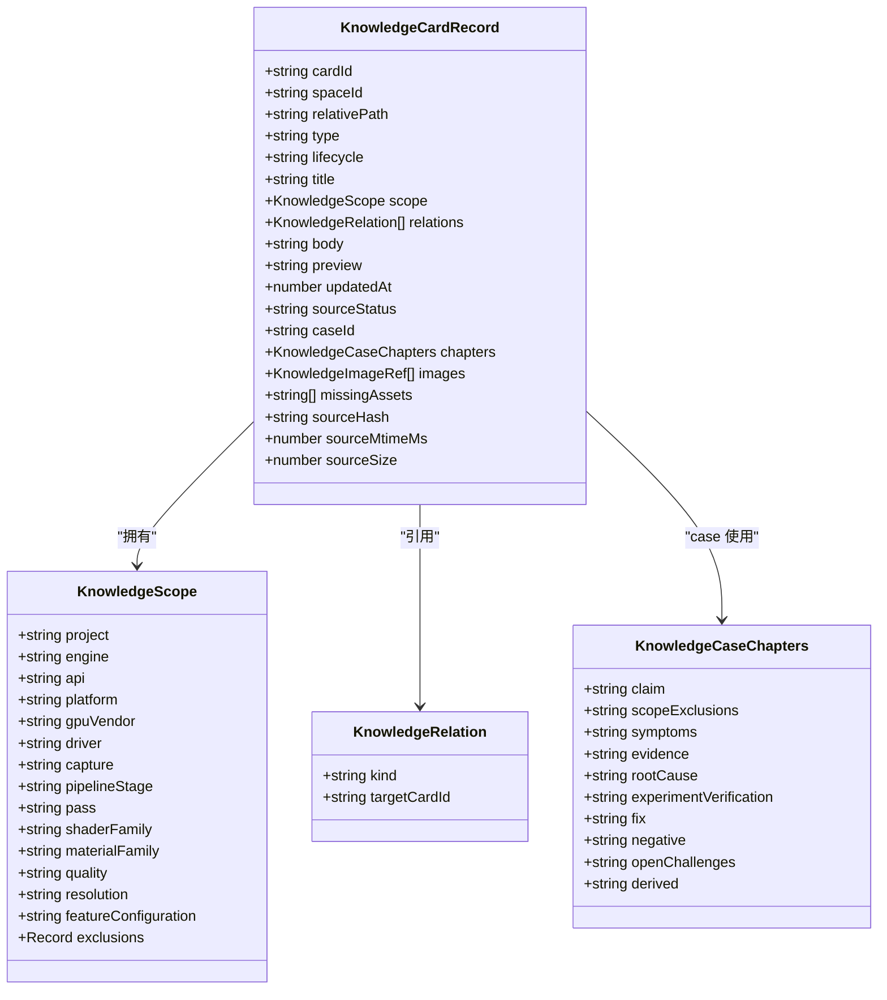

**图表来源**
- [src/main/knowledge/knowledgeCardSchema.ts:1-275](file://src/main/knowledge/knowledgeCardSchema.ts#L1-L275)

**章节来源**
- [src/main/knowledge/knowledgeCardSchema.ts:1-275](file://src/main/knowledge/knowledgeCardSchema.ts#L1-L275)

### 索引快照、corpus hash 与版本迁移

索引快照是知识检索的中间态。它不是完整的 Markdown 副本，而是经过解析、归一化和排序后的结构化数据集合。

| 字段 | 含义 |
|---|---|
| `schemaVersion` | 索引模式版本，当前为常量 `KNOWLEDGE_INDEX_SCHEMA_VERSION` |
| `revision` | 语料哈希，基于排序后的 `cardId:contentHash` 列表计算 |
| `builtAt` | ISO 构建时间 |
| `cards` | 索引条目数组 |

`knowledgeCorpusHash` 会对卡片按 `relativePath` 排序，再用 `cardId` 与 `contentHash` 拼接后计算 SHA-256。这样即使内容不变但路径变化，revision 也会改变；反之，路径相同但内容变化时 revision 也会变化。

索引迁移机制通过 `KNOWLEDGE_INDEX_MIGRATIONS` 暴露给存储层，目前只绑定当前 schemaVersion。未来扩展时，可以在这里增加旧版本到新版本的上迁移逻辑。

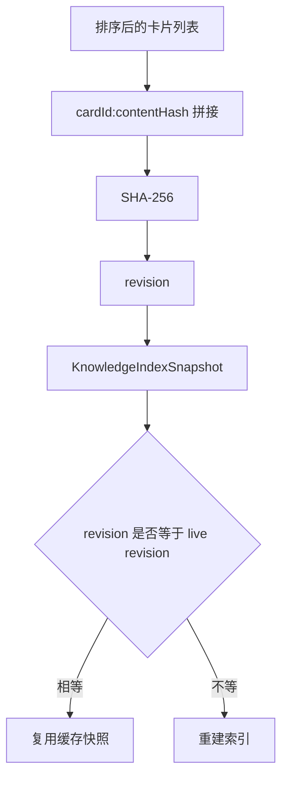

**图表来源**
- [src/main/knowledge/knowledgeLanes.ts:1-56](file://src/main/knowledge/knowledgeLanes.ts#L1-L56)
- [src/main/knowledge/knowledgeIndexSchema.ts:1-46](file://src/main/knowledge/knowledgeIndexSchema.ts#L1-L46)
- [src/main/knowledge/KnowledgeIndexService.ts:1-173](file://src/main/knowledge/KnowledgeIndexService.ts#L1-L173)

**章节来源**
- [src/main/knowledge/knowledgeLanes.ts:1-56](file://src/main/knowledge/knowledgeLanes.ts#L1-L56)
- [src/main/knowledge/knowledgeIndexSchema.ts:1-46](file://src/main/knowledge/knowledgeIndexSchema.ts#L1-L46)
- [src/main/knowledge/KnowledgeIndexService.ts:1-173](file://src/main/knowledge/KnowledgeIndexService.ts#L1-L173)

### 为什么选择六通道而非 embedding-based

代码中没有 embedding 检索实现。Knowledge Center 的产品边界也明确删除了 Semantic lane 与 Settings > Models Embedding 重建入口，并禁止声称语义检索。这一限制不是技术能力缺失，而是设计选择：

1. **可解释性优先**：每条命中都有明确的 channel 和 score，开发者可以回答“为什么这张卡片被召回”。
2. **确定性更强**：Identity/Path 和 Scope/Metadata 是精确匹配，不随模型权重波动。
3. **成本可控**：不需要向量数据库、嵌入模型或大规模向量索引。
4. **Markdown-first**：索引只提取标题、正文、路径、标题层级、关系和时间戳，不假设任何语义标签。
5. **Agent 负责理解**：语义推理交给上层 Agent 或工作流，而不是把黑盒相似度混入检索层。
6. **审计友好**：retired 卡片仍可浏览和显式查询，便于审计，而普通检索默认排除 retired。

这并不意味着 system 永远不能加入语义检索；当前实现只是把语义作为上层能力，而不是把检索契约绑定到某个 embedding 实现。

**章节来源**
- [docs/ui/knowledge-center.md:1-43](file://docs/ui/knowledge-center.md#L1-L43)
- [src/main/knowledge/knowledgeLanes.ts:1-56](file://src/main/knowledge/knowledgeLanes.ts#L1-L56)
- [src/main/knowledge/KnowledgeQueryService.ts:1-239](file://src/main/knowledge/KnowledgeQueryService.ts#L1-L239)

## 依赖关系分析

五个服务之间的耦合是单向且清晰的：

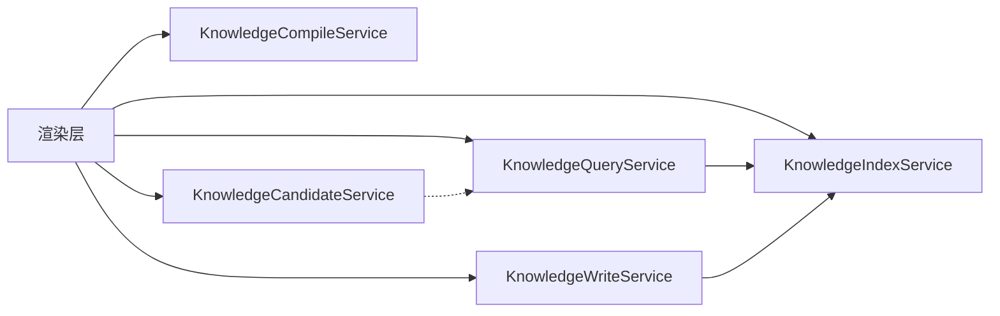

依赖方向说明：

| 组件 | 依赖 | 说明 |
|---|---|---|
| KnowledgeQueryService | KnowledgeIndexService | 读取或重建索引快照 |
| KnowledgeWriteService | KnowledgeIndexService | 写入后可选重建索引 |
| KnowledgeCandidateService | KnowledgeQueryService | 可选获取 spaces 以验证图片 |
| KnowledgeCompileService | 无内部服务 | 纯函数式编译 |
| KnowledgeIndexService | 文件系统与应用路径 | 只读扫描 |

所有服务都通过构造函数注入依赖，并提供测试友好的 `overrides` 接口。默认实例使用真实文件系统、应用路径和服务适配器；测试中可以替换 `readFile`、`statMtime`、`now`、`createId`、`store` 等依赖。

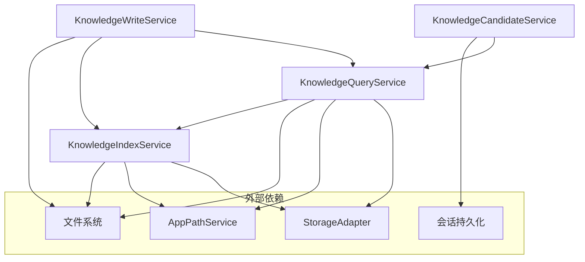

**图表来源**
- [src/main/knowledge/KnowledgeIndexService.ts:1-173](file://src/main/knowledge/KnowledgeIndexService.ts#L1-L173)
- [src/main/knowledge/KnowledgeQueryService.ts:1-239](file://src/main/knowledge/KnowledgeQueryService.ts#L1-L239)
- [src/main/knowledge/KnowledgeWriteService.ts:1-189](file://src/main/knowledge/KnowledgeWriteService.ts#L1-L189)
- [src/main/knowledge/KnowledgeCandidateService.ts:1-102](file://src/main/knowledge/KnowledgeCandidateService.ts#L1-L102)

**章节来源**
- [src/main/knowledge/KnowledgeIndexService.ts:1-173](file://src/main/knowledge/KnowledgeIndexService.ts#L1-L173)
- [src/main/knowledge/KnowledgeQueryService.ts:1-239](file://src/main/knowledge/KnowledgeQueryService.ts#L1-L239)
- [src/main/knowledge/KnowledgeCompileService.ts:1-50](file://src/main/knowledge/KnowledgeCompileService.ts#L1-L50)
- [src/main/knowledge/KnowledgeCandidateService.ts:1-102](file://src/main/knowledge/KnowledgeCandidateService.ts#L1-L102)
- [src/main/knowledge/KnowledgeWriteService.ts:1-189](file://src/main/knowledge/KnowledgeWriteService.ts#L1-L189)

## 性能与可维护性

### 性能特征

| 操作 | 主要成本 | 优化点 |
|---|---|---|
| 重建索引 | 扫描所有 space 下的 Markdown 文件 | 按 relativePath 排序稳定；跳过不可读文件 |
| 查询 | 遍历 universe 并按通道打分 | 可限定 lanes；默认使用全部通道 |
| 编译 | Top-N 排序与 O(n²) 冲突检测 | 默认 limit=12，冲突检测规模有限 |
| 写入 | 序列化、目录创建、原子写入、图片落盘 | 可选择自定义 write/mkdir；写后哈希校验 |
| 候选 | 会话级持久化读写 | 轻量，不写 knowledge space |

索引重建是相对昂贵的操作，因此系统设计为按需重建：`getOrRebuild` 仅在快照不存在或 revision 不一致时重建。日常浏览和查询应优先复用快照。

### 可维护性建议

1. **新增通道时要更新两处**：`KNOWLEDGE_RETRIEVAL_LANES` 和 `scoreLane` 的 switch。
2. **新增字段要同步三处**：卡片 schema、索引 schema、索引条目构造逻辑。
3. **不要绕过 Write/Candidate 的直接写入**：所有持久变更都应经过权限、生命周期和图片校验。
4. **谨慎处理 retired 卡片**：它们仍应可浏览和显式查询，但不进入普通检索结果。
5. **扩展索引迁移时保持向后兼容**：当前迁移只转换当前 schemaVersion。

[本节为通用指导，不直接分析具体代码片段]

## 故障排查指南

### 常见错误类型

| 错误场景 | 可能原因 | 排查方向 |
|---|---|---|
| 写入被拒绝 | 缺少 `explicitHumanConfirmation` | 检查 Human Confirmation 与 approvalToken |
| 写入被拒绝 | approvalToken 无效 | 检查 Main 签发的令牌是否已被消费 |
| 写入失败 | 路径不安全 | 检查 relativePath 是否越界 |
| 写入失败 | 图片缺失 | 检查 images 与 stagedImages |
| 写入失败 | case 章节不完整 | 检查 verified/promoted case 的 chapters |
| 无法提升 | lifecycle 非法 | 检查草稿不能直接 promote，fixed 不能变 verified |
| 查询为空 | 卡片为 retired 且未显式指定 lifecycle | 检查查询过滤器 |
| 索引未更新 | 快照 revision 未变化 | 检查源文件 contentHash 是否真正变化 |
| 候选创建失败 | 缺少用户意图 | 检查是否显式设置 `explicitUserIntent` |
| 候选创建失败 | 图片不可用 | 检查图片是否属于目标 space |

### 排查流程

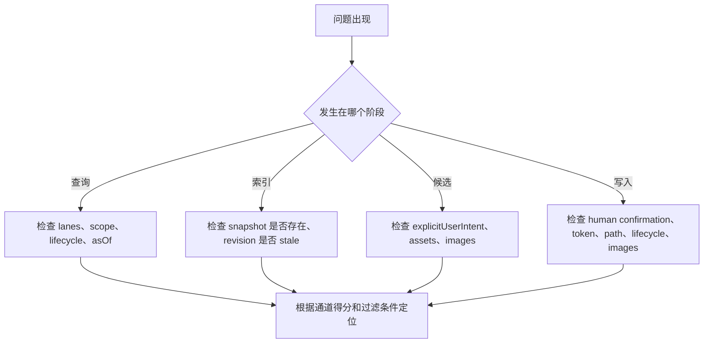

**图表来源**
- [src/main/knowledge/KnowledgeQueryService.ts:1-239](file://src/main/knowledge/KnowledgeQueryService.ts#L1-L239)
- [src/main/knowledge/KnowledgeIndexService.ts:1-173](file://src/main/knowledge/KnowledgeIndexService.ts#L1-L173)
- [src/main/knowledge/KnowledgeCandidateService.ts:1-102](file://src/main/knowledge/KnowledgeCandidateService.ts#L1-L102)
- [src/main/knowledge/KnowledgeWriteService.ts:1-189](file://src/main/knowledge/KnowledgeWriteService.ts#L1-L189)

**章节来源**
- [src/main/knowledge/knowledgeErrors.ts](file://src/main/knowledge/knowledgeErrors.ts)
- [src/main/knowledge/KnowledgeWriteService.ts:1-189](file://src/main/knowledge/KnowledgeWriteService.ts#L1-L189)
- [src/main/knowledge/KnowledgeCandidateService.ts:1-102](file://src/main/knowledge/KnowledgeCandidateService.ts#L1-L102)
- [src/main/knowledge/KnowledgeQueryService.ts:1-239](file://src/main/knowledge/KnowledgeQueryService.ts#L1-L239)

## 结论

这个知识系统的设计核心是：**用 Markdown 表达知识，用结构化字段支撑检索，用明确的生命周期控制可信度，用六通道保证可解释性，而不把语义理解外包给不可控的 embedding 黑盒**。

- Identity/Path 和 Scope/Metadata 提供确定性基础。
- Lexical 和 Structural 利用 Markdown 自然语言与文档结构。
- Relation/Graph 提供轻量图关系。
- Temporal/Version 提供时间感知。
- KnowledgeIndexService 负责稳定、可迁移的索引快照。
- KnowledgeQueryService 负责透明、可审计的通道评分。
- KnowledgeCompileService 负责把查询结果收敛为 Agent 可用的上下文包。
- KnowledgeCandidateService 负责人类主导的候选与审核。
- KnowledgeWriteService 负责唯一、受控的持久写入。

对于初学者，最重要的是记住：知识卡片首先是 Markdown，其次是前端展示的卡片，最后是 Agent 使用的数据结构。对于有经验开发者，最重要的契约是六通道定义、frontmatter schema、索引快照 revision 和 Write/Candidate 的职责边界。

[本节为总结性内容，不直接分析具体代码片段]