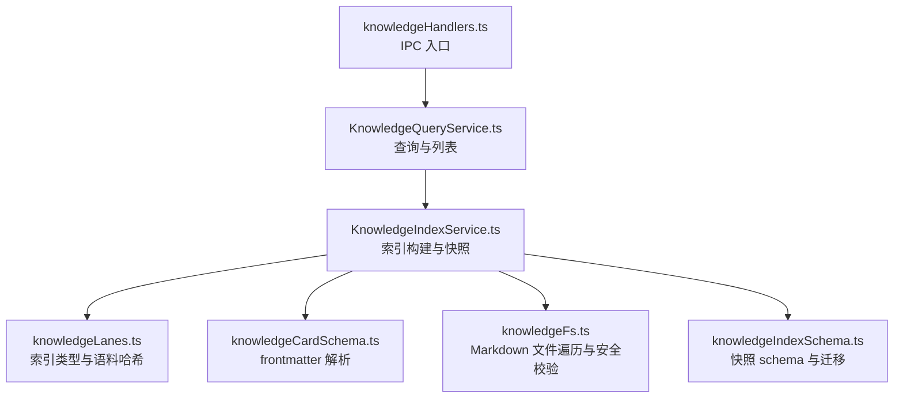
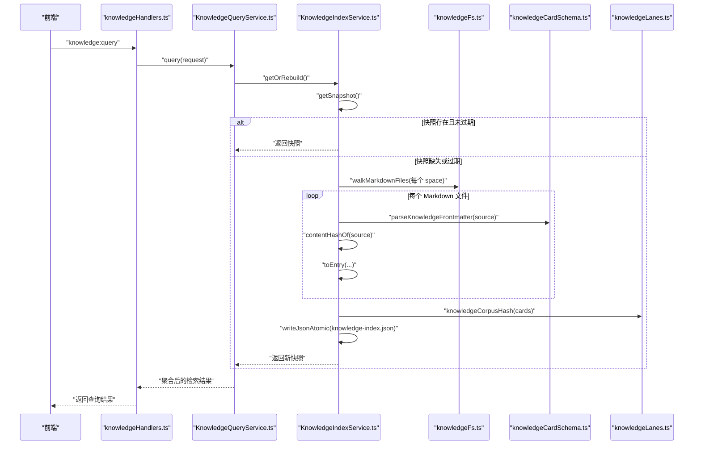
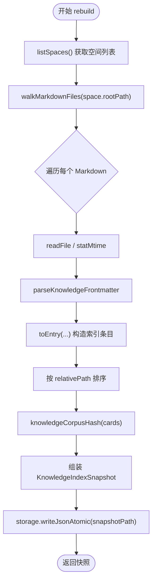
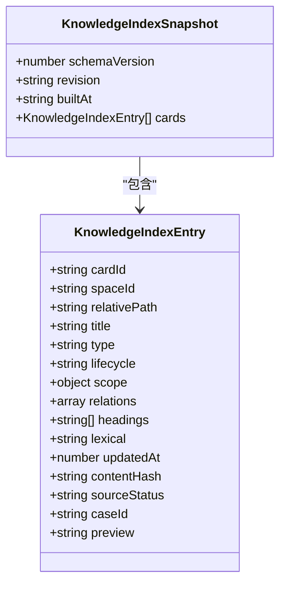
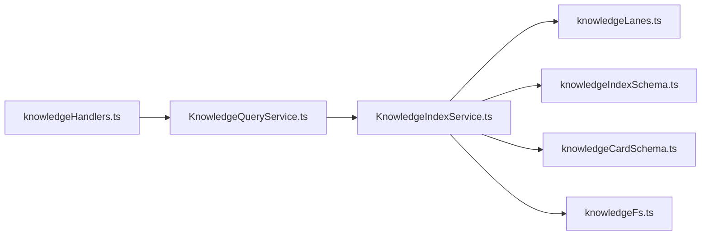

# 知识索引服务

<cite>
**本文引用的文件**   
- [KnowledgeIndexService.ts](file://src/main/knowledge/KnowledgeIndexService.ts)
- [knowledgeLanes.ts](file://src/main/knowledge/knowledgeLanes.ts)
- [knowledgeIndexSchema.ts](file://src/main/knowledge/knowledgeIndexSchema.ts)
- [knowledgeCardSchema.ts](file://src/main/knowledge/knowledgeCardSchema.ts)
- [knowledgeFs.ts](file://src/main/knowledge/knowledgeFs.ts)
- [KnowledgeQueryService.ts](file://src/main/knowledge/KnowledgeQueryService.ts)
- [knowledgeHandlers.ts](file://src/main/ipc/knowledgeHandlers.ts)
</cite>

## 目录
1. [简介](#简介)
2. [项目结构](#项目结构)
3. [核心组件](#核心组件)
4. [架构总览](#架构总览)
5. [详细组件分析](#详细组件分析)
6. [依赖关系分析](#依赖关系分析)
7. [性能与内存优化](#性能与内存优化)
8. [故障排除指南](#故障排除指南)
9. [结论](#结论)

## 简介
本文面向实现与维护者，系统化说明知识索引服务的职责、数据模型、增量更新机制以及与文件系统、查询服务和进程间通信的集成方式。重点包括：
- `KnowledgeIndexService` 如何扫描 Markdown 空间、解析 frontmatter、构建索引条目并持久化快照。
- `KnowledgeIndexEntry` 与 `KnowledgeIndexSnapshot` 的数据语义及字段用途。
- 基于 `contentHash` 和 `knowledgeCorpusHash` 的增量变更检测。
- schema 版本与迁移策略。
- 与 `KnowledgeQueryService`、IPC handler 的协作关系。
- 构建过程中的错误恢复、路径安全、性能优化与排错建议。

## 项目结构
知识索引相关代码集中在主进程的 knowledge 模块中，并通过 IPC 暴露给渲染层使用。关键文件职责如下：

**图表来源**
- [knowledgeHandlers.ts:1-200](file://src/main/ipc/knowledgeHandlers.ts#L1-L200)
- [KnowledgeQueryService.ts:1-200](file://src/main/knowledge/KnowledgeQueryService.ts#L1-L200)
- [KnowledgeIndexService.ts:1-173](file://src/main/knowledge/KnowledgeIndexService.ts#L1-L173)
- [knowledgeLanes.ts:1-56](file://src/main/knowledge/knowledgeLanes.ts#L1-L56)
- [knowledgeCardSchema.ts:1-200](file://src/main/knowledge/knowledgeCardSchema.ts#L1-L200)
- [knowledgeFs.ts:1-200](file://src/main/knowledge/knowledgeFs.ts#L1-L200)
- [knowledgeIndexSchema.ts:1-46](file://src/main/knowledge/knowledgeIndexSchema.ts#L1-L46)

**章节来源**
- [knowledgeHandlers.ts:1-200](file://src/main/ipc/knowledgeHandlers.ts#L1-L200)
- [KnowledgeQueryService.ts:1-200](file://src/main/knowledge/KnowledgeQueryService.ts#L1-L200)
- [KnowledgeIndexService.ts:1-173](file://src/main/knowledge/KnowledgeIndexService.ts#L1-L173)
- [knowledgeLanes.ts:1-56](file://src/main/knowledge/knowledgeLanes.ts#L1-L56)
- [knowledgeCardSchema.ts:1-200](file://src/main/knowledge/knowledgeCardSchema.ts#L1-L200)
- [knowledgeFs.ts:1-200](file://src/main/knowledge/knowledgeFs.ts#L1-L200)
- [knowledgeIndexSchema.ts:1-46](file://src/main/knowledge/knowledgeIndexSchema.ts#L1-L46)

## 核心组件
- `KnowledgeIndexService`：负责列出知识空间、遍历 Markdown 文件、解析 frontmatter、生成索引条目、计算语料修订号、读取/重建/比较索引快照。
- `KnowledgeIndexEntry`：单条知识卡片的索引记录，包含身份、元数据、结构摘要、全文词法、内容哈希、时间戳等。
- `KnowledgeIndexSnapshot`：带 schema 版本、修订号、构建时间的完整索引集合。
- `knowledgeCorpusHash`：对排序后的卡片序列计算稳定哈希，用于增量检测。
- `parseKnowledgeFrontmatter`：从 Markdown 源中解析 frontmatter 与正文，填充卡片记录。
- `walkMarkdownFiles`：递归扫描 Markdown 文件，限制深度并过滤隐藏文件。
- `KnowledgeQueryService`：复用索引或按需重新构建，执行多路检索与结果合并。
- IPC handler：将索引概览、查询等能力暴露给前端。

**章节来源**
- [KnowledgeIndexService.ts:1-173](file://src/main/knowledge/KnowledgeIndexService.ts#L1-L173)
- [knowledgeLanes.ts:1-56](file://src/main/knowledge/knowledgeLanes.ts#L1-L56)
- [knowledgeIndexSchema.ts:1-46](file://src/main/knowledge/knowledgeIndexSchema.ts#L1-L46)
- [knowledgeCardSchema.ts:1-200](file://src/main/knowledge/knowledgeCardSchema.ts#L1-L200)
- [knowledgeFs.ts:1-200](file://src/main/knowledge/knowledgeFs.ts#L1-L200)
- [KnowledgeQueryService.ts:1-200](file://src/main/knowledge/KnowledgeQueryService.ts#L1-L200)
- [knowledgeHandlers.ts:1-200](file://src/main/ipc/knowledgeHandlers.ts#L1-L200)

## 架构总览
知识索引服务是“离线构建 + 在线查询”的双阶段系统：
1. 构建阶段：按空间扫描 Markdown，解析并构造 `KnowledgeIndexEntry`，排序后计算 `knowledgeCorpusHash`，写入 `knowledge-index.json` 快照。
2. 查询阶段：优先使用已缓存快照；若过期则触发重建或直接计算当前修订号进行比对。

**图表来源**
- [knowledgeHandlers.ts:1-200](file://src/main/ipc/knowledgeHandlers.ts#L1-L200)
- [KnowledgeQueryService.ts:1-200](file://src/main/knowledge/KnowledgeQueryService.ts#L1-L200)
- [KnowledgeIndexService.ts:1-173](file://src/main/knowledge/KnowledgeIndexService.ts#L1-L173)
- [knowledgeFs.ts:1-200](file://src/main/knowledge/knowledgeFs.ts#L1-L200)
- [knowledgeCardSchema.ts:1-200](file://src/main/knowledge/knowledgeCardSchema.ts#L1-L200)
- [knowledgeLanes.ts:1-56](file://src/main/knowledge/knowledgeLanes.ts#L1-L56)

## 详细组件分析

### KnowledgeIndexService：索引构建与快照管理
- 依赖注入：通过 `KnowledgeIndexDependencies` 抽象空间列表、快照路径、存储接口、时间函数与文件读取/stat 操作，便于测试与替换实现。
- 构建流程：
  - 遍历所有空间，调用 `walkMarkdownFiles` 获取绝对路径列表。
  - 对每个文件读取文本、统计修改时间，调用 `toEntry` 生成索引条目。
  - 按相对路径排序，避免哈希抖动。
  - 组装 `KnowledgeIndexSnapshot`，写入原子 JSON 文件。
- 快照读取：
  - 通过 `StorageIo.readJson` 读取快照，并传入 `KNOWLEDGE_INDEX_MIGRATIONS` 完成 schema 版本转换。
- 增量检测：
  - `computeLiveRevision` 重算当前语料哈希；`isSnapshotStale` 对比快照 revision。
  - `getOrRebuild` 在快照有效时直接返回，否则重建。

**图表来源**
- [KnowledgeIndexService.ts:1-173](file://src/main/knowledge/KnowledgeIndexService.ts#L1-L173)
- [knowledgeFs.ts:1-200](file://src/main/knowledge/knowledgeFs.ts#L1-L200)
- [knowledgeCardSchema.ts:1-200](file://src/main/knowledge/knowledgeCardSchema.ts#L1-L200)
- [knowledgeLanes.ts:1-56](file://src/main/knowledge/knowledgeLanes.ts#L1-L56)

**章节来源**
- [KnowledgeIndexService.ts:1-173](file://src/main/knowledge/KnowledgeIndexService.ts#L1-L173)

### 索引数据结构：KnowledgeIndexEntry 与 KnowledgeIndexSnapshot
- `KnowledgeIndexEntry` 关键字段语义：
  - `cardId`：卡片唯一标识，默认由 `spaceId:relativePath` 生成，可被 frontmatter 覆盖。
  - `spaceId`：所属空间，区分用户级与项目级知识库。
  - `relativePath`：相对于空间根的路径（POSIX 风格），用于排序与定位。
  - `title`：标题，优先来自 frontmatter，其次取首行一级标题，最后回退到文件名。
  - `type` / `lifecycle`：卡片类型与生命周期，来自共享类型枚举，可选。
  - `scope`：结构化上下文维度，如引擎、平台、GPU、API 等。
  - `relations`：与其他卡片的引用关系。
  - `headings`：提取的一至三级标题列表，支持结构检索。
  - `lexical`：用于词法检索的归一化全文，由 title、body、relativePath 拼接并小写。
  - `updatedAt`：文件修改时间戳，用于时序筛选。
  - `contentHash`：文件内容的 SHA-256，用于细粒度变更检测。
  - `sourceStatus` / `caseId` / `preview`：扩展字段，增强审计与展示。
- `KnowledgeIndexSnapshot`：
  - `schemaVersion`：索引 schema 版本号，用于迁移。
  - `revision`：整个语料的稳定哈希，由排序后的 `(cardId, contentHash)` 序列计算。
  - `builtAt`：构建时间 ISO 字符串。
  - `cards`：完整的索引条目数组。

**图表来源**
- [knowledgeLanes.ts:1-56](file://src/main/knowledge/knowledgeLanes.ts#L1-L56)
- [knowledgeIndexSchema.ts:1-46](file://src/main/knowledge/knowledgeIndexSchema.ts#L1-L46)

**章节来源**
- [knowledgeLanes.ts:1-56](file://src/main/knowledge/knowledgeLanes.ts#L1-L56)
- [knowledgeIndexSchema.ts:1-46](file://src/main/knowledge/knowledgeIndexSchema.ts#L1-L46)

### Frontmatter 解析与预览提取
- `splitFrontmatter`：识别 YAML frontmatter 分隔符，分离原始元数据与正文。
- `parseLooseMeta`：先尝试 YAML 解析，失败时降级为键值行解析，兼容宽松格式。
- `extractTitle`：优先级为 frontmatter.title > 正文首个一级标题 > 回退路径名。
- `parseScope` / `parseRelations` / `parseChapters`：分别校验并规范化 scope、relations、case chapters。
- `parseKnowledgeFrontmatter`：组合上述逻辑，产出标准化的 `record` 与 `body`。
- `extractPreview`：移除标题、代码块、链接、强调符号，截断固定长度作为预览。

这些逻辑共同决定 `KnowledgeIndexEntry` 中的 title、headings、lexical、preview 等字段的最终值。

**章节来源**
- [knowledgeCardSchema.ts:1-200](file://src/main/knowledge/knowledgeCardSchema.ts#L1-L200)

### 文件系统扫描与安全边界
- `walkMarkdownFiles`：
  - 创建空目录以避免后续报错。
  - 使用 `realpath` 确认真实根路径，防止符号链接逃逸。
  - 递归遍历，跳过隐藏文件，限制最大深度，仅收集 `.md` 文件。
- `toPosixRelative`：统一路径分隔符，保证排序稳定性。
- `resolveWithinRoot` / `assertSafeKnowledgeWriteTarget`：在读写路径上强制校验不在空间根之外，拒绝符号链接与硬链接异常。

这些安全机制确保索引构建不会因恶意或误配置的路径导致越界访问。

**章节来源**
- [knowledgeFs.ts:1-200](file://src/main/knowledge/knowledgeFs.ts#L1-L200)

### 增量更新与语料哈希
- `contentHashOf`：对单个 Markdown 源计算 SHA-256，存入 `contentHash`。
- `knowledgeCorpusHash`：
  - 对输入卡片按 `relativePath` 排序。
  - 拼接 `cardId:contentHash` 序列并以 `|` 连接。
  - 对整个字符串计算 SHA-256。
- 增量策略：
  - `getSnapshot` 读取本地快照。
  - `computeLiveRevision` 实时重算当前语料哈希。
  - `isSnapshotStale` 比较两者，决定是否重建。
  - `getOrRebuild` 封装常用流程：命中即返回，否则重建。

这种设计使系统在大量 Markdown 文件下也能快速判断是否需要全量重建。

**章节来源**
- [KnowledgeIndexService.ts:1-173](file://src/main/knowledge/KnowledgeIndexService.ts#L1-L173)
- [knowledgeLanes.ts:1-56](file://src/main/knowledge/knowledgeLanes.ts#L1-L56)

### Schema 版本与迁移
- `KNOWLEDGE_INDEX_SCHEMA_VERSION`：常量表示当前索引 schema 版本。
- `KnowledgeIndexSnapshotSchema`：定义快照结构的 Zod schema，并将 version 转换为当前版本。
- `KNOWLEDGE_INDEX_MIGRATIONS`：声明迁移规则，将旧版本 snapshot 读入时转换为当前 schema。
- 读取快照时传入迁移表，保证向后兼容。

该机制允许未来扩展索引结构而不破坏已有快照。

**章节来源**
- [knowledgeIndexSchema.ts:1-46](file://src/main/knowledge/knowledgeIndexSchema.ts#L1-L46)
- [knowledgeLanes.ts:1-56](file://src/main/knowledge/knowledgeLanes.ts#L1-L56)

### 与查询服务与 IPC 的集成
- `KnowledgeQueryService`：
  - 提供 `listCards`、`getCard`、`query` 等方法。
  - 查询时调用 `index.getOrRebuild()`，自动处理快照失效。
  - 根据 request 过滤 spaceId、type、lifecycle、asOf、scope，并对多个检索 lane 的结果合并打分。
- IPC handler：
  - 暴露 `knowledge:overview` 与 `knowledge:query` 等通道。
  - 将索引快照转化为 `KnowledgeIndexOverview`，包含 revision、builtAt、cardCount、按空间计数。
  - 对查询请求做参数校验与空间白名单检查。

这使前端可以方便地获取索引概览与检索结果，同时保持后端构建逻辑透明。

**章节来源**
- [KnowledgeQueryService.ts:1-200](file://src/main/knowledge/KnowledgeQueryService.ts#L1-L200)
- [knowledgeHandlers.ts:1-200](file://src/main/ipc/knowledgeHandlers.ts#L1-L200)

## 依赖关系分析

- `knowledgeHandlers.ts` 依赖 `KnowledgeQueryService` 与 `KnowledgeIndexService`，但不直接访问文件系统。
- `KnowledgeQueryService` 依赖 `KnowledgeIndexService` 提供索引构建能力。
- `KnowledgeIndexService` 依赖：
  - `knowledgeLanes.ts`：类型与语料哈希。
  - `knowledgeIndexSchema.ts`：快照 schema 与迁移。
  - `knowledgeCardSchema.ts`：frontmatter 解析。
  - `knowledgeFs.ts`：文件遍历与安全校验。
- 耦合点主要集中在索引构建与快照读写；查询与 IPC 层保持较松耦合。

**图表来源**
- [knowledgeHandlers.ts:1-200](file://src/main/ipc/knowledgeHandlers.ts#L1-L200)
- [KnowledgeQueryService.ts:1-200](file://src/main/knowledge/KnowledgeQueryService.ts#L1-L200)
- [KnowledgeIndexService.ts:1-173](file://src/main/knowledge/KnowledgeIndexService.ts#L1-L173)
- [knowledgeLanes.ts:1-56](file://src/main/knowledge/knowledgeLanes.ts#L1-L56)
- [knowledgeIndexSchema.ts:1-46](file://src/main/knowledge/knowledgeIndexSchema.ts#L1-L46)
- [knowledgeCardSchema.ts:1-200](file://src/main/knowledge/knowledgeCardSchema.ts#L1-L200)
- [knowledgeFs.ts:1-200](file://src/main/knowledge/knowledgeFs.ts#L1-L200)

**章节来源**
- [knowledgeHandlers.ts:1-200](file://src/main/ipc/knowledgeHandlers.ts#L1-L200)
- [KnowledgeQueryService.ts:1-200](file://src/main/knowledge/KnowledgeQueryService.ts#L1-L200)
- [KnowledgeIndexService.ts:1-173](file://src/main/knowledge/KnowledgeIndexService.ts#L1-L173)

## 性能与内存优化
- 文件扫描：
  - `walkMarkdownFiles` 限制递归深度，避免深层目录爆炸。
  - 跳过隐藏文件与不可读文件，减少无效 IO。
- 排序与哈希：
  - 所有构建路径均对 `relativePath` 排序，保证 `knowledgeCorpusHash` 稳定。
  - `contentHashOf` 仅在读取源文件后计算一次，避免重复哈希。
- 快照复用：
  - `getOrRebuild` 在快照未过期时直接返回，避免重复 IO。
  - `isSnapshotStale` 只比较 revision，计算成本远低于全量重建。
- 内存管理：
  - 构建过程逐文件追加 `cards` 数组，无中间大对象拷贝。
  - 快照序列化后通过原子写入落盘，减少中间状态占用。
- 异步与错误恢复：
  - 文件读取失败会被捕获并跳过，不中断整体构建。
  - 目录不存在或权限问题会安全返回空结果，避免崩溃。
- 可扩展优化方向：
  - 可按空间并行遍历 Markdown 文件，但需注意磁盘 IO 竞争。
  - 可对大型语料引入分片或增量索引结构，但目前以全量快照为主。

[本节为通用性能指导，不直接分析具体代码片段]

## 故障排除指南
- 快照为空或频繁重建：
  - 检查 `knowledge-index.json` 是否存在，以及 `storage` 是否可写。
  - 确认 `snapshotPath` 指向预期目录。
  - 查看 `computeLiveRevision` 是否因文件读取失败而改变哈希。
- 查询不到某些卡片：
  - 确认卡片所在 spaceId 是否在查询范围。
  - 检查 `lifecycle` 是否为 `retired`，默认查询会排除已退役卡片。
  - 核对 `scope` 过滤条件是否与卡片元数据一致。
- 路径越界或安全错误：
  - 检查 Markdown 文件是否位于空间根内。
  - 确认没有符号链接或硬链接导致的 realpath 不一致。
  - 读写路径需通过 `assertSafeKnowledgeWriteTarget` 校验。
- 前端无法获取索引概览：
  - 确认 IPC handler 已注册 `knowledge:overview`。
  - 检查 `toIndexOverview` 是否能成功读取快照。
- 版本不兼容：
  - 如果历史快照的 `schemaVersion` 与新版本不同，确认 `KNOWLEDGE_INDEX_MIGRATIONS` 是否包含对应迁移。
  - 读取快照时会进行 schema 校验与转换，失败可能意味着迁移缺失。

**章节来源**
- [KnowledgeIndexService.ts:1-173](file://src/main/knowledge/KnowledgeIndexService.ts#L1-L173)
- [knowledgeHandlers.ts:1-200](file://src/main/ipc/knowledgeHandlers.ts#L1-L200)
- [knowledgeFs.ts:1-200](file://src/main/knowledge/knowledgeFs.ts#L1-L200)
- [knowledgeIndexSchema.ts:1-46](file://src/main/knowledge/knowledgeIndexSchema.ts#L1-L46)

## 结论
知识索引服务以 Markdown 文件为事实源，通过稳定的路径与哈希策略构建可复现的索引快照，并提供高效的增量检测机制。`KnowledgeIndexEntry` 与 `KnowledgeIndexSnapshot` 的设计兼顾了检索效率与语义表达，结合 schema 迁移保证了长期演进能力。与服务分层清晰，IPC 暴露简洁接口，便于前端集成。在实际维护中，应重点关注文件路径安全、快照一致性、lifecycle 与 scope 过滤行为，以及在大规模知识库下的构建性能。

[本节为总结性内容，不直接分析具体代码片段]