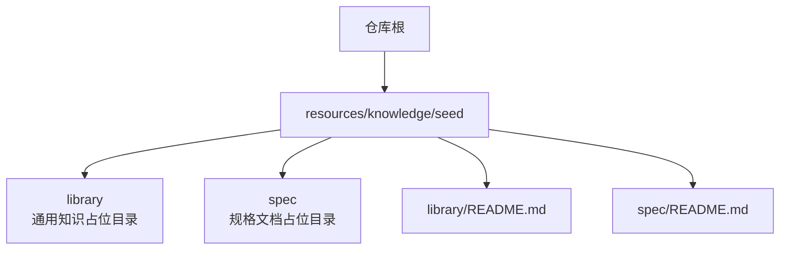
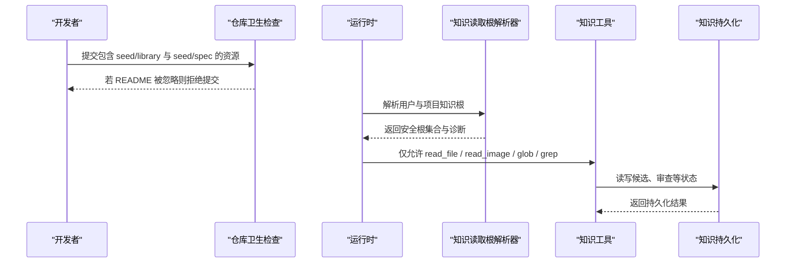
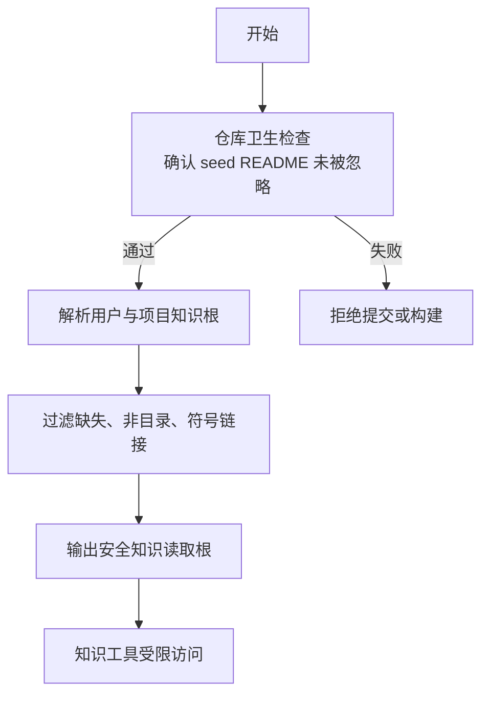
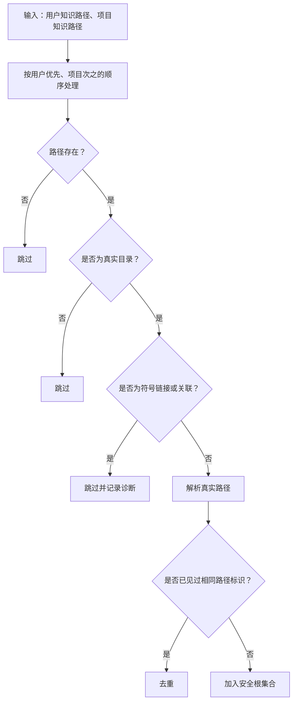
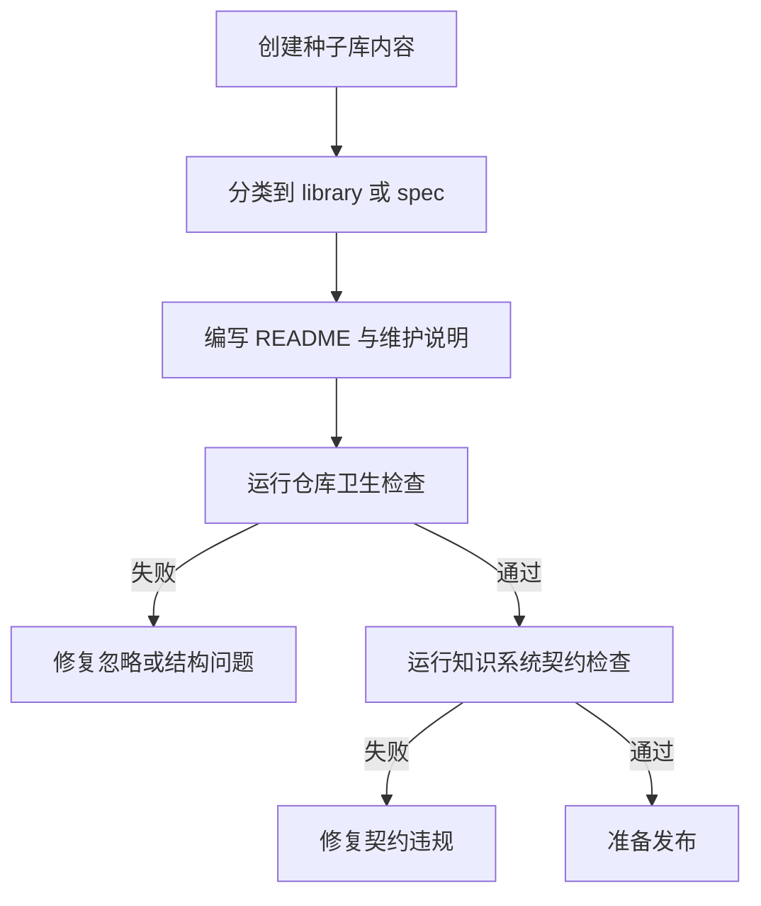
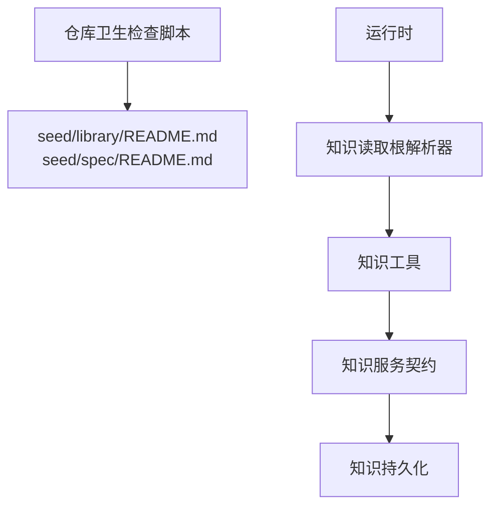

# 种子库管理

<cite>
**本文引用的文件**   
- [scripts/check-repository-hygiene.mjs](file://scripts/check-repository-hygiene.mjs)
- [src/main/agent-runtime/knowledgeReadRoots.ts](file://src/main/agent-runtime/knowledgeReadRoots.ts)
- [scripts/check-knowledge-system.mjs](file://scripts/check-knowledge-system.mjs)
- [src/main/knowledge/KnowledgeTools.ts](file://src/main/knowledge/KnowledgeTools.ts)
- [src/main/knowledge/KnowledgeDurableStore.test.ts](file://src/main/knowledge/KnowledgeDurableStore.test.ts)
</cite>

## 目录
1. [引言](#引言)
2. [项目结构](#项目结构)
3. [核心组件](#核心组件)
4. [架构总览](#架构总览)
5. [详细组件分析](#详细组件分析)
6. [依赖关系分析](#依赖关系分析)
7. [性能考虑](#性能考虑)
8. [故障排查指南](#故障排查指南)
9. [结论](#结论)
10. [附录：贡献与质量标准](#附录贡献与质量标准)

## 引言
本文面向种子库（seed knowledge）的维护者、贡献者和审核者，系统化说明内置种子库的组织方式、加载机制、优先级与覆盖规则，以及扩展、验证和发布流程。种子库是 Agent 运行时可读取的知识资源，由仓库中的检查脚本约束，并由运行时的知识根解析逻辑安全暴露给只读工具。

需要特别注意：当前仓库中“种子库”的实际存在形态是受保护的资源占位说明，而非直接由应用代码动态扫描的“library/spec 分类树”。种子库的领域分类、命名规范和版本策略更多体现为工程契约和约定，需要通过仓库检查和运行时边界共同保障质量。

## 项目结构
种子库在仓库中的受保护位置位于 `resources/knowledge/seed` 下，包含两个顶层类别：
- `library`：通用知识库，通常用于描述通用知识或共享概念。
- `spec`：规格文档，通常用于描述规范、接口、行为约定等强约束内容。

**图示来源**
- [scripts/check-repository-hygiene.mjs:136-142](file://scripts/check-repository-hygiene.mjs#L136-L142)

该结构的关键约束是：这两个 README 文件必须作为可分发资源被 Git 跟踪，不能被 `.gitignore` 忽略。仓库卫生检查会显式校验这一点，如果它们被忽略，提交将失败。

**章节来源**
- [scripts/check-repository-hygiene.mjs:136-142](file://scripts/check-repository-hygiene.mjs#L136-L142)

## 核心组件
种子库相关能力由以下组件协同实现：
- 仓库卫生检查脚本：确保种子库占位说明未被忽略。
- 知识读取根解析器：将用户和项目知识目录转换为安全的只读根集合。
- 知识系统契约检查：约束知识工具、服务、技能、权限和持久化等契约。
- 知识工具定义：声明知识相关的工具能力。
- 知识持久化测试：使用种子值进行数据一致性验证。

这些组件共同构成“约定—校验—运行时边界—持久化”的闭环。

**章节来源**
- [scripts/check-repository-hygiene.mjs:136-142](file://scripts/check-repository-hygiene.mjs#L136-L142)
- [src/main/agent-runtime/knowledgeReadRoots.ts:1-140](file://src/main/agent-runtime/knowledgeReadRoots.ts#L1-L140)
- [scripts/check-knowledge-system.mjs:1-200](file://scripts/check-knowledge-system.mjs#L1-L200)
- [src/main/knowledge/KnowledgeTools.ts:133-337](file://src/main/knowledge/KnowledgeTools.ts#L133-L337)
- [src/main/knowledge/KnowledgeDurableStore.test.ts:430-445](file://src/main/knowledge/KnowledgeDurableStore.test.ts#L430-L445)

## 架构总览
种子库的生命周期可以概括为：仓库阶段通过脚本约束资源状态；构建和发布阶段保证资源可分发；运行阶段通过安全根解析暴露只读访问；知识子系统通过工具和服务契约约束使用方式。

**图示来源**
- [scripts/check-repository-hygiene.mjs:136-142](file://scripts/check-repository-hygiene.mjs#L136-L142)
- [src/main/agent-runtime/knowledgeReadRoots.ts:1-140](file://src/main/agent-runtime/knowledgeReadRoots.ts#L1-L140)
- [src/main/knowledge/KnowledgeTools.ts:133-337](file://src/main/knowledge/KnowledgeTools.ts#L133-L337)
- [src/main/knowledge/KnowledgeDurableStore.test.ts:430-445](file://src/main/knowledge/KnowledgeDurableStore.test.ts#L430-L445)

## 详细组件分析

### 种子库组织与用途
- `library`：适合放置通用知识，例如术语、背景说明、跨领域共识性内容。它强调“广泛可读”，但不代表其内容会被自动索引或结构化。
- `spec`：适合放置规格文档，例如接口契约、行为约定、验收标准、版本兼容性说明。它强调“强约束”，通常应更稳定且变更需严格评审。

两者的区别不是由运行时强制区分，而是由仓库契约和团队约定共同维持。因此，新增内容时应首先判断它是通用知识还是强约束规格，再决定放入 `library` 或 `spec`。

**章节来源**
- [scripts/check-repository-hygiene.mjs:136-142](file://scripts/check-repository-hygiene.mjs#L136-L142)

### 分类体系与命名规范
当前仓库没有提供种子库内部文件的自动分类器，也没有统一的命名规范实现。但仓库对种子库有明确的结构级要求：
- 种子库必须位于 `resources/knowledge/seed`。
- `library/README.md` 与 `spec/README.md` 必须存在且未被忽略。
- 种子库 README 属于“可分发知识资源”，因此不能进入忽略列表。

这意味着“分类体系”目前主要是目录层级上的 library/spec 二分，而“命名规范”应由 README 或上层知识索引约定补充。新增领域知识时，建议：
- 在对应目录创建语义清晰的子目录。
- 在 README 中记录分类原则、命名约定、版本策略和维护人。
- 避免把临时草稿、生成产物或日志放入种子库。

**章节来源**
- [scripts/check-repository-hygiene.mjs:136-142](file://scripts/check-repository-hygiene.mjs#L136-L142)

### 版本管理策略
种子库本身没有独立的版本控制系统。它的版本主要通过以下方式管理：
- Git 提交历史：每次变更都应附带清晰提交信息。
- 仓库检查契约：通过检查脚本保证结构不被破坏。
- 运行时边界：知识读取根解析器不信任符号链接、不信任非目录路径，从而降低恶意或错误路径带来的风险。
- 持久化状态：知识候选、审查等状态通过持久化存储保持会话一致性。

因此，种子库的版本管理更接近“仓库版本 + 契约约束 + 运行时安全边界”的组合，而不是独立发行包版本。

**章节来源**
- [src/main/agent-runtime/knowledgeReadRoots.ts:1-140](file://src/main/agent-runtime/knowledgeReadRoots.ts#L1-L140)
- [scripts/check-knowledge-system.mjs:1-200](file://scripts/check-knowledge-system.mjs#L1-L200)

### 加载机制
种子库并不由某个“SeedLibrary”或“SeedSpec”类直接加载。实际加载机制分为两层：

1. 仓库阶段：`check-repository-hygiene.mjs` 检查 `library/README.md` 和 `spec/README.md` 是否被 Git 忽略。如果被忽略，检查失败。
2. 运行阶段：`knowledgeReadRoots.ts` 解析用户知识目录和项目知识目录，过滤无效路径、符号链接和非目录，最终得到安全的知识读取根集合。

**图示来源**
- [scripts/check-repository-hygiene.mjs:136-142](file://scripts/check-repository-hygiene.mjs#L136-L142)
- [src/main/agent-runtime/knowledgeReadRoots.ts:1-140](file://src/main/agent-runtime/knowledgeReadRoots.ts#L1-L140)

**章节来源**
- [scripts/check-repository-hygiene.mjs:136-142](file://scripts/check-repository-hygiene.mjs#L136-L142)
- [src/main/agent-runtime/knowledgeReadRoots.ts:1-140](file://src/main/agent-runtime/knowledgeReadRoots.ts#L1-L140)

### 优先级与覆盖规则
知识读取根的解析顺序是：先用户知识目录，后项目知识目录。重复路径会根据平台路径标识去重。该顺序意味着用户知识可能覆盖项目知识，但覆盖语义由具体工具和上层业务决定，种子库本身不直接参与覆盖决策。

**图示来源**
- [src/main/agent-runtime/knowledgeReadRoots.ts:1-140](file://src/main/agent-runtime/knowledgeReadRoots.ts#L1-L140)

**章节来源**
- [src/main/agent-runtime/knowledgeReadRoots.ts:1-140](file://src/main/agent-runtime/knowledgeReadRoots.ts#L1-L140)

### 覆盖规则与安全边界
知识读取根解析器不会无条件信任所有路径：
- 缺失路径被跳过。
- 非目录被跳过。
- 符号链接或关联被拒绝。
- 无法解析真实路径时产生诊断。
- 重复路径根据平台路径标识去重。

这些规则使种子库和用户/项目知识目录成为只读资源边界，而不是任意文件系统入口。

**章节来源**
- [src/main/agent-runtime/knowledgeReadRoots.ts:1-140](file://src/main/agent-runtime/knowledgeReadRoots.ts#L1-L140)

### 如何扩展和自定义种子库
扩展种子库的建议流程如下：

1. 确定内容类型：
   - 通用知识 → `resources/knowledge/seed/library`。
   - 强约束规格 → `resources/knowledge/seed/spec`。

2. 创建文件或目录：
   - 使用语义清晰的名称。
   - 在 README 中说明范围、作者、更新日期和版本策略。

3. 提交前自检：
   - 确认 README 未被 `.gitignore` 忽略。
   - 确认新内容不属于生成产物、日志或临时文件。

4. 运行仓库检查：
   - 使用仓库卫生检查脚本确认资源未被忽略。
   - 使用知识系统契约检查确认知识工具、服务和技能符合约定。

5. 发布前确认：
   - 确认种子库 README 是可分发资源。
   - 确认运行时知识读取根能正确解析目标路径。

**图示来源**
- [scripts/check-repository-hygiene.mjs:136-142](file://scripts/check-repository-hygiene.mjs#L136-L142)
- [scripts/check-knowledge-system.mjs:1-200](file://scripts/check-knowledge-system.mjs#L1-L200)

**章节来源**
- [scripts/check-repository-hygiene.mjs:136-142](file://scripts/check-repository-hygiene.mjs#L136-L142)
- [scripts/check-knowledge-system.mjs:1-200](file://scripts/check-knowledge-system.mjs#L1-L200)

### 管理命令与验证工具
与种子库直接相关的管理命令主要来自 Node 脚本：

- 仓库卫生检查：
  - 脚本：`scripts/check-repository-hygiene.mjs`
  - 作用：检查种子库 README 是否被忽略，并执行多项仓库级约束。

- 知识系统契约检查：
  - 脚本：`scripts/check-knowledge-system.mjs`
  - 作用：检查知识工具、服务、技能、权限、持久化等契约是否满足约定。

- 知识工具：
  - 文件：`src/main/knowledge/KnowledgeTools.ts`
  - 作用：声明知识相关工具能力，供运行时和权限策略使用。

- 持久化测试：
  - 文件：`src/main/knowledge/KnowledgeDurableStore.test.ts`
  - 作用：使用种子值验证持久化写入和读取的一致性。

注意：仓库中没有名为 `seed` 的管理命令。种子库管理主要依赖 Node 脚本和 TypeScript 契约检查。

**章节来源**
- [scripts/check-repository-hygiene.mjs:136-142](file://scripts/check-repository-hygiene.mjs#L136-L142)
- [scripts/check-knowledge-system.mjs:1-200](file://scripts/check-knowledge-system.mjs#L1-L200)
- [src/main/knowledge/KnowledgeTools.ts:133-337](file://src/main/knowledge/KnowledgeTools.ts#L133-L337)
- [src/main/knowledge/KnowledgeDurableStore.test.ts:430-445](file://src/main/knowledge/KnowledgeDurableStore.test.ts#L430-L445)

### 发布流程
种子库的发布流程可理解为：
1. 在仓库中维护 `resources/knowledge/seed/library/README.md` 和 `resources/knowledge/seed/spec/README.md`。
2. 确保它们未被 Git 忽略。
3. 通过仓库卫生检查。
4. 通过知识系统契约检查。
5. 随应用打包资源一起发布。

发布时不应把种子库 README 当作可执行入口，也不应把它视为不受约束的用户输入路径。

**章节来源**
- [scripts/check-repository-hygiene.mjs:136-142](file://scripts/check-repository-hygiene.mjs#L136-L142)
- [scripts/check-knowledge-system.mjs:1-200](file://scripts/check-knowledge-system.mjs#L1-L200)

## 依赖关系分析
种子库相关模块之间的依赖关系如下：

**图示来源**
- [scripts/check-repository-hygiene.mjs:136-142](file://scripts/check-repository-hygiene.mjs#L136-L142)
- [src/main/agent-runtime/knowledgeReadRoots.ts:1-140](file://src/main/agent-runtime/knowledgeReadRoots.ts#L1-L140)
- [src/main/knowledge/KnowledgeTools.ts:133-337](file://src/main/knowledge/KnowledgeTools.ts#L133-L337)
- [scripts/check-knowledge-system.mjs:1-200](file://scripts/check-knowledge-system.mjs#L1-L200)

**章节来源**
- [scripts/check-repository-hygiene.mjs:136-142](file://scripts/check-repository-hygiene.mjs#L136-L142)
- [src/main/agent-runtime/knowledgeReadRoots.ts:1-140](file://src/main/agent-runtime/knowledgeReadRoots.ts#L1-L140)
- [src/main/knowledge/KnowledgeTools.ts:133-337](file://src/main/knowledge/KnowledgeTools.ts#L133-L337)
- [scripts/check-knowledge-system.mjs:1-200](file://scripts/check-knowledge-system.mjs#L1-L200)

## 性能考虑
种子库的性能关注点主要在路径解析和资源访问边界上：
- 路径解析应避免大量无效候选。
- 符号链接和关联路径被快速拒绝，减少不安全 I/O。
- 重复路径通过集合去重，避免重复处理。
- 种子库 README 主要用于结构和分发约束，不应被当成大规模数据源。

优化建议：
- 尽量缩小用户知识和项目知识目录范围。
- 避免在种子库中存放大型二进制文件。
- 将大文档拆分为小条目，并通过上层索引或搜索能力访问。

[本节为通用性能建议，不直接分析具体源码]

## 故障排查指南
常见问题及处理方式：

1. 种子库 README 被 Git 忽略：
   - 现象：仓库卫生检查失败。
   - 原因：`.gitignore` 或仓库配置导致 `seed/library/README.md` 或 `seed/spec/README.md` 被忽略。
   - 处理：移除忽略规则，确保它们是可分发资源。

2. 知识读取根被跳过：
   - 现象：运行时报告路径缺失、非目录、符号链接或真实路径解析失败。
   - 原因：用户或项目知识路径不存在、不是目录、是符号链接、或无法解析真实路径。
   - 处理：修正路径、移除符号链接、确认目录权限。

3. 知识契约检查失败：
   - 现象：知识系统契约检查报错。
   - 原因：知识工具、服务、技能或权限不符合约定。
   - 处理：对照契约检查项修复代码、权限或技能声明。

4. 持久化写入异常：
   - 现象：知识持久化测试或运行时报错。
   - 原因：种子值、文件格式或持久化路径不正确。
   - 处理：参考测试中的种子值模式，检查持久化实现和路径。

**章节来源**
- [scripts/check-repository-hygiene.mjs:136-142](file://scripts/check-repository-hygiene.mjs#L136-L142)
- [src/main/agent-runtime/knowledgeReadRoots.ts:1-140](file://src/main/agent-runtime/knowledgeReadRoots.ts#L1-L140)
- [scripts/check-knowledge-system.mjs:1-200](file://scripts/check-knowledge-system.mjs#L1-L200)
- [src/main/knowledge/KnowledgeDurableStore.test.ts:430-445](file://src/main/knowledge/KnowledgeDurableStore.test.ts#L430-L445)

## 结论
种子库在当前仓库中是一个受保护的资源结构，核心价值在于：
- 通过 `library` 和 `spec` 表达通用知识与规格文档的职责分离。
- 通过仓库卫生检查保证关键 README 不被忽略。
- 通过运行时知识读取根解析器限制知识资源的访问边界。
- 通过知识系统契约检查约束工具、服务、技能和持久化行为。

种子库的质量不仅取决于内容本身，还取决于仓库检查、运行时边界和团队约定的共同作用。

[本节为总结性内容，不直接分析具体源码]

## 附录：贡献与质量标准
贡献种子库内容的最低质量标准：
- 结构正确：内容放在 `library` 或 `spec` 下，且 README 未被忽略。
- 语义清晰：标题、摘要、适用范围、维护人和更新日期完整。
- 版本可控：变更记录清晰，避免无意义的大段重写。
- 安全合规：不包含可执行脚本、敏感凭据或外部依赖。
- 契约一致：不破坏知识工具、服务和技能的既有契约。
- 可发布：能被打包为应用资源的一部分。

贡献流程建议：
1. 新建或更新种子库内容。
2. 运行仓库卫生检查。
3. 运行知识系统契约检查。
4. 提交并等待审核。
5. 发布前再次确认 README 可分发、路径可解析。

**章节来源**
- [scripts/check-repository-hygiene.mjs:136-142](file://scripts/check-repository-hygiene.mjs#L136-L142)
- [scripts/check-knowledge-system.mjs:1-200](file://scripts/check-knowledge-system.mjs#L1-L200)