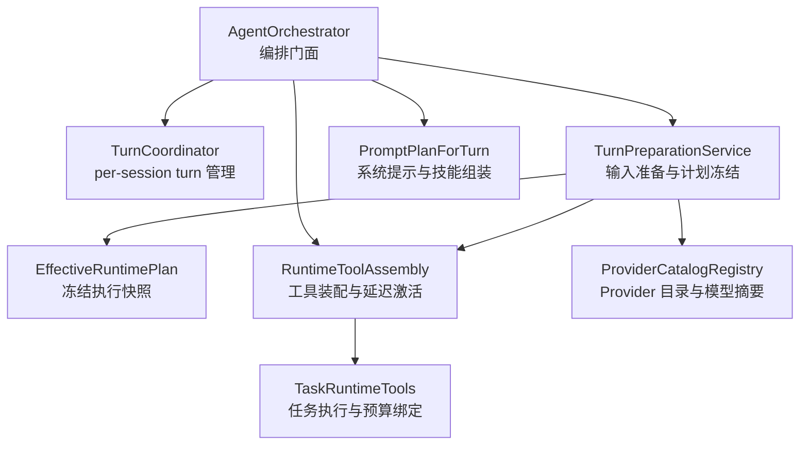
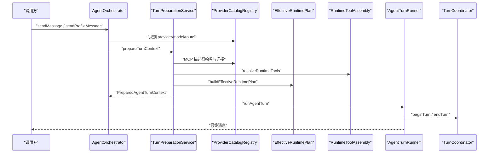
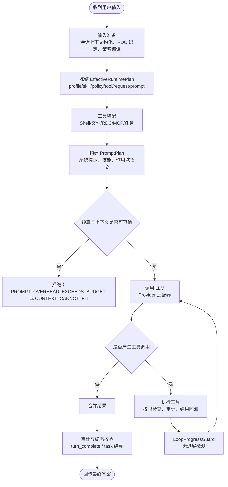
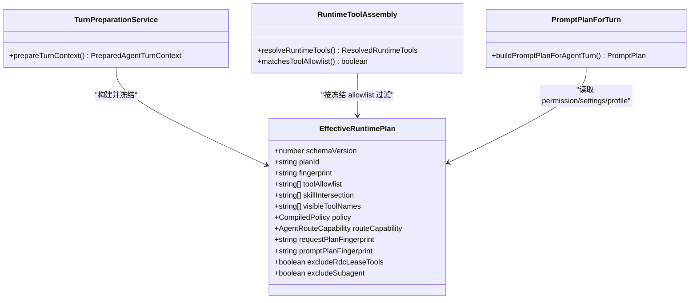
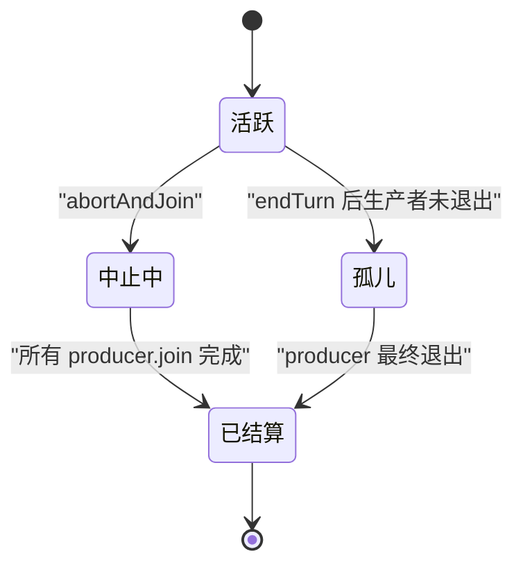
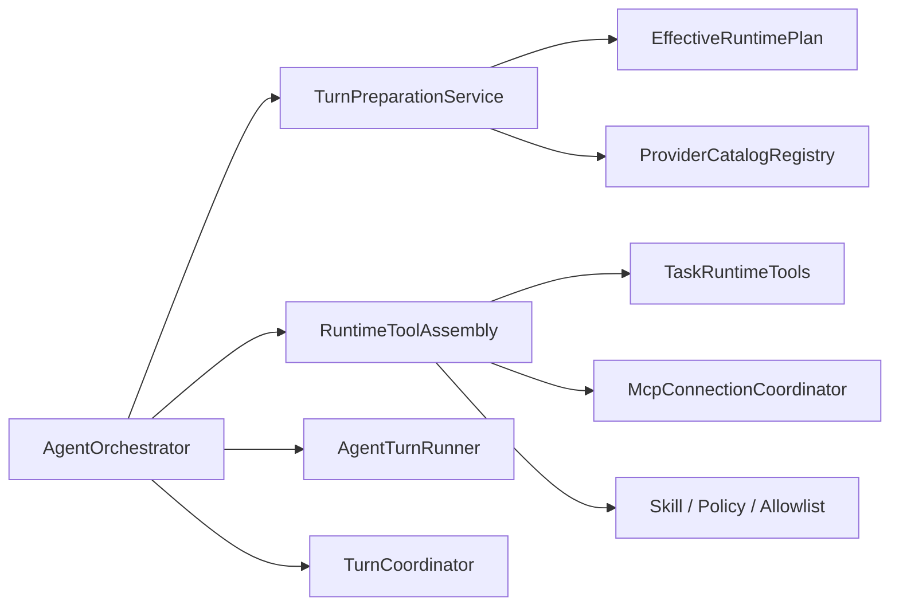

# Agent 运行时架构

<cite>
**本文引用的文件**   
- [AgentOrchestrator.ts](file://src/main/workflow/debugger/AgentOrchestrator.ts)
- [TurnCoordinator.ts](file://src/main/workflow/debugger/TurnCoordinator.ts)
- [TurnPreparationService.ts](file://src/main/workflow/debugger/TurnPreparationService.ts)
- [PromptPlanForTurn.ts](file://src/main/workflow/debugger/PromptPlanForTurn.ts)
- [RuntimeToolAssembly.ts](file://src/main/workflow/debugger/RuntimeToolAssembly.ts)
- [TaskRuntimeTools.ts](file://src/main/workflow/debugger/TaskRuntimeTools.ts)
- [EffectiveRuntimePlan.ts](file://src/main/agent-runtime/EffectiveRuntimePlan.ts)
- [ProviderCatalogRegistry.ts](file://src/main/provider-catalog/ProviderCatalogRegistry.ts)
- [provider-architecture.md](file://docs/architecture/provider-architecture.md)
- [agent-runtime-kernel.md](file://docs/architecture/agent-runtime-kernel.md)
- [runtime-kernel.md](file://docs/contracts/runtime-kernel.md)
</cite>

## 目录

1. [引言](#引言)
2. [项目结构](#项目结构)
3. [核心组件](#核心组件)
4. [架构总览](#架构总览)
5. [详细组件分析](#详细组件分析)
6. [依赖关系分析](#依赖关系分析)
7. [性能与预算特性](#性能与预算特性)
8. [可取消、可回收与权限控制](#可取消可回收与权限控制)
9. [扩展指南](#扩展指南)
10. [常见问题与排查](#常见问题与排查)
11. [结论](#结论)

## 引言

本文件面向 Agent 运行时的实现读者，聚焦以下核心职责：

- **编排层**：`AgentOrchestrator` 作为门面，统一入口 `sendMessage` / `sendProfileMessage` / `prepareTurnContext` / `runSubagent`。
- **回合协调层**：`TurnCoordinator` + `TurnHandle` 管理 per-session 的 turn handle、生命周期、取消、子代理预算和事件回传。
- **计划冻结层**：`EffectiveRuntimePlan` 在准备阶段冻结 profile、技能、工具允许列表、策略、路由、请求指纹与 Prompt 指纹。
- **提示组装层**：`PromptPlanForTurn` 构建系统提示、技能、作用域指令与工具清单；`TurnPreparationService` 完成上下文压缩、MCP 连接、RDC 绑定与 `EffectiveRuntimePlan` 生成。
- **工具装配层**：`RuntimeToolAssembly` 将 Shell、文件操作、RDC CLI、任务、知识、调查、MCP 等能力暴露给 Agent，并执行 deferred 分层加载。
- **Provider 目录层**：`ProviderCatalogRegistry` 基于编译期 manifest 提供 provider 摘要、模型清单、认证模式与路由事实，不持有凭据。

Turn 的生命周期遵循契约中的唯一路径：**输入准备 → 计划冻结 → 工具组装 → LLM 调用 → 工具执行 → 结果合并 → 审计 → 回传**。任何阶段失败都应 fail-closed，不得把未执行的 tool call 注入下一轮上下文。

## 项目结构

Agent 运行时主要分布在三个区域：

| 区域 | 主要职责 | 关键文件 |
|---|---|---|
| 工作流调试器 | Orchestrator、Turn 生命周期、准备服务、工具装配、子代理 | `AgentOrchestrator.ts`、`TurnCoordinator.ts`、`TurnPreparationService.ts`、`RuntimeToolAssembly.ts`、`TaskRuntimeTools.ts`、`PromptPlanForTurn.ts` |
| Agent 运行时内核 | Effective 计划、Prompt 构建、Tokenizer、Provider 注册、错误分类、Reasoning 投影 | `EffectiveRuntimePlan.ts`、`agent-runtime-kernel.md`、`runtime-kernel.md` |
| Provider 目录 | 编译 catalog、surface 加载、模型摘要、认证模式映射 | `ProviderCatalogRegistry.ts`、`provider-architecture.md` |



**图表来源**
- [AgentOrchestrator.ts:25-115](file://src/main/workflow/debugger/AgentOrchestrator.ts#L25-L115)
- [TurnCoordinator.ts:201-641](file://src/main/workflow/debugger/TurnCoordinator.ts#L201-L641)
- [TurnPreparationService.ts:1-120](file://src/main/workflow/debugger/TurnPreparationService.ts#L1-L120)
- [EffectiveRuntimePlan.ts:1-80](file://src/main/agent-runtime/EffectiveRuntimePlan.ts#L1-L80)
- [PromptPlanForTurn.ts:1-40](file://src/main/workflow/debugger/PromptPlanForTurn.ts#L1-L40)
- [RuntimeToolAssembly.ts:1-60](file://src/main/workflow/debugger/RuntimeToolAssembly.ts#L1-L60)
- [TaskRuntimeTools.ts:1-30](file://src/main/workflow/debugger/TaskRuntimeTools.ts#L1-L30)
- [ProviderCatalogRegistry.ts:1-40](file://src/main/provider-catalog/ProviderCatalogRegistry.ts#L1-L40)

**章节来源**
- [agent-runtime-kernel.md:1-40](file://docs/architecture/agent-runtime-kernel.md#L1-L40)
- [runtime-kernel.md:1-40](file://docs/contracts/runtime-kernel.md#L1-L40)

## 核心组件

### Orchestrator：单一编排门面

`AgentOrchestrator` 不是业务逻辑大杂烩，而是对以下子系统组合的 facade：

- 槽位与状态：`AgentSlotRegistry`
- MCP 连接：`McpConnectionCoordinator`
- 延迟工具激活：`DeferredToolActivationTracker`
- Tokenizer：`TokenizerService`
- 提示计划构建：`PromptPlanForTurn`
- 运行时工具装配：`RuntimeToolAssembly`
- 工具执行工厂：`ToolExecutorFactory`
- 回合准备：`TurnPreparationService`
- Profile 准备：`ProfileTurnPreparation`
- 回合执行：`AgentTurnRunner`
- 子代理执行：`SubagentRunner`
- 后台子代理：`BackgroundSubagentService`
- 会话级 turn 协调：`turnCoordinator`

其公共 API 明确限定为：`sendMessage`、`sendProfileMessage`、`getAgentState`、`configureAgent`、`prepareTurnContext`。LLM 流式循环、工具门禁和最终状态由下游模块承担。

**章节来源**
- [AgentOrchestrator.ts:1-115](file://src/main/workflow/debugger/AgentOrchestrator.ts#L1-L115)

### TurnCoordinator：per-session turn 所有权

`TurnCoordinator` 维护两个映射：

- `activeBySession`：当前活跃 turn
- `orphanedBySession`：已终止但生产者尚未完全退出的孤儿 turn

`TurnHandle` 封装一次 turn 的全部运行时权威：

| 字段或方法 | 含义 |
|---|---|
| `turnId` | 本次 turn 标识 |
| `generation` | 防止迟到写入的代际令牌 |
| `abortController.signal` | 可取消信号 |
| `policyBudget` | 工具调用、子代理、深度、墙时间的累计预算 |
| `subagentBudget` | 子代理深度、子数量、聚合工具调用、聚合墙时间 |
| `eventSink` | 向工作区广播事件的通道 |
| `completionDeclaration` | 结构化 turn 完成声明 |
| `approvedPlan` | Mission 计划的冻结校验信息 |
| `isLive(generation)` | 是否仍接受该代际写入 |
| `abortAndJoin(options)` | 优雅关闭、强制关闭、孤儿回收 |

**章节来源**
- [TurnCoordinator.ts:201-641](file://src/main/workflow/debugger/TurnCoordinator.ts#L201-L641)

### EffectiveRuntimePlan：turn 内一致性快照

`EffectiveRuntimePlan` 是 Prompt 构建与工具执行共享的不可变快照。它包含：

- 固定 schema 版本 `schemaVersion: 3`
- `planId` 与 `fingerprint`
- agent、project、profile provenance
- 冻结的 `profileSkills`、`toolAllowlist`、`skillIntersection`、`visibleToolNames`
- 冻结的 `permissionSettings`、`knowledgeReadRoots`
- 冻结的 `CompiledPolicy` 与 `policyFingerprint`
- 冻结的 `routeCapability`、`requestPlanFingerprint`、`promptPlanFingerprint`
- RDC 绑定指纹、MCP descriptor hash、deferred 工具激活集
- 子代理与 RDC lease 工具的排除标记

其设计目标是：**准备阶段解析一次，后续 prompt 和 executor 都引用同一 planId/fingerprint，避免再次读取 settings 导致语义漂移。**

**章节来源**
- [EffectiveRuntimePlan.ts:1-80](file://src/main/agent-runtime/EffectiveRuntimePlan.ts#L1-L80)
- [EffectiveRuntimePlan.ts:201-307](file://src/main/agent-runtime/EffectiveRuntimePlan.ts#L201-L307)

### ProviderCatalogRegistry：事实型 Provider 目录

`ProviderCatalogRegistry` 不保存凭据，也不直接发起网络请求：

- 从编译期生成的 catalog index 加载 surface 摘要
- 按 id 异步加载并缓存单个 compiled surface
- 将 manifest 的 auth mode 映射为 UI 可用的 `LlmProviderAuthMode`
- 合并 surface 与 mode 的 availability
- 提供 model summary、model definition、ownership、discovery authority

真正的凭据刷新、connection test、adapter 发送都在上层 orchestrator 与 provider adapter 中完成。

**章节来源**
- [ProviderCatalogRegistry.ts:1-200](file://src/main/provider-catalog/ProviderCatalogRegistry.ts#L1-L200)
- [provider-architecture.md:1-60](file://docs/architecture/provider-architecture.md#L1-L60)

## 架构总览

下图展示一个典型 turn 的主要参与者：



**图表来源**
- [AgentOrchestrator.ts:200-550](file://src/main/workflow/debugger/AgentOrchestrator.ts#L200-L550)
- [TurnPreparationService.ts:120-458](file://src/main/workflow/debugger/TurnPreparationService.ts#L120-L458)
- [EffectiveRuntimePlan.ts:201-307](file://src/main/agent-runtime/EffectiveRuntimePlan.ts#L201-L307)
- [RuntimeToolAssembly.ts:1-60](file://src/main/workflow/debugger/RuntimeToolAssembly.ts#L1-L60)

## 详细组件分析

### Turn 生命周期流程



**图表来源**
- [AgentOrchestrator.ts:200-550](file://src/main/workflow/debugger/AgentOrchestrator.ts#L200-L550)
- [TurnPreparationService.ts:120-458](file://src/main/workflow/debugger/TurnPreparationService.ts#L120-L458)
- [runtime-kernel.md:40-120](file://docs/contracts/runtime-kernel.md#L40-L120)

#### 输入准备

`TurnPreparationService.prepareTurnContext` 负责：

1. 从 session context journal 物化可见 turn。
2. 获取 RDC 上下文租约并加载 catalog。
3. 冻结 RDC turn binding。
4. 编译 effective policy。
5. 根据 policy 和用户设置计算 context compaction percent。
6. 合并 approved execution offer 所需的 skill。
7. 计算 skill 交集，缩小工具范围。
8. 获取 MCP 连接并收集连接错误。
9. 解析 runtime tools，分区 deferred 工具。
10. 估算 token 并压缩 conversation。
11. 构建 request envelope snapshot。
12. 解析 knowledge read roots。
13. 构建 `EffectiveRuntimePlan`。
14. 返回 `PreparedAgentTurnContext`，其中包含 frozen plan、tool allowlist、initial messages、cache 信息与诊断。

关键点：

- 无效 policy 不得先创建外部进程或网络连接。
- MCP 连接在 try/catch 中释放，失败路径不泄漏。
- 最后一条消息必须是原始 user content，否则抛出 `CONTEXT_CANNOT_FIT`。

**章节来源**
- [TurnPreparationService.ts:120-458](file://src/main/workflow/debugger/TurnPreparationService.ts#L120-L458)

#### 计划冻结

`EffectiveRuntimePlan` 通过 `buildEffectiveRuntimePlan` 合并：

- agent 身份与 project root
- profile skills、max turns、handoffs、delegates
- tool allowlist、skill intersection、visible tool names
- permission settings、knowledge read roots
- CompiledPolicy、context compaction percent
- route capability、request plan fingerprint、prompt plan fingerprint
- attachment manifest fingerprint、RDC binding fingerprint
- RDC lease 工具与 subagent 排除标记
- delegation capsule（子代理）

随后用稳定哈希生成 `fingerprint`，用于判断 prompt cache、executor 一致性以及重试是否需要重建 plan。

**章节来源**
- [EffectiveRuntimePlan.ts:1-80](file://src/main/agent-runtime/EffectiveRuntimePlan.ts#L1-L80)
- [EffectiveRuntimePlan.ts:201-307](file://src/main/agent-runtime/EffectiveRuntimePlan.ts#L201-L307)

#### 工具组装

`RuntimeToolAssembly` 把平台能力包装成 AgentTool：

| 能力 | 对应工具或机制 |
|---|---|
| Shell | ShellTool 与 ShellInvocationService |
| 文件读写、复制、移动、删除 | ReadFileTool、WriteFileTool、CopyFileTool、MoveFileTool、DeleteFileTool |
| RDC CLI | rdc_probe、rdc_context、RdcCliInvokerService |
| 搜索与检索 | tool_search、GlobTool、GrepTool |
| 任务执行 | TaskRuntimeTools |
| 知识 | KnowledgeTools |
| 调查 | InvestigationTools |
| 报告输出 | OutputRegistrationTool |
| MCP | mcp__* 工具与 McpConnectionCoordinator |
| 用户交互 | ask_user、turn_complete |

工具装配还处理：

- allowlist 匹配与规范化
- RDC lease 工具排除
- deferred 工具分区分批激活
- native-structured 路由下只注入 active tool definitions
- turn_complete 的结构化完成声明

**章节来源**
- [RuntimeToolAssembly.ts:1-200](file://src/main/workflow/debugger/RuntimeToolAssembly.ts#L1-L200)
- [agent-runtime-kernel.md:40-120](file://docs/architecture/agent-runtime-kernel.md#L40-L120)

#### LLM 调用与工具执行

`AgentOrchestrator` 在准备完成后调用 `AgentTurnRunner.runAgentTurn`。执行器负责：

- 建立 turn handle
- 调用 Provider 适配器
- 标准化 provider 事件
- 执行已批准工具
- 使用 `LoopProgressGuard` 检测无进展
- 达到 maxTurns 时停止继续请求
- 产出 canonical final answer 或失败

Provider 错误被分类为统一错误模型，包括认证、配额、网络、超时、上下文溢出、流协议等。

**章节来源**
- [AgentOrchestrator.ts:200-550](file://src/main/workflow/debugger/AgentOrchestrator.ts#L200-L550)
- [runtime-kernel.md:120-220](file://docs/contracts/runtime-kernel.md#L120-L220)

#### 结果合并、审计与回传

工具执行结果不会直接信任模型自述。Work Process 的工具摘要来自 runtime tool result。`turn_complete` 要求：

- disposition 属于受枚举值
- evidenceRefs 携带 uri 与 hash
- result.outputs 全部为字符串
- Mission 执行必须满足 completion contract
- direct Task 必须先结算

若模型绕过 turn_complete 直接给出终答，父回合会将其遗留执行标记为 blocked，并以本地完整性诊断收口。

**章节来源**
- [RuntimeToolAssembly.ts:100-200](file://src/main/workflow/debugger/RuntimeToolAssembly.ts#L100-L200)
- [runtime-kernel.md:120-220](file://docs/contracts/runtime-kernel.md#L120-L220)

### EffectiveRuntimePlan 如何保证 turn 内一致性



**图表来源**
- [EffectiveRuntimePlan.ts:1-80](file://src/main/agent-runtime/EffectiveRuntimePlan.ts#L1-L80)
- [TurnPreparationService.ts:300-458](file://src/main/workflow/debugger/TurnPreparationService.ts#L300-L458)
- [RuntimeToolAssembly.ts:60-120](file://src/main/workflow/debugger/RuntimeToolAssembly.ts#L60-L120)
- [PromptPlanForTurn.ts:40-134](file://src/main/workflow/debugger/PromptPlanForTurn.ts#L40-L134)

### TurnCoordinator 的 per-session 管理与预算链



`TurnCoordinator` 在 `beginTurn` 中：

- 清理已结算的孤儿
- 拒绝仍有未结算生产者的孤儿 session
- 中止前一个活跃 turn
- 递增 generation
- 创建 TurnHandle 并放入 activeBySession

预算方面：

- `PolicyBudgetState` 累计 toolCalls、subagents、childDepth、wallStartedAt 与上限
- `reserveDispatchBudget` 先扫描链上所有限制，再原子累加
- `consumeReservedSubagentSlot` 供并发调度器消费预留 slot
- `SubagentBudgetState` 限制 depth、childrenSpawned、aggregateToolCalls、aggregateWallMs
- 父级空闲时间不计入子代理墙时间

**章节来源**
- [TurnCoordinator.ts:201-641](file://src/main/workflow/debugger/TurnCoordinator.ts#L201-L641)

### Provider Catalog 的事实分层、认证流程与连接管理

Provider Catalog 的分层如下：

| 层级 | 内容 | 责任 |
|---|---|---|
| identity | models.dev identity | 固定上游身份与 provenance |
| profile | protocol/auth/discovery/wire mechanics | 复用抽象行为 |
| surface | RDC 展示面、分类、operator、endpoint、route、models | 定义产品能力事实 |
| compiler | Zod strict schema、闭集引用、catalogRevision | 构建期校验 |
| registry | list/load/summary | 运行时查询 |
| planner/adapter | EffectiveModel/RequestPlan/Adapter | 执行期决策 |

认证流程要点：

- Renderer 侧 store 只是主进程快照镜像
- 真实认证发生在主进程
- Grok 订阅走浏览器 Authorization Code + PKCE + loopback 回调
- 凭据不进入 manifest、EffectiveModel、RequestPlan、IPC 或会话
- preflight 创建 opaque credential lease，adapter 消费 lease 发送
- 401 在未输出 stream 内容时最多重试一次，刷新凭据后原位替换

连接管理：

- MCP 连接按 profile.mcpServers 在 prepareTurnContext 中申请
- connection errors 保留但不阻塞整个 turn
- MCP descriptor hash 参与 effectivePlan fingerprint
- orchestrator 提供 disconnectAllMcpServers 与状态摘要

**章节来源**
- [provider-architecture.md:1-120](file://docs/architecture/provider-architecture.md#L1-L120)
- [ProviderCatalogRegistry.ts:1-200](file://src/main/provider-catalog/ProviderCatalogRegistry.ts#L1-L200)
- [TurnPreparationService.ts:180-260](file://src/main/workflow/debugger/TurnPreparationService.ts#L180-L260)

### Tool Assembly 如何暴露 Shell、文件操作与 RDC CLI

Tool Assembly 的核心原则是：**发现不等于授权，授权不等于执行。**

- `matchesToolAllowlist` 支持通配、命名空间前缀与规范化名称
- `isAllowedForRuntime` 结合 agentId、frozen tool allowlist 与 RDC lease 工具排除
- deferred 工具默认不在 provider tools 列表中，只能通过 `tool_search` 或预激活规则启用
- native-structured 路由只注入 active tool definitions，减少 prompt 开销
- RDC CLI 能力由 `RdcCliInvokerService`、`RdcOperationCatalog`、`RdcNativeProtocol` 等支撑，而不是硬编码到 registry

典型路径：

```text
AgentOrchestrator
  -> RuntimeToolAssembly.resolveRuntimeTools
  -> 文件工具 / Shell / 搜索 / 知识 / 调查 / 任务 / MCP
  -> ToolExecutorFactory.createToolExecutor
  -> 权限策略与执行环境
```

**章节来源**
- [RuntimeToolAssembly.ts:1-200](file://src/main/workflow/debugger/RuntimeToolAssembly.ts#L1-L200)
- [agent-runtime-kernel.md:40-120](file://docs/architecture/agent-runtime-kernel.md#L40-L120)

## 依赖关系分析



**图表来源**
- [AgentOrchestrator.ts:25-115](file://src/main/workflow/debugger/AgentOrchestrator.ts#L25-L115)
- [TurnPreparationService.ts:120-458](file://src/main/workflow/debugger/TurnPreparationService.ts#L120-L458)
- [RuntimeToolAssembly.ts:1-60](file://src/main/workflow/debugger/RuntimeToolAssembly.ts#L1-L60)
- [EffectiveRuntimePlan.ts:1-80](file://src/main/agent-runtime/EffectiveRuntimePlan.ts#L1-L80)

耦合关系说明：

- Orchestrator 依赖多个子系统，但对外只暴露少量门面方法。
- TurnPreparationService 是准备阶段的强耦合点，集中处理 RDC、MCP、policy、tool signature 和 effectivePlan。
- RuntimeToolAssembly 依赖 orchestrator 提供的 getActiveTurn、memory store、subagent tools 和 MCP 状态。
- EffectiveRuntimePlan 是被多方读用的冻结数据，不应在执行路径中被重新解析。
- ProviderCatalogRegistry 仅暴露事实查询，不持有凭据或执行状态。

**章节来源**
- [AgentOrchestrator.ts:25-115](file://src/main/workflow/debugger/AgentOrchestrator.ts#L25-L115)
- [TurnPreparationService.ts:120-458](file://src/main/workflow/debugger/TurnPreparationService.ts#L120-L458)

## 性能与预算特性

### Token 预算与上下文压缩

- `effectiveMaxChildDepth` 由 policy.maxChildDepth 与 inheritedMaxChildDepth 取较小值。
- `resolveEffectiveCompactionPercent` 合并用户阈值与 policy 最小值。
- 工具 schema、skills、system prompt 的 token 消耗计入 fixed overhead。
- 如果 message budget 非正数，准备阶段直接拒绝。
- prepared input tokens、uncompacted input tokens、usage percent 均记录在 summary 中。

### 工具调用与子代理预算

| 维度 | 父级预算 | 子代理预算 |
|---|---|---|
| 最大深度 | policy.maxChildDepth | SubagentBudget.maxDepth |
| 最大子数量 | policy.maxSubagents | SubagentBudget.maxChildren |
| 最大工具调用 | policy.maxToolCalls | SubagentBudget.maxAggregateToolCalls |
| 最大墙时间 | policy.maxWallTimeMs | SubagentBudget.maxAggregateWallMs |
| 并发预留 | reservedSubagentSlots | activeChildren / childrenSpawned |

### 循环保护

`LoopProgressGuard` 使用有序工具名、规范化参数、成功/失败、语义结果和 revision 构造稳定指纹：

- 第二次相同：注入 `<runtime_no_progress>`
- 第三次相同：抛出 `AGENT_NO_PROGRESS`
- 任一变化：重置计数

接近 maxTurns 时，最后一次请求不提供工具，只允许生成如实终答。

**章节来源**
- [TurnPreparationService.ts:120-458](file://src/main/workflow/debugger/TurnPreparationService.ts#L120-L458)
- [TurnCoordinator.ts:201-280](file://src/main/workflow/debugger/TurnCoordinator.ts#L201-L280)
- [agent-runtime-kernel.md:80-140](file://docs/architecture/agent-runtime-kernel.md#L80-L140)
- [runtime-kernel.md:40-120](file://docs/contracts/runtime-kernel.md#L40-L120)

## 可取消、可回收与权限控制

### 可取消

- TurnHandle 使用 AbortController 提供 signal。
- 父级 parentSignal 会传播为 parent_abort。
- wall timer 在超过 maxWallTimeMs 时触发 timeout。
- beginTurn 会中止旧 turn。
- abortSession 与 abortAll 批量取消。
- 取消发生在 preparing、committing、running 不同阶段有差异化语义。

### 可回收

- TurnHandle.producers 记录所有异步 producer。
- abortAndJoin 先尝试 graceMs，再 forceAfterMs。
- 无法确认所有 producer 退出时标记 orphaned。
- TurnCoordinator.orphanedBySession 保留孤儿直到 whenSettled。
- endTurn 对已关闭或孤儿 handle 安全处理。
- Orchestrator 在 finally 中释放 transient agent state、MCP lease 和 provider credential。

### 权限控制

权限控制贯穿三层：

1. **Profile 层**：manifest.tools 决定角色允许的基础工具集合。
2. **Skill 层**：active skill 的 allowedTools 可与 allowlist 求交集。
3. **Policy 层**：deniedTools、approvalFloorByTool、command prefix、readable/writable roots。
4. **Runtime 层**：RDC lease 工具排除、subagent 排除、deferred 工具未激活拒绝。

`turn_complete` 也受 Mission completion contract 约束，不能由模型随意宣布完成。

**章节来源**
- [TurnCoordinator.ts:201-641](file://src/main/workflow/debugger/TurnCoordinator.ts#L201-L641)
- [AgentOrchestrator.ts:550-797](file://src/main/workflow/debugger/AgentOrchestrator.ts#L550-L797)
- [runtime-kernel.md:220-344](file://docs/contracts/runtime-kernel.md#L220-L344)

## 扩展指南

### 扩展自定义 Provider

步骤建议：

1. 在 manifest 中新增或更新 surface、route、models。
2. 确保 compiler 能校验 endpoint、auth、wire、binding。
3. 使用 `ProviderCatalogRegistry.listProviderSummaries` 或 `loadProviderSurface` 暴露事实。
4. 实现对应 adapter，消费冻结的 RequestPlan 和 credential lease。
5. 不要把凭据写入 manifest、EffectiveModel、RequestPlan 或 IPC。
6. 使用统一错误分类处理认证、配额、网络、超时、流协议。

注意事项：

- 不要按 hostname 或包名推断协议。
- 不要静默把 unknown 升级为 supported。
- Discovery 结果只能收窄账号可用性，不能覆盖 manifest 结构能力。
- 多协议模型必须在 manifest 中显式声明 routeOptions。

**章节来源**
- [provider-architecture.md:1-120](file://docs/architecture/provider-architecture.md#L1-L120)
- [ProviderCatalogRegistry.ts:1-200](file://src/main/provider-catalog/ProviderCatalogRegistry.ts#L1-L200)
- [runtime-kernel.md:220-344](file://docs/contracts/runtime-kernel.md#L220-L344)

### 扩展自定义 Skill

步骤建议：

1. 在 agent manifest 中声明 skill 及其 allowedTools。
2. 通过 `agentRuntimeConfigService.loadSkill` 加载 skill。
3. 在 `PromptPlanForTurn` 或 `TurnPreparationService` 中合并 preload skillIds。
4. 使用 `combineActiveSkillAllowlists` 与基础 allowlist 求交集。
5. 确保 skill sourceHash 与 promptPlan segment sourceHash 一致，否则触发 rebuild。

注意事项：

- Skill 不能绕过 profile 和 policy。
- 没有 skill 收窄时，不能回退为完整工具集。
- 工具发现不授予权限，调用侧仍需权限校验。

**章节来源**
- [PromptPlanForTurn.ts:40-134](file://src/main/workflow/debugger/PromptPlanForTurn.ts#L40-L134)
- [TurnPreparationService.ts:120-220](file://src/main/workflow/debugger/TurnPreparationService.ts#L120-L220)
- [agent-runtime-kernel.md:40-120](file://docs/architecture/agent-runtime-kernel.md#L40-L120)

### 扩展自定义 Hook 或事件钩子

Hook 与事件通常通过 TurnHandle.eventSink 和工作流事件通道向外扩散：

- eventSink 挂在 TurnHandle 上，禁止 Orchestrator 侧维护 activeTurnBySession 双轨。
- isLive 保证同一 turn 内代际正确性。
- TaskRuntimeTools 通过 eventSink 推送 task.created / task.updated。
- Orchestrator 发布 agent status 与 message 到 workflow projection。

扩展建议：

- 新事件类型应优先使用 SharedAgentEvent 或工作流投影。
- 不要在工具内部直接写 UI 状态。
- 对 late write 使用 TurnHandle.isLive 或 expectedGeneration 守卫。
- 对敏感日志做脱敏，避免泄露凭据、captureHash 或内部 lease。

**章节来源**
- [TurnCoordinator.ts:201-400](file://src/main/workflow/debugger/TurnCoordinator.ts#L201-L400)
- [TaskRuntimeTools.ts:1-104](file://src/main/workflow/debugger/TaskRuntimeTools.ts#L1-L104)
- [AgentOrchestrator.ts:700-797](file://src/main/workflow/debugger/AgentOrchestrator.ts#L700-L797)

## 常见问题与排查

| 问题 | 可能原因 | 排查方法 |
|---|---|---|
| TURN_ORPHANED | 上一轮 turn 的生产者未完全退出 | 检查 producer.abort/join、长时间 IO、子代理未结束 |
| PROMPT_OVERHEAD_EXCEEDS_BUDGET | system prompt、skills、tool schemas 超出预算 | 检查 tool schema 数量、deferred 工具、skill 交集 |
| CONTEXT_CANNOT_FIT | 压缩后最后一条消息不是原始用户消息 | 检查 conversation 压缩逻辑、imageTokenAdjustment |
| AGENT_TOOLS_EMPTY | effective tool set 为空 | 检查 profile.allowlist、skill intersection、policy.deniedTools |
| TOOL_NOT_ACTIVATED | 调用了未激活的 deferred 工具 | 检查 tool_search 是否命中、native-structured 注入规则 |
| AGENT_NO_PROGRESS | 连续相同工具轮次无进展 | 检查工具返回值是否稳定、是否缺少有效 sideEffect |
| AGENT_MAX_TURNS_EXCEEDED | 达到 maxTurns 且 Provider 仍要求 continuation | 检查 prompt 是否最后一次移除工具、turn_complete 是否缺失 |
| 子代理超时或无进展 | 子代理预算耗尽或父级空闲时间误计 | 检查 SubagentBudget、startSubagentBudgetChild/finishSubagentBudgetChild |
| Provider 登录失败 | OAuth、device、api-key、environment 配置不完整 | 检查 catalog authModes、account discovery、credential lease |
| MCP 工具不可用 | MCP server 未连接或 descriptor hash 变化 | 检查 mcpDescriptorHash、mcpLease、connectionErrors |

通用排查顺序：

1. 查看 Work Process 中的 normalized events：llm_turn、reasoning、approval、tool.started、tool.completed。
2. 确认 effectivePlan fingerprint 是否与 promptPlan 一致。
3. 检查 TurnHandle 是否 still live，是否被 edit_resend、timeout、parent_abort 中断。
4. 检查 policy 是否拒绝目标工具或命令前缀。
5. 检查 RDC context lease 是否属于当前 sessionId/projectId。
6. 检查 provider 错误分类是否为 retryable。

**章节来源**
- [TurnCoordinator.ts:201-641](file://src/main/workflow/debugger/TurnCoordinator.ts#L201-L641)
- [TurnPreparationService.ts:120-458](file://src/main/workflow/debugger/TurnPreparationService.ts#L120-L458)
- [runtime-kernel.md:40-220](file://docs/contracts/runtime-kernel.md#L40-L220)

## 结论

Agent 运行时的核心思想是：**以冻结的计划为中心，把权限、工具、Provider、会话和审计边界严格分离。**

- `AgentOrchestrator` 提供稳定门面，不替代具体执行模块。
- `TurnCoordinator` 保证 per-session turn 的可取消、可回收和无双轨状态。
- `EffectiveRuntimePlan` 冻结 turn 内的一致性视图，避免 prompt 与 executor 各自重读 settings。
- `TurnPreparationService` 是输入准备与计划冻结的单一入口。
- `RuntimeToolAssembly` 暴露平台能力，同时坚持“发现 ≠ 授权 ≠ 执行”。
- `ProviderCatalogRegistry` 只提供 manifest 事实，凭据和连接由上层管理。

扩展时应遵循 fail-closed、冻结事实、审计先行、权限最小化和错误可分类的原则，避免引入隐式默认值、隐藏工具路径或可被 renderer 绕过的权限通道。