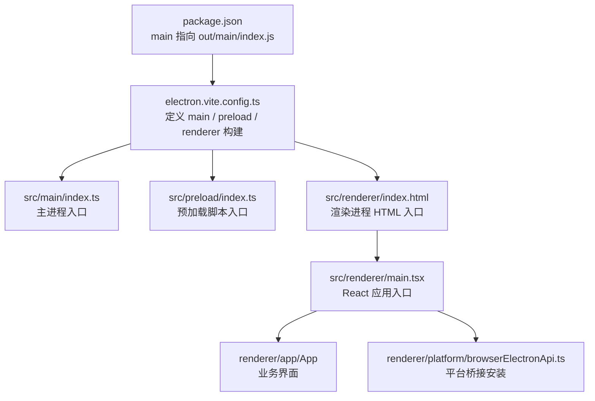
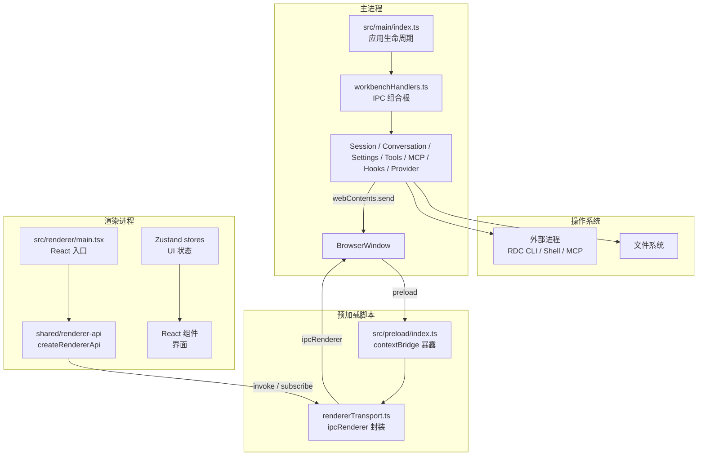
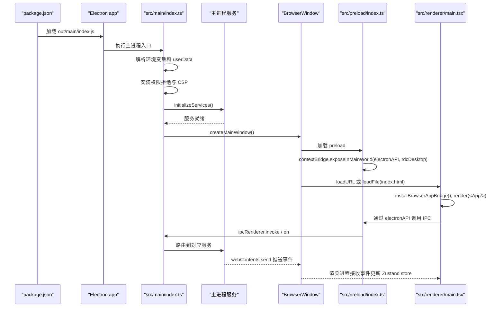
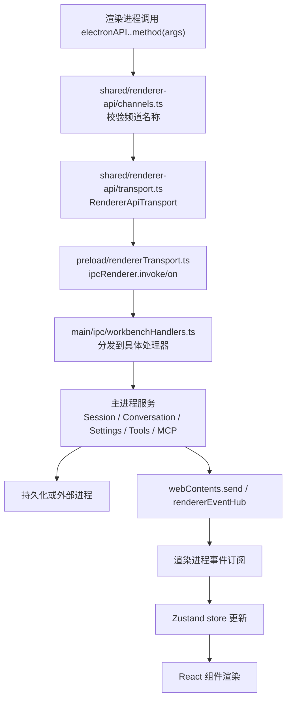
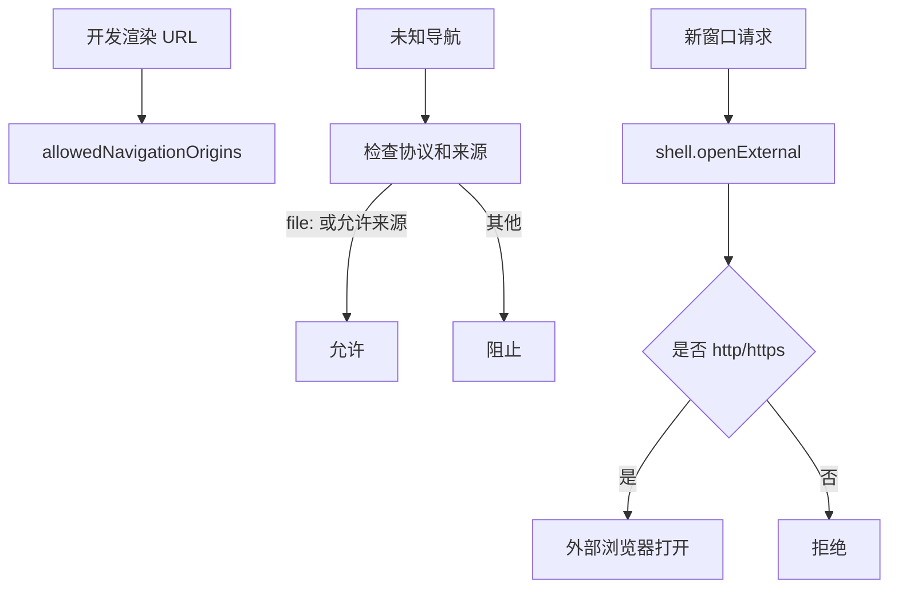
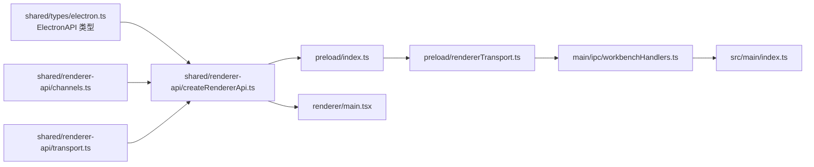

# Electron 多进程架构

<cite>
**本文引用的文件**   
- [electron.vite.config.ts](file://electron.vite.config.ts)
- [vite.renderer.config.ts](file://vite.renderer.config.ts)
- [package.json](file://package.json)
- [electron-builder.json](file://electron-builder.json)
- [src/main/index.ts](file://src/main/index.ts)
- [src/preload/index.ts](file://src/preload/index.ts)
- [src/preload/rendererTransport.ts](file://src/preload/rendererTransport.ts)
- [src/shared/renderer-api/createRendererApi.ts](file://src/shared/renderer-api/createRendererApi.ts)
- [src/shared/renderer-api/channels.ts](file://src/shared/renderer-api/channels.ts)
- [src/shared/renderer-api/transport.ts](file://src/shared/renderer-api/transport.ts)
- [src/shared/types/electron.ts](file://src/shared/types/electron.ts)
- [src/shared/types/electron-api.ts](file://src/shared/types/electron-api.ts)
- [src/renderer/main.tsx](file://src/renderer/main.tsx)
- [src/renderer/platform/browserElectronApi.ts](file://src/renderer/platform/browserElectronApi.ts)
- [src/main/ipc/workbenchHandlers.ts](file://src/main/ipc/workbenchHandlers.ts)
</cite>

## 目录
1. [引言](#引言)
2. [项目结构](#项目结构)
3. [核心组件与职责边界](#核心组件与职责边界)
4. [架构总览](#架构总览)
5. [详细组件分析](#详细组件分析)
6. [依赖关系分析](#依赖关系分析)
7. [性能与安全特性](#性能与安全特性)
8. [故障排查指南](#故障排查指南)
9. [结论](#结论)

## 引言
本文面向两种读者：初学者希望理解 Electron 的 Main、Preload、Renderer 三层模型和 IPC 通信；有经验的开发者希望掌握本项目中主进程作为唯一权威的安全隔离策略、渲染层 Zustand Store 消费数据的模式，以及构建、启动、调试的关键路径。

RDC-Agent 是一个基于 Electron 的桌面应用，负责 RenderDoc `.rdc` 捕获分析与 Agent 工作流。它通过 Electron Vite 构建，将主进程、预加载脚本和渲染进程分别打包，并通过 `ipcMain` / `ipcRenderer` 在受控安全边界内通信。主进程管理 Session、Conversation、Settings、IPC、Tools、RDC CLI、MCP、Worker、Hooks 和 Provider 认证等敏感能力；预加载脚本仅暴露最小化 API；渲染进程通过 Zustand store 和 React 组件消费数据，不直接访问 Node.js、文件系统或浏览器底层权限。

## 项目结构
项目的入口由 `package.json` 的 `main` 字段指向打包后的主进程输出，开发模式下由脚本启动；生产模式由 Electron 加载 `out/main/index.js`。Electron Vite 配置定义了三个构建目标：
- **主进程**：入口为 `src/main/index.ts`，并额外打包一个 `turnPreparationWorker` Worker。
- **预加载脚本**：入口为 `src/preload/index.ts`。
- **渲染进程**：Vite React 应用，入口 HTML 为 `src/renderer/index.html`，React 入口为 `src/renderer/main.tsx`。

**图示来源**
- [package.json:1-143](file://package.json#L1-L143)
- [electron.vite.config.ts:1-62](file://electron.vite.config.ts#L1-L62)
- [src/renderer/main.tsx:1-15](file://src/renderer/main.tsx#L1-L15)

**章节来源**
- [package.json:1-143](file://package.json#L1-L143)
- [electron.vite.config.ts:1-62](file://electron.vite.config.ts#L1-L62)
- [vite.renderer.config.ts:1-39](file://vite.renderer.config.ts#L1-L39)

## 核心组件与职责边界

### 主进程：唯一权威
主进程是系统状态和资源的所有者。它负责：
- 初始化 Electron `app`、`session`、单实例锁、用户数据目录和隔离环境。
- 设置内容安全策略（CSP）和权限拒绝策略，限制渲染进程的网络、脚本和对象执行能力。
- 创建 `BrowserWindow`，绑定预加载脚本，加载开发或生产渲染 URL。
- 注册全局 IPC 处理器，协调 Conversation、Session、Settings、Tools、RDC CLI、MCP、Worker、Hooks 和 Provider 认证。
- 管理生命周期：启动、窗口事件、关闭、信号处理和优雅停机。
- 通过 `rendererEventHub` 同时向所有渲染窗口广播事件。

主进程入口中可见的关键职责包括：
- 导入并调用 `registerIPCHandlers`、`initializeIpcState`、`initializeServices`。
- 初始化 `storageAdapter`、`settingsService`、`rdcCliInvokerService`、`replayDeviceService`、`agentOrchestrator`、`processSupervisor`、`conversationService` 等子系统。
- 在 `before-quit` 阶段通过 `shutdownCoordinator` 有序释放资源，包括 OAuth、Conversation、Run、RDC Runtime、MCP、Shell、BrowserAppBridge、Replay 设备等。

**章节来源**
- [src/main/index.ts:1-200](file://src/main/index.ts#L1-L200)
- [src/main/index.ts:201-450](file://src/main/index.ts#L201-L450)
- [src/main/index.ts:600-779](file://src/main/index.ts#L600-L779)
- [src/main/ipc/workbenchHandlers.ts:1-200](file://src/main/ipc/workbenchHandlers.ts#L1-L200)

### 预加载脚本：受限 API 边界
预加载脚本运行在隔离上下文，可以访问 `contextBridge` 和 `webUtils`，但不应引入 Node.js 内置模块。它做两件事：
1. 使用共享类型和通道定义，构造 `createRendererApi`，生成 `electronAPI`。
2. 通过 `contextBridge.exposeInMainWorld` 暴露两个顶层对象：
   - `electronAPI`：渲染进程调用的受限 API。
   - `rdcDesktop.getPathForFile`：通过 `webUtils.getPathForFile` 安全获取 File 对应的磁盘路径，失败时返回 `null`。

预加载中的 `rendererTransport` 封装了 `ipcRenderer.invoke` 和 `ipcRenderer.on`，并对事件回调进行包装和清理，避免渲染进程直接持有原始 `ipcRenderer` 引用。

**章节来源**
- [src/preload/index.ts:1-25](file://src/preload/index.ts#L1-L25)
- [src/preload/rendererTransport.ts:1-44](file://src/preload/rendererTransport.ts#L1-L44)

### 渲染进程：状态消费层
渲染进程是 React 应用和用户交互界面。它：
- 安装平台桥接和性能探针。
- 挂载 `<App />`。
- 通过全局 `window.electronAPI` 调用主进程能力。
- 使用 Zustand store 订阅主进程事件，将会话、项目、工作流、工具执行、计划、知识、设备、运行时日志等状态同步到 UI。

渲染进程不直接操作文件系统、网络凭据、进程或原生 Electron 对象；所有敏感能力都经过 `electronAPI` 和 IPC 通道校验。

**章节来源**
- [src/renderer/main.tsx:1-15](file://src/renderer/main.tsx#L1-L15)
- [src/shared/renderer-api/createRendererApi.ts:1-80](file://src/shared/renderer-api/createRendererApi.ts#L1-L80)

## 架构总览
下图展示进程、信任边界和数据流向：

**图示来源**
- [src/main/index.ts:201-450](file://src/main/index.ts#L201-L450)
- [src/main/ipc/workbenchHandlers.ts:1-200](file://src/main/ipc/workbenchHandlers.ts#L1-L200)
- [src/preload/index.ts:1-25](file://src/preload/index.ts#L1-L25)
- [src/preload/rendererTransport.ts:1-44](file://src/preload/rendererTransport.ts#L1-L44)
- [src/renderer/main.tsx:1-15](file://src/renderer/main.tsx#L1-L15)
- [src/shared/renderer-api/createRendererApi.ts:1-80](file://src/shared/renderer-api/createRendererApi.ts#L1-L80)

## 详细组件分析

### 进程启动流程
主进程启动顺序可概括为：
1. 解析环境变量、检测开发/测试/无头模式。
2. 确定用户数据目录，必要时创建临时 QA 目录。
3. 获取单实例锁，防止重复启动。
4. 安装默认权限拒绝和内容安全策略。
5. 初始化存储适配器、设置服务、CLI 工具、会话恢复、回放设备等。
6. 注册 IPC 处理器。
7. 可选启动 BrowserAppBridge，用于浏览器真实会话或无头 QA。
8. 非无头模式创建主窗口，加载开发或生产渲染页面。
9. 监听窗口事件、控制台消息、加载失败、渲染进程崩溃。
10. 注册关闭钩子，按阶段释放资源。

**图示来源**
- [package.json:1-143](file://package.json#L1-L143)
- [src/main/index.ts:201-450](file://src/main/index.ts#L201-L450)
- [src/main/index.ts:600-779](file://src/main/index.ts#L600-L779)
- [src/preload/index.ts:1-25](file://src/preload/index.ts#L1-L25)
- [src/renderer/main.tsx:1-15](file://src/renderer/main.tsx#L1-L15)

**章节来源**
- [src/main/index.ts:201-450](file://src/main/index.ts#L201-L450)
- [src/main/index.ts:600-779](file://src/main/index.ts#L600-L779)

### 主进程与渲染进程的通信路径
通信契约由共享代码维护：
- `shared/renderer-api/channels.ts` 定义 `RENDERER_INVOKE_CHANNEL` 和 `RENDERER_EVENT_CHANNEL`。
- `shared/renderer-api/transport.ts` 定义 `RendererApiTransport` 接口。
- `shared/renderer-api/createRendererApi.ts` 组装 `electronAPI`，包含对话、命令、工作流、工具、MCP、设置、项目、会话、运行时日志等能力。
- `preload/rendererTransport.ts` 用 `ipcRenderer` 实现该接口。
- `preload/index.ts` 把 `electronAPI` 暴露给渲染进程。
- `main/ipc/workbenchHandlers.ts` 是 IPC 组合根，集中注册各域处理器并广播事件。

**图示来源**
- [src/shared/renderer-api/channels.ts:1-264](file://src/shared/renderer-api/channels.ts#L1-L264)
- [src/shared/renderer-api/transport.ts:1-10](file://src/shared/renderer-api/transport.ts#L1-L10)
- [src/shared/renderer-api/createRendererApi.ts:1-80](file://src/shared/renderer-api/createRendererApi.ts#L1-L80)
- [src/preload/rendererTransport.ts:1-44](file://src/preload/rendererTransport.ts#L1-L44)
- [src/main/ipc/workbenchHandlers.ts:1-200](file://src/main/ipc/workbenchHandlers.ts#L1-L200)

**章节来源**
- [src/shared/renderer-api/createRendererApi.ts:1-80](file://src/shared/renderer-api/createRendererApi.ts#L1-L80)
- [src/shared/renderer-api/channels.ts:1-264](file://src/shared/renderer-api/channels.ts#L1-L264)
- [src/shared/renderer-api/transport.ts:1-10](file://src/shared/renderer-api/transport.ts#L1-L10)
- [src/preload/rendererTransport.ts:1-44](file://src/preload/rendererTransport.ts#L1-L44)
- [src/main/ipc/workbenchHandlers.ts:1-200](file://src/main/ipc/workbenchHandlers.ts#L1-L200)

### 安全边界与信任模型
主进程通过以下机制建立安全边界：
- **禁用 Node 集成**：`nodeIntegration: false`。
- **启用上下文隔离**：`contextIsolation: true`。
- **启用沙箱**：`sandbox: true`。
- **默认拒绝权限**：`setPermissionRequestHandler` 和 `setPermissionCheckHandler` 返回 `false`。
- **严格 CSP**：限制脚本来源、样式来源、连接来源、对象来源、框架祖先和基础 URI。
- **限制导航**：除允许的开发源和 `file:` 协议外，阻止渲染进程导航到未知来源。
- **限制新窗口**：只允许打开 `http://` 或 `https://` 的外部链接。
- **预加载最小暴露**：只暴露 `electronAPI` 和 `rdcDesktop.getPathForFile`。

**图示来源**
- [src/main/index.ts:201-450](file://src/main/index.ts#L201-L450)

**章节来源**
- [src/main/index.ts:201-450](file://src/main/index.ts#L201-L450)

### 渲染进程 Zustand Store 消费数据
渲染进程通过 `electronAPI` 调用主进程能力，并通过事件订阅将主进程状态同步到本地 store。典型路径包括：
- 会话、项目、运行状态、工具执行结果、计划评审、证据事件、运行时日志、设备状态等。
- 这些状态最终被 Zustand store 消费，驱动 React 组件更新。
- 渲染进程不需要直接了解 IPC 细节，只需订阅事件并写入 store。

由于本仓库中 store 实现分布在多个文件中，本文不展开每个 store 的内部结构，但可确认其消费模式遵循“主进程广播事件 → 渲染进程订阅 → Zustand 更新 → React 重渲染”。

**章节来源**
- [src/renderer/main.tsx:1-15](file://src/renderer/main.tsx#L1-L15)
- [src/shared/renderer-api/createRendererApi.ts:1-80](file://src/shared/renderer-api/createRendererApi.ts#L1-L80)
- [src/main/ipc/workbenchHandlers.ts:1-200](file://src/main/ipc/workbenchHandlers.ts#L1-L200)

### 构建配置
#### Electron Vite 构建
- 主进程使用 `externalizeDepsPlugin()` 并注入 provider catalog Vite 插件。
- 预加载脚本同样使用依赖外部化插件。
- 渲染进程使用 React 插件，开发服务器监听 `127.0.0.1:5173`。
- 三者共享 `@shared` 别名，保证主进程、预加载和渲染进程共用类型与常量。

#### 渲染进程独立 Vite 配置
- 提供 `vite.renderer.config.ts`，用于 `dev:renderer` 命令。
- 自定义插件替换 Vite 开发样式更新逻辑，适配 BrowserAppBridge 同源反向代理。
- HMR 使用 WebSocket，并由 Bridge 升级协议。

#### 包管理与构建产物
- `package.json` 的 `main` 指向 `out/main/index.js`。
- `electron-builder.json` 指定应用 ID、产品名称、输出目录、打包资源、Windows NSIS 和 zip 目标。
- 关键资源如 agent-runtime hooks 会被解包或复制到 extraResources。

**章节来源**
- [electron.vite.config.ts:1-62](file://electron.vite.config.ts#L1-L62)
- [vite.renderer.config.ts:1-39](file://vite.renderer.config.ts#L1-L39)
- [package.json:1-143](file://package.json#L1-L143)
- [electron-builder.json:1-54](file://electron-builder.json#L1-L54)

## 依赖关系分析
主进程依赖众多内部模块，但对外只通过 IPC 暴露能力；预加载脚本依赖共享类型和通道；渲染进程依赖 React、Zustand 和共享 API。

**图示来源**
- [src/shared/types/electron.ts:1-200](file://src/shared/types/electron.ts#L1-L200)
- [src/shared/renderer-api/createRendererApi.ts:1-80](file://src/shared/renderer-api/createRendererApi.ts#L1-L80)
- [src/shared/renderer-api/channels.ts:1-264](file://src/shared/renderer-api/channels.ts#L1-L264)
- [src/shared/renderer-api/transport.ts:1-10](file://src/shared/renderer-api/transport.ts#L1-L10)
- [src/preload/index.ts:1-25](file://src/preload/index.ts#L1-L25)
- [src/preload/rendererTransport.ts:1-44](file://src/preload/rendererTransport.ts#L1-L44)
- [src/main/ipc/workbenchHandlers.ts:1-200](file://src/main/ipc/workbenchHandlers.ts#L1-L200)
- [src/main/index.ts:201-450](file://src/main/index.ts#L201-L450)
- [src/renderer/main.tsx:1-15](file://src/renderer/main.tsx#L1-L15)

**章节来源**
- [src/shared/types/electron.ts:1-200](file://src/shared/types/electron.ts#L1-L200)
- [src/shared/renderer-api/createRendererApi.ts:1-80](file://src/shared/renderer-api/createRendererApi.ts#L1-L80)
- [src/preload/index.ts:1-25](file://src/preload/index.ts#L1-L25)
- [src/main/index.ts:201-450](file://src/main/index.ts#L201-L450)

## 性能与安全特性
### 性能相关
- 开发模式下渲染进程使用 Vite HMR，端口 `127.0.0.1:5173`。
- 无头模式和测试模式禁用 GPU 加速，避免图形相关不稳定因素。
- 主进程对渲染进程控制台消息、加载失败和渲染进程崩溃进行日志记录。
- BrowserAppBridge 在无头模式下保持主进程存活，避免隐藏窗口带来的 GPU 开销。

### 安全相关
- 渲染进程禁用 Node 集成、启用上下文隔离和沙箱。
- 默认拒绝权限请求。
- CSP 限制脚本、样式、连接、对象和框架来源。
- 禁止未授权导航和新窗口。
- 预加载脚本只暴露最小 API，不直接引入 Node 内置模块。
- 主进程通过 `rendererEventHub` 统一管理跨窗口事件，减少直接 `webContents` 耦合。

**章节来源**
- [electron.vite.config.ts:1-62](file://electron.vite.config.ts#L1-L62)
- [src/main/index.ts:201-450](file://src/main/index.ts#L201-L450)
- [src/main/index.ts:600-779](file://src/main/index.ts#L600-L779)
- [src/preload/index.ts:1-25](file://src/preload/index.ts#L1-L25)

## 故障排查指南

### 常见问题定位
| 现象 | 可能原因 | 排查步骤 |
|---|---|---|
| 渲染进程无法加载 | 开发端口占用、URL 主机名不匹配、CSP 限制 | 检查 `ELECTRON_RENDERER_URL`、`getDevRendererUrl`、`registerAllowedOrigin` |
| 渲染进程被阻止导航 | 导航到不允许的来源 | 查看 `web-contents-created` 中的 `will-navigate` 拦截逻辑 |
| 外部链接无法打开 | 新窗口处理只允许 http/https | 检查 `setWindowOpenHandler` |
| 预加载 API 不可用 | `contextBridge` 未正确暴露 | 检查 `preload/index.ts` 暴露的 `electronAPI` 和 `rdcDesktop` |
| IPC 调用无效 | 频道不在白名单或未注册处理器 | 检查 `channels.ts` 和 `workbenchHandlers.ts` |
| 渲染进程崩溃 | 内存不足、异常或原生错误 | 查看 `render-process-gone` 日志 |
| 主进程无法退出 | 关闭协调器未完成 | 检查 `before-quit` 和 `shutdownCoordinator.shutdownAll` |

### IPC 基本概念
IPC 是 Electron 中主进程与渲染进程之间的消息通道。常见用法：
- `ipcRenderer.invoke(channel, ...args)`：发起请求并等待响应。
- `ipcRenderer.on(channel, listener)`：订阅主进程推送的事件。
- `ipcRenderer.removeListener` 和 `removeAllListeners`：清理监听器，避免内存泄漏。
- 主进程通过 `BrowserWindow.webContents.send(channel, ...args)` 向渲染进程推送事件。

在本项目中，渲染进程不直接使用 `ipcRenderer`，而是通过 `electronAPI` 和 `rendererTransport` 调用，这样可以统一类型、频道和能力校验。

**章节来源**
- [src/preload/rendererTransport.ts:1-44](file://src/preload/rendererTransport.ts#L1-L44)
- [src/shared/renderer-api/channels.ts:1-264](file://src/shared/renderer-api/channels.ts#L1-L264)
- [src/main/index.ts:201-450](file://src/main/index.ts#L201-L450)

### 调试建议
- 开发模式下先启动渲染进程 Vite 服务，再启动 Electron。
- 在主进程日志中查找 `[Main] Startup failed`、`[Main] Failed to initialize services`。
- 在渲染进程控制台查看 `[RendererConsole]` 输出。
- 关注 `did-fail-load` 和 `render-process-gone` 的错误信息。
- 检查 CSP 是否阻止了开发时的脚本或连接。
- 确认 `preload/index.js` 路径与 `BrowserWindow.webPreferences.preload` 一致。
- 使用 `check:architecture`、`check:provider-system`、`check-tool-system` 等脚本验证架构约束。

**章节来源**
- [src/main/index.ts:201-450](file://src/main/index.ts#L201-L450)
- [src/main/index.ts:600-779](file://src/main/index.ts#L600-L779)
- [package.json:1-143](file://package.json#L1-L143)

## 结论
RDC-Agent 的多进程架构以主进程为唯一权威，通过严格的 Electron 安全选项、内容安全策略和最小化预加载 API，将敏感能力限制在主进程和主进程服务中。预加载脚本充当可信桥梁，渲染进程通过 `electronAPI` 和事件订阅消费数据，并使用 Zustand store 驱动 UI。Electron Vite 将主进程、预加载脚本和渲染进程统一构建，配合 `electron-builder` 完成打包。

对于初学者，建议从 `src/main/index.ts`、`src/preload/index.ts`、`src/renderer/main.tsx` 和 `shared/renderer-api` 入手，理解主进程、预加载脚本和渲染进程的职责边界。对于有经验的开发者，应重点关注 IPC 通道白名单、`contextBridge` 暴露面、CSP 策略、关闭窗口和新窗口处理，以及主进程服务的初始化和关闭顺序。这样既能保证功能完整，又能维持清晰的安全边界。