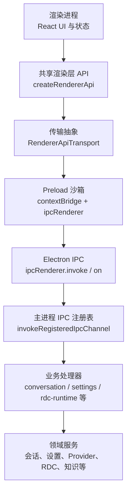
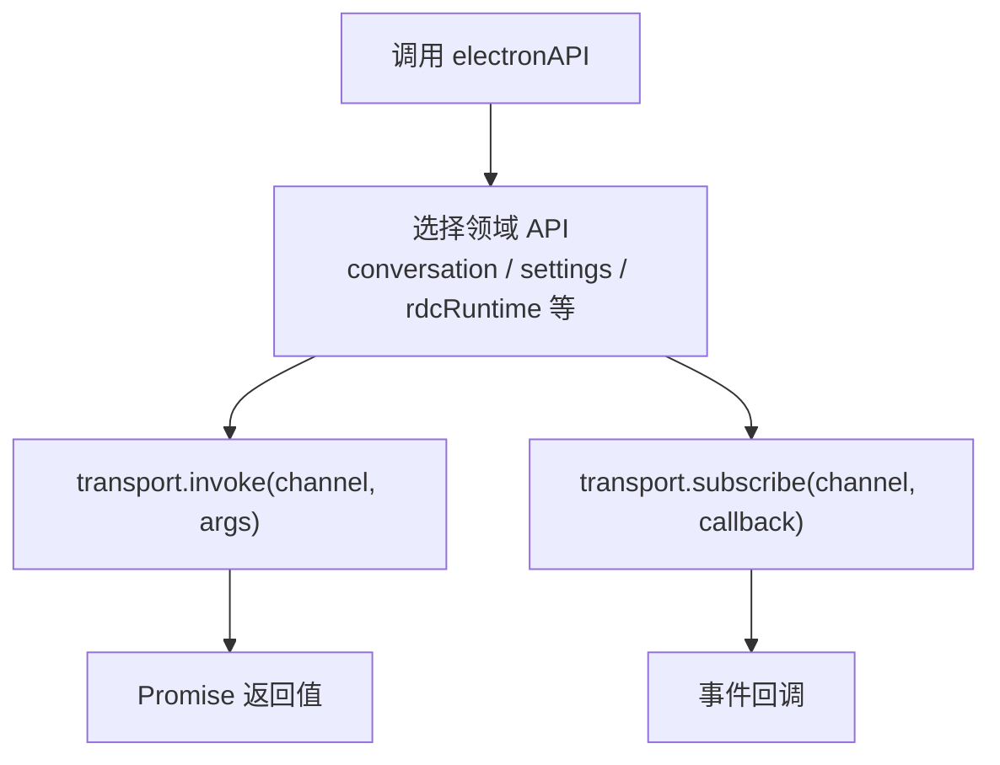
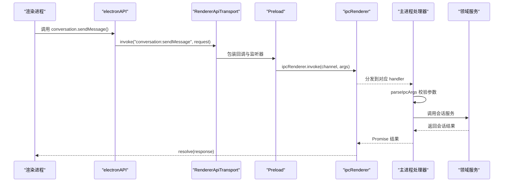
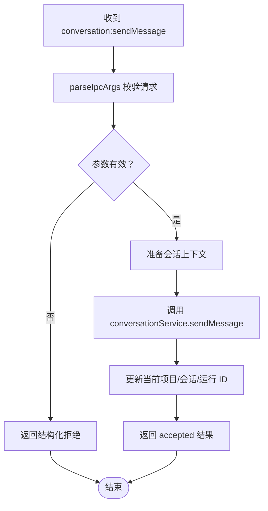
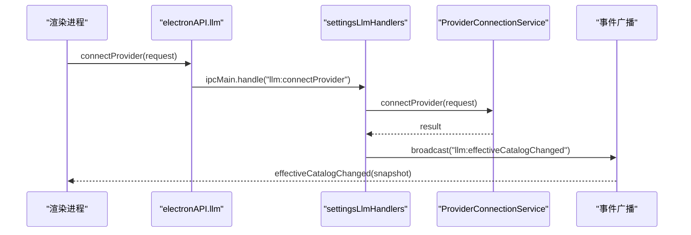
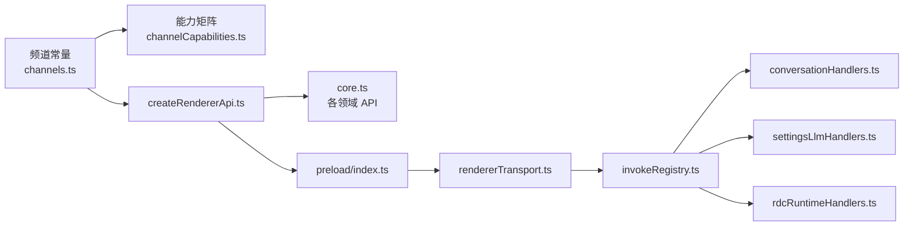

# IPC 与进程间通信模型

<cite>
**本文引用的文件**   
- [src/preload/index.ts](file://src/preload/index.ts)
- [src/preload/rendererTransport.ts](file://src/preload/rendererTransport.ts)
- [src/shared/renderer-api/createRendererApi.ts](file://src/shared/renderer-api/createRendererApi.ts)
- [src/shared/renderer-api/core.ts](file://src/shared/renderer-api/core.ts)
- [src/shared/renderer-api/channels.ts](file://src/shared/renderer-api/channels.ts)
- [src/shared/renderer-api/channelCapabilities.ts](file://src/shared/renderer-api/channelCapabilities.ts)
- [src/shared/renderer-api/transport.ts](file://src/shared/renderer-api/transport.ts)
- [src/main/ipc/invokeRegistry.ts](file://src/main/ipc/invokeRegistry.ts)
- [src/main/ipc/conversationHandlers.ts](file://src/main/ipc/conversationHandlers.ts)
- [src/main/ipc/settingsLlmHandlers.ts](file://src/main/ipc/settingsLlmHandlers.ts)
- [src/main/ipc/rdcRuntimeHandlers.ts](file://src/main/ipc/rdcRuntimeHandlers.ts)
- [docs/contracts/failure-model.md](file://docs/contracts/failure-model.md)
- [docs/contracts/permissions.md](file://docs/contracts/permissions.md)
- [docs/contracts/runtime-kernel.md](file://docs/contracts/runtime-kernel.md)
</cite>

## 目录

1. [引言](#引言)
2. [项目结构](#项目结构)
3. [核心组件](#核心组件)
4. [架构总览](#架构总览)
5. [详细组件分析](#详细组件分析)
6. [依赖关系分析](#依赖关系分析)
7. [性能考虑](#性能考虑)
8. [故障排查指南](#故障排查指南)
9. [结论](#结论)

## 引言

本文面向 Electron 应用中 Main 进程、Preload 沙箱与 Renderer 进程之间的进程间通信模型。重点说明渲染层如何通过 Preload 暴露的受控 `electronAPI` 调用主进程能力，而不是直接访问 Node.js 或系统资源。文档覆盖以下方面：

- IPC 通道类型：请求/响应通道与事件通道。
- 消息契约：共享频道清单、能力分类、参数校验和错误分类。
- 典型场景：会话级通信、设置读取、Provider 管理、RDC 操作、工具调用、知识检索等。
- 安全边界：权限检查、审计、失败分类、Lease 与信任机制。
- 性能建议：避免频繁小消息、使用事件流、区分同步调用与异步事件。
- 扩展指导：新增 API 时如何保持 Renderer、Browser Bridge、Main Handler 三者一致。

该模型的核心思想是：**Renderer 只能调用 Preload 暴露的受控接口；Preload 把调用转发到 Electron IPC；Main 对所有入口进行参数校验、权限检查和领域处理；结果通过返回值或事件回传 Renderer。**

## 项目结构

IPC 相关代码分布在四个关键位置：

| 层次 | 职责 | 主要路径 |
| --- | --- | --- |
| 渲染层 API 定义 | 描述 Renderer 可用的方法、频道、事件和能力分类 | `src/shared/renderer-api` |
| Preload 桥接层 | 在沙箱中创建 `electronAPI`，封装 `ipcRenderer` | `src/preload/index.ts`、`src/preload/rendererTransport.ts` |
| 主进程 IPC 注册 | 安装 `ipcMain.handle` 并集中注册所有 Renderer 调用 | `src/main/ipc/invokeRegistry.ts` |
| 主进程处理器 | 按业务域实现具体 IPC handler | `conversationHandlers.ts`、`settingsLlmHandlers.ts`、`rdcRuntimeHandlers.ts` 等 |

**图示来源**   
- [src/shared/renderer-api/createRendererApi.ts:1-80](file://src/shared/renderer-api/createRendererApi.ts#L1-L80)
- [src/preload/rendererTransport.ts:1-44](file://src/preload/rendererTransport.ts#L1-L44)
- [src/main/ipc/invokeRegistry.ts:1-50](file://src/main/ipc/invokeRegistry.ts#L1-L50)

**章节来源**   
- [src/preload/index.ts:1-25](file://src/preload/index.ts#L1-L25)
- [src/shared/renderer-api/createRendererApi.ts:1-80](file://src/shared/renderer-api/createRendererApi.ts#L1-L80)

## 核心组件

### 渲染层 API 工厂

`createRendererApi` 是渲染层能力的统一入口。它接收平台信息和一个 `RendererApiTransport`，然后组装对话、工作流、Agent、记忆、调查、计划、知识、RDC、工具、MCP、LLM、设置、项目、设备、会话、运行日志、捕获、上下文、事件和窗口控制等 API。

关键设计点：

- 所有调用最终都通过 `transport.invoke(channel, ...args)`。
- 事件订阅通过 `transport.addListener(EVENT.xxx, callback)`。
- `on` 和 `off` 会先校验频道是否属于已注册的渲染事件频道。
- 返回对象同时包含 `platform`、`isMac`、`isWindows`、`isLinux` 等平台信息。

**图示来源**   
- [src/shared/renderer-api/createRendererApi.ts:1-80](file://src/shared/renderer-api/createRendererApi.ts#L1-L80)
- [src/shared/renderer-api/core.ts:1-167](file://src/shared/renderer-api/core.ts#L1-L167)

**章节来源**   
- [src/shared/renderer-api/createRendererApi.ts:1-80](file://src/shared/renderer-api/createRendererApi.ts#L1-L80)
- [src/shared/renderer-api/core.ts:1-167](file://src/shared/renderer-api/core.ts#L1-L167)

### 传输抽象

`RendererApiTransport` 是一个抽象接口，只定义 `invoke`、`subscribe`、`addListener`、`removeListener`、`removeAllListeners`。当前实现由 Preload 提供，底层使用 Electron 原生 `ipcRenderer.invoke` 和 `ipcRenderer.on`。

这种抽象的意义是：

- Renderer 不关心调用是通过桌面 IPC 还是 Browser Bridge HTTP/SSE。
- 新增传输实现时，不需要修改上层 API。
- 测试和调试时可以替换为 mock transport。

**章节来源**   
- [src/shared/renderer-api/transport.ts:1-11](file://src/shared/renderer-api/transport.ts#L1-L11)

### Preload 桥接层

Preload 脚本只做两件事：

1. 使用 `contextBridge.exposeInMainWorld('electronAPI', electronAPI)` 暴露渲染层 API。
2. 额外暴露 `rdcDesktop.getPathForFile(file)`，用于将浏览器 File 转换为可被主进程处理的路径。

Preload 本身不导入文件系统、子进程等 Node.js 内置模块，符合 Electron Sandbox 安全模型。

**章节来源**   
- [src/preload/index.ts:1-25](file://src/preload/index.ts#L1-L25)
- [src/preload/rendererTransport.ts:1-44](file://src/preload/rendererTransport.ts#L1-L44)

### 频道与能力矩阵

`channels.ts` 维护两类常量：

| 类型 | 含义 | 示例 |
| --- | --- | --- |
| `RENDERER_INVOKE_CHANNEL` | 请求/响应 IPC 通道 | `conversation:sendMessage`、`settings:get`、`rdc-runtime:overview` |
| `RENDERER_EVENT_CHANNEL` | 单向事件通道 | `conversation:event`、`llm:stream`、`workflow:runStatusChanged` |

`channelCapabilities.ts` 为每个 invoke 通道分配能力分类：

| 分类 | 含义 |
| --- | --- |
| `read` | 只读查询 |
| `mutation` | 状态变更 |
| `high-impact` | 高影响操作，需要更严格限制 |
| `desktop-only` | 仅桌面端可用 |

这个矩阵是 Browser QA 与桌面端共同遵守的能力契约。未知通道会在运行时 fail-closed。

**章节来源**   
- [src/shared/renderer-api/channels.ts:1-271](file://src/shared/renderer-api/channels.ts#L1-L271)
- [src/shared/renderer-api/channelCapabilities.ts:1-202](file://src/shared/renderer-api/channelCapabilities.ts#L1-L202)

## 架构总览

下图展示一次典型请求从渲染层到主进程服务的完整流程：

**图示来源**   
- [src/shared/renderer-api/core.ts:1-167](file://src/shared/renderer-api/core.ts#L1-L167)
- [src/preload/rendererTransport.ts:1-44](file://src/preload/rendererTransport.ts#L1-L44)
- [src/main/ipc/conversationHandlers.ts:1-200](file://src/main/ipc/conversationHandlers.ts#L1-L200)

## 详细组件分析

### 会话级通信：Session / Conversation / Turn

会话通信集中在 `conversation:` 系列通道。渲染层通过 `electronAPI.conversation` 发送消息、重写历史、取消活跃回合、回答用户输入、审批工具调用、审批计划、获取历史、切换分支、清理历史、撤销最后一轮等。

主进程侧的典型处理流程如下：

**图示来源**   
- [src/main/ipc/conversationHandlers.ts:1-200](file://src/main/ipc/conversationHandlers.ts#L1-L200)

关键行为：

- 发送成功后可能更新 `currentProjectId`、`currentSessionId`、`currentRunId`。
- 失败时通过 `toRejectedSendResult` 转换为结构化拒绝结果。
- 历史记录读取、委派追踪、委派内容读取等操作都有 session 所有权检查。
- 附件预览和附件暂存走专用存储和服务。

**章节来源**   
- [src/shared/renderer-api/core.ts:1-167](file://src/shared/renderer-api/core.ts#L1-L167)
- [src/main/ipc/conversationHandlers.ts:1-200](file://src/main/ipc/conversationHandlers.ts#L1-L200)

### 设置读取与 Provider 管理

设置与 LLM Provider 管理集中在 `settings:` 和 `llm:` 通道。渲染层可以读取应用设置、Provider 目录、有效模型、Provider 密钥、Agent 定义、模型覆盖、Shell 解析器等。

Provider 管理包括连接、断开、刷新模型、账号登录、登录状态查询、登出等操作。成功连接或状态变更后，主进程会通过 `effectiveCatalogChanged` 事件向渲染层广播新的目录快照。

**图示来源**   
- [src/main/ipc/settingsLlmHandlers.ts:1-200](file://src/main/ipc/settingsLlmHandlers.ts#L1-L200)

注意：敏感凭据不应通过普通 IPC 明文传播。权限与安全文档强调 secret 隔离，对外查询应返回掩码或布尔值，而不是原始密钥。

**章节来源**   
- [src/shared/renderer-api/channels.ts:1-271](file://src/shared/renderer-api/channels.ts#L1-L271)
- [src/main/ipc/settingsLlmHandlers.ts:1-200](file://src/main/ipc/settingsLlmHandlers.ts#L1-L200)
- [docs/contracts/permissions.md:1-132](file://docs/contracts/permissions.md#L1-L132)

### RDC 操作

RDC Runtime 操作通过 `rdc-runtime:` 通道暴露，包括概览、验证、upsert、导入、删除、显示文件、Hook 信任/撤销、MCP 信任/撤销、Hook 测试、请求快照列表与读取等。

这类操作通常涉及本地文件系统、Hook 引擎、RDC Runtime Service 和 Hook/MCP 信任状态，因此大多标记为 `high-impact` 或 `desktop-only`。

**章节来源**   
- [src/shared/renderer-api/channels.ts:1-271](file://src/shared/renderer-api/channels.ts#L1-L271)
- [src/shared/renderer-api/channelCapabilities.ts:1-202](file://src/shared/renderer-api/channelCapabilities.ts#L1-L202)
- [src/main/ipc/rdcRuntimeHandlers.ts:1-165](file://src/main/ipc/rdcRuntimeHandlers.ts#L1-L165)

### 工具调用与知识检索

工具调用相关通道包括获取工具目录、运行时摘要、检测安装、解析安装、验证安装、MCP 状态、证据链和证据事件。知识检索相关通道包括概览、查询、卡片、编译、重建索引、候选项、导入、图片、写入、推广、导出等。

这些通道多数是只读查询，但部分写操作（如知识导入、知识写入、MCP 验证）被归类为高影响操作，因为可能改变项目配置或执行环境。

**章节来源**   
- [src/shared/renderer-api/channels.ts:1-271](file://src/shared/renderer-api/channels.ts#L1-L271)
- [src/shared/renderer-api/channelCapabilities.ts:1-202](file://src/shared/renderer-api/channelCapabilities.ts#L1-L202)

## 依赖关系分析

IPC 依赖关系可以从“共享契约 → Preload → 主进程注册表 → 处理器”这条链路理解：

**图示来源**   
- [src/shared/renderer-api/channels.ts:1-271](file://src/shared/renderer-api/channels.ts#L1-L271)
- [src/shared/renderer-api/channelCapabilities.ts:1-202](file://src/shared/renderer-api/channelCapabilities.ts#L1-L202)
- [src/shared/renderer-api/createRendererApi.ts:1-80](file://src/shared/renderer-api/createRendererApi.ts#L1-L80)
- [src/preload/index.ts:1-25](file://src/preload/index.ts#L1-L25)
- [src/preload/rendererTransport.ts:1-44](file://src/preload/rendererTransport.ts#L1-L44)
- [src/main/ipc/invokeRegistry.ts:1-50](file://src/main/ipc/invokeRegistry.ts#L1-L50)

### 一致性保障

仓库通过多个机制保证 Renderer 与 Main 的一致性：

1. `RENDERER_INVOKE_CHANNELS` 是冻结数组，供静态检查和覆盖率测试使用。
2. `assertChannelCapabilityCoverage` 要求每个 invoke 通道都在能力矩阵中。
3. `assertRendererIpcParity` 要求每个 Renderer 频道都有对应的主进程 handler。
4. Browser Bridge 复用同一 `ElectronAPI` 工厂和 channel manifest，不是第二套 UI 能力面。

**章节来源**   
- [src/shared/renderer-api/channelCapabilities.ts:1-202](file://src/shared/renderer-api/channelCapabilities.ts#L1-L202)
- [src/main/ipc/invokeRegistry.ts:1-50](file://src/main/ipc/invokeRegistry.ts#L1-L50)
- [docs/contracts/permissions.md:1-132](file://docs/contracts/permissions.md#L1-L132)

## 性能考虑

### 避免频繁小消息

IPC 是跨进程通信，存在序列化、线程切换和调度开销。对于高频数据，应优先考虑事件流或批量更新，而不是每次状态变化都发一条小消息。

推荐实践：

- 使用 `conversation:event`、`llm:stream`、`workflow:runStatusChanged` 等事件通道推送增量状态。
- 对列表类数据使用分页或增量更新。
- 对大体积数据（如附件、日志、trace）明确限制字节上限。

### 使用事件流代替轮询

渲染层应订阅事件，而不是定时调用 `list` 或 `get` 轮询。例如 Provider 目录变更通过 `llm:effectiveCatalogChanged` 推送，工作流状态通过 `workflow:runStatusChanged` 推送。

### 区分同步调用与异步事件

- **同步调用**：`transport.invoke`，适合一次性请求/响应，例如读取设置、发送会话消息、验证 RDC 资源。
- **异步事件**：`transport.subscribe` 或 `on`，适合长生命周期状态变化，例如流式输出、运行状态变化、设备状态变化。

### 消息大小与超时

处理器中的 `parseIpcArgs` 常配合 `maxBytes` 限制请求体大小。这是防止恶意或异常渲染进程发送超大负载的重要边界。

### 事件监听器管理

`rendererTransport.ts` 内部维护 `listenerMap`，并在移除监听器时清理 Electron 原生监听器。开发者应避免长期持有未释放的事件回调，否则可能导致内存泄漏。

[本节为通用性能建议，不直接分析具体代码行]

## 故障排查指南

### 常见错误来源

| 类别 | 现象 | 排查方向 |
| --- | --- | --- |
| 通道不存在 | 渲染层调用无响应或报错 | 检查 `channels.ts` 是否定义了该通道 |
| 能力缺失 | Browser Bridge 或能力检查失败 | 检查 `channelCapabilities.ts` 是否映射 |
| 主进程无 handler | `No IPC handler registered for xxx` | 检查主进程是否注册了对应 handler |
| 参数非法 | 校验失败或结构化拒绝 | 检查 `parseIpcArgs` 与 Zod schema |
| 会话越权 | 委派追踪或内容读取返回会话拒绝 | 检查当前 session 与请求 session 是否匹配 |
| 凭据问题 | Provider 连接失败或状态异常 | 检查 Provider 配置、secret 隔离和账号状态 |
| 事件未触发 | UI 不更新 | 检查事件通道名称、订阅生命周期和主进程广播 |

### 失败分类模型

失败模型将错误分为三类：

| 分类 | 默认行为 | 适用场景 |
| --- | --- | --- |
| Security fail-closed | 拒绝操作，不静默放行 | 未授权访问、秘密泄露、权限扩大、SSRF、不可信输入 |
| Integrity degrade-safe | 保留可验证子集，记录诊断 | 损坏记录、schema 不匹配、通道冲突、上下文装不下 |
| Availability recoverable | 重试、中止并加入、恢复、展示可恢复错误 | 瞬时网络、Provider 5xx、进程超时、用户取消 |

这不仅是错误处理策略，也是 IPC 设计原则：不能因为可用性错误就降低安全门禁，也不能把所有失败都当成安全拒绝。

**章节来源**   
- [docs/contracts/failure-model.md:1-137](file://docs/contracts/failure-model.md#L1-L137)

### 权限与安全边界

权限文档定义了多个稳定边界：

- Permission Mode 与 AgentPermissionPolicy 决定命令、工具、文件和 shell 的审批路径。
- Electron Sandbox 默认 deny-by-default。
- IPC 使用 Zod 全量校验。
- approvalToken 单次消费。
- RDC context 采用 per-session lease，禁止全局镜像。
- Hook 和 MCP trust 有指纹或部署标识约束。

如果某个 IPC 调用突然被拒绝，优先检查：

1. 通道是否在能力矩阵中。
2. 调用方是否具备所需权限。
3. 是否需要 approval token。
4. 是否处于正确 session 或 project 上下文。
5. 是否触及硬拒绝规则。

**章节来源**   
- [docs/contracts/permissions.md:1-132](file://docs/contracts/permissions.md#L1-L132)

### 运行时内核契约

运行时内核契约补充了会话、Prompt、Provider、Tool 和 Session 的稳定边界。特别值得关注的 IPC 相关点包括：

- 会话提交是事务性的，WAL 前缀校验失败时 fail-closed。
- Agent loop 的相同工具轮次检测、最大轮数限制、终答缺失检查。
- Provider 错误分类与重试策略。
- 流式输出的语义块必须按顺序且唯一归属。
- 工具执行回执必须由主进程生成，模型提交的 result JSON 不具备 provenance。

**章节来源**   
- [docs/contracts/runtime-kernel.md:1-133](file://docs/contracts/runtime-kernel.md#L1-L133)

## 结论

本项目的 IPC 模型以共享 TypeScript 类型和频道清单为中心，将渲染层 API、Preload 桥接、Electron IPC 和主进程处理器解耦。其优点包括：

- 渲染层只能通过受控 `electronAPI` 调用主进程能力。
- 所有 IPC 通道集中在 `channels.ts`，便于审计和测试。
- 能力矩阵使 Browser Bridge 与桌面端共享同一权限语义。
- 主进程处理器使用 `parseIpcArgs` 做参数校验和字节限制。
- 失败分类帮助区分安全、完整性和可用性错误。
- 事件通道支持会话、Provider、工作流、设备等长生命周期状态更新。

扩展新 API 时，建议遵循以下步骤：

1. 在 `channels.ts` 添加 invoke 或 event 频道。
2. 在 `channelCapabilities.ts` 标注能力分类。
3. 在 `core.ts` 或对应 API 文件中添加渲染层方法。
4. 在主进程新增 handler，并使用 `parseIpcArgs` 校验参数。
5. 确保 `assertRendererIpcParity` 和 `assertChannelCapabilityCoverage` 通过。
6. 对高影响操作增加权限检查、审计和失败分类。
7. 对高频状态使用事件通道，避免轮询。

[本节为总结性内容，不直接分析具体代码行]