# 安全、权限与信任模型

<cite>
**本文引用的文件**   
- [permissions.md](file://docs/contracts/permissions.md)
- [scoped-runtime-resources.md](file://docs/product/scoped-runtime-resources.md)
- [AgentPermissionPolicy.ts](file://src/main/agent-runtime/permissions/AgentPermissionPolicy.ts)
- [PolicyCompiler.ts](file://src/main/agent-runtime/permissions/PolicyCompiler.ts)
- [SettingsService.ts](file://src/main/settings/SettingsService.ts)
- [SecretStorageService.ts](file://src/main/settings/SecretStorageService.ts)
- [ProviderCatalogService.ts](file://src/main/settings/ProviderCatalogService.ts)
- [McpTrustService.ts](file://src/main/settings/McpTrustService.ts)
- [HookEngine.ts](file://src/main/hooks/HookEngine.ts)
- [hookTrustStore.ts](file://src/main/hooks/hookTrustStore.ts)
- [check-secrets.mjs](file://scripts/check-secrets.mjs)
</cite>

## 目录
1. [引言](#引言)
2. [项目结构与安全边界](#项目结构与安全边界)
3. [核心组件](#核心组件)
4. [架构总览](#架构总览)
5. [详细组件分析](#详细组件分析)
6. [依赖关系分析](#依赖关系分析)
7. [性能与可审计性](#性能与可审计性)
8. [故障排查指南](#故障排查指南)
9. [结论](#结论)

## 引言
RDC-Agent 的安全策略以“失败即关闭”为核心：当配置缺失、凭据不可用、权限未知、IPC 载荷非法、扩展未信任或执行环境不符合预期时，系统应拒绝操作并返回明确错误，而不是降级为默认允许。该策略适用于以下扩展点：

- IPC：渲染进程到主进程的调用必须通过模式校验和授权令牌。
- Provider：模型提供商的配置、能力与凭据由设置和服务层收敛。
- Tool：工具调用必须经过权限分类、策略下界、命令黑名单和资源根限制。
- Skill：技能只收窄已预载的工具集合，不扩大权限。
- Hook：用户和项目钩子需要基于指纹的信任记录。
- MCP：项目级 MCP 连接前必须显式信任，且禁止覆盖用户可执行内容。
- Shell：灾难命令硬拒绝，风险分类器不是安全边界。
- Secret：敏感值只在主进程内加密存储，不在日志、契约或 IPC 中明文传播。

文档面向两类读者：初学者可通过权限决策流程图和信任边界图理解概念；有经验的开发者可参考实现路径、错误分类和最小权限原则，用于自定义权限策略或扩展点集成。

## 项目结构与安全边界
RDC-Agent 将权限、信任与资源隔离分为三层：

1. 产品规格层：定义权限模式、Scope、Skill 交集、Hook 事件、MCP 信任、Shell 规则、Secret 隔离等不变量。
2. 运行时服务层：`SettingsService`、`AgentPermissionPolicyService`、`PolicyCompiler`、`SecretStorageService`、`ProviderCatalogService`、`McpTrustService`、`HookEngine` 等实现具体策略。
3. 执行与通信层：IPC handler、Tool 执行入口、Shell 解析器、Browser Bridge、Provider 调用链。

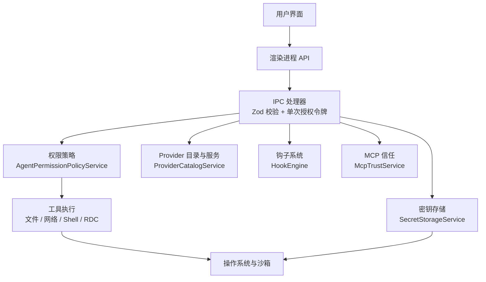

**图表来源**
- [permissions.md:1-119](file://docs/contracts/permissions.md#L1-L119)
- [scoped-runtime-resources.md:1-100](file://docs/product/scoped-runtime-resources.md#L1-L100)
- [AgentPermissionPolicy.ts:1-481](file://src/main/agent-runtime/permissions/AgentPermissionPolicy.ts#L1-L481)
- [SettingsService.ts:1-200](file://src/main/settings/SettingsService.ts#L1-L200)
- [SecretStorageService.ts:1-267](file://src/main/settings/SecretStorageService.ts#L1-L267)
- [ProviderCatalogService.ts:1-72](file://src/main/settings/ProviderCatalogService.ts#L1-L72)
- [McpTrustService.ts:1-133](file://src/main/settings/McpTrustService.ts#L1-L133)
- [HookEngine.ts:1-200](file://src/main/hooks/HookEngine.ts#L1-L200)

**章节来源**
- [permissions.md:1-119](file://docs/contracts/permissions.md#L1-L119)
- [scoped-runtime-resources.md:1-100](file://docs/product/scoped-runtime-resources.md#L1-L100)

## 核心组件
- `AgentPermissionPolicyService`：对工具调用进行风险分类，输出允许、自动审查、询问用户或拒绝决策，并与编译后的策略下界取更严格者。
- `PolicyCompiler`：加载 `.policy.yml`，合并多份策略，计算工具禁用列表、审批下界和资源预算上限。
- `SettingsService`：统一读取、规范化应用设置，提供 Provider 凭据视图、连接字段解析、代理运行时权限配置。
- `SecretStorageService`：使用 Electron `safeStorage` 加密 Provider 密钥，处理损坏隔离、权限位、掩码预览。
- `ProviderCatalogService`：从 Provider 注册表导出可见的 Provider 能力、协议、认证模式和生命周期状态。
- `McpTrustService`：维护项目级 MCP 描述符信任记录，连接前校验是否允许连接。
- `HookEngine` 与 `hookTrustStore`：加载钩子定义、计算信任指纹、管理用户和项目钩子的信任状态。

**章节来源**
- [AgentPermissionPolicy.ts:1-481](file://src/main/agent-runtime/permissions/AgentPermissionPolicy.ts#L1-L481)
- [PolicyCompiler.ts:1-234](file://src/main/agent-runtime/permissions/PolicyCompiler.ts#L1-L234)
- [SettingsService.ts:1-200](file://src/main/settings/SettingsService.ts#L1-L200)
- [SecretStorageService.ts:1-267](file://src/main/settings/SecretStorageService.ts#L1-L267)
- [ProviderCatalogService.ts:1-72](file://src/main/settings/ProviderCatalogService.ts#L1-L72)
- [McpTrustService.ts:1-133](file://src/main/settings/McpTrustService.ts#L1-L133)
- [HookEngine.ts:1-200](file://src/main/hooks/HookEngine.ts#L1-L200)
- [hookTrustStore.ts:1-100](file://src/main/hooks/hookTrustStore.ts#L1-L100)

## 架构总览
RDC-Agent 采用分层权限模型：

| 层级 | 职责 | 关键实现 |
|---|---|---|
| 策略声明层 | 定义权限模式、策略文件、Skill 选择、Hook 与 MCP 元信息 | 设置面板、`.policy.yml`、技能与钩子定义 |
| 策略编译层 | 合并策略、校验预算、计算审批下界 | `PolicyCompiler` |
| 权限决策层 | 对工具调用进行分类，结合模式、工作区根、命令白名单、危险模式 | `AgentPermissionPolicyService` |
| 执行约束层 | 真正拒绝非法载荷、灾难命令、越界路径、未信任扩展 | IPC 校验、`shellHardDeny`、文件系统、Electron 沙箱 |
| 凭据与信任层 | 加密存储、掩码展示、MCP 与 Hook 信任记录 | `SecretStorageService`、`McpTrustService`、`HookEngine` |

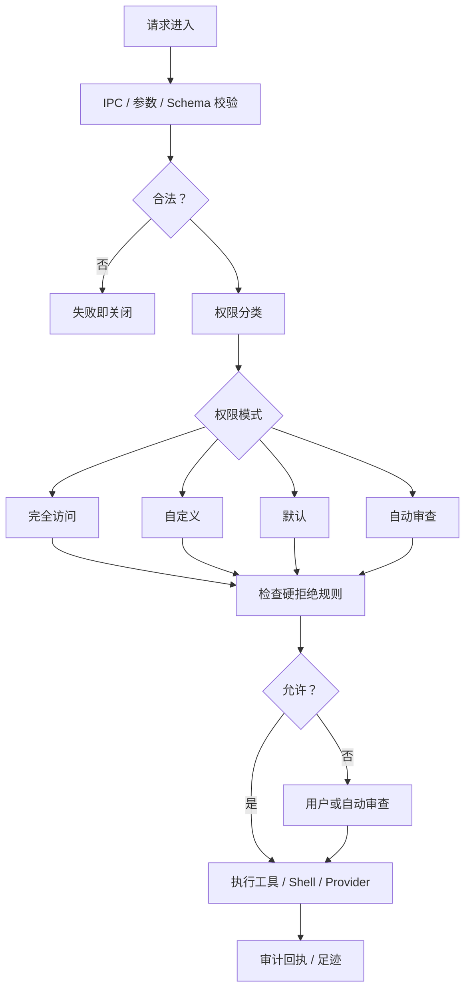

**图表来源**
- [permissions.md:1-119](file://docs/contracts/permissions.md#L1-L119)
- [AgentPermissionPolicy.ts:1-481](file://src/main/agent-runtime/permissions/AgentPermissionPolicy.ts#L1-L481)
- [PolicyCompiler.ts:1-234](file://src/main/agent-runtime/permissions/PolicyCompiler.ts#L1-L234)

**章节来源**
- [permissions.md:1-119](file://docs/contracts/permissions.md#L1-L119)

## 详细组件分析

### 权限策略与权限决策
`AgentPermissionPolicyService.evaluate` 是工具调用的权限入口。它首先考虑 Mission 计划专用工具的硬拒绝、策略禁用列表、RDC 执行限制、Shell 灾难命令和文件工具绕过规则，然后计算基线决策，再与 `CompiledPolicy` 的审批下界比较，取更严格者。

权限决策强度顺序为：允许 < 自动审查 < 询问用户 < 拒绝。`user` 审批下界不能被权限模式降回自动审查，`auto_review` 下界也不能被放宽。

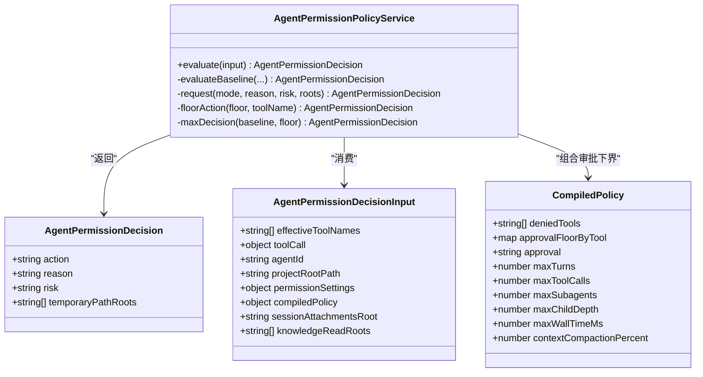

**图表来源**
- [AgentPermissionPolicy.ts:1-481](file://src/main/agent-runtime/permissions/AgentPermissionPolicy.ts#L1-L481)
- [PolicyCompiler.ts:1-234](file://src/main/agent-runtime/permissions/PolicyCompiler.ts#L1-L234)

关键行为：

- 只读文件工具可在工作区内自动允许，外部路径需审查。
- 会话附件目录仅对只读文件工具自动可读，写入工具、代码解释器和跨会话附件不继承。
- Knowledge 读根在冻结策略中注入，只对只读文件工具免审批，写工具和 Shell 双重拒绝。
- Shell 命令先走硬拒绝，再走风险分类和命令白名单，最后按权限模式决定自动审查或询问用户。
- 完全访问模式不会绕过 Mission 计划专用工具禁用、灾难 Shell 规则和底层执行约束。

**章节来源**
- [AgentPermissionPolicy.ts:1-481](file://src/main/agent-runtime/permissions/AgentPermissionPolicy.ts#L1-L481)
- [permissions.md:1-119](file://docs/contracts/permissions.md#L1-L119)

### 策略编译与最小权限原则
`PolicyCompiler` 负责加载 `.policy.yml`，将其转换为 `CompiledPolicy`。它只允许已知限制键，要求数值为非负整数，并将多个策略合并为一份收紧策略。

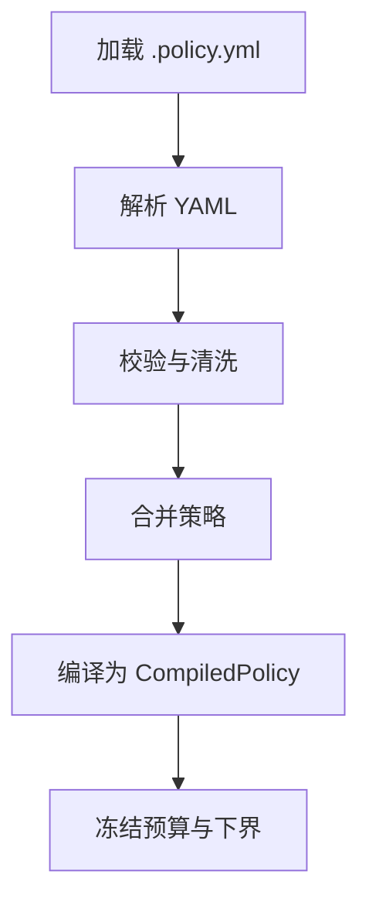

**图表来源**
- [PolicyCompiler.ts:1-234](file://src/main/agent-runtime/permissions/PolicyCompiler.ts#L1-L234)

最小权限原则体现在：

- 策略只能收紧，不能放宽。
- 禁用工具、审批下界和预算上限共同形成下限。
- `maxChildDepth`、`maxTurns`、`maxToolCalls`、`maxSubagents`、`maxWallTimeMs` 在回合计划中冻结。
- 未知限制键直接报错，避免隐藏扩权。

**章节来源**
- [PolicyCompiler.ts:1-234](file://src/main/agent-runtime/permissions/PolicyCompiler.ts#L1-L234)

### SettingsService 与 ProviderCatalogService
`SettingsService` 是应用设置的权威入口，负责初始化运行时路径、重建持久化设置、读写 Provider 凭据、解析连接字段，并暴露 Agent 运行时权限配置。对外查询 Provider 凭据只返回掩码预览，不返回明文。

`ProviderCatalogService` 把 Provider 注册表中的能力、协议、认证模式、生命周期状态和连接 schema 投影为 UI 可用数据，但不直接持有用户凭据。

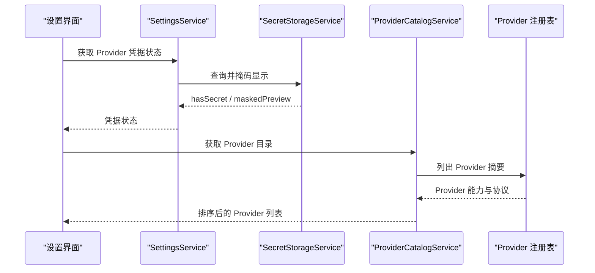

**图表来源**
- [SettingsService.ts:1-200](file://src/main/settings/SettingsService.ts#L1-L200)
- [SecretStorageService.ts:1-267](file://src/main/settings/SecretStorageService.ts#L1-L267)
- [ProviderCatalogService.ts:1-72](file://src/main/settings/ProviderCatalogService.ts#L1-L72)

**章节来源**
- [SettingsService.ts:1-200](file://src/main/settings/SettingsService.ts#L1-L200)
- [ProviderCatalogService.ts:1-72](file://src/main/settings/ProviderCatalogService.ts#L1-L72)

### Secret 管理与错误分类
`SecretStorageService` 将 Provider 密钥以 `safeStorage` 加密形式保存，文件权限设置为 0600，并在 Windows 上尝试限制 ACL。如果 `safeStorage` 不可用，则拒绝存储；如果密钥文件损坏，则隔离到 `.corrupt-*` 文件并抛出错误。对外接口只提供掩码预览，不泄露完整密钥。

错误分类包括：

- `SecretStorageUnavailableError`：系统加密存储不可用。
- `SecretStoreCorruptError`：密钥文件损坏，附带隔离路径。
- 解密失败：记录警告并返回空值，防止明文泄露。

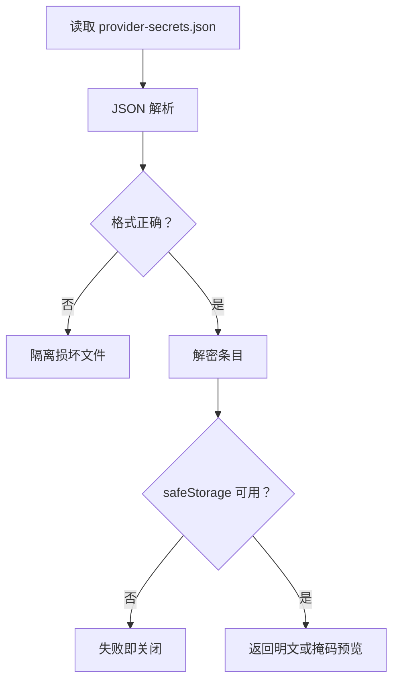

**图表来源**
- [SecretStorageService.ts:1-267](file://src/main/settings/SecretStorageService.ts#L1-L267)

**章节来源**
- [SecretStorageService.ts:1-267](file://src/main/settings/SecretStorageService.ts#L1-L267)

### Hook 信任模型
Hook 信任基于“解析定义 + 所有脚本与参数文件字节 + 规范真实路径 + 作用域与来源 + PATH 解析后的可执行身份”计算的指纹。builtin 钩子默认信任；用户和项目钩子必须显式信任。旧版仅 YAML 哈希的信任记录会在首次加载时被清空，要求重新信任。

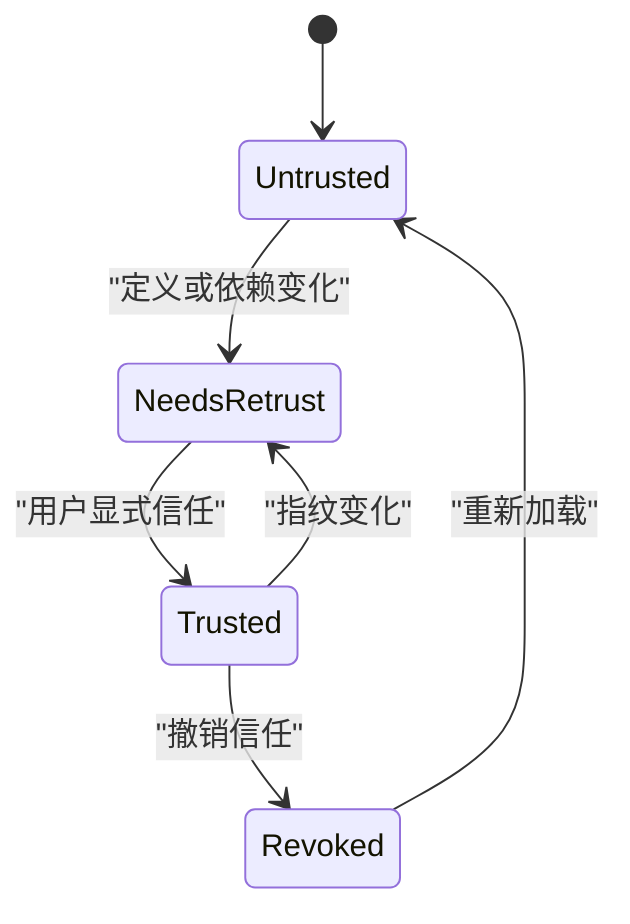

**图表来源**
- [HookEngine.ts:1-200](file://src/main/hooks/HookEngine.ts#L1-L200)
- [hookTrustStore.ts:1-100](file://src/main/hooks/hookTrustStore.ts#L1-L100)

**章节来源**
- [HookEngine.ts:1-200](file://src/main/hooks/HookEngine.ts#L1-L200)
- [hookTrustStore.ts:1-100](file://src/main/hooks/hookTrustStore.ts#L1-L100)

### MCP 信任模型
MCP 信任服务根据项目真实路径、描述符 ID 和描述符哈希维护信任记录。项目 MCP 不能覆盖用户的 command、args、url 或 env；可执行指纹变化时需要重新信任；连接前必须调用 `assertConnectAllowed`。不支持的传输类型会被标记为阻塞原因。

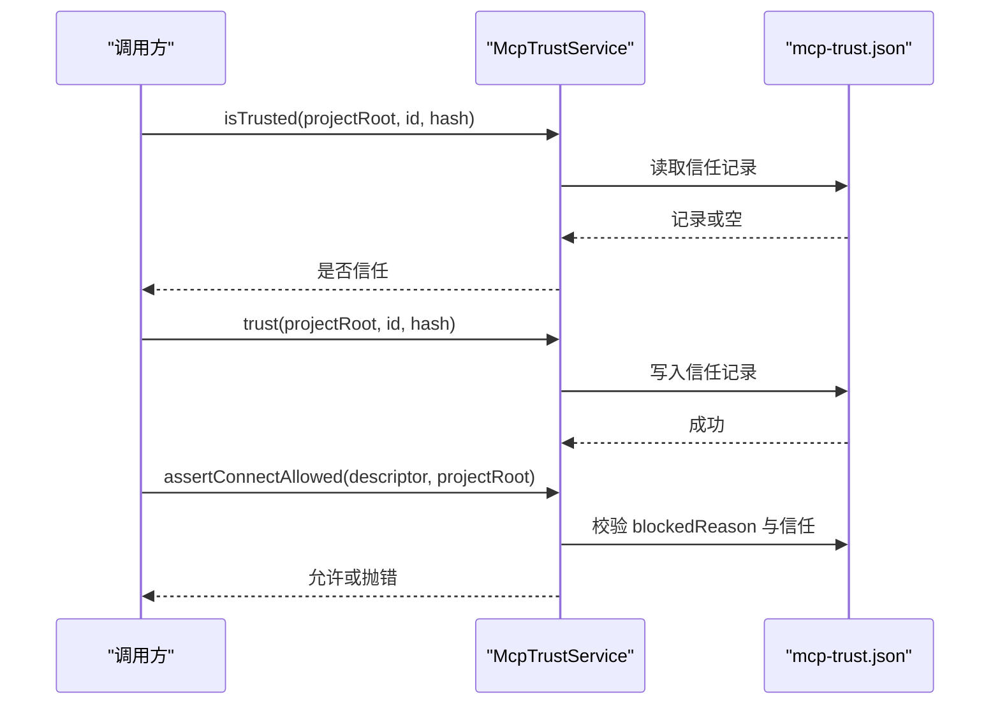

**图表来源**
- [McpTrustService.ts:1-133](file://src/main/settings/McpTrustService.ts#L1-L133)

**章节来源**
- [McpTrustService.ts:1-133](file://src/main/settings/McpTrustService.ts#L1-L133)

### 典型授权用例

#### 用户授权流程
用户打开设置面板后，系统显示 Provider 能力、认证模式和连接字段；用户输入凭据时，凭据经 `SecretStorageService` 加密存储；设置变更后，`SettingsService` 刷新 Provider 连接值，但不会向 UI 或 IPC 暴露明文。

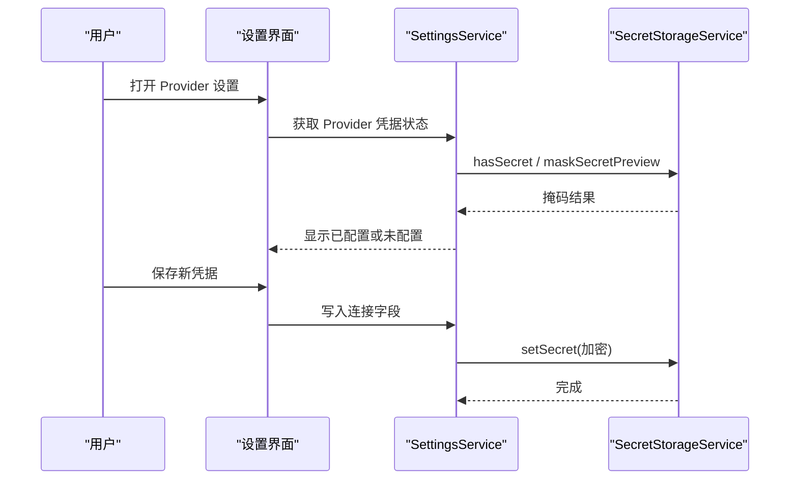

**图表来源**
- [SettingsService.ts:1-200](file://src/main/settings/SettingsService.ts#L1-L200)
- [SecretStorageService.ts:1-267](file://src/main/settings/SecretStorageService.ts#L1-L267)

#### 工具调用授权流程
Agent 调用工具时，执行入口传入冻结工具集、权限模式、项目根、会话附件根和知识读根；`AgentPermissionPolicyService` 判断是否为只读文件工具、Shell、变更工具或网络工具，并结合策略下界给出最终动作。

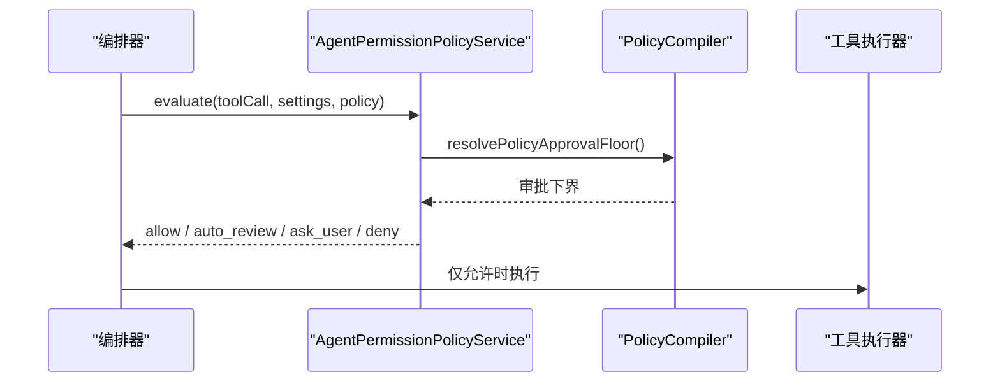

**图表来源**
- [AgentPermissionPolicy.ts:1-481](file://src/main/agent-runtime/permissions/AgentPermissionPolicy.ts#L1-L481)
- [PolicyCompiler.ts:1-234](file://src/main/agent-runtime/permissions/PolicyCompiler.ts#L1-L234)

#### 外部命令执行授权流程
Shell 命令先检查硬拒绝规则，再检查文件工具绕过，再检查命令白名单、危险模式和外部路径引用，最后按权限模式决定是否自动审查或询问用户。风险分类器只做路由，不做最终安全裁决。

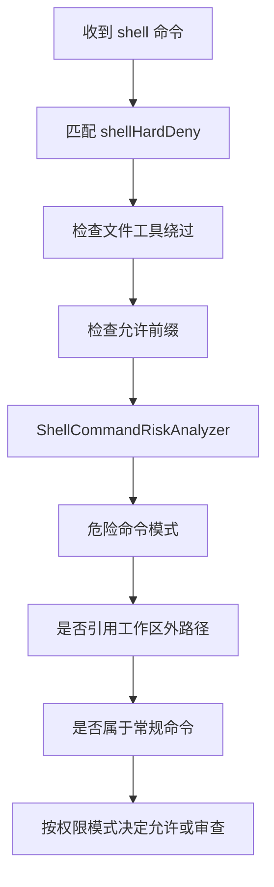

**图表来源**
- [AgentPermissionPolicy.ts:1-481](file://src/main/agent-runtime/permissions/AgentPermissionPolicy.ts#L1-L481)
- [permissions.md:1-119](file://docs/contracts/permissions.md#L1-L119)

#### 敏感资源访问流程
Knowledge 读根在准备回合时冻结，只并入只读文件工具；write、edit、delete、shell 和 code_interpreter 在策略层和执行层都拒绝。会话附件目录仅绑定当前会话，不对其他会话或写入工具开放。

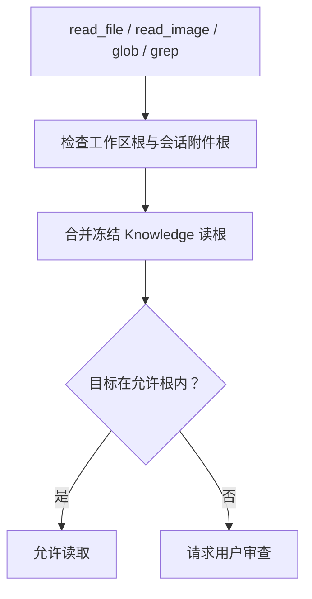

**图表来源**
- [permissions.md:1-119](file://docs/contracts/permissions.md#L1-L119)
- [AgentPermissionPolicy.ts:1-481](file://src/main/agent-runtime/permissions/AgentPermissionPolicy.ts#L1-L481)

## 依赖关系分析

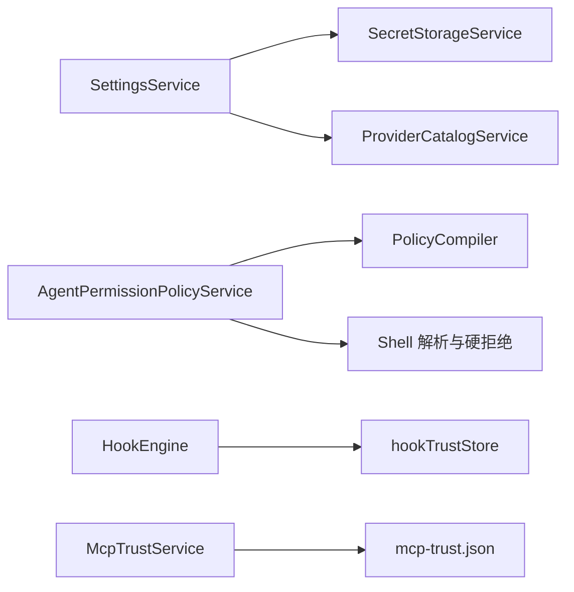

**图表来源**
- [SettingsService.ts:1-200](file://src/main/settings/SettingsService.ts#L1-L200)
- [SecretStorageService.ts:1-267](file://src/main/settings/SecretStorageService.ts#L1-L267)
- [ProviderCatalogService.ts:1-72](file://src/main/settings/ProviderCatalogService.ts#L1-L72)
- [AgentPermissionPolicy.ts:1-481](file://src/main/agent-runtime/permissions/AgentPermissionPolicy.ts#L1-L481)
- [PolicyCompiler.ts:1-234](file://src/main/agent-runtime/permissions/PolicyCompiler.ts#L1-L234)
- [HookEngine.ts:1-200](file://src/main/hooks/HookEngine.ts#L1-L200)
- [hookTrustStore.ts:1-100](file://src/main/hooks/hookTrustStore.ts#L1-L100)
- [McpTrustService.ts:1-133](file://src/main/settings/McpTrustService.ts#L1-L133)

耦合与内聚说明：

- `SettingsService` 聚合凭据、Provider、Shell 和 Agent 运行时配置，但凭据实际由 `SecretStorageService` 管理，避免设置层泄露明文。
- `AgentPermissionPolicyService` 依赖 `PolicyCompiler` 提供的编译策略，同时依赖 Shell 解析和危险命令检测，保持权限分类与执行边界分离。
- `HookEngine` 与 `hookTrustStore` 解耦：信任存储只负责持久化和版本迁移，信任逻辑集中在引擎。
- `McpTrustService` 独立于 Provider 目录，只负责项目 MCP 的描述符信任与连接许可。

潜在循环依赖：

- 当前实现中，权限策略不反向依赖 Hook 或 MCP 信任服务；Hook 和 MCP 信任也不依赖权限策略，从而降低模块间循环风险。

外部依赖：

- Electron `safeStorage`：密钥加密。
- Node.js 文件系统：策略文件、Hook 信任、MCP 信任、Provider 目录。
- Shell 解析器：不同平台解释器选择。

**章节来源**
- [SettingsService.ts:1-200](file://src/main/settings/SettingsService.ts#L1-L200)
- [AgentPermissionPolicy.ts:1-481](file://src/main/agent-runtime/permissions/AgentPermissionPolicy.ts#L1-L481)
- [HookEngine.ts:1-200](file://src/main/hooks/HookEngine.ts#L1-L200)
- [McpTrustService.ts:1-133](file://src/main/settings/McpTrustService.ts#L1-L133)

## 性能与可审计性
- 策略编译在准备阶段完成，运行时复用冻结的 `CompiledPolicy`，减少重复解析。
- 权限决策主要做字符串归一化、路径比较和正则匹配，复杂度较低。
- Secret 读写采用原子临时文件加重命名，避免部分写入导致凭证损坏。
- 审计日志应避免记录完整密钥；`check-secrets.mjs` 提供了扫描提交差异中密钥的模式匹配和脱敏能力，适合用于门禁和 CI 检查。

建议：

- 在审计回执中记录权限决策动作、工具名、风险等级、项目根和会话范围，但不记录敏感参数值。
- 对高频路径匹配使用索引或缓存，避免重复解析。
- 对策略文件和信任文件变更增加指纹校验，便于快速定位配置漂移。

**章节来源**
- [check-secrets.mjs:1-200](file://scripts/check-secrets.mjs#L1-L200)

## 故障排查指南

### 常见安全问题
1. **凭据明文泄露**：检查是否通过 `getProviderSecret` 或其他通道返回明文，确保对外接口只返回 `hasSecret` 和 `maskedPreview`。
2. **策略文件扩权**：确认 `.policy.yml` 没有引入未知限制键，也没有试图放宽内置硬拒绝。
3. **Shell 绕过**：不要信任风险分类器结果作为唯一边界，必须同时检查 `shellHardDeny`、命令白名单和工作区根。
4. **Hook 未信任**：用户或项目钩子变更后出现未信任错误，需要重新信任并核对信任指纹。
5. **MCP 连接失败**：项目 MCP 描述符变化后未重新信任，或被标记为不支持传输。
6. **IPC 非法载荷**：渲染进程调用主进程接口时报错，通常是因为 Zod 校验失败或授权令牌无效。
7. **知识库越界读取**：Knowledge 读根只供只读文件工具使用，写入工具不得依赖该根获得编辑权限。

### 配置建议
- 优先使用工作区内的只读工具，减少外部路径审查。
- 使用 `.policy.yml` 收紧高危工具，并为高风险工具设置 `approvalFloorByTool.user`。
- 将 Shell 常用命令加入允许前缀，避免每次都需要审查。
- 对 Project 资源只覆盖必要项，保留 builtin 与 user 的最小集。
- 定期清理未使用的 Provider 凭据和 MCP 信任记录。
- 启用秘密扫描门禁，阻止密钥直接提交到仓库。

### 故障排查步骤
1. 查看权限决策返回值，确认是 `allow`、`auto_review`、`ask_user` 还是 `deny`。
2. 检查 `reason` 字段，定位是工作区外路径、命令白名单、灾难命令还是策略禁用。
3. 检查 `.policy.yml` 是否被禁用或包含非法字段。
4. 检查 `provider-secrets.json` 是否损坏，必要时恢复备份并重建。
5. 检查 Hook 信任指纹是否与当前定义一致。
6. 检查 MCP 信任记录是否匹配项目真实路径和描述符哈希。
7. 对于 IPC 错误，检查 channel 是否存在、参数是否符合 schema、授权令牌是否已消费。

**章节来源**
- [permissions.md:1-119](file://docs/contracts/permissions.md#L1-L119)
- [SecretStorageService.ts:1-267](file://src/main/settings/SecretStorageService.ts#L1-L267)
- [HookEngine.ts:1-200](file://src/main/hooks/HookEngine.ts#L1-L200)
- [McpTrustService.ts:1-133](file://src/main/settings/McpTrustService.ts#L1-L133)
- [AgentPermissionPolicy.ts:1-481](file://src/main/agent-runtime/permissions/AgentPermissionPolicy.ts#L1-L481)

## 结论
RDC-Agent 的安全模型围绕“失败即关闭”展开：权限分类负责决策，IPC、策略编译、Shell 硬拒绝、文件系统、Electron 沙箱和凭据隔离负责执行。`SettingsService` 管理设置与 Provider 凭据视图，`ProviderCatalogService` 暴露 Provider 能力，`SecretStorageService` 保护敏感值，`PolicyCompiler` 固化最小权限，`AgentPermissionPolicyService` 统一工具授权，`HookEngine` 和 `McpTrustService` 分别管理扩展信任。

对初学者而言，应重点理解权限模式、工作区根、Skill 交集、Hook 与 MCP 信任和 Secret 隔离；对开发者而言，应遵循最小权限原则，不把风险分类器当作安全边界，不在日志和 IPC 中传播敏感值，并通过策略文件、命令白名单和信任记录建立可审计、可复现的权限控制。