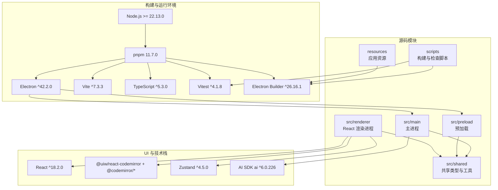
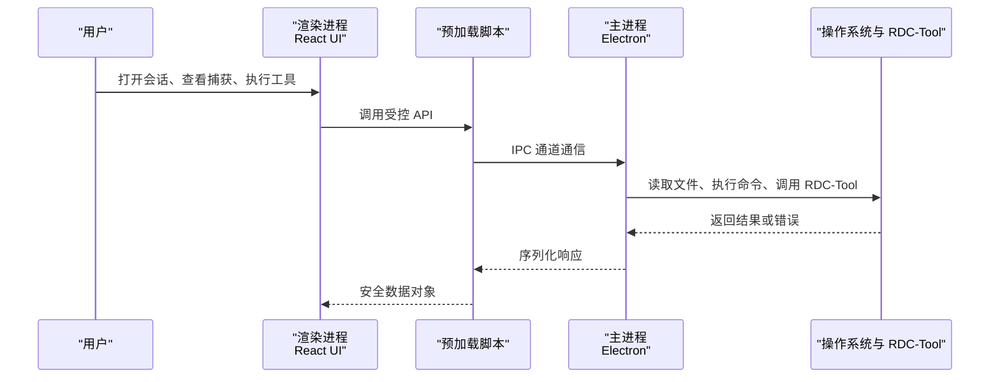
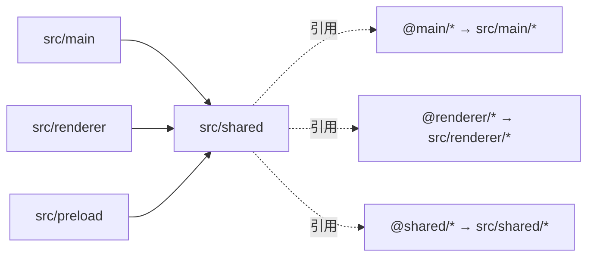
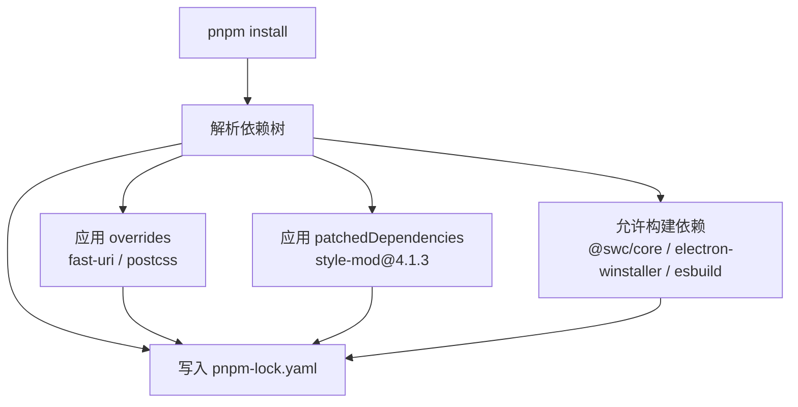
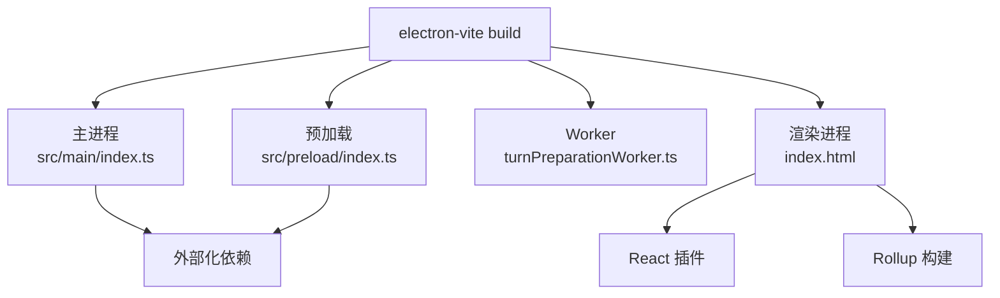
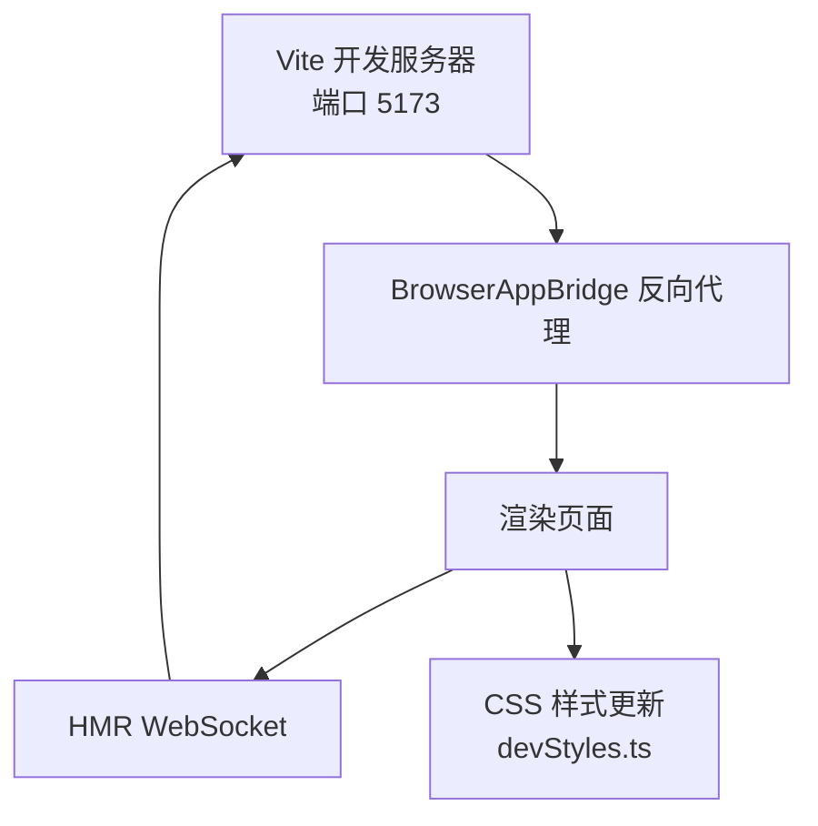
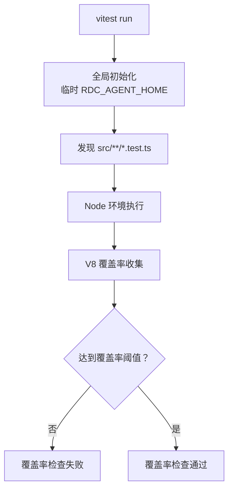
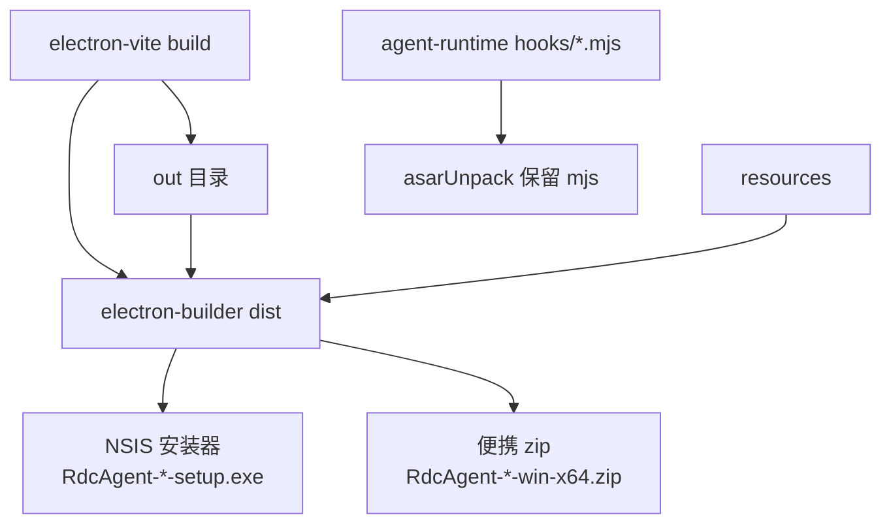

# 技术栈与版本兼容性

<cite>
**本文引用的文件**   
- [package.json](file://package.json)
- [tsconfig.json](file://tsconfig.json)
- [electron.vite.config.ts](file://electron.vite.config.ts)
- [vite.renderer.config.ts](file://vite.renderer.config.ts)
- [vitest.config.ts](file://vitest.config.ts)
- [scripts/vitest-global-setup.ts](file://scripts/vitest-global-setup.ts)
- [scripts/vitest-renderer.config.ts](file://scripts/vitest-renderer.config.ts)
- [electron-builder.json](file://electron-builder.json)
- [pnpm-workspace.yaml](file://pnpm-workspace.yaml)
- [patches/style-mod@4.1.3.patch](file://patches/style-mod@4.1.3.patch)
- [scripts/pnpm-resolver.mjs](file://scripts/pnpm-resolver.mjs)
- [README.en.md](file://README.en.md)
</cite>

## 目录
1. [简介](#简介)
2. [项目结构与运行环境](#项目结构与运行环境)
3. [核心技术栈与选型原因](#核心技术栈与选型原因)
4. [主进程、预加载与渲染进程边界](#主进程预加载与渲染进程边界)
5. [共享类型与路径别名](#共享类型与路径别名)
6. [依赖关系、覆盖与补丁策略](#依赖关系覆盖与补丁策略)
7. [TypeScript 编译配置](#typescript-编译配置)
8. [Vite 构建与开发服务器](#vite-构建与开发服务器)
9. [测试与覆盖率配置](#测试与覆盖率配置)
10. [Windows NSIS 打包与 Electron Builder](#windows-nsis-打包与-electron-builder)
11. [本地开发与安装检查清单](#本地开发与安装检查清单)
12. [版本升级指南](#版本升级指南)
13. [已知兼容性问题与处理建议](#已知兼容性问题与处理建议)
14. [常见问题排查](#常见问题排查)
15. [结论](#结论)

## 简介
RDC-Agent 是一个基于 Electron 的 Windows 桌面应用，用于 RenderDoc `.rdc` 捕获分析与智能体协作调试。它使用 React 作为前端 UI 框架，通过 AI SDK 集成多种模型提供商，并借助 Zustand 管理前端状态。项目采用 pnpm 包管理器、Vite 构建、Vitest 测试、TypeScript 类型系统，并使用 Electron Builder 和 NSIS 生成 Windows 安装包。

该文档聚焦于技术栈、版本约束、构建流程、打包产物和兼容性处理，帮助开发者快速定位环境问题、理解依赖关系并进行安全升级。

## 项目结构与运行环境
RDC-Agent 的项目结构按运行环境和职责划分：
- `src/main`：Electron 主进程逻辑，包括会话、设置、工具、工作流、IPC、代理运行时等。
- `src/preload`：预加载脚本，暴露受控接口给渲染进程。
- `src/renderer`：React 渲染进程前端，包含 UI 组件、状态、服务和页面入口。
- `src/shared`：主进程与渲染进程共享的类型、常量、工具和 API 契约。
- `scripts`：构建辅助、检查脚本、发布工具和测试配置。
- `resources`：应用资源、图标、Agent 运行时资源和知识库种子数据。
- `patches`：第三方依赖补丁。
- `electron-builder.json`：Electron Builder 打包配置。
- `electron.vite.config.ts`：主进程、预加载和渲染进程的 Vite 聚合配置。
- `vite.renderer.config.ts`：浏览器开发模式下渲染进程独立 Vite 配置。
- `vitest.config.ts`：Node 端测试与覆盖率配置。

**图表来源**
- [package.json:1-143](file://package.json#L1-L143)
- [electron.vite.config.ts:1-62](file://electron.vite.config.ts#L1-L62)
- [electron-builder.json:1-54](file://electron-builder.json#L1-L54)
- [README.en.md:1-136](file://README.en.md#L1-L136)

**章节来源**
- [package.json:1-143](file://package.json#L1-L143)
- [README.en.md:1-136](file://README.en.md#L1-L136)

## 核心技术栈与选型原因

| 技术 | 版本范围或固定值 | 用途 | 选型原因 |
|---|---:|---|---|
| Electron | `^42.2.0` | 桌面应用宿主 | 提供主进程、预加载、渲染进程隔离，支持 Windows 原生能力、文件系统、Shell 操作和 RDC/RenderDoc 工具链集成。 |
| React | `^18.2.0` | 用户界面框架 | 成熟生态、与 Vite 插件兼容良好，适合复杂工作表和可视化报告界面。 |
| AI SDK | `ai ^6.0.226` | 统一调用 LLM 提供商 | 抽象多模型调用、流式响应和工具调用，便于扩展不同 Agent 提供商。 |
| Zustand | `^4.5.0` | 前端状态管理 | 轻量、函数式 API，适合大型工作区中的会话、设置、工作过程和 UI 状态。 |
| Vite | `^7.3.3` | 前端构建与开发服务器 | 快速 HMR、现代 ESModule 支持，同时承载主进程、预加载和渲染进程构建。 |
| Vitest | `^4.1.8` | 单元测试与覆盖率 | 与 Vite 生态一致，支持 Node 环境与 V8 覆盖率收集。 |
| TypeScript | `^5.3.0` | 类型系统与代码质量 | 严格模式、路径别名、bundler 解析，保证主进程、渲染进程和共享类型的一致性。 |
| CodeMirror | `@uiw/react-codemirror ^4.25.11` 及多个 `@codemirror/*` | 代码和 Markdown 编辑 | 模块化语言支持、命令系统和视图扩展，适合对话、计划、工具输出等文本编辑场景。 |
| Electron Builder | `^26.16.1` | 桌面应用打包 | 生成 NSIS 安装器和 zip 便携包，支持资源注入、asar 解包和签名开关。 |
| pnpm | `11.7.0` | 包管理与缓存 | 强一致性锁文件、workspace 存储、允许构建依赖和 patch 机制。 |

**章节来源**
- [package.json:1-143](file://package.json#L1-L143)
- [README.en.md:1-136](file://README.en.md#L1-L136)

## 主进程、预加载与渲染进程边界
RDC-Agent 将安全敏感的原生能力放在主进程，通过 IPC 暴露给渲染进程；预加载脚本作为受限桥接层，避免渲染进程直接访问 Node API。

**图表来源**
- [electron.vite.config.ts:1-62](file://electron.vite.config.ts#L1-L62)
- [README.en.md:1-136](file://README.en.md#L1-L136)

主进程负责：
- 会话、设置、知识、调查、工具、工作流、提供者目录和代理运行时。
- 与外部 RDC-Tool CLI、RenderDoc 运行时和系统 Shell 交互。
- 启动 Worker 线程处理准备任务。

预加载负责：
- 向渲染进程暴露最小必要 API。
- 控制跨进程数据传输，避免渲染进程直接持有 Node 或 Electron 敏感对象。

渲染进程负责：
- React UI、Zustand 状态、CodeMirror 编辑器、Markdown 预览、国际化和本地样式。

**章节来源**
- [electron.vite.config.ts:1-62](file://electron.vite.config.ts#L1-L62)
- [README.en.md:1-136](file://README.en.md#L1-L136)

## 共享类型与路径别名
项目通过 TypeScript 路径别名统一三个模块根：
- `@main/*` → `src/main/*`
- `@renderer/*` → `src/renderer/*`
- `@shared/*` → `src/shared/*`

这使主进程、预加载、渲染进程和测试都能以相同方式引用共享类型、常量和工具，减少重复定义和路径错误。

**图表来源**
- [tsconfig.json:1-27](file://tsconfig.json#L1-L27)
- [electron.vite.config.ts:1-62](file://electron.vite.config.ts#L1-L62)
- [vitest.config.ts:1-81](file://vitest.config.ts#L1-L81)

**章节来源**
- [tsconfig.json:1-27](file://tsconfig.json#L1-L27)
- [electron.vite.config.ts:1-62](file://electron.vite.config.ts#L1-L62)
- [vitest.config.ts:1-81](file://vitest.config.ts#L1-L81)

## 依赖关系、覆盖与补丁策略

### 依赖分类
- **生产依赖**：AI SDK、CodeMirror、Zustand、React、OpenAI 客户端、PDF.js、Mermaid、YAML、UUID、Zod 等。
- **开发依赖**：Electron、Electron Builder、Vite、Vitest、TypeScript、SWC、Happy DOM、ESLint 等。
- **覆盖依赖**：通过 `overrides` 强制指定 `fast-uri` 和 `postcss` 版本，解决上游传递依赖冲突。
- **补丁依赖**：通过 `patchedDependencies` 对 `style-mod@4.1.3` 打补丁，适配桌面 CSP 下的样式表行为。
- **构建允许依赖**：通过 `allowBuilds` 允许 `@swc/core`、`electron-winstaller`、`esbuild` 在 pnpm 中执行原生构建。

**图表来源**
- [package.json:1-143](file://package.json#L1-L143)
- [pnpm-workspace.yaml:1-20](file://pnpm-workspace.yaml#L1-L20)
- [patches/style-mod@4.1.3.patch:1-26](file://patches/style-mod@4.1.3.patch#L1-L26)

### patches 的使用场景
`style-mod` 补丁移除了对 `root.head` 的检查，改为直接使用 `root.adoptedStyleSheets` 和 `window.CSSStyleSheet`。这是为了适配 Electron 桌面 CSP（内容安全策略）下样式插入限制，避免因 `head` 不可用导致样式失效。

该补丁由 `pnpm-workspace.yaml` 声明，并通过 `patches/style-mod@4.1.3.patch` 提供 diff。升级 `style-mod` 时需要重新验证补丁是否仍适用。

**章节来源**
- [package.json:1-143](file://package.json#L1-L143)
- [pnpm-workspace.yaml:1-20](file://pnpm-workspace.yaml#L1-L20)
- [patches/style-mod@4.1.3.patch:1-26](file://patches/style-mod@4.1.3.patch#L1-L26)

## TypeScript 编译配置
TypeScript 配置采用严格模式，但不进行 emit 输出，构建交给 Vite/Electron-vite：
- 目标为 `ES2022`。
- 启用 `DOM`、`DOM.Iterable` 类型。
- 模块解析使用 `bundler` 模式，配合 Vite。
- 启用 JSX `react-jsx`。
- 启用严格检查：`strict`、`noUnusedLocals`、`noUnusedParameters`、`noFallthroughCasesInSwitch`。
- 启用 `skipLibCheck`，加快类型检查速度。
- 启用 `isolatedModules`，要求每个模块可独立转译，利于 Vite 和 SWC。
- 路径别名映射 `@main`、`@renderer`、`@shared`。
- 类型声明仅包含 `node`。

这意味着 TypeScript 主要承担类型检查和静态分析职责，实际 JS 输出由 Vite 和 Electron-vite 生成。

**章节来源**
- [tsconfig.json:1-27](file://tsconfig.json#L1-L27)
- [package.json:1-143](file://package.json#L1-L143)

## Vite 构建与开发服务器

### 主进程、预加载与渲染进程构建
`electron.vite.config.ts` 使用 `electron-vite` 同时构建三个入口：
- 主进程入口：`src/main/index.ts`
- Worker 入口：`src/main/workers/turnPreparationWorker.ts`
- 预加载入口：`src/preload/index.ts`
- 渲染进程入口：`src/renderer/index.html`

主进程和预加载使用 `externalizeDepsPlugin()`，让依赖保持为 Node 模块，而不是全部打包进主进程 bundle。渲染进程使用 `@vitejs/plugin-react`，启用 React 支持和 HMR。

**图表来源**
- [electron.vite.config.ts:1-62](file://electron.vite.config.ts#L1-L62)

### 浏览器开发模式渲染配置
`vite.renderer.config.ts` 是浏览器开发模式的专用配置，主要用于 In-App Browser QA 场景：
- 端口 `5173`，主机 `127.0.0.1`。
- HMR 使用 WebSocket 协议，由 Bridge 升级连接。
- 自定义插件替换 Vite 客户端样式更新导入，改用 `/platform/devStyles.ts`，满足 CSP 限制。
- 注释明确指出：不要直接浏览 Vite 地址，应通过 Bridge 的 `/qa` URL。

**图表来源**
- [vite.renderer.config.ts:1-39](file://vite.renderer.config.ts#L1-L39)

**章节来源**
- [electron.vite.config.ts:1-62](file://electron.vite.config.ts#L1-L62)
- [vite.renderer.config.ts:1-39](file://vite.renderer.config.ts#L1-L39)

## 测试与覆盖率配置

### Node 端测试
默认 Vitest 配置：
- 全局 API 开启。
- 运行环境为 `node`。
- 测试文件匹配 `src/**/*.test.ts`。
- 全局初始化脚本：`scripts/vitest-global-setup.ts`。
- 覆盖率提供者：`v8`。
- 覆盖率报告：`text`、`lcov`、`json-summary`。
- 覆盖率输出目录：`./coverage`。
- 覆盖率包含：`src/main` 和 `src/shared`。
- 排除大量 Electron、进程、IPC、工具、媒体、会话、OAuth、工作器、守护进程、SDK、报告和测试夹具等不适合 Node 单元覆盖的代码。
- 覆盖率阈值：行 40%、函数 40%、分支 30%、语句 40%。

**图表来源**
- [vitest.config.ts:1-81](file://vitest.config.ts#L1-L81)
- [scripts/vitest-global-setup.ts:1-32](file://scripts/vitest-global-setup.ts#L1-L32)

### 渲染进程测试
渲染进程测试使用 `scripts/vitest-renderer.config.ts`，继承基础配置但：
- 只包含 `src/renderer/**/*.test.ts`。
- 覆盖率输出到 `./coverage/renderer`。
- 不启用覆盖率阈值，避免影响主进程/shared 的 ratchet 基线。

### 全局初始化安全约束
全局初始化会创建临时根目录，并将 `TMP`、`TEMP`、`TMPDIR`、`RDC_AGENT_HOME`、`RDC_AGENT_USER_DATA` 指向临时位置，确保测试不会读写开发者真实用户目录。测试结束后清理临时目录。

**章节来源**
- [vitest.config.ts:1-81](file://vitest.config.ts#L1-L81)
- [scripts/vitest-global-setup.ts:1-32](file://scripts/vitest-global-setup.ts#L1-L32)
- [scripts/vitest-renderer.config.ts:1-17](file://scripts/vitest-renderer.config.ts#L1-L17)

## Windows NSIS 打包与 Electron Builder

### 打包产物
- 应用 ID：`com.rdc-agent.app`
- 产品名称：`RDC-Agent`
- 输出目录：`release`
- 构建资源目录：`resources`
- 打包文件：`out/**/*`、`resources/agent-runtime/**/*`、`resources/knowledge/**/*`
- 不解包规则：`resources/agent-runtime/hooks/**/*.mjs` 从 asar 解包
- 额外资源：hooks 目录和品牌 logo

Windows 目标：
- NSIS 安装器，架构 `x64`
- zip 便携包，架构 `x64`
- 可执行文件名：`RdcAgent`
- 产物命名：`${productName}-${version}-${arch}.${ext}`
- 启用可执行文件签名和版本信息编辑
- 关闭强制代码签名
- NSIS 安装器非一键安装，允许选择安装目录，卸载时不清除应用数据

**图表来源**
- [electron-builder.json:1-54](file://electron-builder.json#L1-L54)

### 开发模式与生产模式
- 开发模式：`pnpm dev` 通过 `scripts/launch-rdc-agent.mjs` 启动。
- 生产启动：`pnpm start`。
- 构建：`pnpm build`。
- 本地打包：`pnpm pack`。
- 正式打包：`pnpm dist`。

**章节来源**
- [package.json:1-143](file://package.json#L1-L143)
- [electron-builder.json:1-54](file://electron-builder.json#L1-L54)

## 本地开发与安装检查清单

### 最低环境要求
- 操作系统：Windows
- Node.js：`>=22.13.0`
- pnpm：`11.7.0`
- RDC-Tool CLI：可从 Settings 中检测并配置
- RenderDoc 运行时基线：当前为 RenderDoc 1.45，RDC-Agent 0.6.x 对应 RDC-Tool 1.0.0

### 安装检查清单
- [ ] Node.js 版本大于等于 `22.13.0`
- [ ] pnpm 版本为 `11.7.0`
- [ ] 仓库可通过 `pnpm install` 成功安装依赖
- [ ] 无 `yauzl` 或 Electron 安装挂起问题
- [ ] `@swc/core`、`electron-winstaller`、`esbuild` 可正常构建
- [ ] `pnpm run typecheck` 通过
- [ ] `pnpm test` 通过
- [ ] `pnpm run check:gates` 通过
- [ ] `pnpm run build` 生成 `out` 目录
- [ ] `pnpm run dev` 可启动开发应用
- [ ] RDC-Tool CLI 可在 Settings 中检测到

### 常见依赖问题解决方案
| 问题 | 可能原因 | 处理建议 |
|---|---|---|
| pnpm 版本不一致 | 系统安装了其他版本 pnpm | 使用 `pnpx pnpm@11.7.0` 或通过项目内 resolver 启动 |
| Electron 安装卡住 | Node >=24.16 与 `extract-zip`/`yauzl` 兼容问题 | 项目已通过 `overrides.yauzl=3.3.1` 修复；确保使用项目 pnpm 缓存 |
| 原生模块构建失败 | 缺少 Node 原生构建工具或权限不足 | 确认 `allowBuilds` 允许 `@swc/core`、`electron-winstaller`、`esbuild` |
| style-mod 样式失效 | Electron CSP 限制 `head` 或样式表创建方式 | 项目已应用 `style-mod@4.1.3` 补丁；不要跳过补丁安装 |
| 渲染进程 HMR 失败 | 直接访问 Vite 地址而非 Bridge | 使用 BrowserAppBridge 的 `/qa` URL，不要直接访问 `127.0.0.1:5173` |
| 测试写入用户目录 | 全局初始化未生效或环境变量被覆盖 | 使用默认 `vitest run`，不要手动设置 `RDC_AGENT_HOME` |

**章节来源**
- [README.en.md:1-136](file://README.en.md#L1-L136)
- [package.json:1-143](file://package.json#L1-L143)
- [pnpm-workspace.yaml:1-20](file://pnpm-workspace.yaml#L1-L20)
- [scripts/pnpm-resolver.mjs:1-74](file://scripts/pnpm-resolver.mjs#L1-L74)
- [vite.renderer.config.ts:1-39](file://vite.renderer.config.ts#L1-L39)
- [scripts/vitest-global-setup.ts:1-32](file://scripts/vitest-global-setup.ts#L1-L32)

## 版本升级指南

### 升级前检查
1. 确认 Node.js 版本符合 `>=22.13.0`。
2. 确认 pnpm 版本为 `11.7.0`。
3. 备份 `pnpm-lock.yaml` 和 `package.json`。
4. 记录当前依赖树，尤其是 AI SDK、CodeMirror、Zustand、Vite、Electron 相关版本。
5. 运行 `pnpm run check:gates` 和 `pnpm test`，确认基线状态。

### 推荐升级顺序
1. **Node.js 与 pnpm**：先升级运行环境，再升级依赖。
2. **TypeScript**：升级后运行 `tsc --noEmit`，修复类型错误。
3. **Vite 与 React 插件**：注意 JSX 行为和 Vite 配置变更。
4. **Electron**：注意 Chromium 和 Node 版本变化，检查 IPC、原生模块和 CSP。
5. **AI SDK**：注意 provider 接口、流式响应和工具调用契约变化。
6. **CodeMirror**：注意 `@codemirror/*` 主版本升级带来的 API 变更。
7. **Zustand**：注意持久化、中间件和 React 绑定变化。
8. **Electron Builder**：注意 Windows 打包行为、签名和资源规则变化。

### 升级后验证
- 运行 `pnpm install`，确认无 `yauzl`、`fast-uri`、`postcss` 异常。
- 运行 `pnpm run typecheck`。
- 运行 `pnpm test`。
- 运行 `pnpm run build`。
- 运行 `pnpm run dev`。
- 如涉及 Electron 升级，验证 NSIS 安装器和 zip 产物。
- 如涉及 AI SDK 升级，验证各 Provider 认证和模型选择。
- 如涉及 CodeMirror 升级，验证 Markdown、语法高亮、KaTeX、Mermaid 渲染。

**章节来源**
- [package.json:1-143](file://package.json#L1-L143)
- [tsconfig.json:1-27](file://tsconfig.json#L1-L27)
- [README.en.md:1-136](file://README.en.md#L1-L136)

## 已知兼容性问题与处理建议

| 组件 | 已知问题 | 处理方式 |
|---|---|---|
| Electron 42 与 Node >=24.16 | `install.js` → `extract-zip` → `yauzl@2` 可能挂起 | 项目已通过 `overrides.yauzl=3.3.1` 固定修复版本；保持 pnpm 安装流程 |
| style-mod | Electron CSP 下 `root.head` 不可用导致样式表创建失败 | 使用 `patches/style-mod@4.1.3.patch`，移除 `root.head` 条件判断 |
| 渲染进程开发样式 | Vite 客户端样式更新不符合 CSP | 使用 `vite.renderer.config.ts` 中的 `rdc-csp-dev-styles` 插件，改用 `devStyles.ts` |
| 浏览器开发模式 | 不应直接访问 Vite 服务器 | 通过 BrowserAppBridge 的 `/qa` URL 访问，HMR 由 Bridge 升级 WebSocket |
| 测试数据安全 | 测试可能误写用户真实目录 | 使用 `scripts/vitest-global-setup.ts`，所有数据写入临时目录，测试后清理 |
| Windows 打包 | NSIS 安装器默认非一键安装 | 如需自动化部署，需调整 `oneClick` 和 `perMachine` 配置，但需谨慎评估用户体验 |
| AI SDK 与 Provider | 提供商订阅命名、认证流程和模型选择可能变化 | 遵循 `check:provider-system`、`check:identity` 等检查脚本 |
| RenderDoc 运行时 | 新版本需要完整打包、catalog 检查和测试验证 | 不盲目升级 RenderDoc；保持 RDC-Agent 0.6.x 与 RDC-Tool 1.0.0、RenderDoc 1.45 的配对 |

**章节来源**
- [pnpm-workspace.yaml:1-20](file://pnpm-workspace.yaml#L1-L20)
- [patches/style-mod@4.1.3.patch:1-26](file://patches/style-mod@4.1.3.patch#L1-L26)
- [vite.renderer.config.ts:1-39](file://vite.renderer.config.ts#L1-L39)
- [scripts/vitest-global-setup.ts:1-32](file://scripts/vitest-global-setup.ts#L1-L32)
- [electron-builder.json:1-54](file://electron-builder.json#L1-L54)
- [README.en.md:1-136](file://README.en.md#L1-L136)

## 常见问题排查

### 如何确认当前使用的 pnpm 版本
项目内置 `scripts/pnpm-resolver.mjs`，期望 pnpm 版本为 `11.7.0`。它会尝试以下候选：
- 与 Node 相邻的 `pnpm.mjs`
- corepack 管理的 `corepack pnpm`
- 系统 PATH 中的 `pnpm` 或 `pnpm.cmd`
- Codex runtime 中绑定的 `pnpm.mjs`

如果版本不匹配，resolver 会报错并列出已检查的候选。

### 如何恢复干净依赖
1. 删除 `node_modules`。
2. 删除 `pnpm-lock.yaml` 前建议先备份。
3. 使用 `pnpm install` 重新生成锁文件。
4. 如果仍有 `yauzl` 或 Electron 安装问题，确认 `pnpm-workspace.yaml` 中的 `overrides.yauzl=3.3.1` 生效。

### 如何检查依赖差异
- 使用 `pnpm diff` 对比依赖树。
- 使用 `pnpm why <package>` 查看某个包的引入路径。
- 使用 `pnpm ls <package>` 查看已安装版本。
- 使用 `pnpm update` 谨慎升级，并立即运行 `typecheck`、`test`、`build`。

### 如何处理 CSP 相关样式问题
- 开发模式使用 `vite.renderer.config.ts`。
- 不要直接访问 `127.0.0.1:5173`。
- 通过 BrowserAppBridge 的 `/qa` URL 访问渲染页面。
- 如果新增 CSS 动态更新逻辑，确保不与 `devStyles.ts` 替换逻辑冲突。

**章节来源**
- [scripts/pnpm-resolver.mjs:1-74](file://scripts/pnpm-resolver.mjs#L1-L74)
- [pnpm-workspace.yaml:1-20](file://pnpm-workspace.yaml#L1-L20)
- [vite.renderer.config.ts:1-39](file://vite.renderer.config.ts#L1-L39)

## 结论
RDC-Agent 的技术栈围绕 Electron 42、React 18、AI SDK、Zustand、Vite、Vitest、TypeScript 和 CodeMirror 构建，目标是提供一个可审计、可追踪、可复现的 GPU 帧问题调查工作区。项目通过清晰的进程边界、共享类型、严格的 TypeScript 配置、Vite 多入口构建、Vitest 覆盖率门槛和 Electron Builder NSIS 打包，形成完整的桌面应用工程体系。

升级时应优先稳定 Node、pnpm、TypeScript 和构建工具，再逐步升级 Electron、AI SDK、CodeMirror 和 UI 依赖；任何涉及 CSP、IPC、Provider 认证或 RenderDoc 运行时变化的升级都必须结合现有检查脚本和测试基线验证。对于 Windows 发布，应继续使用 NSIS 安装器和 zip 便携包两种产物，并在自动化部署前明确安装器行为和安全策略。