# 数据流与状态边界

<cite>
**本文引用的文件**   
- [会话投影契约](file://docs/contracts/session-projection.md)
- [数据流文档](file://docs/architecture/data-flow.md)
- [对话类型定义](file://src/shared/types/conversation.ts)
- [会话类型定义](file://src/shared/types/session.ts)
- [追踪与制品类型定义](file://src/shared/types/trace.ts)
- [主进程对话服务](file://src/main/conversation/ConversationService.ts)
- [调查制品服务](file://src/main/investigation/InvestigationArtifactService.ts)
- [渲染层对话状态存储](file://src/renderer/stores/conversationStore.ts)
- [渲染层会话投影存储](file://src/renderer/stores/sessionProjectionStore.ts)
</cite>

## 目录
1. [引言](#引言)
2. [项目结构与分层](#项目结构与分层)
3. [关键数据模型](#关键数据模型)
4. [主进程单一真相来源](#主进程单一真相来源)
5. [渲染层状态边界](#渲染层状态边界)
6. [核心数据流](#核心数据流)
7. [组件关系图](#组件关系图)
8. [详细组件分析](#详细组件分析)
9. [依赖关系分析](#依赖关系分析)
10. [缓存、增量更新与大对象处理](#缓存增量更新与大对象处理)
11. [性能优化建议](#性能优化建议)
12. [故障排查指南](#故障排查指南)
13. [结论](#结论)

## 引言
本文面向 RDC Agent 的跨进程状态管理，目标是说明 Main 进程与 Renderer 之间关于 `SessionRecord`、`ConversationMessage`、`Turn`、Investigation Artifact 和 Report 等关键数据模型的流动路径，并明确：

- 哪些数据是主进程的权威来源。
- 哪些状态会被序列化或投影到渲染层。
- Conversation Service、Session Service、Investigation Service 与前端 Zustand store 的职责边界。
- 状态更新、事件通知、回滚、单调停止与一致性保证机制。
- 如何扩展新的数据流，以及需要避免的反模式。

文档同时提供面向初学者的分层说明和面向经验开发者的扩展注意事项。

## 项目结构与分层
系统按 Electron 多进程结构组织，核心分层如下：

| 层级 | 职责 | 典型位置 |
|---|---|---|
| 共享类型层 | 跨进程契约、不可变数据结构、枚举和投影视图类型 | `src/shared/types/*` |
| 主进程服务层 | 会话生命周期、对话执行、工作流编排、调查制品持久化、IPC 门控 | `src/main/conversation`、`src/main/sessions`、`src/main/investigation`、`src/main/agent-trace` |
| 预加载桥接层 | 暴露安全 IPC API，连接 Renderer 调用与主进程通道 | `src/preload` |
| 渲染层状态层 | Zustand store、会话投影缓存、Composer 交互上下文 | `src/renderer/stores`、`src/renderer/features/composer` |
| 渲染层 UI 层 | 转录区、右侧栏、Composer、设置面板等 | `src/renderer/ui`、`src/renderer/features` |

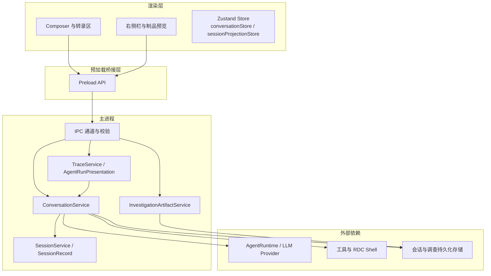

**图表来源**
- [数据流文档:1-86](file://docs/architecture/data-flow.md#L1-L86)
- [会话投影契约:1-131](file://docs/contracts/session-projection.md#L1-L131)

**章节来源**
- [数据流文档:1-86](file://docs/architecture/data-flow.md#L1-L86)
- [会话投影契约:1-131](file://docs/contracts/session-projection.md#L1-L131)

## 关键数据模型
本节按“主进程权威模型”和“渲染层投影模型”区分。

### 主进程权威模型
| 模型 | 含义 | 所有权 | 是否直接传给渲染层 |
|---|---|---|---|
| `SessionRecord` | 会话元数据、归属项目、标题、目标、Agent、模型覆盖等 | 主进程会话存储 | 不直接作为完整对象广播；选择时通过 IPC 查询或投影 |
| `ConversationMessage` | 用户消息、助手消息、系统消息、诊断、工具调用、循环结果等 | 主进程对话历史 | 部分字段可序列化，但渲染层通常只使用可见消息与投影视图 |
| `Turn` | 一次对话轮次，对应 `runId`、`sessionId`、分支、请求、工具执行与工作块 | 主进程工作流与对话运行态 | 渲染层通过 trace projection 和 conversation message 间接感知 |
| Investigation Artifact | 证据、实验、主张、世界状态、报告等调查记录 | 主进程调查存储 | 列表和摘要投影给渲染层；详细内容按需读取 |
| Report | 调查报告中聚合的实验与结论 | 主进程调查存储 | 列表项投影，完整内容按需读取 |

### 渲染层投影模型
| 投影模型 | 用途 | 更新方式 |
|---|---|---|
| `ConversationMessage[]`（排序后） | Composer 与转录区显示 | 增量 upsert、排序、分支过滤 |
| `AgentRunPresentation` | 进度、工具调用、产物、上下文、捕获区域 | trace projection 推送或拉取 |
| `InvestigationArtifactsPanelViewModel` | 右侧栏调查制品列表 | 分页查询 + 预览投影 |
| `OutputsPanelViewModel` | 输出面板视图 | 由 trace/artifact 投影构建 |
| `ContextSnapshot` / `OpenedCaptureState` | 上下文快照与捕获状态 | 按 session scope 投影 |

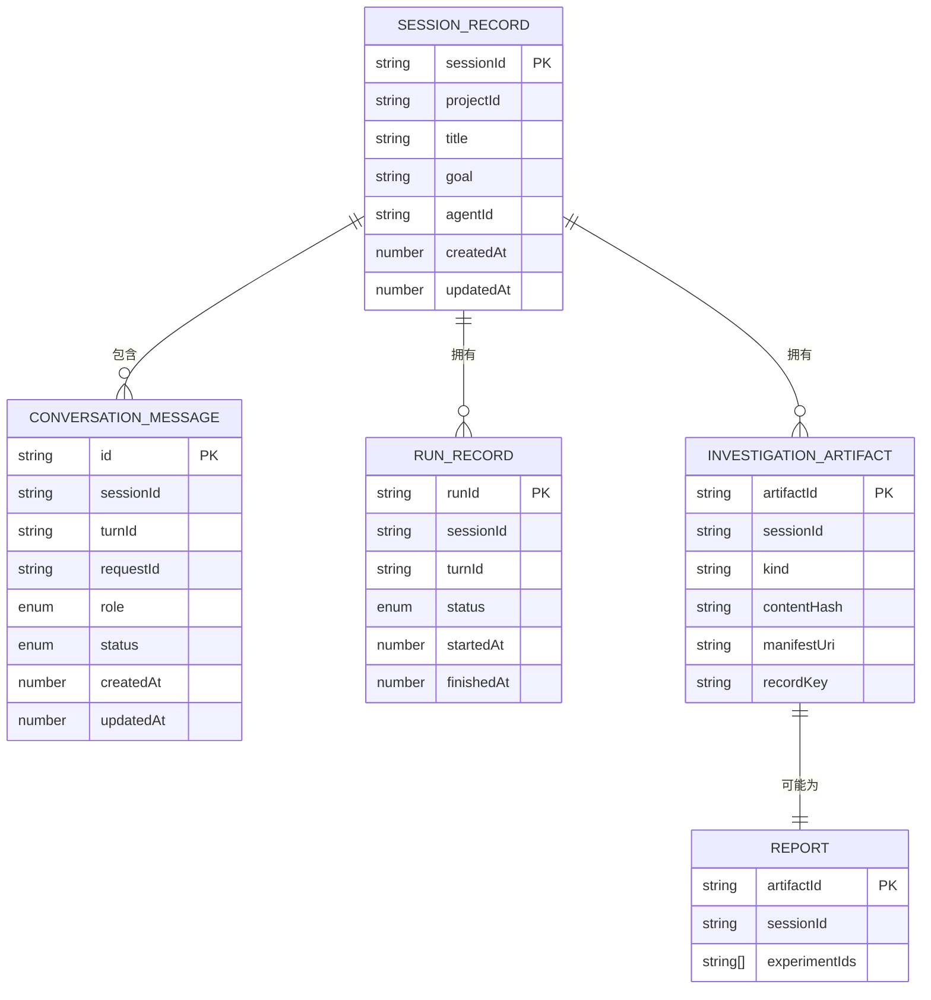

**图表来源**
- [会话类型定义:1-200](file://src/shared/types/session.ts#L1-L200)
- [对话类型定义:1-200](file://src/shared/types/conversation.ts#L1-L200)
- [追踪与制品类型定义:1-200](file://src/shared/types/trace.ts#L1-L200)
- [调查制品服务:1-260](file://src/main/investigation/InvestigationArtifactService.ts#L1-L260)

**章节来源**
- [会话类型定义:1-200](file://src/shared/types/session.ts#L1-L200)
- [对话类型定义:1-200](file://src/shared/types/conversation.ts#L1-L200)
- [追踪与制品类型定义:1-200](file://src/shared/types/trace.ts#L1-L200)
- [调查制品服务:1-260](file://src/main/investigation/InvestigationArtifactService.ts#L1-L260)

## 主进程单一真相来源
主进程维护以下权威事实：

1. **会话选择与活跃会话**  
   - renderer 的 `currentSession.sessionId` 只是当前投影目标。  
   - 真正的主进程会话列表、会话状态、权限与资源归属仍由主进程控制。

2. **对话历史**  
   - `ConversationService.getHistory` 从存储读取并恢复中断轮次。  
   - 分支状态、可见消息、消息顺序由主进程计算后再交给渲染层。

3. **工作流与追踪**  
   - `TraceService` 基于 conversation/message/action/event 构建 `AgentRunPresentation`。  
   - 渲染层不应自行推断运行状态，应消费 trace projection 或显式查询。

4. **调查制品与报告**  
   - `InvestigationArtifactService` 负责写入、索引、事务、哈希、替代链与完整性断言。  
   - 渲染层只接收 rows、totalCount、storeDegraded 及可选 nextCursor，不重建版本关系。

5. **权限与会话范围**  
   - 所有带 `sessionId` 的事件在写入 active UI store 前必须经过 active session 门控。  
   - Capture、context、artifact、output 等右栏资源都受 `{projectId, sessionId}` 作用域保护。

**章节来源**
- [会话投影契约:1-131](file://docs/contracts/session-projection.md#L1-L131)
- [数据流文档:1-86](file://docs/architecture/data-flow.md#L1-L86)
- [主进程对话服务:1-200](file://src/main/conversation/ConversationService.ts#L1-L200)
- [调查制品服务:1-260](file://src/main/investigation/InvestigationArtifactService.ts#L1-L260)

## 渲染层状态边界
渲染层不是权威源，而是投影消费者。其状态边界包括：

| 状态 | 渲染层职责 | 禁止行为 |
|---|---|---|
| 当前会话 | 保存 `currentSession` 投影 | 自行创建或修改会话权威字段 |
| 对话消息 | 排序、合并、分支投影、单调停止标记 | 绕过 IPC 直接改写历史 |
| 工作流状态 | 显示 trace presentation、上下文、捕获状态 | 从工具 argsPreview 重建业务状态 |
| 调查制品列表 | 展示 rows、totalCount、degraded | 扫描存储或根据本地缓存重建完整制品 |
| Composer 草稿 | 按 `{projectId}:{sessionId}` 隔离 | 把其他 session 的 draft 混入当前请求 |
| 计划审批 | 显示 plan review、提交反馈 | 伪造 reject decision 或覆盖已取消交互 |

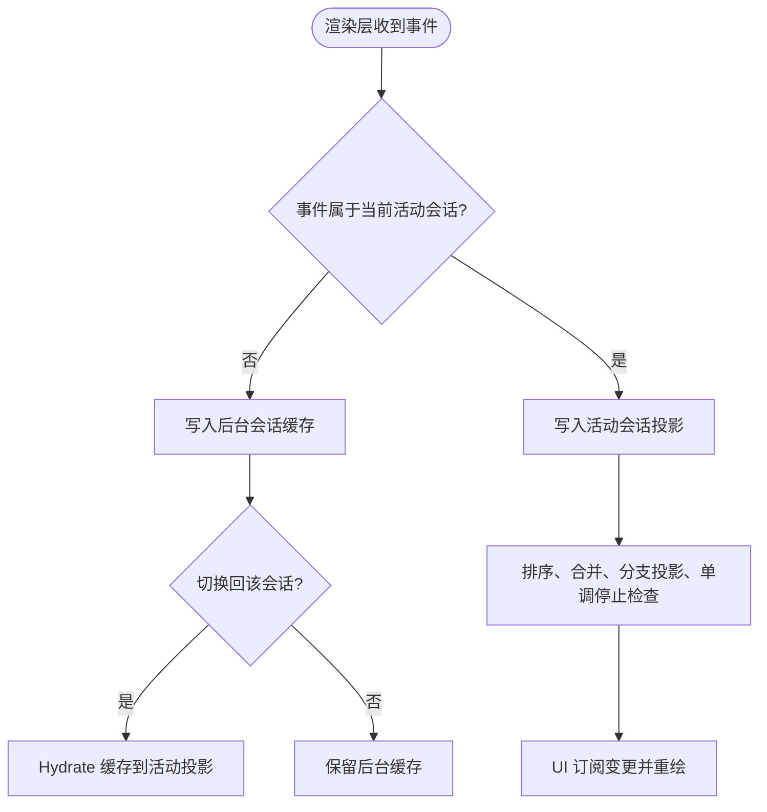

**图表来源**
- [会话投影契约:1-131](file://docs/contracts/session-projection.md#L1-L131)
- [渲染层会话投影存储:1-177](file://src/renderer/stores/sessionProjectionStore.ts#L1-L177)

**章节来源**
- [会话投影契约:1-131](file://docs/contracts/session-projection.md#L1-L131)
- [渲染层会话投影存储:1-177](file://src/renderer/stores/sessionProjectionStore.ts#L1-L177)

## 核心数据流

### 发送对话消息的流程
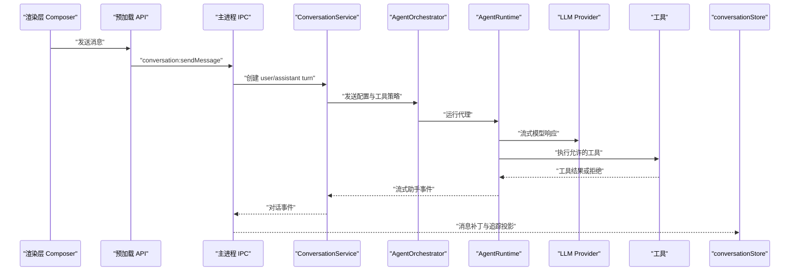

**图表来源**
- [数据流文档:1-86](file://docs/architecture/data-flow.md#L1-L86)
- [主进程对话服务:1-200](file://src/main/conversation/ConversationService.ts#L1-L200)
- [渲染层对话状态存储:1-139](file://src/renderer/stores/conversationStore.ts#L1-L139)

### 会话切换与后台缓存流程
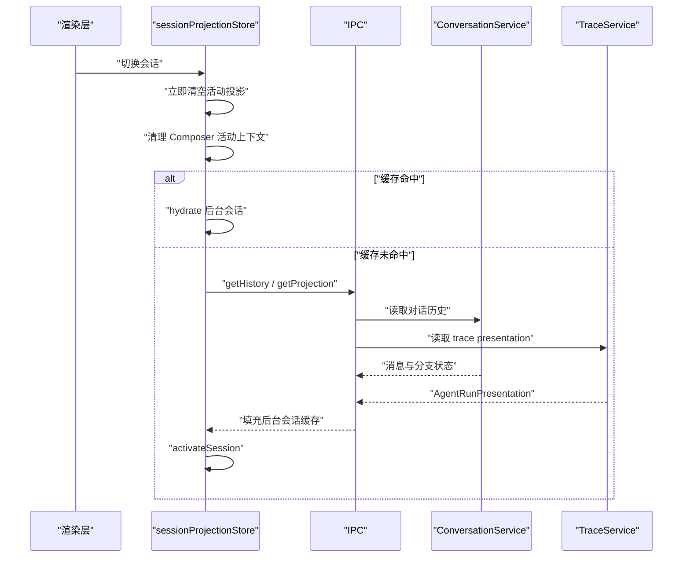

**图表来源**
- [会话投影契约:1-131](file://docs/contracts/session-projection.md#L1-L131)
- [渲染层会话投影存储:1-177](file://src/renderer/stores/sessionProjectionStore.ts#L1-L177)

### 调查制品列表与预览流程
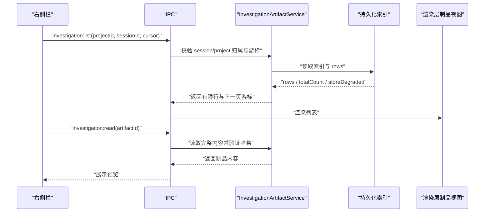

**图表来源**
- [会话投影契约:1-131](file://docs/contracts/session-projection.md#L1-L131)
- [调查制品服务:1-260](file://src/main/investigation/InvestigationArtifactService.ts#L1-L260)
- [追踪与制品类型定义:1-200](file://src/shared/types/trace.ts#L1-L200)

**章节来源**
- [数据流文档:1-86](file://docs/architecture/data-flow.md#L1-L86)
- [会话投影契约:1-131](file://docs/contracts/session-projection.md#L1-L131)
- [主进程对话服务:1-200](file://src/main/conversation/ConversationService.ts#L1-L200)
- [渲染层对话状态存储:1-139](file://src/renderer/stores/conversationStore.ts#L1-L139)
- [渲染层会话投影存储:1-177](file://src/renderer/stores/sessionProjectionStore.ts#L1-L177)
- [调查制品服务:1-260](file://src/main/investigation/InvestigationArtifactService.ts#L1-L260)

## 组件关系图

### 主进程与服务关系
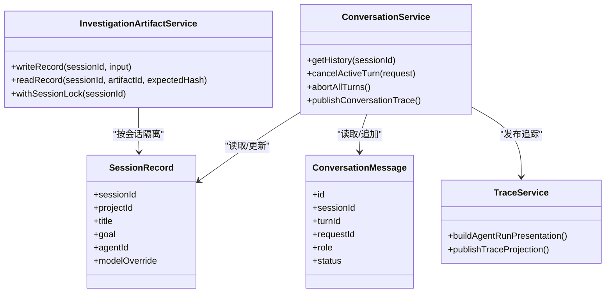

**图表来源**
- [主进程对话服务:1-200](file://src/main/conversation/ConversationService.ts#L1-L200)
- [调查制品服务:1-260](file://src/main/investigation/InvestigationArtifactService.ts#L1-L260)
- [会话类型定义:1-200](file://src/shared/types/session.ts#L1-L200)
- [对话类型定义:1-200](file://src/shared/types/conversation.ts#L1-L200)

**章节来源**
- [主进程对话服务:1-200](file://src/main/conversation/ConversationService.ts#L1-L200)
- [调查制品服务:1-260](file://src/main/investigation/InvestigationArtifactService.ts#L1-L260)

## 详细组件分析

### ConversationService
ConversationService 是对话执行的核心协调者，负责：

- 管理准备中请求与活动轮次。
- 中止全部轮次、取消活动轮次。
- 读取会话历史并恢复中断轮次。
- 清除历史、撤销最后一轮。
- 将对话事件与追踪投影发布出去。

它并不直接持有渲染层状态，而是通过 IPC 和 trace 通道向渲染层推送最小必要信息。

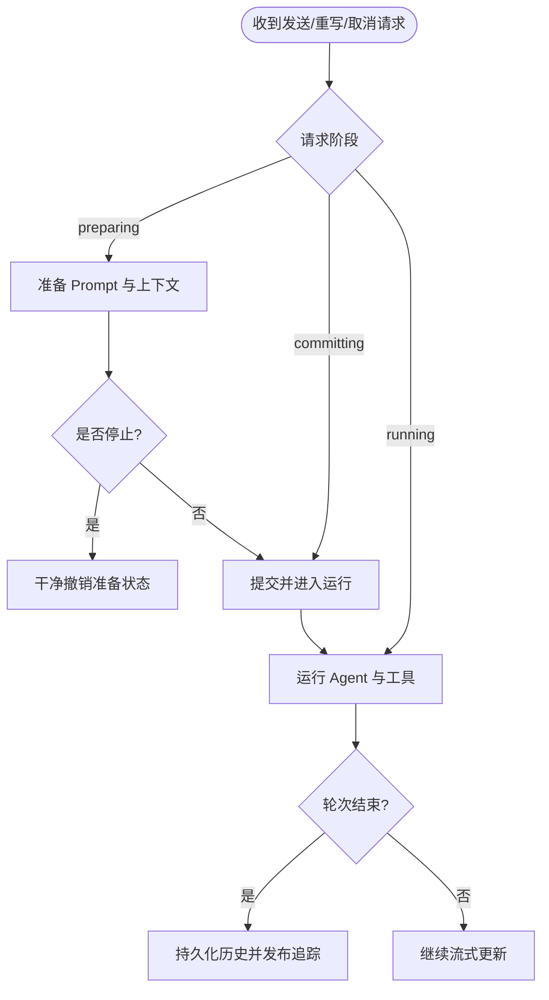

**图表来源**
- [主进程对话服务:1-200](file://src/main/conversation/ConversationService.ts#L1-L200)

**章节来源**
- [主进程对话服务:1-200](file://src/main/conversation/ConversationService.ts#L1-L200)

### InvestigationArtifactService
InvestigationArtifactService 是调查制品的权威写入与读取入口，关键特性包括：

- 按会话加锁，防止并发写入破坏索引。
- 解析并校验记录 schema。
- 生成 artifactId、manifest、contentHash。
- 支持 supersedes 替代链。
- 对 report 与 experiment 做额外约束。
- 通过事务写入 manifest、index 与内容。
- 读路径支持 read repair、依赖收束与退化状态。

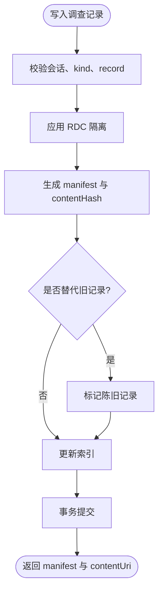

**图表来源**
- [调查制品服务:1-260](file://src/main/investigation/InvestigationArtifactService.ts#L1-L260)

**章节来源**
- [调查制品服务:1-260](file://src/main/investigation/InvestigationArtifactService.ts#L1-L260)

### 渲染层 Zustand Store
渲染层主要使用两个关键 store：

1. **conversationStore**  
   - 维护排序后的消息、分支状态、单调停止集合、撤销请求集合、时间线、推理摘要等。
   - 所有写操作都会重新排序并投影可见消息。
   - 单调停止用于防止迟到 streaming 或运行中状态覆盖已停止消息。

2. **sessionProjectionStore**  
   - 按 `sessionId` 缓存多个会话的投影。
   - 提供 `captureActiveSession`、`projectConversationMessage`、`projectTrace`、`activateSession`、`evictSession`。
   - 活动会话优先写入当前 UI store，后台会话写入 `bySessionId`。

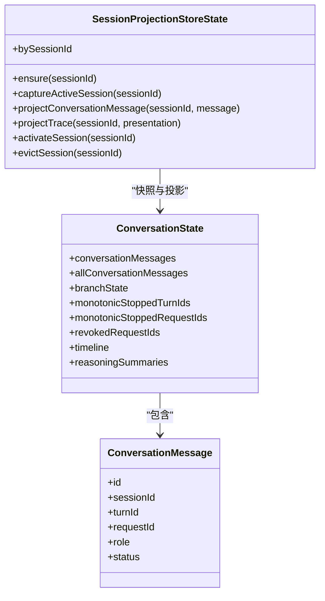

**图表来源**
- [渲染层对话状态存储:1-139](file://src/renderer/stores/conversationStore.ts#L1-L139)
- [渲染层会话投影存储:1-177](file://src/renderer/stores/sessionProjectionStore.ts#L1-L177)
- [对话类型定义:1-200](file://src/shared/types/conversation.ts#L1-L200)

**章节来源**
- [渲染层对话状态存储:1-139](file://src/renderer/stores/conversationStore.ts#L1-L139)
- [渲染层会话投影存储:1-177](file://src/renderer/stores/sessionProjectionStore.ts#L1-L177)

## 依赖关系分析

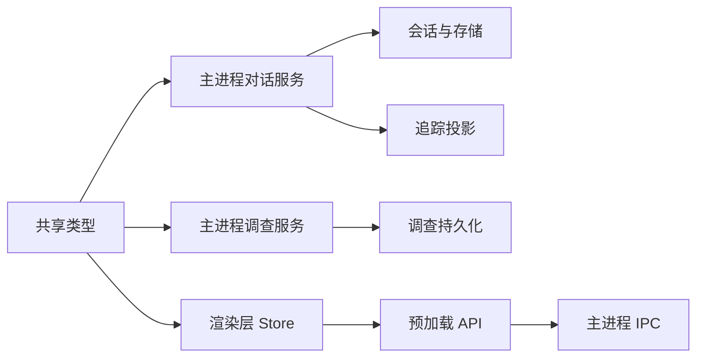

**图表来源**
- [数据流文档:1-86](file://docs/architecture/data-flow.md#L1-L86)
- [会话投影契约:1-131](file://docs/contracts/session-projection.md#L1-L131)

**章节来源**
- [数据流文档:1-86](file://docs/architecture/data-flow.md#L1-L86)
- [会话投影契约:1-131](file://docs/contracts/session-projection.md#L1-L131)

## 缓存、增量更新与大对象处理

### 缓存策略
| 数据 | 缓存位置 | 失效条件 |
|---|---|---|
| 活动会话消息 | `conversationStore` | 会话切换、重置、重写、停止 |
| 后台会话投影 | `sessionProjectionStore.bySessionId` | 切换出、主动 evict、重置 |
| trace presentation | `workflowStore.tracePresentation` 与投影缓存 | 新 run、会话切换、投影更新 |
| 调查制品列表 | 渲染层按需缓存 rows | 切换 project/session、刷新 |
| 调查制品详情 | 按需读取，不常驻内存 | 关闭预览或切换制品 |

### 增量更新
- 渲染层使用 `addConversationMessage`、`upsertConversationMessage`、`patchAssistantMessageByTurnId` 进行增量更新。
- 会话投影 store 使用 `updateSessionProjectionMap` 按 sessionId 定位投影对象，避免全量替换。
- 调查制品列表通过 cursor 分页，避免一次性加载大量记录。

### 大对象处理
- 工具 result payload 不得复制到证据引用中，只保留受信任的 resourceRef。
- 调查制品内容通过 URI 与 contentHash 引用，渲染层按需读取。
- 图片预览通过会话 scoped 接口获取像素，不在渲染层重建源路径。
- 委托子代理日志分页读取结构化任务与实际发送载荷，避免一次性传输大块文本。

**章节来源**
- [会话投影契约:1-131](file://docs/contracts/session-projection.md#L1-L131)
- [对话类型定义:1-200](file://src/shared/types/conversation.ts#L1-L200)
- [追踪与制品类型定义:1-200](file://src/shared/types/trace.ts#L1-L200)
- [渲染层对话状态存储:1-139](file://src/renderer/stores/conversationStore.ts#L1-L139)
- [渲染层会话投影存储:1-177](file://src/renderer/stores/sessionProjectionStore.ts#L1-L177)

## 性能优化建议

1. **避免全量重算可见消息**  
   使用已有排序与 merge 逻辑，仅在新增、更新、停止、分支切换时触发投影。

2. **限制流式补丁频率**  
   对于高频 streaming patch，可在渲染层做节流或批处理，但不要改变主进程语义。

3. **延迟加载大对象**  
   调查制品详情、委托日志、图片像素都应按需请求，不要随消息列表一起加载。

4. **复用会话投影**  
   切换会话时使用 hydrate，而不是每次都重新拉取完整历史；miss 再走 IPC。

5. **避免重复 IPC**  
   同一请求在同一 session 内去重，例如 ConversationService 已实现 send request fingerprint 相关机制。

6. **谨慎处理 right rail 投影**  
   所有 right rail 数据都必须经过 session scope 校验，避免后台会话事件污染活动视图。

7. **减少渲染层状态复制**  
   不要把主进程内部结构原样复制到渲染层；只投影 UI 需要的字段。

[本节为通用性能指导，不直接分析具体代码文件]

## 故障排查指南

### 常见问题与定位思路

| 现象 | 可能原因 | 排查步骤 |
|---|---|---|
| 切换会话后转录区短暂显示旧会话 | 活动会话清理晚于乐观切换 | 检查 immediate cleanup 与 async hydration 顺序 |
| 后台会话消息出现在活动转录区 | 缺少 active session gate | 确认事件是否经 `isActiveSessionEvent` 门控 |
| 停止后消息又变为 running | 单调停止被迟到 patch 覆盖 | 检查 `monotonicStoppedTurnIds` / `monotonicStoppedRequestIds` |
| 计划审批反馈写入错误 session | 缺少 owning turnId 或 sessionId | 核对 plan review owner 与冻结请求 |
| 右侧栏制品列表错乱 | 游标越界或 session/project 不一致 | 检查 investigation:list 参数与游标校验 |
| 调查制品预览内容与索引不一致 | 内容哈希或替代链损坏 | 检查 contentHash、supersede 链与 read repair |
| 图片预览不更新 | image.updatedAt 缺失或同 EID replacement 冲突 | 检查图片刷新事件与 session scope |

### 关键一致性规则
- 停止是单调的：一旦标记停止，后续 streaming 或运行中状态不得覆盖。
- 会话切换会丢弃非活动会话的当前视图投影，但保留后台缓存。
- 所有带 sessionId 的流式/投影事件必须经过活动会话门控。
- 调查制品列表只读投影，完整读取需显式请求并校验权限与游标。
- 委托子代理与 Task Execution 状态不同，不能互相替代。

**章节来源**
- [会话投影契约:1-131](file://docs/contracts/session-projection.md#L1-L131)
- [主进程对话服务:1-200](file://src/main/conversation/ConversationService.ts#L1-L200)
- [调查制品服务:1-260](file://src/main/investigation/InvestigationArtifactService.ts#L1-L260)

## 结论
本项目的状态管理遵循清晰的边界：

- 主进程是会话、对话、工作流、追踪、调查制品与报告的权威来源。
- 渲染层是投影消费者，负责可见消息、trace presentation、制品列表、上下文与捕获状态的展示。
- 会话切换通过 immediate cleanup、后台缓存与 hydrate 保证一致性。
- 单调停止、session scope、cursor 分页、contentHash 与替代链共同保障可靠性。
- 扩展新数据流时，应优先定义共享类型、在主进程完成权限与一致性校验、通过 IPC 推送最小必要投影，并在渲染层按 session 隔离状态。

反模式包括：
- 让渲染层成为权威源。
- 跳过 active session gate。
- 用 argsPreview 重建业务状态。
- 在渲染层重建调查制品版本关系。
- 把后台会话事件直接写入活动视图。
- 在会话切换时不清理 Composer 活动上下文。
- 在不校验 ownership 的情况下接受 stop、rewritten turn 或计划反馈。