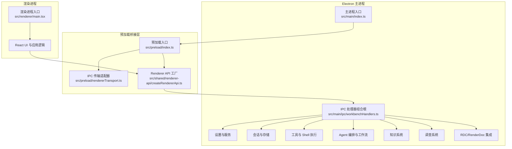
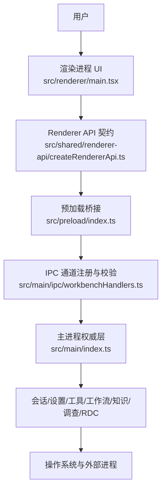
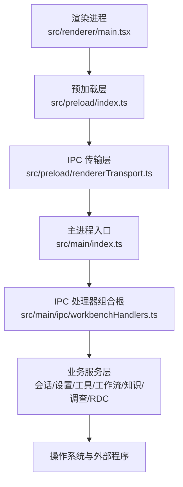
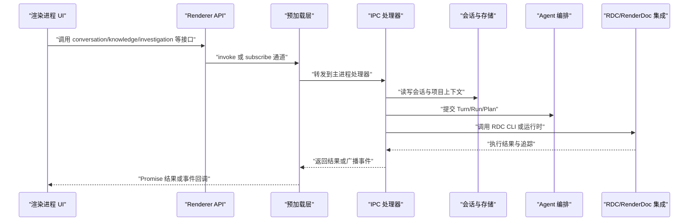
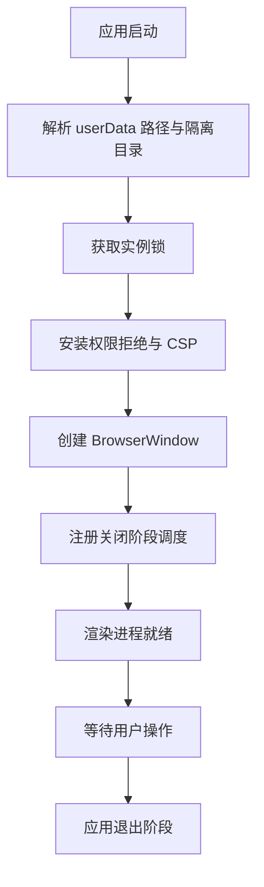
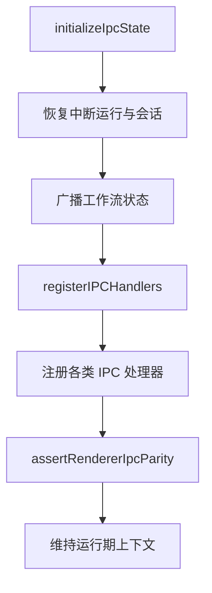
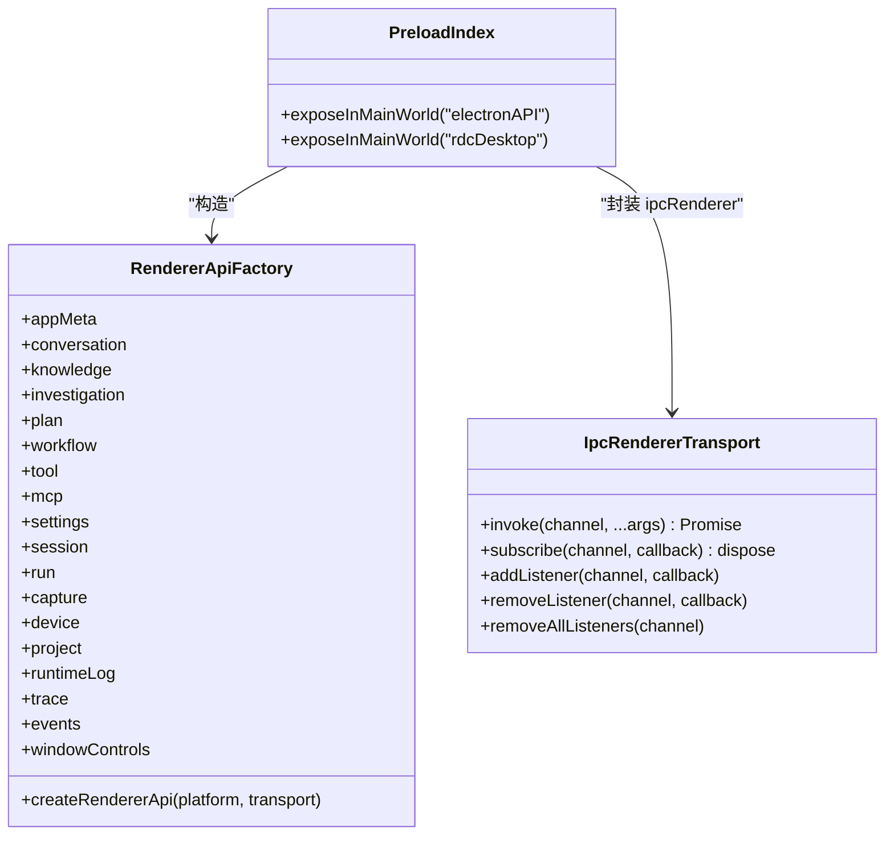
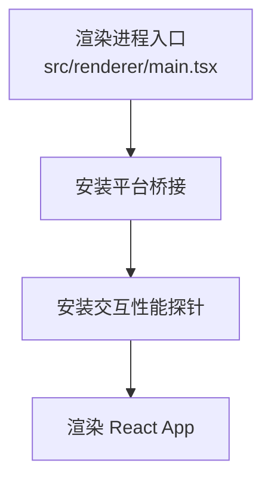
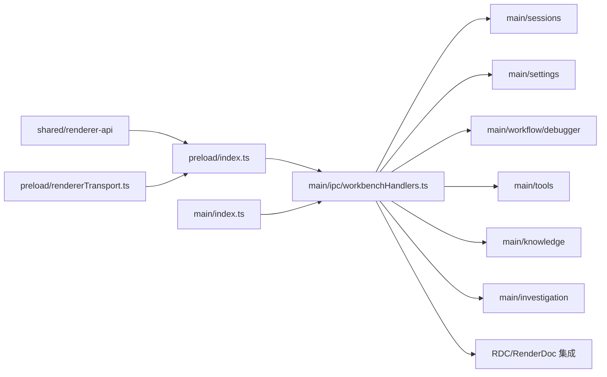

# 架构总览

<cite>
**本文引用的文件**   
- [src/main/index.ts](file://src/main/index.ts)
- [src/preload/index.ts](file://src/preload/index.ts)
- [src/preload/rendererTransport.ts](file://src/preload/rendererTransport.ts)
- [src/shared/renderer-api/createRendererApi.ts](file://src/shared/renderer-api/createRendererApi.ts)
- [src/shared/renderer-api/index.ts](file://src/shared/renderer-api/index.ts)
- [src/main/ipc/handlers.ts](file://src/main/ipc/handlers.ts)
- [src/main/ipc/workbenchHandlers.ts](file://src/main/ipc/workbenchHandlers.ts)
- [src/renderer/main.tsx](file://src/renderer/main.tsx)
</cite>

## 目录
1. [引言](#引言)
2. [项目结构](#项目结构)
3. [核心组件](#核心组件)
4. [架构总览](#架构总览)
5. [详细组件分析](#详细组件分析)
6. [依赖关系分析](#依赖关系分析)
7. [性能与安全性考虑](#性能与安全性考虑)
8. [故障排查指南](#故障排查指南)
9. [术语约定](#术语约定)
10. [结论](#结论)

## 引言
本仓库实现的是 RDC-Agent，一个以 Electron 为宿主、围绕 RenderDoc/RDC 调试能力构建的桌面智能代理应用。系统由三个进程边界组成：Electron Main 进程负责权威控制、资源管理和外部系统集成；Preload 预加载脚本作为受控桥接层，暴露最小化的 Renderer API；Renderer 渲染进程专注 React UI、状态和交互。Agent 运行时、RDC/RenderDoc 集成、知识系统、调查工作流、设置与权限等子系统都挂载在 Main 进程之上，并通过 IPC 通道向渲染层提供能力。

## 项目结构
仓库采用分层组织方式：
- `src/main`：Main 进程代码，包含会话、工具、IPC、设置、工作流、调查、知识、RDC CLI 调用、进程生命周期等。
- `src/preload`：预加载桥接层，仅使用 `contextBridge` 和 `ipcRenderer`，不直接引入 Node 内置模块。
- `src/renderer`：渲染进程前端，入口为 React 应用，安装平台适配和性能探针后挂载根组件。
- `src/shared`：跨进程共享类型、常量、主题、Provider 目录、Renderer API 契约以及 IPC 通道枚举。
- `resources/agent-runtime`：Agent 运行时所需的 agents、hooks、prompts、skills 等资源。
- `scripts`：启动、检查、发布、测试辅助脚本。
- `docs`：架构、产品、UI、工作流、契约等文档。

**图表来源**
- [src/main/index.ts:1-200](file://src/main/index.ts#L1-L200)
- [src/main/ipc/workbenchHandlers.ts:1-200](file://src/main/ipc/workbenchHandlers.ts#L1-L200)
- [src/preload/index.ts:1-25](file://src/preload/index.ts#L1-L25)
- [src/preload/rendererTransport.ts:1-44](file://src/preload/rendererTransport.ts#L1-L44)
- [src/shared/renderer-api/createRendererApi.ts:1-80](file://src/shared/renderer-api/createRendererApi.ts#L1-L80)
- [src/renderer/main.tsx:1-15](file://src/renderer/main.tsx#L1-L15)

**章节来源**
- [src/main/index.ts:1-200](file://src/main/index.ts#L1-L200)
- [src/main/ipc/workbenchHandlers.ts:1-200](file://src/main/ipc/workbenchHandlers.ts#L1-L200)
- [src/preload/index.ts:1-25](file://src/preload/index.ts#L1-L25)
- [src/preload/rendererTransport.ts:1-44](file://src/preload/rendererTransport.ts#L1-L44)
- [src/shared/renderer-api/createRendererApi.ts:1-80](file://src/shared/renderer-api/createRendererApi.ts#L1-L80)
- [src/renderer/main.tsx:1-15](file://src/renderer/main.tsx#L1-L15)

## 核心组件
- **Electron Main 进程**：创建窗口、管理用户数据目录、单实例锁、CSP 安全策略、权限默认拒绝、会话恢复、生命周期协调、关闭时释放 RDC 运行时、MCP 连接、Shell 进程、浏览器桥接和录制回放设备。
- **IPC 工作区处理器**：注册所有 Renderer 可调用通道，维护当前项目、会话、运行任务上下文，广播事件到渲染层，并串联 Agent 编排、会话存储、设置、RDC CLI 和工具追踪。
- **Preload 预加载层**：通过 `contextBridge.exposeInMainWorld` 暴露 `electronAPI` 和受限的 `rdcDesktop.getPathForFile`，使用 `createIpcRendererTransport` 封装 `ipcRenderer.invoke` 与事件订阅。
- **Renderer API 工厂**：集中生成 `conversation`、`knowledge`、`investigation`、`plan`、`workflow`、`tool`、`mcp`、`settings`、`session`、`run`、`capture`、`device`、`project`、`runtimeLog`、`trace`、`events`、`windowControls` 等命名空间。
- **Renderer 渲染进程**：安装平台桥接和交互性能探针，渲染 React 根应用，专注于界面状态、用户输入和可视化结果。

**章节来源**
- [src/main/index.ts:1-200](file://src/main/index.ts#L1-L200)
- [src/main/ipc/workbenchHandlers.ts:200-293](file://src/main/ipc/workbenchHandlers.ts#L200-L293)
- [src/preload/index.ts:1-25](file://src/preload/index.ts#L1-L25)
- [src/preload/rendererTransport.ts:1-44](file://src/preload/rendererTransport.ts#L1-L44)
- [src/shared/renderer-api/createRendererApi.ts:1-80](file://src/shared/renderer-api/createRendererApi.ts#L1-L80)
- [src/renderer/main.tsx:1-15](file://src/renderer/main.tsx#L1-L15)

## 架构总览
RDC-Agent 的整体架构遵循“主进程权威 + 预加载受控桥接 + 渲染层专注 UI”的三层模型。

**图表来源**
- [src/renderer/main.tsx:1-15](file://src/renderer/main.tsx#L1-L15)
- [src/preload/index.ts:1-25](file://src/preload/index.ts#L1-L25)
- [src/shared/renderer-api/createRendererApi.ts:1-80](file://src/shared/renderer-api/createRendererApi.ts#L1-L80)
- [src/main/ipc/workbenchHandlers.ts:1-200](file://src/main/ipc/workbenchHandlers.ts#L1-L200)
- [src/main/index.ts:1-200](file://src/main/index.ts#L1-L200)

### 进程边界图

**图表来源**
- [src/renderer/main.tsx:1-15](file://src/renderer/main.tsx#L1-L15)
- [src/preload/index.ts:1-25](file://src/preload/index.ts#L1-L25)
- [src/preload/rendererTransport.ts:1-44](file://src/preload/rendererTransport.ts#L1-L44)
- [src/main/index.ts:1-200](file://src/main/index.ts#L1-L200)
- [src/main/ipc/workbenchHandlers.ts:1-200](file://src/main/ipc/workbenchHandlers.ts#L1-L200)

### 关键组件交互关系

**图表来源**
- [src/shared/renderer-api/createRendererApi.ts:1-80](file://src/shared/renderer-api/createRendererApi.ts#L1-L80)
- [src/preload/rendererTransport.ts:1-44](file://src/preload/rendererTransport.ts#L1-L44)
- [src/main/ipc/workbenchHandlers.ts:1-200](file://src/main/ipc/workbenchHandlers.ts#L1-L200)

## 详细组件分析

### Electron Main 进程入口
Main 进程负责：
- 初始化用户数据路径、隔离 Home 目录、实例锁、Headless/Browser QA 模式开关。
- 安装默认拒绝权限策略和生产环境 CSP。
- 创建无框窗口，启用 `nodeIntegration: false`、`contextIsolation: true`、`sandbox: true`。
- 注册生命周期协调器，按阶段停止对话、终止运行、关闭 RDC 运行时、断开 MCP、终止 Shell、停止浏览器桥接、释放回放设备。
- 处理键盘快捷键、打开外部链接、最大化状态广播、窗口布局持久化。

**图表来源**
- [src/main/index.ts:1-200](file://src/main/index.ts#L1-L200)
- [src/main/index.ts:201-450](file://src/main/index.ts#L201-L450)

**章节来源**
- [src/main/index.ts:1-200](file://src/main/index.ts#L1-L200)
- [src/main/index.ts:201-450](file://src/main/index.ts#L201-L450)

### IPC 工作区处理器与通道注册
`workbenchHandlers.ts` 是 IPC 的组合根，职责包括：
- 初始化当前项目、会话、运行 ID。
- 恢复中断的运行任务和可恢复会话。
- 广播工作流运行状态、主题变化、工具执行完成事件。
- 注册会话、计划、工作流、项目、命令、对话、Agent、记忆、知识、调查、Shell、Web、证据、设置、追踪、RDC 运行时等处理器。
- 安装 invoke 注册表并进行 Renderer IPC 一致性断言。

**图表来源**
- [src/main/ipc/workbenchHandlers.ts:1-200](file://src/main/ipc/workbenchHandlers.ts#L1-L200)
- [src/main/ipc/workbenchHandlers.ts:200-293](file://src/main/ipc/workbenchHandlers.ts#L200-L293)

**章节来源**
- [src/main/ipc/workbenchHandlers.ts:1-200](file://src/main/ipc/workbenchHandlers.ts#L1-L200)
- [src/main/ipc/workbenchHandlers.ts:200-293](file://src/main/ipc/workbenchHandlers.ts#L200-L293)

### 预加载桥接层
预加载层承担两个关键职责：
- 暴露 `electronAPI`：由 `createRendererApi` 构造，将 `platform`、`appMeta`、`conversation`、`knowledge`、`investigation`、`plan`、`workflow`、`tool`、`mcp`、`settings`、`session`、`run`、`capture`、`device`、`project`、`runtimeLog`、`trace`、`events`、`windowControls` 等能力暴露给渲染进程。
- 暴露受限 `rdcDesktop.getPathForFile`：仅用于将 `File` 对象映射为本地路径，失败时返回 `null`。

**图表来源**
- [src/preload/index.ts:1-25](file://src/preload/index.ts#L1-L25)
- [src/shared/renderer-api/createRendererApi.ts:1-80](file://src/shared/renderer-api/createRendererApi.ts#L1-L80)
- [src/preload/rendererTransport.ts:1-44](file://src/preload/rendererTransport.ts#L1-L44)

**章节来源**
- [src/preload/index.ts:1-25](file://src/preload/index.ts#L1-L25)
- [src/preload/rendererTransport.ts:1-44](file://src/preload/rendererTransport.ts#L1-L44)
- [src/shared/renderer-api/createRendererApi.ts:1-80](file://src/shared/renderer-api/createRendererApi.ts#L1-L80)

### 渲染进程入口
渲染进程入口非常精简：
- 安装平台桥接。
- 安装交互性能探针。
- 挂载 React StrictMode 根组件。

这意味着渲染层应把主要状态管理、副作用和复杂逻辑放在 `renderer/features`、`renderer/stores`、`renderer/services`、`renderer/patterns` 等目录中，而不是集中在入口文件中。

**图表来源**
- [src/renderer/main.tsx:1-15](file://src/renderer/main.tsx#L1-L15)

**章节来源**
- [src/renderer/main.tsx:1-15](file://src/renderer/main.tsx#L1-L15)

## 依赖关系分析
Renderer API 依赖共享通道枚举、能力覆盖检查和传输抽象；IPC 处理器依赖会话存储、设置服务、Agent 编排、RDC CLI 调用、工作流执行、工具追踪和事件中心；Main 进程依赖 Electron API、文件系统、操作系统、生命周期协调器和外部进程。

**图表来源**
- [src/shared/renderer-api/index.ts:1-17](file://src/shared/renderer-api/index.ts#L1-L17)
- [src/shared/renderer-api/createRendererApi.ts:1-80](file://src/shared/renderer-api/createRendererApi.ts#L1-L80)
- [src/preload/rendererTransport.ts:1-44](file://src/preload/rendererTransport.ts#L1-L44)
- [src/main/ipc/workbenchHandlers.ts:1-200](file://src/main/ipc/workbenchHandlers.ts#L1-L200)
- [src/main/index.ts:1-200](file://src/main/index.ts#L1-L200)

**章节来源**
- [src/shared/renderer-api/index.ts:1-17](file://src/shared/renderer-api/index.ts#L1-L17)
- [src/shared/renderer-api/createRendererApi.ts:1-80](file://src/shared/renderer-api/createRendererApi.ts#L1-L80)
- [src/preload/rendererTransport.ts:1-44](file://src/preload/rendererTransport.ts#L1-L44)
- [src/main/ipc/workbenchHandlers.ts:1-200](file://src/main/ipc/workbenchHandlers.ts#L1-L200)
- [src/main/index.ts:1-200](file://src/main/index.ts#L1-L200)

## 性能与安全性考虑
- **权限默认拒绝**：主进程通过权限请求处理器和权限检查处理器统一返回拒绝，避免渲染进程意外获取敏感权限。
- **内容安全策略**：生产环境下限制脚本、样式、图片、字体、连接源，禁止内联脚本和对象嵌入，仅允许特定远程 API。
- **沙箱渲染进程**：窗口配置启用 `contextIsolation` 和 `sandbox`，禁用 `nodeIntegration`，降低渲染侧攻击面。
- **IPC 通道约束**：Renderer API 通过通道枚举和能力检查进行约束，IPC 处理器注册完成后进行一致性断言。
- **单实例与用户数据隔离**：通过实例锁和用户数据路径保护，避免多实例冲突和会话污染。

这些机制共同构成“默认拒绝、最小暴露、显式授权”的安全模型。

**章节来源**
- [src/main/index.ts:1-200](file://src/main/index.ts#L1-L200)
- [src/main/index.ts:201-450](file://src/main/index.ts#L201-L450)
- [src/shared/renderer-api/index.ts:1-17](file://src/shared/renderer-api/index.ts#L1-L17)
- [src/main/ipc/workbenchHandlers.ts:200-293](file://src/main/ipc/workbenchHandlers.ts#L200-L293)

## 故障排查指南
- **渲染进程崩溃或无法加载**：主进程会记录 `render-process-gone`、`did-fail-load` 和渲染控制台消息，便于定位网络、CSP 或静态资源问题。
- **会话或运行状态不一致**：检查 `initializeIpcState` 是否成功恢复会话和项目，确认 `storageAdapter` 读取当前会话、项目和最新运行的逻辑。
- **工具调用未产生追踪**：确认 `registerToolTraceBridge` 已订阅 `rdcCliInvokerService.onInvocationTrace`，并检查 `appendActionEvent` 与 `runtimeLogService.log` 的写入。
- **主题或窗口状态不同步**：检查 `nativeTheme` 更新监听和 `emitWindowMaximizedState` 是否触发事件广播。
- **IPC 通道缺失或类型不一致**：确保 Renderer API 工厂、通道枚举、IPC 处理器注册保持一致，并由 `assertRendererIpcParity` 验证。

**章节来源**
- [src/main/index.ts:201-450](file://src/main/index.ts#L201-L450)
- [src/main/ipc/workbenchHandlers.ts:1-200](file://src/main/ipc/workbenchHandlers.ts#L1-L200)
- [src/main/ipc/workbenchHandlers.ts:200-293](file://src/main/ipc/workbenchHandlers.ts#L200-L293)

## 术语约定
为避免不同读者对同一概念产生歧义，建议在本仓库中使用如下统一心智模型：

- **Session（会话）**：一次完整的 RDC/调试调查上下文，通常绑定项目、用户和一组相关 Run。
- **Conversation（对话）**：会话内的问答式交互单元，由用户提问和 Agent 回答组成。
- **Turn（轮次）**：一次对话中的完整交互回合，包含用户输入、Agent 推理、工具调用、结果回写。
- **Provider（提供方）**：外部模型或服务提供方，如 OpenAI、Anthropic、Google 等，通过 Provider 目录和设置管理。
- **Tool（工具）**：Agent 可调用的能力，例如 Shell、Web、RDC CLI、文件操作、诊断工具等。
- **Skill（技能）**：基于 prompts、agents、hooks 等组成的可复用业务能力集合。
- **Hook（钩子）**：在 Agent 执行流程中插入的扩展点，用于注入行为、日志、审计或自定义逻辑。
- **Investigation Artifact（调查产物）**：调查过程中产生的结构化结果，例如证据、步骤、结论、截图、录屏、运行记录。
- **Vertical Schema（垂直领域模式）**：面向具体调试或行业场景的数据结构与业务流程定义。
- **Scope（作用域）**：限定资源、权限、工具、知识或运行范围的概念，例如项目作用域、会话作用域、工具作用域。

这些术语帮助读者理解 RDC-Agent 如何将调试工作从“手动操作”升级为“可编排、可追踪、可复用的智能工作流”。

[本节为概念说明，不直接分析具体源码文件]

## 结论
RDC-Agent 的架构以 Main 进程为权威层，以 Preload 为受控桥接，以 Renderer 为交互界面。Agent 运行时、RDC/RenderDoc 集成、知识系统、调查工作流、设置与权限等子系统都集中在主进程内部，并通过清晰的 IPC 通道向渲染层暴露最小化能力。这种设计既保证了安全性和稳定性，又为后续扩展 Provider、Tool、Skill、Hook 和 Vertical Schema 提供了良好基础。对于初学者，建议先理解 Session、Conversation、Turn、Provider、Tool、Skill、Hook、Investigation Artifact、Vertical Schema、Scope 等术语；对于有经验的读者，建议重点关注 `main/index.ts`、`ipc/workbenchHandlers.ts`、`preload/index.ts`、`shared/renderer-api/createRendererApi.ts` 四个入口，它们构成了整个系统的骨架。