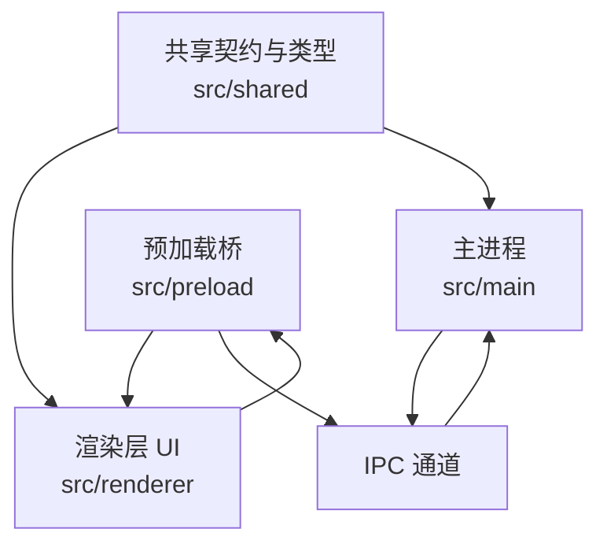
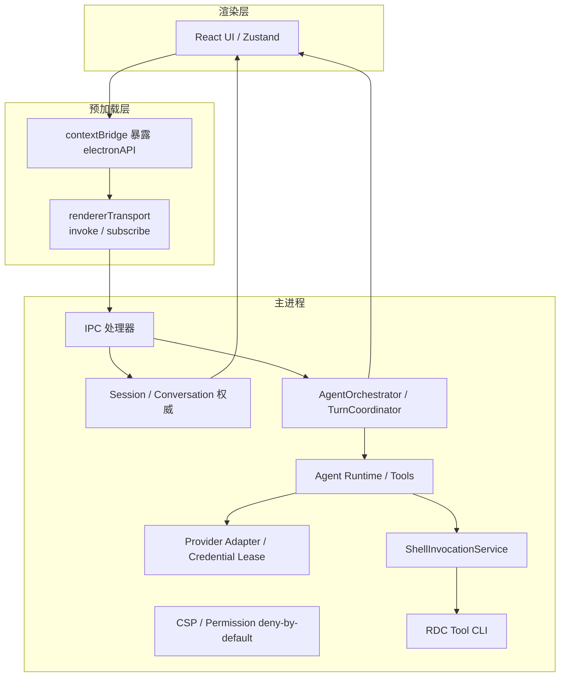
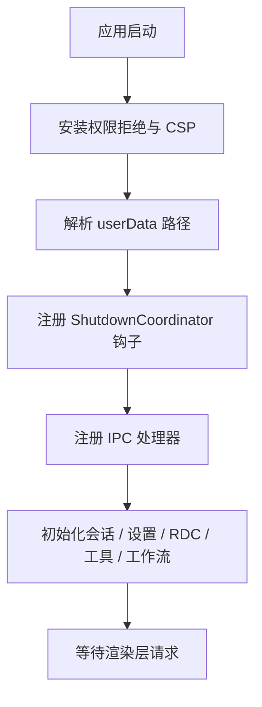
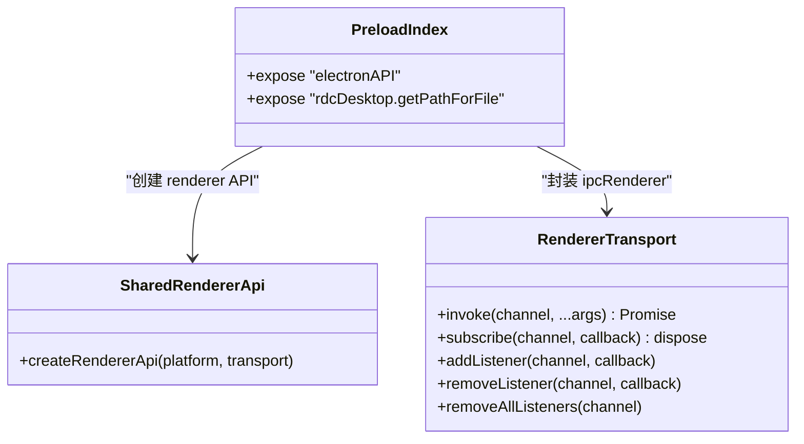
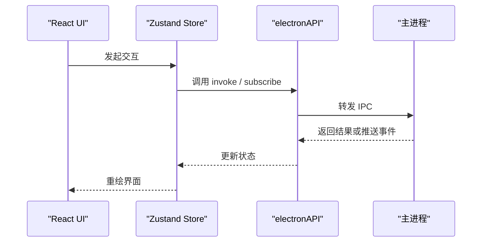
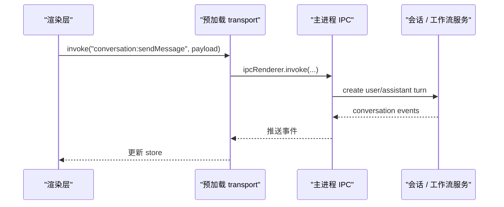
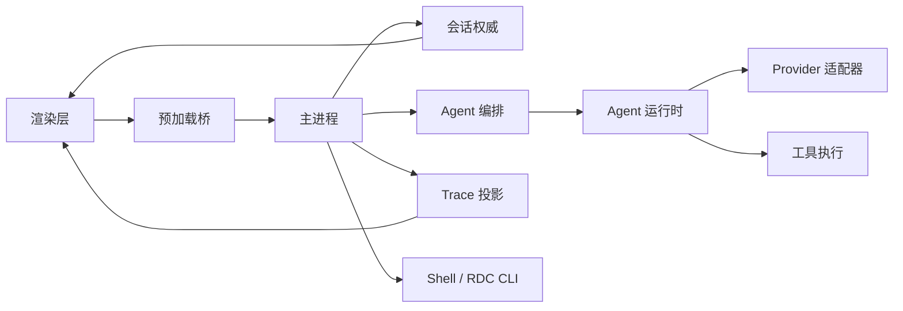
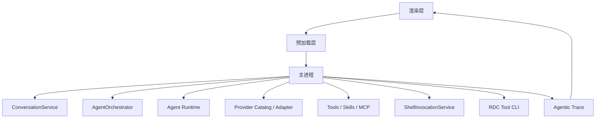
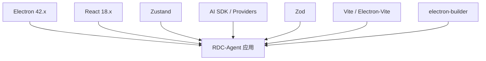
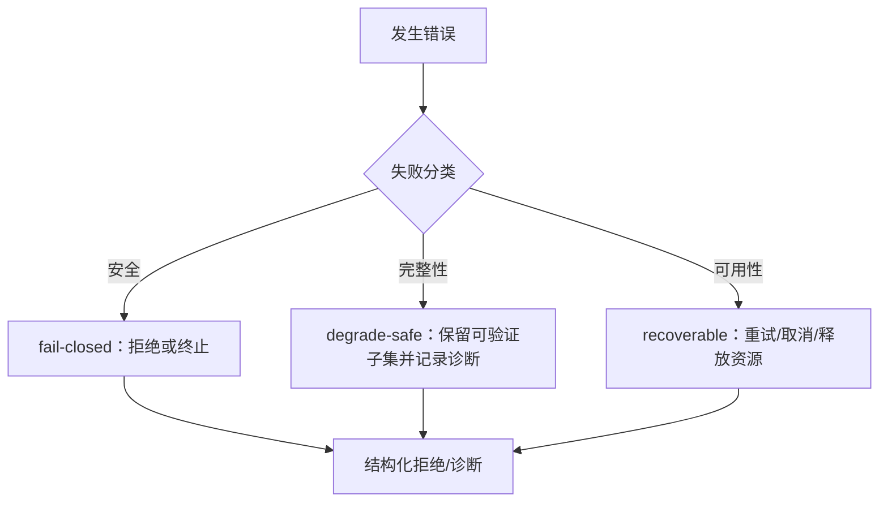

# 系统架构

<cite>
**本文引用的文件**   
- [package.json](file://package.json)
- [DESIGN.md](file://DESIGN.md)
- [src/main/index.ts](file://src/main/index.ts)
- [src/preload/index.ts](file://src/preload/index.ts)
- [src/preload/rendererTransport.ts](file://src/preload/rendererTransport.ts)
- [src/shared/renderer-api/index.ts](file://src/shared/renderer-api/index.ts)
- [src/renderer/main.tsx](file://src/renderer/main.tsx)
- [docs/architecture/overview.md](file://docs/architecture/overview.md)
- [docs/architecture/data-flow.md](file://docs/architecture/data-flow.md)
- [docs/architecture/provider-architecture.md](file://docs/architecture/provider-architecture.md)
- [docs/contracts/failure-model.md](file://docs/contracts/failure-model.md)
- [docs/contracts/runtime-kernel.md](file://docs/contracts/runtime-kernel.md)
- [docs/contracts/session-projection.md](file://docs/contracts/session-projection.md)
</cite>

## 目录
1. [引言](#引言)
2. [项目结构](#项目结构)
3. [核心组件](#核心组件)
4. [架构总览](#架构总览)
5. [详细组件分析](#详细组件分析)
6. [依赖关系分析](#依赖关系分析)
7. [性能与资源特性](#性能与资源特性)
8. [故障排查指南](#故障排查指南)
9. [结论](#结论)

## 引言
RDC-Agent 是一个基于 Electron 的桌面 Agent 工作台，面向 RenderDoc `.rdc` 捕获分析与调试工作流。其架构以主进程为权威边界，通过预加载桥接受控能力，渲染层仅负责 UI 展示与交互状态。系统强调单一真相、冻结执行、主进程权威、Scope 固定、Provider 事实分层、可取消与可回收、失败有分类等不变量。本文从多进程设计、权限边界、IPC 模型、数据流向、关键契约与技术栈选型角度，给出完整架构说明。

## 项目结构
仓库采用四层组织：
- `src/main`：Electron 主进程入口、IPC 处理器、会话与工作流编排、设置、存储、工具调用、外部能力。
- `src/preload`：沙箱兼容的 `window.electronAPI` 桥，不直接引入 Node 内置模块。
- `src/renderer`：React 18 UI、Zustand 状态、浏览器桥接、工作台呈现。
- `src/shared`：跨层类型、常量、纯辅助函数与 Provider Catalog 编译器。

**图示来源**
- [src/main/index.ts:1-20](file://src/main/index.ts#L1-L20)
- [src/preload/index.ts:1-25](file://src/preload/index.ts#L1-L25)
- [src/renderer/main.tsx:1-15](file://src/renderer/main.tsx#L1-L15)
- [docs/architecture/overview.md:1-41](file://docs/architecture/overview.md#L1-L41)

**章节来源**
- [docs/architecture/overview.md:1-41](file://docs/architecture/overview.md#L1-L41)

## 核心组件
- 主进程权威：集中处理权限、secret、MCP trust、Shell、RDC CLI、IPC 校验与安全策略。
- 预加载桥：暴露最小 `electronAPI` 和 `rdcDesktop` 能力，屏蔽 Node 与原生 API。
- 渲染层：React 18 + Zustand 管理 UI 状态，订阅主进程事件并呈现 Conversation、Trace、Work Process 等。
- 共享层：定义 IPC channel、RendererApi transport、Provider Catalog schema、错误分类、会话投影契约。

**章节来源**
- [DESIGN.md:1-73](file://DESIGN.md#L1-L73)
- [docs/contracts/runtime-kernel.md:1-133](file://docs/contracts/runtime-kernel.md#L1-L133)
- [docs/contracts/session-projection.md:1-131](file://docs/contracts/session-projection.md#L1-L131)

## 架构总览
RDC-Agent 的多进程架构遵循“主进程拥有能力，渲染层只消费投影”的原则。主进程负责安全面、持久化、Agent 运行时、Provider 请求、RDC 工具链；预加载层仅提供受控 IPC 通道；渲染层专注 React 界面与用户操作。

**图示来源**
- [src/main/index.ts:1-200](file://src/main/index.ts#L1-L200)
- [src/preload/index.ts:1-25](file://src/preload/index.ts#L1-L25)
- [src/preload/rendererTransport.ts:1-44](file://src/preload/rendererTransport.ts#L1-L44)
- [docs/architecture/data-flow.md:1-86](file://docs/architecture/data-flow.md#L1-L86)

**章节来源**
- [docs/architecture/overview.md:1-41](file://docs/architecture/overview.md#L1-L41)
- [docs/architecture/data-flow.md:1-86](file://docs/architecture/data-flow.md#L1-L86)

## 详细组件分析

### 主进程：权限、安全与权威边界
主进程是安全与业务权威中心，承担以下职责：
- 安装 deny-by-default 权限处理器与生产 CSP，禁用 unsafe-inline、unsafe-eval、style-src-attr。
- 初始化 Electron app、userData、窗口布局、生命周期协调器。
- 注册 IPC handlers、会话服务、RDC CLI 调用者、Replay 设备、Browser App Bridge、ShutdownCoordinator。
- 在退出阶段按相位释放会话、进程、MCP 连接、Shell 子进程、Bridge 与 Replay 设备。

**图示来源**
- [src/main/index.ts:1-200](file://src/main/index.ts#L1-L200)

**章节来源**
- [src/main/index.ts:1-200](file://src/main/index.ts#L1-L200)
- [DESIGN.md:1-73](file://DESIGN.md#L1-L73)

### 预加载层：最小能力桥接
预加载脚本的职责是暴露最小、可审计的 API：
- 使用 `contextBridge.exposeInMainWorld` 暴露 `electronAPI`。
- `createRendererApi` 组合 platform 信息与 `createIpcRendererTransport`。
- 暴露 `rdcDesktop.getPathForFile`，封装 `webUtils.getPathForFile` 并吞掉异常。
- 明确禁止在此处引入 Node 内置模块。

**图示来源**
- [src/preload/index.ts:1-25](file://src/preload/index.ts#L1-L25)
- [src/preload/rendererTransport.ts:1-44](file://src/preload/rendererTransport.ts#L1-L44)
- [src/shared/renderer-api/index.ts:1-17](file://src/shared/renderer-api/index.ts#L1-L17)

**章节来源**
- [src/preload/index.ts:1-25](file://src/preload/index.ts#L1-L25)
- [src/preload/rendererTransport.ts:1-44](file://src/preload/rendererTransport.ts#L1-L44)
- [src/shared/renderer-api/index.ts:1-17](file://src/shared/renderer-api/index.ts#L1-L17)

### 渲染层：UI 与状态投影
渲染层入口挂载 React StrictMode，并安装 Browser App Bridge 与交互性能探针。UI 通过 Zustand store 订阅主进程事件，展示 Conversation、Trace、Right Rail、Composer、Work Process 等视图。

**图示来源**
- [src/renderer/main.tsx:1-15](file://src/renderer/main.tsx#L1-L15)
- [src/preload/rendererTransport.ts:1-44](file://src/preload/rendererTransport.ts#L1-L44)

**章节来源**
- [src/renderer/main.tsx:1-15](file://src/renderer/main.tsx#L1-L15)
- [docs/contracts/session-projection.md:1-131](file://docs/contracts/session-projection.md#L1-L131)

### 关键架构原则
- 单一真相：Session / Conversation / branch / journal 是历史权威；Agent slot 是执行配置与缓存。
- 冻结执行：`EffectiveRuntimePlan`（`schemaVersion: 3`）在 `prepareTurn` 冻结；Prompt 与 Executor 共用；在途 turn 不读可变 Settings。
- 主进程权威：权限、secret、MCP trust、Shell、RDC CLI、IPC 校验均在主进程。
- Scope 固定：用户资源与项目资源路径固定，无静默迁移。
- Provider 事实分层：Manifest 基线真值、Discovery 候选验证、用户覆盖显式 provenance。
- 可取消与可回收：Turn、子进程、应用退出均有明确生命周期与回收路径。
- 失败有分类：安全类 fail-closed；完整性 degrade-safe；可用性 recoverable。

**章节来源**
- [DESIGN.md:1-73](file://DESIGN.md#L1-L73)
- [docs/contracts/runtime-kernel.md:1-133](file://docs/contracts/runtime-kernel.md#L1-L133)
- [docs/contracts/failure-model.md:1-137](file://docs/contracts/failure-model.md#L1-L137)

### 进程间通信模型
IPC 是渲染层与主进程的受控通道：
- 渲染层通过 `electronAPI.invoke` 发送命令。
- 预加载层将 `ipcRenderer.invoke` 包装为 typed transport。
- 主进程通过 IPC handler 路由到 Conversation、Workflow、Trace、Settings、Capture 等服务。
- 事件通过 `ipcRenderer.on` 推送到渲染层，并由 session projection gate 过滤 active session。

**图示来源**
- [src/preload/rendererTransport.ts:1-44](file://src/preload/rendererTransport.ts#L1-L44)
- [docs/architecture/data-flow.md:1-86](file://docs/architecture/data-flow.md#L1-L86)
- [docs/contracts/session-projection.md:1-131](file://docs/contracts/session-projection.md#L1-L131)

**章节来源**
- [docs/architecture/data-flow.md:1-86](file://docs/architecture/data-flow.md#L1-L86)

### 数据流向图
当前主要数据流包括：
- Agent Turn：渲染层 → 预加载 → 主进程 → 会话 → 编排 → 运行时 → Provider → 工具 → 回灌 → 渲染层。
- RDC Shell Actions：渲染层 → 主进程 → RDC Session → Runtime → Shell → System RDC CLI → 结构化诊断。
- Trace Projection：会话事件 → TraceService → IPC → 渲染层 Work Process。
- Settings Flow：主进程持久化 → IPC → 渲染层编辑器。

**图示来源**
- [docs/architecture/data-flow.md:1-86](file://docs/architecture/data-flow.md#L1-L86)

**章节来源**
- [docs/architecture/data-flow.md:1-86](file://docs/architecture/data-flow.md#L1-L86)

### 组件交互关系图

**图示来源**
- [docs/architecture/overview.md:1-41](file://docs/architecture/overview.md#L1-L41)
- [docs/architecture/data-flow.md:1-86](file://docs/architecture/data-flow.md#L1-L86)

## 依赖关系分析
技术栈选择与版本兼容性要点：
- Electron 42.x：作为桌面外壳，提供进程隔离、IPC、文件系统、shell、session 与 CSP 控制。
- React 18.x：渲染层 UI 框架，StrictMode 用于开发期检查。
- AI SDK：`ai`、`@ai-sdk/provider`、OpenAI 客户端、Azure/GitLab/SAP 等 Provider 集成。
- Zustand：渲染层状态管理，配合 session projection gate 与 Composer draft scope。
- Zod：Provider Catalog manifest、IPC payload、settings 与运行契约校验。
- Vite / Electron-Vite：构建与开发入口；electron-builder 打包 Windows 发布产物。

**图示来源**
- [package.json:1-143](file://package.json#L1-L143)

**章节来源**
- [package.json:1-143](file://package.json#L1-L143)
- [DESIGN.md:1-73](file://DESIGN.md#L1-L73)

## 性能与资源特性
- 渲染层使用 React StrictMode 与 InteractionPerformanceProbe，便于观察交互延迟。
- 主进程通过 ShutdownCoordinator 分阶段释放资源，避免退出时残留进程或泄漏 lease。
- Session 与 Conversation 使用 journal、快照与分支机制，保证恢复与一致性。
- EffectiveCatalog 使用 revisioned snapshot，避免广播完整 catalog，降低渲染层压力。
- Trace 与 Work Process 通过投影减少跨进程数据体积，只传递必要呈现字段。
- RDC CLI 调用由主进程固定参数与超时控制，渲染层不构造生命周期命令。

**章节来源**
- [src/renderer/main.tsx:1-15](file://src/renderer/main.tsx#L1-L15)
- [src/main/index.ts:1-200](file://src/main/index.ts#L1-L200)
- [docs/architecture/provider-architecture.md:1-138](file://docs/architecture/provider-architecture.md#L1-L138)
- [docs/architecture/data-flow.md:1-86](file://docs/architecture/data-flow.md#L1-L86)

## 故障排查指南
- 安全类失败应 fail-closed：权限不足、secret 不可读、未信任 MCP、非法 IPC payload、Sandbox/CSP 绕过、RDC context 无 session 或 lease 所有权不匹配。
- 完整性类失败应 degrade-safe：JSONL 坏行、storage schema 损坏、workTrace 非 canonical、附件 manifest/magic 不匹配、上下文无法装入。
- 可用性类失败应 recoverable：网络波动、Provider 5xx、配额限制、用户取消、锁竞争、子进程超时。
- Provider 空流不得冒充 HTTP 502；协议违规不重试；agent loop 停滞与 provider 失败互斥。
- 会话停止语义区分 preparing 干净撤销与 committing/running 单调落停；已停止 request 丢弃迟到 streaming patch。
- Capture 打开、图片获取、设备不支持、关闭未确认应分别投影，保留 lease 与诊断。

**图示来源**
- [docs/contracts/failure-model.md:1-137](file://docs/contracts/failure-model.md#L1-L137)
- [docs/contracts/runtime-kernel.md:1-133](file://docs/contracts/runtime-kernel.md#L1-L133)
- [docs/contracts/session-projection.md:1-131](file://docs/contracts/session-projection.md#L1-L131)

**章节来源**
- [docs/contracts/failure-model.md:1-137](file://docs/contracts/failure-model.md#L1-L137)
- [docs/contracts/runtime-kernel.md:1-133](file://docs/contracts/runtime-kernel.md#L1-L133)
- [docs/contracts/session-projection.md:1-131](file://docs/contracts/session-projection.md#L1-L131)

## 结论
RDC-Agent 的架构以主进程为唯一权威边界，通过预加载层暴露最小能力，渲染层专注 UI 与状态投影。该设计确保权限、secret、MCP trust、Shell、RDC CLI 与 IPC 校验集中在安全面；同时通过 EffectiveRuntimePlan、EffectiveCatalog、Session 投影与失败分类实现可解释、可恢复、可审计的执行流程。Electron 42.x、React 18.x、AI SDK 与 Zustand 的组合满足桌面应用、AI 工作流与前端状态管理的需要，并在构建与打包阶段通过严格契约与脚本保障版本一致性与发布质量。