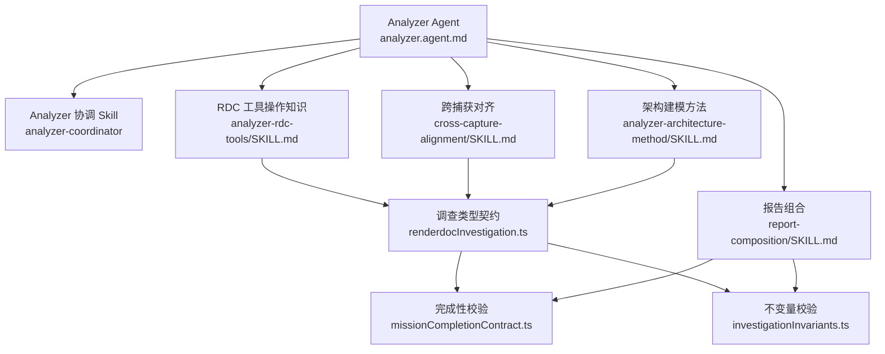
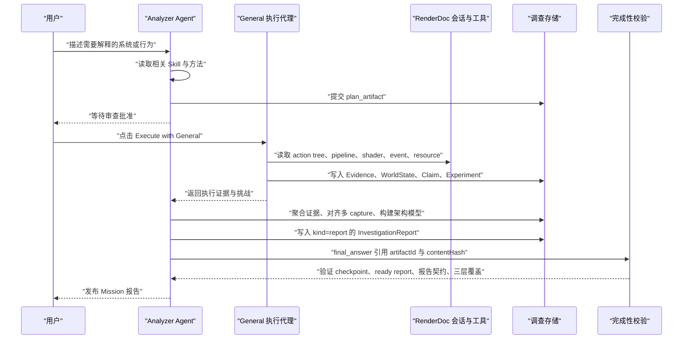
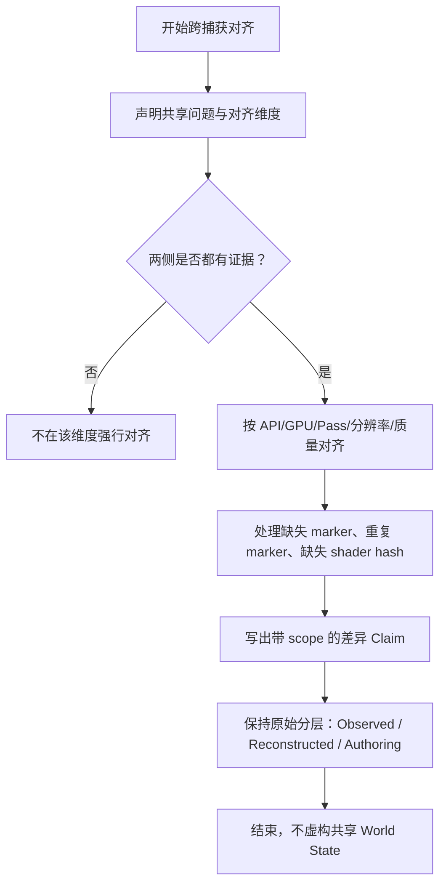
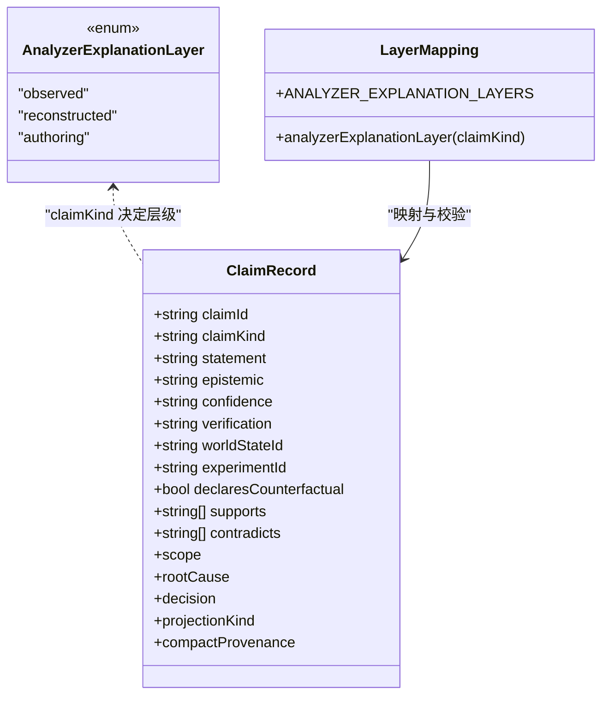
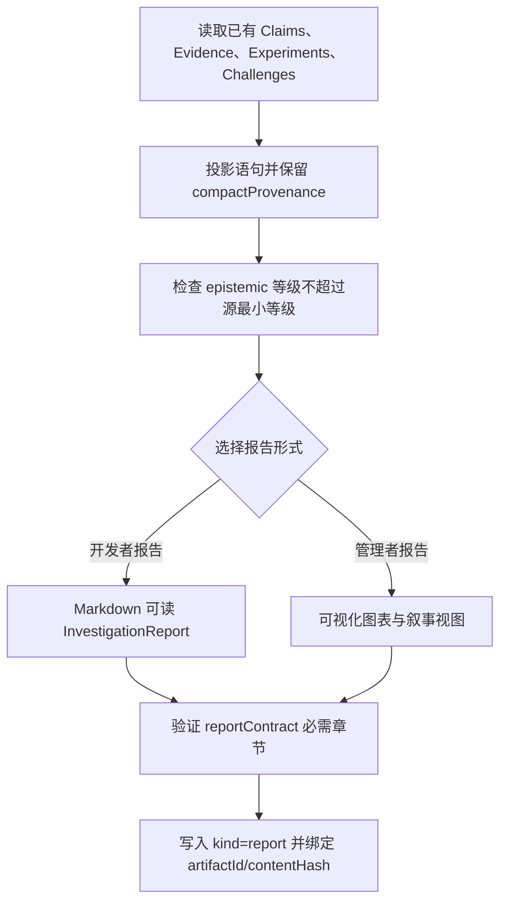
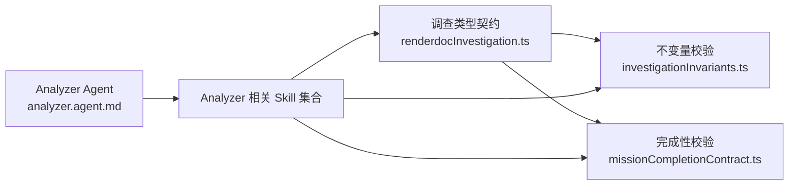

# Analyzer 调查方法

<cite>
**本文引用的文件**   
- [analyzer.agent.md](file://resources/agent-runtime/agents/analyzer.agent.md)
- [cross-capture-alignment/SKILL.md](file://resources/agent-runtime/skills/cross-capture-alignment/SKILL.md)
- [renderdoc-investigation/SKILL.md](file://resources/agent-runtime/skills/renderdoc-investigation/SKILL.md)
- [analyzer-rdc-tools/SKILL.md](file://resources/agent-runtime/skills/analyzer-rdc-tools/SKILL.md)
- [capture-facts/SKILL.md](file://resources/agent-runtime/skills/capture-facts/SKILL.md)
- [resource-versioning/SKILL.md](file://resources/agent-runtime/skills/resource-versioning/SKILL.md)
- [pass-graph-analysis/SKILL.md](file://resources/agent-runtime/skills/pass-graph-analysis/SKILL.md)
- [analyzer-architecture-method/SKILL.md](file://resources/agent-runtime/skills/analyzer-architecture-method/SKILL.md)
- [report-composition/SKILL.md](file://resources/agent-runtime/skills/report-composition/SKILL.md)
- [renderdocInvestigation.ts](file://src/shared/types/renderdocInvestigation.ts)
- [missionCompletionContract.ts](file://src/main/investigation/missionCompletionContract.ts)
- [investigationInvariants.ts](file://src/main/investigation/investigationInvariants.ts)
</cite>

## 目录
1. [引言](#引言)
2. [项目结构定位](#项目结构定位)
3. [核心组件](#核心组件)
4. [架构总览](#架构总览)
5. [详细组件分析](#详细组件分析)
6. [依赖关系分析](#依赖关系分析)
7. [性能与复杂度特征](#性能与复杂度特征)
8. [配置与报告模板定制指南](#配置与报告模板定制指南)
9. [故障排查指南](#故障排查指南)
10. [结论](#结论)

## 引言
Analyzer 是 RenderDoc Agent 系统中的“规划型调查者”，负责在未知渲染系统中制定可解释的调查计划，并在执行后对证据、重建结果和高层假设进行分层整理。它不直接执行 Shell 或代码解释器，而是通过 `plan_artifact` 提交冻结计划、等待用户审批，再由 General 执行实际 RDC 工具调用；最终由 Analyzer 汇总执行证据、独立质疑和局限性，并通过 `investigation_*` 发布结构化调查报告。

本文件围绕以下目标展开：
- 说明 Analyzer 如何处理多个 capture 之间的关联分析，包括时间轴对齐、事件匹配、差异比较。
- 解释 `analyzerExplanationLayer` 的分层解释模型，以及从原始数据到高层结论的推理约束。
- 说明 Analyzer 的证据聚合机制，如何将分散的 Evidence、Claim、Experiment、Challenge 整合为统一报告。
- 描述 Developer Report（Markdown 可读报告）与 Executive Visual Report（可视化图表视图）两种输出形式及其生成流程。
- 给出跨设备、跨版本、跨场景的分析案例，并说明其在复杂 GPU 问题中的回归分析、性能趋势对比、架构演进评估作用。
- 提供 Analyzer 相关配置参数与报告模板定制建议。

## 项目结构定位
Analyzer 的实现不是单一源文件，而是由“Agent 定义 + 技能手册 + 类型契约 + 完成性校验”共同构成：
- Agent 定义定义了 Analyzer 的身份、工具集、Skill 绑定和交接策略。
- 技能手册定义了跨捕获对齐、RDC 工具使用、Capture Facts、资源版本、Pass 图、架构方法和报告组合等具体分析方法。
- 类型契约定义了调查记录的数据模型，包括证据、声明、实验、挑战、报告契约和分层映射。
- 完成性校验确保 Analyzer 报告满足 Observed / Reconstructed / Authoring 三层要求，并强制 final_answer 引用已就绪报告。



**图示来源**  
- [analyzer.agent.md:1-48](file://resources/agent-runtime/agents/analyzer.agent.md#L1-L48)
- [analyzer-rdc-tools/SKILL.md:1-20](file://resources/agent-runtime/skills/analyzer-rdc-tools/SKILL.md#L1-L20)
- [cross-capture-alignment/SKILL.md:1-17](file://resources/agent-runtime/skills/cross-capture-alignment/SKILL.md#L1-L17)
- [analyzer-architecture-method/SKILL.md:1-44](file://resources/agent-runtime/skills/analyzer-architecture-method/SKILL.md#L1-L44)
- [report-composition/SKILL.md:1-63](file://resources/agent-runtime/skills/report-composition/SKILL.md#L1-L63)
- [renderdocInvestigation.ts:1-200](file://src/shared/types/renderdocInvestigation.ts#L1-L200)
- [missionCompletionContract.ts:1-120](file://src/main/investigation/missionCompletionContract.ts#L1-L120)
- [investigationInvariants.ts:1-120](file://src/main/investigation/investigationInvariants.ts#L1-L120)

**章节来源**  
- [analyzer.agent.md:1-48](file://resources/agent-runtime/agents/analyzer.agent.md#L1-L48)
- [renderdocInvestigation.ts:1-200](file://src/shared/types/renderdocInvestigation.ts#L1-L200)
- [missionCompletionContract.ts:1-120](file://src/main/investigation/missionCompletionContract.ts#L1-L120)
- [investigationInvariants.ts:1-120](file://src/main/investigation/investigationInvariants.ts#L1-L120)

## 核心组件
Analyzer 的核心能力由以下组件协作实现：

| 组件 | 职责 | 关键行为 |
|---|---|---|
| Analyzer Agent | 调查规划入口 | 仅做计划，不执行 Shell；提交 plan_artifact；等待 review；执行后评估证据并发布报告 |
| Analyzer RDC Tools Skill | RDC 工具操作知识 | 指导如何读取 action tree、pipeline state、shader fingerprint、counter/event duration，避免过度推断 |
| Capture Facts Skill | 记录观测事实 | 将 draw/dispatch/copy/present 等写入 EvidenceRecord，严格区分 observed 与 inferred/derived |
| Resource Versioning Skill | 资源生命周期追踪 | 记录 producer/consumer 与版本，变更后标记旧证据 stale，优先使用 superseded 产物 |
| Pass Graph Analysis Skill | Pass 拓扑重建 | 基于事件顺序、附件、输出生成 derived_structure，语义标签留在 authoring 层 |
| Cross-Capture Alignment Skill | 多 capture 对齐 | 明确共享问题与对齐维度，仅在双端均有证据时对齐，差异写为 scoped Claim |
| Analyzer Architecture Method Skill | 架构模型增量构建 | 将 Observed / Reconstructed / Authoring 组织为 claim_set，通过 supersedes 形成版本链 |
| Report Composition Skill | 报告视图组合 | 以 View 形式投影 Claims/Evidence/Experiments，不得提升 claim rank |
| 调查类型契约 | 数据结构与层级映射 | 定义 Evidence、Claim、Experiment、Report 等记录类型及 `analyzerExplanationLayer` |
| 完成性校验 | Mission 结束门禁 | 检查 checkpoint、ready report、final_answer 引用、报告契约字段、Analyzer 三层覆盖 |
| 不变量校验 | 数据完整性与层级约束 | 校验 compactProvenance、epistemic 等级、ANALYZER-LAYER、引用可解析等 |

**章节来源**  
- [analyzer.agent.md:1-48](file://resources/agent-runtime/agents/analyzer.agent.md#L1-L48)
- [analyzer-rdc-tools/SKILL.md:1-20](file://resources/agent-runtime/skills/analyzer-rdc-tools/SKILL.md#L1-L20)
- [capture-facts/SKILL.md:1-18](file://resources/agent-runtime/skills/capture-facts/SKILL.md#L1-L18)
- [resource-versioning/SKILL.md:1-16](file://resources/agent-runtime/skills/resource-versioning/SKILL.md#L1-L16)
- [pass-graph-analysis/SKILL.md:1-17](file://resources/agent-runtime/skills/pass-graph-analysis/SKILL.md#L1-L17)
- [cross-capture-alignment/SKILL.md:1-17](file://resources/agent-runtime/skills/cross-capture-alignment/SKILL.md#L1-L17)
- [analyzer-architecture-method/SKILL.md:1-44](file://resources/agent-runtime/skills/analyzer-architecture-method/SKILL.md#L1-L44)
- [report-composition/SKILL.md:1-63](file://resources/agent-runtime/skills/report-composition/SKILL.md#L1-L63)
- [renderdocInvestigation.ts:1-200](file://src/shared/types/renderdocInvestigation.ts#L1-L200)
- [missionCompletionContract.ts:120-277](file://src/main/investigation/missionCompletionContract.ts#L120-L277)
- [investigationInvariants.ts:120-468](file://src/main/investigation/investigationInvariants.ts#L120-L468)

## 架构总览
Analyzer 的调查流程可以抽象为“规划 → 执行 → 证据聚合 → 分层建模 → 报告组合 → 完成性校验”。



**图示来源**  
- [analyzer.agent.md:1-48](file://resources/agent-runtime/agents/analyzer.agent.md#L1-L48)
- [analyzer-architecture-method/SKILL.md:1-44](file://resources/agent-runtime/skills/analyzer-architecture-method/SKILL.md#L1-L44)
- [report-composition/SKILL.md:1-63](file://resources/agent-runtime/skills/report-composition/SKILL.md#L1-L63)
- [missionCompletionContract.ts:120-277](file://src/main/investigation/missionCompletionContract.ts#L120-L277)

## 详细组件分析

### 跨捕获分析与证据串联
跨捕获分析的核心是“按明确维度对齐，而不是构造虚构的统一世界状态”。

#### 时间轴对齐与事件匹配
- 对齐维度包括 API、GPU、Pass、分辨率、质量等。
- 只在两个 capture 中都有证据的维度上对齐。
- 当 marker_path 缺失、重复 marker、shader SHA-256 缺失或非自动 debug_name 不稳定时，只能提出启发式匹配，并保留反证和歧义。
- 对于没有可靠布局或读取失败的情况，应明确 unsupported 或错误，不能伪造跨 session 身份。



**图示来源**  
- [cross-capture-alignment/SKILL.md:1-17](file://resources/agent-runtime/skills/cross-capture-alignment/SKILL.md#L1-L17)
- [analyzer-architecture-method/SKILL.md:28-44](file://resources/agent-runtime/skills/analyzer-architecture-method/SKILL.md#L28-L44)

#### 差异比较与不确定性管理
- 差异必须写成 scoped Claim，例如限定 capture、eventId、resourceId、pass、device、api。
- 禁止将单个 GPU 家族的经验泛化为全局规律。
- 历史 imported-case 的 fixed 状态不能作为当前 verified 结论。
- 噪声阈值以下的时序差值不能作为优化收益。

**章节来源**  
- [cross-capture-alignment/SKILL.md:1-17](file://resources/agent-runtime/skills/cross-capture-alignment/SKILL.md#L1-L17)
- [analyzer-architecture-method/SKILL.md:28-44](file://resources/agent-runtime/skills/analyzer-architecture-method/SKILL.md#L28-L44)

### 分层解释模型：`analyzerExplanationLayer`
Analyzer 的解释被严格分为三层：

| 层级 | 内容 | 允许的 `claimKind` | 认识论与验证约束 |
|---|---|---|---|
| Observed | 捕获中的 draw、dispatch、copy、barrier、present | `observed_fact` | epistemic=`observed`，verification=`observed` |
| Reconstructed | 从捕获推导出的事件、资源、Pass 结构 | `derived_structure` | epistemic=`derived`，verification=`reconstructed` |
| Authoring | 引擎、材质、RenderGraph 假设 | `semantic_inference` 或 `hypothesis` | epistemic=`inferred` 或 `unknown`，绝不能是 `observed` |



**图示来源**  
- [renderdocInvestigation.ts:430-509](file://src/shared/types/renderdocInvestigation.ts#L430-L509)
- [investigationInvariants.ts:1-120](file://src/main/investigation/investigationInvariants.ts#L1-L120)
- [analyzer-architecture-method/SKILL.md:1-27](file://resources/agent-runtime/skills/analyzer-architecture-method/SKILL.md#L1-L27)

#### 层级不可越级规则
- 观察层不能降级为推测层，也不能把推测写成观察。
- 重建层不能把引擎语义写成 `observed_fact`。
- 作者假设层不能升级为 `observed` 或 `derived`。
- 投影生成的 Claim 不能提高 source claims 的最小认识论等级。
- Analyzer 完成时必须包含 Observed、Reconstructed、Authoring 三层，否则会被拒绝。

**章节来源**  
- [analyzer-architecture-method/SKILL.md:1-27](file://resources/agent-runtime/skills/analyzer-architecture-method/SKILL.md#L1-L27)
- [investigationInvariants.ts:1-120](file://src/main/investigation/investigationInvariants.ts#L1-L120)
- [missionCompletionContract.ts:200-277](file://src/main/investigation/missionCompletionContract.ts#L200-L277)

### 证据聚合机制
Analyzer 的证据聚合不是简单拼接文本，而是将分散的原始证据、重建结构和高层假设组织成可追溯、可验证、可迭代的调查状态。

#### 证据来源与强度
- EvidenceRecord 包含 mission、observationKind、summary、epistemicStatus、worldStateId、source、artifactRefs、contentHashes、region、strength、stale 等字段。
- strong observed tool evidence 必须有可解析的 artifactRef 与 contentHash。
- EvidencePack 用于打包一组相关 Evidence。

#### 声明与溯源
- ClaimRecord 通过 compactProvenance 链接源 Claim，并强制 sourceClaimId、sourceEpistemicStatus、sourceVerificationLevel 与源记录完全一致。
- Claim 可 supports 或 contradicts 其他 Claim，并可关联 Experiment。
- ClaimSet 用于组织 Architecture Model 等多条声明。

#### 实验与回滚
- ExperimentRecord 支持 baseline、intervention、variant、rollback、restored 的执行证据引用。
- 因果或反事实 Claim 必须关联已关闭状态的 Experiment，且 rollback.executed、baselineRestored、verifyEvidenceIds 必须完整。
- 如果世界状态被修改且未满足隔离条件，则证据会被标记为 polluted/stale。

```mermaid
erDiagram
  WORLD_STATE ||--o{ EVIDENCE_RECORD : "owns"
  WORLD_STATE ||--o{ CLAIM_RECORD : "context"
  EXPERIMENT_RECORD ||--o{ CLAIM_RECORD : "supports causal"
  CLAIM_SET ||--o{ CLAIM_RECORD : "contains"
  INVESTIGATION_REPORT ||--o{ CLAIM_RECORD : "projects"
  INVESTIGATION_REPORT ||--o{ EVIDENCE_RECORD : "references"
  INVESTIGATION_REPORT ||--o{ EXPERIMENT_RECORD : "references"

  WORLD_STATE {
    string worldStateId
    string kind
    string captureRef
    string validity
  }

  EVIDENCE_RECORD {
    string evidenceId
    string mission
    string observationKind
    string epistemicStatus
    string worldStateId
    string strength
    bool stale
  }

  CLAIM_RECORD {
    string claimId
    string claimKind
    string epistemic
    string verification
    string worldStateId
    string experimentId
  }

  EXPERIMENT_RECORD {
    string experimentId
    string hypothesisClaimId
    string baselineWorldStateId
    string variantWorldStateId
    string restoredWorldStateId
    string status
  }

  CLAIM_SET {
    items
  }

  INVESTIGATION_REPORT {
    string title
    string mission
    string summary
  }
```

**图示来源**  
- [renderdocInvestigation.ts:200-430](file://src/shared/types/renderdocInvestigation.ts#L200-L430)
- [investigationInvariants.ts:200-468](file://src/main/investigation/investigationInvariants.ts#L200-L468)

**章节来源**  
- [renderdocInvestigation.ts:200-430](file://src/shared/types/renderdocInvestigation.ts#L200-L430)
- [investigationInvariants.ts:200-468](file://src/main/investigation/investigationInvariants.ts#L200-L468)
- [capture-facts/SKILL.md:1-18](file://resources/agent-runtime/skills/capture-facts/SKILL.md#L1-L18)
- [resource-versioning/SKILL.md:1-16](file://resources/agent-runtime/skills/resource-versioning/SKILL.md#L1-L16)

### 开发者报告与管理者可视化报告
Analyzer 的报告本质上是一个 View：它不创造新的真相来源，而是对已有 Investigation State 进行投影和排版。

#### Developer Report（Markdown 可读报告）
- 对应 `kind=report` 的 `InvestigationReport`。
- 必须包含 conclusion、evidence、verification、limitations、status、links、artifactIds、candidateStatus。
- 报告中的语句必须来自已有 Claims/Evidence/Experiments，并保持非空 compactProvenance。
- 报告的 epistemic 等级不能超过源 Claim 的最小等级。
- Analyzer 额外投影 Observed Model、Resource Versioning、Pass Reconstruction、Shader Fingerprint/Block、Traceability、Architecture Model version、Unknown Frontier。

#### Executive Visual Report（可视化图表）
- 可视编辑允许改变 Layout、Typography、Diagram、Narrative，但不得改变数字、Scope、Verification 或 Conclusion。
- Visualization 本身仍是 report 的一种呈现方式，不应把紧凑文本或可视化描述升级为更高确定性的 Claim。
- 报告未完成时应保持 draft，并明确缺失的验证项。



**图示来源**  
- [report-composition/SKILL.md:1-63](file://resources/agent-runtime/skills/report-composition/SKILL.md#L1-L63)
- [missionCompletionContract.ts:120-277](file://src/main/investigation/missionCompletionContract.ts#L120-L277)

**章节来源**  
- [report-composition/SKILL.md:1-63](file://resources/agent-runtime/skills/report-composition/SKILL.md#L1-L63)
- [missionCompletionContract.ts:120-277](file://src/main/investigation/missionCompletionContract.ts#L120-L277)

### 复杂 GPU 问题排查中的作用
Analyzer 在 GPU 问题排查中承担“解释未知渲染系统”的角色，尤其适合以下场景：

| 场景 | Analyzer 的作用 | 关键方法与产出 |
|---|---|---|
| 回归分析 | 对比新旧 capture 的行为差异，判断是否属于已知范围还是新未知前沿 | cross-capture-alignment、resource-versioning、claim 差异 |
| 性能趋势对比 | 用 counter/event duration 说明相对成本，但不把热点之和等同于整帧时间 | analyzer-rdc-tools、experiment protocol |
| 架构演进影响评估 | 通过 Architecture Model 的 supersedes 建立版本链，说明新增、保留、未知部分 | analyzer-architecture-method、claim_set |
| 多设备、多驱动、多后端 | 通过 device/api/driver 等 scope 限制结论适用范围 | investigationClaimScope、verification=cross_device |
| 多版本 Shader / 资源 | 通过 SPIR-V slice、shader fingerprint、resource hash 建立稳定证据 | resource-versioning、analyzer-rdc-tools |

**章节来源**  
- [analyzer-rdc-tools/SKILL.md:1-20](file://resources/agent-runtime/skills/analyzer-rdc-tools/SKILL.md#L1-L20)
- [analyzer-architecture-method/SKILL.md:1-44](file://resources/agent-runtime/skills/analyzer-architecture-method/SKILL.md#L1-L44)
- [cross-capture-alignment/SKILL.md:1-17](file://resources/agent-runtime/skills/cross-capture-alignment/SKILL.md#L1-L17)
- [renderdocInvestigation.ts:250-320](file://src/shared/types/renderdocInvestigation.ts#L250-L320)

## 依赖关系分析
Analyzer 的依赖可以分为内部契约依赖、Skill 方法依赖和外部执行依赖。



**图示来源**  
- [renderdocInvestigation.ts:1-200](file://src/shared/types/renderdocInvestigation.ts#L1-L200)
- [investigationInvariants.ts:1-120](file://src/main/investigation/investigationInvariants.ts#L1-L120)
- [missionCompletionContract.ts:1-120](file://src/main/investigation/missionCompletionContract.ts#L1-L120)
- [analyzer.agent.md:1-48](file://resources/agent-runtime/agents/analyzer.agent.md#L1-L48)

### 耦合与内聚
- 高内聚：每个 Skill 聚焦一个分析方法，如 capture facts、resource versioning、pass graph、cross-capture alignment、architecture method、report composition。
- 低耦合：Skill 通过标准化调查类型契约交互，而不是直接互相调用实现。
- 强约束：完成性校验与不变量校验保证 Analyzer 不会绕过证据链、层级约束和报告契约。

### 外部集成点
- Analyzer 通过 `rdcContext`、`rdc_probe`、`subagent`、`skill`、`knowledge`、`investigation` 等工具访问运行时上下文、子代理、技能和调查存储。
- 实际 RDC 工具执行由 General 承担，Analyzer 专注计划和最终评估。

**章节来源**  
- [analyzer.agent.md:1-48](file://resources/agent-runtime/agents/analyzer.agent.md#L1-L48)
- [renderdocInvestigation.ts:1-200](file://src/shared/types/renderdocInvestigation.ts#L1-L200)
- [missionCompletionContract.ts:120-277](file://src/main/investigation/missionCompletionContract.ts#L120-L277)
- [investigationInvariants.ts:120-468](file://src/main/investigation/investigationInvariants.ts#L120-L468)

## 性能与复杂度特征
Analyzer 的调查过程涉及大量索引遍历、资源追踪、Pass 图重建和多 capture 对齐，其复杂度主要受以下因素影响：

| 阶段 | 输入规模 | 典型复杂度 | 注意事项 |
|---|---|---|---|
| Action Tree 与事件骨架 | 事件数 N | O(N) 或 O(N log N) | 分页或节点预算截断时需明确未覆盖区间 |
| 资源版本追踪 | 资源数 R、生产者消费者边 E | O(R + E) | 禁止把 later bind 当作 earlier content unchanged |
| Pass 图重建 | Pass 数 P、附件与输出边 M | O(P + M) | 缺少 debug tag 仍需主 Pass 图并显式 Unknown Frontier |
| Shader Fingerprint | Shader 数 S、变体 V | O(S × V) | 源码、反汇编、作者意图需分层记录 |
| 跨捕获对齐 | 两个 capture 的事件/资源规模 | O(N1 + N2 + 匹配代价) | 无 marker 时只能启发式匹配并保留歧义 |
| 报告组合 | Claims/Evidence/Experiments 总数 K | O(K) 投影 | 不得重复列出未变更的记录 |

此外：
- counter 与 event duration 用于结构说明和相对成本，但不能称为整帧时间。
- 导出只保存复查需要的最小纹理、buffer、mesh、shader 或 cbuffer 证据。
- 资源枚举的 descriptor_store 可按范围读取，但 draw 的实际访问与存储中尚未访问槽位是不同事实。

**章节来源**  
- [analyzer-rdc-tools/SKILL.md:1-20](file://resources/agent-runtime/skills/analyzer-rdc-tools/SKILL.md#L1-L20)
- [pass-graph-analysis/SKILL.md:1-17](file://resources/agent-runtime/skills/pass-graph-analysis/SKILL.md#L1-L17)
- [resource-versioning/SKILL.md:1-16](file://resources/agent-runtime/skills/resource-versioning/SKILL.md#L1-L16)
- [analyzer-architecture-method/SKILL.md:28-44](file://resources/agent-runtime/skills/analyzer-architecture-method/SKILL.md#L28-L44)

## 配置与报告模板定制指南

### Analyzer 相关配置参数
以下参数来自 Analyzer Agent 定义和相关类型契约，可用于控制 Analyzer 的行为边界与报告结构：

| 参数 | 含义 | 默认或取值范围 | 影响 |
|---|---|---|---|
| name | Analyzer Agent 名称 | `Analyzer` | 标识规划型调查者 |
| description | Analyzer 的职责描述 | 最大化未知渲染系统的可解释性 | 影响引导提示与任务路由 |
| target | 目标运行环境 | `rdc-agent` | 限制 Analyzer 在 RenderDoc Agent 上下文中运行 |
| tools | Analyzer 可用的工具列表 | read/search/web/askUser/task/planArtifact/memory/rdcContext/rdc_probe/subagent/tool_search/skill/knowledge/investigation | 控制 Analyzer 能读取和编排的能力 |
| skills | Analyzer 绑定的 Skill | analyzer-coordinator 等 | 控制分析方法入口 |
| handoffs | 交接策略 | Execute with General | 审批后交由 General 执行 |
| INVESTIGATION_MISSIONS | 支持的调查任务 | debugger/analyzer/optimizer | 区分 Debugger、Analyzer、Optimizer 三种 Mission |
| EPISTEMIC_STATUSES | 认识论等级 | unknown/inferred/derived/observed | 控制证据确定性层级 |
| VERIFICATION_LEVELS | 验证级别 | observed/reconstructed/differential_supported/replay_counterfactual/runtime_counterfactual/cross_scene/cross_device/expert_reviewed | 控制验证强度 |
| ANALYZER_EXPLANATION_LAYERS | Analyzer 解释层 | observed/reconstructed/authoring | 强制报告必须覆盖三层 |
| REPORT_CANDIDATE_STATUSES | 报告候选状态 | none/session-created/not-requested | 控制报告候选生命周期 |

**章节来源**  
- [analyzer.agent.md:1-48](file://resources/agent-runtime/agents/analyzer.agent.md#L1-L48)
- [renderdocInvestigation.ts:1-200](file://src/shared/types/renderdocInvestigation.ts#L1-L200)
- [renderdocInvestigation.ts:430-509](file://src/shared/types/renderdocInvestigation.ts#L430-L509)

### 报告模板定制指南
报告模板应以“View 而非 Truth Source”为原则定制：

1. **固定契约字段**  
   - conclusion、evidence、verification、limitations、status、links、artifactIds、candidateStatus 不可省略。
   - status 必须是 verified/conclusive/complete 之一，大小写不敏感但必须合法。
   - final_answer 必须引用 ready report 的 artifactId 与 contentHash。

2. **Analyzer 专属章节**  
   - Observed Model：从 captured draw/dispatch/copy/present 出发。
   - Resource Versioning：producer/consumer 与版本链。
   - Pass Reconstruction：从事件与附件重建 Pass 拓扑。
   - Shader Fingerprint/Block：源码、反汇编、反射、bindpoint、constant block。
   - Traceability：跨事件/资源/Pass 的可追踪路径。
   - Architecture Model version：superseded vs current。
   - Unknown Frontier：明确未知边界。

3. **可视化定制边界**  
   - 可调整布局、排版、图表、叙事。
   - 不得修改数字、Scope、Verification、Conclusion。
   - 不得把紧凑文本或报告文案升级为更高层级的 Claim。

4. **草稿与完成状态**  
   - 不完整、不确定或被阻塞时保持 draft。
   - 草稿可描述已知事实和限制，但不能制造因果 Claim 或已完成实验。
   - 未完成时 turn_complete 应为 partial 或 blocked。

**章节来源**  
- [report-composition/SKILL.md:1-63](file://resources/agent-runtime/skills/report-composition/SKILL.md#L1-L63)
- [missionCompletionContract.ts:120-277](file://src/main/investigation/missionCompletionContract.ts#L120-L277)
- [investigationInvariants.ts:200-468](file://src/main/investigation/investigationInvariants.ts#L200-L468)

## 故障排查指南

### 常见问题与诊断思路

| 现象 | 可能原因 | 诊断步骤 | 修复建议 |
|---|---|---|---|
| Analyzer 无法完成调查 | 缺少 MissionCheckpoint 或 ready report | 检查 session 是否存在调查存储、是否写入 checkpoint、是否写入 kind=report | 先提交 checkpoint，再写入 ready report，并确保 final_answer 引用 |
| final_answer 未绑定报告 | 未包含 artifactId 或 contentHash | 检查 final_answer 文本是否包含两者 | 更新 final_answer，指向最新 ready report |
| 报告契约不完整 | 缺少 conclusion/evidence/verification/limitations/status/links/artifactIds | 检查 reportContract 各字段是否为非空字符串 | 补全报告契约字段 |
| Analyzer 缺少某一层 | 报告未包含 Observed/Reconstructed/Authoring 中的某层 | 检查 report.claims 中 claimKind 对应的层级 | 补充对应层级的 Claim |
| 层级违规 | 把 Authoring 写成 observed，或把 observed 降级 | 检查 claimKind、epistemic、verification 的组合 | 按 analyzerExplanationLayer 修正 |
| compactProvenance 无效 | sourceClaimId/sourceEpistemicStatus/sourceVerificationLevel 不匹配源 Claim | 使用 lookup 获取源 Claim 并比对 | 修正为源记录的精确副本 |
| 强观测证据缺少 artifactRef | tool 来源的 strong observed evidence 没有可解析 artifactRef | 检查 EvidenceRecord.artifactRefs 与 contentHashes | 补充最小必要证据引用 |
| 多 capture 对齐失败 | marker_path 缺失、重复 marker、shader hash 缺失 | 检查 cross-capture-alignment 的启发式分支 | 保留 null 或歧义，不伪造键 |
| 报告数值或结论被改写 | 可视化编辑改变了语义 | 检查报告是否被误认为 new truth source | 仅编辑视觉表现，不改数字与结论 |

### 关键校验入口
- `assertSClaim01`：投影 Claim 必须有非空 compactProvenance，且不能提高认识论等级。
- `assertAnalyzerClaimLayer`：Analyzer 的 claimKind 必须停留在对应解释层。
- `assertReportContractPresent`：ready report 必须包含契约字段、projected claims 且所有 artifactIds 可解析。
- `assertMissionTurnCompletion`：Mission 完成必须存在 checkpoint、ready report、final_answer 引用、合法 status 和 Analyzer 三层覆盖。

**章节来源**  
- [investigationInvariants.ts:1-468](file://src/main/investigation/investigationInvariants.ts#L1-L468)
- [missionCompletionContract.ts:120-277](file://src/main/investigation/missionCompletionContract.ts#L120-L277)
- [renderdocInvestigation.ts:200-430](file://src/shared/types/renderdocInvestigation.ts#L200-L430)

## 结论
Analyzer 的调查方法不是“一次性推理”，而是一套以证据为中心、以层级约束为边界、以报告契约为门禁的结构化调查体系。它的核心价值在于：
- 让多个 capture 的关联分析建立在明确维度和有限证据之上。
- 让从原始事件到架构假设的每一步都可追溯、可反驳、可版本化。
- 让开发者报告与管理者可视化报告共享同一份 Investigation State，避免“报告即真相”的风险。
- 让 GPU 回归、性能趋势、架构演进等问题从模糊直觉走向可验证的结论或明确的未知前沿。

在实际使用中，应避免以下误区：
- 不要为小问题构建整帧完整快照。
- 不要把 observed、derived、inferred、unknown 混为一谈。
- 不要把紧凑文本、可视化图表或报告文案升级为更高确定性的 Claim。
- 不要在证据不足时虚构跨 capture 的共享世界状态。
- 不要跳过 checkpoint、ready report 或 final_answer 绑定直接宣称调查完成。