# Debugger 调查方法

<cite>
**本文引用的文件**   
- [vertical-debugger-overview.md](file://docs/product/docs/product/vertical-debugger-overview.md)
- [TurnCoordinator.ts](file://src/src/main/workflow/debugger/TurnCoordinator.ts)
- [AgentOrchestrator.deps.ts](file://src/src/main/workflow/debugger/AgentOrchestrator.deps.ts)
- [TaskRootBudget.ts](file://src/src/main/workflow/debugger/TaskRootBudget.ts)
- [DelegationBudget.ts](file://src/src/main/workflow/debugger/DelegationBudget.ts)
- [TaskRuntimeBudgetView.ts](file://src/src/main/workflow/debugger/TaskRuntimeBudgetView.ts)
- [DebuggerRuntimePolicy.test.ts](file://src/src/main/workflow/debugger/DebuggerRuntimePolicy.test.ts)
- [SubagentRunner.ts](file://src/src/main/workflow/debugger/SubagentRunner.ts)
- [BackgroundSubagentService.ts](file://src/src/main/workflow/debugger/BackgroundSubagentService.ts)
- [TaskRuntimeTools.ts](file://src/src/main/workflow/debugger/TaskRuntimeTools.ts)
- [ToolExecutorFactory.ts](file://src/src/main/workflow/debugger/ToolExecutorFactory.ts)
- [RuntimeToolAssembly.ts](file://src/src/main/workflow/debugger/RuntimeToolAssembly.ts)
- [PromptPlanForTurn.ts](file://src/src/main/workflow/debugger/PromptPlanForTurn.ts)
- [InvestigationTools.ts](file://src/src/main/investigation/InvestigationTools.ts)
- [rightRailInvestigationArtifacts.ts](file://src/src/main/agent-trace/rightRailInvestigationArtifacts.ts)
- [DebuggerPage.tsx](file://src/src/renderer/features/transcript/DebuggerPage.tsx)
- [agents.ts](file://src/shared/constants/agents.ts)
- [check-agent-tool-capability.mjs](file://scripts/check-agent-tool-capability.mjs)
</cite>

## 目录
1. [引言](#引言)
2. [项目结构定位](#项目结构定位)
3. [核心设计理念](#核心设计理念)
4. [系统架构总览](#系统架构总览)
5. [关键组件详解](#关键组件详解)
6. [证据类型与可验证断言](#证据类型与可验证断言)
7. [GPU 调试案例](#gpu-调试案例)
8. [与其他调查方法的差异](#与其他调查方法的差异)
9. [依赖关系分析](#依赖关系分析)
10. [性能与预算约束](#性能与预算约束)
11. [配置选项与扩展点](#配置选项与扩展点)
12. [故障排查指南](#故障排查指南)
13. [结论](#结论)

## 引言
Debugger 调查方法是一种以问题定位和根因分析为核心的智能体工作流。它不追求一次性给出完整修复方案，而是从用户报告的问题出发，通过假设驱动的证据收集逐步缩小范围，最终产出可被人工或自动化测试复现的结论。其核心思想是：把“诊断过程”本身结构化、可观测、可审计，并通过工具装配策略把 RDC 诊断能力、文件系统访问、Shell 命令等组合成面向 GPU 场景的调查流水线。

在文档体系中，垂直 Debugger 作为产品级概念被明确描述；在实现层面，它由 `workflow/debugger` 下的编排器、预算控制器、子代理执行器、运行时工具装配器等模块共同构成，并与通用调查工具、右侧栏调查产物展示、渲染端 Debugger 页面以及共享 Agent 常量相互协作。

**章节来源**
- [vertical-debugger-overview.md](file://docs/product/docs/product/vertical-debugger-overview.md)

## 项目结构定位
Debugger 不是单一类，而是一个围绕“轮次编排 + 预算控制 + 工具装配 + 证据沉淀”的工作流体系：

- **编排层**：负责将用户问题转化为多轮调查计划，协调主调查任务与子调查任务。
- **预算层**：为根任务和委托子任务分别设置指令、工具调用、时间等预算，防止无限探索。
- **工具层**：根据调查阶段动态装配 RDC 诊断工具、文件读取工具、Shell 命令工具。
- **产物层**：将证据、假设、结论写入调查记录，并在右侧栏中投影给用户。
- **交互层**：在渲染端提供 Debugger 视图，引导用户输入问题、查看证据、接受或拒绝关键操作。

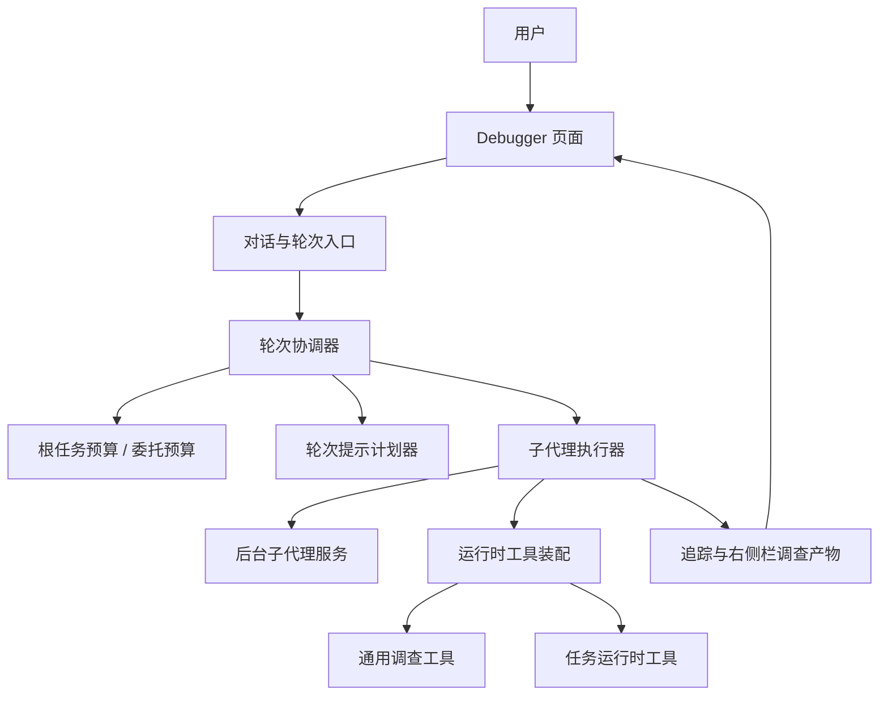

**图表来源**
- [TurnCoordinator.ts](file://src/src/main/workflow/debugger/TurnCoordinator.ts)
- [AgentOrchestrator.deps.ts](file://src/src/main/workflow/debugger/AgentOrchestrator.deps.ts)
- [TaskRootBudget.ts](file://src/src/main/workflow/debugger/TaskRootBudget.ts)
- [DelegationBudget.ts](file://src/src/main/workflow/debugger/DelegationBudget.ts)
- [SubagentRunner.ts](file://src/src/main/workflow/debugger/SubagentRunner.ts)
- [BackgroundSubagentService.ts](file://src/src/main/workflow/debugger/BackgroundSubagentService.ts)
- [RuntimeToolAssembly.ts](file://src/src/main/workflow/debugger/RuntimeToolAssembly.ts)
- [InvestigationTools.ts](file://src/src/main/investigation/InvestigationTools.ts)
- [rightRailInvestigationArtifacts.ts](file://src/src/main/agent-trace/rightRailInvestigationArtifacts.ts)
- [DebuggerPage.tsx](file://src/src/renderer/features/transcript/DebuggerPage.tsx)

**章节来源**
- [vertical-debugger-overview.md](file://docs/product/docs/product/vertical-debugger-overview.md)
- [DebuggerPage.tsx](file://src/src/renderer/features/transcript/DebuggerPage.tsx)

## 核心设计理念
Debugger 调查方法强调以下设计原则：

1. **问题驱动**：入口是用户报告的具体现象，例如渲染异常、卡顿、资源泄漏。
2. **假设驱动**：每轮调查提出一个或多个可证伪假设，而不是盲目尝试。
3. **证据优先**：工具调用的目标是获取可重复观察的证据，包括日志、状态快照、抓包数据、文件内容等。
4. **范围收敛**：通过否定无效路径、确认关键条件，逐步缩小根因范围。
5. **结论可验证**：最终结论应能转化为 claim，即可以被复现、测试或人工复核的断言。
6. **预算可控**：所有调查步骤受指令、工具调用、子任务数量等预算约束，避免陷入无界推理。
7. **可审计轨迹**：调查过程被记录为追踪事件，并映射到右侧栏的调查产物视图。

这些理念使 Debugger 区别于一般问答式 Agent：它更像一名有方法论的工程师，而不是只回答问题的聊天机器人。

**章节来源**
- [vertical-debugger-overview.md](file://docs/product/docs/product/vertical-debugger-overview.md)
- [rightRailInvestigationArtifacts.ts](file://src/src/main/agent-trace/rightRailInvestigationArtifacts.ts)

## 系统架构总览
下图展示了 Debugger 在工作流中的整体位置：用户通过渲染端 Debugger 页面提交问题，对话系统将其交给轮次协调器；协调器结合预算管理器生成轮次计划，并决定是否需要委派给子代理；子代理通过运行时工具装配器获得 RDC、文件、Shell 等能力；调查结果沉淀为证据和结论，并在右侧栏中呈现。

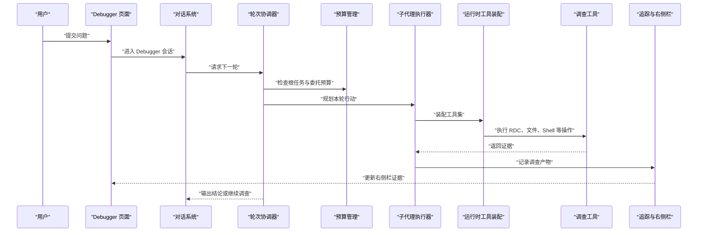

**图表来源**
- [TurnCoordinator.ts](file://src/src/main/workflow/debugger/TurnCoordinator.ts)
- [SubagentRunner.ts](file://src/src/main/workflow/debugger/SubagentRunner.ts)
- [RuntimeToolAssembly.ts](file://src/src/main/workflow/debugger/RuntimeToolAssembly.ts)
- [InvestigationTools.ts](file://src/src/main/investigation/InvestigationTools.ts)
- [rightRailInvestigationArtifacts.ts](file://src/src/main/agent-trace/rightRailInvestigationArtifacts.ts)
- [DebuggerPage.tsx](file://src/src/renderer/features/transcript/DebuggerPage.tsx)

## 关键组件详解

### 轮次协调器：TurnCoordinator
TurnCoordinator 是 Debugger 工作流的调度中心。它的主要职责包括：

- 接收当前轮次的上下文和用户问题。
- 判断是否已经形成足够证据来结束调查。
- 决定是否委派子代理进行专项调查。
- 将本轮计划传递给执行层。
- 维护调查状态，确保每一步都有可解释的目的。

TurnCoordinator 并不直接执行底层工具调用，而是把“做什么”和“为什么做”交给子代理和工具装配层。这种分离让调查逻辑更清晰，也便于对调查行为进行审计和限制。

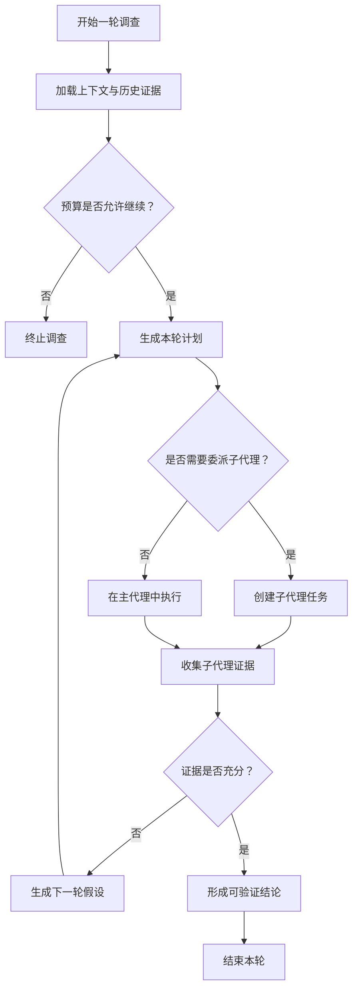

**图表来源**
- [TurnCoordinator.ts](file://src/src/main/workflow/debugger/TurnCoordinator.ts)

**章节来源**
- [TurnCoordinator.ts](file://src/src/main/workflow/debugger/TurnCoordinator.ts)

### 代理编排依赖：AgentOrchestrator.deps
AgentOrchestrator 相关依赖文件负责把 Debugger 的核心组件组装起来。它通常包含：

- 轮次协调器的构造方式。
- 预算管理器注入。
- 子代理执行器注入。
- 工具装配器和调查工具的注册。
- 追踪和右侧栏产物的连接。

这种依赖注入方式让 Debugger 可以灵活替换预算策略、工具集和追踪后端，同时保持工作流语义不变。

**章节来源**
- [AgentOrchestrator.deps.ts](file://src/src/main/workflow/debugger/AgentOrchestrator.deps.ts)

### 预算控制：TaskRootBudget 与 DelegationBudget
Debugger 使用双层预算模型：

- **根任务预算**：保护整个调查会话不被无限消耗。
- **委托预算**：保护每个子代理任务不被过度扩展。

预算维度通常包括指令数、工具调用次数、时间、费用等（具体维度由实现和运行环境决定）。当任一预算耗尽时，调查应停止或降级为保守模式，而不是继续冒险尝试。

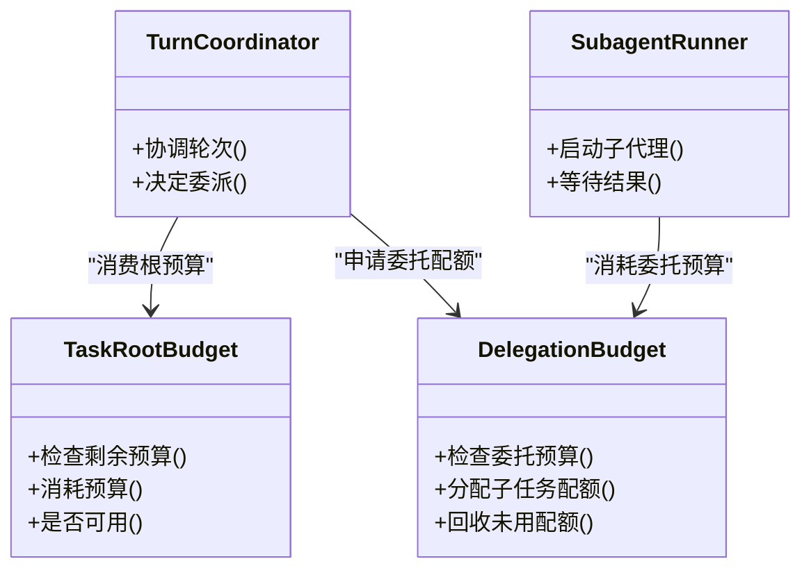

**图表来源**
- [TaskRootBudget.ts](file://src/src/main/workflow/debugger/TaskRootBudget.ts)
- [DelegationBudget.ts](file://src/src/main/workflow/debugger/DelegationBudget.ts)
- [TurnCoordinator.ts](file://src/src/main/workflow/debugger/TurnCoordinator.ts)
- [SubagentRunner.ts](file://src/src/main/workflow/debugger/SubagentRunner.ts)

**章节来源**
- [TaskRootBudget.ts](file://src/src/main/workflow/debugger/TaskRootBudget.ts)
- [DelegationBudget.ts](file://src/src/main/workflow/debugger/DelegationBudget.ts)

### 子代理执行器：SubagentRunner 与 BackgroundSubagentService
SubagentRunner 负责启动、监控和回收子代理任务。BackgroundSubagentService 则承担后台执行、资源隔离和生命周期管理职责。两者的分工是：

- SubagentRunner 关注“任务编排”：何时启动、何时等待、如何处理结果。
- BackgroundSubagentService 关注“执行环境”：如何安全地运行子代理、如何管理并发、如何上报状态。

这种分离有利于在 GPU 调试场景中并行执行多个独立调查任务，例如同时检查渲染管线、驱动日志、内存占用和磁盘 IO。

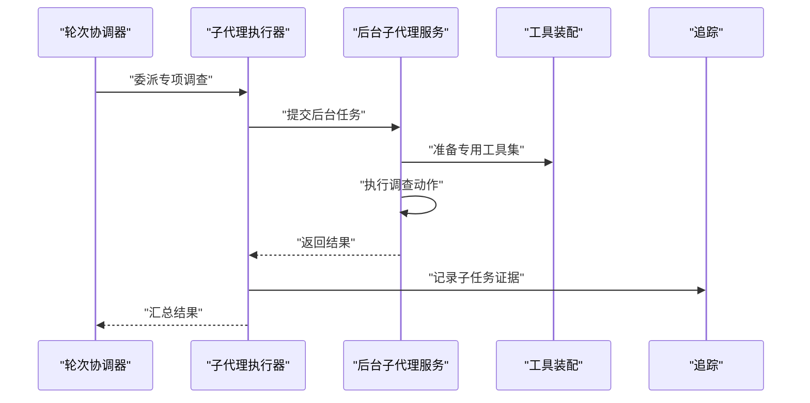

**图表来源**
- [SubagentRunner.ts](file://src/src/main/workflow/debugger/SubagentRunner.ts)
- [BackgroundSubagentService.ts](file://src/src/main/workflow/debugger/BackgroundSubagentService.ts)
- [RuntimeToolAssembly.ts](file://src/src/main/workflow/debugger/RuntimeToolAssembly.ts)

**章节来源**
- [SubagentRunner.ts](file://src/src/main/workflow/debugger/SubagentRunner.ts)
- [BackgroundSubagentService.ts](file://src/src/main/workflow/debugger/BackgroundSubagentService.ts)

### 运行时工具装配：RuntimeToolAssembly 与 TaskRuntimeTools
Debugger 的工具装配策略不是静态暴露所有能力，而是按调查阶段装配最小必要工具集：

- **RDC 诊断工具**：用于查询图形 API 状态、捕获帧、检查着色器、渲染对象、内存和资源。
- **文件读取工具**：用于读取配置文件、日志、转储、Shader 源码、纹理文件。
- **Shell 命令工具**：用于运行系统命令、查询进程、检查驱动信息、抓取堆栈。
- **通用调查工具**：用于整理证据、生成摘要、对比差异、标记关键发现。

TaskRuntimeTools 提供任务运行时可用的基础工具能力，而 RuntimeToolAssembly 根据当前调查目标选择并包装这些工具。

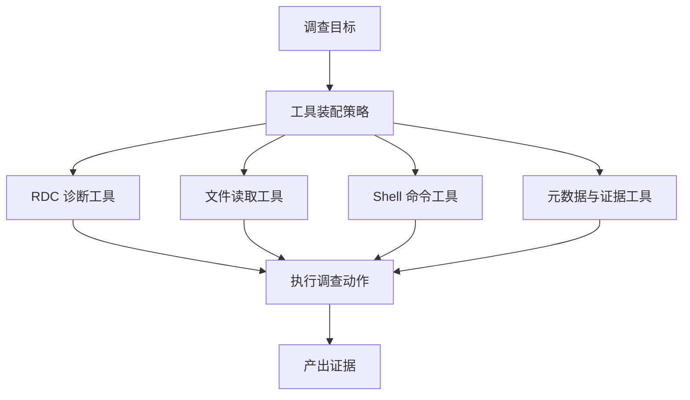

**图表来源**
- [RuntimeToolAssembly.ts](file://src/src/main/workflow/debugger/RuntimeToolAssembly.ts)
- [TaskRuntimeTools.ts](file://src/src/main/workflow/debugger/TaskRuntimeTools.ts)
- [ToolExecutorFactory.ts](file://src/src/main/workflow/debugger/ToolExecutorFactory.ts)

**章节来源**
- [RuntimeToolAssembly.ts](file://src/src/main/workflow/debugger/RuntimeToolAssembly.ts)
- [TaskRuntimeTools.ts](file://src/src/main/workflow/debugger/TaskRuntimeTools.ts)
- [ToolExecutorFactory.ts](file://src/src/main/workflow/debugger/ToolExecutorFactory.ts)

### 轮次提示计划：PromptPlanForTurn
PromptPlanForTurn 负责把当前上下文、历史证据、预算状态和调查目标转化为下一轮的提示计划。它的重点不是替 AI 做决定，而是帮助 AI 做出“更可解释、更可审计”的决定。典型输入包括：

- 用户原始问题。
- 已确认事实。
- 待验证假设。
- 尚未获取的关键证据。
- 剩余预算。
- 上一轮失败或不确定的步骤。

输出通常是下一步要执行的工具序列或子任务清单，而不是模糊的“继续探索”。

**章节来源**
- [PromptPlanForTurn.ts](file://src/src/main/workflow/debugger/PromptPlanForTurn.ts)

### 通用调查工具：InvestigationTools
InvestigationTools 提供跨 Agent 的通用调查能力，例如：

- 整理已有证据。
- 生成结构化摘要。
- 标记高风险路径。
- 对比不同时间点状态。
- 将碎片化信息整合为结论草稿。

这些工具不一定直接访问系统，但能把 Debugger 产生的原始数据转化为人类可读、机器可校验的结构。

**章节来源**
- [InvestigationTools.ts](file://src/src/main/investigation/InvestigationTools.ts)

## 证据类型与可验证断言
Debugger 产出的证据应当满足三个标准：**可获取、可复现、可关联**。常见证据类型包括：

| 证据类别 | 示例 | 用途 | 可验证性 |
|---|---|---|---|
| 系统状态 | 进程列表、驱动版本、GPU 型号 | 排除环境问题 | 高 |
| 图形状态 | RDC 捕获、API 调用顺序、资源引用 | 定位渲染异常 | 高 |
| 日志文本 | 应用日志、驱动日志、调试输出 | 定位错误触发点 | 中到高 |
| 文件内容 | Shader 源码、配置文件、纹理 | 确认输入是否正确 | 高 |
| 性能指标 | 帧耗时、CPU/GPU 利用率、内存峰值 | 定位性能瓶颈 | 中到高 |
| 网络与 IPC | 远程调用、IPC 消息 | 定位跨进程问题 | 中 |
| 结论草稿 | 假设、根因、修复建议 | 指导后续修复 | 需要人工复核 |

结论形式应转化为 **claim**，即一段明确的断言，例如：

- “某渲染异常由特定绘制调用引起。”
- “某性能瓶颈来自高频资源重建。”
- “某资源泄漏由未释放句柄导致。”
- “某崩溃发生在驱动层，与应用无关。”

每个 claim 都应附带证据链：数据来源、采集方式、复现步骤、不确定性说明。

**章节来源**
- [rightRailInvestigationArtifacts.ts](file://src/src/main/agent-trace/rightRailInvestigationArtifacts.ts)

## GPU 调试案例

### 渲染异常排查流程
典型场景：屏幕出现花屏、黑块、错位或着色器闪烁。

1. **确认环境**：检查 GPU 驱动、显卡型号、操作系统版本。
2. **缩小范围**：判断是全屏问题还是局部绘制问题，是否与特定窗口或控件有关。
3. **捕获图形状态**：使用 RDC 工具抓取异常帧，检查绘制调用顺序、纹理绑定、渲染目标。
4. **检查着色器**：读取相关 Shader 源码，确认编译状态、变体、常量值。
5. **验证资源**：检查纹理、缓冲区是否有效，尺寸、格式、采样方式是否符合预期。
6. **形成 claim**：例如“该花屏由某个纹理格式不匹配导致”。

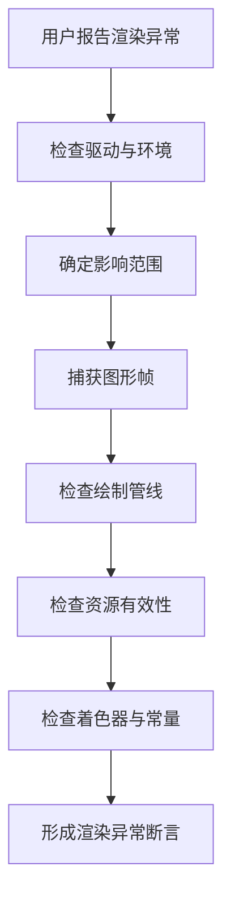

**图表来源**
- [TaskRuntimeTools.ts](file://src/src/main/workflow/debugger/TaskRuntimeTools.ts)
- [RuntimeToolAssembly.ts](file://src/src/main/workflow/debugger/RuntimeToolAssembly.ts)

### 性能瓶颈排查流程
典型场景：界面卡顿、帧率下降、GPU 占用过高。

1. **确认指标**：查看帧时间、CPU/GPU 利用率、内存增长趋势。
2. **区分阶段**：判断瓶颈在 CPU 侧、GPU 侧、IO 侧还是同步等待。
3. **定位热点**：通过性能数据找到耗时最高的绘制批次、计算任务或资源上传。
4. **验证原因**：检查是否频繁重建资源、重复编译 Shader、过多状态切换。
5. **形成 claim**：例如“性能瓶颈来自每帧重建纹理”。

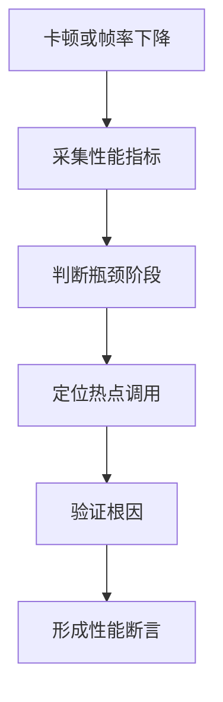

**图表来源**
- [TaskRuntimeTools.ts](file://src/src/main/workflow/debugger/TaskRuntimeTools.ts)
- [TaskRuntimeBudgetView.ts](file://src/src/main/workflow/debugger/TaskRuntimeBudgetView.ts)

### 资源泄漏排查流程
典型场景：长时间运行后内存上涨、句柄泄漏、GPU 内存持续增长。

1. **建立基线**：记录初始资源数量和内存占用。
2. **对比快照**：在不同时间点抓取资源快照或对象图。
3. **查找增长项**：比较两次快照，找出持续增长的资源类型。
4. **追踪引用**：检查谁创建、谁持有、谁释放。
5. **形成 claim**：例如“某资源泄漏由未关闭的渲染对象导致”。

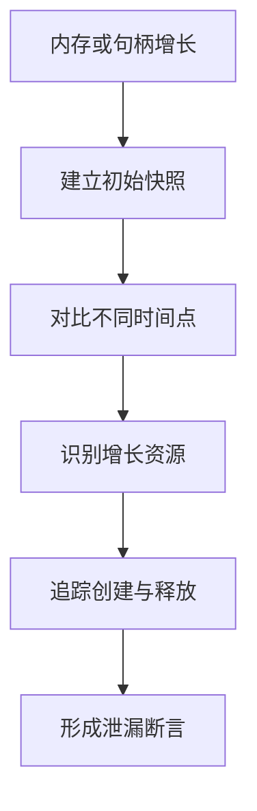

**图表来源**
- [TaskRuntimeTools.ts](file://src/src/main/workflow/debugger/TaskRuntimeTools.ts)
- [InvestigationTools.ts](file://src/src/main/investigation/InvestigationTools.ts)

## 与其他调查方法的差异
Debugger 调查方法与其他 Agent 工作方式的区别主要体现在：

| 维度 | Debugger 调查方法 | 一般问答型 Agent | 代码修复型 Agent |
|---|---|---|---|
| 目标 | 定位根因并形成可验证结论 | 回答问题或完成任务 | 直接生成修复代码 |
| 证据要求 | 强证据驱动 | 弱证据驱动 | 中等证据驱动 |
| 工具使用 | 组合 RDC、文件、Shell | 可能仅调用有限工具 | 主要读写代码 |
| 输出形式 | 证据链、假设、claim | 自然语言答案 | 代码变更 |
| 风险控制 | 严格预算与委派控制 | 风险较低 | 风险集中在修改范围 |
| 适用场景 | GPU 调试、系统问题、复杂根因分析 | 知识查询、简单任务 | 已知缺陷修复 |

因此，Debugger 更适合以下场景：

- 问题边界模糊，需要先收集证据。
- 需要跨进程、跨设备、跨系统层定位。
- 结论必须可复现、可审计。
- 修复方案尚不明确，但根因方向可推断。

**章节来源**
- [vertical-debugger-overview.md](file://docs/product/docs/product/vertical-debugger-overview.md)

## 依赖关系分析
Debugger 内部组件之间的耦合如下：

- TurnCoordinator 依赖预算管理和子代理执行器。
- SubagentRunner 依赖后台服务和工具装配。
- RuntimeToolAssembly 依赖具体调查工具和工具执行工厂。
- 所有执行结果通过追踪系统投影到右侧栏。
- 渲染端 Debugger 页面作为用户入口，不直接参与底层工具调用。

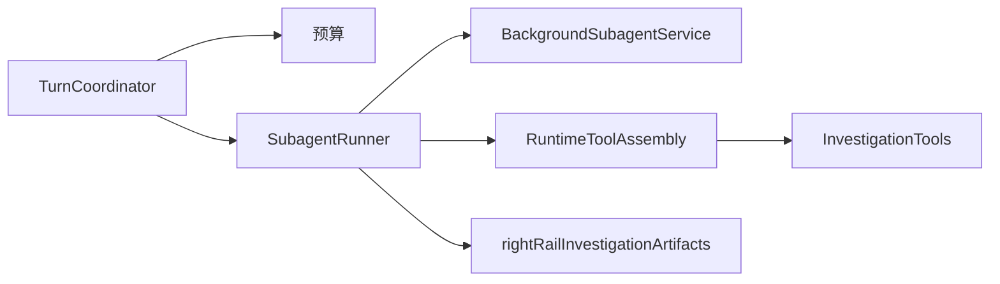

**图表来源**
- [TurnCoordinator.ts](file://src/src/main/workflow/debugger/TurnCoordinator.ts)
- [SubagentRunner.ts](file://src/src/main/workflow/debugger/SubagentRunner.ts)
- [BackgroundSubagentService.ts](file://src/src/main/workflow/debugger/BackgroundSubagentService.ts)
- [RuntimeToolAssembly.ts](file://src/src/main/workflow/debugger/RuntimeToolAssembly.ts)
- [InvestigationTools.ts](file://src/src/main/investigation/InvestigationTools.ts)
- [rightRailInvestigationArtifacts.ts](file://src/src/main/agent-trace/rightRailInvestigationArtifacts.ts)

**章节来源**
- [AgentOrchestrator.deps.ts](file://src/src/main/workflow/debugger/AgentOrchestrator.deps.ts)

## 性能与预算约束
Debugger 必须在“充分调查”和“资源消耗”之间取得平衡。预算机制的作用包括：

- 防止单轮调查无限循环。
- 防止子代理爆炸式扩散。
- 控制 LLM 指令数和工具调用次数。
- 避免长时间阻塞前台交互。
- 在证据不足时主动降级，而不是硬猜结论。

TaskRuntimeBudgetView 提供预算可视化的支撑能力，让用户看到调查还在消耗多少资源、还剩多少空间。

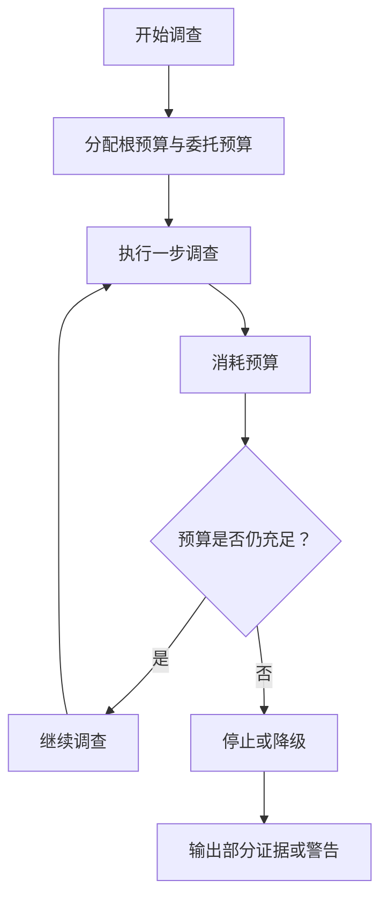

**图表来源**
- [TaskRootBudget.ts](file://src/src/main/workflow/debugger/TaskRootBudget.ts)
- [DelegationBudget.ts](file://src/src/main/workflow/debugger/DelegationBudget.ts)
- [TaskRuntimeBudgetView.ts](file://src/src/main/workflow/debugger/TaskRuntimeBudgetView.ts)

**章节来源**
- [TaskRootBudget.ts](file://src/src/main/workflow/debugger/TaskRootBudget.ts)
- [DelegationBudget.ts](file://src/src/main/workflow/debugger/DelegationBudget.ts)
- [TaskRuntimeBudgetView.ts](file://src/src/main/workflow/debugger/TaskRuntimeBudgetView.ts)
- [DebuggerRuntimePolicy.test.ts](file://src/src/main/workflow/debugger/DebuggerRuntimePolicy.test.ts)

## 配置选项与扩展点
可以从以下几个层面理解 Debugger 的配置与扩展：

1. **Agent 定义**：共享常量中定义了内置 Agent 标识，Debugger 通常对应特定的 Agent 角色。
2. **工具能力校验**：脚本会检查 Agent 工具能力契约，确保 Debugger 可用的工具集合符合预期。
3. **运行时策略**：Debugger 运行时策略可通过测试或配置调整，例如是否允许某些高危工具、是否启用后台子代理。
4. **预算参数**：根预算和委托预算可通过配置调整，以适配不同复杂度的问题。
5. **工具装配扩展**：可在 RuntimeToolAssembly 或 TaskRuntimeTools 中增加新的诊断能力，例如新增 RDC 接口、日志解析器或性能聚合器。
6. **追踪与右侧栏**：通过 rightRailInvestigationArtifacts 扩展证据展示形态，例如新增 GPU 资源视图或性能趋势图。

实际使用中，不建议直接绕过预算或工具策略。若需要扩展，应优先新增专用工具，再由 RuntimeToolAssembly 按需装配。

**章节来源**
- [agents.ts](file://src/shared/constants/agents.ts)
- [check-agent-tool-capability.mjs](file://scripts/check-agent-tool-capability.mjs)
- [DebuggerRuntimePolicy.test.ts](file://src/src/main/workflow/debugger/DebuggerRuntimePolicy.test.ts)
- [RuntimeToolAssembly.ts](file://src/src/main/workflow/debugger/RuntimeToolAssembly.ts)
- [rightRailInvestigationArtifacts.ts](file://src/src/main/agent-trace/rightRailInvestigationArtifacts.ts)

## 故障排查指南
在使用 Debugger 调查方法时，常见问题包括：

| 问题 | 可能原因 | 排查建议 |
|---|---|---|
| 调查过早结束 | 预算不足或证据阈值过高 | 检查根预算和委托预算，适当放宽或拆分任务 |
| 子代理过多 | 委派策略过于激进 | 限制并发子任务数量，提高委派门槛 |
| 工具不可用 | 工具装配策略未包含所需能力 | 检查 RuntimeToolAssembly 和 TaskRuntimeTools 的配置 |
| 结论不可复现 | 缺少关键证据或环境差异 | 补充系统状态、驱动版本、复现步骤 |
| 右侧栏没有证据 | 追踪或产物映射未生效 | 检查 rightRailInvestigationArtifacts 和相关投影逻辑 |
| 渲染端无 Debugger 入口 | 页面路由或配置未启用 | 检查 DebuggerPage 及其所在功能开关 |

推荐排查顺序：

1. 先看预算是否耗尽。
2. 再看工具是否被正确装配。
3. 然后检查子代理是否成功执行。
4. 最后确认追踪产物是否写入并投影到右侧栏。

**章节来源**
- [TaskRootBudget.ts](file://src/src/main/workflow/debugger/TaskRootBudget.ts)
- [DelegationBudget.ts](file://src/src/main/workflow/debugger/DelegationBudget.ts)
- [RuntimeToolAssembly.ts](file://src/src/main/workflow/debugger/RuntimeToolAssembly.ts)
- [SubagentRunner.ts](file://src/src/main/workflow/debugger/SubagentRunner.ts)
- [rightRailInvestigationArtifacts.ts](file://src/src/main/agent-trace/rightRailInvestigationArtifacts.ts)
- [DebuggerPage.tsx](file://src/src/renderer/features/transcript/DebuggerPage.tsx)

## 结论
Debugger 调查方法是一套面向根因分析的调查协议。它通过 TurnCoordinator 组织轮次，通过预算机制控制风险，通过工具装配策略组合 RDC、文件和 Shell 能力，通过证据沉淀和右侧栏投影让调查过程透明可审计。最终目标不是快速给出答案，而是形成可验证的 claim，使修复工作建立在可靠证据之上。

对于 GPU 相关问题，Debugger 特别适合处理渲染异常、性能瓶颈和资源泄漏等复杂场景；而对于简单问答或明确修复任务，其他 Agent 模式可能更高效。正确选择调查方法，是构建高质量智能体工作流的关键。