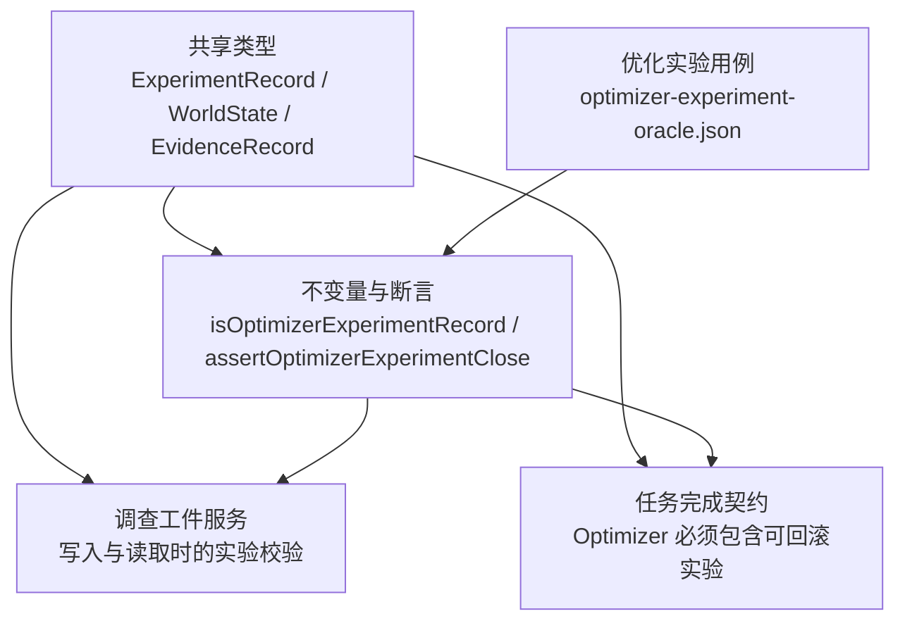
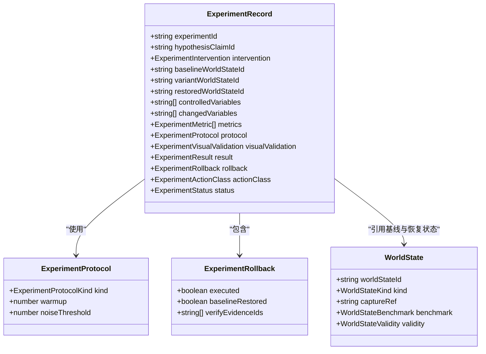
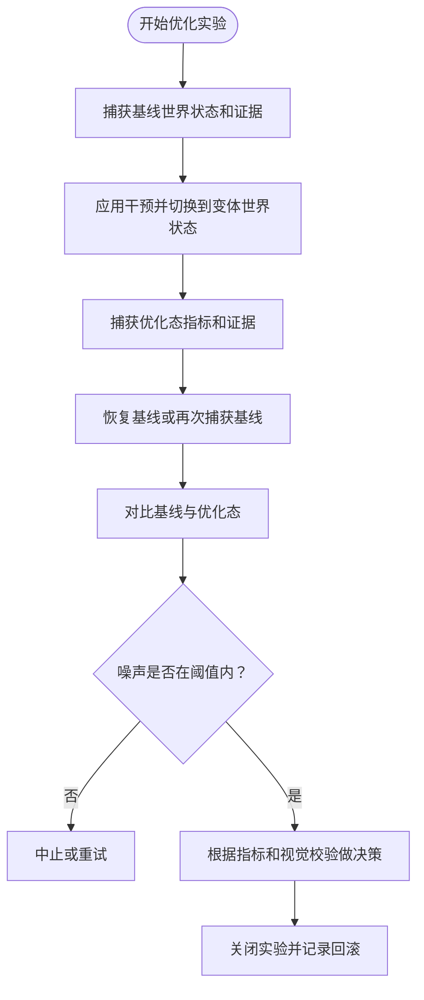
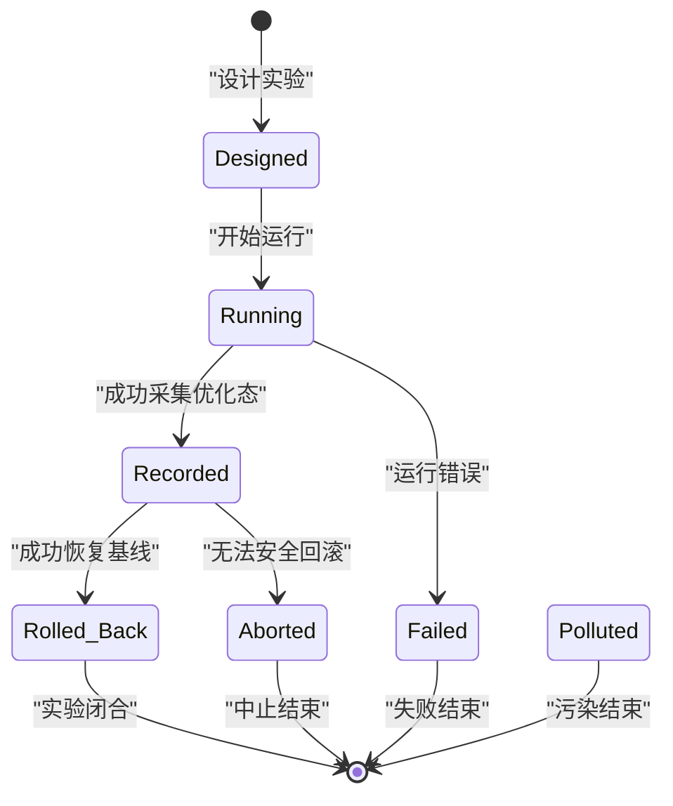
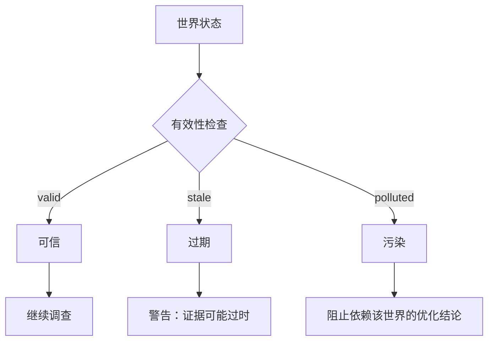
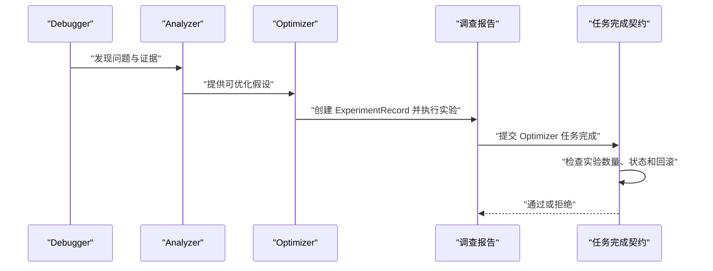
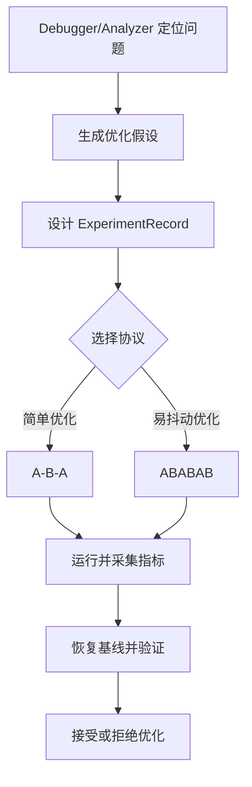

# Optimizer 调查方法

<cite>
**本文引用的文件**   
- [renderdocInvestigation.ts](file://src/shared/types/renderdocInvestigation.ts)
- [investigationInvariants.ts](file://src/main/investigation/investigationInvariants.ts)
- [missionCompletionContract.ts](file://src/main/investigation/missionCompletionContract.ts)
- [InvestigationArtifactService.ts](file://src/main/investigation/InvestigationArtifactService.ts)
- [optimizer-experiment-oracle.json](file://src/main/investigation/__fixtures__/optimizer-experiment-oracle.json)
</cite>

## 目录
1. [引言](#引言)
2. [项目结构与定位](#项目结构与定位)
3. [核心数据模型：ExperimentRecord](#核心数据模型experimentrecord)
4. [实验协议与优化流程](#实验协议与优化流程)
5. [实验状态机](#实验状态机)
6. [Optimizer 风险评估机制](#optimizer-风险评估机制)
7. [与 Debugger、Analyzer 的协作模式](#与-debuggeranalyzer-的协作模式)
8. [性能优化案例](#性能优化案例)
9. [配置、监控与结果分析指南](#配置监控与结果分析指南)
10. [故障排查](#故障排查)
11. [结论](#结论)

## 引言
Optimizer 调查方法是 RenderDoc 垂直调查体系中的“可回滚优化”能力。它把一次优化假设建模为一个可验证、可撤销、可审计的实验，而不是简单提交代码改动后直接观察现象。其核心思想是：

- 用 **ExperimentRecord** 记录一次优化的完整上下文：基线世界状态、干预手段、受控变量、变更变量、指标、协议、可视化校验、执行证据、回滚结果和最终状态。
- 通过 **A-B-A** 或 **ABABAB** 两种实验协议控制噪声、隔离副作用并支持安全回滚。
- 将优化结论绑定到已关闭的实验上；只有满足回滚约束的实验才能进入报告或被接受为优化依据。
- 与其他调查方法（Debugger、Analyzer）共享世界状态、证据、主张和任务边界，使“发现问题—设计优化—验证效果—回滚风险”形成闭环。

## 项目结构与定位
Optimizer 相关逻辑主要分布在以下位置：

| 路径 | 职责 |
|---|---|
| `src/shared/types/renderdocInvestigation.ts` | 定义 ExperimentRecord、ExperimentProtocol、ExperimentStatus、WorldState、EvidenceRecord、InvestigationReport 等共享类型 |
| `src/main/investigation/investigationInvariants.ts` | 实现 Optimizer 实验识别、关闭约束、引用完整性等不变量断言 |
| `src/main/investigation/missionCompletionContract.ts` | 在 Mission 完成阶段强制要求 Optimizer 必须包含可证伪且带回滚的实验 |
| `src/main/investigation/InvestigationArtifactService.ts` | 在写入、读取、证明时调用优化实验关闭断言，确保实验一致性 |
| `src/main/investigation/__fixtures__/optimizer-experiment-oracle.json` | 提供 A-B-A 优化实验的正确与非法关闭用例 |

**图表来源**
- [renderdocInvestigation.ts:200-470](file://src/shared/types/renderdocInvestigation.ts#L200-L470)
- [investigationInvariants.ts:25-34](file://src/main/investigation/investigationInvariants.ts#L25-L34)
- [investigationInvariants.ts:204-227](file://src/main/investigation/investigationInvariants.ts#L204-L227)
- [missionCompletionContract.ts:248-277](file://src/main/investigation/missionCompletionContract.ts#L248-L277)
- [InvestigationArtifactService.ts:486-492](file://src/main/investigation/InvestigationArtifactService.ts#L486-L492)
- [optimizer-experiment-oracle.json:1-35](file://src/main/investigation/__fixtures__/optimizer-experiment-oracle.json#L1-L35)

**章节来源**
- [renderdocInvestigation.ts:200-470](file://src/shared/types/renderdocInvestigation.ts#L200-L470)
- [investigationInvariants.ts:25-34](file://src/main/investigation/investigationInvariants.ts#L25-L34)
- [missionCompletionContract.ts:248-277](file://src/main/investigation/missionCompletionContract.ts#L248-L277)
- [InvestigationArtifactService.ts:486-492](file://src/main/investigation/InvestigationArtifactService.ts#L486-L492)
- [optimizer-experiment-oracle.json:1-35](file://src/main/investigation/__fixtures__/optimizer-experiment-oracle.json#L1-L35)

## 核心数据模型：ExperimentRecord
ExperimentRecord 是 Optimizer 调查的核心记录对象。它不是简单的“修改前/修改后对比”，而是对一次优化假设的结构化描述。

### 关键字段语义

| 字段 | 含义 | 优化意义 |
|---|---|---|
| `experimentId` | 实验唯一标识 | 用于声明式引用、审计和回滚追踪 |
| `hypothesisClaimId` | 关联的假设主张 | 说明这次优化要验证什么 |
| `intervention` | 干预措施，含 `type` 和 `payload` | 明确“改了什么”，例如着色器替换、管线参数调整 |
| `baselineWorldStateId` | 基线世界状态 | 原始运行环境快照 |
| `variantWorldStateId` | 优化版本世界状态 | 应用干预后的运行环境快照 |
| `restoredWorldStateId` | 恢复后的世界状态 | 回滚后应回到基线 |
| `controlledVariables` | 受控变量列表 | 控制变量法中保持不变的维度 |
| `changedVariables` | 变更变量列表 | 本次优化真正改变的维度 |
| `metrics` | 指标数组 | 用于判断优化是否有效 |
| `protocol` | 实验协议，含 `kind`、`warmup`、`noiseThreshold` | 决定 A-B-A 或 ABABAB 流程 |
| `visualValidation` | 可选视觉校验 | 适用于渲染差异、截图比对等场景 |
| `result` | 可选结果摘要与是否接受 | 人类或自动评审结论 |
| `rollback` | 回滚记录 | 是否执行、是否恢复基线、哪些证据用于验证 |
| `actionClass` | 可选动作类别 C/R/E | 标记实验类型 |
| `status` | 实验状态 | designed / running / recorded / rolled_back / failed / aborted / polluted |

**图表来源**
- [renderdocInvestigation.ts:200-470](file://src/shared/types/renderdocInvestigation.ts#L200-L470)

**章节来源**
- [renderdocInvestigation.ts:200-470](file://src/shared/types/renderdocInvestigation.ts#L200-L470)

## 实验协议与优化流程
Optimizer 通过协议控制实验节奏，避免把偶发噪声误判为优化收益。

### A-B-A 协议
A-B-A 是基础的可回滚优化协议：

1. **第一个 A（基线捕获）**：在当前世界状态下采集基线指标、证据和世界状态。
2. **B（优化干预）**：应用干预，切换到变体世界状态，采集优化指标和证据。
3. **第二个 A（再次基线捕获）**：恢复基线或重新采集基线，确认系统回到预期状态。
4. **对比与决策**：比较 B 与前后两个 A，结合指标、视觉校验和噪声阈值判断优化是否有效。
5. **关闭实验**：将状态设为 `recorded` 或 `rolled_back`，并确保回滚信息完整。

适用场景：
- 单次优化假设验证。
- 希望快速判断“优化是否显著”。
- 需要保证可回滚，避免污染后续工作区。

### ABABAB 协议
ABABAB 是在 A-B-A 基础上引入更多交替采样，用于降低短期波动影响：

1. A1 → B1 → A2 → B2 → A3 → B3。
2. 多次交替采样基线和优化态。
3. 使用 `warmup` 和 `noiseThreshold` 过滤启动噪声和随机波动。
4. 如果整体趋势稳定显示优化有效，则接受；否则拒绝或继续迭代。

适用场景：
- 时序敏感的性能优化，如帧时间、吞吐、内存峰值。
- 存在抖动或间歇性问题的渲染管线调优。
- 需要更强统计稳健性的优化。

### 控制变量法在 Optimizer 中的体现
Optimizer 并不只是“改一个地方然后看结果”，而是显式区分：

- `controlledVariables`：保持不变的维度，例如驱动、设备、分辨率、采样策略、事件范围。
- `changedVariables`：本次只改变的一个或一组变量，例如某个着色器替换、某个资源加载策略。
- `benchmark`：世界状态中的基准配置，包括预热、分辨率、VSync、采样协议。
- `visualValidation`：当数值指标不足以说明问题时，补充截图、差异图或像素历史。

**图表来源**
- [renderdocInvestigation.ts:200-470](file://src/shared/types/renderdocInvestigation.ts#L200-L470)

**章节来源**
- [renderdocInvestigation.ts:200-470](file://src/shared/types/renderdocInvestigation.ts#L200-L470)

## 实验状态机
ExperimentStatus 定义了 Optimizer 实验的完整生命周期：

| 状态 | 含义 | 典型转换 |
|---|---|---|
| `designed` | 实验已设计，尚未运行 | 设计完成后进入 `running` |
| `running` | 正在运行干预或采集 | 成功采集后进入 `recorded`；异常进入 `failed` |
| `recorded` | 优化态已记录，未回滚 | 可回滚后进入 `rolled_back`；确认不可逆时可能进入 `aborted` |
| `rolled_back` | 已成功恢复基线，实验闭合 | 通常不再变化 |
| `failed` | 运行失败 | 可重试或终止 |
| `aborted` | 主动中止 | 通常不再变化 |
| `polluted` | 世界状态被污染，不可信 | 需要清理、重建或重新捕获 |

**图表来源**
- [renderdocInvestigation.ts:200-470](file://src/shared/types/renderdocInvestigation.ts#L200-L470)

### 关键约束
- 只有 `recorded` 或 `rolled_back` 属于“已关闭”实验。
- 关闭的实验不能是 `intervention.type === 'none'`，因为无干预不构成可证伪优化。
- 关闭的实验必须包含完整的回滚验证信息：`executed`、`baselineRestored`、至少一条 `verifyEvidenceIds`。
- 如果世界状态标记为 `polluted` 或 `stale`，相关证据会被视为过时或不安全。

**章节来源**
- [renderdocInvestigation.ts:200-470](file://src/shared/types/renderdocInvestigation.ts#L200-L470)
- [investigationInvariants.ts:204-227](file://src/main/investigation/investigationInvariants.ts#L204-L227)

## Optimizer 风险评估机制
Optimizer 的风险评估不是事后复盘，而是在数据结构、协议和不变量层面提前约束。

### 污染检测
- 世界状态的 `validity` 可以是 `valid`、`stale`、`polluted` 或 `unknown`。
- 如果世界状态被标记为 `polluted`，相关证据会被认为不可信。
- 工具证据若被判定过时，会触发 stale 标记，防止旧证据支撑新结论。

### 副作用隔离
- 每次优化都绑定到独立的 `worldStateId`，并通过 `captureRef`、`replay`、`shaderReplacement`、`patchStack` 精确描述运行环境。
- 干预通过 `intervention.type` 和 `payload` 表达，而不是隐式全局状态。
- 基线、变体和恢复后的世界状态分别记录，便于审计。

### 安全回滚
- 回滚记录包含三个关键部分：
  - `executed`：是否实际执行了回滚。
  - `baselineRestored`：是否恢复到基线世界状态。
  - `verifyEvidenceIds`：用于验证回滚结果的证据列表。
- 任何关闭的实验都必须有有效的回滚验证；否则会被视为不合规。

**图表来源**
- [renderdocInvestigation.ts:200-470](file://src/shared/types/renderdocInvestigation.ts#L200-L470)
- [investigationInvariants.ts:175-183](file://src/main/investigation/investigationInvariants.ts#L175-L183)

**章节来源**
- [renderdocInvestigation.ts:200-470](file://src/shared/types/renderdocInvestigation.ts#L200-L470)
- [investigationInvariants.ts:175-183](file://src/main/investigation/investigationInvariants.ts#L175-L183)
- [investigationInvariants.ts:204-227](file://src/main/investigation/investigationInvariants.ts#L204-L227)

## 与 Debugger、Analyzer 的协作模式
Optimizer 不是孤立存在的。它在同一调查系统中与 Debugger、Analyzer 协同：

- **Debugger**：发现具体问题，例如渲染错位、掉帧、资源泄漏。
- **Analyzer**：解释问题结构，建立观测层、重构层、作者层的证据链。
- **Optimizer**：基于已知问题提出优化假设，并用实验验证和优化建议。

任务完成契约对 Optimizer 的要求更严格：

1. Optimizer 报告必须引用至少一个实验。
2. 每个被引用的实验必须可解析。
3. 每个实验必须处于 `recorded` 或 `rolled_back`。
4. 每个实验必须通过 `assertOptimizerExperimentClose`，即不能是无干预实验，且必须有完整回滚验证。

**图表来源**
- [missionCompletionContract.ts:248-277](file://src/main/investigation/missionCompletionContract.ts#L248-L277)
- [investigationInvariants.ts:313-327](file://src/main/investigation/investigationInvariants.ts#L313-L327)

**章节来源**
- [missionCompletionContract.ts:248-277](file://src/main/investigation/missionCompletionContract.ts#L248-L277)
- [investigationInvariants.ts:313-327](file://src/main/investigation/investigationInvariants.ts#L313-L327)

## 性能优化案例
以下内容以 Optimizer 的数据结构为依据，给出典型性能优化场景的操作方式。由于仓库未包含具体优化脚本，本节重点说明如何结构化记录这些优化，而不是提供实现细节。

### 着色器优化
- 干预类型：着色器替换。
- 基线世界状态：记录原着色器 ID 和对应捕获。
- 变体世界状态：记录替换后的着色器引用。
- 指标：SPIR-V 片段、帧时间、GPU 耗时、像素历史。
- 视觉校验：截图 before/after、diff 区域。
- 回滚：恢复原着色器引用，并使用基线证据验证画面一致。

### 内存使用优化
- 干预类型：资源加载策略、缓存策略、批处理大小。
- 受控变量：设备、驱动、渲染分辨率、场景复杂度。
- 变更变量：仅修改内存分配路径或资源复用策略。
- 指标：峰值内存、常驻内存、GC 次数、资源占用快照。
- 回滚：恢复原始资源管理行为，验证内存曲线回到基线。

### 渲染管线调优
- 干预类型：绘制批次合并、状态切换顺序、同步策略。
- 协议：建议使用 ABABAB，因为渲染性能容易受 GPU 调度、驱动热更新影响。
- 指标：帧时间分布、DrawCall 数量、命令缓冲区大小、等待时间。
- 视觉校验：像素级差异、关键 UI 元素截图。
- 回滚：恢复原始管线配置，验证渲染输出与基线一致。

**图表来源**
- [renderdocInvestigation.ts:200-470](file://src/shared/types/renderdocInvestigation.ts#L200-L470)

**章节来源**
- [renderdocInvestigation.ts:200-470](file://src/shared/types/renderdocInvestigation.ts#L200-L470)

## 配置、监控与结果分析指南

### 实验配置要点
- 明确 `intervention.type`，不要使用无意义的空干预。
- 填写 `controlledVariables`，说明哪些条件保持不变。
- 填写 `changedVariables`，说明这次优化只改变了什么。
- 设置合理的 `warmup`，排除启动开销。
- 设置合理的 `noiseThreshold`，避免把噪声当成优化收益。
- 对于渲染相关优化，优先启用 `visualValidation`。

### 监控指标建议
| 类别 | 推荐指标 |
|---|---|
| 渲染性能 | 帧时间、GPU 耗时、DrawCall、状态切换次数 |
| 资源性能 | 资源加载时间、内存峰值、资源命中/失效率 |
| 稳定性 | 崩溃率、卡顿次数、重复场景一致性 |
| 视觉质量 | 截图差异、像素误差、关键区域对比 |

### 结果分析方法
1. 先看协议：ABABAB 更适合抖动明显的场景。
2. 再看世界状态：是否使用了正确的基线和恢复状态。
3. 再看指标：是否跨越噪声阈值，是否有足够样本。
4. 再看视觉校验：数值改善但画面退化不算真正优化。
5. 最后看回滚：是否能可靠恢复基线，是否有关联证据验证。

**章节来源**
- [renderdocInvestigation.ts:200-470](file://src/shared/types/renderdocInvestigation.ts#L200-L470)

## 故障排查

### 常见错误及修复

| 问题 | 原因 | 修复方式 |
|---|---|---|
| Optimizer 报告无法完成 | 没有引用实验，或实验未关闭 | 添加至少一个 `recorded` 或 `rolled_back` 的 ExperimentRecord |
| 实验被关闭但不合法 | 干预类型为 `none`，或回滚信息不完整 | 设置真实干预，并确保 `executed`、`baselineRestored`、`verifyEvidenceIds` 有效 |
| 世界状态被污染 | 运行环境被修改且未正确恢复 | 清理环境，重新捕获基线，重新运行实验 |
| 证据与实验脱节 | 证据未关联实验或未绑定世界状态 | 将证据与 `experimentId`、`worldStateId` 对齐 |
| 报告引用实验不可解析 | 实验 ID 不存在或未被写入 | 检查实验写入流程和报告中的 `experimentIds` |

### 不变量断言的关键检查点
- 关闭实验不能是 `intervention.type === 'none'`。
- 关闭实验必须有回滚验证。
- Optimizer 报告引用的实验必须是已关闭实验。
- 世界状态为 `polluted` 的证据不应作为强证据支撑优化结论。

**章节来源**
- [investigationInvariants.ts:204-227](file://src/main/investigation/investigationInvariants.ts#L204-L227)
- [investigationInvariants.ts:313-327](file://src/main/investigation/investigationInvariants.ts#L313-L327)
- [missionCompletionContract.ts:248-277](file://src/main/investigation/missionCompletionContract.ts#L248-L277)
- [optimizer-experiment-oracle.json:1-35](file://src/main/investigation/__fixtures__/optimizer-experiment-oracle.json#L1-L35)

## 结论
Optimizer 调查方法的核心价值在于把“优化”从直觉和经验升级为可验证、可回滚、可审计的工程实践。通过 ExperimentRecord 的结构化描述、A-B-A 与 ABABAB 协议的噪声控制、世界状态与证据的隔离、以及严格的关闭断言，Optimizer 能够：

- 区分真正的优化收益与随机噪声。
- 在优化失败或副作用出现时安全回滚。
- 与 Debugger、Analyzer 形成“诊断—解释—优化”的完整链路。
- 让性能优化不仅看数字，还要看回放、证据、世界状态和回滚验证。