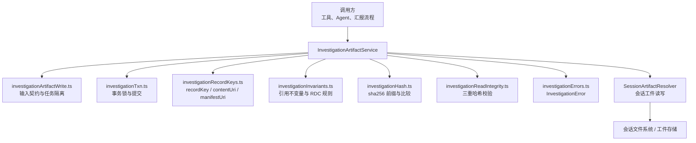
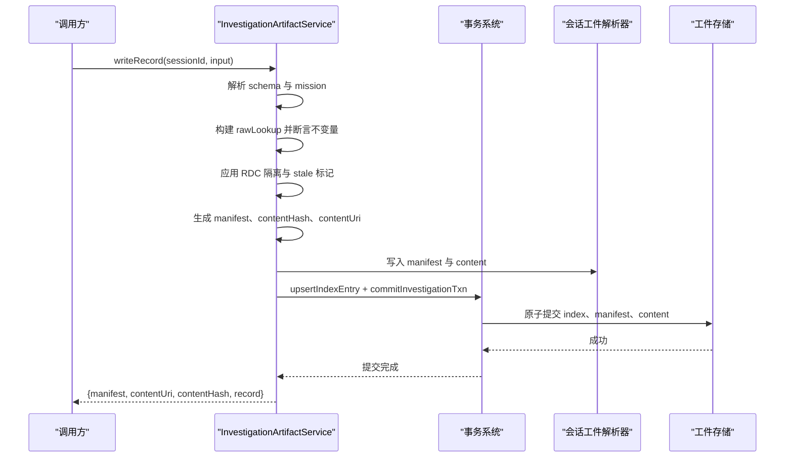
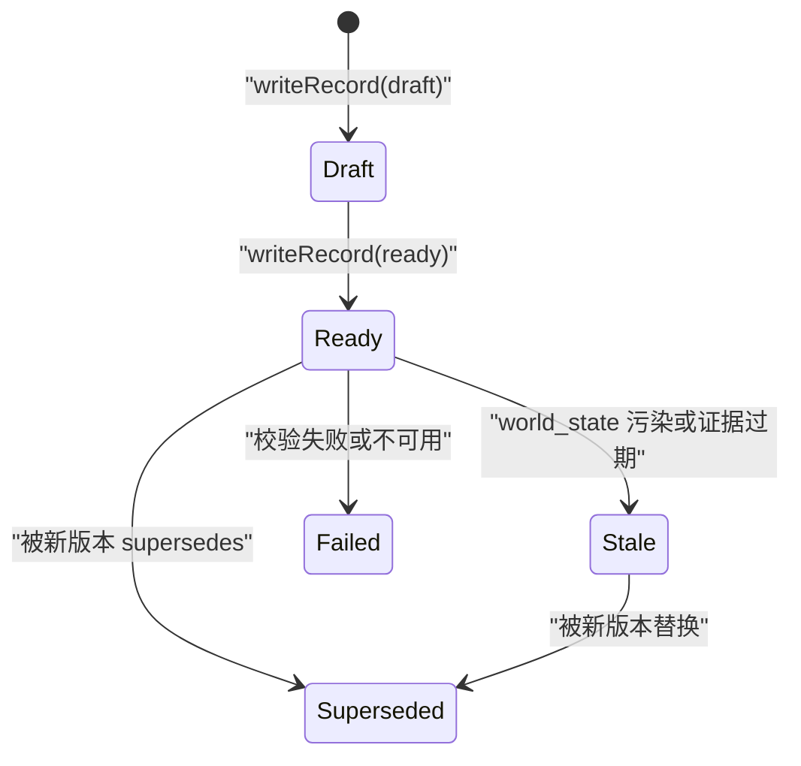
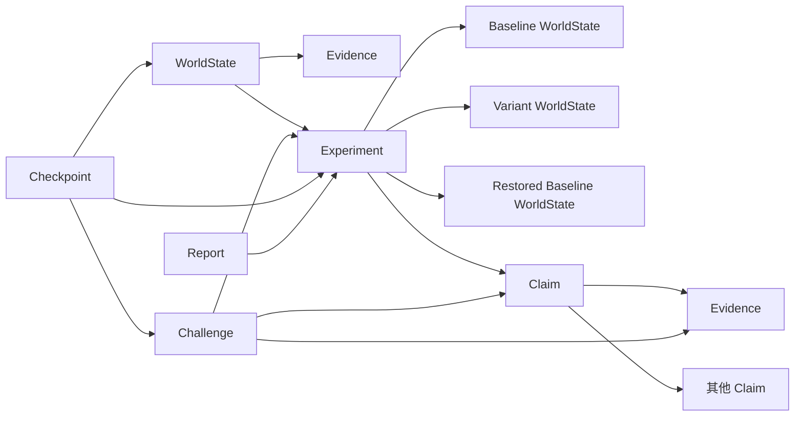
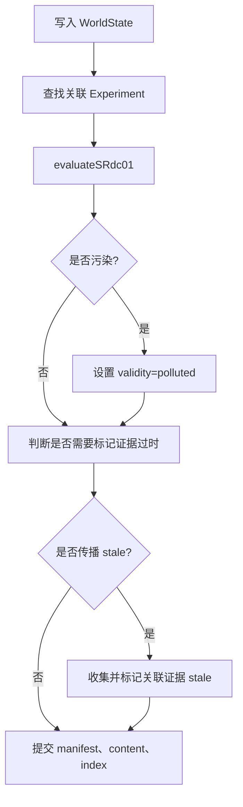
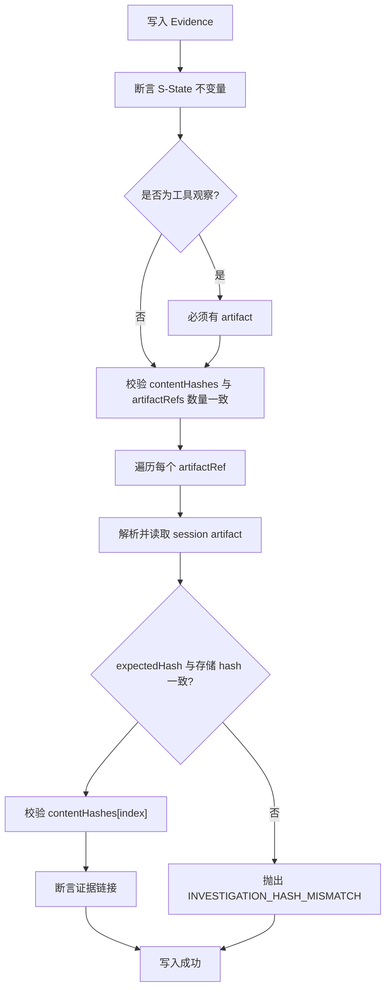
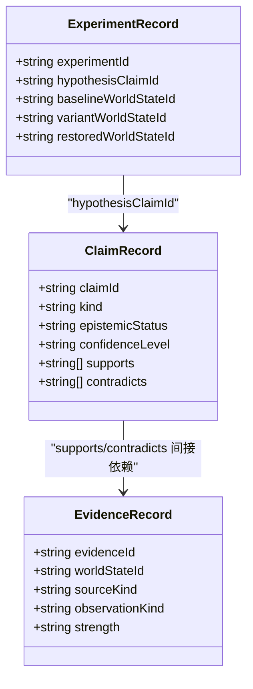
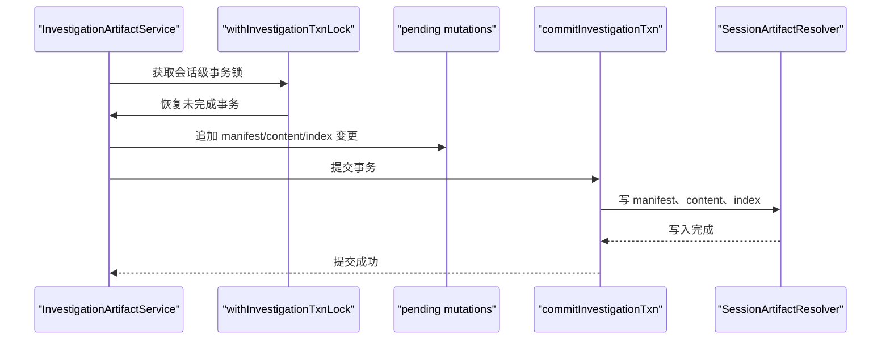

# 调查工件服务

<cite>
**本文引用的文件**   
- [InvestigationArtifactService.ts](file://src/main/investigation/InvestigationArtifactService.ts)
- [renderdocInvestigation.ts](file://src/shared/types/renderdocInvestigation.ts)
- [sessionArtifact.ts](file://src/shared/types/sessionArtifact.ts)
- [investigationArtifactWrite.ts](file://src/main/investigation/investigationArtifactWrite.ts)
- [investigationTxn.ts](file://src/main/investigation/investigationTxn.ts)
- [investigationRecordKeys.ts](file://src/main/investigation/investigationRecordKeys.ts)
- [investigationInvariants.ts](file://src/main/investigation/investigationInvariants.ts)
- [investigationHash.ts](file://src/main/investigation/investigationHash.ts)
- [investigationReadIntegrity.ts](file://src/main/investigation/investigationReadIntegrity.ts)
- [investigationErrors.ts](file://src/main/investigation/investigationErrors.ts)
</cite>

## 目录
1. [引言](#引言)
2. [项目结构与职责边界](#项目结构与职责边界)
3. [核心组件：InvestigationArtifactService](#核心组件investigationartifactservice)
4. [架构总览](#架构总览)
5. [九种调查工件类型、生命周期与关系](#九种调查工件类型生命周期与关系)
6. [rdc.investigation.v1 设计理念与字段约束](#rdcinvestigationv1-设计理念与字段约束)
7. [World State 状态与有效性管理](#world-state-状态与有效性管理)
8. [证据链构建与验证机制](#证据链构建与验证机制)
9. [声明认知状态与可信度等级](#声明认知状态与可信度等级)
10. [事务性写入、索引维护与内容哈希校验](#事务性写入索引维护与内容哈希校验)
11. [API 使用示例](#api-使用示例)
12. [错误处理模式](#错误处理模式)
13. [性能与可靠性特性](#性能与可靠性特性)
14. [故障排查指南](#故障排查指南)
15. [结论](#结论)

## 引言

InvestigationArtifactService 是 RenderDoc 调查子系统中的“调查工件存储和查询核心服务”。它负责把调查过程中的世界状态、证据、声明、实验、挑战、检查点、报告等数据，以统一的 schema、事务化写入方式持久化到会话工件系统中，并通过索引、完整性校验和不变量断言保证这些调查工件可追溯、可复现、可审计。

该服务的输入不是原始业务对象，而是 `InvestigationWriteInput`；输出也不是裸 JSON，而是包含 manifest、contentUri、contentHash 以及已解析 record 的结构化结果。对外暴露的主要能力包括：

- 按 kind 解析并校验记录 schema。
- 绑定 worldStateId，并维护 world_state/evidence/experiment/challenge/checkpoint/report 之间的引用关系。
- 在写入时更新 index、manifest、content，并在 ready 模式下做更强的一致性检查。
- 读取时执行 triple hash 校验、反序列化、就绪态刷新、索引一致性修复。
- 通过 InvestigationLookup 统一提供跨工件类型的引用解析。

## 项目结构与职责边界



**图示来源**
- [InvestigationArtifactService.ts:1-120](file://src/main/investigation/InvestigationArtifactService.ts#L1-L120)
- [investigationArtifactWrite.ts](file://src/main/investigation/investigationArtifactWrite.ts)
- [investigationTxn.ts](file://src/main/investigation/investigationTxn.ts)
- [investigationRecordKeys.ts](file://src/main/investigation/investigationRecordKeys.ts)
- [investigationInvariants.ts](file://src/main/investigation/investigationInvariants.ts)
- [investigationHash.ts](file://src/main/investigation/investigationHash.ts)
- [investigationReadIntegrity.ts](file://src/main/investigation/investigationReadIntegrity.ts)
- [investigationErrors.ts](file://src/main/investigation/investigationErrors.ts)

**章节来源**
- [InvestigationArtifactService.ts:1-120](file://src/main/investigation/InvestigationArtifactService.ts#L1-L120)

## 核心组件：InvestigationArtifactService

### 构造依赖

| 依赖 | 作用 |
| --- | --- |
| `resolver` | 会话工件解析器，负责 resolve、read、write |
| `receiptStore` | 执行回执存储，用于实验证据链验证 |
| `now` | 时间源，用于 createdAt |
| `onPersistBoundary` | 持久化边界回调，便于外部观察事务落盘时机 |
| `lockMaxAttempts` | 事务锁重试次数 |
| `verifiedIndexes` | 当前会话的已校验索引缓存 |
| `readRepair` | 读路径上的索引修复与就绪态刷新 |

构造函数会初始化 SessionArtifactResolver、RdcExecutionReceipts、InvestigationReadRepair，并将 readIndex、readJson、parseManifest、assertReady、commitMutations 等方法注入到 readRepair 中，使读路径具备自修复能力。

### 主要公共方法

| 方法 | 行为 |
| --- | --- |
| `writeRecord(sessionId, input)` | 主写入入口：会话校验、加锁、schema 解析、不变量检查、隔离应用、manifest 生成、索引更新、事务提交 |
| `readRecord(sessionId, artifactId, expectedHash?)` | 主读取入口：恢复依赖、查找索引、读取 manifest 和 content、三重哈希校验、反序列化、就绪态刷新、索引记录不变量检查 |
| `list(sessionId, filter?)` | 列出 draft/ready 条目并按需校验不变量 |
| `readAllRecords(sessionId)` | 读取所有条目，先一次图级修复再逐个读取 |
| `listForProjection(sessionId)` | 面向投影的轻量列表，失败时返回 storeDegraded |
| `listManifests(sessionId)` | 列出所有 manifest，解析失败时映射为 null |
| `assertReady(sessionId, manifest, contentText, lookup?)` | 强一致 ready 校验：sourceRefs、hash、schema、worldState、report contract |
| `createLookup(sessionId)` | 创建带缓存与循环保护的对象式引用查找器 |

**章节来源**
- [InvestigationArtifactService.ts:60-120](file://src/main/investigation/InvestigationArtifactService.ts#L60-L120)
- [InvestigationArtifactService.ts:120-220](file://src/main/investigation/InvestigationArtifactService.ts#L120-L220)
- [InvestigationArtifactService.ts:220-330](file://src/main/investigation/InvestigationArtifactService.ts#L220-L330)
- [InvestigationArtifactService.ts:330-420](file://src/main/investigation/InvestigationArtifactService.ts#L330-L420)

## 架构总览



**图示来源**
- [InvestigationArtifactService.ts:120-220](file://src/main/investigation/InvestigationArtifactService.ts#L120-L220)
- [investigationTxn.ts](file://src/main/investigation/investigationTxn.ts)
- [investigationRecordKeys.ts](file://src/main/investigation/investigationRecordKeys.ts)

## 九种调查工件类型、生命周期与关系

### 九种类型定义

| 工件 kind | recordType | 主要语义 |
| --- | --- | --- |
| `world_state` | `WorldState` | 调查基线或实验快照，包含设备、驱动、焦点、补丁、回放信息等 |
| `evidence` | `EvidenceRecord` | 对某一 worldState 的可验证观察，含 sourceKind、observationKind、strength、artifactRefs、contentHashes |
| `evidence_pack` | `EvidencePack` | 批量证据集合，成员类型为 EvidenceRecord |
| `claim` | `ClaimRecord` | 基于证据或其他声明形成的结论，含 epistemicStatus、confidenceLevel、supports、contradicts |
| `claim_set` | `ClaimSet` | 批量化声明集合，items 内每个 item 引用一个 claimId |
| `experiment` | `ExperimentRecord` | A-B-A 或 ABABAB 实验，关联 hypothesisClaimId、baseline/variant/restored WorldState、verifyEvidenceIds |
| `challenge` | `ChallengeRecord` | 对 claim/evidence/experiment 的挑战，含 targetId、targetType、kind、status |
| `checkpoint` | `MissionCheckpoint` | 任务级检查点，包含 currentWorldStateId、completedExperiments、openChallenges、established/rejected |
| `report` | `InvestigationReport` | 调查结论报告，包含 experimentIds、mission、contract 等 |

**章节来源**
- [renderdocInvestigation.ts:1-160](file://src/shared/types/renderdocInvestigation.ts#L1-L160)

### 生命周期与状态

| 工件 | 典型状态 | 关键生命周期事件 |
| --- | --- | --- |
| 所有工件 | `draft` → `ready` → `stale` / `superseded` / `failed` | 写入时为 draft；ready 模式可提升为 ready；被替换后变 superseded；世界状态污染后可能变 stale |
| world_state | baseline / experiment / restored_baseline | 作为其他工件的绑定目标，被 experiment 引用 |
| evidence | 与 world_state 绑定 | 若所属 world_state 失效，可能被标记 stale |
| claim | unknown / inferred / derived / observed | 随证据强度与推导过程提升认知等级 |
| experiment | designed / running / recorded / rolled_back / failed / aborted / polluted | 需要 hypothesisClaimId 与多个 worldState 引用 |
| challenge | open / resolved / wont_fix | 指向 claim/evidence/experiment |
| checkpoint | 任务阶段标记 | 汇总已完成实验、开放挑战、建立/拒绝项 |
| report | 调查终态 | 必须满足 report contract，并引用已运行实验 |



**图示来源**
- [renderdocInvestigation.ts:120-160](file://src/shared/types/renderdocInvestigation.ts#L120-L160)
- [InvestigationArtifactService.ts:120-220](file://src/main/investigation/InvestigationArtifactService.ts#L120-L220)

### 工件关系图



**图示来源**
- [renderdocInvestigation.ts:1-160](file://src/shared/types/renderdocInvestigation.ts#L1-L160)
- [InvestigationArtifactService.ts:330-520](file://src/main/investigation/InvestigationArtifactService.ts#L330-L520)

## rdc.investigation.v1 设计理念与字段约束

### 命名空间与注册表

`rdc.investigation.v1` 是 RenderDoc 调查垂直工件的 schema 命名空间。每个 kind 通过 `INVESTIGATION_KIND_REGISTRY` 绑定到一个 recordType 和一个完整 schema 名称，例如：

- `world_state` → `rdc.investigation.v1.WorldState`
- `evidence` → `rdc.investigation.v1.EvidenceRecord`
- `experiment` → `rdc.investigation.v1.ExperimentRecord`
- `report` → `rdc.investigation.v1.InvestigationReport`

写入时，service 会先通过 `requireInvestigationKind` 获取 kind 对应的 recordType 和 schema，再用 `parseInvestigationRecord` 校验输入 record。

### 字段约束要点

| 维度 | 约束 |
| --- | --- |
| kind 与 recordType | 必须匹配 kind registry，否则 ready 校验拒绝 |
| mission | debugger/analyzer/optimizer，决定优化器相关约束 |
| artifactId | 全局唯一，不能重复；复用历史版本时必须通过 supersedes |
| status | draft/ready/stale/failed/superseded |
| worldStateId | 对绑定型工件强制存在且可解析 |
| sourceRefs | ready 模式至少需要一个有效 sourceRef |
| contentHash | manifest.contentHash、index.entry.contentHash、实际 content 的 sha256 三者必须一致 |
| 引用 | 所有引用必须可解析，部分引用还需要额外不变量断言 |

**章节来源**
- [renderdocInvestigation.ts:1-160](file://src/shared/types/renderdocInvestigation.ts#L1-L160)
- [InvestigationArtifactService.ts:120-220](file://src/main/investigation/InvestigationArtifactService.ts#L120-L220)
- [InvestigationArtifactService.ts:330-420](file://src/main/investigation/InvestigationArtifactService.ts#L330-L420)

## World State 状态与有效性管理

World State 支持以下 kind：

| WorldStateKind | 含义 |
| --- | --- |
| `baseline` | 初始调查基线 |
| `experiment` | 实验产生的变体状态 |
| `restored_baseline` | 从实验恢复后的基线 |
| `unknown` | 未明确分类的状态 |

World State 的 validity 支持：

| WorldStateValidity | 含义 |
| --- | --- |
| `valid` | 正常有效 |
| `stale` | 因上游变化而失效 |
| `polluted` | 受污染，通常由实验判定 |
| `unknown` | 尚未确定 |

### 污染传播逻辑

写入 world_state 时，service 会：

1. 查找是否有关联 experiment。
2. 调用 `evaluateSRdc01` 计算 worldState 是否被污染。
3. 如果污染，设置 `validity = 'polluted'`。
4. 如果 worldState 的变化会导致其关联证据失效，则返回 `markEvidenceStaleFor`。
5. 后续写入路径通过 `collectStalePropagation` 将对应证据标记为 stale。



**图示来源**
- [InvestigationArtifactService.ts:451-560](file://src/main/investigation/InvestigationArtifactService.ts#L451-L560)
- [investigationInvariants.ts](file://src/main/investigation/investigationInvariants.ts)

**章节来源**
- [renderdocInvestigation.ts:40-80](file://src/shared/types/renderdocInvestigation.ts#L40-L80)
- [InvestigationArtifactService.ts:451-560](file://src/main/investigation/InvestigationArtifactService.ts#L451-L560)

## 证据链构建与验证机制

### 证据来源分类

| sourceKind | 含义 |
| --- | --- |
| `tool` | 工具产出，如渲染捕获、调试器输出、自动分析结果 |
| `human` | 人工观察、人工标注、专家判断 |
| `external_document` | 外部文档、规范、测试报告等 |

### 观察类型

| observationKind | 典型用途 |
| --- | --- |
| `image_compare` | 图像对比、像素差异 |
| `spirv_slice` | SPIR-V 片段、着色器中间表示切片 |
| `timing` | 时序、帧时、GPU/CPU 耗时 |
| `pixel_history` | 像素轨迹、逐帧变化历史 |
| `mesh` | 网格结构、拓扑差异 |
| `resource` | 资源加载、内存布局、资源 ID |
| `other` | 其他自定义观察 |

### 强度评估

| strength | 含义 |
| --- | --- |
| `strong` | 强证据，可直接支撑高可信度结论 |
| `moderate` | 中等证据，通常需要多份证据聚合 |
| `weak` | 弱证据，仅能辅助或提出假设 |
| `none` | 无强度，更多是上下文信息 |

### 证据链验证

对单个 EvidenceRecord，service 会执行：

1. 调用 `assertSState01` 校验基础不变量。
2. 要求 observed tool evidence 必须附带 artifact。
3. 校验 `contentHashes.length === artifactRefs.length`。
4. 对每个 artifactRef 调用 `assertContentRef`，验证 session artifact 是否存在且 hash 匹配。
5. 校验 `contentHashes[index]` 与该 ref 的 expectedHash 一致。
6. 调用 `assertEvidenceLinks` 校验证据之间的链接关系。



**图示来源**
- [InvestigationArtifactService.ts:560-640](file://src/main/investigation/InvestigationArtifactService.ts#L560-L640)
- [investigationInvariants.ts](file://src/main/investigation/investigationInvariants.ts)

**章节来源**
- [renderdocInvestigation.ts:140-220](file://src/shared/types/renderdocInvestigation.ts#L140-L220)
- [InvestigationArtifactService.ts:560-640](file://src/main/investigation/InvestigationArtifactService.ts#L560-L640)

## 声明认知状态与可信度等级

### 认知状态

| EpistemicStatus | 含义 |
| --- | --- |
| `unknown` | 尚未形成明确判断 |
| `inferred` | 根据已有信息推断得出 |
| `derived` | 由证据或多步推理导出 |
| `observed` | 直接观察到的高置信事实 |

认知状态具有偏序关系：unknown < inferred < derived < observed。

### 可信度等级

| ConfidenceLevel | 含义 |
| --- | --- |
| `exact` | 精确匹配或确定性结论 |
| `strong` | 强可信结论 |
| `probable` | 较大概率成立 |
| `speculative` | 推测性结论 |

### 声明校验

声明记录需要：

- 指定 kind，例如 observed_fact、hypothesis、causal_conclusion 等。
- 指定 epistemicStatus 和 confidenceLevel。
- supports/contradicts 指向其他 claim。
- 因果或反事实声明需要额外满足 `assertSCausal01`。
- 所有 projected claims 需要满足 `assertSClaim01`。



**图示来源**
- [renderdocInvestigation.ts:1-120](file://src/shared/types/renderdocInvestigation.ts#L1-L120)
- [InvestigationArtifactService.ts:451-520](file://src/main/investigation/InvestigationArtifactService.ts#L451-L520)

**章节来源**
- [renderdocInvestigation.ts:1-120](file://src/shared/types/renderdocInvestigation.ts#L1-L120)
- [InvestigationArtifactService.ts:451-520](file://src/main/investigation/InvestigationArtifactService.ts#L451-L520)

## 事务性写入、索引维护与内容哈希校验

### 事务性写入流程



**图示来源**
- [InvestigationArtifactService.ts:200-220](file://src/main/investigation/InvestigationArtifactService.ts#L200-L220)
- [InvestigationArtifactService.ts:832-897](file://src/main/investigation/InvestigationArtifactService.ts#L832-L897)

### 索引维护

每次写入都会：

1. 读取当前 index snapshot。
2. 如果需要，传播 stale 标记。
3. 如果需要，处理 supersedes 链并退役旧记录。
4. 追加 manifest 和 content mutation。
5. 调用 `upsertIndexEntry` 更新索引条目。
6. 追加 index mutation。
7. 调用 `commitInvestigationTxn` 一次性提交。

### 内容哈希校验

服务维护三层哈希一致性：

| 层级 | 位置 | 校验内容 |
| --- | --- | --- |
| 内容哈希 | content | sha256(contentText) |
| manifest 哈希 | manifest.contentHash | 格式化后的 sha256 |
| 索引哈希 | index entry.contentHash | 与 manifest 保持一致 |

读取时会调用 `assertTripleContentHash`，确保三者一致；若 truncated 或 expectedHash 不匹配，则抛出 `INVESTIGATION_HASH_MISMATCH`。

**章节来源**
- [InvestigationArtifactService.ts:200-220](file://src/main/investigation/InvestigationArtifactService.ts#L200-L220)
- [InvestigationArtifactService.ts:700-832](file://src/main/investigation/InvestigationArtifactService.ts#L700-L832)
- [investigationReadIntegrity.ts](file://src/main/investigation/investigationReadIntegrity.ts)
- [investigationHash.ts](file://src/main/investigation/investigationHash.ts)

## API 使用示例

### 写入草稿工件

```typescript
const result = investigationArtifactService.writeRecord('sessionId', {
  kind: 'evidence',
  record: evidenceRecord,
  title: '图像对比证据',
  summary: '对比两个渲染帧的像素差异',
  status: 'draft',
  sourceRefs: [],
});
```

- 返回 `{ manifest, contentUri, contentHash, record }`。
- status 为 draft 时不会执行 strong ready 校验。
- 新 artifactId 自动生成。

### 写入就绪工件

```typescript
const result = investigationArtifactService.writeRecord('sessionId', {
  kind: 'claim',
  record: claimRecord,
  title: '观测结论',
  summary: '基于证据推导出因果关系',
  status: 'ready',
  sourceRefs: [{ artifactId, expectedHash }],
});
```

- ready 模式要求至少一个 sourceRef。
- sourceRef 会被解析并校验 expectedHash。
- manifest.contentHash 必须等于 contentText 的 sha256。

### 读取工件

```typescript
const readResult = investigationArtifactService.readRecord('sessionId', artifactId);
```

- 返回 `{ manifest, record, contentUri, contentHash }`。
- 如果传入 expectedHash，会校验内容是否与预期一致。
- 对于 ready 工件，会在读取时尝试刷新就绪态。

### 列出工件

```typescript
const entries = investigationArtifactService.list('sessionId', {
  kind: 'experiment',
  status: 'ready',
});
```

- 默认只返回 draft/ready。
- 可按 kind 和 status 过滤。
- 返回的是索引条目，不是完整 record。

### 构建查找器

```typescript
const lookup = investigationArtifactService.createLookup('sessionId');
const ws = lookup.getWorldState('worldStateId');
const claim = lookup.getClaim('claimId');
const evidence = lookup.getEvidence('evidenceId');
const experiment = lookup.getExperiment('experimentId');
const challenge = lookup.getChallenge('challengeId');
```

**章节来源**
- [InvestigationArtifactService.ts:120-220](file://src/main/investigation/InvestigationArtifactService.ts#L120-L220)
- [InvestigationArtifactService.ts:220-420](file://src/main/investigation/InvestigationArtifactService.ts#L220-L420)

## 错误处理模式

### 主要错误码

| 错误类别 | 典型错误 | 触发场景 |
| --- | --- | --- |
| 会话错误 | `INVESTIGATION_SESSION_DENIED` | sessionId 为空 |
| Schema 错误 | `INVESTIGATION_SCHEMA_INVALID` | record 无法解析或不符合 kind 对应 schema |
| 引用缺失 | `INVESTIGATION_REF_UNresolved` | 找不到 worldState、claim、evidence、source artifact 等 |
| 哈希错误 | `INVESTIGATION_HASH_MISMATCH` | contentHash、expectedHash、artifact hash 不一致 |
| 索引损坏 | `INVESTIGATION_INDEX_CORRUPT` | index 截断或 JSON 解析失败 |
| 索引缺失 | `INVESTIGATION_INDEX_MISSING` | index 不存在但存在 records/manifests 目录 |
| 事务退化 | `INVESTIGATION_DEGRADED` | 检测到部分事务残留 |
| 重复 ID | `INVESTIGATION_DUPLICATE_ID` | artifactId 或 record id 重复 |
| 就绪拒绝 | `INVESTIGATION_READY_DENIED` | ready 模式不满足 sourceRefs、recordType、contentHash 等条件 |

### 错误传播策略

- SessionArtifactError 通常来自底层 session artifact 系统。
- InvestigationArtifactService 会把大部分底层错误包装成 InvestigationError。
- 读取路径遇到 index 缺失但存在旧文件时，优先提示 INDEX_MISSING。
- 读取路径检测到事务残留时，优先提示 DEGRADED。
- 投影列表 listForProjection 捕获降级错误，返回 `{ artifacts: [], storeDegraded: true }`，避免上层 UI 崩溃。

**章节来源**
- [InvestigationArtifactService.ts:220-330](file://src/main/investigation/InvestigationArtifactService.ts#L220-L330)
- [InvestigationArtifactService.ts:700-832](file://src/main/investigation/InvestigationArtifactService.ts#L700-L832)
- [investigationErrors.ts](file://src/main/investigation/investigationErrors.ts)
- [sessionArtifact.ts](file://src/shared/types/sessionArtifact.ts)

## 性能与可靠性特性

### 性能特性

| 特性 | 说明 |
| --- | --- |
| 索引缓存 | `verifiedIndexes` 在会话锁内缓存已校验 index |
| 查找缓存 | `buildLookup` 使用 memo 和 visiting 集合减少重复解析和循环引用风险 |
| 批量读取 | `readAllRecords` 先做一次依赖修复，再逐个读取 |
| 投影列表 | `listForProjection` 使用 readRepair.projectionIndex，适合前端快速展示 |
| 延迟解析 | manifest 和 record 只在需要时解析和校验 |

### 可靠性特性

| 特性 | 说明 |
| --- | --- |
| 会话锁 | `withSessionLock` 防止并发写入导致索引不一致 |
| 事务提交 | `commitInvestigationTxn` 将 manifest、content、index 作为一组 mutation 提交 |
| 事务恢复 | `recoverInvestigationTxn` 在获取锁时恢复未完成事务 |
| 三重哈希 | content、manifest、index 三者哈希一致 |
| 索引完整性 | 读取 index 时进行 schema 校验、截断检测、JSON 解析校验 |
| 就绪态修复 | `readRepair.refreshReadyOnRead` 在读取 ready 工件时刷新状态 |
| 降级保护 | `listForProjection` 在 store degraded 时返回空结果而非抛错 |

**章节来源**
- [InvestigationArtifactService.ts:60-120](file://src/main/investigation/InvestigationArtifactService.ts#L60-L120)
- [InvestigationArtifactService.ts:330-420](file://src/main/investigation/InvestigationArtifactService.ts#L330-L420)
- [InvestigationArtifactService.ts:700-897](file://src/main/investigation/InvestigationArtifactService.ts#L700-L897)

## 故障排查指南

### 问题：写入时报 `INVESTIGATION_SCHEMA_INVALID`

**可能原因：**

- record 字段不符合对应 kind 的 schema。
- optimizer mission 下的 world_state 缺少 measured benchmark settings。
- kind 与 recordType 不匹配。

**排查建议：**

1. 确认 `input.kind` 与 `record` 结构匹配。
2. 如果是 optimizer mission，检查 world_state 是否包含必要 benchmark 字段。
3. 查看 parseInvestigationRecord 抛出的具体消息。

**章节来源**
- [InvestigationArtifactService.ts:120-200](file://src/main/investigation/InvestigationArtifactService.ts#L120-L200)
- [InvestigationArtifactService.ts:451-520](file://src/main/investigation/InvestigationArtifactService.ts#L451-L520)

### 问题：写入时报 `INVESTIGATION_HASH_MISMATCH`

**可能原因：**

- contentHash 与实际内容不一致。
- expectedHash 与存储内容不一致。
- evidence 的 contentHashes 与 artifactRefs 不匹配。

**排查建议：**

1. 检查写入前是否对 contentText 计算了正确的 sha256。
2. 检查 sourceRefs.expectedHash 是否与 artifact 实际 hash 一致。
3. 检查 evidence.artifactRefs 和 evidence.contentHashes 长度和内容是否一一对应。

**章节来源**
- [InvestigationArtifactService.ts:220-330](file://src/main/investigation/InvestigationArtifactService.ts#L220-L330)
- [InvestigationArtifactService.ts:560-640](file://src/main/investigation/InvestigationArtifactService.ts#L560-L640)

### 问题：读取时报 `INVESTIGATION_INDEX_CORRUPT`

**可能原因：**

- index 文件被截断。
- index JSON 无法解析。
- 底层 session artifact 读取异常。

**排查建议：**

1. 检查 session 工件目录下是否存在 index。
2. 检查 index 是否被部分写入或覆盖。
3. 如果存在 records/manifests 目录，可能是旧格式，应提示 INDEX_MISSING。
4. 如果存在事务残留，应先恢复事务。

**章节来源**
- [InvestigationArtifactService.ts:700-832](file://src/main/investigation/InvestigationArtifactService.ts#L700-L832)

### 问题：listForProjection 返回 storeDegraded

**可能原因：**

- 索引缺失或损坏。
- 事务未完成。
- 底层存储不可用。

**排查建议：**

1. 不要直接使用返回的空 artifacts 数组作为最终结果。
2. 检查是否存在事务残留。
3. 检查是否有可用备份或可从旧 records/manifests 恢复。
4. 在 UI 层显示“调查数据不可用”而非直接报错。

**章节来源**
- [InvestigationArtifactService.ts:330-420](file://src/main/investigation/InvestigationArtifactService.ts#L330-L420)

## 结论

InvestigationArtifactService 的核心价值在于把调查过程从“散落的日志和截图”升级为“可验证、可追溯、可推理的证据链”。它通过 nine kinds of investigation artifacts、rdc.investigation.v1 schema、worldState 绑定、evidence chain validation、epistemic status、transactional writes、triple content hashing 和 index integrity checks，共同构成一个面向调试、分析和优化任务的可靠调查存储层。

在实际使用中，推荐遵循以下原则：

- 始终使用 `writeRecord` 而不是直接写 JSON。
- 对重要结论使用 `status: 'ready'` 并保留 sourceRefs。
- 对可复现实验使用 experiment 并绑定 baseline、variant、restored baseline。
- 对强证据使用 strong confidence 和 strong evidence strength。
- 对易变世界状态及时重建或标记 stale。
- 对前端投影使用 `listForProjection` 并处理 storeDegraded。
- 对哈希不一致、引用缺失、索引损坏等错误采用明确的上层错误提示和恢复流程。