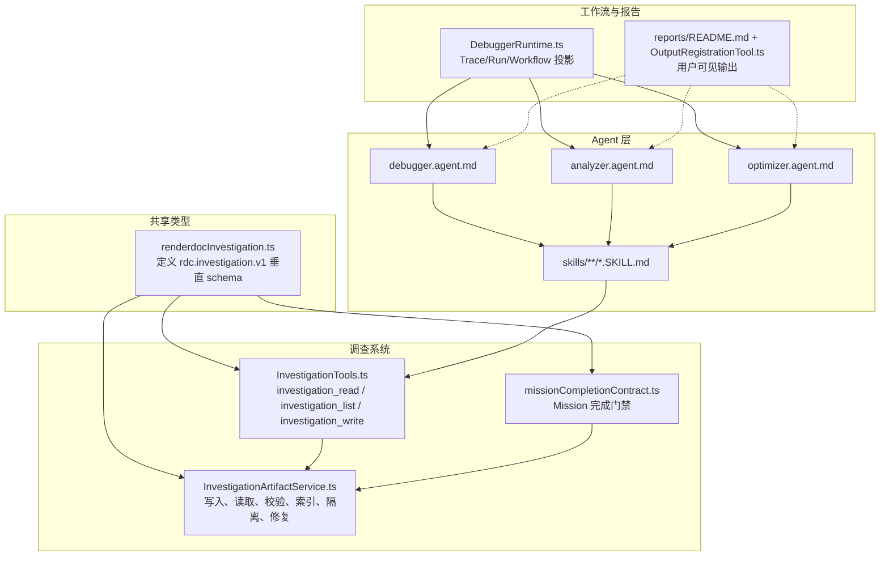
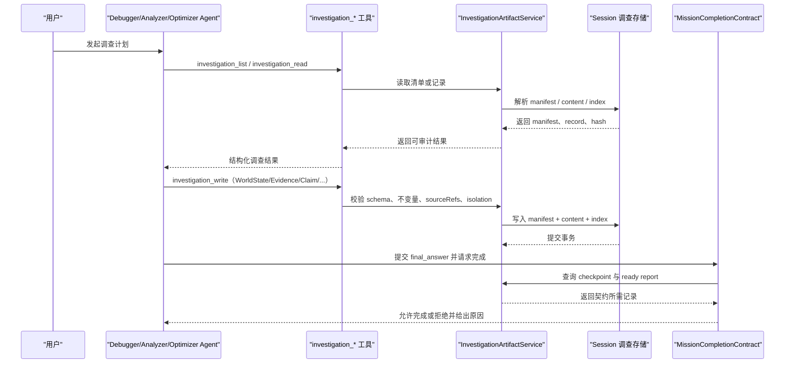
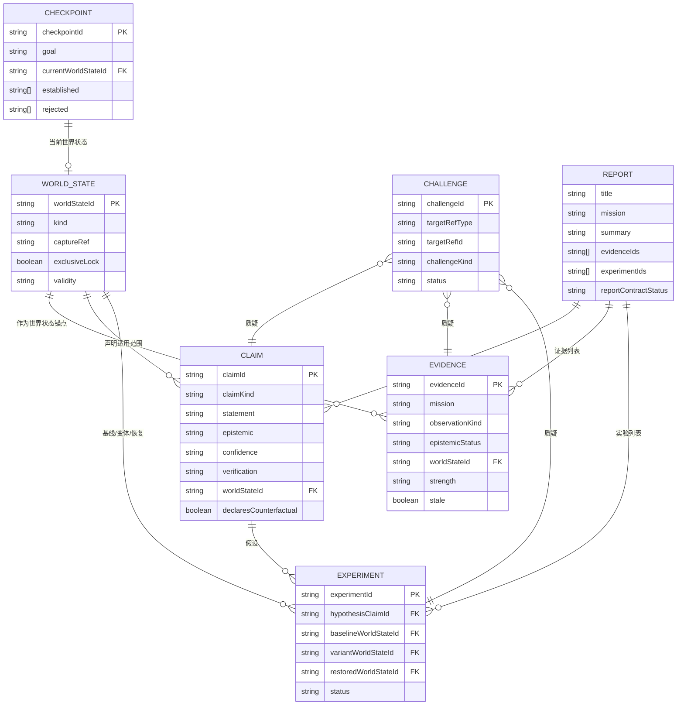
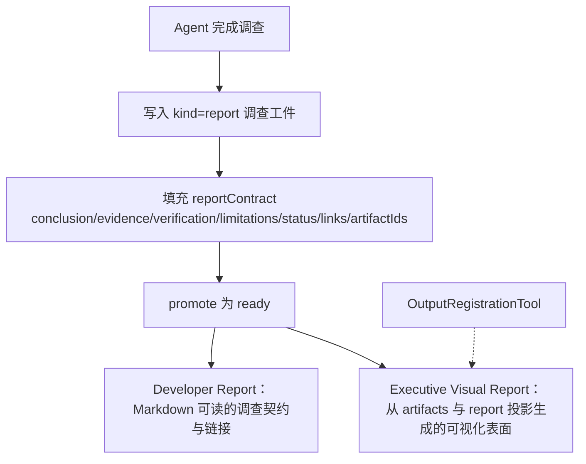
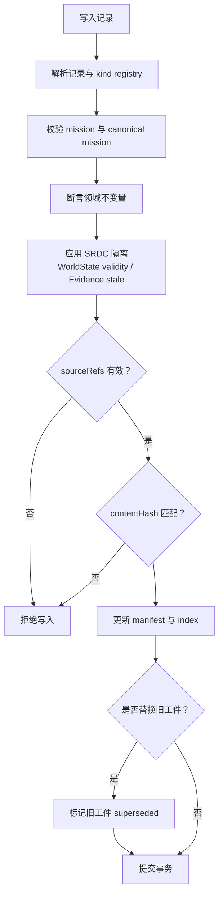
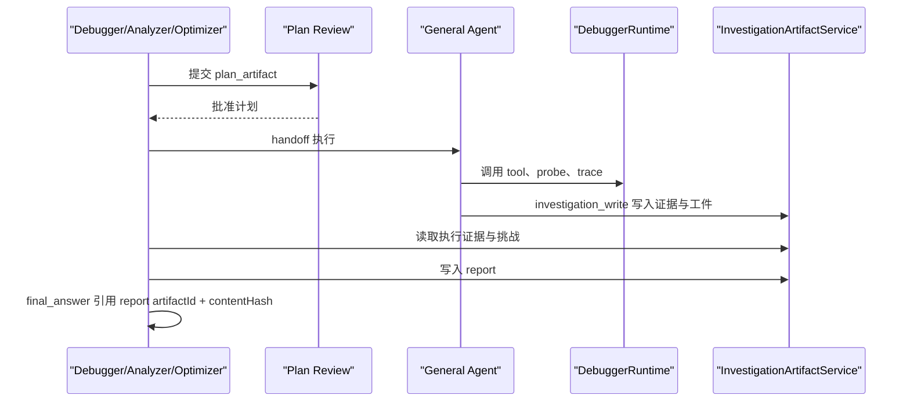
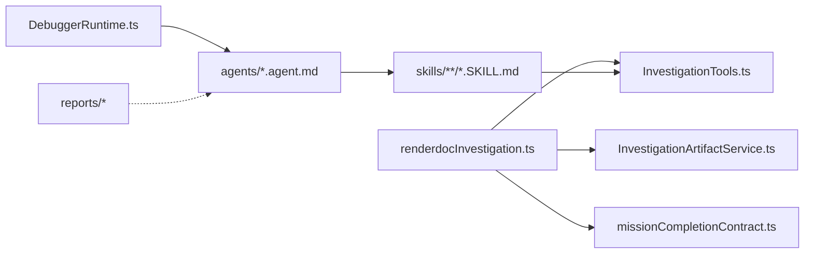

# 调查工作流

<cite>
**本文引用的文件**   
- [InvestigationArtifactService.ts](file://src/main/investigation/InvestigationArtifactService.ts)
- [renderdocInvestigation.ts](file://src/shared/types/renderdocInvestigation.ts)
- [missionCompletionContract.ts](file://src/main/investigation/missionCompletionContract.ts)
- [InvestigationTools.ts](file://src/main/investigation/InvestigationTools.ts)
- [DebuggerRuntime.ts](file://src/main/workflow/debugger/DebuggerRuntime.ts)
- [SKILL.md（调试器因果方法）](file://resources/agent-runtime/skills/debugger-causal-method/SKILL.md)
- [SKILL.md（分析器架构方法）](file://resources/agent-runtime/skills/analyzer-architecture-method/SKILL.md)
- [SKILL.md（优化器协调器）](file://resources/agent-runtime/skills/optimizer-coordinator/SKILL.md)
- [SKILL.md（捕获事实）](file://resources/agent-runtime/skills/capture-facts/SKILL.md)
- [SKILL.md（制品溯源）](file://resources/agent-runtime/skills/artifact-provenance/SKILL.md)
- [debugger.agent.md](file://resources/agent-runtime/agents/debugger.agent.md)
- [analyzer.agent.md](file://resources/agent-runtime/agents/analyzer.agent.md)
- [optimizer.agent.md](file://resources/agent-runtime/agents/optimizer.agent.md)
- [README.md（报告目录）](file://src/main/reports/README.md)
- [OutputRegistrationTool.ts](file://src/main/reports/OutputRegistrationTool.ts)
</cite>

## 目录
1. [引言](#引言)
2. [项目结构](#项目结构)
3. [核心组件](#核心组件)
4. [架构总览](#架构总览)
5. [详细组件分析](#详细组件分析)
6. [依赖关系分析](#依赖关系分析)
7. [性能与一致性考虑](#性能与一致性考虑)
8. [故障排查指南](#故障排查指南)
9. [结论](#结论)
10. [附录：实际调查案例与工作流示例](#附录实际调查案例与工作流示例)

## 引言
本文件系统化说明 RenderDoc Agent 系统中的“调查工作流”。它围绕 `rdc.investigation.v1` 垂直 schema、`InvestigationArtifactService` 的管理机制，以及 Debugger、Analyzer、Optimizer 三种调查方法展开。文档重点解释 World State、Evidence、Claim、Experiment、Challenge、Checkpoint、Report 等调查工件的定义和相互关系，说明报告生成机制中的 Developer Report（Markdown）与 Executive Visual Report（可视化阅读表面），并覆盖调查状态管理、证据验证、结论可信度评估的实现细节。最后给出 Agent 集成方式、handoff 机制及典型调查案例。

## 项目结构
调查相关代码主要分布在以下区域：
- 类型与垂直 schema：`src/shared/types/renderdocInvestigation.ts`
- 调查服务与事务：`src/main/investigation/InvestigationArtifactService.ts` 及相关读写、不变量、索引、修复模块
- Agent 工具入口：`src/main/investigation/InvestigationTools.ts`
- 任务完成契约：`src/main/investigation/missionCompletionContract.ts`
- 调试器运行时桥接：`src/main/workflow/debugger/DebuggerRuntime.ts`
- Agent 与 Skill 规范：`resources/agent-runtime/agents/*.agent.md`、`resources/agent-runtime/skills/**/*.SKILL.md`
- 非调查类输出报告目录：`src/main/reports/README.md`、`src/main/reports/OutputRegistrationTool.ts`

**图示来源**
- [renderdocInvestigation.ts:1-200](file://src/shared/types/renderdocInvestigation.ts#L1-L200)
- [InvestigationArtifactService.ts:106-200](file://src/main/investigation/InvestigationArtifactService.ts#L106-L200)
- [InvestigationTools.ts:124-257](file://src/main/investigation/InvestigationTools.ts#L124-L257)
- [missionCompletionContract.ts:1-120](file://src/main/investigation/missionCompletionContract.ts#L1-L120)
- [DebuggerRuntime.ts:1-66](file://src/main/workflow/debugger/DebuggerRuntime.ts#L1-L66)
- [README.md（报告目录）:1-5](file://src/main/reports/README.md#L1-L5)

**章节来源**
- [renderdocInvestigation.ts:1-200](file://src/shared/types/renderdocInvestigation.ts#L1-L200)
- [InvestigationArtifactService.ts:106-200](file://src/main/investigation/InvestigationArtifactService.ts#L106-L200)
- [InvestigationTools.ts:124-257](file://src/main/investigation/InvestigationTools.ts#L124-L257)
- [missionCompletionContract.ts:1-120](file://src/main/investigation/missionCompletionContract.ts#L1-L120)
- [DebuggerRuntime.ts:1-66](file://src/main/workflow/debugger/DebuggerRuntime.ts#L1-L66)
- [README.md（报告目录）:1-5](file://src/main/reports/README.md#L1-L5)

## 核心组件
### InvestigationArtifactService
`InvestigationArtifactService` 是 `rdc.investigation.v1` 调查系统的核心管理器。它负责：
- 按 kind 注册表解析记录类型和 schema；
- 写记录：解析输入、校验 mission、应用领域不变量、执行证据隔离、更新 manifest 与 index、提交事务；
- 读记录：查找 manifest、校验内容哈希、反序列化记录、对 ready 记录刷新就绪状态、校验索引内记录的不变量；
- 列出记录：支持 kind/status 过滤，并对 draft/ready 条目做不变量断言；
- 构建 lookup：提供按 id 获取 world_state、claim、evidence、experiment、challenge 的访问接口，同时缓存已校验记录以避免重复解析；
- 源引用校验：在 `assertSourceRef` 中通过 Session Artifact Resolver 校验 sourceRefs 的实际内容与 expectedHash；
- 数据隔离：根据 SRDC 不变量判定 WorldState 是否 polluted，并标记受影响 Evidence 为 stale；
- 替代与失效：当新 artifact 替换旧 artifact 时，标记旧版本 superseded，并在 world_state 被替换时级联标记下游依赖 stale。

关键职责边界：
- 不直接持有持久化实现，而是通过 `withPendingInvestigationMutations`、`commitMutations` 等抽象操作事务；
- 将 schema 解析、索引维护、内容哈希、read repair、事务恢复等职责拆分到独立模块；
- 所有对外写入都先锁定 session，避免并发污染。

**章节来源**
- [InvestigationArtifactService.ts:106-573](file://src/main/investigation/InvestigationArtifactService.ts#L106-L573)

### 垂直 schema：rdc.investigation.v1
垂直 schema 集中定义在 `renderdocInvestigation.ts`，其要点包括：
- 命名空间常量 `INVESTIGATION_SCHEMA_NAMESPACE = 'rdc.investigation.v1'`；
- 三种 Mission：`debugger`、`analyzer`、`optimizer`；
- 认识论状态序：`unknown < inferred < derived < observed`；
- 置信度等级：`exact`、`strong`、`probable`、`speculative`；
- 验证级别：`observed`、`reconstructed`、`differential_supported`、`replay_counterfactual`、`runtime_counterfactual`、`cross_scene`、`cross_device`、`expert_reviewed`；
- 工件种类：world_state、evidence、evidence_pack、claim、claim_set、experiment、challenge、checkpoint、report；
- 工件状态：draft、ready、stale、failed、superseded；
- 实验协议：A-B-A、ABABAB；
- 挑战目标类型：claim、evidence、experiment；
- 证据源类型：tool、human、external_document；
- 证据观测类型：image_compare、spirv_slice、timing、pixel_history、mesh、resource、other；
- 报告契约字段：conclusion、evidence、verification、limitations、status、links、artifactIds、candidateStatus；
- Analyzer 解释分层：observed、reconstructed、authoring。

这些枚举和接口共同构成调查数据的稳定契约，Agent Skill 必须基于此契约写入，不得自行发明新的 artifact kind。

**章节来源**
- [renderdocInvestigation.ts:1-200](file://src/shared/types/renderdocInvestigation.ts#L1-L200)
- [renderdocInvestigation.ts:201-509](file://src/shared/types/renderdocInvestigation.ts#L201-L509)

## 架构总览
调查工作流由三类 Agent 驱动，但底层数据模型统一为 `rdc.investigation.v1`。Agent 通过 `investigation_read`、`investigation_list`、`investigation_write` 三个工具访问调查存储；最终由 `missionCompletionContract` 检查 Mission 是否满足完成条件，包括 Checkpoint、Ready Report、Final Answer 引用绑定、报告契约章节完整性和方法特定约束。

**图示来源**
- [InvestigationTools.ts:124-257](file://src/main/investigation/InvestigationTools.ts#L124-L257)
- [InvestigationArtifactService.ts:106-573](file://src/main/investigation/InvestigationArtifactService.ts#L106-L573)
- [missionCompletionContract.ts:1-277](file://src/main/investigation/missionCompletionContract.ts#L1-L277)

## 详细组件分析

### 调查工件模型与关系
调查工件不是简单文档，而是带身份、版本、状态、依赖和审计信息的结构化实体。

**图示来源**
- [renderdocInvestigation.ts:201-509](file://src/shared/types/renderdocInvestigation.ts#L201-L509)

#### World State
World State 描述一次 capture 的可复现环境，包括 driver、device、exclusiveLock、shader replacement、patch stack、focus、benchmark 等。它是 Evidence 和 Experiment 的锚点。`InvestigationArtifactService.applyRdcIsolation` 会根据 SRDC 不变量把被污染的 WorldState 标记为 polluted，并传播 stale 给依赖 Evidence。

#### Evidence 与 EvidencePack
Evidence 记录一次观测的来源、epistemicStatus、strength、region、artifactRefs、contentHashes 等。EvidencePack 用于打包多条 Evidence。写入 Evidence 时必须确保 worldStateId 可解析，且 sourceRefs 指向真实内容。

#### Claim 与 ClaimSet
Claim 表达一个可审计主张，包含 claimKind、statement、epistemic、confidence、verification、scope、rootCause、decision 等。ClaimSet 聚合多个 Claim。对于因果或反事实 Claim，系统要求更严格的根因七元组和反事实证据约束。

#### Experiment
Experiment 用于 A-B-A 或 ABABAB 对照实验，包含 hypothesisClaimId、baselineWorldStateId、variantWorldStateId、restoredWorldStateId、controlledVariables、changedVariables、metrics、protocol、visualValidation、result、rollback、actionClass、status。Optimizer Mission 强制要求可证伪的实验和 rollback。

#### Challenge
Challenge 针对 claim、evidence 或 experiment 提出矛盾、缺失证据、替代方案、范围问题或方法论质疑。它可以关联 resolutionClaimId。

#### Checkpoint
Checkpoint 记录 Mission 的计划版本、established/rejected 事实、completedExperiments、openChallenges、currentWorldStateId、criticalArtifactRefs、unresolvedFrontier。它是 Mission 完成的前置条件之一。

#### Report
Report 汇总 claims、evidenceIds、experimentIds，并可携带 reportContract。报告契约包括 conclusion、evidence、verification、limitations、status、links、artifactIds、candidateStatus。

**章节来源**
- [renderdocInvestigation.ts:201-509](file://src/shared/types/renderdocInvestigation.ts#L201-L509)
- [InvestigationArtifactService.ts:201-573](file://src/main/investigation/InvestigationArtifactService.ts#L201-L573)

### 三种调查方法的设计理念和使用场景

#### Debugger：因果定位
Debugger 聚焦“第一个坏事件”、假设矩阵和反事实证据。其 Skill 强调：
- 以 observed Evidence 定位最早分歧事件或像素；
- 不将 First Bad Event 写成 Hypothesis Matrix 行或 Counterfactual；
- 只在具备足够证据后写入 causal/counterfactual Claim，并填写 rootCause 七元组。

使用场景：渲染异常、资源错误、事件顺序不一致、像素差异等问题。

**章节来源**
- [SKILL.md（调试器因果方法）:1-38](file://resources/agent-runtime/skills/debugger-causal-method/SKILL.md#L1-L38)
- [SKILL.md（捕获事实）:6-16](file://resources/agent-runtime/skills/capture-facts/SKILL.md#L6-L16)
- [debugger.agent.md:1-48](file://resources/agent-runtime/agents/debugger.agent.md#L1-L48)

#### Analyzer：架构重建
Analyzer 负责从 trace、pipeline、resource、shader 等原始事实重建架构模型，严格区分 Observed、Reconstructed、Authoring 三层。Skill 规定：
- 不发明新的 kind、Profile 或 TaskStore；
- 只写 `rdc.investigation.v1` 工件；
- 观察层保持 observed_fact 与 observed；
- 双 capture 场景下，由应用管理身份，跨 capture 对齐事实但不伪造共享 WorldState。

使用场景：pass 行为分析、管线状态变化、资源绑定推断、shader 源码与二进制映射、数据流追溯。

**章节来源**
- [SKILL.md（分析器架构方法）:1-38](file://resources/agent-runtime/skills/analyzer-architecture-method/SKILL.md#L1-L38)
- [analyzer.agent.md:1-47](file://resources/agent-runtime/agents/analyzer.agent.md#L1-L47)

#### Optimizer：可证伪优化实验
Optimizer 关注可量化改进，要求先建立 measured baseline，再进行 A-B-A 实验，并以 rollback 和 verifyEvidenceIds 保证可回滚、可复核。Skill 强调噪声阈值、帧分解、设备/场景一致性，以及不能把低于噪声阈值的 delta 当作 gain。

使用场景：性能回归、绘制耗时上升、内存抖动、采样偏差问题。

**章节来源**
- [SKILL.md（优化器协调器）:1-48](file://resources/agent-runtime/skills/optimizer-coordinator/SKILL.md#L1-L48)
- [optimizer.agent.md:1-48](file://resources/agent-runtime/agents/optimizer.agent.md#L1-L48)

### 报告生成机制：Developer Report 与 Executive Visual Report
仓库明确区分两类输出：
- 调查工件：走 `rdc.investigation.v1`，存在于 session-owned 存储；
- 普通用户输出：走 reports 目录下的 ArtifactStore、OutputRegistrationTool、StorageAdapter。

`reports/README.md` 指出，Investigation 垂直记录不走该目录，只存在于 `rdc.investigation.v1`。因此，“Developer Report（Markdown）”和“Executive Visual Report（可视化）”作为阅读表面，应理解为：
- Developer Report：面向工程师的调查 Markdown 报告，通常对应 kind=report 的 InvestigationReport，承载 claims、evidenceIds、experimentIds、reportContract；
- Executive Visual Report：面向决策者的可视化摘要，可能由上层 UI 或导出流程从 InvestigationReport 和 artifacts 投影生成，而不是直接存储在 reports 目录。

`OutputRegistrationTool` 的作用是“发布项目文件作为本次 run 的用户可见输出”，例如截图、trace、shader、log、data、note 等，但它不处理调查工件本身。

**图示来源**
- [renderdocInvestigation.ts:201-509](file://src/shared/types/renderdocInvestigation.ts#L201-L509)
- [README.md（报告目录）:1-5](file://src/main/reports/README.md#L1-L5)
- [OutputRegistrationTool.ts:1-117](file://src/main/reports/OutputRegistrationTool.ts#L1-L117)

**章节来源**
- [README.md（报告目录）:1-5](file://src/main/reports/README.md#L1-L5)
- [OutputRegistrationTool.ts:1-117](file://src/main/reports/OutputRegistrationTool.ts#L1-L117)
- [renderdocInvestigation.ts:201-509](file://src/shared/types/renderdocInvestigation.ts#L201-L509)

### 调查状态管理与证据验证
#### 工件状态
- draft：草稿，尚未达到 ready 证明标准；
- ready：已通过 schema、kind registry、sourceRefs、contentHash、worldStateId 绑定、报告契约等检查；
- stale：因 WorldState 变更或证据依赖失效而陈旧；
- failed：写入或运行失败；
- superseded：被新版本替代。

#### 证据验证
证据验证分为多层：
1. **Schema 校验**：解析 record 并匹配 INVESTIGATION_KIND_REGISTRY；
2. **引用校验**：worldStateId、hypothesisClaimId、experiment 的 baseline/variant/restored、challenge targetRef、report contract artifactIds 必须可解析；
3. **sourceRefs 校验**：每个 `{artifactId, expectedHash}` 必须 resolve 到相同 sha256；
4. **SRDC 不变量**：判断 WorldState 是否 polluted，影响 Evidence stale 状态；
5. **Method-specific 约束**：如 optimizer 的 experiment 必须可关闭、analyzer 必须覆盖 three layers。

**图示来源**
- [InvestigationArtifactService.ts:201-573](file://src/main/investigation/InvestigationArtifactService.ts#L201-L573)

**章节来源**
- [InvestigationArtifactService.ts:201-573](file://src/main/investigation/InvestigationArtifactService.ts#L201-L573)

### 结论可信度评估
可信度由两个维度组成：
- **EpistemicStatus**：unknown → inferred → derived → observed；
- **ConfidenceLevel**：exact → strong → probable → speculative；
- **VerificationLevel**：observed、reconstructed、differential_supported、replay_counterfactual、runtime_counterfactual、cross_scene、cross_device、expert_reviewed。

System 还通过 `analyzerExplanationLayer` 将 claimKind 映射到 analyzer 的解释层：
- observed_fact → observed；
- derived_structure → reconstructed；
- semantic_inference、hypothesis → authoring。

Mission 完成时，Analyzer 必须覆盖三个解释层；Optimizer 必须有至少一个可证伪且可 rollback 的实验。

**章节来源**
- [renderdocInvestigation.ts:1-200](file://src/shared/types/renderdocInvestigation.ts#L1-L200)
- [missionCompletionContract.ts:201-277](file://src/main/investigation/missionCompletionContract.ts#L201-L277)

### 与 Agent 系统集成与 handoff 机制
Agent 的 plan-only 角色和 handoff 模式在 agent 定义和 skill 中明确：
- Debugger、Analyzer、Optimizer 都是 Mission profile，拥有 investigation 能力；
- 它们遵循各自 coordinator skill，先提交 plan_artifact，等待 review；
- 批准后由用户点击 Execute，General Agent 承担实际执行；
- 完成后，原始 Mission Agent 评估 signed execution evidence、Skeptic Challenges、limitations，并通过 investigation_* 写入 report，在 final_answer 中引用 report 的 artifactId 和 contentHash；
- DebuggerRuntime 提供 Trace 投影、分支切换、run 停止、workflow state 查询等运行时能力。

**图示来源**
- [debugger.agent.md:1-48](file://resources/agent-runtime/agents/debugger.agent.md#L1-L48)
- [analyzer.agent.md:1-47](file://resources/agent-runtime/agents/analyzer.agent.md#L1-L47)
- [optimizer.agent.md:1-48](file://resources/agent-runtime/agents/optimizer.agent.md#L1-L48)
- [DebuggerRuntime.ts:1-66](file://src/main/workflow/debugger/DebuggerRuntime.ts#L1-L66)
- [InvestigationTools.ts:124-257](file://src/main/investigation/InvestigationTools.ts#L124-L257)

**章节来源**
- [debugger.agent.md:1-48](file://resources/agent-runtime/agents/debugger.agent.md#L1-L48)
- [analyzer.agent.md:1-47](file://resources/agent-runtime/agents/analyzer.agent.md#L1-L47)
- [optimizer.agent.md:1-48](file://resources/agent-runtime/agents/optimizer.agent.md#L1-L48)
- [DebuggerRuntime.ts:1-66](file://src/main/workflow/debugger/DebuggerRuntime.ts#L1-L66)
- [InvestigationTools.ts:124-257](file://src/main/investigation/InvestigationTools.ts#L124-L257)

## 依赖关系分析

**图示来源**
- [renderdocInvestigation.ts:1-200](file://src/shared/types/renderdocInvestigation.ts#L1-L200)
- [InvestigationArtifactService.ts:106-200](file://src/main/investigation/InvestigationArtifactService.ts#L106-L200)
- [InvestigationTools.ts:124-257](file://src/main/investigation/InvestigationTools.ts#L124-L257)
- [missionCompletionContract.ts:1-120](file://src/main/investigation/missionCompletionContract.ts#L1-L120)
- [DebuggerRuntime.ts:1-66](file://src/main/workflow/debugger/DebuggerRuntime.ts#L1-L66)

**章节来源**
- [renderdocInvestigation.ts:1-200](file://src/shared/types/renderdocInvestigation.ts#L1-L200)
- [InvestigationArtifactService.ts:106-200](file://src/main/investigation/InvestigationArtifactService.ts#L106-L200)
- [InvestigationTools.ts:124-257](file://src/main/investigation/InvestigationTools.ts#L124-L257)
- [missionCompletionContract.ts:1-120](file://src/main/investigation/missionCompletionContract.ts#L1-L120)
- [DebuggerRuntime.ts:1-66](file://src/main/workflow/debugger/DebuggerRuntime.ts#L1-L66)

## 性能与一致性考虑
- **会话锁**：所有 writeRecord、readRecord、list 等方法都通过 session 锁保护，避免并发写入导致 index 不一致。
- **read repair**：读取路径会尝试 reconcile superseded dependents，并在 readAllRecords 前统一修复依赖图，减少单次读取时的重复开销。
- **lookup 缓存**：buildLookup 使用 memo 和 visiting set，避免循环依赖导致的无限递归，同时缓存已校验记录。
- **批量索引更新**：writeRecordLocked 收集 mutations，再一次性 commitMutations，减少多次持久化成本。
- **sourceRefs 哈希校验**：ready 写入要求 sourceRefs 与实际内容哈希一致，防止“语义未变但哈希漂移”或“哈希未变但内容漂移”的情况。
- **Stale 传播**：WorldState 污染或替换会触发 stale 传播，使下游证据自动降级，降低误用陈旧证据的风险。

[本节为通用指导，不直接分析具体代码片段]

## 故障排查指南
常见错误和处理建议：
- **INVESTIGATION_NOT_FOUND**：artifactId 不存在，检查 list 结果是否正确，或使用 investigation_list 重新枚举。
- **INVESTIGATION_HASH_MISMATCH**：expectedHash 与读取内容不匹配，确认 sourceRefs.expectedHash 是否来自最新 investigation_read/list。
- **INVESTIGATION_READY_DENIED**：ready 写入缺少 sourceRefs、recordType 不匹配、schema 无效或 report contract 不完整。
- **INVESTIGATION_REF_UNRESOLVED**：worldStateId、hypothesisClaimId、experiment anchors、challenge targetRef 等引用无法解析。
- **MISSION_COMPLETION_DENIED**：
  - missing_checkpoint：没有可 dereference 的 MissionCheckpoint；
  - missing_report：没有 ready kind=report；
  - report_not_ready：cited report 不是 ready；
  - incomplete_chapters：reportContract 缺少必要章节；
  - final_not_bound：final_answer 未正确引用 report 的 artifactId 和 contentHash；
  - non_complete_status：report.status 不允许完成；
  - mission_method：Analyzer 缺少解释层或 Optimizer 缺少可关闭实验。

建议排查步骤：
1. 先用 `investigation_list` 查看 session 中所有 manifest；
2. 用 `investigation_read` 读取 suspect artifact，核对 contentHash；
3. 检查 report 的 reportContract 字段是否齐全；
4. 对 Optimizer，确认 experiment 有 rollback 和 verifyEvidenceIds；
5. 对 Analyzer，确认 claims 覆盖 observed、reconstructed、authoring 三层；
6. 如果 WorldState 被污染，先修复或替换 WorldState，再重新评估 Evidence stale。

**章节来源**
- [InvestigationArtifactService.ts:201-573](file://src/main/investigation/InvestigationArtifactService.ts#L201-L573)
- [missionCompletionContract.ts:1-277](file://src/main/investigation/missionCompletionContract.ts#L1-L277)
- [SKILL.md（制品溯源）:1-38](file://resources/agent-runtime/skills/artifact-provenance/SKILL.md#L1-L38)

## 结论
调查工作流的核心是把 Agent 的思考过程固化为可审计、可回溯、可验证的结构化工件。`rdc.investigation.v1` 提供了稳定的数据契约，`InvestigationArtifactService` 提供强一致的写入、读取、校验和隔离机制，Mission Completion Contract 则保证 Debugger、Analyzer、Optimizer 三种方法都能产出可接受的报告。开发者通过 Developer Report 理解调查逻辑，管理者通过 Executive Visual Report 获得高层结论。Agent 通过 plan-only 和 handoff 机制分工协作，既保留人类审查点，又提升复杂调查的可重复性。

[本节为总结，不直接分析具体代码片段]

## 附录：实际调查案例与工作流示例

### 案例一：Debugger 定位第一个坏事件
1. 用户从 General 切回 Debugger；
2. Debugger 读取现有 evidence 和 world_state；
3. 使用 capture-facts skill 记录第一个坏事件的 observed Evidence；
4. 构造假设矩阵，设计反事实实验；
5. 若证据充分，写入 causal/counterfactual Claim，并填充 rootCause；
6. 保存 Checkpoint，必要时 replan；
7. 用户批准计划后，General 执行探针和工具；
8. Debugger 评估 signed execution evidence 和 Skeptic Challenges；
9. 写入 report，final_answer 引用 report 的 artifactId 和 contentHash。

**章节来源**
- [SKILL.md（调试器因果方法）:1-38](file://resources/agent-runtime/skills/debugger-causal-method/SKILL.md#L1-L38)
- [SKILL.md（捕获事实）:6-16](file://resources/agent-runtime/skills/capture-facts/SKILL.md#L6-L16)
- [debugger.agent.md:1-48](file://resources/agent-runtime/agents/debugger.agent.md#L1-L48)

### 案例二：Analyzer 重建渲染管线架构
1. Analyzer 规划需要读取的事件索引、action details、parent chain、pipeline shader hash、resource usage；
2. General 通过 shell.rdc 或 Analyzer 手册预载工具；
3. 在 A capture 中记录 observed_fact Evidence；
4. 在 Reconstructed 层推导 pass、binding、shader、resource 关系；
5. 在 Authoring 层形成有限假设，并标注 epistemic 和 confidence；
6. 生成 report，确保 three explanation layers 都被覆盖；
7. 完成 gate 通过后，报告可作为 Developer Report 或 Executive Visual Report 的基础。

**章节来源**
- [SKILL.md（分析器架构方法）:1-38](file://resources/agent-runtime/skills/analyzer-architecture-method/SKILL.md#L1-L38)
- [analyzer.agent.md:1-47](file://resources/agent-runtime/agents/analyzer.agent.md#L1-L47)

### 案例三：Optimizer 优化帧耗时
1. 先测量 baseline timing、present、environment，并声明 noise floor；
2. 写入 measured WorldState；
3. 设计 A-B-A 实验，控制变量、记录 changedVariables；
4. 执行 intervention 并记录 variant 结果；
5. 执行 rollback 并验证 restoredWorldState；
6. 若 delta 超过噪声阈值且 visual validation 通过，形成 optimization_recommendation Claim；
7. 写入 report，final_answer 引用 report 的 artifactId 和 contentHash。

**章节来源**
- [SKILL.md（优化器协调器）:1-48](file://resources/agent-runtime/skills/optimizer-coordinator/SKILL.md#L1-L48)
- [optimizer.agent.md:1-48](file://resources/agent-runtime/agents/optimizer.agent.md#L1-L48)