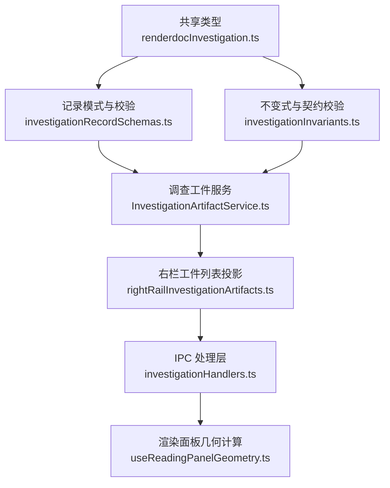
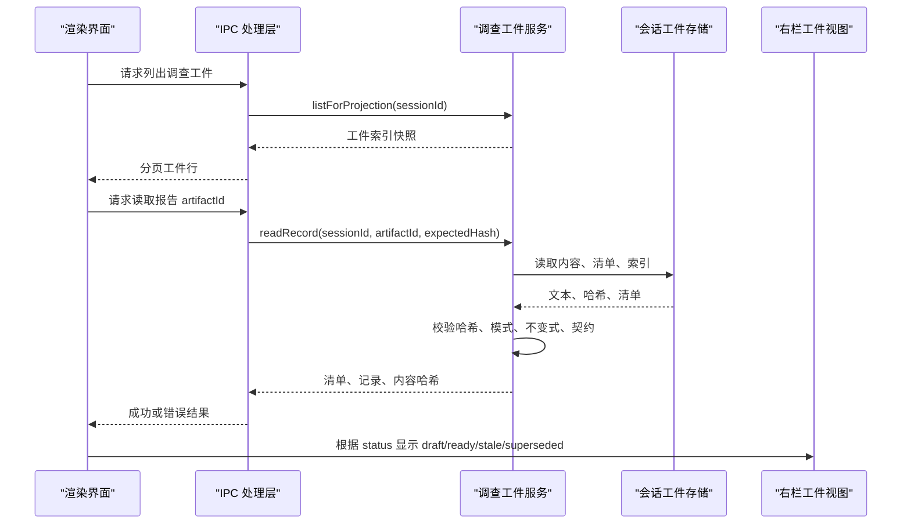
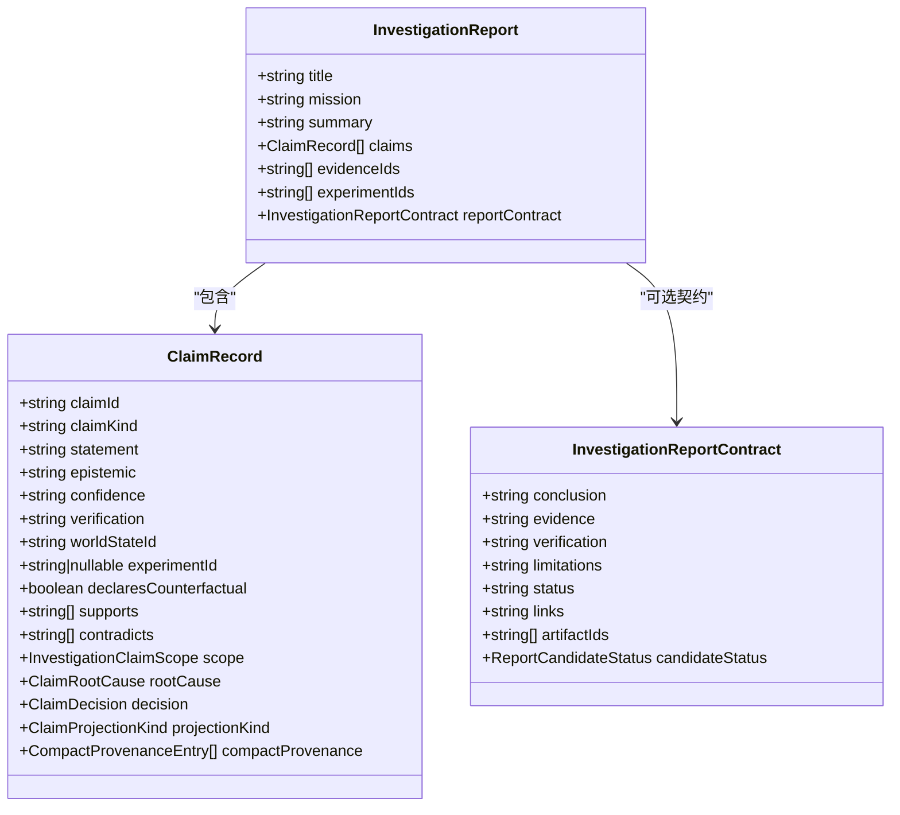
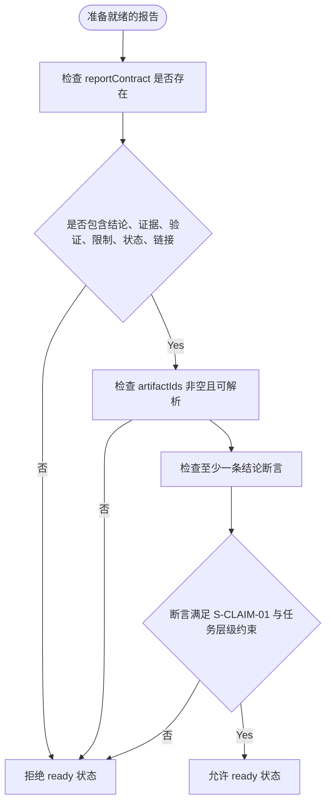
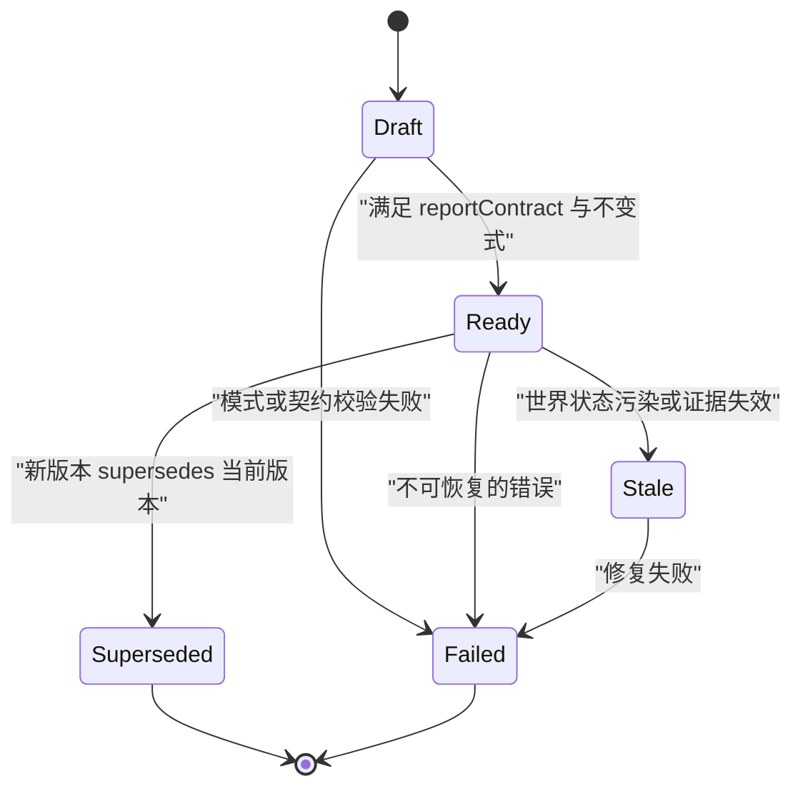
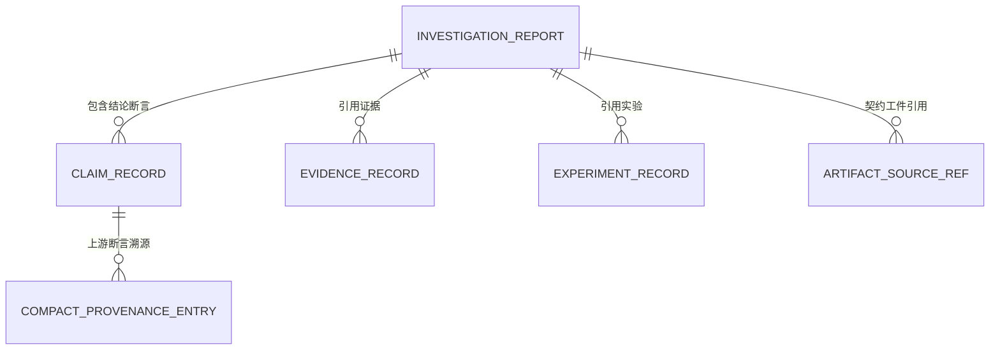
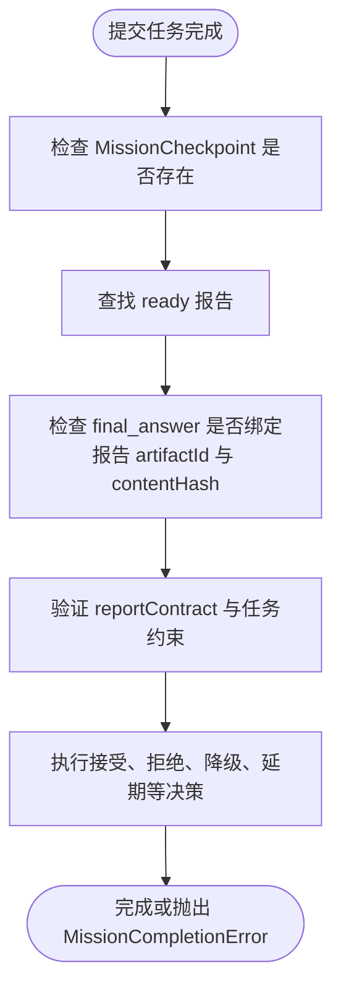
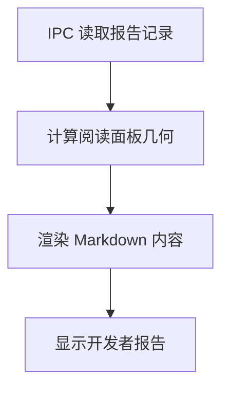
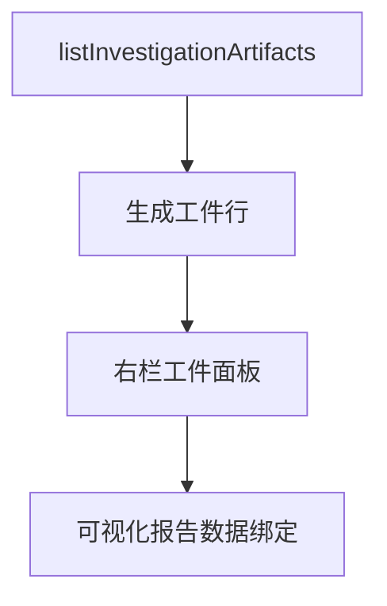
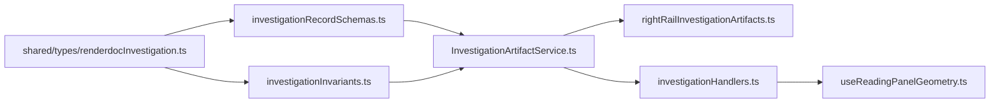

# 调查报告生成

<cite>
**本文引用的文件**
- [renderdocInvestigation.ts](file://src/shared/types/renderdocInvestigation.ts)
- [investigationRecordSchemas.ts](file://src/main/investigation/investigationRecordSchemas.ts)
- [investigationInvariants.ts](file://src/main/investigation/investigationInvariants.ts)
- [missionCompletionContract.ts](file://src/main/investigation/missionCompletionContract.ts)
- [InvestigationArtifactService.ts](file://src/main/investigation/InvestigationArtifactService.ts)
- [rightRailInvestigationArtifacts.ts](file://src/main/agent-trace/rightRailInvestigationArtifacts.ts)
- [investigationHandlers.ts](file://src/main/ipc/investigationHandlers.ts)
- [useReadingPanelGeometry.ts](file://src/renderer/lib/useReadingPanelGeometry.ts)
</cite>

## 目录
1. [引言](#引言)
2. [项目结构](#项目结构)
3. [核心组件](#核心组件)
4. [架构总览](#架构总览)
5. [详细组件分析](#详细组件分析)
6. [依赖关系分析](#依赖关系分析)
7. [性能与完整性考虑](#性能与完整性考虑)
8. [故障排查指南](#故障排查指南)
9. [结论](#结论)
10. [附录：报告模板、样式与国际化建议](#附录报告模板样式与国际化建议)

## 引言
本文件面向“调查报告生成系统”，聚焦两类阅读表面：
- Developer Report（开发者报告）：以证据链、假设检验、实验回滚、断言不变式为核心的技术型阅读面。
- Executive Visual Report（高管可视化报告）：以结论摘要、证据与验证说明、限制、状态与外部链接为主的决策型阅读面。

系统中，所有调查工件都通过统一的数据模型、契约校验、索引与版本控制机制组织。`InvestigationReport` 是顶层聚合体，承载章节化结论、证据引用、实验关联和可选的 `reportContract` 摘要契约；当报告被标记为 `ready` 时，必须满足最小完整性要求。报告的状态迁移由 `draft → ready` 等生命周期驱动，并通过 `superseded` 实现版本替代。

## 项目结构
本报告相关代码分布在共享类型定义、主进程调查服务、IPC 桥接、右栏投影与渲染几何计算模块中：

**图示来源**
- [renderdocInvestigation.ts:386-424](file://src/shared/types/renderdocInvestigation.ts#L386-L424)
- [investigationRecordSchemas.ts:278-318](file://src/main/investigation/investigationRecordSchemas.ts#L278-L318)
- [investigationInvariants.ts:231-307](file://src/main/investigation/investigationInvariants.ts#L231-L307)
- [InvestigationArtifactService.ts:140-220](file://src/main/investigation/InvestigationArtifactService.ts#L140-L220)
- [rightRailInvestigationArtifacts.ts:1-112](file://src/main/agent-trace/rightRailInvestigationArtifacts.ts#L1-L112)
- [investigationHandlers.ts:1-103](file://src/main/ipc/investigationHandlers.ts#L1-L103)
- [useReadingPanelGeometry.ts:1-56](file://src/renderer/lib/useReadingPanelGeometry.ts#L1-L56)

**章节来源**
- [renderdocInvestigation.ts:386-424](file://src/shared/types/renderdocInvestigation.ts#L386-L424)
- [investigationRecordSchemas.ts:278-318](file://src/main/investigation/investigationRecordSchemas.ts#L278-L318)
- [InvestigationArtifactService.ts:140-220](file://src/main/investigation/InvestigationArtifactService.ts#L140-L220)

## 核心组件
- **调查工件类型与枚举**：定义世界状态、证据、断言、实验、挑战、检查点、报告及报告契约、工件清单等类型。
- **记录模式与 Zod 校验**：对 `InvestigationReport` 及其子结构进行严格 JSON Schema 校验。
- **不变式与报告契约**：强制 `ready` 报告必须包含结论、证据、验证、限制、状态、链接、工件 ID 列表以及可解析的断言投影。
- **调查工件服务**：负责写入、读取、索引、哈希校验、事务提交、版本替代、状态判定与跨工件引用校验。
- **右栏工件投影**：将后端工件列表转换为前端面板视图模型，过滤已替代版本并展示关键元信息。
- **IPC 处理层**：在 Electron 主进程中暴露 `investigation:list` 与 `investigation:read`，并将底层错误映射为统一的 IPC 结果。
- **渲染面板几何计算**：用于计算阅读面板尺寸与定位，支持 Markdown 或可视化报告在右侧面板中的自适应布局。

**章节来源**
- [renderdocInvestigation.ts:386-424](file://src/shared/types/renderdocInvestigation.ts#L386-L424)
- [investigationRecordSchemas.ts:278-318](file://src/main/investigation/investigationRecordSchemas.ts#L278-L318)
- [investigationInvariants.ts:231-307](file://src/main/investigation/investigationInvariants.ts#L231-L307)
- [InvestigationArtifactService.ts:140-220](file://src/main/investigation/InvestigationArtifactService.ts#L140-L220)
- [rightRailInvestigationArtifacts.ts:1-112](file://src/main/agent-trace/rightRailInvestigationArtifacts.ts#L1-L112)
- [investigationHandlers.ts:1-103](file://src/main/ipc/investigationHandlers.ts#L1-L103)
- [useReadingPanelGeometry.ts:1-56](file://src/renderer/lib/useReadingPanelGeometry.ts#L1-L56)

## 架构总览
调查报告的读写流程围绕“记录内容 + 清单 + 索引”三元组展开：

**图示来源**
- [investigationHandlers.ts:58-103](file://src/main/ipc/investigationHandlers.ts#L58-L103)
- [InvestigationArtifactService.ts:220-320](file://src/main/investigation/InvestigationArtifactService.ts#L220-L320)
- [rightRailInvestigationArtifacts.ts:54-112](file://src/main/agent-trace/rightRailInvestigationArtifacts.ts#L54-L112)

**章节来源**
- [investigationHandlers.ts:1-103](file://src/main/ipc/investigationHandlers.ts#L1-L103)
- [InvestigationArtifactService.ts:220-320](file://src/main/investigation/InvestigationArtifactService.ts#L220-L320)
- [rightRailInvestigationArtifacts.ts:54-112](file://src/main/agent-trace/rightRailInvestigationArtifacts.ts#L54-L112)

## 详细组件分析

### InvestigationReport 数据结构
`InvestigationReport` 是调查系统的顶层报告实体，主要字段包括：
- `title`：报告标题。
- `mission`：所属调查任务，例如 `debugger`、`analyzer`、`optimizer`。
- `summary`：报告摘要。
- `claims`：结论断言集合，通常以投影断言形式呈现给阅读者。
- `evidenceIds`：引用的证据 ID 列表，用于证据溯源。
- `experimentIds`：引用的实验 ID 列表，用于假设检验与优化结论支撑。
- `reportContract`：可选的最小完整性契约，用于高管可视化报告的关键摘要与可审核声明。

**图示来源**
- [renderdocInvestigation.ts:405-424](file://src/shared/types/renderdocInvestigation.ts#L405-L424)
- [renderdocInvestigation.ts:307-369](file://src/shared/types/renderdocInvestigation.ts#L307-L369)

**章节来源**
- [renderdocInvestigation.ts:405-424](file://src/shared/types/renderdocInvestigation.ts#L405-L424)
- [investigationRecordSchemas.ts:278-318](file://src/main/investigation/investigationRecordSchemas.ts#L278-L318)

### 报告契约与最小完整性要求
报告契约 `reportContract` 是确保报告达到可发布状态的“最小完整片段”。当报告状态为 `ready` 时，系统会强制校验：
- 结论、证据、验证、限制、状态、链接均为非空字符串。
- `artifactIds` 至少包含一个可解析的工件 ID。
- `candidateStatus` 使用允许值。
- 报告至少包含一条结论性断言投影。
- 断言投影需满足 S-CLAIM-01 等不变式，且 analyzer 任务还需满足解释层级约束。

**图示来源**
- [investigationInvariants.ts:231-307](file://src/main/investigation/investigationInvariants.ts#L231-L307)
- [investigationRecordSchemas.ts:278-318](file://src/main/investigation/investigationRecordSchemas.ts#L278-L318)

**章节来源**
- [investigationInvariants.ts:231-307](file://src/main/investigation/investigationInvariants.ts#L231-L307)
- [missionCompletionContract.ts:146-205](file://src/main/investigation/missionCompletionContract.ts#L146-L205)

### 报告状态管理与版本控制
调查工件采用以下状态：
- `draft`：草稿态，尚未满足 ready 契约。
- `ready`：完成态，已通过模式、哈希、不变式与报告契约校验。
- `stale`：过时态，通常因世界状态污染或证据失效而标记。
- `failed`：失败态，写入或校验失败。
- `superseded`：被替代态，新版本通过 `supersedes` 字段替换旧版本。

**图示来源**
- [renderdocInvestigation.ts:158-176](file://src/shared/types/renderdocInvestigation.ts#L158-L176)
- [InvestigationArtifactService.ts:200-220](file://src/main/investigation/InvestigationArtifactService.ts#L200-L220)
- [InvestigationArtifactService.ts:800-896](file://src/main/investigation/InvestigationArtifactService.ts#L800-L896)

**章节来源**
- [renderdocInvestigation.ts:158-176](file://src/shared/types/renderdocInvestigation.ts#L158-L176)
- [InvestigationArtifactService.ts:200-220](file://src/main/investigation/InvestigationArtifactService.ts#L200-L220)

### 报告与调查工件的关系映射
报告通过以下关系建立证据溯源、结论验证与假设检验：
- `evidenceIds` 引用 `EvidenceRecord`，保证结论基于可追溯证据。
- `experimentIds` 引用 `ExperimentRecord`，支撑因果结论与优化结论的可证伪性。
- `claims` 作为结论断言集合，通常携带 `compactProvenance`，向上游断言溯源。
- `reportContract.artifactIds` 指向参与报告构建的相关工件，便于审计与交叉验证。

**图示来源**
- [renderdocInvestigation.ts:307-369](file://src/shared/types/renderdocInvestigation.ts#L307-L369)
- [renderdocInvestigation.ts:405-424](file://src/shared/types/renderdocInvestigation.ts#L405-L424)

**章节来源**
- [renderdocInvestigation.ts:307-369](file://src/shared/types/renderdocInvestigation.ts#L307-L369)
- [renderdocInvestigation.ts:405-424](file://src/shared/types/renderdocInvestigation.ts#L405-L424)

### 报告审查流程与决策操作
系统中的审查与决策主要通过断言决策与任务完成契约体现：
- 断言决策包含接受、拒绝、降级、延期等判断，并通过 `ClaimDecision` 表达。
- 任务完成阶段会检查最终答案是否绑定到 `ready` 报告，并验证报告契约与任务特定要求。
- analyzer 任务需要 Observed / Reconstructed / Authoring 三层断言覆盖；optimizer 任务需要可证伪实验与回滚。

**图示来源**
- [missionCompletionContract.ts:69-205](file://src/main/investigation/missionCompletionContract.ts#L69-L205)
- [missionCompletionContract.ts:205-277](file://src/main/investigation/missionCompletionContract.ts#L205-L277)
- [renderdocInvestigation.ts:307-369](file://src/shared/types/renderdocInvestigation.ts#L307-L369)

**章节来源**
- [missionCompletionContract.ts:69-205](file://src/main/investigation/missionCompletionContract.ts#L69-L205)
- [missionCompletionContract.ts:205-277](file://src/main/investigation/missionCompletionContract.ts#L205-L277)

### Markdown 报告模板引擎与渲染流程
仓库中存在 Markdown 消息渲染测试与阅读面板几何计算逻辑，表明渲染层支持 Markdown 内容与动态布局。虽然未直接提供模板引擎源码，但可从以下路径推断渲染关注点：
- 渲染几何计算负责测量工作区与右侧面板边界，输出 CSS 变量用于定位阅读面板。
- IPC 返回的记录可用于渲染 Markdown 内容。
- 测试文件涉及 Markdown 渲染行为，可作为模板扩展点参考。

**图示来源**
- [investigationHandlers.ts:58-103](file://src/main/ipc/investigationHandlers.ts#L58-L103)
- [useReadingPanelGeometry.ts:1-56](file://src/renderer/lib/useReadingPanelGeometry.ts#L1-L56)

**章节来源**
- [investigationHandlers.ts:58-103](file://src/main/ipc/investigationHandlers.ts#L58-L103)
- [useReadingPanelGeometry.ts:1-56](file://src/renderer/lib/useReadingPanelGeometry.ts#L1-L56)

### 可视化报告的数据绑定与图表生成机制
当前仓库未提供可视化报告的具体图表生成实现，但右栏工件列表与 IPC 数据流提供了数据绑定基础：
- `listInvestigationArtifacts` 将工件索引与清单映射为面板行，包含工件 ID、类型、状态、任务、内容哈希短串、世界状态 ID、退化标志等。
- `mapRightRailInvestigationArtifacts` 取前五行供快速浏览。
- 可视化报告可基于这些行数据绑定结论摘要、证据计数、实验计数、状态分布等指标。

**图示来源**
- [rightRailInvestigationArtifacts.ts:54-112](file://src/main/agent-trace/rightRailInvestigationArtifacts.ts#L54-L112)

**章节来源**
- [rightRailInvestigationArtifacts.ts:54-112](file://src/main/agent-trace/rightRailInvestigationArtifacts.ts#L54-L112)

## 依赖关系分析

**图示来源**
- [renderdocInvestigation.ts:386-424](file://src/shared/types/renderdocInvestigation.ts#L386-L424)
- [investigationRecordSchemas.ts:278-318](file://src/main/investigation/investigationRecordSchemas.ts#L278-L318)
- [investigationInvariants.ts:231-307](file://src/main/investigation/investigationInvariants.ts#L231-L307)
- [InvestigationArtifactService.ts:140-220](file://src/main/investigation/InvestigationArtifactService.ts#L140-L220)
- [rightRailInvestigationArtifacts.ts:1-112](file://src/main/agent-trace/rightRailInvestigationArtifacts.ts#L1-L112)
- [investigationHandlers.ts:1-103](file://src/main/ipc/investigationHandlers.ts#L1-L103)
- [useReadingPanelGeometry.ts:1-56](file://src/renderer/lib/useReadingPanelGeometry.ts#L1-L56)

**章节来源**
- [renderdocInvestigation.ts:386-424](file://src/shared/types/renderdocInvestigation.ts#L386-L424)
- [investigationRecordSchemas.ts:278-318](file://src/main/investigation/investigationRecordSchemas.ts#L278-L318)
- [investigationInvariants.ts:231-307](file://src/main/investigation/investigationInvariants.ts#L231-L307)
- [InvestigationArtifactService.ts:140-220](file://src/main/investigation/InvestigationArtifactService.ts#L140-L220)
- [rightRailInvestigationArtifacts.ts:1-112](file://src/main/agent-trace/rightRailInvestigationArtifacts.ts#L1-L112)
- [investigationHandlers.ts:1-103](file://src/main/ipc/investigationHandlers.ts#L1-L103)
- [useReadingPanelGeometry.ts:1-56](file://src/renderer/lib/useReadingPanelGeometry.ts#L1-L56)

## 性能与完整性考虑
- 内容哈希校验：每次读取都会校验内容文本与清单哈希的一致性，防止截断或篡改。
- 索引完整性：索引文档会被解析并校验，异常时区分缺失、损坏、部分事务残留等状态。
- 只读缓存：会话锁定期间会缓存已验证索引，减少重复解析开销。
- 投影优化：`listForProjection` 返回轻量索引快照，适合前端分页与过滤。
- 状态传播：世界状态污染或实验回滚不完整会传播为证据过期，影响报告有效性。

**章节来源**
- [InvestigationArtifactService.ts:220-320](file://src/main/investigation/InvestigationArtifactService.ts#L220-L320)
- [InvestigationArtifactService.ts:700-896](file://src/main/investigation/InvestigationArtifactService.ts#L700-L896)

## 故障排查指南
常见错误与定位方式：
- `INVESTIGATION_NOT_FOUND`：工件 ID 不存在。
- `INVESTIGATION_HASH_MISMATCH`：内容哈希不匹配或预期哈希不一致。
- `INVESTIGATION_INDEX_CORRUPT`：索引损坏或缺失。
- `INVESTIGATION_DEGRADED`：存在部分事务残留。
- `INVESTIGATION_READY_DENIED`：ready 状态缺少 sourceRefs、contentHash 不匹配或契约不完整。
- `INVESTIGATION_INVARIANT_VIOLATION`：报告契约、断言投影、实验闭合条件等不变式违反。
- `MissionCompletionError`：任务完成阶段缺少检查点、报告未就绪、最终答案未绑定、报告状态不允许完成等。

排查步骤：
1. 使用 `investigation:list` 查看工件索引，确认工件存在且未被替代。
2. 使用 `investigation:read` 读取具体工件，检查返回状态与错误码。
3. 核对 `reportContract` 是否包含必要字段，断言是否满足 S-CLAIM-01。
4. 检查世界状态与实验回滚是否满足隔离与闭合条件。
5. 若为任务完成报错，检查最终答案是否绑定报告 artifactId 与 contentHash。

**章节来源**
- [investigationHandlers.ts:24-57](file://src/main/ipc/investigationHandlers.ts#L24-L57)
- [InvestigationArtifactService.ts:220-320](file://src/main/investigation/InvestigationArtifactService.ts#L220-L320)
- [missionCompletionContract.ts:69-205](file://src/main/investigation/missionCompletionContract.ts#L69-L205)

## 结论
调查报告中，Developer Report 侧重证据链与实验闭环，Executive Visual Report 侧重结论摘要与可审计契约。系统通过 `InvestigationReport`、`reportContract`、Zod 模式、不变式与工件索引共同保证最小完整性与可追溯性。状态管理明确区分草稿、就绪、过时、失败与被替代版本，任务完成契约进一步约束报告必须满足任务特定的断言与实验要求。IPC 与右栏投影为上层 Markdown 与可视化渲染提供稳定数据源，渲染几何计算支持灵活的面板布局。

[无章节来源：本节为总结性内容]

## 附录：报告模板、样式与国际化建议
- 模板定制：建议在现有 Markdown 渲染基础上扩展模板变量，如 `title`、`summary`、`reportContract.conclusion`、`reportContract.evidence`、`reportContract.limitations`、`status`、`links`，并在开发者报告侧展示 `claims`、`evidenceIds`、`experimentIds` 的详情。
- 样式配置：可利用 `useReadingPanelGeometry` 输出的 CSS 变量控制阅读面板位置与尺寸，结合主题 token 适配深色/浅色模式。
- 国际化支持：当前仓库具备 i18n 资源目录与多语言翻译文件，建议将报告提示、错误码、任务名称、状态文案纳入对应语言包。

[无章节来源：本节为通用建议，不直接分析具体文件]