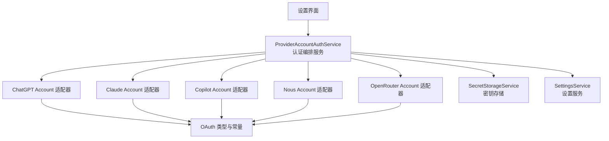
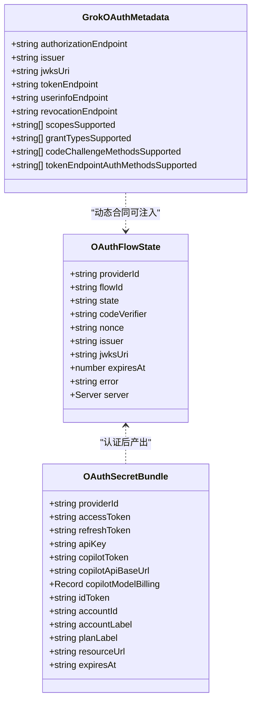
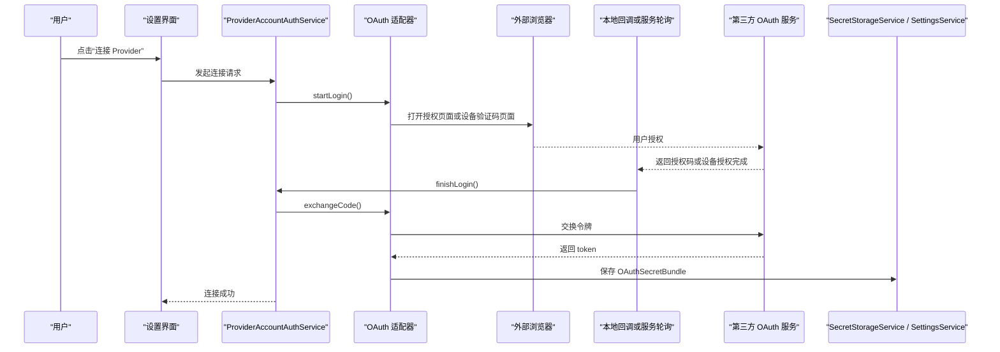
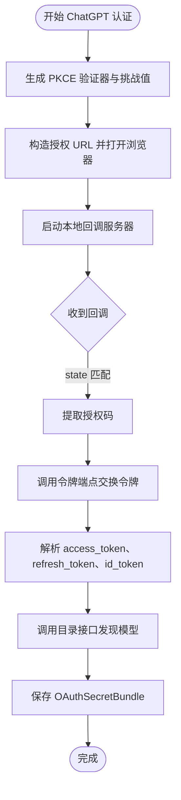
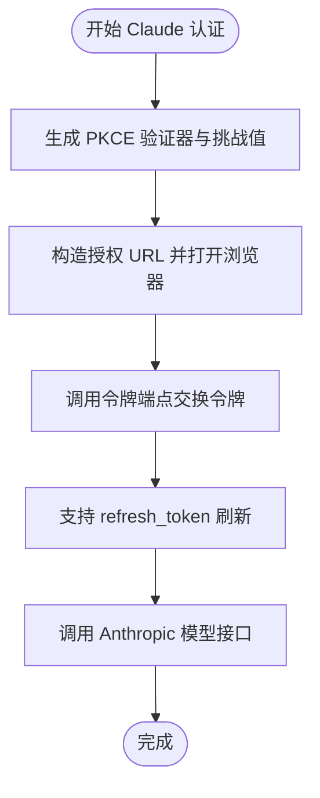
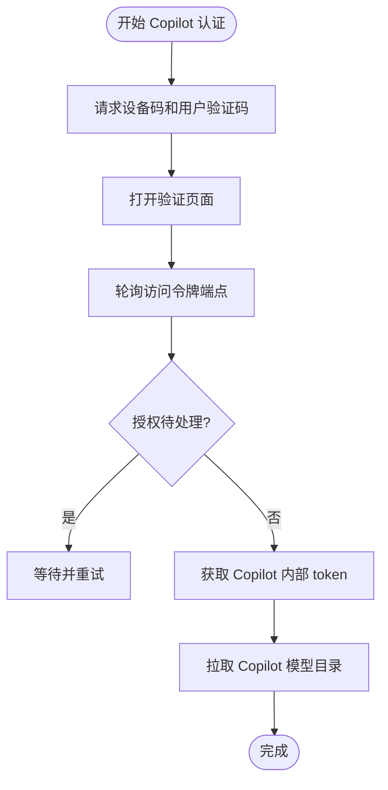
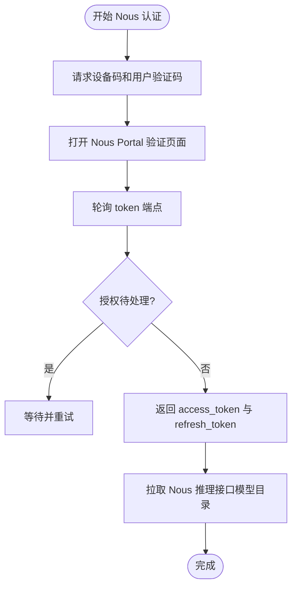
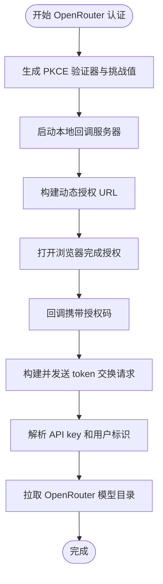
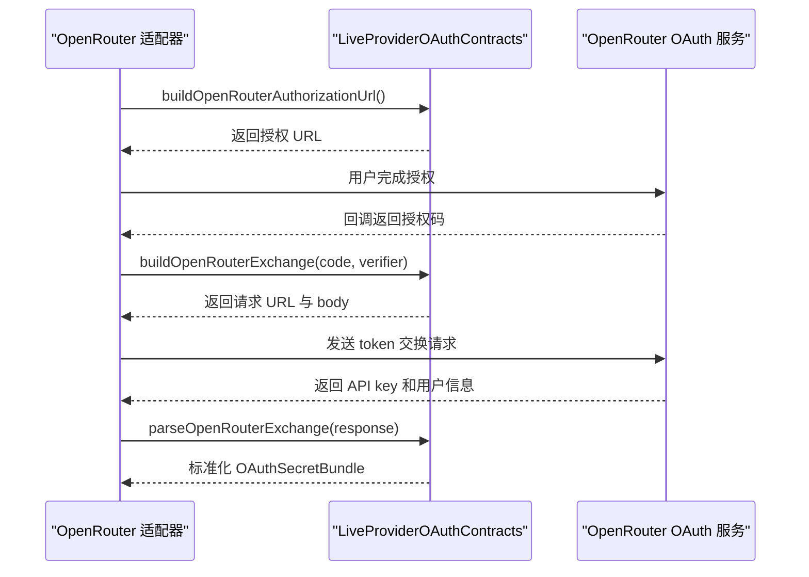
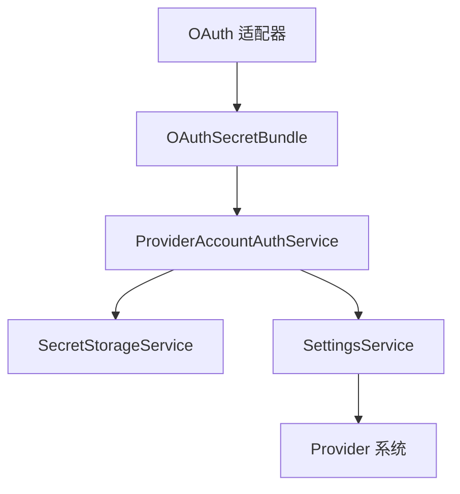

# OAuth 认证流程

<cite>
**本文引用的文件**   
- [oauthTypes.ts](file://src/main/settings/oauth/oauthTypes.ts)
- [oauthConstants.ts](file://src/main/settings/oauth/oauthConstants.ts)
- [chatGptAccountOAuth.ts](file://src/main/settings/oauth/chatGptAccountOAuth.ts)
- [claudeAccountOAuth.ts](file://src/main/settings/oauth/claudeAccountOAuth.ts)
- [copilotAccountOAuth.ts](file://src/main/settings/oauth/copilotAccountOAuth.ts)
- [nousAccountOAuth.ts](file://src/main/settings/oauth/nousAccountOAuth.ts)
- [openRouterAccountOAuth.ts](file://src/main/settings/oauth/openRouterAccountOAuth.ts)
- [oauthHttp.ts](file://src/main/settings/oauth/oauthHttp.ts)
- [ProviderAccountAuthService.ts](file://src/main/settings/ProviderAccountAuthService.ts)
- [LiveProviderOAuthContracts.test.ts](file://src/main/settings/LiveProviderOAuthContracts.test.ts)
- [SecretStorageService.ts](file://src/main/settings/SecretStorageService.ts)
- [SettingsService.ts](file://src/main/settings/SettingsService.ts)
</cite>

## 目录
1. [引言](#引言)
2. [项目结构定位](#项目结构定位)
3. [核心概念与数据模型](#核心概念与数据模型)
4. [架构总览](#架构总览)
5. [各 OAuth 提供商实现](#各-oauth-提供商实现)
6. [动态 OAuth 合同支持](#动态-oauth-合同支持)
7. [通用常量、错误处理与配置项](#通用常量错误处理与配置项)
8. [主进程内 OAuth Bundle 流转与密钥存储集成](#主进程内-oauth-bundle-流转与密钥存储集成)
9. [回调地址、PKCE 与跨平台兼容说明](#回调地址pkce与跨平台兼容说明)
10. [常见问题排查](#常见问题排查)
11. [结论](#结论)

## 引言
本文面向需要理解并扩展 RDC Agent 中 OAuth 认证能力的开发者。文档重点覆盖：
- ChatGPT Account、Claude Account、Copilot Account、Nous Account、OpenRouter Account 等具体适配器的认证流程。
- OAuth 状态管理，包括授权码获取、token 交换、refresh token 刷新、用户登录状态同步。
- LiveProviderOAuthContracts 提供的运行时动态 OAuth 合同能力。
- oauthConstants 中的通用常量、常见配置项和错误相关行为。
- OAuth bundle 在主进程中的流转机制，以及与 SecretStorageService 的集成方式。
- 回调 URL 配置、PKCE 支持、设备码模式以及跨平台兼容性注意事项。

## 项目结构定位
OAuth 相关实现集中在主进程的设置模块中，主要位于 `src/main/settings/oauth` 目录，并由设置服务和 Provider 系统调用：
- 类型与共享定义：`oauthTypes.ts`、`oauthConstants.ts`、`oauthHttp.ts`。
- 具体提供商适配器：`chatGptAccountOAuth.ts`、`claudeAccountOAuth.ts`、`copilotAccountOAuth.ts`、`nousAccountOAuth.ts`、`openRouterAccountOAuth.ts`。
- 上层编排服务：`ProviderAccountAuthService.ts`。
- 动态合同测试入口与相关契约工具：`LiveProviderOAuthContracts.test.ts`。
- 密钥持久化与服务层：`SecretStorageService.ts`、`SettingsService.ts`。

**图示来源**  
- [chatGptAccountOAuth.ts:1-146](file://src/main/settings/oauth/chatGptAccountOAuth.ts#L1-L146)  
- [claudeAccountOAuth.ts:1-100](file://src/main/settings/oauth/claudeAccountOAuth.ts#L1-L100)  
- [copilotAccountOAuth.ts:1-117](file://src/main/settings/oauth/copilotAccountOAuth.ts#L1-L117)  
- [nousAccountOAuth.ts:1-134](file://src/main/settings/oauth/nousAccountOAuth.ts#L1-L134)  
- [openRouterAccountOAuth.ts:1-127](file://src/main/settings/oauth/openRouterAccountOAuth.ts#L1-L127)  
- [ProviderAccountAuthService.ts](file://src/main/settings/ProviderAccountAuthService.ts)  
- [SecretStorageService.ts](file://src/main/settings/SecretStorageService.ts)  
- [SettingsService.ts](file://src/main/settings/SettingsService.ts)

**章节来源**  
- [chatGptAccountOAuth.ts:1-146](file://src/main/settings/oauth/chatGptAccountOAuth.ts#L1-L146)  
- [claudeAccountOAuth.ts:1-100](file://src/main/settings/oauth/claudeAccountOAuth.ts#L1-L100)  
- [copilotAccountOAuth.ts:1-117](file://src/main/settings/oauth/copilotAccountOAuth.ts#L1-L117)  
- [nousAccountOAuth.ts:1-134](file://src/main/settings/oauth/nousAccountOAuth.ts#L1-L134)  
- [openRouterAccountOAuth.ts:1-127](file://src/main/settings/oauth/openRouterAccountOAuth.ts#L1-L127)  
- [ProviderAccountAuthService.ts](file://src/main/settings/ProviderAccountAuthService.ts)  
- [SecretStorageService.ts](file://src/main/settings/SecretStorageService.ts)  
- [SettingsService.ts](file://src/main/settings/SettingsService.ts)

## 核心概念与数据模型
### OAuthFlowState：单次认证流程状态
`OAuthFlowState` 表示一次 OAuth 认证流程的生命周期状态，包含：
- 提供商标识 `providerId`。
- 流程标识 `flowId`。
- 防重放参数 `state`。
- PKCE 验证器 `codeVerifier`。
- 可选的身份元数据：`issuer`、`jwksUri`。
- 可选的设备码字段：`deviceCode`、`userCode`、`verificationUri`、`intervalSeconds`。
- 可选的本地回调服务器 `server`。
- 可选的错误信息 `error` 与诊断信息 `diagnostic`。
- 过期时间 `expiresAt`。
- 可选的令牌端点、用户信息端点、资源端点、授权模式、请求范围、重定向 URI 等。

该状态用于在浏览器打开、本地回调、token 交换、refresh、目录发现等阶段之间传递上下文。

### OAuthSecretBundle：认证凭据包
`OAuthSecretBundle` 表示认证成功后落盘的凭据包，包含：
- 提供商标识 `providerId`。
- 访问令牌 `accessToken`、刷新令牌 `refreshToken`、API Key `apiKey`。
- Copilot 专用字段：`copilotToken`、`copilotApiBaseUrl`、`copilotModelBilling`。
- ID Token `idToken`、账户标识 `accountId`、账户标签 `accountLabel`、计划标签 `planLabel`。
- 授权模式、请求范围、重定向 URI、资源端点、过期时间字符串等。

该 bundle 由适配器生成，并最终交由设置服务或密钥存储服务保存。

### GrokOAuthMetadata：动态 OIDC 元数据
`GrokOAuthMetadata` 描述动态发现的 OIDC 元数据，例如授权端点、签发者、JWKS 端点、令牌端点、用户信息端点、撤销端点、支持的 scopes、grant types、PKCE challenge methods、令牌端点认证方法等。该结构为动态 OAuth 合同提供基础。

**图示来源**  
- [oauthTypes.ts:1-82](file://src/main/settings/oauth/oauthTypes.ts#L1-L82)

**章节来源**  
- [oauthTypes.ts:1-82](file://src/main/settings/oauth/oauthTypes.ts#L1-L82)

## 架构总览
OAuth 认证的主控流程通常如下：
1. 用户触发连接某个 Provider。
2. ProviderAccountAuthService 选择对应适配器。
3. 适配器构造授权 URL 或设备码流程，并维护 `OAuthFlowState`。
4. 打开外部浏览器完成授权。
5. 通过本地回调或服务端轮询获得授权码或设备授权结果。
6. 使用授权码交换 access token，必要时 refresh token。
7. 从远程 API 拉取模型目录，解析出可用模型。
8. 将 `OAuthSecretBundle` 写入密钥存储或设置服务，并更新连接状态。

**图示来源**  
- [chatGptAccountOAuth.ts:1-146](file://src/main/settings/oauth/chatGptAccountOAuth.ts#L1-L146)  
- [claudeAccountOAuth.ts:1-100](file://src/main/settings/oauth/claudeAccountOAuth.ts#L1-L100)  
- [copilotAccountOAuth.ts:1-117](file://src/main/settings/oauth/copilotAccountOAuth.ts#L1-L117)  
- [nousAccountOAuth.ts:1-134](file://src/main/settings/oauth/nousAccountOAuth.ts#L1-L134)  
- [openRouterAccountOAuth.ts:1-127](file://src/main/settings/oauth/openRouterAccountOAuth.ts#L1-L127)  
- [ProviderAccountAuthService.ts](file://src/main/settings/ProviderAccountAuthService.ts)  
- [SecretStorageService.ts](file://src/main/settings/SecretStorageService.ts)  
- [SettingsService.ts](file://src/main/settings/SettingsService.ts)

## 各 OAuth 提供商实现

### ChatGPT Account
- 授权模式：浏览器 + PKCE。
- 授权端点：OpenAI 认证服务。
- 回调地址：本地 HTTP 回调解码端口。
- 关键流程：
  - 生成 PKCE verifier 和 challenge。
  - 构造授权 URL 并启动本地回调服务器。
  - 回调校验 state 后提取 code。
  - 使用 authorization_code 换取 access_token、refresh_token、id_token。
  - 从 id_token 中提取账户标识。
  - 调用后端目录接口获取模型列表。
  - refresh 流程刷新 access_token 和 refresh_token。

**图示来源**  
- [chatGptAccountOAuth.ts:1-146](file://src/main/settings/oauth/chatGptAccountOAuth.ts#L1-L146)

**章节来源**  
- [chatGptAccountOAuth.ts:1-146](file://src/main/settings/oauth/chatGptAccountOAuth.ts#L1-L146)

### Claude Account
- 授权模式：浏览器 + PKCE。
- 授权端点：Anthropic 控制台授权页面。
- 回调地址：Anthropic 控制台回调地址。
- 关键流程：
  - 生成 PKCE verifier 和 challenge。
  - 构造授权 URL。
  - 使用 authorization_code 换取 access_token 和 refresh_token。
  - refresh 流程刷新 access_token 和 refresh_token。
  - 调用 Anthropic 模型接口拉取模型列表。

**图示来源**  
- [claudeAccountOAuth.ts:1-100](file://src/main/settings/oauth/claudeAccountOAuth.ts#L1-L100)

**章节来源**  
- [claudeAccountOAuth.ts:1-100](file://src/main/settings/oauth/claudeAccountOAuth.ts#L1-L100)

### Copilot Account
- 授权模式：设备码授权。
- 关键点：
  - 先请求设备码和用户验证码。
  - 打开 GitHub 验证页面。
  - 轮询 access_token 端点，处理 pending 和 slow_down。
  - 获取 GitHub Copilot 内部 token 和 API base URL。
  - refresh 流程通过 GitHub API 重新获取 Copilot token。
  - 模型目录来自 Copilot models 接口，并按策略过滤内部模型。

**图示来源**  
- [copilotAccountOAuth.ts:1-117](file://src/main/settings/oauth/copilotAccountOAuth.ts#L1-L117)

**章节来源**  
- [copilotAccountOAuth.ts:1-117](file://src/main/settings/oauth/copilotAccountOAuth.ts#L1-L117)

### Nous Account
- 授权模式：设备码授权。
- 关键点：
  - 调用 Nous Portal 设备码端点。
  - 打开完整验证链接。
  - 轮询 token 端点，处理 pending 和 slow_down。
  - 返回 access_token、refresh_token、scope、inference_base_url。
  - refresh 流程通过 x-nous-refresh-token 头刷新。
  - 模型目录来自 inference_base_url/models，并按策略过滤不可用模型。

**图示来源**  
- [nousAccountOAuth.ts:1-134](file://src/main/settings/oauth/nousAccountOAuth.ts#L1-L134)

**章节来源**  
- [nousAccountOAuth.ts:1-134](file://src/main/settings/oauth/nousAccountOAuth.ts#L1-L134)

### OpenRouter Account
- 授权模式：浏览器 + PKCE，并使用动态合同构建授权 URL 与 token 交换请求。
- 关键点：
  - 生成 PKCE verifier 和 challenge。
  - 启动本地回调服务器，绑定动态路径。
  - 通过 `buildOpenRouterAuthorizationUrl` 构建授权 URL。
  - 回调后通过 `buildOpenRouterExchange` 和 `parseOpenRouterExchange` 交换 API key。
  - 模型目录来自 openrouter.ai/api/v1/models，并结合 ProviderCatalogRegistry 解析。

**图示来源**  
- [openRouterAccountOAuth.ts:1-127](file://src/main/settings/oauth/openRouterAccountOAuth.ts#L1-L127)

**章节来源**  
- [openRouterAccountOAuth.ts:1-127](file://src/main/settings/oauth/openRouterAccountOAuth.ts#L1-L127)

## 动态 OAuth 合同支持
`LiveProviderOAuthContracts` 的核心价值在于：不依赖硬编码每个提供商的所有细节，而是通过运行时发现的 OAuth 合同来构造授权 URL、令牌交换请求，并解析响应。典型能力包括：
- 根据合同动态构建授权 URL。
- 根据合同动态构建 token 交换请求。
- 根据合同解析 token 交换响应。
- 结合 GrokOAuthMetadata 等元数据支持动态 OIDC 配置。

在 OpenRouter Account 中，适配器直接使用动态合同构建授权 URL 和 token 交换逻辑，而不是直接拼接固定 URL；这体现了动态合同对多提供商适配的统一抽象。

**图示来源**  
- [openRouterAccountOAuth.ts:1-127](file://src/main/settings/oauth/openRouterAccountOAuth.ts#L1-L127)  
- [LiveProviderOAuthContracts.test.ts](file://src/main/settings/LiveProviderOAuthContracts.test.ts)

**章节来源**  
- [openRouterAccountOAuth.ts:1-127](file://src/main/settings/oauth/openRouterAccountOAuth.ts#L1-L127)  
- [LiveProviderOAuthContracts.test.ts](file://src/main/settings/LiveProviderOAuthContracts.test.ts)

## 通用常量、错误处理与配置项
### 通用常量
`oauthConstants.ts` 定义了多个提供商相关的常量，包括：
- 超时时间。
- ChatGPT 回调端口、客户端 ID、目录客户端版本。
- Claude 客户端 ID。
- GitHub Copilot 客户端 ID。
- Grok 的 OpenID 配置地址、客户端 ID、请求 scope、代理基地址和 XAI API 基地址。
- Nous 门户基地址、推理 API 基地址、OAuth 客户端 ID 和 scope。

这些常量被各适配器引用，避免硬编码散落在业务逻辑中。

### 常见错误处理模式
各适配器普遍采用以下错误处理策略：
- 缺少必要参数时抛出错误，例如缺少授权码、缺少 device code、缺少 token。
- 服务端返回错误时转换为统一错误消息。
- 回调校验失败时返回无效回调或提供者错误。
- 目录发现失败时抛出无可用模型错误。
- 刷新失败时抛出未返回访问令牌错误。

这些错误会向上返回给编排服务，最终影响 UI 展示的连接状态。

**章节来源**  
- [oauthConstants.ts:1-15](file://src/main/settings/oauth/oauthConstants.ts#L1-L15)  
- [chatGptAccountOAuth.ts:1-146](file://src/main/settings/oauth/chatGptAccountOAuth.ts#L1-L146)  
- [claudeAccountOAuth.ts:1-100](file://src/main/settings/oauth/claudeAccountOAuth.ts#L1-L100)  
- [copilotAccountOAuth.ts:1-117](file://src/main/settings/oauth/copilotAccountOAuth.ts#L1-L117)  
- [nousAccountOAuth.ts:1-134](file://src/main/settings/oauth/nousAccountOAuth.ts#L1-L134)  
- [openRouterAccountOAuth.ts:1-127](file://src/main/settings/oauth/openRouterAccountOAuth.ts#L1-L127)

## 主进程内 OAuth Bundle 流转与密钥存储集成
### Bundle 流转路径
1. 适配器完成授权码或设备码授权后，生成 `OAuthSecretBundle`。
2. 编排服务接收 bundle，并可能进一步刷新或补充元数据。
3. 设置服务或密钥存储服务保存 bundle，以便后续 Provider 请求复用。
4. 当 token 过期时，refresh manager 或调用方根据 bundle 中的 refresh token 刷新。

### 与 SecretStorageService 的集成
`SecretStorageService` 负责安全地保存敏感凭据。OAuth bundle 中的访问令牌、刷新令牌、API key、Copilot token 等都属于敏感数据，应通过密钥存储服务进行持久化。设置服务则负责更高层的配置结构和连接状态。

**图示来源**  
- [ProviderAccountAuthService.ts](file://src/main/settings/ProviderAccountAuthService.ts)  
- [SecretStorageService.ts](file://src/main/settings/SecretStorageService.ts)  
- [SettingsService.ts](file://src/main/settings/SettingsService.ts)

**章节来源**  
- [ProviderAccountAuthService.ts](file://src/main/settings/ProviderAccountAuthService.ts)  
- [SecretStorageService.ts](file://src/main/settings/SecretStorageService.ts)  
- [SettingsService.ts](file://src/main/settings/SettingsService.ts)

## 回调地址、PKCE 与跨平台兼容说明
### 回调地址配置
- ChatGPT Account：使用本地 HTTP 服务器的固定回调路径。
- Claude Account：使用第三方控制台回调地址。
- OpenRouter Account：使用动态分配的本地回调路径，绑定到随机端口。
- Copilot Account 和 Nous Account：不使用本地回调，而是通过设备码轮询完成授权。

### PKCE 支持
- ChatGPT Account、Claude Account、OpenRouter Account 均使用 PKCE。
- PKCE 由适配器生成 verifier 和 challenge，并在授权 URL 和 token 交换请求中使用。
- OpenRouter Account 通过动态合同构造 PKCE 相关请求。

### 跨平台兼容性
- 本地回调服务器依赖 Node.js `http.Server`，在 Electron 主进程中运行。
- 设备码模式更适合无本地回调场景，适合不同操作系统上的稳定体验。
- 回调端口占用、防火墙拦截、代理环境可能导致回调失败，需要结合错误信息和网络环境排查。

**章节来源**  
- [chatGptAccountOAuth.ts:1-146](file://src/main/settings/oauth/chatGptAccountOAuth.ts#L1-L146)  
- [claudeAccountOAuth.ts:1-100](file://src/main/settings/oauth/claudeAccountOAuth.ts#L1-L100)  
- [copilotAccountOAuth.ts:1-117](file://src/main/settings/oauth/copilotAccountOAuth.ts#L1-L117)  
- [nousAccountOAuth.ts:1-134](file://src/main/settings/oauth/nousAccountOAuth.ts#L1-L134)  
- [openRouterAccountOAuth.ts:1-127](file://src/main/settings/oauth/openRouterAccountOAuth.ts#L1-L127)

## 常见问题排查
### 回调失败
- 检查回调路径是否正确。
- 检查本地端口是否被占用。
- 检查防火墙或代理是否阻止本地回环请求。
- 对于动态回调，确认回调端口已成功暴露。

### 授权码无效或缺失
- 检查 state 是否匹配。
- 检查浏览器是否成功返回授权码。
- 检查 adapter 是否正确保存 codeVerifier。

### Token 交换失败
- 检查 grant_type、client_id、redirect_uri、code_verifier 是否正确。
- 检查第三方服务是否返回 access_token。
- 检查 JSON 或表单体格式是否符合服务商要求。

### Refresh Token 失效
- 检查 refresh_token 是否存在。
- 检查服务商是否允许离线刷新。
- 检查刷新响应是否返回新的 access_token。

### 模型目录为空
- 检查 access_token 或 API key 是否有效。
- 检查服务商模型接口是否返回可用模型。
- 检查适配器是否按策略过滤了所有模型。

**章节来源**  
- [chatGptAccountOAuth.ts:1-146](file://src/main/settings/oauth/chatGptAccountOAuth.ts#L1-L146)  
- [claudeAccountOAuth.ts:1-100](file://src/main/settings/oauth/claudeAccountOAuth.ts#L1-L100)  
- [copilotAccountOAuth.ts:1-117](file://src/main/settings/oauth/copilotAccountOAuth.ts#L1-L117)  
- [nousAccountOAuth.ts:1-134](file://src/main/settings/oauth/nousAccountOAuth.ts#L1-L134)  
- [openRouterAccountOAuth.ts:1-127](file://src/main/settings/oauth/openRouterAccountOAuth.ts#L1-L127)

## 结论
本项目的 OAuth 认证体系围绕统一的 `OAuthFlowState` 与 `OAuthSecretBundle` 展开，既支持浏览器 + PKCE 的常见模式，也支持设备码授权，同时通过 `LiveProviderOAuthContracts` 提供动态 OAuth 合同能力，使新提供商可以以更少的硬编码接入。ChatGPT、Claude、Copilot、Nous、OpenRouter 等适配器分别实现了各自的服务商差异，但整体遵循一致的认证编排、错误处理和目录发现模式。在实际使用中，应重点关注回调地址、PKCE 参数、token 交换格式、refresh token 生命周期以及模型目录可用性，并结合密钥存储服务确保凭据安全。