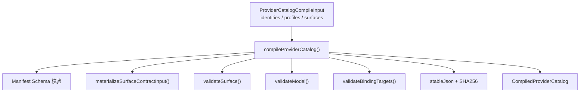
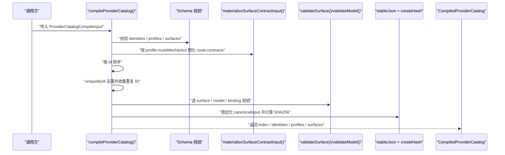
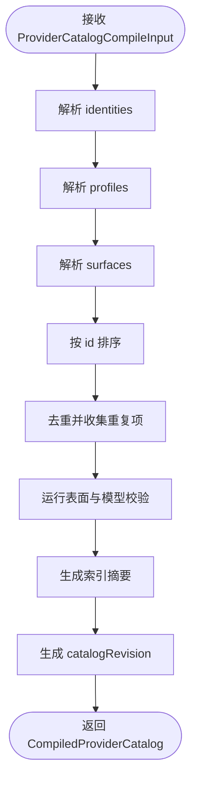
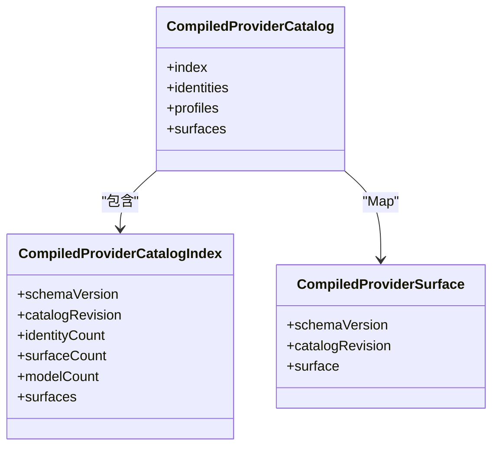
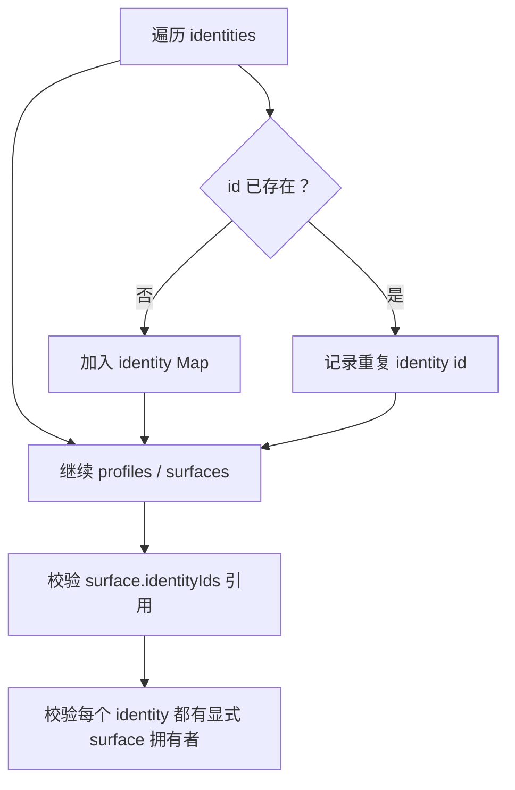
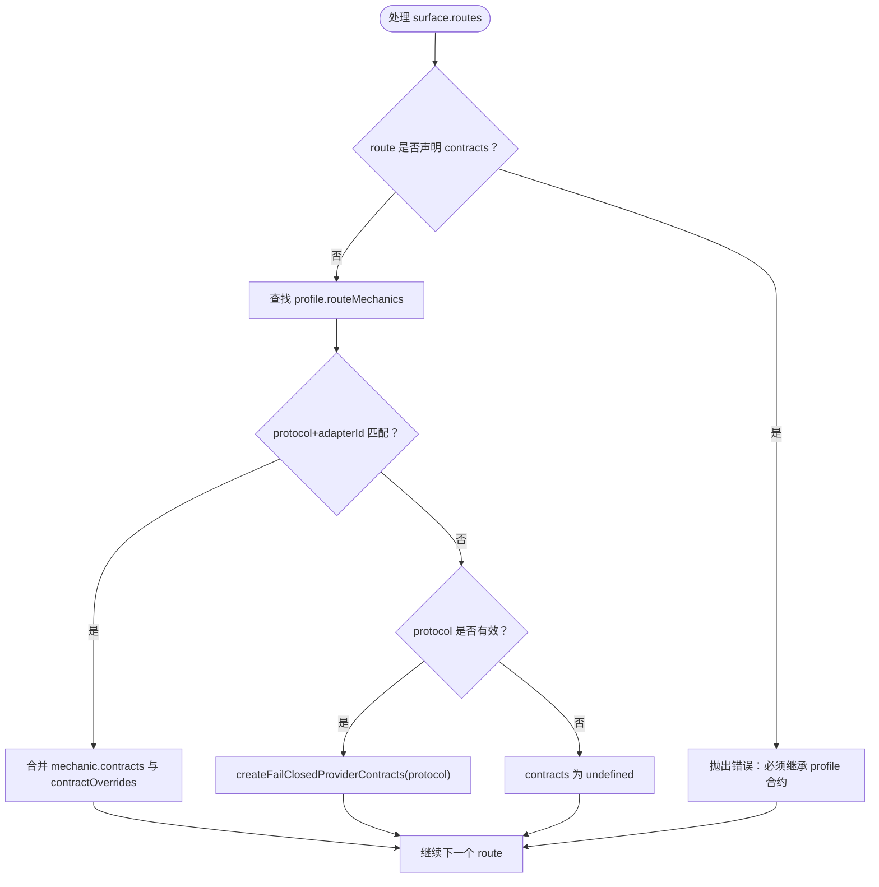
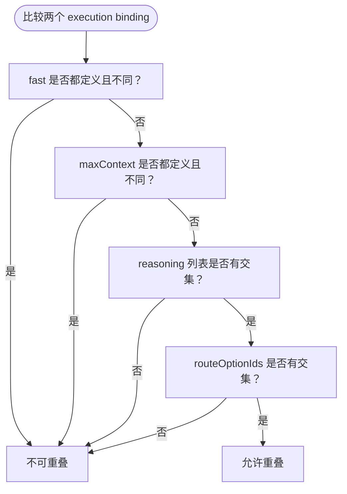
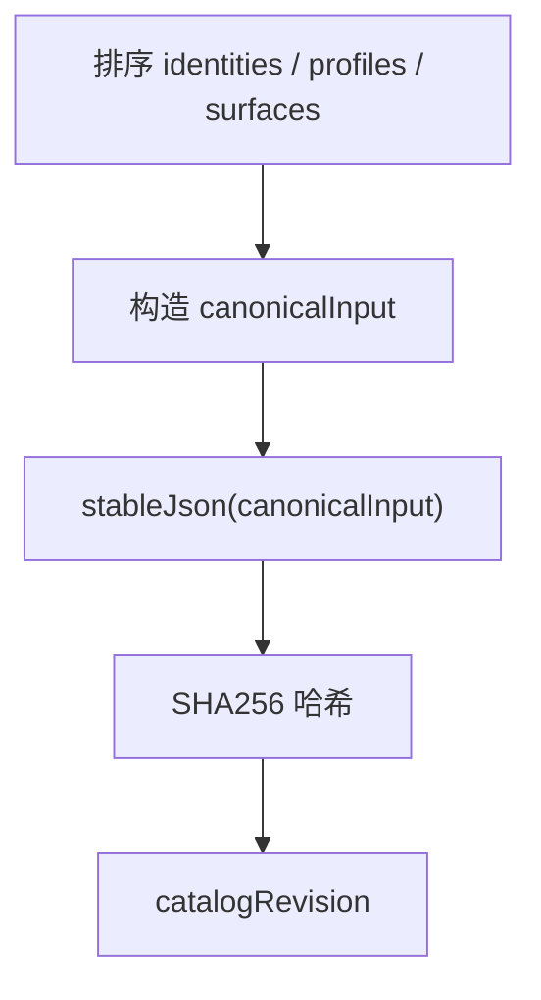
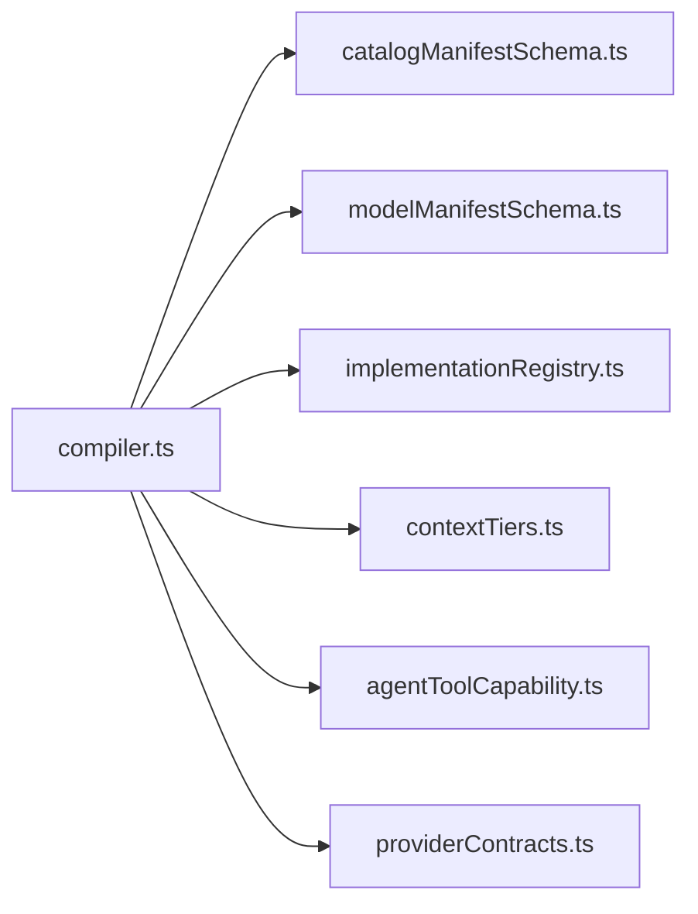

# Catalog Compiler 编译器实现

<cite>
**本文引用的文件**   
- [compiler.ts](file://src/shared/provider-catalog/compiler.ts)
- [compiler.test.ts](file://src/shared/provider-catalog/compiler.test.ts)
- [providerContracts.ts](file://src/shared/provider-catalog/providerContracts.ts)
- [catalogManifestSchema.ts](file://src/shared/provider-catalog/catalogManifestSchema.ts)
- [modelManifestSchema.ts](file://src/shared/provider-catalog/modelManifestSchema.ts)
- [implementationRegistry.ts](file://src/shared/provider-catalog/implementationRegistry.ts)
- [contextTiers.ts](file://src/shared/utils/contextTiers.ts)
- [agentToolCapability.ts](file://src/shared/utils/agentToolCapability.ts)
</cite>

## 目录
1. [简介](#简介)
2. [项目结构](#项目结构)
3. [核心组件](#核心组件)
4. [架构总览](#架构总览)
5. [详细组件分析](#详细组件分析)
6. [依赖关系分析](#依赖关系分析)
7. [性能考虑](#性能考虑)
8. [故障排查指南](#故障排查指南)
9. [结论](#结论)

## 简介
Catalog Compiler 是 Provider 目录编译器的核心实现，负责将用户可编辑的 JSON manifest（identity、profile、surface）编译为类型安全的运行时数据结构。其入口函数 `compileProviderCatalog()` 承担以下职责：
- 校验并解析 identity/profile/surface manifest；
- 将 surface route 的 contracts 继承自 profile.routeMechanics，并按 route 级 contractOverrides 覆盖；
- 对 model、execution binding、fact source、route matrix、协议归属等执行严格校验；
- 输出稳定可比较的目录索引、已编译 surface 映射，以及身份与 profile 清单；
- 通过稳定化 JSON 和 SHA256 生成 catalog revision，配合固定常量约束 models.dev 快照规模。

该文档重点解释输入接口、输出类型、去重逻辑、ID 引用解析、route contracts 继承机制、execution binding 优先级与维度组合策略，以及错误处理与调试技巧。

## 项目结构
Compiler 位于共享层 provider-catalog 模块中，主要文件如下：
- compiler.ts：编译器主逻辑、类型定义、校验规则、revision 生成。
- compiler.test.ts：基于真实 manifest fixture 的行为断言，覆盖 identity 数量、确定性、路由矩阵、binding 冲突等关键场景。
- 外部依赖：manifest schema、协议/适配器注册表、context tier 工具、结构化 tool adapter 能力检测、fail-closed contracts 工厂。

**图表来源**
- [compiler.ts:20-45](file://src/shared/provider-catalog/compiler.ts#L20-L45)
- [compiler.ts:451-715](file://src/shared/provider-catalog/compiler.ts#L451-L715)

**章节来源**
- [compiler.ts:20-45](file://src/shared/provider-catalog/compiler.ts#L20-L45)
- [compiler.ts:451-715](file://src/shared/provider-catalog/compiler.ts#L451-L715)

## 核心组件
Compiler 的核心类型与常量包括：
- `PROVIDER_CATALOG_SCHEMA_VERSION`：目录 schema 版本常量。
- `MODELS_DEV_IDENTITY_COUNT`：期望的 models.dev identity 数量，用于构建期或发布期断言。
- `MODELS_DEV_SNAPSHOT_SHA256`：固定的 models.dev 快照摘要，强制所有 identity 使用同一可信来源。
- `ProviderCatalogCompileInput`：编译器输入接口，包含 identities、profiles、surfaces 三个未知数组。
- `CompiledProviderCatalogIndex`：轻量级目录索引，含 schemaVersion、catalogRevision、identityCount、surfaceCount、modelCount 和 surfaces 摘要。
- `CompiledProviderSurface`：每个 surface 的已编译视图，包含 schemaVersion、catalogRevision 和原始 surface manifest。
- `CompiledProviderCatalog`：最终产物，包含 index、identities、profiles、surfaces Map。

这些类型共同构成“只读、类型安全、可用于 UI 和运行时”的编译后模型。

**章节来源**
- [compiler.ts:20-45](file://src/shared/provider-catalog/compiler.ts#L20-L45)
- [compiler.ts:451-715](file://src/shared/provider-catalog/compiler.ts#L451-L715)

## 架构总览
Compiler 的执行流程可以概括为“解析 → 合约物化 → 排序 → 去重 → 校验 → 索引 → 修订号”。

**图表来源**
- [compiler.ts:451-715](file://src/shared/provider-catalog/compiler.ts#L451-L715)
- [compiler.ts:20-45](file://src/shared/provider-catalog/compiler.ts#L20-L45)

## 详细组件分析

### 输入接口 ProviderCatalogCompileInput
`ProviderCatalogCompileInput` 是编译器的唯一输入：
- identities：未解析的 identity manifest 数组。
- profiles：未解析的 profile manifest 数组。
- surfaces：未解析的 surface manifest 数组。

编译器在入口处立即对这三个数组分别调用对应的 Schema 解析器，把未知数据转换为强类型 manifest。这样后续逻辑可以假设字段存在且类型正确，同时把解析错误集中在 Schema 层抛出。

**图表来源**
- [compiler.ts:20-45](file://src/shared/provider-catalog/compiler.ts#L20-L45)
- [compiler.ts:451-715](file://src/shared/provider-catalog/compiler.ts#L451-L715)

**章节来源**
- [compiler.ts:20-45](file://src/shared/provider-catalog/compiler.ts#L20-L45)
- [compiler.ts:451-715](file://src/shared/provider-catalog/compiler.ts#L451-L715)

### 输出类型设计：CompiledProviderCatalogIndex 与 CompiledProviderSurface
CompiledProviderCatalogIndex 是面向 UI 和快速发现的轻量索引：
- 包含 schemaVersion、catalogRevision、计数信息；
- surfaces 是摘要数组，不包含 discovery、discoveredModelProjection、models.liveProjection 等内部细节；
- 仅保留 vendorId、label、status、availability、category、authModes、routes、recommendedModels 等用户可见字段；
- modelCount 排除 pickerVisibility 为 internal 的模型。

CompiledProviderSurface 则保留完整 surface manifest，供需要深度访问的模块使用。CompiledProviderCatalog 同时暴露 identities、profiles 和 surfaces Map，形成“索引 + 完整对象”的双层结构。

**图表来源**
- [compiler.ts:20-45](file://src/shared/provider-catalog/compiler.ts#L20-L45)
- [compiler.ts:451-715](file://src/shared/provider-catalog/compiler.ts#L451-L715)

**章节来源**
- [compiler.ts:20-45](file://src/shared/provider-catalog/compiler.ts#L20-L45)
- [compiler.ts:451-715](file://src/shared/provider-catalog/compiler.ts#L451-L715)

### identity、profile、surface 的去重与 ID 引用解析
编译器使用 `uniqueById()` 对三类实体进行去重：
- 如果同一 id 出现多次，会向 errors 数组追加重复 ID 错误；
- 使用 Map 保存最新值，保证后续引用解析基于去重后的集合；
- identity 还会额外检查是否等于 MODELS_DEV_IDENTITY_COUNT，并要求每个 identity.provenance.sourceRevision 等于 MODELS_DEV_SNAPSHOT_SHA256；
- surface 会检查其 identityIds 是否全部存在于 identity Map 中；
- 最后还校验“被 surface 代表的 identity 不能重复”，即一个 models.dev identity 只能由一个 surface 显式拥有。

**图表来源**
- [compiler.ts:451-715](file://src/shared/provider-catalog/compiler.ts#L451-L715)

**章节来源**
- [compiler.ts:451-715](file://src/shared/provider-catalog/compiler.ts#L451-L715)

### Route Contracts 继承机制
Route contracts 继承发生在 `materializeSurfaceContractInput()` 中，核心规则如下：
- 每个 surface.routes 会被逐一处理；
- 如果 route 直接声明 contracts，编译器会拒绝，因为 route 必须从 profile 继承 contracts，并通过 contractOverrides 覆盖；
- 继承来源是 profile.routeMechanics：
  - 首先匹配 protocol 和 adapterId 都相同的 mechanic；
  - 如果没有完全匹配，则回退到仅匹配 protocol 的 mechanic；
- 如果找到 mechanic，则将 mechanic.contracts 与 route.contractOverrides 合并；
- 如果找不到 mechanic，但 route.protocol 能通过 ProviderProtocolSchema 校验，则使用 `createFailClosedProviderContracts(protocol)` 生成失败关闭的默认 contracts；
- 如果 protocol 也不合法，则 contracts 为 undefined，交由上层 Schema 或调用方处理。

**图表来源**
- [compiler.ts:20-45](file://src/shared/provider-catalog/compiler.ts#L20-L45)

**章节来源**
- [compiler.ts:20-45](file://src/shared/provider-catalog/compiler.ts#L20-L45)

### Execution Binding 优先级与维度解析
Execution binding 的选择由两个关键函数决定：
- `bindingSpecificity(binding)`：计算绑定特异性，值为 fast、maxContext、reasoning 三个维度是否为真时的总和；
- `bindingDimensions(binding)`：将 active 维度转为字符串，例如 fast、maxContext、reasoning、fast|maxContext 等；
- `bindingsCanOverlap(left, right)`：判断两个 binding 是否可以重叠，考虑 fast/maxContext/reasoning 的值是否兼容，以及 routeOptionIds 是否有交集。

**图表来源**
- [compiler.ts:201-250](file://src/shared/provider-catalog/compiler.ts#L201-L250)

编译器还要求：
- 相同 selectorKey（when 的稳定 JSON）不能有不同 actions；
- 相同 dimensions 且相同 specificity 的两个 binding 如果动作不同，则视为冲突；
- 如果某个 model.controls.fast.state 为 selectable，则必须至少有一个 when.fast === true 的 binding；
- model-switch 目标必须是同 surface 内存在的 model，且源和目标必须有协议兼容的 route；
- client-tier 目标 tierId 必须在 model.contextTiers 中存在。

**章节来源**
- [compiler.ts:201-250](file://src/shared/provider-catalog/compiler.ts#L201-L250)
- [compiler.ts:250-450](file://src/shared/provider-catalog/compiler.ts#L250-L450)

### Catalog Revision 生成算法
Catalog revision 由稳定的 canonical input 生成：
- 先将 identities、profiles、surfaces 按 id 做 localeCompare 排序；
- 构造 `{ identities, profiles, surfaces }` 作为 canonicalInput；
- 使用 `stableJson()` 递归序列化，确保对象键顺序一致、数组顺序不变；
- 对稳定字符串计算 SHA256，得到 hex 形式的 catalogRevision。

这意味着即使原始 manifest 的顺序发生变化，只要内容相同，生成的 catalogRevision 就保持稳定。测试中也验证了反转输入不会改变 catalogRevision。

**图表来源**
- [compiler.ts:20-45](file://src/shared/provider-catalog/compiler.ts#L20-L45)
- [compiler.ts:451-715](file://src/shared/provider-catalog/compiler.ts#L451-L715)

**章节来源**
- [compiler.ts:20-45](file://src/shared/provider-catalog/compiler.ts#L20-L45)
- [compiler.ts:451-715](file://src/shared/provider-catalog/compiler.ts#L451-L715)

### MODELS_DEV_IDENTITY_COUNT 与 MODELS_DEV_SNAPSHOT_SHA256 的作用
这两个常量是发布期一致性约束：
- MODELS_DEV_IDENTITY_COUNT：期望的 identity 总数；如果实际数量不一致，编译器会报错；
- MODELS_DEV_SNAPSHOT_SHA256：每个 identity.provenance.sourceRevision 必须等于该值，否则编译器报错；
- 测试断言 identityCount 等于该常量，且所有 identity 的 provenance 使用该固定快照摘要。

这保证了 Provider 目录中的 identity 来自受控的 models.dev 快照，而不是开发者随意拼接。

**章节来源**
- [compiler.ts:20-45](file://src/shared/provider-catalog/compiler.ts#L20-L45)
- [compiler.test.ts:1-80](file://src/shared/provider-catalog/compiler.test.ts#L1-L80)

### 编译器错误处理与调试技巧
Compiler 的错误处理采用“收集 errors 数组并在末尾统一抛错”的模式：
- 所有 validateSurface、validateModel、validateBindingTargets 都会向 errors 追加具体错误消息；
- 如果 errors 非空，编译器抛出单个 Error，消息中包含所有失败的条目；
- 错误类型覆盖：
  - duplicate id：identity、profile、surface、model、context tier、route option、fact source；
  - unknown reference：unknown profile、unknown auth schema、unknown discovery policy、unknown identity、missing model target、missing context tier、missing fact source；
  - shape 校验：invalid explicit shape for category、compatible-access ownership shape；
  - protocol/adapter：adapter 未注册、adapter 不支持 protocol；
  - contract：route 直接声明 contracts、state default 不在 supportedModes、toolLoop.modelSwitch 不是 pin-until-terminal；
  - discovery：discoveryPolicyId 与 strategy 不匹配；
  - sensitive data：headers、patch、activation.headers、activation.patch 等包含敏感字段；
  - binding：duplicate binding id、conflicting selectors、equal-specificity conflicts、selectable Fast 缺少 binding、protocol-incompatible model-switch；
  - route matrix：多 route 但未声明 model-level routeOptions；
  - identity ownership：models.dev identity 被多个 surface 代表，或缺少显式 surface owner。

调试建议：
1. 缩小范围：先复制一个最小 surface，逐步添加字段，定位触发错误的字段；
2. 查看聚合错误：compiler 抛出的错误包含多条 `- ` 开头的子错误，优先处理第一条；
3. 检查 profile 与 routeMechanics：如果 route 没有 contracts，确认 profile 中是否存在匹配的 mechanic；
4. 检查 execution binding：确认 when 的 fast/maxContext/reasoning 组合是否唯一且无冲突；
5. 检查 sensitive fields：headers、patch、activation 中不要嵌入密钥；
6. 使用测试夹具：compiler.test.ts 提供 loadProviderCatalogManifestInput 和 clone/mutableSurface 模式，适合复现问题。

**章节来源**
- [compiler.ts:201-450](file://src/shared/provider-catalog/compiler.ts#L201-L450)
- [compiler.ts:451-715](file://src/shared/provider-catalog/compiler.ts#L451-L715)
- [compiler.test.ts:451-722](file://src/shared/provider-catalog/compiler.test.ts#L451-L722)

## 依赖关系分析
Compiler 的外部依赖可以分为四类：
- Schema 校验：catalogManifestSchema、modelManifestSchema；
- 实现注册表：implementationRegistry，提供 PROVIDER_ADAPTER_IDS、PROVIDER_AUTH_SCHEMA_IDS、PROVIDER_DISCOVERY_POLICY_IDS、providerAdapterSupportsProtocol；
- 工具函数：contextTiers、agentToolCapability；
- 合约工厂：providerContracts 中的 createFailClosedProviderContracts。

**图表来源**
- [compiler.ts:1-20](file://src/shared/provider-catalog/compiler.ts#L1-L20)

**章节来源**
- [compiler.ts:1-20](file://src/shared/provider-catalog/compiler.ts#L1-L20)

## 性能考虑
Compiler 的性能特征主要由以下几个因素决定：
- 排序：identities、profiles、surfaces 均按 id 排序，时间复杂度约为 O(n log n)；
- 去重：uniqueById 使用 Map，平均 O(1) 插入和查找；
- stableJson：递归序列化对象和数组，时间复杂度与输入大小线性相关；
- 校验：validateSurface 和 validateModel 包含嵌套循环，尤其是 binding 冲突检查为 O(b²)，其中 b 是 executionBindings 数量；
- 哈希：SHA256 作用于稳定化的 JSON 字符串，开销较小。

优化建议：
- 对于超大 catalog，应避免频繁重新编译；可将编译结果缓存并按输入变更失效；
- 如果只消费 index，应优先使用 CompiledProviderCatalogIndex，避免访问 surfaces Map 中的完整 surface；
- 对 execution binding 较多的 model，优先减少不必要的 binding，避免 O(b²) 冲突检查。

[本节为通用性能讨论，不直接分析具体代码行]

## 故障排查指南
常见问题和定位方式：

| 问题类别 | 典型错误 | 排查要点 |
|---|---|---|
| 重复 ID | Duplicate identity/profile/surface/model/id | 检查 manifest 中是否出现同名实体 |
| 引用缺失 | Unknown profile/auth schema/discovery policy/identity/fact source/model/tier | 检查 ID 是否在所有清单中声明 |
| 形状错误 | Invalid explicit shape for category | 检查 category 与 surfaceKind/endpointClass/endpointOwnership 是否匹配 |
| 协议不匹配 | Adapter does not implement protocol | 检查 route.adapterId 是否支持 route.protocol |
| 合约继承错误 | Must inherit contracts from profile | 删除 route.contracts，改用 contractOverrides |
| Binding 冲突 | Conflicting bindings / equal-specificity bindings | 检查 when 组合是否重复且 actions 不同 |
| Fast 可选但没有 binding | Selectable Fast without an execution binding | 添加 when.fast === true 的 binding |
| 敏感数据泄露 | Attempts to embed credential material | 清理 headers、patch、activation 中的密钥 |
| Identity 快照不一致 | Does not use pinned models.dev snapshot | 更新 identity.provenance.sourceRevision |
| Identity 数量不一致 | Expected N identities | 检查是否增减了 models.dev identity |

**章节来源**
- [compiler.ts:201-450](file://src/shared/provider-catalog/compiler.ts#L201-L450)
- [compiler.ts:451-715](file://src/shared/provider-catalog/compiler.ts#L451-L715)
- [compiler.test.ts:451-722](file://src/shared/provider-catalog/compiler.test.ts#L451-L722)

## 结论
Catalog Compiler 通过严格的 schema 校验、profile.routeMechanics 继承、execution binding 维度与特异性控制、以及稳定化 revision 生成，实现了从松散 JSON manifest 到类型安全、可审计、可复现的 Provider Catalog 的转换。它不仅是数据转换器，更是 Provider 目录的契约守卫：任何 identity、profile、surface、model、route、binding 的不一致都会被尽早发现。

在实际使用中，推荐：
- 将 manifest 视为不可变配置，只在受控脚本或 CI 中修改；
- 使用 compiler.test.ts 中的夹具模式复现问题；
- 优先阅读聚合错误中的第一条，再逐步修复引用、shape、protocol、binding 等问题；
- 依赖 CompiledProviderCatalogIndex 做 UI 展示，使用 CompiledProviderCatalog.surfaces 做深度逻辑。

[本节为总结性内容，不直接分析具体代码行]